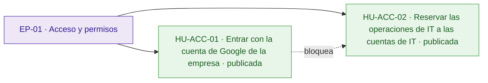
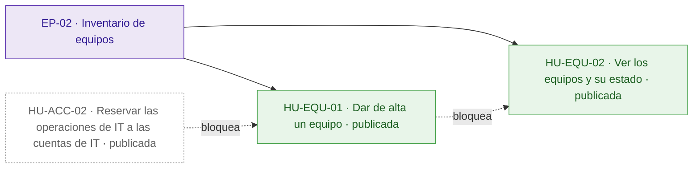
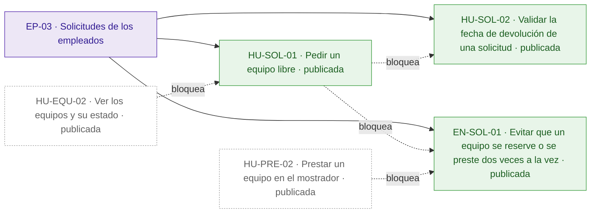
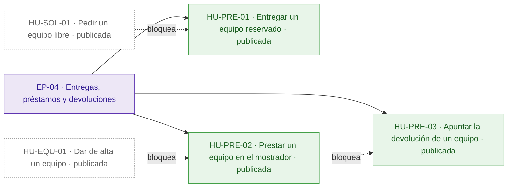
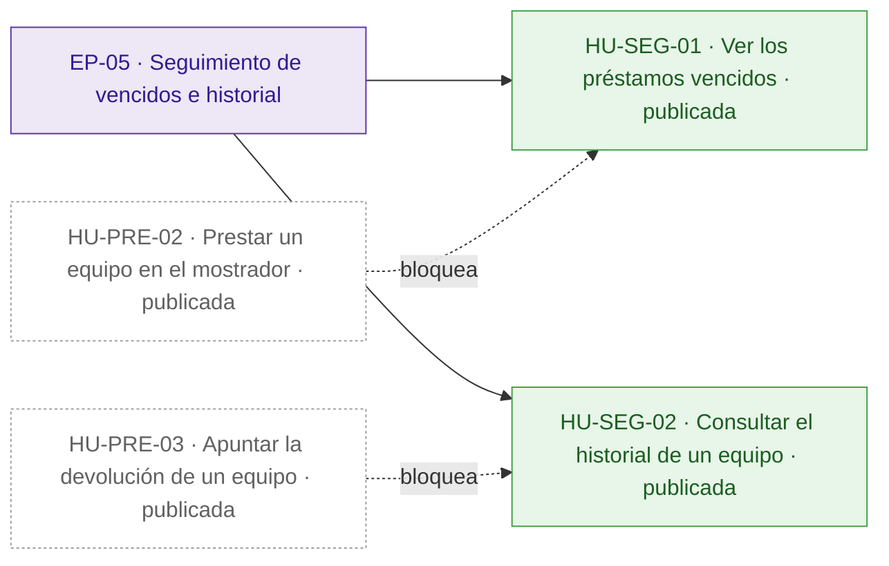
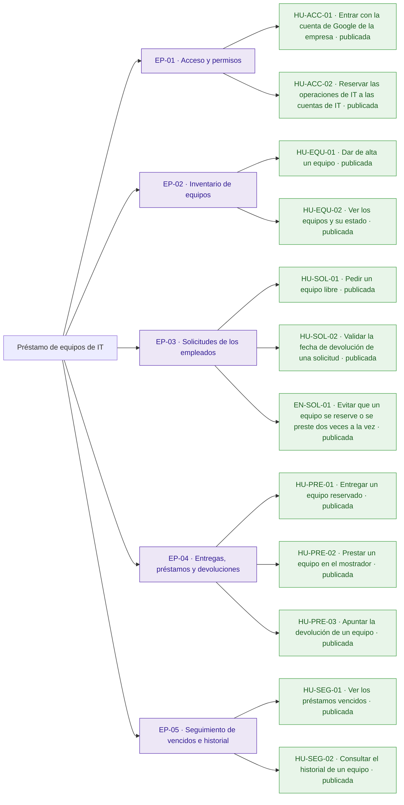
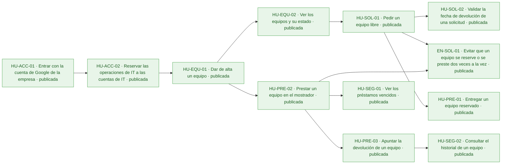
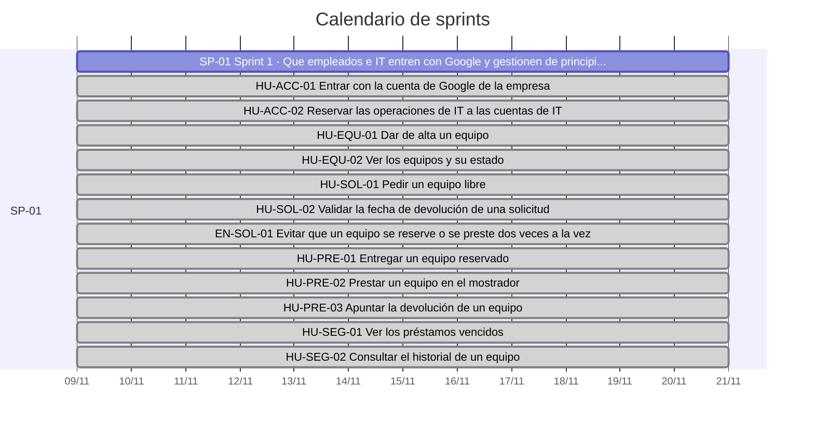
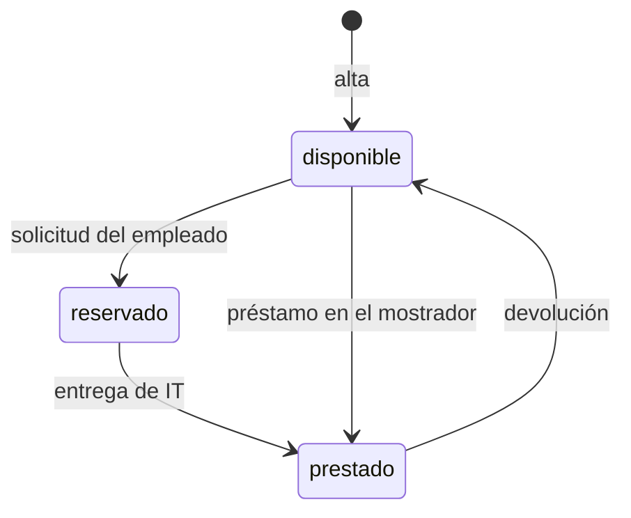

# Préstamo de equipos de IT

Hoy el préstamo de portátiles, monitores y proyectores se apunta en una hoja de cálculo y se pide por correo a IT: nadie sabe qué está libre sin preguntar, dos personas acaban esperando el mismo portátil y los vencimientos pasan desapercibidos hasta que alguien echa en falta el equipo.

La aplicación permite a los empleados ver los equipos y pedir uno libre, y a IT darlos de alta, entregarlos, prestarlos en el mostrador, apuntar las devoluciones, ver los vencidos y consultar el historial. Todos entran con su cuenta de Google de la empresa, un equipo nunca se reserva ni se presta dos veces a la vez y la API es exactamente la que fija el anexo, porque el inventario de IT se conecta a ella. Quedan fuera la anulación de solicitudes por los empleados y los avisos por correo de vencidos.

## Visión y alcance

Que los empleados vean qué equipos de la oficina están libres y los pidan prestados, y que IT gestione altas, entregas, préstamos en el mostrador, devoluciones y vencidos sin que un equipo se preste dos veces a la vez.

**Dentro del alcance**

- Dar de alta un equipo por su nombre (solo IT); se rechaza el nombre vacío o ausente y el nombre repetido (peticion.md).
- Dos nombres de equipo son el mismo si solo se diferencian en mayúsculas o en espacios al principio o al final (peticion.md).
- Ver los equipos y su estado (\`disponible\`, \`reservado\` o \`prestado\`); si está reservado o prestado, también la persona y la fecha de devolución (peticion.md).
- Pedir un equipo libre indicando la fecha de devolución; el equipo queda reservado a nombre de quien lo pide hasta que IT se lo entrega (peticion.md).
- Quien pide un equipo no puede poner una fecha de devolución anterior a hoy (peticion.md).
- Entregar un equipo reservado (solo IT); pasa a prestado con la misma persona y fecha de la solicitud (peticion.md).
- Prestar en el mostrador a la persona indicada, con fecha de devolución (solo IT); IT puede poner una fecha anterior a hoy y ese préstamo aparece ya entre los vencidos (peticion.md).
- Apuntar la devolución (solo IT); el equipo vuelve a disponible, sin persona ni fecha (peticion.md).
- Ver los préstamos vencidos: equipos prestados con fecha de devolución anterior a hoy, del más antiguo al más reciente (solo IT) (peticion.md).
- Consultar el historial de un equipo, del más reciente al más antiguo, con persona, fecha de devolución y estado (\`reservado\`, \`prestado\` o \`devuelto\`) (solo IT) (peticion.md).
- La fecha de devolución va como texto \`AAAA-MM-DD\`, se devuelve igual y tiene que ser una fecha que exista; «hoy» es el día en Madrid (peticion.md).

**Fuera del alcance**

- Que los empleados anulen una solicitud (peticion.md).
- Avisos por correo de préstamos vencidos (peticion.md).

## Resumen en cifras

| Dato | Valor |
| --- | --- |
| Épicas | 5 |
| Historias | 12 |
| Historias por estado | borrador 0, aprobada 0, descartada 0, publicada 12 |
| Tareas | 31 |
| Sprints | 1 |
| Personas en el equipo | 1 |
| Modalidad de desarrollo | manual, sin IA |
| Horas estimadas | 48 h |
| Horas efectivas (según la modalidad de desarrollo) | 48 h |
| Historias sin estimar | 0 |
| Historias descartadas (fuera de las horas) | 0 |
| Supuestos | 12 |
| Preguntas abiertas | 6 |
| Requisitos | 15 |
| Requisitos sin historia | 0 |

## Índice

- [Visión y alcance](#visión-y-alcance)
- [Resumen en cifras](#resumen-en-cifras)
- [Épicas e historias](#épicas-e-historias)
  - [EP-01 · Acceso y permisos](#ep-01--acceso-y-permisos)
  - [EP-02 · Inventario de equipos](#ep-02--inventario-de-equipos)
  - [EP-03 · Solicitudes de los empleados](#ep-03--solicitudes-de-los-empleados)
  - [EP-04 · Entregas, préstamos y devoluciones](#ep-04--entregas-préstamos-y-devoluciones)
  - [EP-05 · Seguimiento de vencidos e historial](#ep-05--seguimiento-de-vencidos-e-historial)
- [Tareas](#tareas)
- [Sprints](#sprints)
- [Equipo](#equipo)
- [Dependencias](#dependencias)
- [Requisitos y trazabilidad](#requisitos-y-trazabilidad)
- [Preparación y definición de hecho](#preparación-y-definición-de-hecho)
- [Diagramas](#diagramas)
- [Supuestos](#supuestos)
- [Preguntas abiertas](#preguntas-abiertas)
- [Decisiones](#decisiones)

## Épicas e historias

### EP-01 · Acceso y permisos

Empleados, IT y el inventario de IT entran con su cuenta de Google de la empresa, y solo las cuentas de IT pueden hacer las operaciones reservadas a IT. Protege frente al riesgo de que un empleado haga lo que solo le toca a IT.

#### Épica EP-01: Acceso y permisos

#### HU-ACC-01 · Entrar con la cuenta de Google de la empresa

Como empleado, quiero usar la aplicación con mi cuenta de Google de la empresa, para que cada reserva y cada préstamo quede a mi nombre sin crear otra contraseña.

**Contexto.** Cubre RQ.012 (peticion.md, anexo): todas las rutas necesitan haber iniciado sesión con el token de identidad de Google, de una persona o de una cuenta de servicio, y la persona de cada operación es el correo del token.

- **Prioridad:** Highest
- **Tamaño:** L
- **Horas:** 8 h estimadas · 8 h efectivas
- **Estado:** publicada
- **Sprint:** SP-01 Sprint 1
- **Responsable:** José Luis Calvo
- **Tipo:** historia
- **Puntos de historia:** 5
- **Preparación:** parcialmente lista (pendiente: DoR-08: dependencias externas sin plan confirmado: Cliente OAuth de la aplicación en Google; Cuentas de Google de la empresa · supuestos sin confirmar: DoR-04, DoR-05, DoR-06, DoR-07, DoR-09)
- **Requisitos:** RQ.012, RQ.015
- **Dependencias externas:** Cliente OAuth de la aplicación en Google; Cuentas de Google de la empresa

**Criterios de aceptación**

*Escenarios positivos*

1. **Dado** la empleada «ana.perez@empresa.com» con un token de identidad de Google con el correo verificado y emitido para el cliente OAuth de la aplicación, **cuando** consulta GET /api/equipos, **entonces** recibe 200 con la lista de equipos y la aplicación la identifica como «ana.perez@empresa.com».

*Escenarios negativos*

1. **Dado** una petición sin token, **cuando** consulta GET /api/equipos, **entonces** recibe 401 con {"error": "Inicia sesión con Google."}.
2. **Dado** la empleada «ana.perez@empresa.com» con un token de Google emitido para otro cliente OAuth, **cuando** consulta GET /api/equipos, **entonces** recibe 401 con {"error": "Inicia sesión con Google."}.
3. **Dado** una cuenta de Google con el correo sin verificar, **cuando** consulta GET /api/equipos, **entonces** recibe 401 con {"error": "Inicia sesión con Google."}.

**Notas.** El mensaje y el código de error son los de la API fijada por el cliente (RQ.015) y no se pueden cambiar.

**Definición de hecho**

- Criterios de aceptación probados.
- Todas las rutas del anexo devuelven 401 sin token válido.
- Mensajes idénticos a los de la API fijada por el cliente.

**Tareas**

- TA-001 · Verificación del token de identidad de Google, del correo verificado y del cliente OAuth en todas las rutas · backend · José Luis Calvo
- TA-002 · Pruebas con token válido, sin token, de otro cliente y sin correo verificado · QA · José Luis Calvo

#### HU-ACC-02 · Reservar las operaciones de IT a las cuentas de IT

Como persona de IT, quiero que solo las cuentas de la lista de IT puedan hacer las operaciones de IT, para que ningún empleado dé de alta, entregue o preste equipos por su cuenta.

**Contexto.** Cubre RQ.013 (peticion.md, anexo): las operaciones «Solo IT» responden 403 a cualquier otra cuenta, las cuentas de IT son las de la variable de entorno CORREOS\_IT y los correos se comparan sin distinguir mayúsculas.

- **Prioridad:** Highest
- **Tamaño:** M
- **Horas:** 4 h estimadas · 4 h efectivas
- **Estado:** publicada
- **Sprint:** SP-01 Sprint 1
- **Responsable:** José Luis Calvo
- **Tipo:** historia
- **Puntos de historia:** 3
- **Preparación:** parcialmente lista (pendiente: DoR-08: depende de HU-ACC-01, sin resolver ni planificada en un sprint anterior · supuestos sin confirmar: DoR-04, DoR-05, DoR-06, DoR-07, DoR-09)
- **Requisitos:** RQ.013, RQ.015
- **Depende de:**
  - HU-ACC-01 · Entrar con la cuenta de Google de la empresa: Saber si una cuenta es de IT exige identificar antes su correo.

**Criterios de aceptación**

*Escenarios positivos*

1. **Dado** la variable CORREOS\_IT con «it@empresa.com,inventario@empresa.com» y la persona de IT con un token válido de «IT@empresa.com», **cuando** envía POST /api/equipos con {"nombre": "Portátil 07"}, **entonces** recibe 201 con el equipo «Portátil 07» en estado «disponible».
2. **Dado** la misma variable CORREOS\_IT y la cuenta de servicio «inventario@empresa.com» con un token válido ante el equipo disponible «Monitor 03», **cuando** envía POST /api/equipos/{id}/solicitud con {"devolucion": "2026-11-20"}, **entonces** recibe 201 con el equipo en estado «reservado» a nombre de «inventario@empresa.com».

*Escenarios negativos*

1. **Dado** la misma variable CORREOS\_IT y la empleada «ana.perez@empresa.com» con un token válido, **cuando** envía POST /api/equipos con {"nombre": "Portátil 08"}, **entonces** recibe 403 con {"error": "Solo IT puede hacer esto."} y no se crea el equipo.

**Notas.** La lista se fija en la configuración del despliegue, no en el código. Responde al riesgo de que un empleado pueda hacer lo que solo le toca a IT.

**Definición de hecho**

- Criterios de aceptación probados.
- Cada operación «Solo IT» del anexo devuelve 403 a una cuenta que no está en CORREOS\_IT.
- La lista de IT no aparece en el código.

**Tareas**

- TA-003 · Lectura de CORREOS\_IT y control de las operaciones «Solo IT» sin distinguir mayúsculas · backend · José Luis Calvo
- TA-004 · Pruebas de 403 en cada operación «Solo IT» y del acceso de la cuenta de servicio · QA · José Luis Calvo

### EP-02 · Inventario de equipos

IT da de alta los portátiles, monitores y proyectores por su nombre, sin repetidos, y cualquier empleado ve los equipos con su estado. Es la base sobre la que se piden y prestan los equipos.

#### Épica EP-02: Inventario de equipos

#### HU-EQU-01 · Dar de alta un equipo

Como persona de IT, quiero dar de alta un equipo con su nombre, para que los empleados lo encuentren disponible en la aplicación en lugar de en la hoja de cálculo.

**Contexto.** Cubre RQ.001 y RQ.002 (peticion.md): IT da de alta los equipos por nombre, y dos nombres son el mismo si solo se diferencian en mayúsculas o en espacios al principio o al final.

- **Prioridad:** Highest
- **Tamaño:** M
- **Horas:** 4 h estimadas · 4 h efectivas
- **Estado:** publicada
- **Sprint:** SP-01 Sprint 1
- **Responsable:** José Luis Calvo
- **Tipo:** historia
- **Puntos de historia:** 3
- **Preparación:** parcialmente lista (pendiente: DoR-08: depende de HU-ACC-02, sin resolver ni planificada en un sprint anterior · supuestos sin confirmar: DoR-04, DoR-05, DoR-06, DoR-07, DoR-09)
- **Requisitos:** RQ.001, RQ.002, RQ.015
- **Depende de:**
  - HU-ACC-02 · Reservar las operaciones de IT a las cuentas de IT: El alta es una operación «Solo IT».

**Criterios de aceptación**

*Escenarios positivos*

1. **Dado** la persona de IT «it@empresa.com» y ningún equipo llamado «Portátil 07», **cuando** envía POST /api/equipos con {"nombre": "Portátil 07"}, **entonces** recibe 201 con {"id": "…", "nombre": "Portátil 07", "estado": "disponible"}.

*Escenarios negativos*

1. **Dado** la persona de IT «it@empresa.com», **cuando** envía POST /api/equipos con {"nombre": ""}, **entonces** recibe 400 con {"error": "Falta el nombre del equipo"} y no se crea ningún equipo.
2. **Dado** la persona de IT «it@empresa.com», **cuando** envía POST /api/equipos con el cuerpo {}, **entonces** recibe 400 con {"error": "Falta el nombre del equipo"} y no se crea ningún equipo.
3. **Dado** la persona de IT «it@empresa.com» y el equipo «Portátil 07» ya dado de alta, **cuando** envía POST /api/equipos con {"nombre": "PORTÁTIL 07"}, **entonces** recibe 409 con {"error": "Ya hay un equipo con ese nombre"} y sigue habiendo un solo «Portátil 07».
4. **Dado** la persona de IT «it@empresa.com» y el equipo «Portátil 07» ya dado de alta, **cuando** envía POST /api/equipos con {"nombre": " portátil 07 "}, **entonces** recibe 409 con {"error": "Ya hay un equipo con ese nombre"} y sigue habiendo un solo «Portátil 07».

**Definición de hecho**

- Criterios de aceptación probados.
- Respuestas y mensajes idénticos a los de la API fijada por el cliente.

**Tareas**

- TA-005 · Almacén de equipos con nombre normalizado único · datos · José Luis Calvo
- TA-006 · POST /api/equipos con sus validaciones y mensajes · backend · José Luis Calvo
- TA-007 · Pruebas del alta, del nombre vacío y del nombre repetido · QA · José Luis Calvo

#### HU-EQU-02 · Ver los equipos y su estado

Como empleado, quiero ver los equipos de la oficina con su estado, para saber qué está libre sin escribir a IT.

**Contexto.** Cubre RQ.003 (peticion.md): cualquier empleado ve los equipos y su estado; hoy no se sabe qué está libre sin preguntar.

- **Prioridad:** Highest
- **Tamaño:** S
- **Horas:** 2 h estimadas · 2 h efectivas
- **Estado:** publicada
- **Sprint:** SP-01 Sprint 1
- **Responsable:** José Luis Calvo
- **Tipo:** historia
- **Puntos de historia:** 2
- **Preparación:** parcialmente lista (pendiente: DoR-08: depende de HU-EQU-01, sin resolver ni planificada en un sprint anterior · supuestos sin confirmar: DoR-04, DoR-05, DoR-06, DoR-07, DoR-09)
- **Requisitos:** RQ.003, RQ.015
- **Depende de:**
  - HU-EQU-01 · Dar de alta un equipo: La lista solo tiene sentido con equipos dados de alta.

**Criterios de aceptación**

*Escenarios positivos*

1. **Dado** el equipo «Portátil 07» disponible y el equipo «Proyector 01» reservado a «ana.perez@empresa.com» hasta el 2026-11-20, **cuando** el empleado «luis.gomez@empresa.com» consulta GET /api/equipos, **entonces** recibe 200 con «Portátil 07» en estado «disponible», sin persona ni devolución, y «Proyector 01» en estado «reservado» con persona «ana.perez@empresa.com» y devolucion «2026-11-20».

*Escenarios negativos*

1. **Dado** los mismos equipos y una petición sin token, **cuando** consulta GET /api/equipos, **entonces** recibe 401 con {"error": "Inicia sesión con Google."} y no ve ningún equipo.

**Definición de hecho**

- Criterios de aceptación probados.
- Campos de la respuesta idénticos a los de la API fijada por el cliente.

**Tareas**

- TA-008 · GET /api/equipos con persona y devolución cuando corresponde · backend · José Luis Calvo
- TA-009 · Pruebas de la lista con equipos en cada estado · QA · José Luis Calvo

### EP-03 · Solicitudes de los empleados

Un empleado pide un equipo libre con la fecha en que lo devolverá y el equipo queda reservado a su nombre hasta que IT se lo entrega, sin que dos peticiones a la vez se queden con el mismo equipo. Deja fuera que los empleados anulen una solicitud.

#### Épica EP-03: Solicitudes de los empleados

#### HU-SOL-01 · Pedir un equipo libre

Como empleado, quiero pedir un equipo libre indicando la fecha en que lo devolveré, para tenerlo reservado a mi nombre hasta que IT me lo entregue, sin esperar respuesta a un correo.

**Contexto.** Cubre RQ.004 (peticion.md): el empleado pide un equipo libre con la fecha de devolución y el equipo queda reservado a su nombre hasta que IT se lo entrega.

- **Prioridad:** Highest
- **Tamaño:** M
- **Horas:** 4 h estimadas · 4 h efectivas
- **Estado:** publicada
- **Sprint:** SP-01 Sprint 1
- **Responsable:** José Luis Calvo
- **Tipo:** historia
- **Puntos de historia:** 3
- **Preparación:** parcialmente lista (pendiente: DoR-08: depende de HU-EQU-02, sin resolver ni planificada en un sprint anterior · supuestos sin confirmar: DoR-04, DoR-05, DoR-06, DoR-07, DoR-09)
- **Requisitos:** RQ.004, RQ.015
- **Depende de:**
  - HU-EQU-02 · Ver los equipos y su estado: El empleado elige el equipo libre de la lista.

**Criterios de aceptación**

*Escenarios positivos*

1. **Dado** el día 2026-11-10 en Madrid y el equipo «Portátil 07» disponible, **cuando** la empleada «ana.perez@empresa.com» envía POST /api/equipos/{id}/solicitud con {"devolucion": "2026-11-20"}, **entonces** recibe 201 con el equipo en estado «reservado», persona «ana.perez@empresa.com» y devolucion «2026-11-20».

*Escenarios negativos*

1. **Dado** el equipo «Portátil 07» reservado a «luis.gomez@empresa.com», **cuando** la empleada «ana.perez@empresa.com» envía la solicitud con {"devolucion": "2026-11-20"}, **entonces** recibe 409 con {"error": "El equipo no está disponible"} y la reserva sigue a nombre de «luis.gomez@empresa.com».
2. **Dado** ningún equipo con el id «no-existe», **cuando** la empleada envía POST /api/equipos/no-existe/solicitud con {"devolucion": "2026-11-20"}, **entonces** recibe 404 con {"error": "No existe el equipo"}.

**Notas.** Depende de la pregunta abierta sobre cuándo caduca una reserva que IT no entrega: los empleados no pueden anular una solicitud.

**Definición de hecho**

- Criterios de aceptación probados.
- Respuestas y mensajes idénticos a los de la API fijada por el cliente.

**Tareas**

- TA-010 · Entrada «reservado» en el historial del equipo · datos · José Luis Calvo
- TA-011 · POST /api/equipos/{id}/solicitud con sus errores de existencia y disponibilidad · backend · José Luis Calvo
- TA-012 · Pruebas de la solicitud, del equipo inexistente y del equipo no disponible · QA · José Luis Calvo

#### HU-SOL-02 · Validar la fecha de devolución de una solicitud

Como empleado, quiero indicar en mi solicitud una fecha de devolución de hoy en adelante, para que ninguna reserva nazca ya vencida por un error al escribir la fecha.

**Contexto.** Cubre RQ.005 y RQ.011 (peticion.md, anexo): la fecha de devolución va como texto AAAA-MM-DD, tiene que ser una fecha que exista y quien pide un equipo no puede poner una fecha anterior a hoy, que es el día en Madrid.

- **Prioridad:** Highest
- **Tamaño:** S
- **Horas:** 2 h estimadas · 2 h efectivas
- **Estado:** publicada
- **Sprint:** SP-01 Sprint 1
- **Responsable:** José Luis Calvo
- **Tipo:** historia
- **Puntos de historia:** 2
- **Preparación:** parcialmente lista (pendiente: DoR-08: depende de HU-SOL-01, sin resolver ni planificada en un sprint anterior · supuestos sin confirmar: DoR-04, DoR-05, DoR-06, DoR-07, DoR-09)
- **Requisitos:** RQ.005, RQ.011, RQ.015
- **Depende de:**
  - HU-SOL-01 · Pedir un equipo libre: Las reglas de fecha se aplican a la solicitud.

**Criterios de aceptación**

*Escenarios positivos*

1. **Dado** el día 2026-11-10 en Madrid y el equipo «Portátil 07» disponible, **cuando** la empleada «ana.perez@empresa.com» envía POST /api/equipos/{id}/solicitud con {"devolucion": "2026-11-10"}, **entonces** recibe 201 con el equipo en estado «reservado» y devolucion «2026-11-10».

*Escenarios negativos*

1. **Dado** el día 2026-11-10 en Madrid y el equipo «Portátil 07» disponible, **cuando** la empleada envía la solicitud con {"devolucion": "2026-11-09"}, **entonces** recibe 400 con {"error": "La fecha de devolución ya ha pasado"} y el equipo sigue disponible.
2. **Dado** el equipo «Portátil 07» disponible, **cuando** la empleada envía la solicitud con {"devolucion": "2026-02-30"}, **entonces** recibe 400 con {"error": "La fecha de devolución no es válida"} y el equipo sigue disponible.
3. **Dado** el equipo «Portátil 07» disponible, **cuando** la empleada envía la solicitud con el cuerpo {}, **entonces** recibe 400 con {"error": "Falta la fecha de devolución"} y el equipo sigue disponible.

**Definición de hecho**

- Criterios de aceptación probados.
- «Hoy» calculado con el día en Madrid.
- Mensajes idénticos a los de la API fijada por el cliente.

**Tareas**

- TA-030 · Validación del formato, la existencia y el día de Madrid de la fecha de devolución · backend · José Luis Calvo
- TA-031 · Pruebas de la fecha de hoy, la fecha pasada, la fecha inexistente y la fecha ausente · QA · José Luis Calvo

#### EN-SOL-01 · Evitar que un equipo se reserve o se preste dos veces a la vez

Como equipo, necesitamos garantizar que un equipo no se reserve ni se preste dos veces con peticiones simultáneas, para que dos empleados nunca se queden con el mismo equipo por pedirlo a la vez.

**Contexto.** Cubre RQ.014 (peticion.md, anexo): un equipo no puede estar reservado o prestado dos veces a la vez, y con dos peticiones simultáneas nunca salen bien las dos. Es la métrica «ningún equipo se reserva o se presta dos veces» del primer mes y el primer riesgo del intent.

- **Prioridad:** Highest
- **Tamaño:** L
- **Horas:** 8 h estimadas · 8 h efectivas
- **Estado:** publicada
- **Sprint:** SP-01 Sprint 1
- **Responsable:** José Luis Calvo
- **Tipo:** habilitador (enabler)
- **Puntos de historia:** 5
- **Preparación:** parcialmente lista (pendiente: DoR-08: depende de HU-SOL-01, HU-PRE-02, sin resolver ni planificada en un sprint anterior · supuestos sin confirmar: DoR-04, DoR-05, DoR-06, DoR-07, DoR-09)
- **Requisitos:** RQ.014, RQ.015
- **Depende de:**
  - HU-SOL-01 · Pedir un equipo libre: La regla se aplica a las solicitudes.
  - HU-PRE-02 · Prestar un equipo en el mostrador: La regla se aplica también a los préstamos en el mostrador.

**Criterios de aceptación**

*Escenarios positivos*

1. **Dado** el equipo «Portátil 07» disponible y 10 empleados distintos con un token válido, **cuando** se lanzan en paralelo 10 POST /api/equipos/{id}/solicitud sobre ese equipo con {"devolucion": "2026-11-20"}, **entonces** exactamente una devuelve 201, las otras 9 devuelven 409 con {"error": "El equipo no está disponible"} y el equipo queda reservado a una sola persona.

*Escenarios negativos*

1. **Dado** el equipo «Monitor 03» disponible, la empleada «ana.perez@empresa.com» y la persona de IT «it@empresa.com», **cuando** se lanzan en paralelo la solicitud de «ana.perez@empresa.com» y el préstamo en el mostrador para «luis.gomez@empresa.com» sobre ese equipo, **entonces** exactamente una devuelve 201, la otra devuelve 409 con {"error": "El equipo no está disponible"} y el equipo queda a nombre de una sola persona.

**Notas.** Responde al riesgo principal: que dos empleados se queden con el mismo equipo porque lo pidieron a la vez.

**Definición de hecho**

- Criterios de aceptación probados con peticiones realmente simultáneas.
- Ningún equipo queda con dos reservas o préstamos activos tras la prueba.

**Tareas**

- TA-013 · Cambio de estado del equipo atómico frente a escrituras simultáneas · datos · José Luis Calvo
- TA-014 · Control de concurrencia en la solicitud y en el préstamo en el mostrador · backend · José Luis Calvo
- TA-015 · Pruebas con peticiones simultáneas sobre el mismo equipo · QA · José Luis Calvo

### EP-04 · Entregas, préstamos y devoluciones

IT entrega los equipos reservados, presta directamente en el mostrador y apunta las devoluciones, de modo que el estado de cada equipo refleja quién lo tiene y hasta cuándo.

#### Épica EP-04: Entregas, préstamos y devoluciones

#### HU-PRE-01 · Entregar un equipo reservado

Como persona de IT, quiero apuntar la entrega de un equipo reservado, para que conste como prestado a quien lo pidió, con la fecha que indicó.

**Contexto.** Cubre RQ.006 (peticion.md): IT entrega los equipos reservados y el préstamo conserva la persona y la fecha de la solicitud.

- **Prioridad:** Highest
- **Tamaño:** S
- **Horas:** 2 h estimadas · 2 h efectivas
- **Estado:** publicada
- **Sprint:** SP-01 Sprint 1
- **Responsable:** José Luis Calvo
- **Tipo:** historia
- **Puntos de historia:** 2
- **Preparación:** parcialmente lista (pendiente: DoR-08: depende de HU-SOL-01, sin resolver ni planificada en un sprint anterior · supuestos sin confirmar: DoR-04, DoR-05, DoR-06, DoR-07, DoR-09)
- **Requisitos:** RQ.006, RQ.015
- **Depende de:**
  - HU-SOL-01 · Pedir un equipo libre: Solo se entrega un equipo reservado por una solicitud.

**Criterios de aceptación**

*Escenarios positivos*

1. **Dado** el equipo «Portátil 07» reservado a «ana.perez@empresa.com» con devolucion «2026-11-20», **cuando** la persona de IT «it@empresa.com» envía POST /api/equipos/{id}/entrega, **entonces** recibe 200 con el equipo en estado «prestado», persona «ana.perez@empresa.com» y devolucion «2026-11-20».

*Escenarios negativos*

1. **Dado** el equipo «Portátil 07» disponible, **cuando** la persona de IT envía POST /api/equipos/{id}/entrega, **entonces** recibe 409 con {"error": "El equipo no está reservado"} y el equipo sigue disponible.
2. **Dado** ningún equipo con el id «no-existe», **cuando** la persona de IT envía POST /api/equipos/no-existe/entrega, **entonces** recibe 404 con {"error": "No existe el equipo"}.

**Definición de hecho**

- Criterios de aceptación probados.
- Respuestas y mensajes idénticos a los de la API fijada por el cliente.

**Tareas**

- TA-016 · Paso de la entrada del historial de «reservado» a «prestado» · datos · José Luis Calvo
- TA-017 · POST /api/equipos/{id}/entrega · backend · José Luis Calvo
- TA-018 · Pruebas de la entrega y de sus errores · QA · José Luis Calvo

#### HU-PRE-02 · Prestar un equipo en el mostrador

Como persona de IT, quiero prestar un equipo disponible a quien viene al mostrador, con su fecha de devolución, para que el préstamo conste aunque la persona no lo haya pedido antes en la aplicación.

**Contexto.** Cubre RQ.007 y RQ.011 (peticion.md): IT presta directamente a quien viene al mostrador y puede poner una fecha anterior a hoy, porque a veces apunta los préstamos con retraso.

- **Prioridad:** Highest
- **Tamaño:** M
- **Horas:** 4 h estimadas · 4 h efectivas
- **Estado:** publicada
- **Sprint:** SP-01 Sprint 1
- **Responsable:** José Luis Calvo
- **Tipo:** historia
- **Puntos de historia:** 3
- **Preparación:** parcialmente lista (pendiente: DoR-08: depende de HU-EQU-01, sin resolver ni planificada en un sprint anterior · supuestos sin confirmar: DoR-04, DoR-05, DoR-06, DoR-07, DoR-09)
- **Requisitos:** RQ.007, RQ.011, RQ.015
- **Depende de:**
  - HU-EQU-01 · Dar de alta un equipo: Solo se presta un equipo dado de alta.

**Criterios de aceptación**

*Escenarios positivos*

1. **Dado** el día 2026-11-10 en Madrid y el equipo «Monitor 03» disponible, **cuando** la persona de IT envía POST /api/equipos/{id}/prestamo con {"persona": "ana.perez@empresa.com", "devolucion": "2026-11-20"}, **entonces** recibe 201 con el equipo en estado «prestado», persona «ana.perez@empresa.com» y devolucion «2026-11-20».
2. **Dado** el día 2026-11-10 en Madrid y el equipo «Monitor 03» disponible, **cuando** la persona de IT envía el préstamo con {"persona": "ana.perez@empresa.com", "devolucion": "2026-11-03"}, **entonces** recibe 201 con el equipo prestado y devolucion «2026-11-03», una fecha anterior a hoy.

*Escenarios negativos*

1. **Dado** el equipo «Monitor 03» disponible, **cuando** la persona de IT envía el préstamo con {"devolucion": "2026-11-20"}, **entonces** recibe 400 con {"error": "Faltan la persona o la fecha de devolución"} y el equipo sigue disponible.
2. **Dado** el equipo «Monitor 03» disponible, **cuando** la persona de IT envía el préstamo con {"persona": "ana.perez@empresa.com"}, **entonces** recibe 400 con {"error": "Faltan la persona o la fecha de devolución"} y el equipo sigue disponible.
3. **Dado** ningún equipo con el id «no-existe», **cuando** la persona de IT envía POST /api/equipos/no-existe/prestamo con {"persona": "ana.perez@empresa.com", "devolucion": "2026-11-20"}, **entonces** recibe 404 con {"error": "No existe el equipo"}.
4. **Dado** el equipo «Monitor 03» disponible, **cuando** la persona de IT envía el préstamo con {"persona": "ana.perez@empresa.com", "devolucion": "2026-02-30"}, **entonces** recibe 400 con {"error": "La fecha de devolución no es válida"}.
5. **Dado** el equipo «Monitor 03» reservado a «luis.gomez@empresa.com», **cuando** la persona de IT envía el préstamo con {"persona": "ana.perez@empresa.com", "devolucion": "2026-11-20"}, **entonces** recibe 409 con {"error": "El equipo no está disponible"} y la reserva sigue a nombre de «luis.gomez@empresa.com».

**Notas.** Qué responder si la persona indicada no es un correo sigue como pregunta abierta.

**Definición de hecho**

- Criterios de aceptación probados.
- Respuestas y mensajes idénticos a los de la API fijada por el cliente.

**Tareas**

- TA-019 · Entrada «prestado» en el historial del equipo · datos · José Luis Calvo
- TA-020 · POST /api/equipos/{id}/prestamo admitiendo fechas pasadas · backend · José Luis Calvo
- TA-021 · Pruebas del préstamo, de la fecha pasada y de sus errores · QA · José Luis Calvo

#### HU-PRE-03 · Apuntar la devolución de un equipo

Como persona de IT, quiero apuntar que un equipo prestado se ha devuelto, para que vuelva a aparecer libre para el siguiente empleado.

**Contexto.** Cubre RQ.008 (peticion.md): IT apunta las devoluciones y el equipo vuelve a disponible, sin persona ni fecha.

- **Prioridad:** Highest
- **Tamaño:** S
- **Horas:** 2 h estimadas · 2 h efectivas
- **Estado:** publicada
- **Sprint:** SP-01 Sprint 1
- **Responsable:** José Luis Calvo
- **Tipo:** historia
- **Puntos de historia:** 2
- **Preparación:** parcialmente lista (pendiente: DoR-08: depende de HU-PRE-02, sin resolver ni planificada en un sprint anterior · supuestos sin confirmar: DoR-04, DoR-05, DoR-06, DoR-07, DoR-09)
- **Requisitos:** RQ.008, RQ.015
- **Depende de:**
  - HU-PRE-02 · Prestar un equipo en el mostrador: Solo se devuelve un equipo prestado.

**Criterios de aceptación**

*Escenarios positivos*

1. **Dado** el equipo «Portátil 07» prestado a «ana.perez@empresa.com» con devolucion «2026-11-20», **cuando** la persona de IT envía POST /api/equipos/{id}/devolucion, **entonces** recibe 200 con el equipo en estado «disponible», sin persona ni devolución.

*Escenarios negativos*

1. **Dado** el equipo «Portátil 07» reservado a «ana.perez@empresa.com», todavía sin entregar, **cuando** la persona de IT envía POST /api/equipos/{id}/devolucion, **entonces** recibe 409 con {"error": "El equipo no está prestado"} y la reserva se mantiene.
2. **Dado** ningún equipo con el id «no-existe», **cuando** la persona de IT envía POST /api/equipos/no-existe/devolucion, **entonces** recibe 404 con {"error": "No existe el equipo"}.

**Definición de hecho**

- Criterios de aceptación probados.
- Respuestas y mensajes idénticos a los de la API fijada por el cliente.

**Tareas**

- TA-022 · Paso de la entrada del historial a «devuelto» · datos · José Luis Calvo
- TA-023 · POST /api/equipos/{id}/devolucion · backend · José Luis Calvo
- TA-024 · Pruebas de la devolución y de sus errores · QA · José Luis Calvo

### EP-05 · Seguimiento de vencidos e historial

IT ve qué préstamos han vencido y consulta el historial de cada equipo, para revisar los vencidos cada semana sin preguntar a nadie. Deja fuera los avisos por correo de préstamos vencidos.

#### Épica EP-05: Seguimiento de vencidos e historial

#### HU-SEG-01 · Ver los préstamos vencidos

Como persona de IT, quiero ver los equipos prestados cuya fecha de devolución ya ha pasado, para reclamarlos cada semana sin esperar a que alguien eche en falta un equipo.

**Contexto.** Cubre RQ.009 (peticion.md): IT ve los equipos prestados cuya fecha de devolución es anterior a hoy en Madrid, del más antiguo al más reciente. Una de las métricas del primer mes es que IT revise los vencidos cada semana sin preguntar a nadie.

- **Prioridad:** Highest
- **Tamaño:** M
- **Horas:** 4 h estimadas · 4 h efectivas
- **Estado:** publicada
- **Sprint:** SP-01 Sprint 1
- **Responsable:** José Luis Calvo
- **Tipo:** historia
- **Puntos de historia:** 3
- **Preparación:** parcialmente lista (pendiente: DoR-08: depende de HU-PRE-02, sin resolver ni planificada en un sprint anterior · supuestos sin confirmar: DoR-04, DoR-05, DoR-06, DoR-07, DoR-09)
- **Requisitos:** RQ.009, RQ.011, RQ.015
- **Depende de:**
  - HU-PRE-02 · Prestar un equipo en el mostrador: Los vencidos son préstamos ya hechos.

**Criterios de aceptación**

*Escenarios positivos*

1. **Dado** el día 2026-11-10 en Madrid y los equipos prestados «Portátil 07» hasta el 2026-11-08, «Monitor 03» hasta el 2026-11-05, «Proyector 01» hasta el 2026-11-10 y «Portátil 08» hasta el 2026-11-20, **cuando** la persona de IT consulta GET /api/prestamos/vencidos, **entonces** recibe 200 con «Monitor 03» y después «Portátil 07», cada uno con id, nombre, persona y devolucion, y sin «Proyector 01» ni «Portátil 08».

*Escenarios negativos*

1. **Dado** los mismos préstamos y la empleada «ana.perez@empresa.com», que no está en CORREOS\_IT, **cuando** consulta GET /api/prestamos/vencidos, **entonces** recibe 403 con {"error": "Solo IT puede hacer esto."}.

**Definición de hecho**

- Criterios de aceptación probados.
- «Hoy» calculado con el día en Madrid.
- Respuesta idéntica a la de la API fijada por el cliente.

**Tareas**

- TA-025 · GET /api/prestamos/vencidos ordenado del más antiguo al más reciente · backend · José Luis Calvo
- TA-026 · Pruebas de vencidos en el límite de hoy en Madrid · QA · José Luis Calvo

#### HU-SEG-02 · Consultar el historial de un equipo

Como persona de IT, quiero consultar el historial de préstamos de un equipo, para saber quién lo tuvo y si lo devolvió, sin buscarlo en la hoja de cálculo.

**Contexto.** Cubre RQ.010 (peticion.md): IT consulta el historial de cada equipo, del más reciente al más antiguo, con persona, devolución y estado.

- **Prioridad:** High
- **Tamaño:** M
- **Horas:** 4 h estimadas · 4 h efectivas
- **Estado:** publicada
- **Sprint:** SP-01 Sprint 1
- **Responsable:** José Luis Calvo
- **Tipo:** historia
- **Puntos de historia:** 3
- **Preparación:** parcialmente lista (pendiente: DoR-08: depende de HU-PRE-03, sin resolver ni planificada en un sprint anterior · supuestos sin confirmar: DoR-04, DoR-05, DoR-06, DoR-07, DoR-09)
- **Requisitos:** RQ.010, RQ.015
- **Depende de:**
  - HU-PRE-03 · Apuntar la devolución de un equipo: El estado «devuelto» del historial nace al apuntar una devolución.

**Criterios de aceptación**

*Escenarios positivos*

1. **Dado** el equipo «Portátil 07», prestado a «luis.gomez@empresa.com» con devolucion «2026-11-05» y ya devuelto, y después reservado a «ana.perez@empresa.com» con devolucion «2026-11-20», **cuando** la persona de IT consulta GET /api/equipos/{id}/historial, **entonces** recibe 200 con primero la entrada de «ana.perez@empresa.com», «2026-11-20» y estado «reservado», y después la de «luis.gomez@empresa.com», «2026-11-05» y estado «devuelto».

*Escenarios negativos*

1. **Dado** ningún equipo con el id «no-existe», **cuando** la persona de IT consulta GET /api/equipos/no-existe/historial, **entonces** recibe 404 con {"error": "No existe el equipo"}.
2. **Dado** el equipo «Portátil 07» y la empleada «ana.perez@empresa.com», que no está en CORREOS\_IT, **cuando** consulta GET /api/equipos/{id}/historial, **entonces** recibe 403 con {"error": "Solo IT puede hacer esto."}.

**Definición de hecho**

- Criterios de aceptación probados.
- Respuesta idéntica a la de la API fijada por el cliente.

**Tareas**

- TA-027 · Consulta del historial de un equipo ordenada del más reciente al más antiguo · datos · José Luis Calvo
- TA-028 · GET /api/equipos/{id}/historial · backend · José Luis Calvo
- TA-029 · Pruebas del historial con entradas en cada estado · QA · José Luis Calvo

## Tareas

| ID | Título | Historia | Disciplina | Descripción | Responsable | Horas estimadas | Horas efectivas |
| --- | --- | --- | --- | --- | --- | --- | --- |
| TA-001 | Verificación del token de identidad de Google, del correo verificado y del cliente OAuth en todas las rutas | HU-ACC-01 · Entrar con la cuenta de Google de la empresa | backend |   | José Luis Calvo |   |   |
| TA-002 | Pruebas con token válido, sin token, de otro cliente y sin correo verificado | HU-ACC-01 · Entrar con la cuenta de Google de la empresa | QA |   | José Luis Calvo |   |   |
| TA-003 | Lectura de CORREOS\_IT y control de las operaciones «Solo IT» sin distinguir mayúsculas | HU-ACC-02 · Reservar las operaciones de IT a las cuentas de IT | backend |   | José Luis Calvo |   |   |
| TA-004 | Pruebas de 403 en cada operación «Solo IT» y del acceso de la cuenta de servicio | HU-ACC-02 · Reservar las operaciones de IT a las cuentas de IT | QA |   | José Luis Calvo |   |   |
| TA-005 | Almacén de equipos con nombre normalizado único | HU-EQU-01 · Dar de alta un equipo | datos |   | José Luis Calvo |   |   |
| TA-006 | POST /api/equipos con sus validaciones y mensajes | HU-EQU-01 · Dar de alta un equipo | backend |   | José Luis Calvo |   |   |
| TA-007 | Pruebas del alta, del nombre vacío y del nombre repetido | HU-EQU-01 · Dar de alta un equipo | QA |   | José Luis Calvo |   |   |
| TA-008 | GET /api/equipos con persona y devolución cuando corresponde | HU-EQU-02 · Ver los equipos y su estado | backend |   | José Luis Calvo |   |   |
| TA-009 | Pruebas de la lista con equipos en cada estado | HU-EQU-02 · Ver los equipos y su estado | QA |   | José Luis Calvo |   |   |
| TA-010 | Entrada «reservado» en el historial del equipo | HU-SOL-01 · Pedir un equipo libre | datos |   | José Luis Calvo |   |   |
| TA-011 | POST /api/equipos/{id}/solicitud con sus errores de existencia y disponibilidad | HU-SOL-01 · Pedir un equipo libre | backend |   | José Luis Calvo |   |   |
| TA-012 | Pruebas de la solicitud, del equipo inexistente y del equipo no disponible | HU-SOL-01 · Pedir un equipo libre | QA |   | José Luis Calvo |   |   |
| TA-013 | Cambio de estado del equipo atómico frente a escrituras simultáneas | EN-SOL-01 · Evitar que un equipo se reserve o se preste dos veces a la vez | datos |   | José Luis Calvo |   |   |
| TA-014 | Control de concurrencia en la solicitud y en el préstamo en el mostrador | EN-SOL-01 · Evitar que un equipo se reserve o se preste dos veces a la vez | backend |   | José Luis Calvo |   |   |
| TA-015 | Pruebas con peticiones simultáneas sobre el mismo equipo | EN-SOL-01 · Evitar que un equipo se reserve o se preste dos veces a la vez | QA |   | José Luis Calvo |   |   |
| TA-016 | Paso de la entrada del historial de «reservado» a «prestado» | HU-PRE-01 · Entregar un equipo reservado | datos |   | José Luis Calvo |   |   |
| TA-017 | POST /api/equipos/{id}/entrega | HU-PRE-01 · Entregar un equipo reservado | backend |   | José Luis Calvo |   |   |
| TA-018 | Pruebas de la entrega y de sus errores | HU-PRE-01 · Entregar un equipo reservado | QA |   | José Luis Calvo |   |   |
| TA-019 | Entrada «prestado» en el historial del equipo | HU-PRE-02 · Prestar un equipo en el mostrador | datos |   | José Luis Calvo |   |   |
| TA-020 | POST /api/equipos/{id}/prestamo admitiendo fechas pasadas | HU-PRE-02 · Prestar un equipo en el mostrador | backend |   | José Luis Calvo |   |   |
| TA-021 | Pruebas del préstamo, de la fecha pasada y de sus errores | HU-PRE-02 · Prestar un equipo en el mostrador | QA |   | José Luis Calvo |   |   |
| TA-022 | Paso de la entrada del historial a «devuelto» | HU-PRE-03 · Apuntar la devolución de un equipo | datos |   | José Luis Calvo |   |   |
| TA-023 | POST /api/equipos/{id}/devolucion | HU-PRE-03 · Apuntar la devolución de un equipo | backend |   | José Luis Calvo |   |   |
| TA-024 | Pruebas de la devolución y de sus errores | HU-PRE-03 · Apuntar la devolución de un equipo | QA |   | José Luis Calvo |   |   |
| TA-025 | GET /api/prestamos/vencidos ordenado del más antiguo al más reciente | HU-SEG-01 · Ver los préstamos vencidos | backend |   | José Luis Calvo |   |   |
| TA-026 | Pruebas de vencidos en el límite de hoy en Madrid | HU-SEG-01 · Ver los préstamos vencidos | QA |   | José Luis Calvo |   |   |
| TA-027 | Consulta del historial de un equipo ordenada del más reciente al más antiguo | HU-SEG-02 · Consultar el historial de un equipo | datos |   | José Luis Calvo |   |   |
| TA-028 | GET /api/equipos/{id}/historial | HU-SEG-02 · Consultar el historial de un equipo | backend |   | José Luis Calvo |   |   |
| TA-029 | Pruebas del historial con entradas en cada estado | HU-SEG-02 · Consultar el historial de un equipo | QA |   | José Luis Calvo |   |   |
| TA-030 | Validación del formato, la existencia y el día de Madrid de la fecha de devolución | HU-SOL-02 · Validar la fecha de devolución de una solicitud | backend |   | José Luis Calvo |   |   |
| TA-031 | Pruebas de la fecha de hoy, la fecha pasada, la fecha inexistente y la fecha ausente | HU-SOL-02 · Validar la fecha de devolución de una solicitud | QA |   | José Luis Calvo |   |   |

## Sprints

| Sprint | Fechas | Objetivo | Historias | Capacidad (h) | Carga (h efectivas) |
| --- | --- | --- | --- | --- | --- |
| SP-01 Sprint 1 | del 09/11/2026 al 20/11/2026 | Que empleados e IT entren con Google y gestionen de principio a fin el préstamo de equipos por la API, sin préstamos dobles. | 12 | 56 h | 48 h · 86 % |

Historias sin sprint: 0.

## Equipo

| Nombre | Rol | Dedicación | Usa un agente de IA |
| --- | --- | --- | --- |
| José Luis Calvo | Desarrollo | 100 % | sí |

*Por privacidad, este documento no incluye correos electrónicos ni usuarios de GitHub o Trello.*

## Dependencias

| Historia | Bloqueada por | Motivo |
| --- | --- | --- |
| HU-ACC-02 · Reservar las operaciones de IT a las cuentas de IT | HU-ACC-01 · Entrar con la cuenta de Google de la empresa | Saber si una cuenta es de IT exige identificar antes su correo. |
| HU-EQU-01 · Dar de alta un equipo | HU-ACC-02 · Reservar las operaciones de IT a las cuentas de IT | El alta es una operación «Solo IT». |
| HU-EQU-02 · Ver los equipos y su estado | HU-EQU-01 · Dar de alta un equipo | La lista solo tiene sentido con equipos dados de alta. |
| HU-SOL-01 · Pedir un equipo libre | HU-EQU-02 · Ver los equipos y su estado | El empleado elige el equipo libre de la lista. |
| HU-SOL-02 · Validar la fecha de devolución de una solicitud | HU-SOL-01 · Pedir un equipo libre | Las reglas de fecha se aplican a la solicitud. |
| EN-SOL-01 · Evitar que un equipo se reserve o se preste dos veces a la vez | HU-SOL-01 · Pedir un equipo libre | La regla se aplica a las solicitudes. |
| EN-SOL-01 · Evitar que un equipo se reserve o se preste dos veces a la vez | HU-PRE-02 · Prestar un equipo en el mostrador | La regla se aplica también a los préstamos en el mostrador. |
| HU-PRE-01 · Entregar un equipo reservado | HU-SOL-01 · Pedir un equipo libre | Solo se entrega un equipo reservado por una solicitud. |
| HU-PRE-02 · Prestar un equipo en el mostrador | HU-EQU-01 · Dar de alta un equipo | Solo se presta un equipo dado de alta. |
| HU-PRE-03 · Apuntar la devolución de un equipo | HU-PRE-02 · Prestar un equipo en el mostrador | Solo se devuelve un equipo prestado. |
| HU-SEG-01 · Ver los préstamos vencidos | HU-PRE-02 · Prestar un equipo en el mostrador | Los vencidos son préstamos ya hechos. |
| HU-SEG-02 · Consultar el historial de un equipo | HU-PRE-03 · Apuntar la devolución de un equipo | El estado «devuelto» del historial nace al apuntar una devolución. |

## Requisitos y trazabilidad

| Requisito | Título | Tipo | Origen | Historias | Cobertura |
| --- | --- | --- | --- | --- | --- |
| RQ.001 | Dar de alta un equipo por su nombre (solo IT), rechazando el nombre vacío o repetido | Funcional | peticion.md | HU-EQU-01 | cubierto |
| RQ.002 | Considerar iguales los nombres que solo difieren en mayúsculas o espacios al principio o al final | Funcional | peticion.md | HU-EQU-01 | cubierto |
| RQ.003 | Ver los equipos y su estado, con persona y fecha de devolución si está reservado o prestado | Funcional | peticion.md | HU-EQU-02 | cubierto |
| RQ.004 | Pedir un equipo libre con fecha de devolución, que queda reservado hasta la entrega | Funcional | peticion.md | HU-SOL-01 | cubierto |
| RQ.005 | Impedir que quien pide un equipo ponga una fecha de devolución anterior a hoy | Funcional | peticion.md | HU-SOL-02 | cubierto |
| RQ.006 | Entregar un equipo reservado (solo IT), con la misma persona y fecha de la solicitud | Funcional | peticion.md | HU-PRE-01 | cubierto |
| RQ.007 | Prestar en el mostrador a una persona con fecha de devolución (solo IT), admitiendo fechas pasadas | Funcional | peticion.md | HU-PRE-02 | cubierto |
| RQ.008 | Apuntar la devolución (solo IT); el equipo vuelve a disponible | Funcional | peticion.md | HU-PRE-03 | cubierto |
| RQ.009 | Ver los préstamos vencidos, del más antiguo al más reciente (solo IT) | Funcional | peticion.md | HU-SEG-01 | cubierto |
| RQ.010 | Consultar el historial de un equipo, del más reciente al más antiguo (solo IT) | Funcional | peticion.md | HU-SEG-02 | cubierto |
| RQ.011 | Validar la fecha de devolución en formato AAAA-MM-DD y que exista; hoy es el día en Madrid | Funcional | peticion.md | HU-SOL-02, HU-PRE-02, HU-SEG-01 | cubierto |
| RQ.012 | Exigir sesión con token de identidad de Google verificado en todas las rutas (401 sin token) | No funcional: seguridad | peticion.md | HU-ACC-01 | cubierto |
| RQ.013 | Restringir las operaciones de IT a las cuentas de CORREOS\_IT (403 al resto) | No funcional: seguridad | peticion.md | HU-ACC-02 | cubierto |
| RQ.014 | Garantizar que un equipo no se reserve o preste dos veces con peticiones simultáneas | No funcional: concurrencia | peticion.md | EN-SOL-01 | cubierto |
| RQ.015 | Exponer exactamente la API del anexo para el inventario de IT | No funcional: compatibilidad | peticion.md | HU-ACC-01, HU-ACC-02, HU-EQU-01, HU-EQU-02, HU-SOL-01, HU-SOL-02, EN-SOL-01, HU-PRE-01, HU-PRE-02, HU-PRE-03, HU-SEG-01, HU-SEG-02 | cubierto |

Requisitos sin ninguna historia: 0 de 15.

## Preparación y definición de hecho

**Definición de preparado (DoR)**

- Historia con título, descripción y valor de negocio claros.
- Trazabilidad a uno o varios RQ registrada.
- Criterios de aceptación verificables definidos.
- Reglas funcionales necesarias cerradas.
- Diseño/prototipo o referencia UI disponible cuando aplique.
- Fuentes/campos de datos identificados cuando aplique.
- Datos de prueba suficientes o estrategia de mock definida.
- Dependencias externas resueltas o plan temporal explícito.
- Permisos/roles definidos si afectan a la historia.
- La historia puede completarse razonablemente dentro de un sprint.
- No hay decisiones de negocio abiertas que impidan implementar o probar.

**Definición de hecho del proyecto (DoD)**

- Todos los criterios de aceptación implementados.
- Código revisado y mergeado conforme al flujo acordado.
- Tests unitarios y de integración asociados en verde.
- Pruebas funcionales ejecutadas correctamente.
- Comportamiento validado con los datos disponibles.
- Permisos/RLS verificados cuando corresponda.
- Rendimiento contrastado cuando el RQ lo requiera.
- Sin defectos críticos o bloqueantes asociados.
- Desplegada en el entorno previsto para el sprint.
- Trazabilidad HU → RQ → prueba/evidencia actualizada.

**Historias que no están listas del todo**

| ID | Historia | Preparación | Pendiente |
| --- | --- | --- | --- |
| HU-ACC-01 | Entrar con la cuenta de Google de la empresa | parcialmente lista | DoR-08: dependencias externas sin plan confirmado: Cliente OAuth de la aplicación en Google; Cuentas de Google de la empresa · supuestos sin confirmar: DoR-04, DoR-05, DoR-06, DoR-07, DoR-09 |
| HU-ACC-02 | Reservar las operaciones de IT a las cuentas de IT | parcialmente lista | DoR-08: depende de HU-ACC-01, sin resolver ni planificada en un sprint anterior · supuestos sin confirmar: DoR-04, DoR-05, DoR-06, DoR-07, DoR-09 |
| HU-EQU-01 | Dar de alta un equipo | parcialmente lista | DoR-08: depende de HU-ACC-02, sin resolver ni planificada en un sprint anterior · supuestos sin confirmar: DoR-04, DoR-05, DoR-06, DoR-07, DoR-09 |
| HU-EQU-02 | Ver los equipos y su estado | parcialmente lista | DoR-08: depende de HU-EQU-01, sin resolver ni planificada en un sprint anterior · supuestos sin confirmar: DoR-04, DoR-05, DoR-06, DoR-07, DoR-09 |
| HU-SOL-01 | Pedir un equipo libre | parcialmente lista | DoR-08: depende de HU-EQU-02, sin resolver ni planificada en un sprint anterior · supuestos sin confirmar: DoR-04, DoR-05, DoR-06, DoR-07, DoR-09 |
| HU-SOL-02 | Validar la fecha de devolución de una solicitud | parcialmente lista | DoR-08: depende de HU-SOL-01, sin resolver ni planificada en un sprint anterior · supuestos sin confirmar: DoR-04, DoR-05, DoR-06, DoR-07, DoR-09 |
| EN-SOL-01 | Evitar que un equipo se reserve o se preste dos veces a la vez | parcialmente lista | DoR-08: depende de HU-SOL-01, HU-PRE-02, sin resolver ni planificada en un sprint anterior · supuestos sin confirmar: DoR-04, DoR-05, DoR-06, DoR-07, DoR-09 |
| HU-PRE-01 | Entregar un equipo reservado | parcialmente lista | DoR-08: depende de HU-SOL-01, sin resolver ni planificada en un sprint anterior · supuestos sin confirmar: DoR-04, DoR-05, DoR-06, DoR-07, DoR-09 |
| HU-PRE-02 | Prestar un equipo en el mostrador | parcialmente lista | DoR-08: depende de HU-EQU-01, sin resolver ni planificada en un sprint anterior · supuestos sin confirmar: DoR-04, DoR-05, DoR-06, DoR-07, DoR-09 |
| HU-PRE-03 | Apuntar la devolución de un equipo | parcialmente lista | DoR-08: depende de HU-PRE-02, sin resolver ni planificada en un sprint anterior · supuestos sin confirmar: DoR-04, DoR-05, DoR-06, DoR-07, DoR-09 |
| HU-SEG-01 | Ver los préstamos vencidos | parcialmente lista | DoR-08: depende de HU-PRE-02, sin resolver ni planificada en un sprint anterior · supuestos sin confirmar: DoR-04, DoR-05, DoR-06, DoR-07, DoR-09 |
| HU-SEG-02 | Consultar el historial de un equipo | parcialmente lista | DoR-08: depende de HU-PRE-03, sin resolver ni planificada en un sprint anterior · supuestos sin confirmar: DoR-04, DoR-05, DoR-06, DoR-07, DoR-09 |

## Diagramas

### Mapa de la iniciativa

### Dependencias entre historias

### Calendario de sprints

### Estados de un equipo

## Supuestos

- \[SUPUESTO\] Sprints de 10 días laborables, desde el lunes 9 de noviembre de 2026, con 8 horas al día y un factor de foco de 0,7: el equipo no ha dado sus valores.
- \[SUPUESTO\] Modalidad de desarrollo: solo trabajo manual; el equipo no ha dicho si usará IA.
- \[SUPUESTO\] El estado \`devuelto\` solo aparece en el historial, no en el equipo — el anexo define tres estados de equipo y \`devuelto\` solo en el historial.
- \[SUPUESTO\] Monitores y proyectores se tratan igual que los portátiles, sin tipo ni categoría — la API solo tiene \`nombre\` y \`estado\`.
- \[SUPUESTO\] El \`id\` del equipo lo genera la aplicación — el alta solo recibe el nombre y devuelve el \`id\`.
- \[SUPUESTO\] La revisión semanal de vencidos la hace IT consultando la lista — los avisos por correo quedan fuera de alcance.
- \[SUPUESTO\] La cuenta de servicio del inventario puede usar todas las operaciones — está en la lista de IT.
- \[SUPUESTO\] Un préstamo vencido sigue en la lista de vencidos hasta que IT apunta la devolución — la petición no dice otra cosa.
- \[SUPUESTO\] Las tareas cubren solo la API, sin tareas de interfaz — el anexo solo describe la API y si hay interfaz web sigue como pregunta abierta.
- \[SUPUESTO\] ¿Cuándo caduca una reserva que IT no llega a entregar?: no caduca sola; sigue reservada hasta que IT la entrega (supuesto razonable: la petición dice que el equipo «queda reservado a su nombre hasta que IT se lo entrega» y no pide caducidad; añadirla ampliaría el alcance)
- \[SUPUESTO\] ¿Hay un máximo de días de préstamo o un límite de equipos por persona?: no hay ninguno en esta entrega (supuesto razonable: la petición y el anexo no fijan límites y añadirlos ampliaría el alcance)
- \[SUPUESTO\] ¿Qué responde la API si el cuerpo no es JSON válido o la \`persona\` del préstamo en el mostrador no es un correo?: un cuerpo que no es JSON se trata como si faltaran los campos y recibe el 400 de campo ausente de cada operación; la \`persona\` se acepta como texto no vacío, sin comprobar el formato de correo (supuesto razonable: el anexo solo exige que la persona esté presente y fija los mensajes exactos)

## Preguntas abiertas

- \[alta\] ¿Hay una interfaz web para empleados e IT, o solo la API? La petición habla de una «aplicación» en la que los empleados «ven» los equipos, pero el anexo solo describe la API.
- \[media\] ¿Hay que migrar los datos de la hoja de cálculo actual?
- \[media\] ¿Cuántos equipos y usuarios hay?
- \[media\] ¿Se añaden los habilitadores transversales de la plantilla (Sprint 0, rendimiento, pentesting, UAT y despliegue)?
- \[media\] ¿Qué historias podrían quedar como importantes o deseables si falta capacidad? Hoy 11 de 12 son imprescindibles.
- \[baja\] ¿Desde qué fecha cuenta el «primer mes» y quién mide que todos los préstamos pasan por la aplicación?

## Decisiones

- **2026-11-07 21:13** · Se crea la iniciativa «Préstamo de equipos de IT» a partir de .diverger/inbox/peticion.md; equipo.csv no se usa como fuente de requisitos porque son los datos del equipo de trabajo. *(supuesto)*
- **2026-11-07 21:13** · Se da por bueno el alcance extraído de peticion.md (modo yolo, sin aprobación explícita), con la API del anexo copiada literalmente como API fijada por el cliente. *(supuesto)*
- **2026-11-07 21:13** · El estado \`devuelto\` solo aparece en el historial, no en el equipo. *(supuesto)*
- **2026-11-07 21:13** · Monitores y proyectores se tratan igual que los portátiles, sin tipo ni categoría. *(supuesto)*
- **2026-11-07 21:13** · El id del equipo lo genera la aplicación. *(supuesto)*
- **2026-11-07 21:13** · La revisión semanal de vencidos la hace IT consultando la lista de vencidos, sin avisos. *(supuesto)*
- **2026-11-07 21:13** · La cuenta de servicio del inventario puede usar todas las operaciones, porque está en la lista de IT. *(supuesto)*
- **2026-11-07 21:13** · Un préstamo vencido sigue en la lista de vencidos hasta que IT apunta la devolución. *(supuesto)*
- **2026-11-07 21:18** · \[SUPUESTO\] DoR DoR-04 «Reglas funcionales necesarias cerradas.»: se supone cumplido — HU-ACC-01, HU-ACC-02, HU-EQU-01, HU-EQU-02, HU-SOL-02, EN-SOL-01, HU-PRE-02, HU-PRE-03, HU-SEG-01, HU-SEG-02. Las reglas están en la API fijada por el cliente (peticion.md, anexo). *(supuesto)*
- **2026-11-07 21:18** · \[SUPUESTO\] DoR DoR-05 «Diseño/prototipo o referencia UI disponible cuando aplique.»: se supone cumplido — HU-ACC-01, HU-ACC-02, HU-EQU-01, HU-EQU-02, HU-SOL-01, HU-SOL-02, EN-SOL-01, HU-PRE-01, HU-PRE-02, HU-PRE-03, HU-SEG-01, HU-SEG-02. Las historias cubren la API; si hay interfaz web sigue como pregunta abierta. *(supuesto)*
- **2026-11-07 21:18** · \[SUPUESTO\] DoR DoR-06 «Fuentes/campos de datos identificados cuando aplique.»: se supone cumplido — HU-ACC-01, HU-ACC-02, HU-EQU-01, HU-EQU-02, HU-SOL-01, HU-SOL-02, EN-SOL-01, HU-PRE-01, HU-PRE-02, HU-PRE-03, HU-SEG-01, HU-SEG-02. Los campos están en la API fijada por el cliente. *(supuesto)*
- **2026-11-07 21:18** · \[SUPUESTO\] DoR DoR-07 «Datos de prueba suficientes o estrategia de mock definida.»: se supone cumplido — HU-ACC-01, HU-ACC-02, HU-EQU-01, HU-EQU-02, HU-SOL-01, HU-SOL-02, EN-SOL-01, HU-PRE-01, HU-PRE-02, HU-PRE-03, HU-SEG-01, HU-SEG-02. Los criterios de aceptación fijan los datos de prueba. *(supuesto)*
- **2026-11-07 21:18** · \[SUPUESTO\] DoR DoR-09 «Permisos/roles definidos si afectan a la historia.»: se supone cumplido — HU-ACC-01, HU-ACC-02, HU-EQU-01, HU-EQU-02, HU-SOL-01, HU-SOL-02, EN-SOL-01, HU-PRE-01, HU-PRE-02, HU-PRE-03, HU-SEG-01, HU-SEG-02. Roles empleado e IT definidos en el anexo (CORREOS\_IT). *(supuesto)*
- **2026-11-07 21:19** · Se escribe el backlog con 5 épicas, 11 historias y 1 habilitador (EN-SOL-01), todas en borrador, a partir de intent.md; tras la auditoría, la solicitud se divide en HU-SOL-01 y HU-SOL-02 y la concurrencia pasa a habilitador. *(supuesto)*
- **2026-11-07 21:19** · Los tamaños y puntos de historia son una propuesta de Diverger para que el equipo los ajuste. *(supuesto)*
- **2026-11-07 21:19** · Las tareas cubren solo la API, sin tareas de interfaz, mientras siga abierta la pregunta de si hay interfaz web. *(supuesto)*
- **2026-11-07 21:19** · No se añaden habilitadores transversales (Sprint 0, rendimiento, pentesting, UAT y despliegue) porque ningún requisito los pide; queda como pregunta abierta. *(supuesto)*
- **2026-11-07 21:22** · \[SUPUESTO\] ¿Cuándo caduca una reserva que IT no llega a entregar?: no caduca sola; sigue reservada hasta que IT la entrega (supuesto razonable: la petición dice que el equipo «queda reservado a su nombre hasta que IT se lo entrega» y no pide caducidad; añadirla ampliaría el alcance) *(supuesto)*
- **2026-11-07 21:22** · \[SUPUESTO\] ¿Hay un máximo de días de préstamo o un límite de equipos por persona?: no hay ninguno en esta entrega (supuesto razonable: la petición y el anexo no fijan límites y añadirlos ampliaría el alcance) *(supuesto)*
- **2026-11-07 21:22** · \[SUPUESTO\] ¿Qué responde la API si el cuerpo no es JSON válido o la persona del préstamo en el mostrador no es un correo?: un cuerpo que no es JSON se trata como si faltaran los campos y recibe el 400 de campo ausente de cada operación; la persona se acepta como texto no vacío, sin comprobar el formato de correo (supuesto razonable: el anexo solo exige que la persona esté presente y fija los mensajes exactos) *(supuesto)*
- **2026-11-07 21:23** · \[SUPUESTO\] HU-ACC-01, HU-ACC-02, HU-EQU-01, HU-EQU-02, HU-SOL-01, HU-SOL-02, EN-SOL-01, HU-PRE-01, HU-PRE-02, HU-PRE-03, HU-SEG-01 y HU-SEG-02 aprobadas sin revisión del usuario: son válidas, sin problemas de calidad, y ninguna pregunta abierta pendiente las cita (requisitos confirmados en la parada del orquestador). *(supuesto)*
- **2026-11-07 21:23** · \[SUPUESTO\] DoR DoR-04 «Reglas funcionales necesarias cerradas.»: se supone cumplido — HU-SOL-01, HU-PRE-01. La caducidad de la reserva se resolvió como supuesto: no caduca sola. *(supuesto)*
- **2026-11-07 21:23** · \[SUPUESTO\] HU-ACC-01 entra en un sprint sin estar lista: Resuelto en el repositorio: infra/staging.tfvars: fija google\_client\_id, el ID del cliente OAuth de Google para el inicio de sesión. *(supuesto)*
- **2026-11-07 21:23** · \[SUPUESTO\] HU-ACC-02 entra en un sprint sin estar lista: Supuesto razonable: solo depende de HU-ACC-01, que se planifica antes en el mismo sprint o en uno anterior. *(supuesto)*
- **2026-11-07 21:23** · \[SUPUESTO\] HU-EQU-01 entra en un sprint sin estar lista: Supuesto razonable: solo depende de HU-ACC-02, que se planifica antes en el mismo sprint o en uno anterior. *(supuesto)*
- **2026-11-07 21:23** · \[SUPUESTO\] HU-EQU-02 entra en un sprint sin estar lista: Supuesto razonable: solo depende de HU-EQU-01, que se planifica antes en el mismo sprint o en uno anterior. *(supuesto)*
- **2026-11-07 21:23** · \[SUPUESTO\] HU-SOL-01 entra en un sprint sin estar lista: Supuesto razonable: solo depende de HU-EQU-02, que se planifica antes en el mismo sprint o en uno anterior. *(supuesto)*
- **2026-11-07 21:23** · \[SUPUESTO\] HU-SOL-02 entra en un sprint sin estar lista: Supuesto razonable: solo depende de HU-SOL-01, que se planifica antes en el mismo sprint o en uno anterior. *(supuesto)*
- **2026-11-07 21:23** · \[SUPUESTO\] EN-SOL-01 entra en un sprint sin estar lista: Supuesto razonable: solo depende de HU-SOL-01 y HU-PRE-02, que se planifican antes en el mismo sprint o en uno anterior. *(supuesto)*
- **2026-11-07 21:23** · \[SUPUESTO\] HU-PRE-01 entra en un sprint sin estar lista: Supuesto razonable: solo depende de HU-SOL-01, que se planifica antes en el mismo sprint o en uno anterior. *(supuesto)*
- **2026-11-07 21:23** · \[SUPUESTO\] HU-PRE-02 entra en un sprint sin estar lista: Supuesto razonable: solo depende de HU-EQU-01, que se planifica antes en el mismo sprint o en uno anterior. *(supuesto)*
- **2026-11-07 21:23** · \[SUPUESTO\] HU-PRE-03 entra en un sprint sin estar lista: Supuesto razonable: solo depende de HU-PRE-02, que se planifica antes en el mismo sprint o en uno anterior. *(supuesto)*
- **2026-11-07 21:23** · \[SUPUESTO\] HU-SEG-01 entra en un sprint sin estar lista: Supuesto razonable: solo depende de HU-PRE-02, que se planifica antes en el mismo sprint o en uno anterior. *(supuesto)*
- **2026-11-07 21:23** · \[SUPUESTO\] HU-SEG-02 entra en un sprint sin estar lista: Supuesto razonable: solo depende de HU-PRE-03, que se planifica antes en el mismo sprint o en uno anterior. *(supuesto)*
- **2026-11-07 21:25** · Equipo cargado desde .diverger/inbox/equipo.csv: una persona (P-01, Desarrollo, dedicación completa, usa agente de IA). *(decisión del usuario)*
- **2026-11-07 21:25** · \[SUPUESTO\] Valores del sprint: 10 días laborables, inicio el lunes 9 de noviembre de 2026, 8 horas al día y factor de foco 0,7; el equipo no ha dado los suyos. *(supuesto)*
- **2026-11-07 21:25** · \[SUPUESTO\] Modalidad de desarrollo: solo trabajo manual; el equipo no ha dicho si usará IA. *(supuesto)*
- **2026-11-07 21:25** · \[SUPUESTO\] Plan guardado: un sprint, SP-01 (del 9 al 20 de noviembre de 2026, 56 h de capacidad), con las 12 historias aprobadas (48 h) asignadas a P-01. No se añaden dependencias: las cuatro propuestas eran de confianza media. *(supuesto)*

---

*Documento generado por Diverger, de DIVERGER, a partir de backlog.json. Se reescribe en cada exportación: los cambios se hacen en el backlog, no aquí.*
