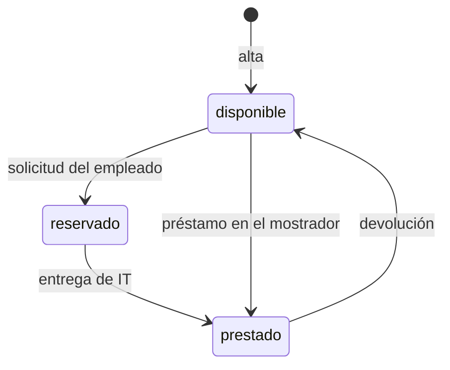

# Préstamo de equipos de IT

## Fuentes

- .diverger/inbox/peticion.md: petición del cliente con su anexo «API para el inventario de IT». Aporta el problema, los usuarios, el alcance, las exclusiones, las restricciones, la API fijada, los riesgos y los criterios de éxito.
- .diverger/inbox/equipo.csv: no se ha leído como fuente de requisitos; son los datos del equipo de trabajo, que se usarán al planificar los sprints.

## Objetivo

Hoy el préstamo se apunta en una hoja de cálculo y los empleados piden los equipos por correo a IT: no se sabe qué está libre sin preguntar, dos personas acaban esperando el mismo portátil y nadie se entera de que un préstamo ha vencido hasta que alguien echa en falta el equipo (peticion.md).

Una aplicación para gestionar el préstamo de equipos de la oficina (portátiles, monitores, proyectores): los empleados ven qué hay disponible y lo piden prestado por unos días, e IT da de alta los equipos, entrega y recoge, y ve qué préstamos han vencido (peticion.md).

Métricas de éxito, durante el primer mes (peticion.md):

- Todos los préstamos pasan por la aplicación.
- Ningún equipo se reserva o se presta dos veces.
- IT revisa los vencidos cada semana sin tener que preguntar a nadie.

## Usuarios

- Empleados: entran con su cuenta de Google de la empresa, ven los equipos y su estado y piden uno libre con la fecha de devolución (peticion.md).
- IT: entra con su cuenta de Google de la empresa; da de alta los equipos, entrega los reservados, presta en el mostrador, apunta las devoluciones, ve los préstamos vencidos y consulta el historial de cada equipo. Sus cuentas son las de la variable de entorno `CORREOS_IT` (peticion.md).
- Inventario de IT: sistema que se conecta a la API con una cuenta de servicio incluida en la lista de IT, así que también puede hacer lo de un empleado (peticion.md).

## Alcance

- Dar de alta un equipo por su nombre (solo IT); se rechaza el nombre vacío o ausente y el nombre repetido (peticion.md).
- Dos nombres de equipo son el mismo si solo se diferencian en mayúsculas o en espacios al principio o al final (peticion.md).
- Ver los equipos y su estado (`disponible`, `reservado` o `prestado`); si está reservado o prestado, también la persona y la fecha de devolución (peticion.md).
- Pedir un equipo libre indicando la fecha de devolución; el equipo queda reservado a nombre de quien lo pide hasta que IT se lo entrega (peticion.md).
- Quien pide un equipo no puede poner una fecha de devolución anterior a hoy (peticion.md).
- Entregar un equipo reservado (solo IT); pasa a prestado con la misma persona y fecha de la solicitud (peticion.md).
- Prestar en el mostrador a la persona indicada, con fecha de devolución (solo IT); IT puede poner una fecha anterior a hoy y ese préstamo aparece ya entre los vencidos (peticion.md).
- Apuntar la devolución (solo IT); el equipo vuelve a disponible, sin persona ni fecha (peticion.md).
- Ver los préstamos vencidos: equipos prestados con fecha de devolución anterior a hoy, del más antiguo al más reciente (solo IT) (peticion.md).
- Consultar el historial de un equipo, del más reciente al más antiguo, con persona, fecha de devolución y estado (`reservado`, `prestado` o `devuelto`) (solo IT) (peticion.md).
- La fecha de devolución va como texto `AAAA-MM-DD`, se devuelve igual y tiene que ser una fecha que exista; «hoy» es el día en Madrid (peticion.md).

## Fuera de alcance

- Que los empleados anulen una solicitud (peticion.md).
- Avisos por correo de préstamos vencidos (peticion.md).

## Restricciones

- Todas las rutas necesitan sesión: vale el token de identidad de Google con el correo verificado, emitido para el cliente OAuth de la aplicación, de una persona o de una cuenta de servicio; sin token válido responden 401 (peticion.md).
- La persona de cada operación es el correo del token (peticion.md).
- Las operaciones «Solo IT» solo las puede hacer una cuenta de IT; con cualquier otra cuenta responden 403. Un empleado no puede hacer lo que solo le toca a IT (peticion.md).
- Las cuentas de IT son las de la variable de entorno `CORREOS_IT`, con los correos separados por comas; la lista se fija en la configuración del despliegue, no en el código, y los correos se comparan sin distinguir mayúsculas (peticion.md).
- Un equipo no puede estar reservado o prestado dos veces a la vez: con dos peticiones simultáneas sobre el mismo equipo disponible, una sale bien y la otra recibe 409 (peticion.md).
- La API tiene que ser exactamente la del anexo, porque el inventario de IT se va a conectar a ella (peticion.md).
- Integraciones: cuentas de Google de la empresa e inventario de IT (peticion.md).

## API fijada por el cliente

El inventario de IT se va a conectar a la aplicación, así que la API tiene que ser exactamente esta. Todas las rutas necesitan haber iniciado sesión: sin un token válido responden 401 con «Inicia sesión con Google.». Vale el token de identidad de Google, con el correo verificado, emitido para el cliente OAuth de la aplicación, tanto de una persona como de una cuenta de servicio. La persona de cada operación es el correo del token.

Las operaciones marcadas «Solo IT» solo las puede hacer una cuenta de IT; con cualquier otra cuenta responden 403 con «Solo IT puede hacer esto.». Las cuentas de IT son las de la variable de entorno `CORREOS_IT`, con los correos separados por comas: la lista se fija en la configuración del despliegue, no en el código. Dos correos son el mismo aunque cambien las mayúsculas. El inventario entra con una cuenta de servicio que está en esa lista, así que también puede hacer lo de un empleado. Los errores son un objeto JSON `{"error": "<mensaje>"}` con el mensaje exacto que se indica.

Un equipo está en uno de tres estados: `disponible`, `reservado` (un empleado lo ha pedido y aún no lo ha recogido) o `prestado`. Cuando está reservado o prestado, el equipo lleva también `persona` (el correo de quien lo tiene) y `devolucion`.

| Operación | Quién | Petición | Respuesta correcta | Errores |
|---|---|---|---|---|
| Dar de alta un equipo | Solo IT | `POST /api/equipos` con `{"nombre": "Portátil 07"}` | 201 con `{"id": "…", "nombre": "Portátil 07", "estado": "disponible"}` | 400 «Falta el nombre del equipo» si el nombre falta o está vacío. 409 «Ya hay un equipo con ese nombre» |
| Ver los equipos | Todos | `GET /api/equipos` | 200 con la lista de equipos, cada uno con `id`, `nombre` y `estado`; si está reservado o prestado, también `persona` y `devolucion` | — |
| Pedir un equipo | Todos | `POST /api/equipos/{id}/solicitud` con `{"devolucion": "2026-11-20"}` | 201 con el equipo: `estado: "reservado"`, `persona` (el correo de quien lo pide) y `devolucion` | 400 «Falta la fecha de devolución». 400 «La fecha de devolución no es válida» si no es una fecha real. 400 «La fecha de devolución ya ha pasado». 404 «No existe el equipo». 409 «El equipo no está disponible» si está reservado o prestado |
| Entregar un equipo reservado | Solo IT | `POST /api/equipos/{id}/entrega` | 200 con el equipo: `estado: "prestado"`, con la misma `persona` y `devolucion` de la solicitud | 404 «No existe el equipo». 409 «El equipo no está reservado» |
| Prestar en el mostrador | Solo IT | `POST /api/equipos/{id}/prestamo` con `{"persona": "ana.perez@empresa.com", "devolucion": "2026-11-20"}` | 201 con el equipo: `estado: "prestado"`, `persona` y `devolucion` | 400 «Faltan la persona o la fecha de devolución». 400 «La fecha de devolución no es válida» si no es una fecha real. 404 «No existe el equipo». 409 «El equipo no está disponible» si está reservado o prestado |
| Apuntar la devolución | Solo IT | `POST /api/equipos/{id}/devolucion` | 200 con el equipo y `estado: "disponible"`, sin `persona` ni `devolucion` | 404 «No existe el equipo». 409 «El equipo no está prestado» |
| Ver los préstamos vencidos | Solo IT | `GET /api/prestamos/vencidos` | 200 con la lista de equipos prestados cuya fecha de devolución es anterior a hoy, cada uno con `id`, `nombre`, `persona` y `devolucion`, del más antiguo al más reciente | — |
| Ver el historial de un equipo | Solo IT | `GET /api/equipos/{id}/historial` | 200 con la lista de sus préstamos, del más reciente al más antiguo, cada uno con `persona`, `devolucion` y `estado` (`reservado`, `prestado` o `devuelto`) | 404 «No existe el equipo» |

La fecha de devolución va como texto `AAAA-MM-DD` y se devuelve igual. Tiene que ser una fecha que exista («2026-02-30» no vale). «Hoy» es el día en Madrid. Quien pide un equipo no puede poner una fecha anterior a hoy, pero IT sí cuando presta en el mostrador, porque a veces apunta los préstamos con retraso; un préstamo así ya aparece entre los vencidos.

Un equipo no puede estar reservado o prestado dos veces a la vez. Si llegan dos peticiones a la vez para el mismo equipo disponible, sean solicitudes o préstamos en el mostrador, una sale bien y la otra recibe 409 «El equipo no está disponible»; nunca salen bien las dos.

Dos nombres de equipo son el mismo si solo se diferencian en mayúsculas o en espacios al principio o al final: « portátil 07 » repite «Portátil 07».

(peticion.md, «Anexo: API para el inventario de IT»)

## Riesgos

- Que dos empleados se queden con el mismo equipo porque lo pidieron a la vez (peticion.md).
- Que un empleado pueda hacer lo que solo le toca a IT (peticion.md).
- Que el inventario deje de funcionar si la API cambia (peticion.md).

## Supuestos

- [SUPUESTO] El estado `devuelto` solo aparece en el historial, no en el equipo — el anexo define tres estados de equipo y `devuelto` solo en el historial.
- [SUPUESTO] Monitores y proyectores se tratan igual que los portátiles, sin tipo ni categoría — la API solo tiene `nombre` y `estado`.
- [SUPUESTO] El `id` del equipo lo genera la aplicación — el alta solo recibe el nombre y devuelve el `id`.
- [SUPUESTO] La revisión semanal de vencidos la hace IT consultando la lista — los avisos por correo quedan fuera de alcance.
- [SUPUESTO] La cuenta de servicio del inventario puede usar todas las operaciones — está en la lista de IT.
- [SUPUESTO] Un préstamo vencido sigue en la lista de vencidos hasta que IT apunta la devolución — la petición no dice otra cosa.

## Preguntas abiertas

1. [alta] ¿Hay una interfaz web para empleados e IT, o solo la API? La petición habla de una «aplicación» en la que los empleados «ven» los equipos, pero el anexo solo describe la API.
2. [alta] ¿Cuándo caduca una reserva que IT no llega a entregar? Si el empleado no la recoge y no puede anularla, el equipo queda bloqueado.
3. [media] ¿Hay un máximo de días de préstamo o un límite de equipos por persona? La petición solo dice «por unos días».
4. [media] ¿Qué responde la API si el cuerpo no es JSON válido o la `persona` del préstamo en el mostrador no es un correo? El anexo no lo define.
5. [media] ¿Hay que migrar los datos de la hoja de cálculo actual?
6. [media] ¿Cuántos equipos y usuarios hay?
7. [baja] ¿Desde qué fecha cuenta el «primer mes» y quién mide que todos los préstamos pasan por la aplicación?

## Claridad

| Categoría | Claridad |
|---|---|
| Usuarios | 75 % |
| Problema | 75 % |
| Objetivo y métricas | 50 % |
| Alcance | 100 % |
| Fuera de alcance | 75 % |
| Restricciones | 75 % |
| Dependencias e integraciones | 50 % |
| Riesgos | 50 % |
| Global | 69 % |

## Diagramas

### Estados de un equipo

