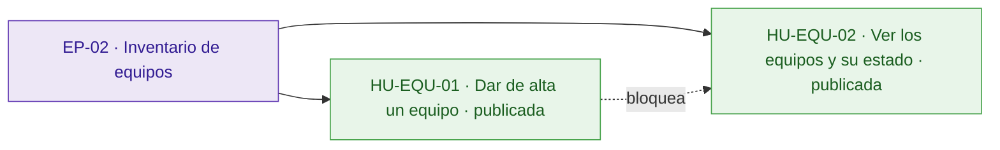
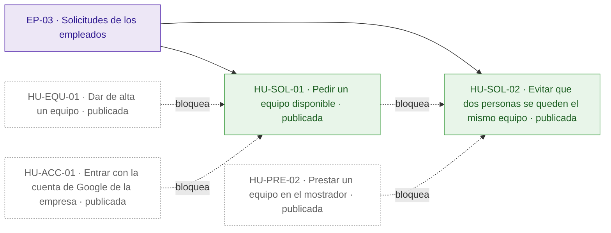
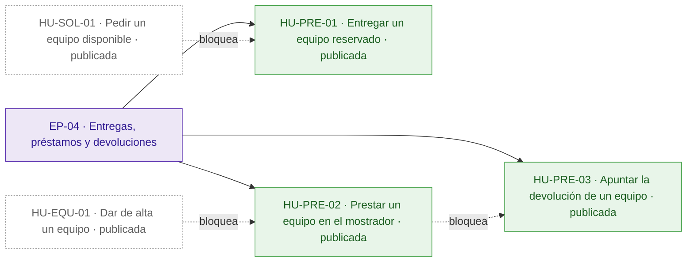
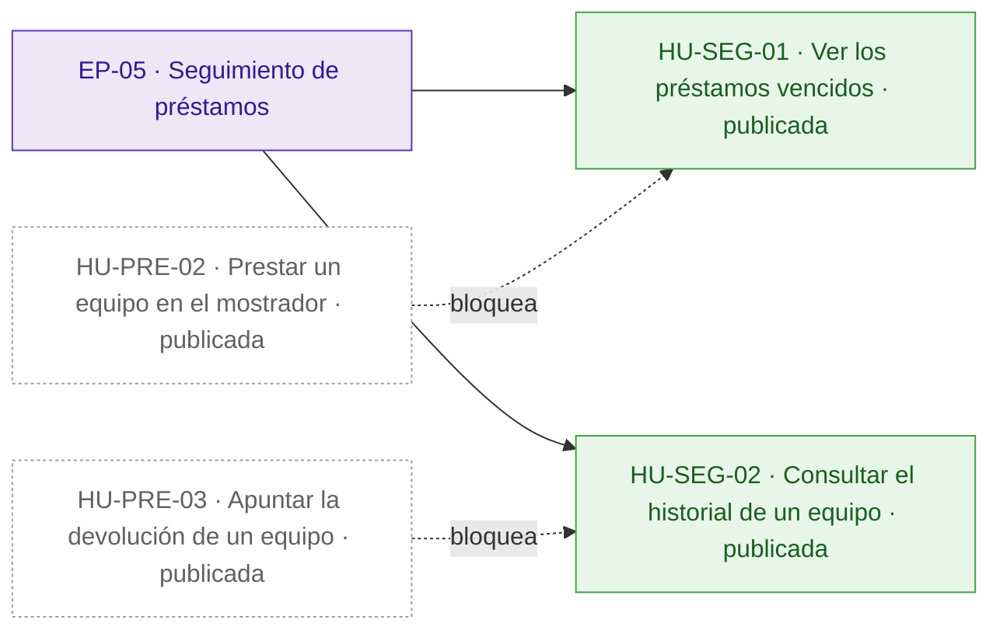
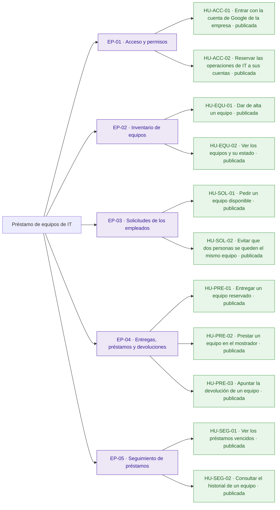
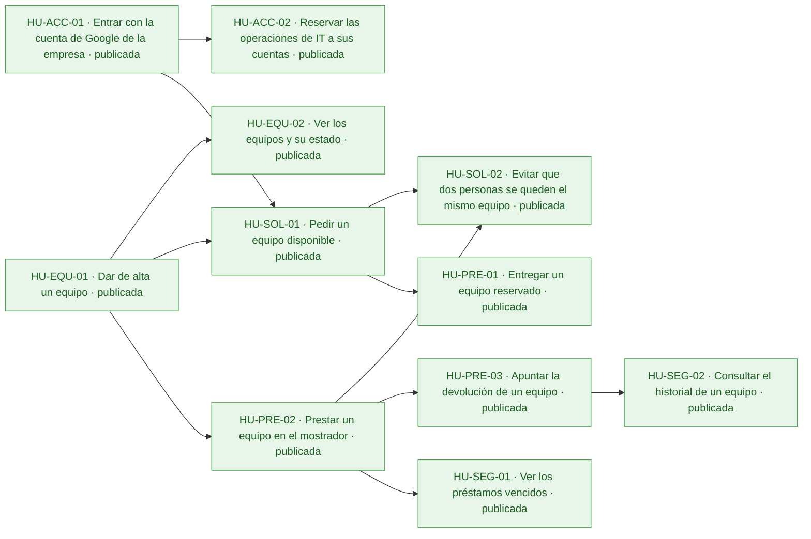
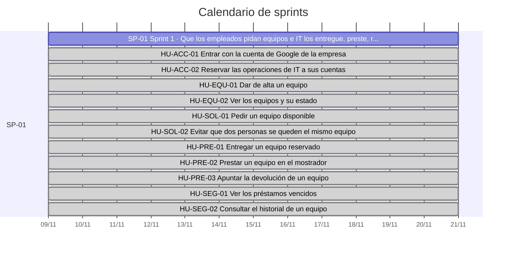
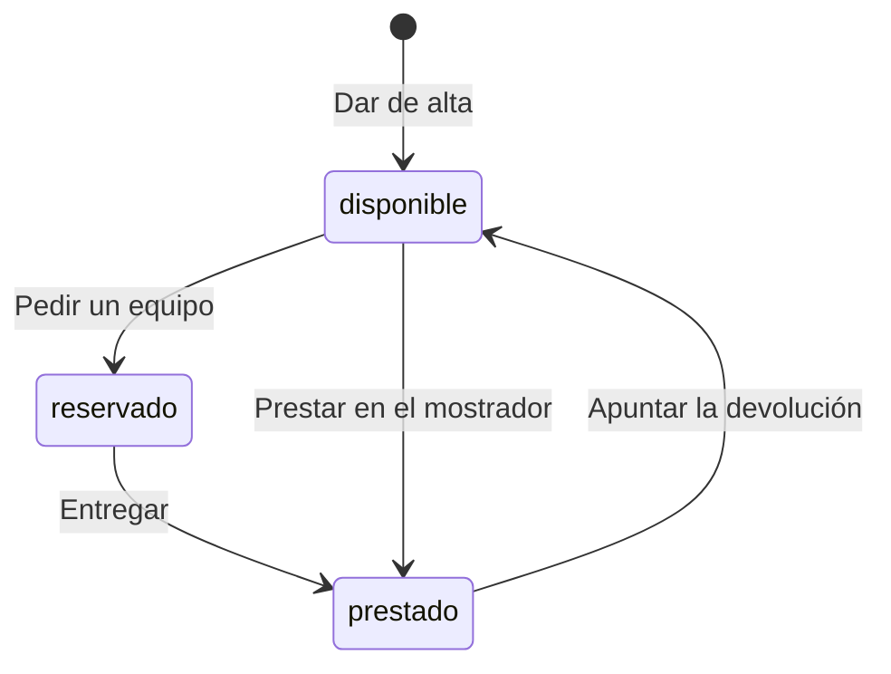

# Préstamo de equipos de IT

Hoy los préstamos de portátiles, monitores y proyectores se apuntan en una hoja de cálculo y se piden por correo a IT: nadie sabe qué está libre, dos personas esperan el mismo portátil y los vencimientos no se detectan hasta que alguien echa en falta el equipo.

La aplicación permite a los empleados ver los equipos y pedir uno libre, y a IT darlos de alta, entregarlos, prestarlos en el mostrador, apuntar las devoluciones, ver los vencidos y consultar el historial. El inventario de IT se conecta a la misma API, que tiene que ser exactamente la del anexo de la petición. Quedan fuera la anulación de solicitudes por los empleados y los avisos por correo de vencidos.

## Visión y alcance

Que los empleados vean y pidan los equipos de IT en una aplicación y que IT gestione en ella las entregas, los préstamos, las devoluciones y los vencidos.

**Dentro del alcance**

- Ver los equipos (portátiles, monitores, proyectores) con su estado; si están reservados o prestados, también la persona y la fecha de devolución. Todos (peticion.md).
- Pedir un equipo disponible indicando la fecha de devolución: queda reservado a nombre de quien lo pide hasta que IT lo entrega. Todos (peticion.md).
- Dar de alta un equipo con nombre obligatorio y único; dos nombres son el mismo si solo cambian las mayúsculas o los espacios al principio o al final. Solo IT (peticion.md).
- Entregar un equipo reservado: pasa a prestado con la misma persona y fecha de devolución. Solo IT (peticion.md).
- Prestar un equipo disponible en el mostrador a la persona indicada, con fecha de devolución, que puede ser anterior a hoy. Solo IT (peticion.md).
- Apuntar la devolución de un equipo prestado: vuelve a disponible, sin persona ni fecha. Solo IT (peticion.md).
- Ver los préstamos vencidos (prestados con devolución anterior a hoy), del más antiguo al más reciente. Solo IT (peticion.md).
- Consultar el historial de préstamos de un equipo, del más reciente al más antiguo, con estado reservado, prestado o devuelto. Solo IT (peticion.md).
- Validar la fecha de devolución: formato \`AAAA-MM-DD\`, fecha real, «hoy» es el día en Madrid y quien pide un equipo no puede poner una fecha anterior a hoy (peticion.md).

**Fuera del alcance**

- Que los empleados anulen una solicitud (peticion.md).
- Avisos por correo de préstamos vencidos (peticion.md).

## Resumen en cifras

| Dato | Valor |
| --- | --- |
| Épicas | 5 |
| Historias | 11 |
| Historias por estado | borrador 0, aprobada 0, descartada 0, publicada 11 |
| Tareas | 35 |
| Sprints | 1 |
| Personas en el equipo | 1 |
| Modalidad de desarrollo | manual, sin IA |
| Horas estimadas | 48 h |
| Horas efectivas (según la modalidad de desarrollo) | 48 h |
| Historias sin estimar | 0 |
| Historias descartadas (fuera de las horas) | 0 |
| Supuestos | 13 |
| Preguntas abiertas | 7 |
| Requisitos | 13 |
| Requisitos sin historia | 0 |

## Índice

- [Visión y alcance](#visión-y-alcance)
- [Resumen en cifras](#resumen-en-cifras)
- [Épicas e historias](#épicas-e-historias)
  - [EP-01 · Acceso y permisos](#ep-01--acceso-y-permisos)
  - [EP-02 · Inventario de equipos](#ep-02--inventario-de-equipos)
  - [EP-03 · Solicitudes de los empleados](#ep-03--solicitudes-de-los-empleados)
  - [EP-04 · Entregas, préstamos y devoluciones](#ep-04--entregas-préstamos-y-devoluciones)
  - [EP-05 · Seguimiento de préstamos](#ep-05--seguimiento-de-préstamos)
- [Tareas](#tareas)
- [Sprints](#sprints)
- [Equipo](#equipo)
- [Dependencias](#dependencias)
- [Requisitos y trazabilidad](#requisitos-y-trazabilidad)
- [Preparación y definición de hecho](#preparación-y-definición-de-hecho)
- [Diagramas](#diagramas)
- [Supuestos](#supuestos)
- [Preguntas abiertas](#preguntas-abiertas)
- [Decisiones](#decisiones)

## Épicas e historias

### EP-01 · Acceso y permisos

Entrada con la cuenta de Google de la empresa y separación entre lo que puede hacer cualquier empleado y lo que solo puede hacer IT. Sirve a empleados, a IT y a la cuenta de servicio del inventario. No incluye otros proveedores de identidad.

#### Épica EP-01: Acceso y permisos

#### HU-ACC-01 · Entrar con la cuenta de Google de la empresa

Como empleado, quiero entrar en la aplicación con mi cuenta de Google de la empresa, para que cada solicitud quede a mi nombre sin tener que escribir mis datos.

**Contexto.** Cubre RQ.010 (peticion.md): todos entran con su cuenta de Google de la empresa y todas las rutas de la API exigen haber iniciado sesión. La persona de cada operación es el correo del token.

- **Prioridad:** Highest
- **Tamaño:** M
- **Horas:** 4 h estimadas · 4 h efectivas
- **Estado:** publicada
- **Sprint:** SP-01 Sprint 1
- **Responsable:** José Luis Calvo
- **Tipo:** historia
- **Puntos de historia:** 3
- **Preparación:** parcialmente lista (pendiente: DoR-08: dependencias externas sin plan confirmado: Cliente OAuth de Google de la aplicación · supuestos sin confirmar: DoR-04, DoR-05, DoR-06, DoR-07, DoR-09)
- **Requisitos:** RQ.010, RQ.013
- **Dependencias externas:** Cliente OAuth de Google de la aplicación

**Criterios de aceptación**

*Escenarios positivos*

1. **Dado** un empleado con un token de identidad de Google válido de «ana.perez@empresa.com», con el correo verificado y emitido para el cliente OAuth de la aplicación, **cuando** consulta GET /api/equipos, **entonces** recibe 200 con la lista de equipos.

*Escenarios negativos*

1. **Dado** una petición sin token de identidad, **cuando** consulta GET /api/equipos, **entonces** recibe 401 con {"error": "Inicia sesión con Google."}.
2. **Dado** un token de Google de «ana.perez@empresa.com» emitido para otro cliente OAuth, **cuando** consulta GET /api/equipos, **entonces** recibe 401 con {"error": "Inicia sesión con Google."}.
3. **Dado** un token de Google de «ana.perez@empresa.com» con el correo sin verificar, **cuando** consulta GET /api/equipos, **entonces** recibe 401 con {"error": "Inicia sesión con Google."}.

**Notas.** Vale el token de una persona y el de una cuenta de servicio, como la del inventario de IT.

**Definición de hecho**

- Criterios de aceptación probados contra la API del anexo.
- Mensaje de error idéntico al del anexo.

**Tareas**

- TA-001 · Verificación del token de Google, del correo verificado y del cliente OAuth · backend · José Luis Calvo
- TA-002 · Inicio de sesión con la cuenta de Google de la empresa · frontend · José Luis Calvo
- TA-003 · Pruebas con token válido, sin token y de otro cliente OAuth · QA · José Luis Calvo

#### HU-ACC-02 · Reservar las operaciones de IT a sus cuentas

Como técnico de IT, quiero que solo las cuentas de la lista CORREOS\_IT puedan hacer las operaciones de IT, para evitar que un empleado cambie el estado de un equipo que no le corresponde.

**Contexto.** Cubre RQ.011 (peticion.md): las operaciones «Solo IT» solo las hace una cuenta de CORREOS\_IT, que se fija en la configuración del despliegue y no en el código. Responde al riesgo de que un empleado haga lo que solo le toca a IT.

- **Prioridad:** Highest
- **Tamaño:** M
- **Horas:** 4 h estimadas · 4 h efectivas
- **Estado:** publicada
- **Sprint:** SP-01 Sprint 1
- **Responsable:** José Luis Calvo
- **Tipo:** historia
- **Puntos de historia:** 3
- **Preparación:** lista (pendiente: supuestos sin confirmar: DoR-04, DoR-05, DoR-06, DoR-07, DoR-09)
- **Requisitos:** RQ.011, RQ.013
- **Depende de:**
  - HU-ACC-01 · Entrar con la cuenta de Google de la empresa: La lista CORREOS\_IT se compara con el correo de un token ya verificado.

**Criterios de aceptación**

*Escenarios positivos*

1. **Dado** CORREOS\_IT con «it@empresa.com,inventario@empresa.com» y un token de «IT@empresa.com», **cuando** da de alta el equipo «Portátil 07» con POST /api/equipos, **entonces** recibe 201 y el equipo queda dado de alta.
2. **Dado** la cuenta de servicio «inventario@empresa.com», incluida en CORREOS\_IT, y el equipo «Portátil 08» disponible, **cuando** pide «Portátil 08» con devolución «2026-11-20», **entonces** recibe 201 con el equipo reservado a «inventario@empresa.com».

*Escenarios negativos*

1. **Dado** CORREOS\_IT con «it@empresa.com,inventario@empresa.com» y un token de «ana.perez@empresa.com», **cuando** intenta dar de alta el equipo «Portátil 07» con POST /api/equipos, **entonces** recibe 403 con {"error": "Solo IT puede hacer esto."} y no se crea ningún equipo.

**Definición de hecho**

- Criterios de aceptación probados contra la API del anexo.
- La lista CORREOS\_IT se lee de la configuración del despliegue, sin correos en el código.

**Tareas**

- TA-004 · Lectura de CORREOS\_IT y comprobación de las operaciones de IT sin distinguir mayúsculas · backend · José Luis Calvo
- TA-005 · Pruebas de 403 en cada operación de IT y de la cuenta de servicio · QA · José Luis Calvo

### EP-02 · Inventario de equipos

IT da de alta los portátiles, monitores y proyectores, y cualquier empleado ve la lista con su estado. Es la base del resto de operaciones. Los cambios de estado de cada equipo están en las épicas de solicitudes y de préstamos.

#### Épica EP-02: Inventario de equipos

#### HU-EQU-01 · Dar de alta un equipo

Como técnico de IT, quiero dar de alta un equipo con su nombre, para que los empleados lo vean y lo puedan pedir sin preguntar a IT si existe.

**Contexto.** Cubre RQ.003 (peticion.md): IT da de alta los equipos; dos nombres son el mismo si solo se diferencian en mayúsculas o en espacios al principio o al final.

- **Prioridad:** Highest
- **Tamaño:** M
- **Horas:** 4 h estimadas · 4 h efectivas
- **Estado:** publicada
- **Sprint:** SP-01 Sprint 1
- **Responsable:** José Luis Calvo
- **Tipo:** historia
- **Puntos de historia:** 3
- **Preparación:** lista (pendiente: supuestos sin confirmar: DoR-04, DoR-05, DoR-06, DoR-07, DoR-09)
- **Requisitos:** RQ.003, RQ.013

**Criterios de aceptación**

*Escenarios positivos*

1. **Dado** un técnico de IT y ningún equipo llamado «Portátil 07», **cuando** envía POST /api/equipos con {"nombre": "Portátil 07"}, **entonces** recibe 201 con el id del equipo, el nombre «Portátil 07» y el estado «disponible».

*Escenarios negativos*

1. **Dado** un técnico de IT, **cuando** envía POST /api/equipos con {"nombre": ""}, **entonces** recibe 400 con {"error": "Falta el nombre del equipo"} y no se crea ningún equipo.
2. **Dado** un técnico de IT y el equipo «Portátil 07» ya dado de alta, **cuando** envía POST /api/equipos con {"nombre": " portátil 07 "}, **entonces** recibe 409 con {"error": "Ya hay un equipo con ese nombre"} y no se crea un segundo equipo.

**Definición de hecho**

- Criterios de aceptación probados contra la API del anexo.
- Mensajes de error idénticos a los del anexo.

**Tareas**

- TA-006 · Almacenamiento de equipos con nombre normalizado único · datos · José Luis Calvo
- TA-007 · Ruta POST /api/equipos con sus validaciones · backend · José Luis Calvo
- TA-008 · Formulario de alta de equipos · frontend · José Luis Calvo
- TA-009 · Pruebas del alta, del nombre vacío y del nombre repetido · QA · José Luis Calvo

#### HU-EQU-02 · Ver los equipos y su estado

Como empleado, quiero ver los equipos con su estado, para saber qué está libre antes de pedirlo, sin escribir a IT.

**Contexto.** Cubre RQ.001 (peticion.md): cualquier empleado ve los equipos y su estado. Hoy no se sabe qué está libre.

- **Prioridad:** Highest
- **Tamaño:** S
- **Horas:** 2 h estimadas · 2 h efectivas
- **Estado:** publicada
- **Sprint:** SP-01 Sprint 1
- **Responsable:** José Luis Calvo
- **Tipo:** historia
- **Puntos de historia:** 2
- **Preparación:** parcialmente lista (pendiente: DoR-08: depende de HU-EQU-01, sin resolver ni planificada en un sprint anterior · supuestos sin confirmar: DoR-04, DoR-05, DoR-06, DoR-07, DoR-09)
- **Requisitos:** RQ.001, RQ.013
- **Depende de:**
  - HU-EQU-01 · Dar de alta un equipo: Para ver equipos hace falta haberlos dado de alta.

**Criterios de aceptación**

*Escenarios positivos*

1. **Dado** «Portátil 07» disponible y «Proyector 02» prestado a «luis.gomez@empresa.com» con devolución «2026-11-20», **cuando** un empleado consulta GET /api/equipos, **entonces** recibe 200 con «Portátil 07» en estado «disponible» sin persona ni devolución, y «Proyector 02» en estado «prestado» con persona «luis.gomez@empresa.com» y devolución «2026-11-20».

*Escenarios negativos*

1. **Dado** una petición sin token de identidad, **cuando** consulta GET /api/equipos, **entonces** recibe 401 con {"error": "Inicia sesión con Google."} y ningún equipo.

**Definición de hecho**

- Criterios de aceptación probados contra la API del anexo.

**Tareas**

- TA-010 · Ruta GET /api/equipos · backend · José Luis Calvo
- TA-011 · Lista de equipos con su estado · frontend · José Luis Calvo
- TA-012 · Pruebas de la lista con equipos en cada estado · QA · José Luis Calvo

### EP-03 · Solicitudes de los empleados

Un empleado pide un equipo libre con su fecha de devolución y queda reservado a su nombre, sin que dos personas puedan quedarse con el mismo equipo. La anulación de solicitudes por los empleados queda fuera de alcance.

#### Épica EP-03: Solicitudes de los empleados

#### HU-SOL-01 · Pedir un equipo disponible

Como empleado, quiero pedir un equipo libre indicando la fecha de devolución, para tenerlo apartado a mi nombre hasta que IT me lo entregue, sin pedirlo por correo.

**Contexto.** Cubre RQ.002 y RQ.009 (peticion.md): un empleado pide un equipo libre con su fecha de devolución y queda reservado a su nombre hasta que IT se lo entrega. La fecha va como AAAA-MM-DD, tiene que existir y no puede ser anterior a hoy en Madrid.

- **Prioridad:** Highest
- **Tamaño:** L
- **Horas:** 8 h estimadas · 8 h efectivas
- **Estado:** publicada
- **Sprint:** SP-01 Sprint 1
- **Responsable:** José Luis Calvo
- **Tipo:** historia
- **Puntos de historia:** 5
- **Preparación:** parcialmente lista (pendiente: DoR-08: depende de HU-EQU-01, sin resolver ni planificada en un sprint anterior · supuestos sin confirmar: DoR-04, DoR-05, DoR-06, DoR-07, DoR-09)
- **Requisitos:** RQ.002, RQ.009, RQ.013
- **Depende de:**
  - HU-EQU-01 · Dar de alta un equipo: Solo se puede pedir un equipo dado de alta.
  - HU-ACC-01 · Entrar con la cuenta de Google de la empresa: La reserva queda a nombre del correo del token verificado.

**Criterios de aceptación**

*Escenarios positivos*

1. **Dado** hoy es 10/11/2026 en Madrid, «Portátil 07» está disponible y la empleada «ana.perez@empresa.com» tiene la sesión iniciada, **cuando** envía POST /api/equipos/{id}/solicitud con {"devolucion": "2026-11-20"}, **entonces** recibe 201 con el equipo en estado «reservado», persona «ana.perez@empresa.com» y devolución «2026-11-20».

*Escenarios negativos*

1. **Dado** hoy es 10/11/2026 en Madrid y «Portátil 07» está disponible, **cuando** la empleada pide el equipo con {"devolucion": "2026-11-09"}, **entonces** recibe 400 con {"error": "La fecha de devolución ya ha pasado"} y el equipo sigue disponible.
2. **Dado** «Portátil 07» está disponible, **cuando** la empleada pide el equipo con {"devolucion": "2026-02-30"}, **entonces** recibe 400 con {"error": "La fecha de devolución no es válida"} y el equipo sigue disponible.
3. **Dado** «Portátil 07» está disponible, **cuando** la empleada pide el equipo con {"devolucion": "20/11/2026"}, **entonces** recibe 400 con {"error": "La fecha de devolución no es válida"} y el equipo sigue disponible.
4. **Dado** «Portátil 07» está disponible, **cuando** la empleada pide el equipo sin fecha de devolución, **entonces** recibe 400 con {"error": "Falta la fecha de devolución"}.
5. **Dado** «Portátil 07» está reservado a «luis.gomez@empresa.com», **cuando** la empleada pide el equipo con {"devolucion": "2026-11-20"}, **entonces** recibe 409 con {"error": "El equipo no está disponible"} y la reserva de «luis.gomez@empresa.com» no cambia.
6. **Dado** no existe ningún equipo con el id «no-existe», **cuando** la empleada envía POST /api/equipos/no-existe/solicitud con {"devolucion": "2026-11-20"}, **entonces** recibe 404 con {"error": "No existe el equipo"}.

**Notas.** Si una reserva caduca y quién puede anularla siguen como preguntas abiertas; los empleados no anulan solicitudes.

**Definición de hecho**

- Criterios de aceptación probados contra la API del anexo.
- Mensajes de error idénticos a los del anexo.
- «Hoy» calculado con la hora de Madrid.

**Tareas**

- TA-013 · Registro de los préstamos de cada equipo · datos · José Luis Calvo
- TA-014 · Ruta POST /api/equipos/{id}/solicitud con la validación de la fecha · backend · José Luis Calvo
- TA-015 · Pedir un equipo con su fecha de devolución desde la lista · frontend · José Luis Calvo
- TA-016 · Pruebas de la solicitud y de cada error de fecha y de estado · QA · José Luis Calvo

#### HU-SOL-02 · Evitar que dos personas se queden el mismo equipo

Como empleado, quiero pedir un equipo a la vez que otra persona sin que los dos nos quedemos con él, para no esperar un portátil que ya tiene otra persona.

**Contexto.** Cubre RQ.012 (peticion.md): un equipo no puede estar reservado o prestado dos veces a la vez; con dos peticiones simultáneas nunca salen bien las dos. Responde al riesgo de que dos empleados se queden con el mismo equipo y a la métrica de que ningún equipo se reserve o se preste dos veces.

- **Prioridad:** Highest
- **Tamaño:** L
- **Horas:** 8 h estimadas · 8 h efectivas
- **Estado:** publicada
- **Sprint:** SP-01 Sprint 1
- **Responsable:** José Luis Calvo
- **Tipo:** historia
- **Puntos de historia:** 5
- **Preparación:** parcialmente lista (pendiente: DoR-08: depende de HU-SOL-01, HU-PRE-02, sin resolver ni planificada en un sprint anterior · supuestos sin confirmar: DoR-04, DoR-05, DoR-06, DoR-07, DoR-09)
- **Requisitos:** RQ.012, RQ.013
- **Depende de:**
  - HU-SOL-01 · Pedir un equipo disponible: La regla protege las solicitudes de los empleados.
  - HU-PRE-02 · Prestar un equipo en el mostrador: La regla también cubre los préstamos en el mostrador.

**Criterios de aceptación**

*Escenarios positivos*

1. **Dado** «Portátil 07» está disponible, **cuando** «ana.perez@empresa.com» y «luis.gomez@empresa.com» envían a la vez una solicitud con devolución «2026-11-20», **entonces** una recibe 201 con el equipo reservado a su nombre, la otra recibe 409 con {"error": "El equipo no está disponible"} y el equipo queda reservado a una sola persona.

*Escenarios negativos*

1. **Dado** «Portátil 07» está disponible, la empleada «ana.perez@empresa.com» envía una solicitud y un técnico de IT envía un préstamo en el mostrador a «luis.gomez@empresa.com», **cuando** las dos peticiones llegan a la vez, **entonces** solo una de las dos sale bien, la otra recibe 409 con {"error": "El equipo no está disponible"} y el equipo tiene una sola persona.

**Notas.** Es la historia que verifica RQ.012 sobre las solicitudes de HU-SOL-01 y los préstamos en el mostrador de HU-PRE-02.

**Definición de hecho**

- Criterios de aceptación probados con peticiones simultáneas reales.
- Mensaje de error idéntico al del anexo.

**Tareas**

- TA-017 · Escritura atómica del cambio de estado del equipo · datos · José Luis Calvo
- TA-018 · Solicitud y préstamo con comprobación del estado en la misma operación · backend · José Luis Calvo
- TA-019 · Pruebas con peticiones simultáneas · QA · José Luis Calvo

### EP-04 · Entregas, préstamos y devoluciones

IT entrega los equipos reservados, presta directamente en el mostrador y apunta las devoluciones. Con ello todos los préstamos pasan por la aplicación. No incluye avisos por correo.

#### Épica EP-04: Entregas, préstamos y devoluciones

#### HU-PRE-01 · Entregar un equipo reservado

Como técnico de IT, quiero entregar a un empleado el equipo que tiene reservado, para que el préstamo conste con la persona y la fecha que pidió sin volver a apuntarlas.

**Contexto.** Cubre RQ.004 (peticion.md): IT entrega los equipos reservados, que pasan a prestados con la misma persona y fecha de devolución de la solicitud.

- **Prioridad:** Highest
- **Tamaño:** M
- **Horas:** 4 h estimadas · 4 h efectivas
- **Estado:** publicada
- **Sprint:** SP-01 Sprint 1
- **Responsable:** José Luis Calvo
- **Tipo:** historia
- **Puntos de historia:** 3
- **Preparación:** parcialmente lista (pendiente: DoR-08: depende de HU-SOL-01, sin resolver ni planificada en un sprint anterior · supuestos sin confirmar: DoR-04, DoR-05, DoR-06, DoR-07, DoR-09)
- **Requisitos:** RQ.004, RQ.013
- **Depende de:**
  - HU-SOL-01 · Pedir un equipo disponible: Entregar exige un equipo reservado.

**Criterios de aceptación**

*Escenarios positivos*

1. **Dado** «Portátil 07» reservado a «ana.perez@empresa.com» con devolución «2026-11-20», **cuando** el técnico de IT envía POST /api/equipos/{id}/entrega, **entonces** recibe 200 con el equipo en estado «prestado», persona «ana.perez@empresa.com» y devolución «2026-11-20».

*Escenarios negativos*

1. **Dado** «Portátil 07» disponible, **cuando** el técnico de IT envía POST /api/equipos/{id}/entrega, **entonces** recibe 409 con {"error": "El equipo no está reservado"} y el equipo sigue disponible.
2. **Dado** no existe ningún equipo con el id «no-existe», **cuando** el técnico de IT envía POST /api/equipos/no-existe/entrega, **entonces** recibe 404 con {"error": "No existe el equipo"}.

**Definición de hecho**

- Criterios de aceptación probados contra la API del anexo.
- Mensajes de error idénticos a los del anexo.

**Tareas**

- TA-020 · Ruta POST /api/equipos/{id}/entrega · backend · José Luis Calvo
- TA-021 · Acción de entregar en los equipos reservados · frontend · José Luis Calvo
- TA-022 · Pruebas de la entrega y de sus errores · QA · José Luis Calvo

#### HU-PRE-02 · Prestar un equipo en el mostrador

Como técnico de IT, quiero prestar un equipo libre a quien viene a pedirlo al mostrador, para que también los préstamos del mostrador pasen por la aplicación.

**Contexto.** Cubre RQ.005 y RQ.009 (peticion.md): IT presta directamente a quien viene al mostrador. Puede poner una fecha de devolución anterior a hoy porque a veces apunta los préstamos con retraso; ese préstamo ya aparece entre los vencidos.

- **Prioridad:** Highest
- **Tamaño:** M
- **Horas:** 4 h estimadas · 4 h efectivas
- **Estado:** publicada
- **Sprint:** SP-01 Sprint 1
- **Responsable:** José Luis Calvo
- **Tipo:** historia
- **Puntos de historia:** 3
- **Preparación:** parcialmente lista (pendiente: DoR-08: depende de HU-EQU-01, sin resolver ni planificada en un sprint anterior · supuestos sin confirmar: DoR-04, DoR-05, DoR-06, DoR-07, DoR-09)
- **Requisitos:** RQ.005, RQ.009, RQ.013
- **Depende de:**
  - HU-EQU-01 · Dar de alta un equipo: Solo se puede prestar un equipo dado de alta.

**Criterios de aceptación**

*Escenarios positivos*

1. **Dado** «Monitor 03» disponible, **cuando** el técnico de IT envía POST /api/equipos/{id}/prestamo con {"persona": "ana.perez@empresa.com", "devolucion": "2026-11-20"}, **entonces** recibe 201 con el equipo en estado «prestado», persona «ana.perez@empresa.com» y devolución «2026-11-20».
2. **Dado** hoy es 10/11/2026 en Madrid y «Monitor 04» está disponible, **cuando** el técnico de IT lo presta con {"persona": "ana.perez@empresa.com", "devolucion": "2026-11-05"}, **entonces** recibe 201 con el equipo prestado y devolución «2026-11-05».

*Escenarios negativos*

1. **Dado** «Monitor 03» disponible, **cuando** el técnico de IT lo presta con {"devolucion": "2026-11-20"} sin persona, **entonces** recibe 400 con {"error": "Faltan la persona o la fecha de devolución"} y el equipo sigue disponible.
2. **Dado** «Monitor 03» disponible, **cuando** el técnico de IT lo presta con {"persona": "ana.perez@empresa.com", "devolucion": "2026-02-30"}, **entonces** recibe 400 con {"error": "La fecha de devolución no es válida"} y el equipo sigue disponible.
3. **Dado** «Monitor 03» disponible, **cuando** el técnico de IT lo presta con {"persona": "ana.perez@empresa.com", "devolucion": "20/11/2026"}, **entonces** recibe 400 con {"error": "La fecha de devolución no es válida"} y el equipo sigue disponible.
4. **Dado** no existe ningún equipo con el id «no-existe», **cuando** el técnico de IT envía POST /api/equipos/no-existe/prestamo con {"persona": "ana.perez@empresa.com", "devolucion": "2026-11-20"}, **entonces** recibe 404 con {"error": "No existe el equipo"}.
5. **Dado** «Monitor 03» reservado a «luis.gomez@empresa.com», **cuando** el técnico de IT lo presta a «ana.perez@empresa.com» con devolución «2026-11-20», **entonces** recibe 409 con {"error": "El equipo no está disponible"} y la reserva de «luis.gomez@empresa.com» no cambia.

**Definición de hecho**

- Criterios de aceptación probados contra la API del anexo.
- Mensajes de error idénticos a los del anexo.

**Tareas**

- TA-023 · Ruta POST /api/equipos/{id}/prestamo · backend · José Luis Calvo
- TA-024 · Formulario de préstamo en el mostrador · frontend · José Luis Calvo
- TA-025 · Pruebas del préstamo, de la fecha pasada y de sus errores · QA · José Luis Calvo

#### HU-PRE-03 · Apuntar la devolución de un equipo

Como técnico de IT, quiero apuntar que un equipo prestado se ha devuelto, para que vuelva a aparecer libre para el siguiente empleado.

**Contexto.** Cubre RQ.006 (peticion.md): IT apunta las devoluciones y el equipo vuelve a disponible, sin persona ni fecha.

- **Prioridad:** Highest
- **Tamaño:** S
- **Horas:** 2 h estimadas · 2 h efectivas
- **Estado:** publicada
- **Sprint:** SP-01 Sprint 1
- **Responsable:** José Luis Calvo
- **Tipo:** historia
- **Puntos de historia:** 2
- **Preparación:** parcialmente lista (pendiente: DoR-08: depende de HU-PRE-02, sin resolver ni planificada en un sprint anterior · supuestos sin confirmar: DoR-04, DoR-05, DoR-06, DoR-07, DoR-09)
- **Requisitos:** RQ.006, RQ.013
- **Depende de:**
  - HU-PRE-02 · Prestar un equipo en el mostrador: Apuntar una devolución exige un equipo prestado.

**Criterios de aceptación**

*Escenarios positivos*

1. **Dado** «Monitor 03» prestado a «ana.perez@empresa.com» con devolución «2026-11-20», **cuando** el técnico de IT envía POST /api/equipos/{id}/devolucion, **entonces** recibe 200 con el equipo en estado «disponible», sin persona ni devolución.

*Escenarios negativos*

1. **Dado** «Monitor 03» disponible, **cuando** el técnico de IT envía POST /api/equipos/{id}/devolucion, **entonces** recibe 409 con {"error": "El equipo no está prestado"}.
2. **Dado** no existe ningún equipo con el id «no-existe», **cuando** el técnico de IT envía POST /api/equipos/no-existe/devolucion, **entonces** recibe 404 con {"error": "No existe el equipo"}.

**Definición de hecho**

- Criterios de aceptación probados contra la API del anexo.
- Mensajes de error idénticos a los del anexo.

**Tareas**

- TA-026 · Ruta POST /api/equipos/{id}/devolucion · backend · José Luis Calvo
- TA-027 · Acción de apuntar la devolución · frontend · José Luis Calvo
- TA-028 · Pruebas de la devolución y de sus errores · QA · José Luis Calvo

### EP-05 · Seguimiento de préstamos

IT ve los préstamos vencidos y el historial de cada equipo, para revisarlos cada semana sin preguntar a nadie. Los avisos por correo de vencidos quedan fuera de alcance.

#### Épica EP-05: Seguimiento de préstamos

#### HU-SEG-01 · Ver los préstamos vencidos

Como técnico de IT, quiero ver los préstamos cuya fecha de devolución ya ha pasado, para revisar los vencidos cada semana sin tener que preguntar a nadie.

**Contexto.** Cubre RQ.007 (peticion.md): IT ve los equipos prestados con fecha de devolución anterior a hoy, del más antiguo al más reciente. Hoy nadie se entera de que un préstamo ha vencido hasta que alguien echa en falta el equipo.

- **Prioridad:** Highest
- **Tamaño:** M
- **Horas:** 4 h estimadas · 4 h efectivas
- **Estado:** publicada
- **Sprint:** SP-01 Sprint 1
- **Responsable:** José Luis Calvo
- **Tipo:** historia
- **Puntos de historia:** 3
- **Preparación:** parcialmente lista (pendiente: DoR-08: depende de HU-PRE-02, sin resolver ni planificada en un sprint anterior · supuestos sin confirmar: DoR-04, DoR-05, DoR-06, DoR-07, DoR-09)
- **Requisitos:** RQ.007, RQ.013
- **Depende de:**
  - HU-PRE-02 · Prestar un equipo en el mostrador: Los vencidos son equipos prestados.

**Criterios de aceptación**

*Escenarios positivos*

1. **Dado** hoy es 10/11/2026 en Madrid; «Portátil 07» prestado con devolución «2026-11-03», «Monitor 03» prestado con devolución «2026-11-08», «Monitor 04» prestado con devolución «2026-11-10» y «Portátil 08» reservado con devolución «2026-11-01», **cuando** el técnico de IT consulta GET /api/prestamos/vencidos, **entonces** recibe 200 con «Portátil 07» y después «Monitor 03», cada uno con id, nombre, persona y devolución, y sin «Monitor 04» ni «Portátil 08».

*Escenarios negativos*

1. **Dado** la empleada «ana.perez@empresa.com», que no está en CORREOS\_IT, **cuando** consulta GET /api/prestamos/vencidos, **entonces** recibe 403 con {"error": "Solo IT puede hacer esto."} y ningún préstamo.

**Notas.** Los avisos por correo de vencidos están fuera de alcance.

**Definición de hecho**

- Criterios de aceptación probados contra la API del anexo.
- «Hoy» calculado con la hora de Madrid.

**Tareas**

- TA-029 · Ruta GET /api/prestamos/vencidos ordenada por fecha · backend · José Luis Calvo
- TA-030 · Lista de préstamos vencidos · frontend · José Luis Calvo
- TA-031 · Pruebas de los vencidos en el límite de hoy · QA · José Luis Calvo

#### HU-SEG-02 · Consultar el historial de un equipo

Como técnico de IT, quiero consultar los préstamos que ha tenido un equipo, para saber quién ha tenido el equipo y hasta cuándo sin buscarlo en la hoja de cálculo.

**Contexto.** Cubre RQ.008 (peticion.md): IT consulta el historial de cada equipo, del más reciente al más antiguo, con estado reservado, prestado o devuelto.

- **Prioridad:** High
- **Tamaño:** M
- **Horas:** 4 h estimadas · 4 h efectivas
- **Estado:** publicada
- **Sprint:** SP-01 Sprint 1
- **Responsable:** José Luis Calvo
- **Tipo:** historia
- **Puntos de historia:** 3
- **Preparación:** parcialmente lista (pendiente: DoR-08: depende de HU-PRE-03, sin resolver ni planificada en un sprint anterior · supuestos sin confirmar: DoR-04, DoR-05, DoR-06, DoR-07, DoR-09)
- **Requisitos:** RQ.008, RQ.013
- **Depende de:**
  - HU-PRE-03 · Apuntar la devolución de un equipo: El historial muestra préstamos devueltos.

**Criterios de aceptación**

*Escenarios positivos*

1. **Dado** «Portátil 07» con un préstamo a «ana.perez@empresa.com» con devolución «2026-11-05» ya devuelto y ahora reservado a «luis.gomez@empresa.com» con devolución «2026-11-20», **cuando** el técnico de IT consulta GET /api/equipos/{id}/historial, **entonces** recibe 200 con primero «luis.gomez@empresa.com», «2026-11-20», «reservado» y después «ana.perez@empresa.com», «2026-11-05», «devuelto».

*Escenarios negativos*

1. **Dado** no existe ningún equipo con el id «no-existe», **cuando** el técnico de IT consulta GET /api/equipos/no-existe/historial, **entonces** recibe 404 con {"error": "No existe el equipo"}.
2. **Dado** la empleada «ana.perez@empresa.com», que no está en CORREOS\_IT, **cuando** consulta GET /api/equipos/{id}/historial de «Portátil 07», **entonces** recibe 403 con {"error": "Solo IT puede hacer esto."}.

**Notas.** \[SUPUESTO\] El beneficio es una deducción; la petición solo pide consultar el historial. Si debe incluir la fecha real de entrega y de devolución, y si la entrega cambia el mismo registro o crea otro, siguen como preguntas abiertas.

**Definición de hecho**

- Criterios de aceptación probados contra la API del anexo.
- Mensaje de error idéntico al del anexo.

**Tareas**

- TA-032 · Consulta del historial por equipo · datos · José Luis Calvo
- TA-033 · Ruta GET /api/equipos/{id}/historial · backend · José Luis Calvo
- TA-034 · Historial en la ficha del equipo · frontend · José Luis Calvo
- TA-035 · Pruebas del orden del historial y de sus errores · QA · José Luis Calvo

## Tareas

| ID | Título | Historia | Disciplina | Descripción | Responsable | Horas estimadas | Horas efectivas |
| --- | --- | --- | --- | --- | --- | --- | --- |
| TA-001 | Verificación del token de Google, del correo verificado y del cliente OAuth | HU-ACC-01 · Entrar con la cuenta de Google de la empresa | backend |   | José Luis Calvo |   |   |
| TA-002 | Inicio de sesión con la cuenta de Google de la empresa | HU-ACC-01 · Entrar con la cuenta de Google de la empresa | frontend |   | José Luis Calvo |   |   |
| TA-003 | Pruebas con token válido, sin token y de otro cliente OAuth | HU-ACC-01 · Entrar con la cuenta de Google de la empresa | QA |   | José Luis Calvo |   |   |
| TA-004 | Lectura de CORREOS\_IT y comprobación de las operaciones de IT sin distinguir mayúsculas | HU-ACC-02 · Reservar las operaciones de IT a sus cuentas | backend |   | José Luis Calvo |   |   |
| TA-005 | Pruebas de 403 en cada operación de IT y de la cuenta de servicio | HU-ACC-02 · Reservar las operaciones de IT a sus cuentas | QA |   | José Luis Calvo |   |   |
| TA-006 | Almacenamiento de equipos con nombre normalizado único | HU-EQU-01 · Dar de alta un equipo | datos |   | José Luis Calvo |   |   |
| TA-007 | Ruta POST /api/equipos con sus validaciones | HU-EQU-01 · Dar de alta un equipo | backend |   | José Luis Calvo |   |   |
| TA-008 | Formulario de alta de equipos | HU-EQU-01 · Dar de alta un equipo | frontend |   | José Luis Calvo |   |   |
| TA-009 | Pruebas del alta, del nombre vacío y del nombre repetido | HU-EQU-01 · Dar de alta un equipo | QA |   | José Luis Calvo |   |   |
| TA-010 | Ruta GET /api/equipos | HU-EQU-02 · Ver los equipos y su estado | backend |   | José Luis Calvo |   |   |
| TA-011 | Lista de equipos con su estado | HU-EQU-02 · Ver los equipos y su estado | frontend |   | José Luis Calvo |   |   |
| TA-012 | Pruebas de la lista con equipos en cada estado | HU-EQU-02 · Ver los equipos y su estado | QA |   | José Luis Calvo |   |   |
| TA-013 | Registro de los préstamos de cada equipo | HU-SOL-01 · Pedir un equipo disponible | datos |   | José Luis Calvo |   |   |
| TA-014 | Ruta POST /api/equipos/{id}/solicitud con la validación de la fecha | HU-SOL-01 · Pedir un equipo disponible | backend |   | José Luis Calvo |   |   |
| TA-015 | Pedir un equipo con su fecha de devolución desde la lista | HU-SOL-01 · Pedir un equipo disponible | frontend |   | José Luis Calvo |   |   |
| TA-016 | Pruebas de la solicitud y de cada error de fecha y de estado | HU-SOL-01 · Pedir un equipo disponible | QA |   | José Luis Calvo |   |   |
| TA-017 | Escritura atómica del cambio de estado del equipo | HU-SOL-02 · Evitar que dos personas se queden el mismo equipo | datos |   | José Luis Calvo |   |   |
| TA-018 | Solicitud y préstamo con comprobación del estado en la misma operación | HU-SOL-02 · Evitar que dos personas se queden el mismo equipo | backend |   | José Luis Calvo |   |   |
| TA-019 | Pruebas con peticiones simultáneas | HU-SOL-02 · Evitar que dos personas se queden el mismo equipo | QA |   | José Luis Calvo |   |   |
| TA-020 | Ruta POST /api/equipos/{id}/entrega | HU-PRE-01 · Entregar un equipo reservado | backend |   | José Luis Calvo |   |   |
| TA-021 | Acción de entregar en los equipos reservados | HU-PRE-01 · Entregar un equipo reservado | frontend |   | José Luis Calvo |   |   |
| TA-022 | Pruebas de la entrega y de sus errores | HU-PRE-01 · Entregar un equipo reservado | QA |   | José Luis Calvo |   |   |
| TA-023 | Ruta POST /api/equipos/{id}/prestamo | HU-PRE-02 · Prestar un equipo en el mostrador | backend |   | José Luis Calvo |   |   |
| TA-024 | Formulario de préstamo en el mostrador | HU-PRE-02 · Prestar un equipo en el mostrador | frontend |   | José Luis Calvo |   |   |
| TA-025 | Pruebas del préstamo, de la fecha pasada y de sus errores | HU-PRE-02 · Prestar un equipo en el mostrador | QA |   | José Luis Calvo |   |   |
| TA-026 | Ruta POST /api/equipos/{id}/devolucion | HU-PRE-03 · Apuntar la devolución de un equipo | backend |   | José Luis Calvo |   |   |
| TA-027 | Acción de apuntar la devolución | HU-PRE-03 · Apuntar la devolución de un equipo | frontend |   | José Luis Calvo |   |   |
| TA-028 | Pruebas de la devolución y de sus errores | HU-PRE-03 · Apuntar la devolución de un equipo | QA |   | José Luis Calvo |   |   |
| TA-029 | Ruta GET /api/prestamos/vencidos ordenada por fecha | HU-SEG-01 · Ver los préstamos vencidos | backend |   | José Luis Calvo |   |   |
| TA-030 | Lista de préstamos vencidos | HU-SEG-01 · Ver los préstamos vencidos | frontend |   | José Luis Calvo |   |   |
| TA-031 | Pruebas de los vencidos en el límite de hoy | HU-SEG-01 · Ver los préstamos vencidos | QA |   | José Luis Calvo |   |   |
| TA-032 | Consulta del historial por equipo | HU-SEG-02 · Consultar el historial de un equipo | datos |   | José Luis Calvo |   |   |
| TA-033 | Ruta GET /api/equipos/{id}/historial | HU-SEG-02 · Consultar el historial de un equipo | backend |   | José Luis Calvo |   |   |
| TA-034 | Historial en la ficha del equipo | HU-SEG-02 · Consultar el historial de un equipo | frontend |   | José Luis Calvo |   |   |
| TA-035 | Pruebas del orden del historial y de sus errores | HU-SEG-02 · Consultar el historial de un equipo | QA |   | José Luis Calvo |   |   |

## Sprints

| Sprint | Fechas | Objetivo | Historias | Capacidad (h) | Carga (h efectivas) |
| --- | --- | --- | --- | --- | --- |
| SP-01 Sprint 1 | del 09/11/2026 al 20/11/2026 | Que los empleados pidan equipos e IT los entregue, preste, recoja y revise los vencidos y el historial desde la aplicación. | 11 | 56 h | 48 h · 86 % |

Historias sin sprint: 0.

## Equipo

| Nombre | Rol | Dedicación | Usa un agente de IA |
| --- | --- | --- | --- |
| José Luis Calvo | Desarrollo | 100 % | sí |

*Por privacidad, este documento no incluye correos electrónicos ni usuarios de GitHub o Trello.*

## Dependencias

| Historia | Bloqueada por | Motivo |
| --- | --- | --- |
| HU-ACC-02 · Reservar las operaciones de IT a sus cuentas | HU-ACC-01 · Entrar con la cuenta de Google de la empresa | La lista CORREOS\_IT se compara con el correo de un token ya verificado. |
| HU-EQU-02 · Ver los equipos y su estado | HU-EQU-01 · Dar de alta un equipo | Para ver equipos hace falta haberlos dado de alta. |
| HU-SOL-01 · Pedir un equipo disponible | HU-EQU-01 · Dar de alta un equipo | Solo se puede pedir un equipo dado de alta. |
| HU-SOL-01 · Pedir un equipo disponible | HU-ACC-01 · Entrar con la cuenta de Google de la empresa | La reserva queda a nombre del correo del token verificado. |
| HU-SOL-02 · Evitar que dos personas se queden el mismo equipo | HU-SOL-01 · Pedir un equipo disponible | La regla protege las solicitudes de los empleados. |
| HU-SOL-02 · Evitar que dos personas se queden el mismo equipo | HU-PRE-02 · Prestar un equipo en el mostrador | La regla también cubre los préstamos en el mostrador. |
| HU-PRE-01 · Entregar un equipo reservado | HU-SOL-01 · Pedir un equipo disponible | Entregar exige un equipo reservado. |
| HU-PRE-02 · Prestar un equipo en el mostrador | HU-EQU-01 · Dar de alta un equipo | Solo se puede prestar un equipo dado de alta. |
| HU-PRE-03 · Apuntar la devolución de un equipo | HU-PRE-02 · Prestar un equipo en el mostrador | Apuntar una devolución exige un equipo prestado. |
| HU-SEG-01 · Ver los préstamos vencidos | HU-PRE-02 · Prestar un equipo en el mostrador | Los vencidos son equipos prestados. |
| HU-SEG-02 · Consultar el historial de un equipo | HU-PRE-03 · Apuntar la devolución de un equipo | El historial muestra préstamos devueltos. |

## Requisitos y trazabilidad

| Requisito | Título | Tipo | Origen | Historias | Cobertura |
| --- | --- | --- | --- | --- | --- |
| RQ.001 | Ver los equipos con su estado, y la persona y la fecha de devolución si están reservados o prestados | Funcional | peticion.md | HU-EQU-02 | cubierto |
| RQ.002 | Pedir un equipo disponible indicando la fecha de devolución, que queda reservado hasta que IT lo entrega | Funcional | peticion.md | HU-SOL-01 | cubierto |
| RQ.003 | Dar de alta un equipo con nombre obligatorio y único sin distinguir mayúsculas ni espacios al principio o al final | Funcional | peticion.md | HU-EQU-01 | cubierto |
| RQ.004 | Entregar un equipo reservado, que pasa a prestado con la misma persona y fecha | Funcional | peticion.md | HU-PRE-01 | cubierto |
| RQ.005 | Prestar un equipo disponible en el mostrador a una persona, con fecha de devolución que puede ser anterior a hoy | Funcional | peticion.md | HU-PRE-02 | cubierto |
| RQ.006 | Apuntar la devolución de un equipo prestado, que vuelve a disponible | Funcional | peticion.md | HU-PRE-03 | cubierto |
| RQ.007 | Ver los préstamos vencidos, del más antiguo al más reciente | Funcional | peticion.md | HU-SEG-01 | cubierto |
| RQ.008 | Consultar el historial de préstamos de un equipo, del más reciente al más antiguo | Funcional | peticion.md | HU-SEG-02 | cubierto |
| RQ.009 | Validar la fecha de devolución: formato AAAA-MM-DD, fecha real, hoy en Madrid y sin fechas pasadas al pedir | Funcional | peticion.md | HU-SOL-01, HU-PRE-02 | cubierto |
| RQ.010 | Exigir un token de identidad de Google válido en todas las rutas; sin él, 401 | No funcional: seguridad | peticion.md | HU-ACC-01 | cubierto |
| RQ.011 | Limitar las operaciones de IT a las cuentas de CORREOS\_IT; las demás reciben 403 | No funcional: seguridad | peticion.md | HU-ACC-02 | cubierto |
| RQ.012 | Impedir que un equipo se reserve o se preste dos veces, también con peticiones simultáneas | No funcional: concurrencia | peticion.md | HU-SOL-02 | cubierto |
| RQ.013 | Exponer exactamente la API del anexo para el inventario de IT | No funcional: compatibilidad | peticion.md | HU-ACC-01, HU-ACC-02, HU-EQU-01, HU-EQU-02, HU-SOL-01, HU-SOL-02, HU-PRE-01, HU-PRE-02, HU-PRE-03, HU-SEG-01, HU-SEG-02 | cubierto |

Requisitos sin ninguna historia: 0 de 13.

## Preparación y definición de hecho

**Definición de preparado (DoR)**

- Historia con título, descripción y valor de negocio claros.
- Trazabilidad a uno o varios RQ registrada.
- Criterios de aceptación verificables definidos.
- Reglas funcionales necesarias cerradas.
- Diseño/prototipo o referencia UI disponible cuando aplique.
- Fuentes/campos de datos identificados cuando aplique.
- Datos de prueba suficientes o estrategia de mock definida.
- Dependencias externas resueltas o plan temporal explícito.
- Permisos/roles definidos si afectan a la historia.
- La historia puede completarse razonablemente dentro de un sprint.
- No hay decisiones de negocio abiertas que impidan implementar o probar.

**Definición de hecho del proyecto (DoD)**

- Todos los criterios de aceptación implementados.
- Código revisado y mergeado conforme al flujo acordado.
- Tests unitarios y de integración asociados en verde.
- Pruebas funcionales ejecutadas correctamente.
- Comportamiento validado con los datos disponibles.
- Permisos/RLS verificados cuando corresponda.
- Rendimiento contrastado cuando el RQ lo requiera.
- Sin defectos críticos o bloqueantes asociados.
- Desplegada en el entorno previsto para el sprint.
- Trazabilidad HU → RQ → prueba/evidencia actualizada.

**Historias que no están listas del todo**

| ID | Historia | Preparación | Pendiente |
| --- | --- | --- | --- |
| HU-ACC-01 | Entrar con la cuenta de Google de la empresa | parcialmente lista | DoR-08: dependencias externas sin plan confirmado: Cliente OAuth de Google de la aplicación · supuestos sin confirmar: DoR-04, DoR-05, DoR-06, DoR-07, DoR-09 |
| HU-EQU-02 | Ver los equipos y su estado | parcialmente lista | DoR-08: depende de HU-EQU-01, sin resolver ni planificada en un sprint anterior · supuestos sin confirmar: DoR-04, DoR-05, DoR-06, DoR-07, DoR-09 |
| HU-SOL-01 | Pedir un equipo disponible | parcialmente lista | DoR-08: depende de HU-EQU-01, sin resolver ni planificada en un sprint anterior · supuestos sin confirmar: DoR-04, DoR-05, DoR-06, DoR-07, DoR-09 |
| HU-SOL-02 | Evitar que dos personas se queden el mismo equipo | parcialmente lista | DoR-08: depende de HU-SOL-01, HU-PRE-02, sin resolver ni planificada en un sprint anterior · supuestos sin confirmar: DoR-04, DoR-05, DoR-06, DoR-07, DoR-09 |
| HU-PRE-01 | Entregar un equipo reservado | parcialmente lista | DoR-08: depende de HU-SOL-01, sin resolver ni planificada en un sprint anterior · supuestos sin confirmar: DoR-04, DoR-05, DoR-06, DoR-07, DoR-09 |
| HU-PRE-02 | Prestar un equipo en el mostrador | parcialmente lista | DoR-08: depende de HU-EQU-01, sin resolver ni planificada en un sprint anterior · supuestos sin confirmar: DoR-04, DoR-05, DoR-06, DoR-07, DoR-09 |
| HU-PRE-03 | Apuntar la devolución de un equipo | parcialmente lista | DoR-08: depende de HU-PRE-02, sin resolver ni planificada en un sprint anterior · supuestos sin confirmar: DoR-04, DoR-05, DoR-06, DoR-07, DoR-09 |
| HU-SEG-01 | Ver los préstamos vencidos | parcialmente lista | DoR-08: depende de HU-PRE-02, sin resolver ni planificada en un sprint anterior · supuestos sin confirmar: DoR-04, DoR-05, DoR-06, DoR-07, DoR-09 |
| HU-SEG-02 | Consultar el historial de un equipo | parcialmente lista | DoR-08: depende de HU-PRE-03, sin resolver ni planificada en un sprint anterior · supuestos sin confirmar: DoR-04, DoR-05, DoR-06, DoR-07, DoR-09 |

## Diagramas

### Mapa de la iniciativa

### Dependencias entre historias

### Calendario de sprints

### Estados de un equipo

## Supuestos

- \[SUPUESTO\] Sprints de 10 días laborables, desde el lunes 9 de noviembre de 2026, con 8 horas al día y un factor de foco de 0,7: el equipo no ha dado sus valores. No se han descontado festivos.
- \[SUPUESTO\] Modalidad de desarrollo: solo trabajo manual; el equipo no ha dicho si usará IA.
- \[SUPUESTO\] La aplicación tiene interfaz web para empleados e IT además de la API — la petición dice que los empleados ven y piden equipos, pero solo especifica la API.
- \[SUPUESTO\] Portátiles, monitores y proyectores son un único tipo de equipo con solo nombre y estado — el anexo no define categoría ni otros campos.
- \[SUPUESTO\] El historial de un equipo incluye todas sus reservas y préstamos desde el alta — se deduce de los estados reservado, prestado y devuelto del anexo.
- \[SUPUESTO\] Una reserva que IT aún no ha entregado no cuenta como vencida — los vencidos son solo los equipos prestados.
- \[SUPUESTO\] Las tareas de interfaz (frontend) dependen de que haya interfaz web; si solo hay API, se quitan.
- \[SUPUESTO\] Una fecha de devolución con un formato distinto de AAAA-MM-DD, como «20/11/2026», responde 400 «La fecha de devolución no es válida» — el anexo fija el formato y ese mensaje para las fechas que no son reales.
- \[SUPUESTO\] ¿Una reserva que IT no entrega caduca?: no caduca; sigue reservada hasta que IT la entrega (intent.md: «queda reservado a su nombre hasta que IT se lo entrega»).
- \[SUPUESTO\] ¿Hay una duración máxima de préstamo o un límite de préstamos por empleado?: no hay ninguno (intent.md: el anexo de la API no fija límites y la API tiene que ser exactamente esa).
- \[SUPUESTO\] ¿El historial debe incluir la fecha de entrega y la de devolución real?: no, solo persona, devolucion y estado (intent.md: el anexo fija esos campos y la API tiene que ser exactamente esa).
- \[SUPUESTO\] ¿Qué responde la API ante una fecha con un formato distinto de AAAA-MM-DD?: 400 «La fecha de devolución no es válida» (supuesto razonable: el anexo exige el formato AAAA-MM-DD y da ese mensaje para lo que no es una fecha real).
- \[SUPUESTO\] ¿Al entregar un equipo reservado, el historial cambia el mismo registro o crea otro?: cambia el mismo registro de reservado a prestado y luego a devuelto (intent.md: el historial es la lista de sus préstamos, cada uno con estado reservado, prestado o devuelto).

## Preguntas abiertas

- \[alta\] ¿Hay interfaz web para empleados e IT o solo la API?
- \[media\] ¿Quién puede anular o corregir una reserva errónea? La API no tiene operación para ello.
- \[media\] ¿Dónde y cómo se despliega la aplicación (nube, tecnología, almacenamiento)?
- \[media\] ¿Cuántos equipos y usuarios habrá y qué rendimiento se espera?
- \[baja\] ¿Se migran los datos de la hoja de cálculo actual?
- \[media\] ¿Se añaden los enablers transversales de la plantilla (Sprint 0, rendimiento, pentesting, UAT y despliegue)?
- \[baja\] ¿Qué historias son imprescindibles y cuáles importantes? Hoy 10 de 11 son imprescindibles.

## Decisiones

- **2026-11-08 08:20** · Se crea la iniciativa «Préstamo de equipos de IT» a partir de .diverger/inbox/peticion.md; equipo.csv no se usa como fuente de requisitos porque es el equipo de desarrollo. *(supuesto)*
- **2026-11-08 08:20** · Se da por aprobado el alcance de intent.md sin preguntar (modo yolo): 9 requisitos funcionales y 4 no funcionales, con la API del anexo copiada tal cual. *(supuesto)*
- **2026-11-08 08:20** · La aplicación tiene interfaz web para empleados e IT además de la API, porque la petición dice que los empleados ven y piden equipos pero solo especifica la API. *(supuesto)*
- **2026-11-08 08:20** · Portátiles, monitores y proyectores son un único tipo de equipo con solo nombre y estado, porque el anexo no define categoría ni otros campos. *(supuesto)*
- **2026-11-08 08:20** · El historial de un equipo incluye todas sus reservas y préstamos desde el alta, según los estados reservado, prestado y devuelto del anexo. *(supuesto)*
- **2026-11-08 08:20** · Una reserva que IT aún no ha entregado no cuenta como vencida: los vencidos son solo los equipos prestados. *(supuesto)*
- **2026-11-08 08:24** · Se escribe el backlog (modo yolo): 5 épicas, 11 historias en borrador y 35 tareas, válido según validate\_backlog tras aplicar la auditoría y la revisión de estilo. *(supuesto)*
- **2026-11-08 08:24** · Los tamaños y puntos de historia son una propuesta de Diverger para que el equipo los ajuste. *(supuesto)*
- **2026-11-08 08:24** · Son imprescindibles las historias de las que depende el objetivo (todos los préstamos por la aplicación, sin dobles reservas, vencidos revisables); el historial de un equipo queda como importante. *(supuesto)*
- **2026-11-08 08:24** · Las tareas de interfaz (frontend) se incluyen suponiendo que hay interfaz web; si solo hay API, se quitan. *(supuesto)*
- **2026-11-08 08:24** · Una fecha de devolución con formato distinto de AAAA-MM-DD, como 20/11/2026, responde 400 «La fecha de devolución no es válida». *(supuesto)*
- **2026-11-08 08:25** · \[SUPUESTO\] DoR DoR-04 «Reglas funcionales necesarias cerradas.»: se supone cumplido — HU-ACC-01, HU-ACC-02, HU-EQU-01, HU-EQU-02, HU-SOL-01, HU-SOL-02, HU-PRE-01, HU-PRE-02, HU-PRE-03, HU-SEG-01, HU-SEG-02 *(supuesto)*
- **2026-11-08 08:25** · \[SUPUESTO\] DoR DoR-05 «Diseño/prototipo o referencia UI disponible cuando aplique.»: se supone cumplido — HU-ACC-01, HU-ACC-02, HU-EQU-01, HU-EQU-02, HU-SOL-01, HU-SOL-02, HU-PRE-01, HU-PRE-02, HU-PRE-03, HU-SEG-01, HU-SEG-02 *(supuesto)*
- **2026-11-08 08:25** · \[SUPUESTO\] DoR DoR-06 «Fuentes/campos de datos identificados cuando aplique.»: se supone cumplido — HU-ACC-01, HU-ACC-02, HU-EQU-01, HU-EQU-02, HU-SOL-01, HU-SOL-02, HU-PRE-01, HU-PRE-02, HU-PRE-03, HU-SEG-01, HU-SEG-02 *(supuesto)*
- **2026-11-08 08:25** · \[SUPUESTO\] DoR DoR-07 «Datos de prueba suficientes o estrategia de mock definida.»: se supone cumplido — HU-ACC-01, HU-ACC-02, HU-EQU-01, HU-EQU-02, HU-SOL-01, HU-SOL-02, HU-PRE-01, HU-PRE-02, HU-PRE-03, HU-SEG-01, HU-SEG-02 *(supuesto)*
- **2026-11-08 08:25** · \[SUPUESTO\] DoR DoR-09 «Permisos/roles definidos si afectan a la historia.»: se supone cumplido — HU-ACC-01, HU-ACC-02, HU-EQU-01, HU-EQU-02, HU-SOL-01, HU-SOL-02, HU-PRE-01, HU-PRE-02, HU-PRE-03, HU-SEG-01, HU-SEG-02 *(supuesto)*
- **2026-11-08 08:35** · \[SUPUESTO\] ¿Una reserva que IT no entrega caduca?: no caduca; sigue reservada hasta que IT la entrega (intent.md: «queda reservado a su nombre hasta que IT se lo entrega»). *(supuesto)*
- **2026-11-08 08:35** · \[SUPUESTO\] ¿Hay una duración máxima de préstamo o un límite de préstamos por empleado?: no hay ninguno (intent.md: el anexo de la API no fija límites y la API tiene que ser exactamente esa). *(supuesto)*
- **2026-11-08 08:35** · \[SUPUESTO\] ¿El historial debe incluir la fecha de entrega y la de devolución real?: no, solo persona, devolucion y estado (intent.md: el anexo fija esos campos y la API tiene que ser exactamente esa). *(supuesto)*
- **2026-11-08 08:35** · \[SUPUESTO\] ¿Qué responde la API ante una fecha con un formato distinto de AAAA-MM-DD?: 400 «La fecha de devolución no es válida» (supuesto razonable: el anexo exige el formato AAAA-MM-DD y da ese mensaje para lo que no es una fecha real). *(supuesto)*
- **2026-11-08 08:35** · \[SUPUESTO\] ¿Al entregar un equipo reservado, el historial cambia el mismo registro o crea otro?: cambia el mismo registro de reservado a prestado y luego a devuelto (intent.md: el historial es la lista de sus préstamos, cada uno con estado reservado, prestado o devuelto). *(supuesto)*
- **2026-11-08 08:35** · \[SUPUESTO\] HU-ACC-01, HU-ACC-02, HU-EQU-01, HU-EQU-02, HU-SOL-01, HU-SOL-02, HU-PRE-01, HU-PRE-02, HU-PRE-03, HU-SEG-01 y HU-SEG-02 aprobadas sin revisión del usuario: son válidas, no tienen problemas de calidad y ninguna pregunta abierta pendiente las cita (requisitos confirmados por la persona). *(supuesto)*
- **2026-11-08 08:36** · \[SUPUESTO\] HU-ACC-01 entra en un sprint sin estar lista: Resuelto en el repositorio: infra/staging.tfvars: google\_client\_id fija el ID del cliente OAuth «Aplicación web», que infra/cloud\_run.tf pasa como GOOGLE\_CLIENT\_ID. *(supuesto)*
- **2026-11-08 08:36** · \[SUPUESTO\] HU-EQU-02 entra en un sprint sin estar lista: Supuesto razonable: HU-EQU-01 se planifica antes en el mismo sprint. *(supuesto)*
- **2026-11-08 08:36** · \[SUPUESTO\] HU-SOL-01 entra en un sprint sin estar lista: Supuesto razonable: HU-EQU-01 se planifica antes en el mismo sprint. *(supuesto)*
- **2026-11-08 08:36** · \[SUPUESTO\] HU-SOL-02 entra en un sprint sin estar lista: Supuesto razonable: HU-SOL-01 y HU-PRE-02 se planifican antes en el mismo sprint. *(supuesto)*
- **2026-11-08 08:36** · \[SUPUESTO\] HU-PRE-01 entra en un sprint sin estar lista: Supuesto razonable: HU-SOL-01 se planifica antes en el mismo sprint. *(supuesto)*
- **2026-11-08 08:36** · \[SUPUESTO\] HU-PRE-02 entra en un sprint sin estar lista: Supuesto razonable: HU-EQU-01 se planifica antes en el mismo sprint. *(supuesto)*
- **2026-11-08 08:36** · \[SUPUESTO\] HU-PRE-03 entra en un sprint sin estar lista: Supuesto razonable: HU-PRE-02 se planifica antes en el mismo sprint. *(supuesto)*
- **2026-11-08 08:36** · \[SUPUESTO\] HU-SEG-01 entra en un sprint sin estar lista: Supuesto razonable: HU-PRE-02 se planifica antes en el mismo sprint. *(supuesto)*
- **2026-11-08 08:36** · \[SUPUESTO\] HU-SEG-02 entra en un sprint sin estar lista: Supuesto razonable: HU-PRE-03 se planifica antes en el mismo sprint. *(supuesto)*
- **2026-11-08 08:37** · Equipo cargado desde .diverger/inbox/equipo.csv: una persona (P-01, Desarrollo, dedicación completa, usa agente de IA). *(supuesto)*
- **2026-11-08 08:37** · \[SUPUESTO\] Valores del sprint: 10 días laborables, inicio el lunes 9 de noviembre de 2026, 8 horas al día y factor de foco 0,7; el equipo no ha dado los suyos. *(supuesto)*
- **2026-11-08 08:37** · \[SUPUESTO\] Modalidad de desarrollo: solo trabajo manual; el equipo no ha dicho si usará IA. *(supuesto)*
- **2026-11-08 08:37** · Dependencias añadidas (confianza alta): HU-ACC-02 bloqueada por HU-ACC-01 y HU-SOL-01 bloqueada por HU-ACC-01. *(supuesto)*
- **2026-11-08 08:37** · \[SUPUESTO\] Plan guardado: 1 sprint, SP-01 del 9 al 20 de noviembre de 2026, con las 11 historias (48 h de 56 h de capacidad) asignadas a P-01. *(supuesto)*

---

*Documento generado por Diverger, de DIVERGER, a partir de backlog.json. Se reescribe en cada exportación: los cambios se hacen en el backlog, no aquí.*
