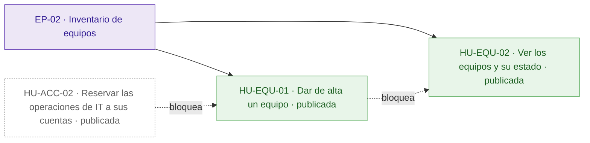
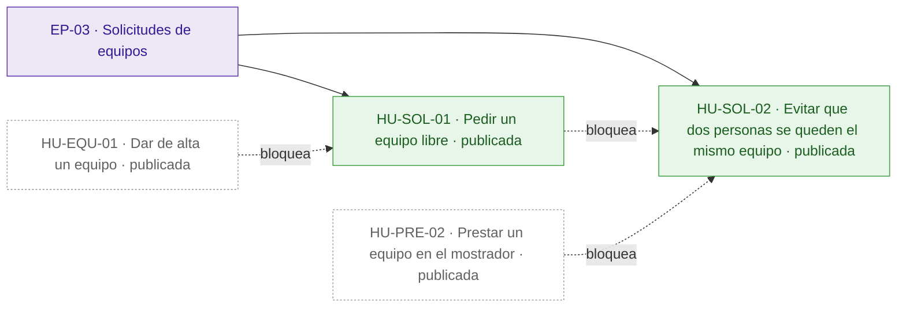
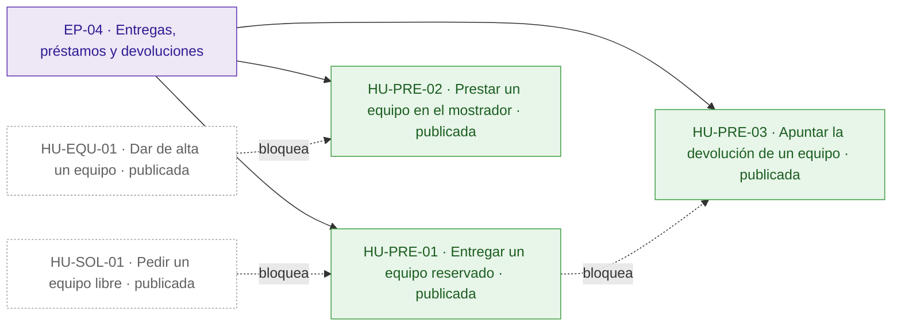
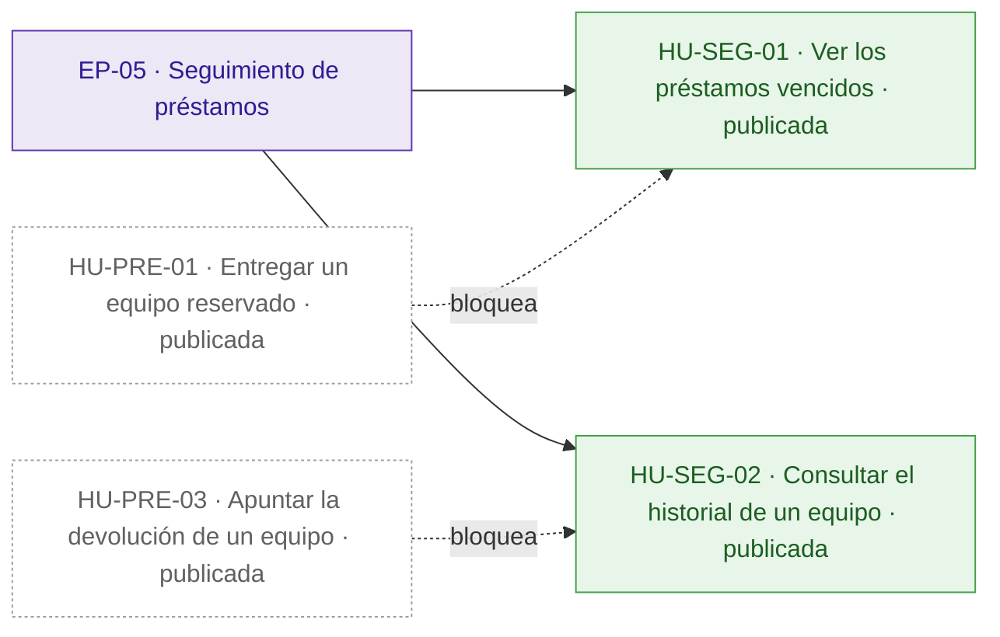
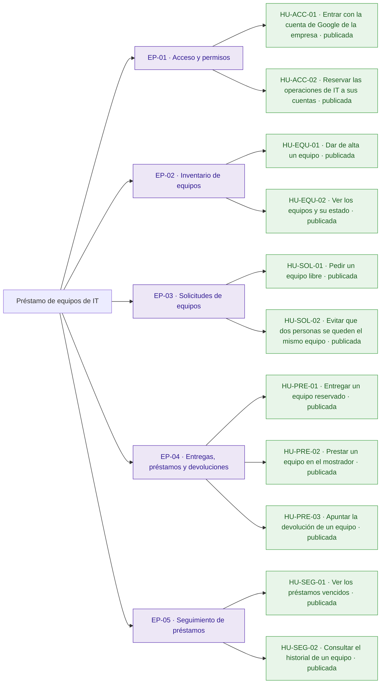
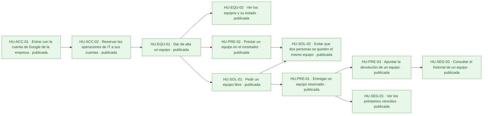
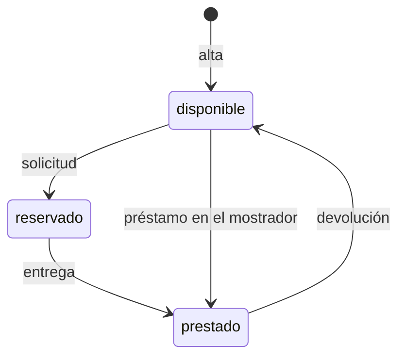

# Préstamo de equipos de IT

Hoy los préstamos de portátiles, monitores y proyectores se apuntan en una hoja de cálculo y se piden por correo a IT: nadie sabe qué está libre sin preguntar, dos personas acaban esperando el mismo portátil y los vencimientos pasan desapercibidos.

La aplicación permite a los empleados ver los equipos y pedir uno libre, y a IT darlos de alta, entregarlos, prestarlos en el mostrador, apuntar las devoluciones, ver los vencidos y consultar el historial. El inventario de IT se conecta por una API fijada por el cliente, que no puede cambiar. Quedan fuera la anulación de solicitudes y los avisos por correo de vencimientos.

## Visión y alcance

Que los empleados vean qué equipos de la oficina están libres y los pidan prestados, y que IT gestione altas, entregas, devoluciones y vencimientos sin que ningún equipo se preste dos veces.

**Dentro del alcance**

- Ver los equipos con su estado (\`disponible\`, \`reservado\` o \`prestado\`) y, si están reservados o prestados, la persona y la fecha de devolución (peticion.md).
- Pedir un equipo libre indicando la fecha de devolución; queda reservado a nombre de quien lo pide hasta que IT lo entrega (peticion.md).
- Quien pide un equipo no puede poner una fecha de devolución anterior a hoy (peticion.md, anexo).
- Dar de alta equipos, solo IT; el nombre es obligatorio y único, y dos nombres son el mismo si solo se diferencian en mayúsculas o en espacios al principio o al final (peticion.md, anexo).
- Entregar un equipo reservado, solo IT: pasa a prestado con la misma persona y fecha de devolución (peticion.md, anexo).
- Prestar en el mostrador, solo IT, a una persona con fecha de devolución, que puede ser anterior a hoy; un préstamo así ya aparece entre los vencidos (peticion.md, anexo).
- Apuntar la devolución, solo IT: el equipo vuelve a disponible sin persona ni fecha (peticion.md, anexo).
- Ver los préstamos vencidos, solo IT: los equipos prestados con fecha de devolución anterior a hoy, del más antiguo al más reciente (peticion.md, anexo).
- Consultar el historial de un equipo, solo IT: sus préstamos del más reciente al más antiguo, con persona, fecha de devolución y estado (\`reservado\`, \`prestado\` o \`devuelto\`) (peticion.md, anexo).
- Un equipo no puede estar reservado o prestado dos veces a la vez, ni siquiera con dos peticiones simultáneas: una sale bien y la otra recibe 409 (peticion.md, anexo).
- La fecha de devolución va como texto \`AAAA-MM-DD\`, tiene que ser una fecha que exista y «hoy» es el día en Madrid (peticion.md, anexo).

**Fuera del alcance**

- Que los empleados anulen una solicitud (peticion.md).
- Avisos por correo de préstamos vencidos (peticion.md).

## Resumen en cifras

| Dato | Valor |
| --- | --- |
| Épicas | 5 |
| Historias | 11 |
| Historias por estado | borrador 0, aprobada 0, descartada 0, publicada 11 |
| Tareas | 34 |
| Sprints | 1 |
| Personas en el equipo | 1 |
| Modalidad de desarrollo | manual, sin IA |
| Horas estimadas | 54 h |
| Horas efectivas (según la modalidad de desarrollo) | 54 h |
| Historias sin estimar | 0 |
| Historias descartadas (fuera de las horas) | 0 |
| Supuestos | 9 |
| Preguntas abiertas | 6 |
| Requisitos | 14 |
| Requisitos sin historia | 0 |

## Índice

- [Visión y alcance](#visión-y-alcance)
- [Resumen en cifras](#resumen-en-cifras)
- [Épicas e historias](#épicas-e-historias)
  - [EP-01 · Acceso y permisos](#ep-01--acceso-y-permisos)
  - [EP-02 · Inventario de equipos](#ep-02--inventario-de-equipos)
  - [EP-03 · Solicitudes de equipos](#ep-03--solicitudes-de-equipos)
  - [EP-04 · Entregas, préstamos y devoluciones](#ep-04--entregas-préstamos-y-devoluciones)
  - [EP-05 · Seguimiento de préstamos](#ep-05--seguimiento-de-préstamos)
- [Tareas](#tareas)
- [Sprints](#sprints)
- [Equipo](#equipo)
- [Dependencias](#dependencias)
- [Requisitos y trazabilidad](#requisitos-y-trazabilidad)
- [Preparación y definición de hecho](#preparación-y-definición-de-hecho)
- [Diagramas](#diagramas)
- [Supuestos](#supuestos)
- [Preguntas abiertas](#preguntas-abiertas)
- [Decisiones](#decisiones)

## Épicas e historias

### EP-01 · Acceso y permisos

Todos entran con su cuenta de Google de la empresa y solo las cuentas de IT hacen las operaciones de IT. Protege la aplicación y la API del inventario frente a cuentas sin sesión y frente a empleados que intenten hacer lo que solo le toca a IT.

#### Épica EP-01: Acceso y permisos

#### HU-ACC-01 · Entrar con la cuenta de Google de la empresa

Como empleado, quiero usar la aplicación con mi cuenta de Google de la empresa, para que solo las personas de la empresa vean y pidan equipos, sin otra contraseña que recordar.

**Contexto.** Todas las rutas de la API necesitan haber iniciado sesión con el token de identidad de Google, con el correo verificado y emitido para el cliente OAuth de la aplicación, tanto de una persona como de una cuenta de servicio (RQ.012, peticion.md, anexo). La persona de cada operación es el correo del token.

- **Prioridad:** Highest
- **Tamaño:** L
- **Horas:** 8 h estimadas · 8 h efectivas
- **Estado:** publicada
- **Sprint:** SP-01 Sprint 1
- **Responsable:** José Luis Calvo
- **Tipo:** historia
- **Puntos de historia:** 5
- **Preparación:** parcialmente lista (pendiente: DoR-08: dependencias externas sin plan confirmado: Cliente OAuth de Google de la aplicación · supuestos sin confirmar: DoR-04, DoR-05, DoR-06, DoR-07, DoR-09)
- **Requisitos:** RQ.012, RQ.014
- **Dependencias externas:** Cliente OAuth de Google de la aplicación

**Criterios de aceptación**

*Escenarios positivos*

1. **Dado** la empleada «ana.perez@empresa.com» con un token de Google válido, con el correo verificado y emitido para el cliente OAuth de la aplicación, **cuando** consulta GET /api/equipos, **entonces** recibe 200 con la lista de equipos.
2. **Dado** la cuenta de servicio del inventario «inventario@empresa.com» con un token de Google válido, con el correo verificado y emitido para el cliente OAuth de la aplicación, **cuando** consulta GET /api/equipos, **entonces** recibe 200 con la lista de equipos.

*Escenarios negativos*

1. **Dado** una petición sin token de Google, **cuando** llega a GET /api/equipos, **entonces** recibe 401 con {"error": "Inicia sesión con Google."}.
2. **Dado** un token de Google de «ana.perez@empresa.com» con el correo sin verificar, **cuando** llega a GET /api/equipos, **entonces** recibe 401 con {"error": "Inicia sesión con Google."}.
3. **Dado** un token de Google emitido para otro cliente OAuth, **cuando** llega a POST /api/equipos/eq-1/solicitud, **entonces** recibe 401 con {"error": "Inicia sesión con Google."} y el equipo «eq-1» sigue disponible.

**Notas.** Depende de la pregunta abierta sobre si el acceso se limita a un dominio de Google concreto.

**Definición de hecho**

- Criterios de aceptación probados.
- Mensajes de error idénticos a los del anexo.
- Textos revisados en español de España.

**Tareas**

- TA-001 · Verificación del token de Google y del correo de la sesión en todas las rutas · backend · José Luis Calvo
- TA-002 · Inicio de sesión con Google en la aplicación web · frontend · José Luis Calvo
- TA-003 · Pruebas de las peticiones sin token y con tokens de otro cliente · QA · José Luis Calvo

#### HU-ACC-02 · Reservar las operaciones de IT a sus cuentas

Como técnico de IT, quiero hacer las operaciones de IT con mi cuenta de la lista CORREOS\_IT, para que un empleado no pueda dar de alta, entregar ni prestar equipos por su cuenta.

**Contexto.** Las operaciones marcadas «Solo IT» solo las puede hacer una cuenta de la variable de entorno CORREOS\_IT, con los correos separados por comas y fijada en la configuración del despliegue, no en el código (RQ.013, peticion.md, anexo). Dos correos son el mismo aunque cambien las mayúsculas. El inventario entra con una cuenta de servicio de esa lista.

- **Prioridad:** Highest
- **Tamaño:** M
- **Horas:** 4 h estimadas · 4 h efectivas
- **Estado:** publicada
- **Sprint:** SP-01 Sprint 1
- **Responsable:** José Luis Calvo
- **Tipo:** historia
- **Puntos de historia:** 3
- **Preparación:** parcialmente lista (pendiente: DoR-08: dependencias externas sin plan confirmado: Lista CORREOS\_IT en la configuración del despliegue; depende de HU-ACC-01, sin resolver ni planificada en un sprint anterior · supuestos sin confirmar: DoR-04, DoR-05, DoR-06, DoR-07, DoR-09)
- **Requisitos:** RQ.013, RQ.014
- **Dependencias externas:** Lista CORREOS\_IT en la configuración del despliegue
- **Depende de:**
  - HU-ACC-01 · Entrar con la cuenta de Google de la empresa: Saber si una cuenta es de IT exige conocer el correo de la sesión.

**Criterios de aceptación**

*Escenarios positivos*

1. **Dado** CORREOS\_IT con el valor «it@empresa.com,inventario@empresa.com» y una sesión de «IT@Empresa.com», **cuando** consulta GET /api/prestamos/vencidos, **entonces** recibe 200 con la lista de préstamos vencidos.

*Escenarios negativos*

1. **Dado** CORREOS\_IT con el valor «it@empresa.com» y una sesión de la empleada «ana.perez@empresa.com», **cuando** envía POST /api/equipos con {"nombre": "Portátil 07"}, **entonces** recibe 403 con {"error": "Solo IT puede hacer esto."} y no se crea ningún equipo.

**Definición de hecho**

- Criterios de aceptación probados.
- La lista de IT se lee de la configuración, no del código.
- Textos revisados en español de España.

**Tareas**

- TA-004 · Comprobación de la lista CORREOS\_IT en las operaciones de IT · backend · José Luis Calvo
- TA-005 · Pruebas de las operaciones de IT con cuentas de empleado y de IT · QA · José Luis Calvo

### EP-02 · Inventario de equipos

IT da de alta los equipos y todos ven la lista con su estado. Es la base de las solicitudes y los préstamos. Deja fuera dar de baja o editar equipos, que el anexo no define.

#### Épica EP-02: Inventario de equipos

#### HU-EQU-01 · Dar de alta un equipo

Como técnico de IT, quiero dar de alta un equipo con su nombre, para que los empleados puedan verlo y pedirlo sin duplicados en el inventario.

**Contexto.** IT da de alta los equipos con POST /api/equipos (RQ.004, peticion.md, anexo). El nombre es obligatorio y dos nombres son el mismo si solo se diferencian en mayúsculas o en espacios al principio o al final.

- **Prioridad:** Highest
- **Tamaño:** M
- **Horas:** 4 h estimadas · 4 h efectivas
- **Estado:** publicada
- **Sprint:** SP-01 Sprint 1
- **Responsable:** José Luis Calvo
- **Tipo:** historia
- **Puntos de historia:** 3
- **Preparación:** parcialmente lista (pendiente: DoR-08: depende de HU-ACC-02, sin resolver ni planificada en un sprint anterior · supuestos sin confirmar: DoR-04, DoR-05, DoR-06, DoR-07, DoR-09)
- **Requisitos:** RQ.004, RQ.014
- **Depende de:**
  - HU-ACC-02 · Reservar las operaciones de IT a sus cuentas: El alta es una operación solo de IT.

**Criterios de aceptación**

*Escenarios positivos*

1. **Dado** un técnico de IT y ningún equipo llamado «Portátil 07», **cuando** envía POST /api/equipos con {"nombre": "Portátil 07"}, **entonces** recibe 201 con el id del equipo, el nombre «Portátil 07» y el estado «disponible».

*Escenarios negativos*

1. **Dado** un técnico de IT y el equipo «Portátil 07» ya dado de alta, **cuando** envía POST /api/equipos con {"nombre": " portátil 07 "}, **entonces** recibe 409 con {"error": "Ya hay un equipo con ese nombre"} y no se crea ningún equipo.
2. **Dado** un técnico de IT, **cuando** envía POST /api/equipos con {"nombre": ""}, **entonces** recibe 400 con {"error": "Falta el nombre del equipo"}.
3. **Dado** un técnico de IT, **cuando** envía POST /api/equipos con {}, **entonces** recibe 400 con {"error": "Falta el nombre del equipo"}.

**Definición de hecho**

- Criterios de aceptación probados.
- Mensajes de error idénticos a los del anexo.
- Textos revisados en español de España.

**Tareas**

- TA-006 · Registro de equipos con nombre normalizado único · datos · José Luis Calvo
- TA-007 · Ruta POST /api/equipos con sus errores · backend · José Luis Calvo
- TA-008 · Formulario de alta de equipos para IT · frontend · José Luis Calvo
- TA-009 · Pruebas del alta, del nombre vacío y del nombre repetido · QA · José Luis Calvo

#### HU-EQU-02 · Ver los equipos y su estado

Como empleado, quiero ver la lista de equipos con su estado, para saber qué está libre sin preguntar a IT.

**Contexto.** Cualquier empleado ve los equipos y su estado con GET /api/equipos (RQ.001, peticion.md, anexo). Si un equipo está reservado o prestado, también se ve la persona y la fecha de devolución.

- **Prioridad:** Highest
- **Tamaño:** S
- **Horas:** 2 h estimadas · 2 h efectivas
- **Estado:** publicada
- **Sprint:** SP-01 Sprint 1
- **Responsable:** José Luis Calvo
- **Tipo:** historia
- **Puntos de historia:** 2
- **Preparación:** parcialmente lista (pendiente: DoR-08: depende de HU-EQU-01, sin resolver ni planificada en un sprint anterior · supuestos sin confirmar: DoR-04, DoR-05, DoR-06, DoR-07, DoR-09)
- **Requisitos:** RQ.001, RQ.014
- **Depende de:**
  - HU-EQU-01 · Dar de alta un equipo: La lista muestra los equipos dados de alta.

**Criterios de aceptación**

*Escenarios positivos*

1. **Dado** el equipo «Portátil 07» disponible y el «Monitor 02» prestado a «ana.perez@empresa.com» hasta el 2026-11-20, **cuando** un empleado consulta GET /api/equipos, **entonces** recibe 200 con «Portátil 07» en estado «disponible» sin persona ni devolución, y «Monitor 02» en estado «prestado» con persona «ana.perez@empresa.com» y devolución «2026-11-20».

*Escenarios negativos*

1. **Dado** ningún equipo dado de alta, **cuando** un empleado consulta GET /api/equipos, **entonces** recibe 200 con una lista vacía.

**Definición de hecho**

- Criterios de aceptación probados.
- Textos revisados en español de España.

**Tareas**

- TA-010 · Ruta GET /api/equipos con persona y devolución · backend · José Luis Calvo
- TA-011 · Lista de equipos con su estado · frontend · José Luis Calvo
- TA-012 · Pruebas de la lista con equipos en cada estado · QA · José Luis Calvo

### EP-03 · Solicitudes de equipos

Un empleado pide un equipo libre con la fecha de devolución y queda reservado a su nombre hasta que IT se lo entrega, sin que dos peticiones simultáneas se queden con el mismo equipo. Deja fuera que el empleado anule una solicitud.

#### Épica EP-03: Solicitudes de equipos

#### HU-SOL-01 · Pedir un equipo libre

Como empleado, quiero pedir un equipo libre indicando la fecha en que lo devolveré, para tenerlo reservado a mi nombre hasta que IT me lo entregue, sin escribir correos.

**Contexto.** Un empleado pide un equipo libre con POST /api/equipos/{id}/solicitud y queda reservado a su nombre hasta que IT se lo entrega (RQ.002, peticion.md). La fecha de devolución va como texto AAAA-MM-DD, tiene que existir y no puede ser anterior a hoy, que es el día en Madrid (RQ.003 y RQ.011, peticion.md, anexo).

- **Prioridad:** Highest
- **Tamaño:** L
- **Horas:** 8 h estimadas · 8 h efectivas
- **Estado:** publicada
- **Sprint:** SP-01 Sprint 1
- **Responsable:** José Luis Calvo
- **Tipo:** historia
- **Puntos de historia:** 5
- **Preparación:** parcialmente lista (pendiente: DoR-08: depende de HU-EQU-01, sin resolver ni planificada en un sprint anterior · supuestos sin confirmar: DoR-04, DoR-05, DoR-06, DoR-07, DoR-09)
- **Requisitos:** RQ.002, RQ.003, RQ.011, RQ.014
- **Depende de:**
  - HU-EQU-01 · Dar de alta un equipo: Pedir un equipo exige que esté dado de alta.

**Criterios de aceptación**

*Escenarios positivos*

1. **Dado** hoy es 2026-11-09 en Madrid y el equipo «eq-7» está disponible, **cuando** la empleada «ana.perez@empresa.com» envía POST /api/equipos/eq-7/solicitud con {"devolucion": "2026-11-20"}, **entonces** recibe 201 con el equipo en estado «reservado», persona «ana.perez@empresa.com» y devolución «2026-11-20».
2. **Dado** hoy es 2026-11-09 en Madrid y el equipo «eq-7» está disponible, **cuando** la empleada «ana.perez@empresa.com» envía POST /api/equipos/eq-7/solicitud con {"devolucion": "2026-11-09"}, **entonces** recibe 201 con el equipo en estado «reservado» y devolución «2026-11-09».

*Escenarios negativos*

1. **Dado** hoy es 2026-11-09 en Madrid y el equipo «eq-7» está disponible, **cuando** un empleado envía POST /api/equipos/eq-7/solicitud con {"devolucion": "2026-11-08"}, **entonces** recibe 400 con {"error": "La fecha de devolución ya ha pasado"} y el equipo sigue disponible.
2. **Dado** el equipo «eq-7» está disponible, **cuando** un empleado envía POST /api/equipos/eq-7/solicitud con {"devolucion": "2026-02-30"}, **entonces** recibe 400 con {"error": "La fecha de devolución no es válida"}.
3. **Dado** el equipo «eq-7» está disponible, **cuando** un empleado envía POST /api/equipos/eq-7/solicitud con {}, **entonces** recibe 400 con {"error": "Falta la fecha de devolución"}.
4. **Dado** el equipo «eq-7» está prestado, **cuando** un empleado envía POST /api/equipos/eq-7/solicitud con {"devolucion": "2026-11-20"}, **entonces** recibe 409 con {"error": "El equipo no está disponible"}.
5. **Dado** no existe ningún equipo «eq-99», **cuando** un empleado envía POST /api/equipos/eq-99/solicitud con {"devolucion": "2026-11-20"}, **entonces** recibe 404 con {"error": "No existe el equipo"}.

**Notas.** Depende de las preguntas abiertas sobre la caducidad de las reservas y el límite de días de préstamo.

**Definición de hecho**

- Criterios de aceptación probados.
- Mensajes de error idénticos a los del anexo.
- Textos revisados en español de España.

**Tareas**

- TA-013 · Ruta de solicitud con la validación de la fecha en Madrid · backend · José Luis Calvo
- TA-014 · Botón y formulario para pedir un equipo · frontend · José Luis Calvo
- TA-015 · Pruebas de la solicitud y de cada error · QA · José Luis Calvo

#### HU-SOL-02 · Evitar que dos personas se queden el mismo equipo

Como empleado, quiero pedir un equipo libre aunque otra persona lo pida en el mismo instante, para no ir a recoger un equipo que en realidad tiene otra persona.

**Contexto.** Un equipo no puede estar reservado o prestado dos veces a la vez. Si llegan dos peticiones a la vez para el mismo equipo disponible, sean solicitudes o préstamos en el mostrador, una sale bien y la otra recibe 409 (RQ.010, peticion.md, anexo). Es la preocupación principal de la petición.

- **Prioridad:** Highest
- **Tamaño:** L
- **Horas:** 8 h estimadas · 8 h efectivas
- **Estado:** publicada
- **Sprint:** SP-01 Sprint 1
- **Responsable:** José Luis Calvo
- **Tipo:** historia
- **Puntos de historia:** 5
- **Preparación:** parcialmente lista (pendiente: DoR-08: depende de HU-SOL-01, HU-PRE-02, sin resolver ni planificada en un sprint anterior · supuestos sin confirmar: DoR-04, DoR-05, DoR-06, DoR-07, DoR-09)
- **Requisitos:** RQ.010
- **Depende de:**
  - HU-SOL-01 · Pedir un equipo libre: La garantía se prueba sobre las solicitudes.
  - HU-PRE-02 · Prestar un equipo en el mostrador: También cubre los préstamos en el mostrador.

**Criterios de aceptación**

*Escenarios positivos*

1. **Dado** el equipo «eq-7» disponible, **cuando** llegan a la vez una solicitud de «ana.perez@empresa.com» y otra de «luis.gomez@empresa.com» para «eq-7», **entonces** una recibe 201 con el equipo reservado a su nombre, la otra recibe 409 con {"error": "El equipo no está disponible"} y GET /api/equipos muestra «eq-7» reservado a una sola persona.

*Escenarios negativos*

1. **Dado** el equipo «eq-7» disponible, **cuando** llegan a la vez dos préstamos en el mostrador de «eq-7», uno a «ana.perez@empresa.com» y otro a «luis.gomez@empresa.com», **entonces** uno recibe 201, el otro recibe 409 con {"error": "El equipo no está disponible"} y GET /api/equipos muestra «eq-7» prestado a una sola persona.

**Definición de hecho**

- Criterios de aceptación probados con peticiones simultáneas.
- Textos revisados en español de España.

**Tareas**

- TA-016 · Registro del préstamo activo de cada equipo a prueba de peticiones simultáneas · datos · José Luis Calvo
- TA-017 · Solicitud y préstamo en una transacción sobre el equipo · backend · José Luis Calvo
- TA-018 · Pruebas de peticiones simultáneas sobre el mismo equipo · QA · José Luis Calvo

### EP-04 · Entregas, préstamos y devoluciones

IT entrega los equipos reservados, presta en el mostrador y apunta las devoluciones, de modo que el estado de cada equipo refleja quién lo tiene.

#### Épica EP-04: Entregas, préstamos y devoluciones

#### HU-PRE-01 · Entregar un equipo reservado

Como técnico de IT, quiero apuntar la entrega de un equipo reservado, para que conste como prestado a la persona que lo pidió, con su fecha de devolución.

**Contexto.** IT entrega los equipos reservados con POST /api/equipos/{id}/entrega; el equipo pasa a prestado con la misma persona y fecha de devolución de la solicitud (RQ.005, peticion.md, anexo).

- **Prioridad:** Highest
- **Tamaño:** M
- **Horas:** 4 h estimadas · 4 h efectivas
- **Estado:** publicada
- **Sprint:** SP-01 Sprint 1
- **Responsable:** José Luis Calvo
- **Tipo:** historia
- **Puntos de historia:** 3
- **Preparación:** parcialmente lista (pendiente: DoR-08: depende de HU-SOL-01, sin resolver ni planificada en un sprint anterior · supuestos sin confirmar: DoR-04, DoR-05, DoR-06, DoR-07, DoR-09)
- **Requisitos:** RQ.005, RQ.014
- **Depende de:**
  - HU-SOL-01 · Pedir un equipo libre: Solo se entrega un equipo que alguien ha pedido.

**Criterios de aceptación**

*Escenarios positivos*

1. **Dado** el equipo «eq-7» reservado por «ana.perez@empresa.com» hasta el 2026-11-20, **cuando** un técnico de IT envía POST /api/equipos/eq-7/entrega, **entonces** recibe 200 con el equipo en estado «prestado», persona «ana.perez@empresa.com» y devolución «2026-11-20».

*Escenarios negativos*

1. **Dado** el equipo «eq-7» disponible, **cuando** un técnico de IT envía POST /api/equipos/eq-7/entrega, **entonces** recibe 409 con {"error": "El equipo no está reservado"} y el equipo sigue disponible.
2. **Dado** no existe ningún equipo «eq-99», **cuando** un técnico de IT envía POST /api/equipos/eq-99/entrega, **entonces** recibe 404 con {"error": "No existe el equipo"}.

**Definición de hecho**

- Criterios de aceptación probados.
- Mensajes de error idénticos a los del anexo.
- Textos revisados en español de España.

**Tareas**

- TA-019 · Ruta de entrega de un equipo reservado · backend · José Luis Calvo
- TA-020 · Acción de entregar en la lista de IT · frontend · José Luis Calvo
- TA-021 · Pruebas de la entrega y de sus errores · QA · José Luis Calvo

#### HU-PRE-02 · Prestar un equipo en el mostrador

Como técnico de IT, quiero prestar un equipo disponible a quien viene al mostrador, para que el préstamo quede apuntado aunque la persona no lo haya pedido antes en la aplicación.

**Contexto.** IT presta directamente con POST /api/equipos/{id}/prestamo a una persona con fecha de devolución (RQ.006, peticion.md, anexo). IT sí puede poner una fecha anterior a hoy, porque a veces apunta los préstamos con retraso; un préstamo así ya aparece entre los vencidos. La fecha tiene que existir (RQ.011).

- **Prioridad:** Highest
- **Tamaño:** M
- **Horas:** 4 h estimadas · 4 h efectivas
- **Estado:** publicada
- **Sprint:** SP-01 Sprint 1
- **Responsable:** José Luis Calvo
- **Tipo:** historia
- **Puntos de historia:** 3
- **Preparación:** parcialmente lista (pendiente: DoR-08: depende de HU-EQU-01, sin resolver ni planificada en un sprint anterior · supuestos sin confirmar: DoR-04, DoR-05, DoR-06, DoR-07, DoR-09)
- **Requisitos:** RQ.006, RQ.011, RQ.014
- **Depende de:**
  - HU-EQU-01 · Dar de alta un equipo: Prestar un equipo exige que esté dado de alta.

**Criterios de aceptación**

*Escenarios positivos*

1. **Dado** el equipo «eq-7» disponible, **cuando** un técnico de IT envía POST /api/equipos/eq-7/prestamo con {"persona": "ana.perez@empresa.com", "devolucion": "2026-11-20"}, **entonces** recibe 201 con el equipo en estado «prestado», persona «ana.perez@empresa.com» y devolución «2026-11-20».
2. **Dado** hoy es 2026-11-09 en Madrid y el equipo «eq-7» disponible, **cuando** un técnico de IT envía POST /api/equipos/eq-7/prestamo con {"persona": "ana.perez@empresa.com", "devolucion": "2026-11-05"}, **entonces** recibe 201 con el equipo prestado hasta el 2026-11-05 y el préstamo aparece entre los vencidos.

*Escenarios negativos*

1. **Dado** el equipo «eq-7» disponible, **cuando** un técnico de IT envía POST /api/equipos/eq-7/prestamo con {"devolucion": "2026-11-20"}, **entonces** recibe 400 con {"error": "Faltan la persona o la fecha de devolución"}.
2. **Dado** el equipo «eq-7» disponible, **cuando** un técnico de IT envía POST /api/equipos/eq-7/prestamo con {"persona": "ana.perez@empresa.com", "devolucion": "2026-02-30"}, **entonces** recibe 400 con {"error": "La fecha de devolución no es válida"}.
3. **Dado** el equipo «eq-7» reservado por «luis.gomez@empresa.com», **cuando** un técnico de IT envía POST /api/equipos/eq-7/prestamo con {"persona": "ana.perez@empresa.com", "devolucion": "2026-11-20"}, **entonces** recibe 409 con {"error": "El equipo no está disponible"}.
4. **Dado** no existe ningún equipo «eq-99», **cuando** un técnico de IT envía POST /api/equipos/eq-99/prestamo con {"persona": "ana.perez@empresa.com", "devolucion": "2026-11-20"}, **entonces** recibe 404 con {"error": "No existe el equipo"}.

**Definición de hecho**

- Criterios de aceptación probados.
- Mensajes de error idénticos a los del anexo.
- Textos revisados en español de España.

**Tareas**

- TA-022 · Ruta de préstamo en el mostrador con fecha pasada permitida · backend · José Luis Calvo
- TA-023 · Formulario de préstamo en el mostrador · frontend · José Luis Calvo
- TA-024 · Pruebas del préstamo en el mostrador y de sus errores · QA · José Luis Calvo

#### HU-PRE-03 · Apuntar la devolución de un equipo

Como técnico de IT, quiero apuntar que un equipo prestado se ha devuelto, para que vuelva a estar libre para el siguiente empleado.

**Contexto.** IT apunta las devoluciones con POST /api/equipos/{id}/devolucion; el equipo vuelve a disponible, sin persona ni fecha de devolución (RQ.007, peticion.md, anexo).

- **Prioridad:** Highest
- **Tamaño:** M
- **Horas:** 4 h estimadas · 4 h efectivas
- **Estado:** publicada
- **Sprint:** SP-01 Sprint 1
- **Responsable:** José Luis Calvo
- **Tipo:** historia
- **Puntos de historia:** 3
- **Preparación:** parcialmente lista (pendiente: DoR-08: depende de HU-PRE-01, sin resolver ni planificada en un sprint anterior · supuestos sin confirmar: DoR-04, DoR-05, DoR-06, DoR-07, DoR-09)
- **Requisitos:** RQ.007, RQ.014
- **Depende de:**
  - HU-PRE-01 · Entregar un equipo reservado: Solo se devuelve un equipo prestado.

**Criterios de aceptación**

*Escenarios positivos*

1. **Dado** el equipo «eq-7» prestado a «ana.perez@empresa.com» hasta el 2026-11-20, **cuando** un técnico de IT envía POST /api/equipos/eq-7/devolucion, **entonces** recibe 200 con el equipo en estado «disponible», sin persona ni devolución.

*Escenarios negativos*

1. **Dado** el equipo «eq-7» reservado por «ana.perez@empresa.com», **cuando** un técnico de IT envía POST /api/equipos/eq-7/devolucion, **entonces** recibe 409 con {"error": "El equipo no está prestado"} y el equipo sigue reservado.
2. **Dado** no existe ningún equipo «eq-99», **cuando** un técnico de IT envía POST /api/equipos/eq-99/devolucion, **entonces** recibe 404 con {"error": "No existe el equipo"}.

**Definición de hecho**

- Criterios de aceptación probados.
- Mensajes de error idénticos a los del anexo.
- Textos revisados en español de España.

**Tareas**

- TA-025 · Ruta de devolución y cierre del préstamo en el historial · backend · José Luis Calvo
- TA-026 · Acción de apuntar la devolución en la lista de IT · frontend · José Luis Calvo
- TA-027 · Pruebas de la devolución y de sus errores · QA · José Luis Calvo

### EP-05 · Seguimiento de préstamos

IT ve los préstamos vencidos y el historial de cada equipo sin tener que preguntar a nadie. Deja fuera los avisos por correo de préstamos vencidos.

#### Épica EP-05: Seguimiento de préstamos

#### HU-SEG-01 · Ver los préstamos vencidos

Como técnico de IT, quiero ver los préstamos cuya fecha de devolución ya ha pasado, para reclamar los equipos cada semana sin preguntar a nadie.

**Contexto.** IT ve con GET /api/prestamos/vencidos los equipos prestados cuya fecha de devolución es anterior a hoy, del más antiguo al más reciente (RQ.008, peticion.md, anexo). «Hoy» es el día en Madrid (RQ.011). Es una de las métricas de éxito: IT revisa los vencidos cada semana.

- **Prioridad:** Highest
- **Tamaño:** M
- **Horas:** 4 h estimadas · 4 h efectivas
- **Estado:** publicada
- **Sprint:** SP-01 Sprint 1
- **Responsable:** José Luis Calvo
- **Tipo:** historia
- **Puntos de historia:** 3
- **Preparación:** parcialmente lista (pendiente: DoR-08: depende de HU-PRE-01, sin resolver ni planificada en un sprint anterior · supuestos sin confirmar: DoR-04, DoR-05, DoR-06, DoR-07, DoR-09)
- **Requisitos:** RQ.008, RQ.011, RQ.014
- **Depende de:**
  - HU-PRE-01 · Entregar un equipo reservado: Los vencidos son equipos prestados; la entrega los deja en prestado.

**Criterios de aceptación**

*Escenarios positivos*

1. **Dado** hoy es 2026-11-09 en Madrid, «Portátil 07» prestado hasta el 2026-11-05, «Monitor 02» prestado hasta el 2026-11-01 y «Proyector 01» prestado hasta el 2026-11-09, **cuando** un técnico de IT consulta GET /api/prestamos/vencidos, **entonces** recibe 200 con «Monitor 02» y después «Portátil 07», cada uno con id, nombre, persona y devolución, y sin «Proyector 01».

*Escenarios negativos*

1. **Dado** hoy es 2026-11-09 en Madrid y el equipo «Portátil 07» reservado hasta el 2026-11-05, **cuando** un técnico de IT consulta GET /api/prestamos/vencidos, **entonces** recibe 200 con una lista vacía.

**Definición de hecho**

- Criterios de aceptación probados.
- Textos revisados en español de España.

**Tareas**

- TA-028 · Ruta GET /api/prestamos/vencidos ordenada por fecha · backend · José Luis Calvo
- TA-029 · Pantalla de préstamos vencidos para IT · frontend · José Luis Calvo
- TA-030 · Pruebas de los vencidos con fechas en el límite de hoy · QA · José Luis Calvo

#### HU-SEG-02 · Consultar el historial de un equipo

Como técnico de IT, quiero consultar el historial de préstamos de un equipo, para saber quién lo ha tenido y cuándo, sin buscar en la hoja de cálculo.

**Contexto.** IT consulta con GET /api/equipos/{id}/historial los préstamos de un equipo, del más reciente al más antiguo, cada uno con persona, fecha de devolución y estado reservado, prestado o devuelto (RQ.009, peticion.md, anexo).

- **Prioridad:** High
- **Tamaño:** M
- **Horas:** 4 h estimadas · 4 h efectivas
- **Estado:** publicada
- **Sprint:** SP-01 Sprint 1
- **Responsable:** José Luis Calvo
- **Tipo:** historia
- **Puntos de historia:** 3
- **Preparación:** parcialmente lista (pendiente: DoR-08: depende de HU-PRE-03, sin resolver ni planificada en un sprint anterior · supuestos sin confirmar: DoR-04, DoR-05, DoR-06, DoR-07, DoR-09)
- **Requisitos:** RQ.009, RQ.014
- **Depende de:**
  - HU-PRE-03 · Apuntar la devolución de un equipo: El estado «devuelto» del historial lo deja la devolución.

**Criterios de aceptación**

*Escenarios positivos*

1. **Dado** el equipo «eq-7» prestado a «ana.perez@empresa.com» hasta el 2026-10-15 y devuelto, y después reservado por «luis.gomez@empresa.com» hasta el 2026-11-20, **cuando** un técnico de IT consulta GET /api/equipos/eq-7/historial, **entonces** recibe 200 con primero el de «luis.gomez@empresa.com» en estado «reservado» y después el de «ana.perez@empresa.com» en estado «devuelto».

*Escenarios negativos*

1. **Dado** no existe ningún equipo «eq-99», **cuando** un técnico de IT consulta GET /api/equipos/eq-99/historial, **entonces** recibe 404 con {"error": "No existe el equipo"}.

**Definición de hecho**

- Criterios de aceptación probados.
- Mensajes de error idénticos a los del anexo.
- Textos revisados en español de España.

**Tareas**

- TA-031 · Consulta del registro de préstamos de cada equipo ya guardado, ordenada del más reciente al más antiguo · datos · José Luis Calvo
- TA-032 · Ruta GET /api/equipos/{id}/historial · backend · José Luis Calvo
- TA-033 · Pantalla del historial de un equipo · frontend · José Luis Calvo
- TA-034 · Pruebas del orden del historial y del equipo inexistente · QA · José Luis Calvo

## Tareas

| ID | Título | Historia | Disciplina | Descripción | Responsable | Horas estimadas | Horas efectivas |
| --- | --- | --- | --- | --- | --- | --- | --- |
| TA-001 | Verificación del token de Google y del correo de la sesión en todas las rutas | HU-ACC-01 · Entrar con la cuenta de Google de la empresa | backend |   | José Luis Calvo |   |   |
| TA-002 | Inicio de sesión con Google en la aplicación web | HU-ACC-01 · Entrar con la cuenta de Google de la empresa | frontend |   | José Luis Calvo |   |   |
| TA-003 | Pruebas de las peticiones sin token y con tokens de otro cliente | HU-ACC-01 · Entrar con la cuenta de Google de la empresa | QA |   | José Luis Calvo |   |   |
| TA-004 | Comprobación de la lista CORREOS\_IT en las operaciones de IT | HU-ACC-02 · Reservar las operaciones de IT a sus cuentas | backend |   | José Luis Calvo |   |   |
| TA-005 | Pruebas de las operaciones de IT con cuentas de empleado y de IT | HU-ACC-02 · Reservar las operaciones de IT a sus cuentas | QA |   | José Luis Calvo |   |   |
| TA-006 | Registro de equipos con nombre normalizado único | HU-EQU-01 · Dar de alta un equipo | datos |   | José Luis Calvo |   |   |
| TA-007 | Ruta POST /api/equipos con sus errores | HU-EQU-01 · Dar de alta un equipo | backend |   | José Luis Calvo |   |   |
| TA-008 | Formulario de alta de equipos para IT | HU-EQU-01 · Dar de alta un equipo | frontend |   | José Luis Calvo |   |   |
| TA-009 | Pruebas del alta, del nombre vacío y del nombre repetido | HU-EQU-01 · Dar de alta un equipo | QA |   | José Luis Calvo |   |   |
| TA-010 | Ruta GET /api/equipos con persona y devolución | HU-EQU-02 · Ver los equipos y su estado | backend |   | José Luis Calvo |   |   |
| TA-011 | Lista de equipos con su estado | HU-EQU-02 · Ver los equipos y su estado | frontend |   | José Luis Calvo |   |   |
| TA-012 | Pruebas de la lista con equipos en cada estado | HU-EQU-02 · Ver los equipos y su estado | QA |   | José Luis Calvo |   |   |
| TA-013 | Ruta de solicitud con la validación de la fecha en Madrid | HU-SOL-01 · Pedir un equipo libre | backend |   | José Luis Calvo |   |   |
| TA-014 | Botón y formulario para pedir un equipo | HU-SOL-01 · Pedir un equipo libre | frontend |   | José Luis Calvo |   |   |
| TA-015 | Pruebas de la solicitud y de cada error | HU-SOL-01 · Pedir un equipo libre | QA |   | José Luis Calvo |   |   |
| TA-016 | Registro del préstamo activo de cada equipo a prueba de peticiones simultáneas | HU-SOL-02 · Evitar que dos personas se queden el mismo equipo | datos |   | José Luis Calvo |   |   |
| TA-017 | Solicitud y préstamo en una transacción sobre el equipo | HU-SOL-02 · Evitar que dos personas se queden el mismo equipo | backend |   | José Luis Calvo |   |   |
| TA-018 | Pruebas de peticiones simultáneas sobre el mismo equipo | HU-SOL-02 · Evitar que dos personas se queden el mismo equipo | QA |   | José Luis Calvo |   |   |
| TA-019 | Ruta de entrega de un equipo reservado | HU-PRE-01 · Entregar un equipo reservado | backend |   | José Luis Calvo |   |   |
| TA-020 | Acción de entregar en la lista de IT | HU-PRE-01 · Entregar un equipo reservado | frontend |   | José Luis Calvo |   |   |
| TA-021 | Pruebas de la entrega y de sus errores | HU-PRE-01 · Entregar un equipo reservado | QA |   | José Luis Calvo |   |   |
| TA-022 | Ruta de préstamo en el mostrador con fecha pasada permitida | HU-PRE-02 · Prestar un equipo en el mostrador | backend |   | José Luis Calvo |   |   |
| TA-023 | Formulario de préstamo en el mostrador | HU-PRE-02 · Prestar un equipo en el mostrador | frontend |   | José Luis Calvo |   |   |
| TA-024 | Pruebas del préstamo en el mostrador y de sus errores | HU-PRE-02 · Prestar un equipo en el mostrador | QA |   | José Luis Calvo |   |   |
| TA-025 | Ruta de devolución y cierre del préstamo en el historial | HU-PRE-03 · Apuntar la devolución de un equipo | backend |   | José Luis Calvo |   |   |
| TA-026 | Acción de apuntar la devolución en la lista de IT | HU-PRE-03 · Apuntar la devolución de un equipo | frontend |   | José Luis Calvo |   |   |
| TA-027 | Pruebas de la devolución y de sus errores | HU-PRE-03 · Apuntar la devolución de un equipo | QA |   | José Luis Calvo |   |   |
| TA-028 | Ruta GET /api/prestamos/vencidos ordenada por fecha | HU-SEG-01 · Ver los préstamos vencidos | backend |   | José Luis Calvo |   |   |
| TA-029 | Pantalla de préstamos vencidos para IT | HU-SEG-01 · Ver los préstamos vencidos | frontend |   | José Luis Calvo |   |   |
| TA-030 | Pruebas de los vencidos con fechas en el límite de hoy | HU-SEG-01 · Ver los préstamos vencidos | QA |   | José Luis Calvo |   |   |
| TA-031 | Consulta del registro de préstamos de cada equipo ya guardado, ordenada del más reciente al más antiguo | HU-SEG-02 · Consultar el historial de un equipo | datos |   | José Luis Calvo |   |   |
| TA-032 | Ruta GET /api/equipos/{id}/historial | HU-SEG-02 · Consultar el historial de un equipo | backend |   | José Luis Calvo |   |   |
| TA-033 | Pantalla del historial de un equipo | HU-SEG-02 · Consultar el historial de un equipo | frontend |   | José Luis Calvo |   |   |
| TA-034 | Pruebas del orden del historial y del equipo inexistente | HU-SEG-02 · Consultar el historial de un equipo | QA |   | José Luis Calvo |   |   |

## Sprints

| Sprint | Fechas | Objetivo | Historias | Capacidad (h) | Carga (h efectivas) |
| --- | --- | --- | --- | --- | --- |
| SP-01 Sprint 1 | del 09/11/2026 al 20/11/2026 | Que empleados e IT gestionen todo el ciclo de préstamo de un equipo por la API fijada, sin préstamos dobles y con los vencidos y el historial a la vista. | 11 | 56 h | 54 h · 96 % |

Historias sin sprint: 0.

## Equipo

| Nombre | Rol | Dedicación | Usa un agente de IA |
| --- | --- | --- | --- |
| José Luis Calvo | Desarrollo | 100 % | sí |

*Por privacidad, este documento no incluye correos electrónicos ni usuarios de GitHub o Trello.*

## Dependencias

| Historia | Bloqueada por | Motivo |
| --- | --- | --- |
| HU-ACC-02 · Reservar las operaciones de IT a sus cuentas | HU-ACC-01 · Entrar con la cuenta de Google de la empresa | Saber si una cuenta es de IT exige conocer el correo de la sesión. |
| HU-EQU-01 · Dar de alta un equipo | HU-ACC-02 · Reservar las operaciones de IT a sus cuentas | El alta es una operación solo de IT. |
| HU-EQU-02 · Ver los equipos y su estado | HU-EQU-01 · Dar de alta un equipo | La lista muestra los equipos dados de alta. |
| HU-SOL-01 · Pedir un equipo libre | HU-EQU-01 · Dar de alta un equipo | Pedir un equipo exige que esté dado de alta. |
| HU-SOL-02 · Evitar que dos personas se queden el mismo equipo | HU-SOL-01 · Pedir un equipo libre | La garantía se prueba sobre las solicitudes. |
| HU-SOL-02 · Evitar que dos personas se queden el mismo equipo | HU-PRE-02 · Prestar un equipo en el mostrador | También cubre los préstamos en el mostrador. |
| HU-PRE-01 · Entregar un equipo reservado | HU-SOL-01 · Pedir un equipo libre | Solo se entrega un equipo que alguien ha pedido. |
| HU-PRE-02 · Prestar un equipo en el mostrador | HU-EQU-01 · Dar de alta un equipo | Prestar un equipo exige que esté dado de alta. |
| HU-PRE-03 · Apuntar la devolución de un equipo | HU-PRE-01 · Entregar un equipo reservado | Solo se devuelve un equipo prestado. |
| HU-SEG-01 · Ver los préstamos vencidos | HU-PRE-01 · Entregar un equipo reservado | Los vencidos son equipos prestados; la entrega los deja en prestado. |
| HU-SEG-02 · Consultar el historial de un equipo | HU-PRE-03 · Apuntar la devolución de un equipo | El estado «devuelto» del historial lo deja la devolución. |

## Requisitos y trazabilidad

| Requisito | Título | Tipo | Origen | Historias | Cobertura |
| --- | --- | --- | --- | --- | --- |
| RQ.001 | Ver los equipos con su estado, y la persona y la fecha de devolución si están reservados o prestados | Funcional | peticion.md | HU-EQU-02 | cubierto |
| RQ.002 | Pedir un equipo libre con la fecha de devolución; queda reservado hasta que IT lo entrega | Funcional | peticion.md | HU-SOL-01 | cubierto |
| RQ.003 | Quien pide un equipo no puede poner una fecha de devolución anterior a hoy | Funcional | peticion.md | HU-SOL-01 | cubierto |
| RQ.004 | Dar de alta equipos con nombre obligatorio y único sin distinguir mayúsculas ni espacios en los extremos | Funcional | peticion.md | HU-EQU-01 | cubierto |
| RQ.005 | Entregar un equipo reservado: pasa a prestado con la misma persona y fecha | Funcional | peticion.md | HU-PRE-01 | cubierto |
| RQ.006 | Prestar en el mostrador a una persona con fecha de devolución, que puede ser anterior a hoy | Funcional | peticion.md | HU-PRE-02 | cubierto |
| RQ.007 | Apuntar la devolución: el equipo vuelve a disponible sin persona ni fecha | Funcional | peticion.md | HU-PRE-03 | cubierto |
| RQ.008 | Ver los préstamos vencidos, del más antiguo al más reciente | Funcional | peticion.md | HU-SEG-01 | cubierto |
| RQ.009 | Consultar el historial de un equipo, del más reciente al más antiguo | Funcional | peticion.md | HU-SEG-02 | cubierto |
| RQ.010 | Un equipo no puede estar reservado o prestado dos veces a la vez, ni con peticiones simultáneas | Funcional | peticion.md | HU-SOL-02 | cubierto |
| RQ.011 | La fecha de devolución es texto AAAA-MM-DD, tiene que existir y «hoy» es el día en Madrid | Funcional | peticion.md | HU-SOL-01, HU-PRE-02, HU-SEG-01 | cubierto |
| RQ.012 | Acceso con el token de identidad de Google con correo verificado, emitido para el cliente OAuth de la aplicación | No funcional: seguridad | peticion.md | HU-ACC-01 | cubierto |
| RQ.013 | Solo las cuentas de CORREOS\_IT, fijada en el despliegue, hacen las operaciones de IT | No funcional: seguridad | peticion.md | HU-ACC-02 | cubierto |
| RQ.014 | La API es exactamente la del anexo, con errores {"error": "\<mensaje\>"} y sus mensajes exactos | No funcional: compatibilidad | peticion.md | HU-ACC-01, HU-ACC-02, HU-EQU-01, HU-EQU-02, HU-SOL-01, HU-PRE-01, HU-PRE-02, HU-PRE-03, HU-SEG-01, HU-SEG-02 | cubierto |

Requisitos sin ninguna historia: 0 de 14.

## Preparación y definición de hecho

**Definición de preparado (DoR)**

- Historia con título, descripción y valor de negocio claros.
- Trazabilidad a uno o varios RQ registrada.
- Criterios de aceptación verificables definidos.
- Reglas funcionales necesarias cerradas.
- Diseño/prototipo o referencia UI disponible cuando aplique.
- Fuentes/campos de datos identificados cuando aplique.
- Datos de prueba suficientes o estrategia de mock definida.
- Dependencias externas resueltas o plan temporal explícito.
- Permisos/roles definidos si afectan a la historia.
- La historia puede completarse razonablemente dentro de un sprint.
- No hay decisiones de negocio abiertas que impidan implementar o probar.

**Definición de hecho del proyecto (DoD)**

- Todos los criterios de aceptación implementados.
- Código revisado y mergeado conforme al flujo acordado.
- Tests unitarios y de integración asociados en verde.
- Pruebas funcionales ejecutadas correctamente.
- Comportamiento validado con los datos disponibles.
- Permisos/RLS verificados cuando corresponda.
- Rendimiento contrastado cuando el RQ lo requiera.
- Sin defectos críticos o bloqueantes asociados.
- Desplegada en el entorno previsto para el sprint.
- Trazabilidad HU → RQ → prueba/evidencia actualizada.

**Historias que no están listas del todo**

| ID | Historia | Preparación | Pendiente |
| --- | --- | --- | --- |
| HU-ACC-01 | Entrar con la cuenta de Google de la empresa | parcialmente lista | DoR-08: dependencias externas sin plan confirmado: Cliente OAuth de Google de la aplicación · supuestos sin confirmar: DoR-04, DoR-05, DoR-06, DoR-07, DoR-09 |
| HU-ACC-02 | Reservar las operaciones de IT a sus cuentas | parcialmente lista | DoR-08: dependencias externas sin plan confirmado: Lista CORREOS\_IT en la configuración del despliegue; depende de HU-ACC-01, sin resolver ni planificada en un sprint anterior · supuestos sin confirmar: DoR-04, DoR-05, DoR-06, DoR-07, DoR-09 |
| HU-EQU-01 | Dar de alta un equipo | parcialmente lista | DoR-08: depende de HU-ACC-02, sin resolver ni planificada en un sprint anterior · supuestos sin confirmar: DoR-04, DoR-05, DoR-06, DoR-07, DoR-09 |
| HU-EQU-02 | Ver los equipos y su estado | parcialmente lista | DoR-08: depende de HU-EQU-01, sin resolver ni planificada en un sprint anterior · supuestos sin confirmar: DoR-04, DoR-05, DoR-06, DoR-07, DoR-09 |
| HU-SOL-01 | Pedir un equipo libre | parcialmente lista | DoR-08: depende de HU-EQU-01, sin resolver ni planificada en un sprint anterior · supuestos sin confirmar: DoR-04, DoR-05, DoR-06, DoR-07, DoR-09 |
| HU-SOL-02 | Evitar que dos personas se queden el mismo equipo | parcialmente lista | DoR-08: depende de HU-SOL-01, HU-PRE-02, sin resolver ni planificada en un sprint anterior · supuestos sin confirmar: DoR-04, DoR-05, DoR-06, DoR-07, DoR-09 |
| HU-PRE-01 | Entregar un equipo reservado | parcialmente lista | DoR-08: depende de HU-SOL-01, sin resolver ni planificada en un sprint anterior · supuestos sin confirmar: DoR-04, DoR-05, DoR-06, DoR-07, DoR-09 |
| HU-PRE-02 | Prestar un equipo en el mostrador | parcialmente lista | DoR-08: depende de HU-EQU-01, sin resolver ni planificada en un sprint anterior · supuestos sin confirmar: DoR-04, DoR-05, DoR-06, DoR-07, DoR-09 |
| HU-PRE-03 | Apuntar la devolución de un equipo | parcialmente lista | DoR-08: depende de HU-PRE-01, sin resolver ni planificada en un sprint anterior · supuestos sin confirmar: DoR-04, DoR-05, DoR-06, DoR-07, DoR-09 |
| HU-SEG-01 | Ver los préstamos vencidos | parcialmente lista | DoR-08: depende de HU-PRE-01, sin resolver ni planificada en un sprint anterior · supuestos sin confirmar: DoR-04, DoR-05, DoR-06, DoR-07, DoR-09 |
| HU-SEG-02 | Consultar el historial de un equipo | parcialmente lista | DoR-08: depende de HU-PRE-03, sin resolver ni planificada en un sprint anterior · supuestos sin confirmar: DoR-04, DoR-05, DoR-06, DoR-07, DoR-09 |

## Diagramas

### Mapa de la iniciativa

### Dependencias entre historias

### Calendario de sprints

### Estados de un equipo

## Supuestos

- \[SUPUESTO\] Sprints de 10 días laborables, que empiezan el lunes 9 de noviembre de 2026, con 8 horas al día y un factor de foco de 0,7: el equipo no ha dado los suyos.
- \[SUPUESTO\] Modalidad de desarrollo: solo trabajo manual; el equipo no ha dicho si usará IA.
- \[SUPUESTO\] La aplicación incluye una interfaz web para empleados e IT además de la API: la petición habla de una «aplicación» en la que los empleados «ven» los equipos, pero solo define la API.
- \[SUPUESTO\] El acceso se limita a las cuentas de la empresa porque el token tiene que estar emitido para el cliente OAuth de la aplicación: la petición no dice cómo se restringe a la empresa.
- \[SUPUESTO\] El historial registra cada préstamo desde la reserva hasta la devolución: se deduce de sus estados reservado, prestado y devuelto.
- \[SUPUESTO\] Una reserva no recogida sigue reservada hasta que IT la entrega: la petición no habla de caducidad y deja fuera la anulación.
- \[SUPUESTO\] ¿Se limita el acceso a un dominio de Google concreto?: no; vale cualquier cuenta con el correo verificado y un token emitido para el cliente OAuth de la aplicación (infra/staging.tfvars: CORREOS\_IT incluye una cuenta de servicio de iam.gserviceaccount.com, fuera del dominio de la empresa, y infra/cloud\_run.tf solo fija GOOGLE\_CLIENT\_ID)
- \[SUPUESTO\] ¿Una reserva no recogida caduca alguna vez?: no; queda reservada hasta que IT la entrega (supuesto razonable: la petición no habla de caducidad y deja fuera la anulación)
- \[SUPUESTO\] ¿Hay un límite de días de préstamo o de préstamos por persona?: no; el empleado elige la fecha de devolución, que no puede ser anterior a hoy (supuesto razonable: el anexo solo exige que la fecha exista y no haya pasado)

## Preguntas abiertas

- \[alta\] ¿Hace falta una interfaz web o basta con la API para el inventario?
- \[media\] ¿Cuántos equipos y usuarios hay y qué rendimiento se espera?
- \[media\] ¿Se añaden los habilitadores transversales de la plantilla (Sprint 0, rendimiento, pentesting, UAT y despliegue)?
- \[media\] ¿Quiere el cliente una historia propia para la integración del inventario con su cuenta de servicio, o bastan los escenarios de acceso?
- \[baja\] ¿Se migran los datos de la hoja de cálculo actual?
- \[baja\] ¿Se pueden dar de baja o editar equipos? El anexo solo define el alta.

## Decisiones

- **2026-11-08 21:03** · Se crea la iniciativa «Préstamo de equipos de IT» a partir de .diverger/inbox/peticion.md, con la API del anexo copiada tal cual como API fijada por el cliente. *(supuesto)*
- **2026-11-08 21:03** · \[SUPUESTO\] La aplicación incluye una interfaz web para empleados e IT además de la API; la petición solo define la API. *(supuesto)*
- **2026-11-08 21:03** · \[SUPUESTO\] El acceso se limita a las cuentas de la empresa porque el token tiene que estar emitido para el cliente OAuth de la aplicación. *(supuesto)*
- **2026-11-08 21:03** · \[SUPUESTO\] El historial registra cada préstamo desde la reserva hasta la devolución, y una reserva no recogida sigue reservada hasta que IT la entrega. *(supuesto)*
- **2026-11-08 21:10** · \[SUPUESTO\] Backlog escrito en yolo: 5 épicas y 11 historias en borrador, con 34 tareas, auditado y revisado de estilo. *(supuesto)*
- **2026-11-08 21:10** · \[SUPUESTO\] Las tallas de las historias son una propuesta de Diverger para que el equipo las ajuste. *(supuesto)*
- **2026-11-08 21:18** · \[SUPUESTO\] ¿Se limita el acceso a un dominio de Google concreto?: no; vale cualquier cuenta con el correo verificado y un token emitido para el cliente OAuth de la aplicación (infra/staging.tfvars: CORREOS\_IT incluye una cuenta de servicio de iam.gserviceaccount.com, fuera del dominio de la empresa, y infra/cloud\_run.tf solo fija GOOGLE\_CLIENT\_ID) *(supuesto)*
- **2026-11-08 21:18** · \[SUPUESTO\] ¿Una reserva no recogida caduca alguna vez?: no; queda reservada hasta que IT la entrega (supuesto razonable: la petición no habla de caducidad y deja fuera la anulación) *(supuesto)*
- **2026-11-08 21:18** · \[SUPUESTO\] ¿Hay un límite de días de préstamo o de préstamos por persona?: no; el empleado elige la fecha de devolución, que no puede ser anterior a hoy (supuesto razonable: el anexo solo exige que la fecha exista y no haya pasado) *(supuesto)*
- **2026-11-08 21:18** · \[SUPUESTO\] HU-ACC-01, HU-ACC-02, HU-EQU-01, HU-EQU-02, HU-SOL-01, HU-SOL-02, HU-PRE-01, HU-PRE-02, HU-PRE-03, HU-SEG-01 y HU-SEG-02 aprobadas sin revisión del usuario: son válidas, no tienen problemas de calidad y las preguntas abiertas que las citaban quedan resueltas como supuestos tras confirmar los requisitos. *(supuesto)*
- **2026-11-08 21:18** · \[SUPUESTO\] DoR DoR-04 «Reglas funcionales necesarias cerradas.»: se supone cumplido — HU-ACC-01, HU-ACC-02, HU-EQU-01, HU-EQU-02, HU-SOL-01, HU-SOL-02, HU-PRE-01, HU-PRE-02, HU-PRE-03, HU-SEG-01, HU-SEG-02 *(supuesto)*
- **2026-11-08 21:18** · \[SUPUESTO\] DoR DoR-05 «Diseño/prototipo o referencia UI disponible cuando aplique.»: se supone cumplido — HU-ACC-01, HU-ACC-02, HU-EQU-01, HU-EQU-02, HU-SOL-01, HU-SOL-02, HU-PRE-01, HU-PRE-02, HU-PRE-03, HU-SEG-01, HU-SEG-02 *(supuesto)*
- **2026-11-08 21:18** · \[SUPUESTO\] DoR DoR-06 «Fuentes/campos de datos identificados cuando aplique.»: se supone cumplido — HU-ACC-01, HU-ACC-02, HU-EQU-01, HU-EQU-02, HU-SOL-01, HU-SOL-02, HU-PRE-01, HU-PRE-02, HU-PRE-03, HU-SEG-01, HU-SEG-02 *(supuesto)*
- **2026-11-08 21:18** · \[SUPUESTO\] DoR DoR-07 «Datos de prueba suficientes o estrategia de mock definida.»: se supone cumplido — HU-ACC-01, HU-ACC-02, HU-EQU-01, HU-EQU-02, HU-SOL-01, HU-SOL-02, HU-PRE-01, HU-PRE-02, HU-PRE-03, HU-SEG-01, HU-SEG-02 *(supuesto)*
- **2026-11-08 21:18** · \[SUPUESTO\] DoR DoR-09 «Permisos/roles definidos si afectan a la historia.»: se supone cumplido — HU-ACC-01, HU-ACC-02, HU-EQU-01, HU-EQU-02, HU-SOL-01, HU-SOL-02, HU-PRE-01, HU-PRE-02, HU-PRE-03, HU-SEG-01, HU-SEG-02 *(supuesto)*
- **2026-11-08 21:19** · \[SUPUESTO\] HU-ACC-01 entra en un sprint sin estar lista: Resuelto en el repositorio: infra/staging.tfvars: google\_client\_id fija el cliente OAuth de la aplicación *(supuesto)*
- **2026-11-08 21:19** · \[SUPUESTO\] HU-ACC-02 entra en un sprint sin estar lista: Resuelto en el repositorio: infra/staging.tfvars: variables\_entorno fija CORREOS\_IT en la configuración del despliegue; HU-ACC-01 se planifica antes en el mismo sprint *(supuesto)*
- **2026-11-08 21:19** · \[SUPUESTO\] HU-EQU-01 entra en un sprint sin estar lista: Supuesto razonable: HU-ACC-02 se planifica antes en el mismo sprint *(supuesto)*
- **2026-11-08 21:19** · \[SUPUESTO\] HU-EQU-02 entra en un sprint sin estar lista: Supuesto razonable: HU-EQU-01 se planifica antes en el mismo sprint *(supuesto)*
- **2026-11-08 21:19** · \[SUPUESTO\] HU-SOL-01 entra en un sprint sin estar lista: Supuesto razonable: HU-EQU-01 se planifica antes en el mismo sprint *(supuesto)*
- **2026-11-08 21:19** · \[SUPUESTO\] HU-SOL-02 entra en un sprint sin estar lista: Supuesto razonable: HU-SOL-01 y HU-PRE-02 se planifican antes en el mismo sprint *(supuesto)*
- **2026-11-08 21:19** · \[SUPUESTO\] HU-PRE-01 entra en un sprint sin estar lista: Supuesto razonable: HU-SOL-01 se planifica antes en el mismo sprint *(supuesto)*
- **2026-11-08 21:19** · \[SUPUESTO\] HU-PRE-02 entra en un sprint sin estar lista: Supuesto razonable: HU-EQU-01 se planifica antes en el mismo sprint *(supuesto)*
- **2026-11-08 21:19** · \[SUPUESTO\] HU-PRE-03 entra en un sprint sin estar lista: Supuesto razonable: HU-PRE-01 se planifica antes en el mismo sprint *(supuesto)*
- **2026-11-08 21:19** · \[SUPUESTO\] HU-SEG-01 entra en un sprint sin estar lista: Supuesto razonable: HU-PRE-01 se planifica antes en el mismo sprint *(supuesto)*
- **2026-11-08 21:19** · \[SUPUESTO\] HU-SEG-02 entra en un sprint sin estar lista: Supuesto razonable: HU-PRE-03 se planifica antes en el mismo sprint *(supuesto)*
- **2026-11-08 21:21** · Equipo cargado desde .diverger/inbox/equipo.csv: una persona (P-01, Desarrollo, dedicación completa, usa agente de IA). *(supuesto)*
- **2026-11-08 21:21** · \[SUPUESTO\] Valores del sprint: 10 días laborables, inicio el lunes 9 de noviembre de 2026, 8 horas al día y factor de foco 0,7; el equipo no ha dado los suyos. *(supuesto)*
- **2026-11-08 21:21** · \[SUPUESTO\] Modalidad de desarrollo: solo trabajo manual; el equipo no ha dicho si usará IA. *(supuesto)*
- **2026-11-08 21:21** · \[SUPUESTO\] Plan guardado: un sprint, SP-01 (9 a 20 de noviembre de 2026, 56 h de capacidad), con las 11 historias (54 h) asignadas a P-01; no se añaden dependencias nuevas. *(supuesto)*

---

*Documento generado por Diverger, de DIVERGER, a partir de backlog.json. Se reescribe en cada exportación: los cambios se hacen en el backlog, no aquí.*
