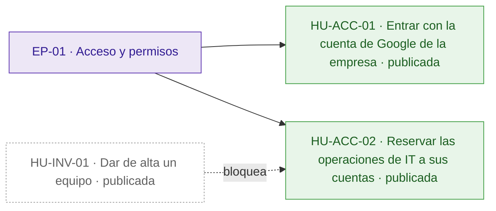
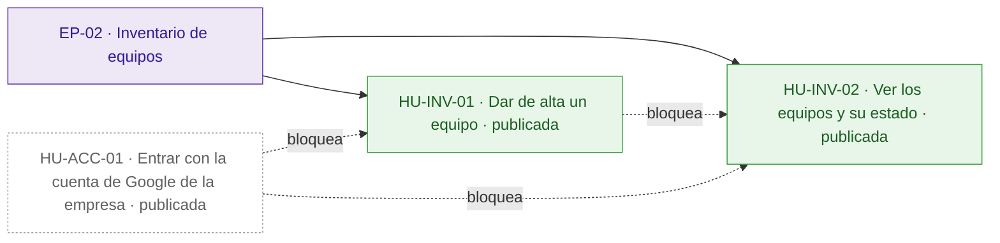
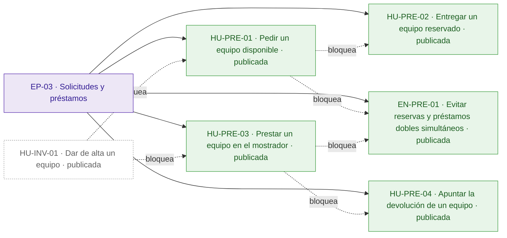
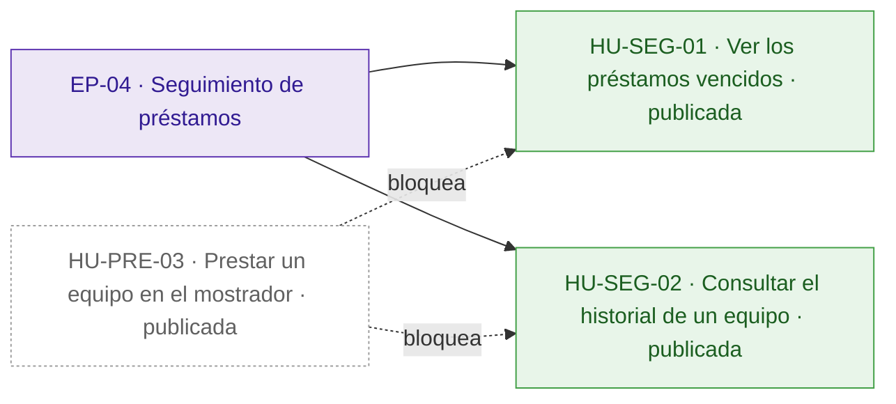
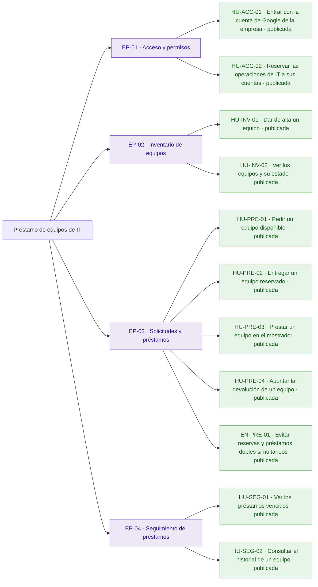
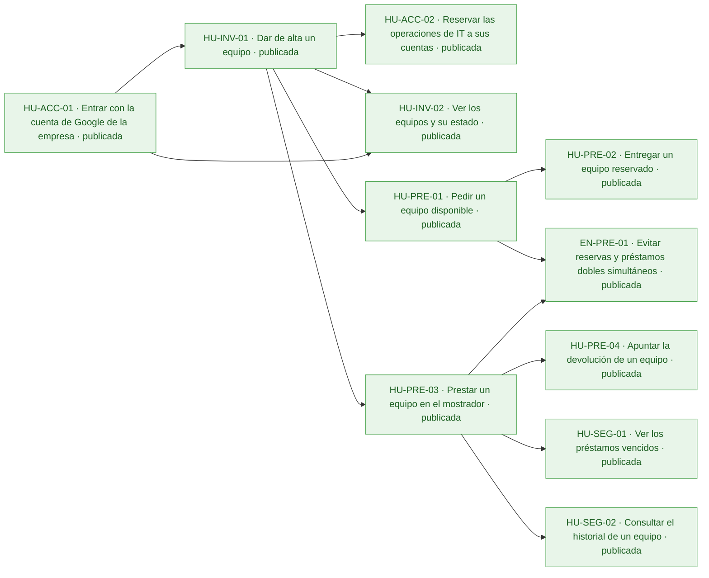
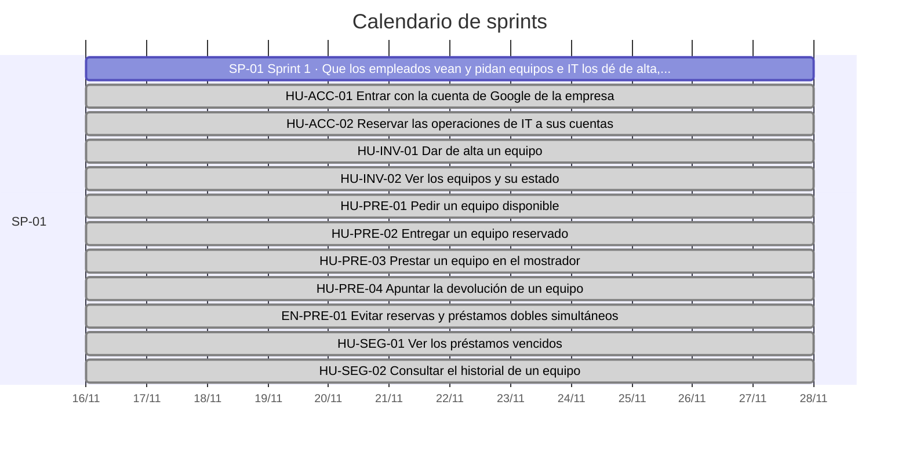
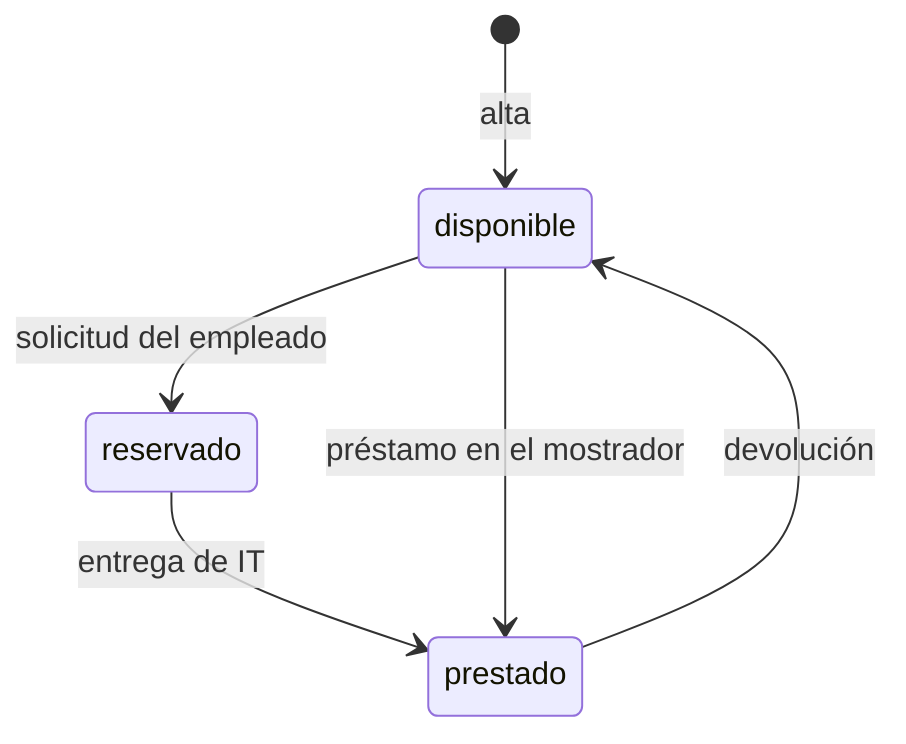

# Préstamo de equipos de IT

Hoy los préstamos de portátiles, monitores y proyectores se apuntan en una hoja de cálculo y se piden por correo a IT: nadie sabe qué está libre, dos personas esperan el mismo equipo y los vencidos solo se descubren cuando alguien echa en falta un equipo.

La aplicación permite a los empleados ver los equipos y pedir uno libre, y a IT dar de alta equipos, entregarlos, prestarlos en el mostrador, apuntar las devoluciones, ver los vencidos y consultar el historial. Todos entran con su cuenta de Google de la empresa, un equipo nunca se reserva ni se presta dos veces y el inventario de IT se conecta a una API que tiene que ser exactamente la acordada. Quedan fuera la anulación de solicitudes por parte de los empleados y los avisos por correo de vencidos.

## Visión y alcance

Que los empleados pidan y IT gestione el préstamo de los equipos de la oficina desde una aplicación, sin préstamos dobles y con los vencidos a la vista.

**Dentro del alcance**

- Ver los equipos con su estado (disponible, reservado o prestado) y, si está reservado o prestado, la persona y la fecha de devolución; lo puede hacer cualquier empleado (peticion.md).
- Pedir un equipo disponible indicando la fecha de devolución; queda reservado a nombre de quien lo pide hasta que IT se lo entrega (peticion.md).
- Dar de alta un equipo con su nombre, solo IT; no puede haber dos equipos con el mismo nombre, ignorando mayúsculas y espacios al principio o al final (peticion.md).
- Entregar un equipo reservado, solo IT: pasa a prestado con la misma persona y fecha de devolución de la solicitud (peticion.md).
- Prestar un equipo disponible en el mostrador a una persona con su fecha de devolución, solo IT (peticion.md).
- Apuntar la devolución de un equipo prestado, solo IT: vuelve a disponible, sin persona ni fecha de devolución (peticion.md).
- Ver los préstamos vencidos (prestados con fecha de devolución anterior a hoy), del más antiguo al más reciente, solo IT (peticion.md).
- Consultar el historial de préstamos de un equipo, del más reciente al más antiguo, con estado reservado, prestado o devuelto, solo IT (peticion.md).
- La fecha de devolución va como \`AAAA-MM-DD\` y debe existir; «hoy» es el día en Madrid; quien pide un equipo no puede poner una fecha anterior a hoy, IT sí al prestar en el mostrador, y ese préstamo aparece ya entre los vencidos (peticion.md).
- Un equipo no puede estar reservado o prestado dos veces a la vez: si llegan dos peticiones a la vez por el mismo equipo disponible, una sale bien y la otra recibe 409 (peticion.md).
- Todas las rutas exigen haber iniciado sesión con un token de identidad de Google válido (correo verificado, emitido para el cliente OAuth de la aplicación, de una persona o de una cuenta de servicio); sin él responden 401 (peticion.md).
- Las operaciones «Solo IT» responden 403 a cualquier cuenta que no esté en \`CORREOS\_IT\`; los correos se comparan sin distinguir mayúsculas (peticion.md).

**Fuera del alcance**

- Que los empleados anulen una solicitud (peticion.md).
- Avisos por correo de préstamos vencidos (peticion.md).

## Resumen en cifras

| Dato | Valor |
| --- | --- |
| Épicas | 4 |
| Historias | 11 |
| Historias por estado | borrador 0, aprobada 0, descartada 0, publicada 11 |
| Tareas | 34 |
| Sprints | 1 |
| Personas en el equipo | 1 |
| Modalidad de desarrollo | manual, sin IA |
| Horas estimadas | 48 h |
| Horas efectivas (según la modalidad de desarrollo) | 48 h |
| Historias sin estimar | 0 |
| Historias descartadas (fuera de las horas) | 0 |
| Supuestos | 11 |
| Preguntas abiertas | 6 |
| Requisitos | 13 |
| Requisitos sin historia | 0 |

## Índice

- [Visión y alcance](#visión-y-alcance)
- [Resumen en cifras](#resumen-en-cifras)
- [Épicas e historias](#épicas-e-historias)
  - [EP-01 · Acceso y permisos](#ep-01--acceso-y-permisos)
  - [EP-02 · Inventario de equipos](#ep-02--inventario-de-equipos)
  - [EP-03 · Solicitudes y préstamos](#ep-03--solicitudes-y-préstamos)
  - [EP-04 · Seguimiento de préstamos](#ep-04--seguimiento-de-préstamos)
- [Tareas](#tareas)
- [Sprints](#sprints)
- [Equipo](#equipo)
- [Dependencias](#dependencias)
- [Requisitos y trazabilidad](#requisitos-y-trazabilidad)
- [Preparación y definición de hecho](#preparación-y-definición-de-hecho)
- [Diagramas](#diagramas)
- [Supuestos](#supuestos)
- [Preguntas abiertas](#preguntas-abiertas)
- [Decisiones](#decisiones)

## Épicas e historias

### EP-01 · Acceso y permisos

Todos los usuarios entran con su cuenta de Google de la empresa y solo las cuentas de IT pueden hacer las operaciones reservadas a IT. Protege a la oficina de que un empleado haga lo que solo le toca a IT. La lista de cuentas de IT se fija en la configuración del despliegue, no en la aplicación.

#### Épica EP-01: Acceso y permisos

#### HU-ACC-01 · Entrar con la cuenta de Google de la empresa

Como empleado, quiero entrar en la aplicación con mi cuenta de Google de la empresa, para usarla sin crear ni recordar otra contraseña.

**Contexto.** Cubre RQ.011 (peticion.md): todos los usuarios entran con su cuenta de Google de la empresa y todas las rutas de la API exigen un token de identidad de Google válido, de una persona o de una cuenta de servicio. La persona de cada operación es el correo del token.

- **Prioridad:** Highest
- **Tamaño:** M
- **Horas:** 4 h estimadas · 4 h efectivas
- **Estado:** publicada
- **Sprint:** SP-01 Sprint 1
- **Responsable:** José Luis Calvo
- **Tipo:** historia
- **Puntos de historia:** 3
- **Preparación:** parcialmente lista (pendiente: DoR-08: dependencias externas sin plan confirmado: Cliente OAuth de Google de la aplicación · supuestos sin confirmar: DoR-04, DoR-05, DoR-06, DoR-07, DoR-09)
- **Requisitos:** RQ.011, RQ.013
- **Dependencias externas:** Cliente OAuth de Google de la aplicación

**Criterios de aceptación**

*Escenarios positivos*

1. **Dado** la empleada «ana.perez@empresa.com» con un token de identidad de Google válido, con el correo verificado y emitido para el cliente OAuth de la aplicación, **cuando** consulta la lista de equipos con GET /api/equipos, **entonces** recibe 200 con la lista de equipos.
2. **Dado** la cuenta de servicio del inventario de IT con un token de identidad de Google válido emitido para el cliente OAuth de la aplicación, **cuando** consulta la lista de equipos con GET /api/equipos, **entonces** recibe 200 con la lista de equipos.

*Escenarios negativos*

1. **Dado** una petición sin token de identidad, **cuando** consulta la lista de equipos con GET /api/equipos, **entonces** recibe 401 con {"error": "Inicia sesión con Google."}.
2. **Dado** la empleada «ana.perez@empresa.com» con un token de Google emitido para otro cliente OAuth, **cuando** consulta la lista de equipos con GET /api/equipos, **entonces** recibe 401 con {"error": "Inicia sesión con Google."}.
3. **Dado** la cuenta «ana.perez@empresa.com» con un token de Google emitido para el cliente OAuth de la aplicación, pero con el correo sin verificar, **cuando** consulta la lista de equipos con GET /api/equipos, **entonces** recibe 401 con {"error": "Inicia sesión con Google."}.
4. **Dado** la empleada «ana.perez@empresa.com» con un token de Google caducado, **cuando** consulta la lista de equipos con GET /api/equipos, **entonces** recibe 401 con {"error": "Inicia sesión con Google."}.
5. **Dado** una petición sin token de identidad y «Portátil 07» disponible, **cuando** pide «Portátil 07» con POST /api/equipos/{id}/solicitud y {"devolucion": "2026-11-20"}, **entonces** recibe 401 con {"error": "Inicia sesión con Google."} y el equipo sigue disponible.

**Notas.** Que la cuenta sea de la empresa lo garantiza el cliente OAuth de la aplicación; es un supuesto, porque la petición no menciona una lista de dominios.

**Definición de hecho**

- Criterios de aceptación probados.
- Mensaje de error idéntico al del anexo de la API.
- Textos revisados en español de España.

**Tareas**

- TA-001 · Verificación del token de identidad de Google en todas las rutas · backend · José Luis Calvo
- TA-002 · Inicio de sesión con Google en la aplicación · frontend · José Luis Calvo
- TA-003 · Pruebas de tokens válidos, ausentes y de otro cliente · QA · José Luis Calvo

#### HU-ACC-02 · Reservar las operaciones de IT a sus cuentas

Como técnico de IT, quiero limitar las operaciones de IT a las cuentas de la lista CORREOS\_IT, para que ningún empleado pueda dar de alta, entregar, prestar o devolver equipos por su cuenta.

**Contexto.** Cubre RQ.012 (peticion.md): las operaciones «Solo IT» responden 403 a cualquier otra cuenta, la lista de cuentas de IT se fija en la variable de entorno CORREOS\_IT y no en el código, y el inventario entra con una cuenta de servicio de esa lista que también puede hacer lo de un empleado.

- **Prioridad:** Highest
- **Tamaño:** M
- **Horas:** 4 h estimadas · 4 h efectivas
- **Estado:** publicada
- **Sprint:** SP-01 Sprint 1
- **Responsable:** José Luis Calvo
- **Tipo:** historia
- **Puntos de historia:** 3
- **Preparación:** parcialmente lista (pendiente: DoR-08: dependencias externas sin plan confirmado: Variable de entorno CORREOS\_IT en la configuración del despliegue; depende de HU-INV-01, sin resolver ni planificada en un sprint anterior · supuestos sin confirmar: DoR-04, DoR-05, DoR-06, DoR-07, DoR-09)
- **Requisitos:** RQ.012, RQ.013
- **Dependencias externas:** Variable de entorno CORREOS\_IT en la configuración del despliegue
- **Depende de:**
  - HU-INV-01 · Dar de alta un equipo: Se comprueba sobre el alta de equipos, la primera operación de IT.

**Criterios de aceptación**

*Escenarios positivos*

1. **Dado** la variable CORREOS\_IT con «it.soporte@empresa.com,inventario@empresa.com» y la cuenta «IT.Soporte@empresa.com» con sesión iniciada, **cuando** da de alta el equipo «Proyector 02» con POST /api/equipos, **entonces** recibe 201 y el equipo «Proyector 02» queda disponible, porque los correos se comparan sin distinguir mayúsculas.
2. **Dado** la cuenta de servicio «inventario@empresa.com», incluida en CORREOS\_IT, con sesión iniciada y el equipo «Portátil 07» disponible, **cuando** pide «Portátil 07» con devolución «2026-11-20», **entonces** recibe 201 y el equipo queda reservado a «inventario@empresa.com».

*Escenarios negativos*

1. **Dado** la variable CORREOS\_IT con «it.soporte@empresa.com,inventario@empresa.com» y la cuenta «it.soporte@otra-empresa.com» con sesión iniciada, **cuando** da de alta el equipo «Proyector 02» con POST /api/equipos, **entonces** recibe 403 con {"error": "Solo IT puede hacer esto."} y no se crea ningún equipo.

**Notas.** Responde al riesgo de que un empleado pueda hacer lo que solo le toca a IT. Cada historia de IT repite su escenario de 403.

**Definición de hecho**

- Criterios de aceptación probados.
- La lista de cuentas de IT se lee de la configuración del despliegue, no del código.
- Textos revisados en español de España.

**Tareas**

- TA-004 · Lectura de CORREOS\_IT y comprobación de cuenta de IT sin distinguir mayúsculas · backend · José Luis Calvo
- TA-005 · Pruebas de cuentas de IT, de servicio y de empleado · QA · José Luis Calvo

### EP-02 · Inventario de equipos

IT da de alta los equipos de la oficina y cualquier empleado ve su estado, quién los tiene y cuándo los devuelve. Sustituye a la hoja de cálculo como fuente de qué está libre. No incluye dar de baja ni renombrar equipos, que siguen como pregunta abierta.

#### Épica EP-02: Inventario de equipos

#### HU-INV-01 · Dar de alta un equipo

Como técnico de IT, quiero dar de alta un equipo con su nombre, para que los empleados lo vean disponible sin preguntar a IT.

**Contexto.** Cubre RQ.003 (peticion.md): IT da de alta los equipos de la oficina y dos nombres son el mismo si solo se diferencian en mayúsculas o en espacios al principio o al final.

- **Prioridad:** Highest
- **Tamaño:** M
- **Horas:** 4 h estimadas · 4 h efectivas
- **Estado:** publicada
- **Sprint:** SP-01 Sprint 1
- **Responsable:** José Luis Calvo
- **Tipo:** historia
- **Puntos de historia:** 3
- **Preparación:** parcialmente lista (pendiente: DoR-08: depende de HU-ACC-01, sin resolver ni planificada en un sprint anterior · supuestos sin confirmar: DoR-04, DoR-05, DoR-06, DoR-07, DoR-09)
- **Requisitos:** RQ.003, RQ.013
- **Depende de:**
  - HU-ACC-01 · Entrar con la cuenta de Google de la empresa: Todas las rutas exigen sesión iniciada con Google.

**Criterios de aceptación**

*Escenarios positivos*

1. **Dado** el técnico de IT «it.soporte@empresa.com» con sesión iniciada y ningún equipo llamado «Portátil 07», **cuando** da de alta el equipo con {"nombre": "Portátil 07"}, **entonces** recibe 201 con {"id": "…", "nombre": "Portátil 07", "estado": "disponible"}.

*Escenarios negativos*

1. **Dado** el técnico de IT «it.soporte@empresa.com» con sesión iniciada, **cuando** da de alta un equipo con {"nombre": ""}, **entonces** recibe 400 con {"error": "Falta el nombre del equipo"} y no se crea ningún equipo.
2. **Dado** el técnico de IT «it.soporte@empresa.com» con sesión iniciada y el equipo «Portátil 07» ya dado de alta, **cuando** da de alta un equipo con {"nombre": " portátil 07 "}, **entonces** recibe 409 con {"error": "Ya hay un equipo con ese nombre"} y sigue habiendo un solo «Portátil 07».
3. **Dado** la empleada «ana.perez@empresa.com», que no es de IT, con sesión iniciada, **cuando** da de alta un equipo con {"nombre": "Monitor 03"}, **entonces** recibe 403 con {"error": "Solo IT puede hacer esto."} y no se crea ningún equipo.

**Notas.** Dar de baja o renombrar equipos sigue como pregunta abierta. El tipo de equipo no se guarda aparte, porque la API del anexo solo tiene nombre.

**Definición de hecho**

- Criterios de aceptación probados.
- Respuestas y mensajes idénticos a los del anexo de la API.
- Textos revisados en español de España.

**Tareas**

- TA-006 · Modelo de equipo con nombre normalizado único · datos · José Luis Calvo
- TA-007 · Endpoint de alta de equipos · backend · José Luis Calvo
- TA-008 · Formulario de alta de equipos para IT · frontend · José Luis Calvo
- TA-009 · Pruebas de alta, nombre vacío, nombre repetido y permiso · QA · José Luis Calvo

#### HU-INV-02 · Ver los equipos y su estado

Como empleado, quiero ver los equipos de la oficina con su estado, para saber qué está libre sin escribir a IT.

**Contexto.** Cubre RQ.001 (peticion.md): cualquier empleado ve los equipos y su estado; cuando un equipo está reservado o prestado, también ve quién lo tiene y la fecha de devolución.

- **Prioridad:** Highest
- **Tamaño:** M
- **Horas:** 4 h estimadas · 4 h efectivas
- **Estado:** publicada
- **Sprint:** SP-01 Sprint 1
- **Responsable:** José Luis Calvo
- **Tipo:** historia
- **Puntos de historia:** 3
- **Preparación:** parcialmente lista (pendiente: DoR-08: depende de HU-INV-01, sin resolver ni planificada en un sprint anterior · supuestos sin confirmar: DoR-04, DoR-05, DoR-06, DoR-07, DoR-09)
- **Requisitos:** RQ.001, RQ.013
- **Depende de:**
  - HU-INV-01 · Dar de alta un equipo: Sin equipos dados de alta no hay nada que listar.
  - HU-ACC-01 · Entrar con la cuenta de Google de la empresa: Listar equipos exige sesión con un token de Google válido.

**Criterios de aceptación**

*Escenarios positivos*

1. **Dado** la empleada «ana.perez@empresa.com» con sesión iniciada, «Portátil 07» disponible y «Monitor 03» prestado a «luis.gomez@empresa.com» con devolución «2026-11-20», **cuando** consulta la lista de equipos con GET /api/equipos, **entonces** recibe 200 con «Portátil 07» en estado «disponible» sin persona ni devolución, y «Monitor 03» en estado «prestado» con persona «luis.gomez@empresa.com» y devolución «2026-11-20».
2. **Dado** la empleada «ana.perez@empresa.com» con sesión iniciada y «Proyector 02» reservado a «luis.gomez@empresa.com» con devolución «2026-11-18», **cuando** consulta la lista de equipos con GET /api/equipos, **entonces** ve «Proyector 02» en estado «reservado» con persona «luis.gomez@empresa.com» y devolución «2026-11-18».

*Escenarios negativos*

1. **Dado** una petición sin token de identidad, **cuando** consulta la lista de equipos con GET /api/equipos, **entonces** recibe 401 con {"error": "Inicia sesión con Google."} y no ve ningún equipo.

**Notas.** Si es aceptable que todos los empleados vean el correo de quien tiene cada equipo sigue como pregunta abierta, aunque la API del anexo lo devuelve.

**Definición de hecho**

- Criterios de aceptación probados.
- Respuesta idéntica a la del anexo de la API.
- Textos revisados en español de España.

**Tareas**

- TA-010 · Endpoint de lista de equipos con persona y devolución · backend · José Luis Calvo
- TA-011 · Pantalla con la lista de equipos y su estado · frontend · José Luis Calvo
- TA-012 · Pruebas de la lista en los tres estados y sin sesión · QA · José Luis Calvo

### EP-03 · Solicitudes y préstamos

Los empleados piden equipos libres y IT los entrega, presta en el mostrador y apunta las devoluciones, sin que un equipo se reserve o se preste nunca dos veces. Los empleados no pueden anular una solicitud.

#### Épica EP-03: Solicitudes y préstamos

#### HU-PRE-01 · Pedir un equipo disponible

Como empleado, quiero pedir un equipo libre indicando la fecha en que lo devolveré, para tenerlo apartado a mi nombre hasta que IT me lo entregue, sin escribir correos.

**Contexto.** Cubre RQ.002 y RQ.009 (peticion.md): el empleado pide un equipo libre con la fecha en que lo devolverá y queda reservado a su nombre hasta que IT se lo entrega. La fecha va como AAAA-MM-DD, debe existir y no puede ser anterior a hoy en Madrid.

- **Prioridad:** Highest
- **Tamaño:** L
- **Horas:** 8 h estimadas · 8 h efectivas
- **Estado:** publicada
- **Sprint:** SP-01 Sprint 1
- **Responsable:** José Luis Calvo
- **Tipo:** historia
- **Puntos de historia:** 5
- **Preparación:** parcialmente lista (pendiente: DoR-08: depende de HU-INV-01, sin resolver ni planificada en un sprint anterior · supuestos sin confirmar: DoR-04, DoR-05, DoR-06, DoR-07, DoR-09)
- **Requisitos:** RQ.002, RQ.009, RQ.013
- **Depende de:**
  - HU-INV-01 · Dar de alta un equipo: Solo se puede pedir un equipo dado de alta.

**Criterios de aceptación**

*Escenarios positivos*

1. **Dado** hoy es 2026-11-10 en Madrid, la empleada «ana.perez@empresa.com» con sesión iniciada y «Portátil 07» disponible, **cuando** pide «Portátil 07» con {"devolucion": "2026-11-20"}, **entonces** recibe 201 con el equipo en estado «reservado», persona «ana.perez@empresa.com» y devolución «2026-11-20».
2. **Dado** hoy es 2026-11-10 en Madrid y «Monitor 03» disponible, **cuando** la empleada «ana.perez@empresa.com» pide «Monitor 03» con {"devolucion": "2026-11-10"}, **entonces** recibe 201 y el equipo queda reservado con devolución «2026-11-10».

*Escenarios negativos*

1. **Dado** hoy es 2026-11-10 en Madrid y «Portátil 07» disponible, **cuando** la empleada «ana.perez@empresa.com» pide «Portátil 07» con {"devolucion": "2026-11-09"}, **entonces** recibe 400 con {"error": "La fecha de devolución ya ha pasado"} y el equipo sigue disponible.
2. **Dado** «Portátil 07» disponible, **cuando** la empleada «ana.perez@empresa.com» pide «Portátil 07» con {"devolucion": "2026-02-30"}, **entonces** recibe 400 con {"error": "La fecha de devolución no es válida"} y el equipo sigue disponible.
3. **Dado** «Portátil 07» disponible, **cuando** la empleada «ana.perez@empresa.com» pide «Portátil 07» con {"devolucion": "20/11/2026"}, **entonces** recibe 400 con {"error": "La fecha de devolución no es válida"} y el equipo sigue disponible.
4. **Dado** «Portátil 07» disponible, **cuando** la empleada «ana.perez@empresa.com» pide «Portátil 07» sin fecha de devolución, **entonces** recibe 400 con {"error": "Falta la fecha de devolución"} y el equipo sigue disponible.
5. **Dado** «Portátil 07» reservado a «luis.gomez@empresa.com», **cuando** la empleada «ana.perez@empresa.com» pide «Portátil 07» con {"devolucion": "2026-11-20"}, **entonces** recibe 409 con {"error": "El equipo no está disponible"} y la reserva de «luis.gomez@empresa.com» no cambia.
6. **Dado** no existe ningún equipo con el id «no-existe», **cuando** la empleada «ana.perez@empresa.com» pide ese equipo con {"devolucion": "2026-11-20"}, **entonces** recibe 404 con {"error": "No existe el equipo"}.

**Notas.** Qué ocurre con una reserva que IT nunca entrega sigue como pregunta abierta; los empleados no pueden anular una solicitud.

**Definición de hecho**

- Criterios de aceptación probados.
- «Hoy» se calcula con la zona horaria de Madrid.
- Respuestas y mensajes idénticos a los del anexo de la API.
- Textos revisados en español de España.

**Tareas**

- TA-013 · Registro de préstamos con estado, persona y devolución · datos · José Luis Calvo
- TA-014 · Endpoint de solicitud con validación de la fecha en hora de Madrid · backend · José Luis Calvo
- TA-015 · Botón y formulario para pedir un equipo · frontend · José Luis Calvo
- TA-016 · Pruebas de fechas válidas, pasadas, inexistentes y equipos no disponibles · QA · José Luis Calvo

#### HU-PRE-02 · Entregar un equipo reservado

Como técnico de IT, quiero entregar a un empleado el equipo que tenía reservado, para que conste como prestado con la misma fecha de devolución que pidió.

**Contexto.** Cubre RQ.004 (peticion.md): IT entrega los equipos reservados, que pasan a prestados con la persona y la fecha de devolución de la solicitud.

- **Prioridad:** Highest
- **Tamaño:** S
- **Horas:** 2 h estimadas · 2 h efectivas
- **Estado:** publicada
- **Sprint:** SP-01 Sprint 1
- **Responsable:** José Luis Calvo
- **Tipo:** historia
- **Puntos de historia:** 2
- **Preparación:** parcialmente lista (pendiente: DoR-08: depende de HU-PRE-01, sin resolver ni planificada en un sprint anterior · supuestos sin confirmar: DoR-04, DoR-05, DoR-06, DoR-07, DoR-09)
- **Requisitos:** RQ.004, RQ.013
- **Depende de:**
  - HU-PRE-01 · Pedir un equipo disponible: Solo se entrega un equipo que un empleado ha reservado.

**Criterios de aceptación**

*Escenarios positivos*

1. **Dado** el técnico de IT «it.soporte@empresa.com» con sesión iniciada y «Portátil 07» reservado a «ana.perez@empresa.com» con devolución «2026-11-20», **cuando** entrega «Portátil 07» con POST /api/equipos/{id}/entrega, **entonces** recibe 200 con el equipo en estado «prestado», persona «ana.perez@empresa.com» y devolución «2026-11-20».

*Escenarios negativos*

1. **Dado** el técnico de IT «it.soporte@empresa.com» con sesión iniciada y «Monitor 03» disponible, **cuando** entrega «Monitor 03», **entonces** recibe 409 con {"error": "El equipo no está reservado"} y el equipo sigue disponible.
2. **Dado** el técnico de IT «it.soporte@empresa.com» con sesión iniciada y ningún equipo con el id «no-existe», **cuando** entrega el equipo «no-existe», **entonces** recibe 404 con {"error": "No existe el equipo"}.
3. **Dado** la empleada «ana.perez@empresa.com», que no es de IT, y «Portátil 07» reservado a su nombre, **cuando** entrega «Portátil 07», **entonces** recibe 403 con {"error": "Solo IT puede hacer esto."} y el equipo sigue reservado.

**Definición de hecho**

- Criterios de aceptación probados.
- Respuestas y mensajes idénticos a los del anexo de la API.
- Textos revisados en español de España.

**Tareas**

- TA-017 · Endpoint de entrega de equipos reservados · backend · José Luis Calvo
- TA-018 · Acción de entrega en la pantalla de IT · frontend · José Luis Calvo
- TA-019 · Pruebas de entrega, equipo no reservado y permiso · QA · José Luis Calvo

#### HU-PRE-03 · Prestar un equipo en el mostrador

Como técnico de IT, quiero prestar un equipo disponible a quien viene a pedirlo al mostrador, para que también esos préstamos queden registrados, aunque los apunte con retraso.

**Contexto.** Cubre RQ.005 y RQ.009 (peticion.md): IT presta directamente a quien viene al mostrador. A diferencia del empleado, IT puede poner una fecha de devolución anterior a hoy, porque a veces apunta los préstamos con retraso; ese préstamo aparece ya entre los vencidos.

- **Prioridad:** Highest
- **Tamaño:** M
- **Horas:** 4 h estimadas · 4 h efectivas
- **Estado:** publicada
- **Sprint:** SP-01 Sprint 1
- **Responsable:** José Luis Calvo
- **Tipo:** historia
- **Puntos de historia:** 3
- **Preparación:** parcialmente lista (pendiente: DoR-08: depende de HU-INV-01, sin resolver ni planificada en un sprint anterior · supuestos sin confirmar: DoR-04, DoR-05, DoR-06, DoR-07, DoR-09)
- **Requisitos:** RQ.005, RQ.009, RQ.013
- **Depende de:**
  - HU-INV-01 · Dar de alta un equipo: Solo se presta un equipo dado de alta.

**Criterios de aceptación**

*Escenarios positivos*

1. **Dado** el técnico de IT «it.soporte@empresa.com» con sesión iniciada y «Monitor 03» disponible, **cuando** presta «Monitor 03» con {"persona": "ana.perez@empresa.com", "devolucion": "2026-11-20"}, **entonces** recibe 201 con el equipo en estado «prestado», persona «ana.perez@empresa.com» y devolución «2026-11-20».
2. **Dado** hoy es 2026-11-10 en Madrid, el técnico de IT «it.soporte@empresa.com» con sesión iniciada y «Proyector 02» disponible, **cuando** presta «Proyector 02» con {"persona": "luis.gomez@empresa.com", "devolucion": "2026-11-05"}, **entonces** recibe 201 con el equipo prestado y devolución «2026-11-05», y el préstamo aparece ya entre los vencidos.

*Escenarios negativos*

1. **Dado** el técnico de IT «it.soporte@empresa.com» con sesión iniciada y «Monitor 03» disponible, **cuando** presta «Monitor 03» con {"devolucion": "2026-11-20"} sin persona, **entonces** recibe 400 con {"error": "Faltan la persona o la fecha de devolución"} y el equipo sigue disponible.
2. **Dado** el técnico de IT «it.soporte@empresa.com» con sesión iniciada y «Monitor 03» disponible, **cuando** presta «Monitor 03» con {"persona": "ana.perez@empresa.com"} sin fecha de devolución, **entonces** recibe 400 con {"error": "Faltan la persona o la fecha de devolución"} y el equipo sigue disponible.
3. **Dado** el técnico de IT «it.soporte@empresa.com» con sesión iniciada y ningún equipo con el id «no-existe», **cuando** presta el equipo «no-existe» con {"persona": "ana.perez@empresa.com", "devolucion": "2026-11-20"}, **entonces** recibe 404 con {"error": "No existe el equipo"}.
4. **Dado** el técnico de IT «it.soporte@empresa.com» con sesión iniciada y «Monitor 03» disponible, **cuando** presta «Monitor 03» con {"persona": "ana.perez@empresa.com", "devolucion": "2026-02-30"}, **entonces** recibe 400 con {"error": "La fecha de devolución no es válida"} y el equipo sigue disponible.
5. **Dado** el técnico de IT «it.soporte@empresa.com» con sesión iniciada y «Portátil 07» reservado a «luis.gomez@empresa.com», **cuando** presta «Portátil 07» con {"persona": "ana.perez@empresa.com", "devolucion": "2026-11-20"}, **entonces** recibe 409 con {"error": "El equipo no está disponible"} y la reserva no cambia.
6. **Dado** la empleada «ana.perez@empresa.com», que no es de IT, y «Monitor 03» disponible, **cuando** presta «Monitor 03» con {"persona": "ana.perez@empresa.com", "devolucion": "2026-11-20"}, **entonces** recibe 403 con {"error": "Solo IT puede hacer esto."} y el equipo sigue disponible.

**Definición de hecho**

- Criterios de aceptación probados.
- «Hoy» se calcula con la zona horaria de Madrid.
- Respuestas y mensajes idénticos a los del anexo de la API.
- Textos revisados en español de España.

**Tareas**

- TA-020 · Endpoint de préstamo en el mostrador con fecha pasada permitida · backend · José Luis Calvo
- TA-021 · Formulario de préstamo en el mostrador · frontend · José Luis Calvo
- TA-022 · Pruebas de préstamo, fecha pasada, datos que faltan y permiso · QA · José Luis Calvo

#### HU-PRE-04 · Apuntar la devolución de un equipo

Como técnico de IT, quiero apuntar que un empleado ha devuelto el equipo prestado, para que otro empleado pueda pedirlo en cuanto vuelve.

**Contexto.** Cubre RQ.006 (peticion.md): IT apunta las devoluciones y el equipo vuelve a estar disponible, sin persona ni fecha de devolución.

- **Prioridad:** Highest
- **Tamaño:** S
- **Horas:** 2 h estimadas · 2 h efectivas
- **Estado:** publicada
- **Sprint:** SP-01 Sprint 1
- **Responsable:** José Luis Calvo
- **Tipo:** historia
- **Puntos de historia:** 2
- **Preparación:** parcialmente lista (pendiente: DoR-08: depende de HU-PRE-03, sin resolver ni planificada en un sprint anterior · supuestos sin confirmar: DoR-04, DoR-05, DoR-06, DoR-07, DoR-09)
- **Requisitos:** RQ.006, RQ.013
- **Depende de:**
  - HU-PRE-03 · Prestar un equipo en el mostrador: Solo se devuelve un equipo prestado.

**Criterios de aceptación**

*Escenarios positivos*

1. **Dado** el técnico de IT «it.soporte@empresa.com» con sesión iniciada y «Monitor 03» prestado a «ana.perez@empresa.com» con devolución «2026-11-20», **cuando** apunta la devolución de «Monitor 03» con POST /api/equipos/{id}/devolucion, **entonces** recibe 200 con el equipo en estado «disponible», sin persona ni devolución.

*Escenarios negativos*

1. **Dado** el técnico de IT «it.soporte@empresa.com» con sesión iniciada y «Portátil 07» reservado a «luis.gomez@empresa.com», **cuando** apunta la devolución de «Portátil 07», **entonces** recibe 409 con {"error": "El equipo no está prestado"} y la reserva no cambia.
2. **Dado** el técnico de IT «it.soporte@empresa.com» con sesión iniciada y ningún equipo con el id «no-existe», **cuando** apunta la devolución del equipo «no-existe», **entonces** recibe 404 con {"error": "No existe el equipo"}.
3. **Dado** la empleada «ana.perez@empresa.com», que no es de IT, con «Monitor 03» prestado a su nombre, **cuando** apunta la devolución de «Monitor 03», **entonces** recibe 403 con {"error": "Solo IT puede hacer esto."} y el equipo sigue prestado.

**Definición de hecho**

- Criterios de aceptación probados.
- Respuestas y mensajes idénticos a los del anexo de la API.
- Textos revisados en español de España.

**Tareas**

- TA-023 · Endpoint de devolución · backend · José Luis Calvo
- TA-024 · Acción de devolución en la pantalla de IT · frontend · José Luis Calvo
- TA-025 · Pruebas de devolución, equipo no prestado y permiso · QA · José Luis Calvo

#### EN-PRE-01 · Evitar reservas y préstamos dobles simultáneos

Como equipo, necesitamos impedir que un equipo quede reservado o prestado dos veces con peticiones simultáneas, para que nunca haya dos personas esperando el mismo portátil.

**Contexto.** Cubre RQ.010 (peticion.md): un equipo no puede estar reservado o prestado dos veces a la vez, ni siquiera si dos personas lo piden en el mismo momento. Es lo que más preocupa al cliente y uno de los criterios de éxito del primer mes.

- **Prioridad:** Highest
- **Tamaño:** L
- **Horas:** 8 h estimadas · 8 h efectivas
- **Estado:** publicada
- **Sprint:** SP-01 Sprint 1
- **Responsable:** José Luis Calvo
- **Tipo:** habilitador (enabler)
- **Puntos de historia:** 5
- **Preparación:** parcialmente lista (pendiente: DoR-08: depende de HU-PRE-01, HU-PRE-03, sin resolver ni planificada en un sprint anterior · supuestos sin confirmar: DoR-04, DoR-05, DoR-06, DoR-07, DoR-09)
- **Requisitos:** RQ.010, RQ.013
- **Depende de:**
  - HU-PRE-01 · Pedir un equipo disponible: La regla se aplica a las solicitudes de los empleados.
  - HU-PRE-03 · Prestar un equipo en el mostrador: La regla se aplica también a los préstamos en el mostrador.

**Criterios de aceptación**

*Escenarios positivos*

1. **Dado** «Portátil 07» disponible y dos solicitudes simultáneas con devolución «2026-11-20», una de «ana.perez@empresa.com» y otra de «luis.gomez@empresa.com», **cuando** llegan las dos a la vez, **entonces** una recibe 201 y la otra 409 con {"error": "El equipo no está disponible"}, y el equipo queda reservado a una sola persona.

*Escenarios negativos*

1. **Dado** «Monitor 03» disponible, una solicitud de «ana.perez@empresa.com» y un préstamo en el mostrador de «it.soporte@empresa.com» a «luis.gomez@empresa.com», simultáneos, **cuando** llegan los dos a la vez, **entonces** uno recibe 201 y el otro 409 con {"error": "El equipo no está disponible"}; nunca salen bien los dos.
2. **Dado** «Proyector 02» disponible y dos préstamos simultáneos en el mostrador, a «ana.perez@empresa.com» y a «luis.gomez@empresa.com», **cuando** llegan los dos a la vez, **entonces** uno recibe 201 y el otro 409 con {"error": "El equipo no está disponible"}, y GET /api/equipos muestra «Proyector 02» prestado a una sola persona.

**Definición de hecho**

- Criterios de aceptación probados con peticiones concurrentes reales.
- Respuestas y mensajes idénticos a los del anexo de la API.
- Textos revisados en español de España.

**Tareas**

- TA-026 · Cambio de estado atómico del equipo · datos · José Luis Calvo
- TA-027 · Control de concurrencia en solicitud y préstamo · backend · José Luis Calvo
- TA-028 · Pruebas con peticiones simultáneas · QA · José Luis Calvo

### EP-04 · Seguimiento de préstamos

IT ve los préstamos vencidos y el historial de cada equipo sin tener que preguntar a nadie. No incluye avisos por correo de préstamos vencidos.

#### Épica EP-04: Seguimiento de préstamos

#### HU-SEG-01 · Ver los préstamos vencidos

Como técnico de IT, quiero ver los préstamos cuya fecha de devolución ya ha pasado, para reclamar los equipos cada semana sin preguntar a nadie.

**Contexto.** Cubre RQ.007 (peticion.md): IT ve los equipos prestados cuya fecha de devolución es anterior a hoy, del más antiguo al más reciente. Es uno de los criterios de éxito del primer mes: revisar los vencidos cada semana sin preguntar a nadie.

- **Prioridad:** Highest
- **Tamaño:** M
- **Horas:** 4 h estimadas · 4 h efectivas
- **Estado:** publicada
- **Sprint:** SP-01 Sprint 1
- **Responsable:** José Luis Calvo
- **Tipo:** historia
- **Puntos de historia:** 3
- **Preparación:** parcialmente lista (pendiente: DoR-08: depende de HU-PRE-03, sin resolver ni planificada en un sprint anterior · supuestos sin confirmar: DoR-04, DoR-05, DoR-06, DoR-07, DoR-09)
- **Requisitos:** RQ.007, RQ.013
- **Depende de:**
  - HU-PRE-03 · Prestar un equipo en el mostrador: Hace falta un préstamo con fecha pasada, que solo se apunta en el mostrador.

**Criterios de aceptación**

*Escenarios positivos*

1. **Dado** hoy es 2026-11-10 en Madrid, «Monitor 03» prestado con devolución «2026-11-08», «Proyector 02» prestado con devolución «2026-11-03» y «Portátil 07» prestado con devolución «2026-11-10», **cuando** el técnico de IT «it.soporte@empresa.com» consulta GET /api/prestamos/vencidos, **entonces** recibe 200 con «Proyector 02» y después «Monitor 03», cada uno con id, nombre, persona y devolución, y sin «Portátil 07», que vence hoy.

*Escenarios negativos*

1. **Dado** hoy es 2026-11-10 en Madrid y «Altavoz 01» reservado con devolución «2026-11-09», **cuando** el técnico de IT «it.soporte@empresa.com» consulta los préstamos vencidos, **entonces** «Altavoz 01» no aparece, porque solo cuentan los equipos prestados.
2. **Dado** la empleada «ana.perez@empresa.com», que no es de IT, con sesión iniciada, **cuando** consulta GET /api/prestamos/vencidos, **entonces** recibe 403 con {"error": "Solo IT puede hacer esto."}.

**Notas.** No hay avisos por correo de préstamos vencidos: está fuera de alcance.

**Definición de hecho**

- Criterios de aceptación probados.
- «Hoy» se calcula con la zona horaria de Madrid.
- Respuestas y mensajes idénticos a los del anexo de la API.
- Textos revisados en español de España.

**Tareas**

- TA-029 · Endpoint de préstamos vencidos ordenados por fecha · backend · José Luis Calvo
- TA-030 · Pantalla de préstamos vencidos para IT · frontend · José Luis Calvo
- TA-031 · Pruebas de vencidos, vencimiento hoy, reservas y permiso · QA · José Luis Calvo

#### HU-SEG-02 · Consultar el historial de un equipo

Como técnico de IT, quiero consultar todos los préstamos que ha tenido un equipo, para saber quién lo tuvo antes si aparece dañado o falta algo.

**Contexto.** Cubre RQ.008 (peticion.md): IT consulta el historial de cada equipo, del más reciente al más antiguo, con estado reservado, prestado o devuelto.

- **Prioridad:** High
- **Tamaño:** M
- **Horas:** 4 h estimadas · 4 h efectivas
- **Estado:** publicada
- **Sprint:** SP-01 Sprint 1
- **Responsable:** José Luis Calvo
- **Tipo:** historia
- **Puntos de historia:** 3
- **Preparación:** parcialmente lista (pendiente: DoR-08: depende de HU-PRE-03, sin resolver ni planificada en un sprint anterior · supuestos sin confirmar: DoR-04, DoR-05, DoR-06, DoR-07, DoR-09)
- **Requisitos:** RQ.008, RQ.013
- **Depende de:**
  - HU-PRE-03 · Prestar un equipo en el mostrador: El historial necesita préstamos registrados.

**Criterios de aceptación**

*Escenarios positivos*

1. **Dado** «Portátil 07» prestado a «ana.perez@empresa.com» con devolución «2026-11-05» y ya devuelto, y ahora reservado a «luis.gomez@empresa.com» con devolución «2026-11-20», **cuando** el técnico de IT «it.soporte@empresa.com» consulta GET /api/equipos/{id}/historial, **entonces** recibe 200 con primero «luis.gomez@empresa.com», «2026-11-20», «reservado» y después «ana.perez@empresa.com», «2026-11-05», «devuelto».
2. **Dado** «Monitor 03» prestado en este momento a «ana.perez@empresa.com» con devolución «2026-11-20» y sin préstamos anteriores, **cuando** el técnico de IT «it.soporte@empresa.com» consulta el historial de «Monitor 03», **entonces** recibe 200 con un único préstamo: «ana.perez@empresa.com», «2026-11-20», «prestado».

*Escenarios negativos*

1. **Dado** no existe ningún equipo con el id «no-existe», **cuando** el técnico de IT «it.soporte@empresa.com» consulta su historial, **entonces** recibe 404 con {"error": "No existe el equipo"}.
2. **Dado** la empleada «ana.perez@empresa.com», que no es de IT, con sesión iniciada, **cuando** consulta el historial de «Portátil 07», **entonces** recibe 403 con {"error": "Solo IT puede hacer esto."}.

**Notas.** Que el historial incluya la reserva aún no entregada es un supuesto, porque el estado «reservado» figura entre los del historial.

**Definición de hecho**

- Criterios de aceptación probados.
- Respuestas y mensajes idénticos a los del anexo de la API.
- Textos revisados en español de España.

**Tareas**

- TA-032 · Endpoint de historial ordenado del más reciente al más antiguo · backend · José Luis Calvo
- TA-033 · Pantalla de historial de un equipo · frontend · José Luis Calvo
- TA-034 · Pruebas de historial, equipo inexistente y permiso · QA · José Luis Calvo

## Tareas

| ID | Título | Historia | Disciplina | Descripción | Responsable | Horas estimadas | Horas efectivas |
| --- | --- | --- | --- | --- | --- | --- | --- |
| TA-001 | Verificación del token de identidad de Google en todas las rutas | HU-ACC-01 · Entrar con la cuenta de Google de la empresa | backend |   | José Luis Calvo |   |   |
| TA-002 | Inicio de sesión con Google en la aplicación | HU-ACC-01 · Entrar con la cuenta de Google de la empresa | frontend |   | José Luis Calvo |   |   |
| TA-003 | Pruebas de tokens válidos, ausentes y de otro cliente | HU-ACC-01 · Entrar con la cuenta de Google de la empresa | QA |   | José Luis Calvo |   |   |
| TA-004 | Lectura de CORREOS\_IT y comprobación de cuenta de IT sin distinguir mayúsculas | HU-ACC-02 · Reservar las operaciones de IT a sus cuentas | backend |   | José Luis Calvo |   |   |
| TA-005 | Pruebas de cuentas de IT, de servicio y de empleado | HU-ACC-02 · Reservar las operaciones de IT a sus cuentas | QA |   | José Luis Calvo |   |   |
| TA-006 | Modelo de equipo con nombre normalizado único | HU-INV-01 · Dar de alta un equipo | datos |   | José Luis Calvo |   |   |
| TA-007 | Endpoint de alta de equipos | HU-INV-01 · Dar de alta un equipo | backend |   | José Luis Calvo |   |   |
| TA-008 | Formulario de alta de equipos para IT | HU-INV-01 · Dar de alta un equipo | frontend |   | José Luis Calvo |   |   |
| TA-009 | Pruebas de alta, nombre vacío, nombre repetido y permiso | HU-INV-01 · Dar de alta un equipo | QA |   | José Luis Calvo |   |   |
| TA-010 | Endpoint de lista de equipos con persona y devolución | HU-INV-02 · Ver los equipos y su estado | backend |   | José Luis Calvo |   |   |
| TA-011 | Pantalla con la lista de equipos y su estado | HU-INV-02 · Ver los equipos y su estado | frontend |   | José Luis Calvo |   |   |
| TA-012 | Pruebas de la lista en los tres estados y sin sesión | HU-INV-02 · Ver los equipos y su estado | QA |   | José Luis Calvo |   |   |
| TA-013 | Registro de préstamos con estado, persona y devolución | HU-PRE-01 · Pedir un equipo disponible | datos |   | José Luis Calvo |   |   |
| TA-014 | Endpoint de solicitud con validación de la fecha en hora de Madrid | HU-PRE-01 · Pedir un equipo disponible | backend |   | José Luis Calvo |   |   |
| TA-015 | Botón y formulario para pedir un equipo | HU-PRE-01 · Pedir un equipo disponible | frontend |   | José Luis Calvo |   |   |
| TA-016 | Pruebas de fechas válidas, pasadas, inexistentes y equipos no disponibles | HU-PRE-01 · Pedir un equipo disponible | QA |   | José Luis Calvo |   |   |
| TA-017 | Endpoint de entrega de equipos reservados | HU-PRE-02 · Entregar un equipo reservado | backend |   | José Luis Calvo |   |   |
| TA-018 | Acción de entrega en la pantalla de IT | HU-PRE-02 · Entregar un equipo reservado | frontend |   | José Luis Calvo |   |   |
| TA-019 | Pruebas de entrega, equipo no reservado y permiso | HU-PRE-02 · Entregar un equipo reservado | QA |   | José Luis Calvo |   |   |
| TA-020 | Endpoint de préstamo en el mostrador con fecha pasada permitida | HU-PRE-03 · Prestar un equipo en el mostrador | backend |   | José Luis Calvo |   |   |
| TA-021 | Formulario de préstamo en el mostrador | HU-PRE-03 · Prestar un equipo en el mostrador | frontend |   | José Luis Calvo |   |   |
| TA-022 | Pruebas de préstamo, fecha pasada, datos que faltan y permiso | HU-PRE-03 · Prestar un equipo en el mostrador | QA |   | José Luis Calvo |   |   |
| TA-023 | Endpoint de devolución | HU-PRE-04 · Apuntar la devolución de un equipo | backend |   | José Luis Calvo |   |   |
| TA-024 | Acción de devolución en la pantalla de IT | HU-PRE-04 · Apuntar la devolución de un equipo | frontend |   | José Luis Calvo |   |   |
| TA-025 | Pruebas de devolución, equipo no prestado y permiso | HU-PRE-04 · Apuntar la devolución de un equipo | QA |   | José Luis Calvo |   |   |
| TA-026 | Cambio de estado atómico del equipo | EN-PRE-01 · Evitar reservas y préstamos dobles simultáneos | datos |   | José Luis Calvo |   |   |
| TA-027 | Control de concurrencia en solicitud y préstamo | EN-PRE-01 · Evitar reservas y préstamos dobles simultáneos | backend |   | José Luis Calvo |   |   |
| TA-028 | Pruebas con peticiones simultáneas | EN-PRE-01 · Evitar reservas y préstamos dobles simultáneos | QA |   | José Luis Calvo |   |   |
| TA-029 | Endpoint de préstamos vencidos ordenados por fecha | HU-SEG-01 · Ver los préstamos vencidos | backend |   | José Luis Calvo |   |   |
| TA-030 | Pantalla de préstamos vencidos para IT | HU-SEG-01 · Ver los préstamos vencidos | frontend |   | José Luis Calvo |   |   |
| TA-031 | Pruebas de vencidos, vencimiento hoy, reservas y permiso | HU-SEG-01 · Ver los préstamos vencidos | QA |   | José Luis Calvo |   |   |
| TA-032 | Endpoint de historial ordenado del más reciente al más antiguo | HU-SEG-02 · Consultar el historial de un equipo | backend |   | José Luis Calvo |   |   |
| TA-033 | Pantalla de historial de un equipo | HU-SEG-02 · Consultar el historial de un equipo | frontend |   | José Luis Calvo |   |   |
| TA-034 | Pruebas de historial, equipo inexistente y permiso | HU-SEG-02 · Consultar el historial de un equipo | QA |   | José Luis Calvo |   |   |

## Sprints

| Sprint | Fechas | Objetivo | Historias | Capacidad (h) | Carga (h efectivas) |
| --- | --- | --- | --- | --- | --- |
| SP-01 Sprint 1 | del 16/11/2026 al 27/11/2026 | Que los empleados vean y pidan equipos e IT los dé de alta, entregue, preste, recoja y vea los vencidos y el historial, sin préstamos dobles. | 11 | 56 h | 48 h · 86 % |

Historias sin sprint: 0.

## Equipo

| Nombre | Rol | Dedicación | Usa un agente de IA |
| --- | --- | --- | --- |
| José Luis Calvo | Desarrollo | 100 % | sí |

*Por privacidad, este documento no incluye correos electrónicos ni usuarios de GitHub o Trello.*

## Dependencias

| Historia | Bloqueada por | Motivo |
| --- | --- | --- |
| HU-ACC-02 · Reservar las operaciones de IT a sus cuentas | HU-INV-01 · Dar de alta un equipo | Se comprueba sobre el alta de equipos, la primera operación de IT. |
| HU-INV-01 · Dar de alta un equipo | HU-ACC-01 · Entrar con la cuenta de Google de la empresa | Todas las rutas exigen sesión iniciada con Google. |
| HU-INV-02 · Ver los equipos y su estado | HU-INV-01 · Dar de alta un equipo | Sin equipos dados de alta no hay nada que listar. |
| HU-INV-02 · Ver los equipos y su estado | HU-ACC-01 · Entrar con la cuenta de Google de la empresa | Listar equipos exige sesión con un token de Google válido. |
| HU-PRE-01 · Pedir un equipo disponible | HU-INV-01 · Dar de alta un equipo | Solo se puede pedir un equipo dado de alta. |
| HU-PRE-02 · Entregar un equipo reservado | HU-PRE-01 · Pedir un equipo disponible | Solo se entrega un equipo que un empleado ha reservado. |
| HU-PRE-03 · Prestar un equipo en el mostrador | HU-INV-01 · Dar de alta un equipo | Solo se presta un equipo dado de alta. |
| HU-PRE-04 · Apuntar la devolución de un equipo | HU-PRE-03 · Prestar un equipo en el mostrador | Solo se devuelve un equipo prestado. |
| EN-PRE-01 · Evitar reservas y préstamos dobles simultáneos | HU-PRE-01 · Pedir un equipo disponible | La regla se aplica a las solicitudes de los empleados. |
| EN-PRE-01 · Evitar reservas y préstamos dobles simultáneos | HU-PRE-03 · Prestar un equipo en el mostrador | La regla se aplica también a los préstamos en el mostrador. |
| HU-SEG-01 · Ver los préstamos vencidos | HU-PRE-03 · Prestar un equipo en el mostrador | Hace falta un préstamo con fecha pasada, que solo se apunta en el mostrador. |
| HU-SEG-02 · Consultar el historial de un equipo | HU-PRE-03 · Prestar un equipo en el mostrador | El historial necesita préstamos registrados. |

## Requisitos y trazabilidad

| Requisito | Título | Tipo | Origen | Historias | Cobertura |
| --- | --- | --- | --- | --- | --- |
| RQ.001 | Ver los equipos con su estado, persona y fecha de devolución | Funcional | peticion.md | HU-INV-02 | cubierto |
| RQ.002 | Pedir un equipo disponible con fecha de devolución; queda reservado hasta la entrega | Funcional | peticion.md | HU-PRE-01 | cubierto |
| RQ.003 | Dar de alta un equipo con nombre único sin distinguir mayúsculas ni espacios en los extremos | Funcional | peticion.md | HU-INV-01 | cubierto |
| RQ.004 | Entregar un equipo reservado | Funcional | peticion.md | HU-PRE-02 | cubierto |
| RQ.005 | Prestar un equipo disponible en el mostrador | Funcional | peticion.md | HU-PRE-03 | cubierto |
| RQ.006 | Apuntar la devolución de un equipo prestado | Funcional | peticion.md | HU-PRE-04 | cubierto |
| RQ.007 | Ver los préstamos vencidos, del más antiguo al más reciente | Funcional | peticion.md | HU-SEG-01 | cubierto |
| RQ.008 | Consultar el historial de préstamos de un equipo | Funcional | peticion.md | HU-SEG-02 | cubierto |
| RQ.009 | Validar la fecha de devolución (AAAA-MM-DD, existente, hoy en Madrid, pasada solo en el mostrador) | Funcional | peticion.md | HU-PRE-01, HU-PRE-03 | cubierto |
| RQ.010 | Impedir que un equipo se reserve o preste dos veces, también con peticiones simultáneas | No funcional: concurrencia | peticion.md | EN-PRE-01 | cubierto |
| RQ.011 | Exigir sesión con token de identidad de Google válido en todas las rutas | No funcional: seguridad | peticion.md | HU-ACC-01 | cubierto |
| RQ.012 | Restringir las operaciones de IT a las cuentas de CORREOS\_IT | No funcional: seguridad | peticion.md | HU-ACC-02 | cubierto |
| RQ.013 | Exponer exactamente la API del anexo, con errores JSON y mensajes exactos | No funcional: compatibilidad | peticion.md | HU-ACC-01, HU-ACC-02, HU-INV-01, HU-INV-02, HU-PRE-01, HU-PRE-02, HU-PRE-03, HU-PRE-04, EN-PRE-01, HU-SEG-01, HU-SEG-02 | cubierto |

Requisitos sin ninguna historia: 0 de 13.

## Preparación y definición de hecho

**Definición de preparado (DoR)**

- Historia con título, descripción y valor de negocio claros.
- Trazabilidad a uno o varios RQ registrada.
- Criterios de aceptación verificables definidos.
- Reglas funcionales necesarias cerradas.
- Diseño/prototipo o referencia UI disponible cuando aplique.
- Fuentes/campos de datos identificados cuando aplique.
- Datos de prueba suficientes o estrategia de mock definida.
- Dependencias externas resueltas o plan temporal explícito.
- Permisos/roles definidos si afectan a la historia.
- La historia puede completarse razonablemente dentro de un sprint.
- No hay decisiones de negocio abiertas que impidan implementar o probar.

**Definición de hecho del proyecto (DoD)**

- Todos los criterios de aceptación implementados.
- Código revisado y mergeado conforme al flujo acordado.
- Tests unitarios y de integración asociados en verde.
- Pruebas funcionales ejecutadas correctamente.
- Comportamiento validado con los datos disponibles.
- Permisos/RLS verificados cuando corresponda.
- Rendimiento contrastado cuando el RQ lo requiera.
- Sin defectos críticos o bloqueantes asociados.
- Desplegada en el entorno previsto para el sprint.
- Trazabilidad HU → RQ → prueba/evidencia actualizada.

**Historias que no están listas del todo**

| ID | Historia | Preparación | Pendiente |
| --- | --- | --- | --- |
| HU-ACC-01 | Entrar con la cuenta de Google de la empresa | parcialmente lista | DoR-08: dependencias externas sin plan confirmado: Cliente OAuth de Google de la aplicación · supuestos sin confirmar: DoR-04, DoR-05, DoR-06, DoR-07, DoR-09 |
| HU-ACC-02 | Reservar las operaciones de IT a sus cuentas | parcialmente lista | DoR-08: dependencias externas sin plan confirmado: Variable de entorno CORREOS\_IT en la configuración del despliegue; depende de HU-INV-01, sin resolver ni planificada en un sprint anterior · supuestos sin confirmar: DoR-04, DoR-05, DoR-06, DoR-07, DoR-09 |
| HU-INV-01 | Dar de alta un equipo | parcialmente lista | DoR-08: depende de HU-ACC-01, sin resolver ni planificada en un sprint anterior · supuestos sin confirmar: DoR-04, DoR-05, DoR-06, DoR-07, DoR-09 |
| HU-INV-02 | Ver los equipos y su estado | parcialmente lista | DoR-08: depende de HU-INV-01, sin resolver ni planificada en un sprint anterior · supuestos sin confirmar: DoR-04, DoR-05, DoR-06, DoR-07, DoR-09 |
| HU-PRE-01 | Pedir un equipo disponible | parcialmente lista | DoR-08: depende de HU-INV-01, sin resolver ni planificada en un sprint anterior · supuestos sin confirmar: DoR-04, DoR-05, DoR-06, DoR-07, DoR-09 |
| HU-PRE-02 | Entregar un equipo reservado | parcialmente lista | DoR-08: depende de HU-PRE-01, sin resolver ni planificada en un sprint anterior · supuestos sin confirmar: DoR-04, DoR-05, DoR-06, DoR-07, DoR-09 |
| HU-PRE-03 | Prestar un equipo en el mostrador | parcialmente lista | DoR-08: depende de HU-INV-01, sin resolver ni planificada en un sprint anterior · supuestos sin confirmar: DoR-04, DoR-05, DoR-06, DoR-07, DoR-09 |
| HU-PRE-04 | Apuntar la devolución de un equipo | parcialmente lista | DoR-08: depende de HU-PRE-03, sin resolver ni planificada en un sprint anterior · supuestos sin confirmar: DoR-04, DoR-05, DoR-06, DoR-07, DoR-09 |
| EN-PRE-01 | Evitar reservas y préstamos dobles simultáneos | parcialmente lista | DoR-08: depende de HU-PRE-01, HU-PRE-03, sin resolver ni planificada en un sprint anterior · supuestos sin confirmar: DoR-04, DoR-05, DoR-06, DoR-07, DoR-09 |
| HU-SEG-01 | Ver los préstamos vencidos | parcialmente lista | DoR-08: depende de HU-PRE-03, sin resolver ni planificada en un sprint anterior · supuestos sin confirmar: DoR-04, DoR-05, DoR-06, DoR-07, DoR-09 |
| HU-SEG-02 | Consultar el historial de un equipo | parcialmente lista | DoR-08: depende de HU-PRE-03, sin resolver ni planificada en un sprint anterior · supuestos sin confirmar: DoR-04, DoR-05, DoR-06, DoR-07, DoR-09 |

## Diagramas

### Mapa de la iniciativa

### Dependencias entre historias

### Calendario de sprints

### Estados de un equipo

## Supuestos

- \[SUPUESTO\] El tipo de equipo (portátil, monitor, proyector) no se guarda como campo aparte; solo existe el nombre — la API del anexo no tiene campo de tipo.
- \[SUPUESTO\] Un empleado puede tener varios equipos reservados o prestados a la vez — la petición no lo limita.
- \[SUPUESTO\] El historial de un equipo incluye también la reserva aún no entregada — el estado «reservado» figura entre los del historial.
- \[SUPUESTO\] Que la cuenta sea «de la empresa» lo garantiza el cliente OAuth de la aplicación; no hay una lista de dominios permitidos — la petición no la menciona.
- \[SUPUESTO\] El equipo que construye el producto es una sola persona de Desarrollo con dedicación completa (100 %) y uso de agente de IA — equipo.csv tiene una sola fila y no indica la unidad de «dedicacion».
- \[SUPUESTO\] Además de la API, la aplicación tiene pantallas para empleados e IT sobre la misma API — la petición habla de una aplicación en la que los empleados ven y piden equipos, sin describir la interfaz.
- \[SUPUESTO\] ¿Qué ocurre con una reserva que IT nunca entrega?: la reserva sigue vigente hasta que IT la entrega; no caduca ni hay operación para liberarla en esta fase (supuesto razonable: la API fijada no tiene operación de anulación ni caducidad, y los empleados no anulan solicitudes según intent.md; añadirla ampliaría el alcance).
- \[SUPUESTO\] ¿Es aceptable que cualquier empleado vea el correo de quien tiene cada equipo?: sí (intent.md, API fijada por el cliente: «Ver los equipos \| Todos \| … si está reservado o prestado, también \`persona\` y \`devolucion\`»).
- \[SUPUESTO\] ¿Hay un plazo máximo de préstamo o una fecha de devolución máxima?: no; cualquier fecha de devolución existente que no sea anterior a hoy vale (supuesto razonable: la API fijada solo rechaza fechas inexistentes o pasadas, y un límite cambiaría sus respuestas). El volumen de equipos y empleados sigue sin conocerse y no cambia ninguna historia.
- \[SUPUESTO\] Valores del sprint: 10 días laborables, empieza el lunes 16 de noviembre de 2026, 8 horas al día y factor de foco 0,7; el equipo no los ha dado.
- \[SUPUESTO\] Modalidad de desarrollo: solo trabajo manual; el equipo no ha dicho si usará IA.

## Preguntas abiertas

- \[media\] ¿Cómo se medirá que «todos los préstamos pasan por la aplicación» durante el primer mes?
- \[media\] ¿Hay que migrar los préstamos y equipos de la hoja de cálculo actual?
- \[media\] ¿El equipo es realmente de una sola persona o faltan roles (producto, QA, diseño)?
- \[baja\] ¿Se pueden dar de baja o renombrar equipos?
- \[baja\] ¿Se pueden prorrogar los préstamos?
- \[media\] ¿Se añaden los enablers transversales de la plantilla (Sprint 0, rendimiento, pentesting, UAT y despliegue)?

## Decisiones

- **2026-11-09 23:31** · Se crea la iniciativa «Préstamo de equipos de IT» a partir de .diverger/inbox/peticion.md y .diverger/inbox/equipo.csv (modo yolo, sin fuentes indicadas). El alcance se da por aprobado sin preguntar. *(supuesto)*
- **2026-11-09 23:31** · El tipo de equipo no se guarda como campo aparte; solo existe el nombre, porque la API del anexo no tiene campo de tipo. *(supuesto)*
- **2026-11-09 23:31** · Un empleado puede tener varios equipos reservados o prestados a la vez, porque la petición no lo limita. *(supuesto)*
- **2026-11-09 23:31** · El historial de un equipo incluye también la reserva aún no entregada, porque el estado «reservado» figura entre los del historial. *(supuesto)*
- **2026-11-09 23:31** · Que la cuenta sea de la empresa lo garantiza el cliente OAuth de la aplicación; no hay lista de dominios permitidos. *(supuesto)*
- **2026-11-09 23:31** · El equipo que construye el producto es una sola persona de Desarrollo con dedicación completa (100 %) que usa agente de IA, según equipo.csv. *(supuesto)*
- **2026-11-09 23:37** · Se escribe el backlog con 4 épicas, 10 historias y 1 habilitador (EN-PRE-01), todos en borrador, a partir de intent.md y tras aplicar la auditoría y la revisión de estilo. *(supuesto)*
- **2026-11-09 23:37** · Los tamaños y puntos de historia son una propuesta de Diverger para que el equipo los ajuste. *(supuesto)*
- **2026-11-09 23:37** · Solo HU-SEG-02 Consultar el historial de un equipo es importante (should); el resto son imprescindibles porque los criterios de éxito y los riesgos de la petición dependen de ellas. *(supuesto)*
- **2026-11-09 23:37** · Además de la API, la aplicación tiene pantallas para empleados e IT sobre la misma API, porque la petición habla de una aplicación en la que los empleados ven y piden equipos sin describir la interfaz. *(supuesto)*
- **2026-11-09 23:37** · No se añaden los habilitadores transversales de la plantilla (Sprint 0, rendimiento, pentesting, UAT y despliegue) porque ningún requisito los pide; queda como pregunta abierta. *(supuesto)*
- **2026-11-09 23:37** · \[SUPUESTO\] DoR DoR-04 «Reglas funcionales necesarias cerradas.»: se supone cumplido — HU-ACC-01, HU-ACC-02, HU-INV-01, HU-INV-02, HU-PRE-01, HU-PRE-02, HU-PRE-03, HU-PRE-04, EN-PRE-01, HU-SEG-01, HU-SEG-02 *(supuesto)*
- **2026-11-09 23:37** · \[SUPUESTO\] DoR DoR-05 «Diseño/prototipo o referencia UI disponible cuando aplique.»: se supone cumplido — HU-ACC-01, HU-ACC-02, HU-INV-01, HU-INV-02, HU-PRE-01, HU-PRE-02, HU-PRE-03, HU-PRE-04, EN-PRE-01, HU-SEG-01, HU-SEG-02 *(supuesto)*
- **2026-11-09 23:37** · \[SUPUESTO\] DoR DoR-06 «Fuentes/campos de datos identificados cuando aplique.»: se supone cumplido — HU-ACC-01, HU-ACC-02, HU-INV-01, HU-INV-02, HU-PRE-01, HU-PRE-02, HU-PRE-03, HU-PRE-04, EN-PRE-01, HU-SEG-01, HU-SEG-02 *(supuesto)*
- **2026-11-09 23:37** · \[SUPUESTO\] DoR DoR-07 «Datos de prueba suficientes o estrategia de mock definida.»: se supone cumplido — HU-ACC-01, HU-ACC-02, HU-INV-01, HU-INV-02, HU-PRE-01, HU-PRE-02, HU-PRE-03, HU-PRE-04, EN-PRE-01, HU-SEG-01, HU-SEG-02 *(supuesto)*
- **2026-11-09 23:37** · \[SUPUESTO\] DoR DoR-09 «Permisos/roles definidos si afectan a la historia.»: se supone cumplido — HU-ACC-01, HU-ACC-02, HU-INV-01, HU-INV-02, HU-PRE-01, HU-PRE-02, HU-PRE-03, HU-PRE-04, EN-PRE-01, HU-SEG-01, HU-SEG-02 *(supuesto)*
- **2026-11-09 23:40** · \[SUPUESTO\] ¿Qué ocurre con una reserva que IT nunca entrega?: la reserva sigue vigente hasta que IT la entrega; no caduca ni hay operación para liberarla en esta fase (supuesto razonable: la API fijada no tiene anulación ni caducidad y añadirla ampliaría el alcance). *(supuesto)*
- **2026-11-09 23:40** · \[SUPUESTO\] ¿Es aceptable que cualquier empleado vea el correo de quien tiene cada equipo?: sí (intent.md, API fijada por el cliente: «Ver los equipos \| Todos \| … si está reservado o prestado, también persona y devolucion»). *(supuesto)*
- **2026-11-09 23:40** · \[SUPUESTO\] ¿Hay un plazo máximo de préstamo?: no; vale cualquier fecha de devolución existente que no sea anterior a hoy (supuesto razonable: la API fijada solo rechaza fechas inexistentes o pasadas y un límite cambiaría sus respuestas). *(supuesto)*
- **2026-11-09 23:40** · \[SUPUESTO\] HU-ACC-01, HU-ACC-02, HU-INV-01, HU-INV-02, HU-PRE-01, HU-PRE-02, HU-PRE-03, HU-PRE-04, EN-PRE-01, HU-SEG-01 y HU-SEG-02 aprobadas sin revisión del usuario: son válidas, sin problemas de calidad y, tras los supuestos anteriores, ninguna pregunta abierta las cita (requisitos confirmados en el orquestador). *(supuesto)*
- **2026-11-09 23:41** · \[SUPUESTO\] HU-ACC-01 entra en un sprint sin estar lista: Resuelto en el repositorio: infra/staging.tfvars: define google\_client\_id, el cliente OAuth de Google de la aplicación, que infra/cloud\_run.tf pasa como GOOGLE\_CLIENT\_ID. *(supuesto)*
- **2026-11-09 23:41** · \[SUPUESTO\] HU-ACC-02 entra en un sprint sin estar lista: Resuelto en el repositorio: infra/staging.tfvars: variables\_entorno define CORREOS\_IT; HU-INV-01 se planifica antes en el mismo plan. *(supuesto)*
- **2026-11-09 23:41** · \[SUPUESTO\] HU-INV-01 entra en un sprint sin estar lista: Supuesto razonable: HU-ACC-01, de la que depende, se planifica antes en el mismo plan. *(supuesto)*
- **2026-11-09 23:41** · \[SUPUESTO\] HU-INV-02 entra en un sprint sin estar lista: Supuesto razonable: HU-INV-01, de la que depende, se planifica antes en el mismo plan. *(supuesto)*
- **2026-11-09 23:41** · \[SUPUESTO\] HU-PRE-01 entra en un sprint sin estar lista: Supuesto razonable: HU-INV-01, de la que depende, se planifica antes en el mismo plan. *(supuesto)*
- **2026-11-09 23:41** · \[SUPUESTO\] HU-PRE-02 entra en un sprint sin estar lista: Supuesto razonable: HU-PRE-01, de la que depende, se planifica antes en el mismo plan. *(supuesto)*
- **2026-11-09 23:41** · \[SUPUESTO\] HU-PRE-03 entra en un sprint sin estar lista: Supuesto razonable: HU-INV-01, de la que depende, se planifica antes en el mismo plan. *(supuesto)*
- **2026-11-09 23:41** · \[SUPUESTO\] HU-PRE-04 entra en un sprint sin estar lista: Supuesto razonable: HU-PRE-03, de la que depende, se planifica antes en el mismo plan. *(supuesto)*
- **2026-11-09 23:41** · \[SUPUESTO\] EN-PRE-01 entra en un sprint sin estar lista: Supuesto razonable: HU-PRE-01 y HU-PRE-03, de las que depende, se planifican antes en el mismo plan. *(supuesto)*
- **2026-11-09 23:41** · \[SUPUESTO\] HU-SEG-01 entra en un sprint sin estar lista: Supuesto razonable: HU-PRE-03, de la que depende, se planifica antes en el mismo plan. *(supuesto)*
- **2026-11-09 23:41** · \[SUPUESTO\] HU-SEG-02 entra en un sprint sin estar lista: Supuesto razonable: HU-PRE-03, de la que depende, se planifica antes en el mismo plan. *(supuesto)*
- **2026-11-09 23:42** · Equipo cargado desde .diverger/inbox/equipo.csv: una persona (P-01, Desarrollo, dedicación completa, usa agente de IA). *(supuesto)*
- **2026-11-09 23:42** · \[SUPUESTO\] Valores del sprint: 10 días laborables, inicio el lunes 16 de noviembre de 2026, 8 horas al día y factor de foco 0,7; el equipo no ha dado los suyos. Capacidad del sprint: 56 h. *(supuesto)*
- **2026-11-09 23:42** · \[SUPUESTO\] Modalidad de desarrollo: solo trabajo manual; el equipo no ha dicho si usará IA. *(supuesto)*
- **2026-11-09 23:42** · Dependencia añadida (confianza alta): HU-INV-02 bloqueada por HU-ACC-01, porque listar equipos exige sesión con un token de Google válido. *(supuesto)*
- **2026-11-09 23:42** · \[SUPUESTO\] Plan guardado: 1 sprint (SP-01, del 16 al 27 de noviembre de 2026) con las 11 historias aprobadas, 48 h sobre 56 h de capacidad (86 %), todas asignadas a P-01; las tareas de datos y QA también a P-01 porque nadie del equipo tiene esos roles. *(supuesto)*

---

*Documento generado por Diverger, de DIVERGER, a partir de backlog.json. Se reescribe en cada exportación: los cambios se hacen en el backlog, no aquí.*
