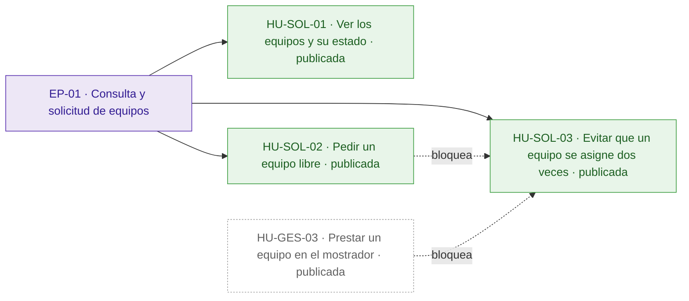
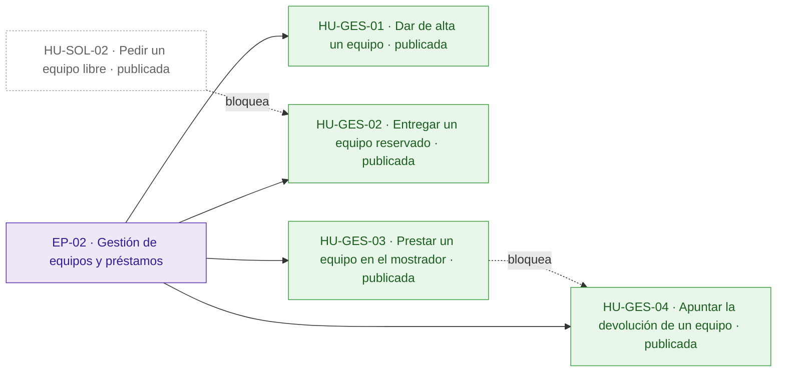
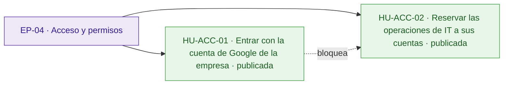
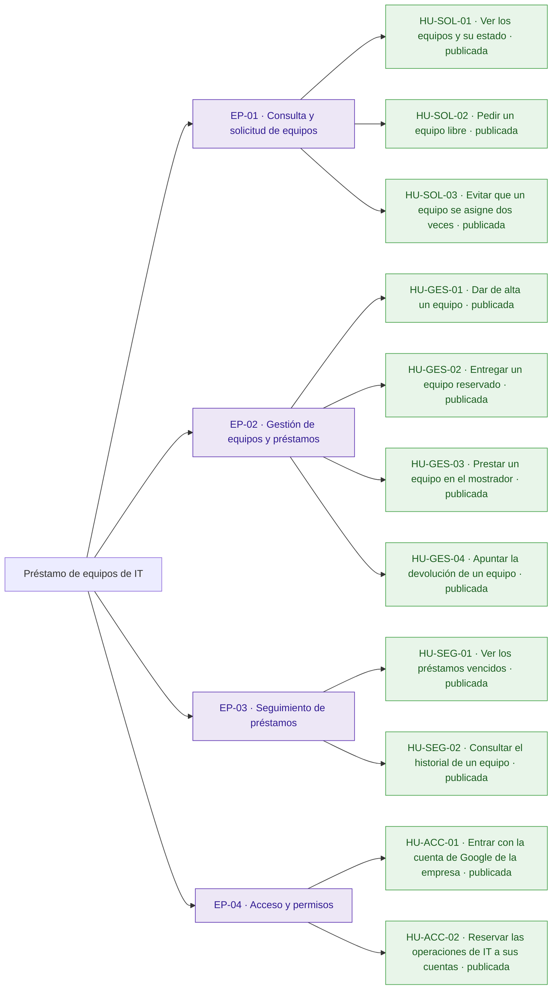
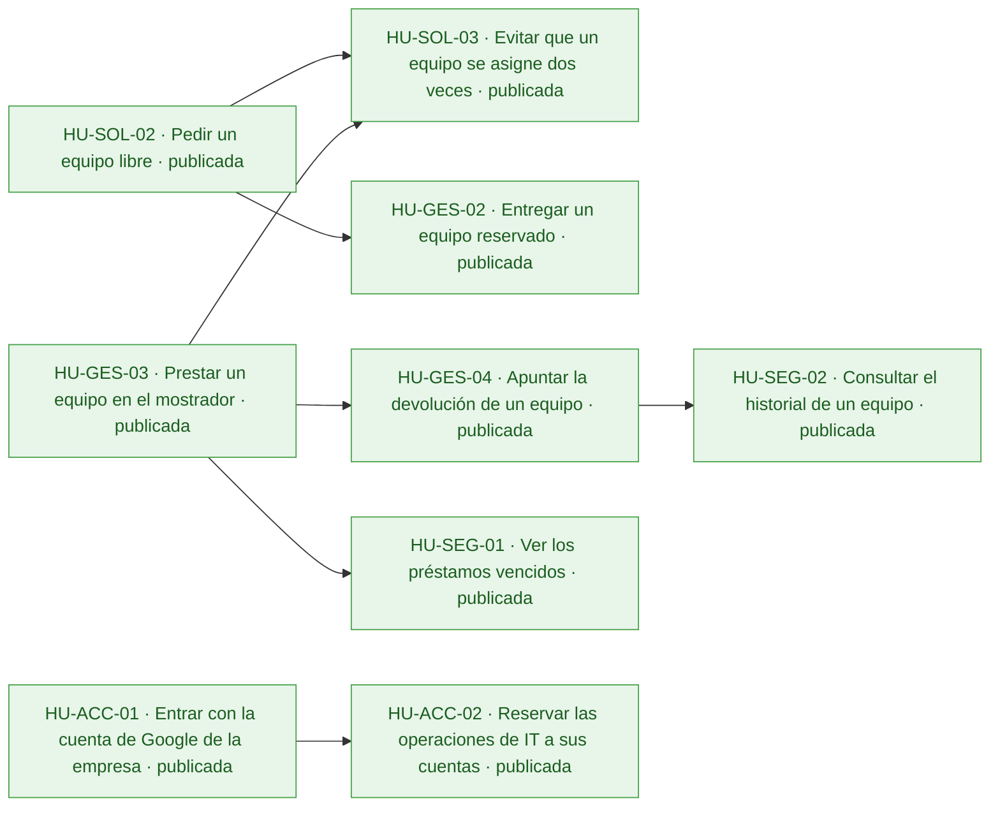
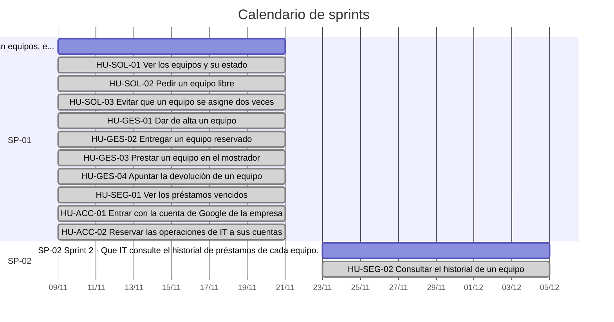
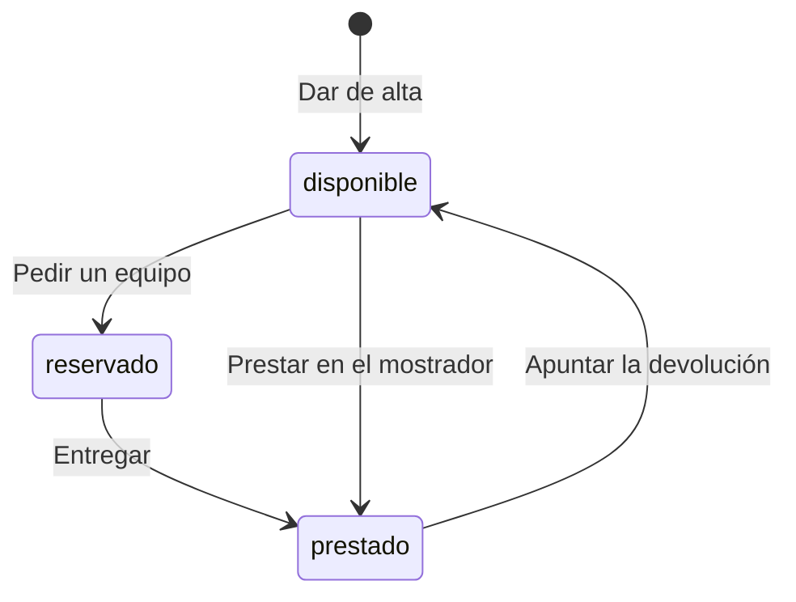

# Préstamo de equipos de IT

Hoy los préstamos de portátiles, monitores y proyectores se apuntan en una hoja de cálculo y se piden por correo a IT: nadie sabe qué está libre sin preguntar, dos personas esperan el mismo portátil y los vencimientos pasan desapercibidos hasta que alguien echa en falta el equipo.

La aplicación permite a los empleados ver los equipos y pedir uno libre, y a IT dar de alta equipos, entregar los reservados, prestar en el mostrador, apuntar devoluciones y revisar vencidos e historial. Todos entran con su cuenta de Google de la empresa, solo las cuentas de IT hacen las operaciones de IT y la API debe ser exactamente la del anexo, porque el inventario de IT se conecta a ella. Quedan fuera la anulación de solicitudes por los empleados y los avisos por correo de vencidos.

## Visión y alcance

Que los empleados vean y pidan los equipos de IT en una aplicación, e IT gestione en ella altas, entregas, préstamos, devoluciones y vencidos.

**Dentro del alcance**

- Cualquier empleado ve los equipos (portátiles, monitores, proyectores) y su estado; si está reservado o prestado, también quién lo tiene y la fecha de devolución (peticion.md).
- Un empleado pide un equipo libre indicando la fecha de devolución y el equipo queda reservado a su nombre hasta que IT se lo entrega (peticion.md).
- IT da de alta los equipos con un nombre (peticion.md).
- IT entrega los equipos reservados, que pasan a prestados con la misma persona y fecha de devolución (peticion.md).
- IT presta directamente en el mostrador a quien viene a pedirlo, indicando la persona y la fecha de devolución (peticion.md).
- IT apunta las devoluciones y el equipo vuelve a estar disponible (peticion.md).
- IT ve los préstamos vencidos: equipos prestados con fecha de devolución anterior a hoy, del más antiguo al más reciente (peticion.md).
- IT consulta el historial de cada equipo, del préstamo más reciente al más antiguo, con su persona, fecha de devolución y estado (reservado, prestado o devuelto) (peticion.md).
- Un equipo está en uno de tres estados: disponible, reservado o prestado (peticion.md, Anexo).
- Nombres y fechas: el nombre del equipo es obligatorio y dos nombres son el mismo si solo cambian mayúsculas o espacios en los extremos; la fecha de devolución es una fecha real en formato AAAA-MM-DD; «hoy» es el día en Madrid; quien pide un equipo no puede poner una fecha anterior a hoy, pero IT sí cuando presta en el mostrador (peticion.md, Anexo).
- Un equipo no puede estar reservado o prestado dos veces a la vez: si llegan dos peticiones a la vez para el mismo equipo disponible, una sale bien y la otra recibe 409 (peticion.md, Anexo).

**Fuera del alcance**

- Que los empleados anulen una solicitud (peticion.md).
- Avisos por correo de préstamos vencidos (peticion.md).

## Resumen en cifras

| Dato | Valor |
| --- | --- |
| Épicas | 4 |
| Historias | 11 |
| Historias por estado | borrador 0, aprobada 0, descartada 0, publicada 11 |
| Tareas | 36 |
| Sprints | 2 |
| Personas en el equipo | 1 |
| Modalidad de desarrollo | manual, sin IA |
| Horas estimadas | 60 h |
| Horas efectivas (según la modalidad de desarrollo) | 60 h |
| Historias sin estimar | 0 |
| Historias descartadas (fuera de las horas) | 0 |
| Supuestos | 12 |
| Preguntas abiertas | 7 |
| Requisitos | 14 |
| Requisitos sin historia | 0 |

## Índice

- [Visión y alcance](#visión-y-alcance)
- [Resumen en cifras](#resumen-en-cifras)
- [Épicas e historias](#épicas-e-historias)
  - [EP-01 · Consulta y solicitud de equipos](#ep-01--consulta-y-solicitud-de-equipos)
  - [EP-02 · Gestión de equipos y préstamos](#ep-02--gestión-de-equipos-y-préstamos)
  - [EP-03 · Seguimiento de préstamos](#ep-03--seguimiento-de-préstamos)
  - [EP-04 · Acceso y permisos](#ep-04--acceso-y-permisos)
- [Tareas](#tareas)
- [Sprints](#sprints)
- [Equipo](#equipo)
- [Dependencias](#dependencias)
- [Requisitos y trazabilidad](#requisitos-y-trazabilidad)
- [Preparación y definición de hecho](#preparación-y-definición-de-hecho)
- [Diagramas](#diagramas)
- [Supuestos](#supuestos)
- [Preguntas abiertas](#preguntas-abiertas)
- [Decisiones](#decisiones)

## Épicas e historias

### EP-01 · Consulta y solicitud de equipos

Los empleados ven qué equipos hay y en qué estado están, y piden uno libre indicando la fecha de devolución. Garantiza que un equipo nunca queda reservado o prestado dos veces, ni con peticiones simultáneas. No incluye que el empleado anule una solicitud, que queda fuera de alcance.

#### Épica EP-01: Consulta y solicitud de equipos

#### HU-SOL-01 · Ver los equipos y su estado

Como empleado, quiero ver la lista de equipos con su estado, para saber qué está libre sin tener que preguntar a IT.

**Contexto.** Cubre RQ.001 y RQ.009 (peticion.md): hoy no se sabe qué está libre sin preguntar. La respuesta sigue la operación «Ver los equipos» del anexo de la API.

- **Prioridad:** Highest
- **Tamaño:** M
- **Horas:** 4 h estimadas · 4 h efectivas
- **Estado:** publicada
- **Sprint:** SP-01 Sprint 1
- **Responsable:** José Luis Calvo
- **Tipo:** historia
- **Puntos de historia:** 3
- **Preparación:** lista (pendiente: supuestos sin confirmar: DoR-04, DoR-05, DoR-06, DoR-07, DoR-09)
- **Requisitos:** RQ.001, RQ.009, RQ.012, RQ.014

**Criterios de aceptación**

*Escenarios positivos*

1. **Dado** un empleado con sesión iniciada como «luis.gomez@empresa.com», con el equipo «Portátil 07» disponible y el equipo «Proyector 02» prestado a «ana.perez@empresa.com» con devolución «2026-11-20», **cuando** pide GET /api/equipos, **entonces** recibe 200 con «Portátil 07» en estado «disponible» sin «persona» ni «devolucion», y «Proyector 02» en estado «prestado» con «persona» «ana.perez@empresa.com» y «devolucion» «2026-11-20».
2. **Dado** un empleado con sesión iniciada y el equipo «Monitor 03» reservado a «ana.perez@empresa.com» con devolución «2026-11-25», **cuando** pide GET /api/equipos, **entonces** recibe «Monitor 03» en estado «reservado» con «persona» «ana.perez@empresa.com» y «devolucion» «2026-11-25».

*Escenarios negativos*

1. **Dado** una petición sin token de identidad de Google, **cuando** pide GET /api/equipos, **entonces** recibe 401 con {"error": "Inicia sesión con Google."} y ninguna lista de equipos.

**Notas.** Cualquier empleado ve el correo de quien tiene cada equipo, como fija el anexo; si es aceptable sigue como pregunta abierta.

**Definición de hecho**

- Criterios de aceptación probados.
- Respuesta igual a la de la operación «Ver los equipos» del anexo de la API.
- Textos revisados en español de España.

**Tareas**

- TA-001 · Endpoint GET /api/equipos con estado, persona y devolución · backend · José Luis Calvo
- TA-002 · Pantalla con la lista de equipos y su estado · frontend · José Luis Calvo
- TA-003 · Pruebas de la lista de equipos y del acceso sin sesión · QA · José Luis Calvo

#### HU-SOL-02 · Pedir un equipo libre

Como empleado, quiero pedir un equipo disponible indicando la fecha de devolución, para tenerlo reservado a mi nombre hasta que IT me lo entregue, sin escribir un correo.

**Contexto.** Cubre RQ.002 (peticion.md) con las reglas de fechas de RQ.010: la fecha va como AAAA-MM-DD, tiene que existir y no puede ser anterior a hoy, el día en Madrid. Sigue la operación «Pedir un equipo» del anexo de la API.

- **Prioridad:** Highest
- **Tamaño:** L
- **Horas:** 8 h estimadas · 8 h efectivas
- **Estado:** publicada
- **Sprint:** SP-01 Sprint 1
- **Responsable:** José Luis Calvo
- **Tipo:** historia
- **Puntos de historia:** 5
- **Preparación:** lista (pendiente: supuestos sin confirmar: DoR-04, DoR-05, DoR-06, DoR-07, DoR-09)
- **Requisitos:** RQ.002, RQ.009, RQ.010, RQ.014

**Criterios de aceptación**

*Escenarios positivos*

1. **Dado** un empleado con sesión iniciada como «luis.gomez@empresa.com», hoy 10/11/2026 en Madrid y el equipo «Portátil 07» disponible, **cuando** pide POST /api/equipos/{id}/solicitud de «Portátil 07» con {"devolucion": "2026-11-20"}, **entonces** recibe 201 con el equipo en estado «reservado», «persona» «luis.gomez@empresa.com» y «devolucion» «2026-11-20».

*Escenarios negativos*

1. **Dado** un empleado con sesión iniciada, hoy 10/11/2026 en Madrid y el equipo «Portátil 07» disponible, **cuando** pide la solicitud de «Portátil 07» con {"devolucion": "2026-11-09"}, **entonces** recibe 400 con {"error": "La fecha de devolución ya ha pasado"} y el equipo sigue disponible.
2. **Dado** un empleado con sesión iniciada y el equipo «Portátil 07» disponible, **cuando** pide la solicitud de «Portátil 07» con {"devolucion": "2026-02-30"}, **entonces** recibe 400 con {"error": "La fecha de devolución no es válida"} y el equipo sigue disponible.
3. **Dado** un empleado con sesión iniciada y el equipo «Portátil 07» disponible, **cuando** pide la solicitud de «Portátil 07» con el cuerpo {}, **entonces** recibe 400 con {"error": "Falta la fecha de devolución"} y el equipo sigue disponible.
4. **Dado** un empleado con sesión iniciada y el equipo «Proyector 02» prestado a «ana.perez@empresa.com», **cuando** pide la solicitud de «Proyector 02» con {"devolucion": "2026-11-20"}, **entonces** recibe 409 con {"error": "El equipo no está disponible"} y el préstamo de «ana.perez@empresa.com» no cambia.
5. **Dado** un empleado con sesión iniciada y ningún equipo con el id «no-existe», **cuando** pide POST /api/equipos/no-existe/solicitud con {"devolucion": "2026-11-20"}, **entonces** recibe 404 con {"error": "No existe el equipo"}.

**Notas.** Qué ocurre con una reserva que IT nunca entrega sigue como pregunta abierta: el empleado no puede anularla.

**Definición de hecho**

- Criterios de aceptación probados.
- «Hoy» calculado con el día de Madrid.
- Respuestas y mensajes iguales a los de la operación «Pedir un equipo» del anexo de la API.

**Tareas**

- TA-004 · Registro de la solicitud como préstamo reservado · datos · José Luis Calvo
- TA-005 · Endpoint de solicitud con validación de fechas en el día de Madrid · backend · José Luis Calvo
- TA-006 · Formulario para pedir un equipo con su fecha de devolución · frontend · José Luis Calvo
- TA-007 · Pruebas de la solicitud y de sus errores · QA · José Luis Calvo

#### HU-SOL-03 · Evitar que un equipo se asigne dos veces

Como empleado, quiero pedir un equipo disponible aunque otra persona lo pida a la vez, para saber en el momento si me lo he quedado, sin esperar un portátil que ya tiene otro compañero.

**Contexto.** Cubre RQ.011 (peticion.md): hoy dos personas esperan el mismo portátil. El anexo exige que, si llegan dos peticiones a la vez para el mismo equipo disponible, sean solicitudes o préstamos en el mostrador, una salga bien y la otra reciba 409.

- **Prioridad:** Highest
- **Tamaño:** L
- **Horas:** 8 h estimadas · 8 h efectivas
- **Estado:** publicada
- **Sprint:** SP-01 Sprint 1
- **Responsable:** José Luis Calvo
- **Tipo:** historia
- **Puntos de historia:** 5
- **Preparación:** parcialmente lista (pendiente: DoR-08: depende de HU-SOL-02, HU-GES-03, sin resolver ni planificada en un sprint anterior · supuestos sin confirmar: DoR-04, DoR-05, DoR-06, DoR-07, DoR-09)
- **Requisitos:** RQ.011, RQ.014
- **Depende de:**
  - HU-SOL-02 · Pedir un equipo libre: La concurrencia se prueba sobre la solicitud de un equipo.
  - HU-GES-03 · Prestar un equipo en el mostrador: La concurrencia también cubre el préstamo en el mostrador.

**Criterios de aceptación**

*Escenarios positivos*

1. **Dado** el equipo «Portátil 07» disponible y dos empleados, «luis.gomez@empresa.com» y «ana.perez@empresa.com», con sesión iniciada, **cuando** los dos piden a la vez la solicitud de «Portátil 07» con {"devolucion": "2026-11-20"}, **entonces** una petición recibe 201 con el equipo reservado a su correo y la otra recibe 409 con {"error": "El equipo no está disponible"}.

*Escenarios negativos*

1. **Dado** el equipo «Portátil 07» disponible, el empleado «luis.gomez@empresa.com» y el técnico de IT «it.soporte@empresa.com» con sesión iniciada, **cuando** en el mismo instante el empleado pide POST /api/equipos/{id}/solicitud con {"devolucion": "2026-11-20"} y el técnico pide POST /api/equipos/{id}/prestamo con {"persona": "ana.perez@empresa.com", "devolucion": "2026-11-20"}, **entonces** una petición recibe 201, la otra recibe 409 con {"error": "El equipo no está disponible"} y GET /api/equipos muestra «Portátil 07» con una sola «persona».

**Notas.** Responde al riesgo de que dos empleados se queden con el mismo equipo porque lo pidieron a la vez.

**Definición de hecho**

- Criterios de aceptación probados con peticiones simultáneas repetidas.
- Ninguna ejecución deja un equipo reservado o prestado a dos personas.

**Tareas**

- TA-008 · Cambio de estado atómico del equipo · datos · José Luis Calvo
- TA-009 · Respuesta 409 a la petición que pierde la carrera · backend · José Luis Calvo
- TA-010 · Pruebas de peticiones simultáneas de solicitud y préstamo · QA · José Luis Calvo

### EP-02 · Gestión de equipos y préstamos

IT da de alta los equipos, entrega los reservados, presta directamente en el mostrador y apunta las devoluciones. Es lo que sustituye a la hoja de cálculo actual. No incluye avisos por correo, que quedan fuera de alcance.

#### Épica EP-02: Gestión de equipos y préstamos

#### HU-GES-01 · Dar de alta un equipo

Como técnico de IT, quiero dar de alta un equipo con su nombre, para que los empleados lo vean disponible y puedan pedirlo.

**Contexto.** Cubre RQ.003 (peticion.md) con la regla de nombres de RQ.010: dos nombres son el mismo si solo cambian mayúsculas o espacios al principio o al final. Sigue la operación «Dar de alta un equipo» del anexo, solo para IT.

- **Prioridad:** Highest
- **Tamaño:** M
- **Horas:** 4 h estimadas · 4 h efectivas
- **Estado:** publicada
- **Sprint:** SP-01 Sprint 1
- **Responsable:** José Luis Calvo
- **Tipo:** historia
- **Puntos de historia:** 3
- **Preparación:** lista (pendiente: supuestos sin confirmar: DoR-04, DoR-05, DoR-06, DoR-07, DoR-09)
- **Requisitos:** RQ.003, RQ.010, RQ.013, RQ.014

**Criterios de aceptación**

*Escenarios positivos*

1. **Dado** un técnico de IT con sesión iniciada y ningún equipo llamado «Portátil 07», **cuando** pide POST /api/equipos con {"nombre": "Portátil 07"}, **entonces** recibe 201 con el «id» del equipo, «nombre» «Portátil 07» y «estado» «disponible».

*Escenarios negativos*

1. **Dado** un técnico de IT con sesión iniciada y el equipo «Portátil 07» ya dado de alta, **cuando** pide POST /api/equipos con {"nombre": " portátil 07 "}, **entonces** recibe 409 con {"error": "Ya hay un equipo con ese nombre"} y no se crea otro equipo.
2. **Dado** un técnico de IT con sesión iniciada, **cuando** pide POST /api/equipos con {"nombre": ""}, **entonces** recibe 400 con {"error": "Falta el nombre del equipo"} y no se crea ningún equipo.
3. **Dado** un técnico de IT con sesión iniciada, **cuando** pide POST /api/equipos con el cuerpo {}, **entonces** recibe 400 con {"error": "Falta el nombre del equipo"} y no se crea ningún equipo.
4. **Dado** un empleado «luis.gomez@empresa.com» que no está en CORREOS\_IT, **cuando** pide POST /api/equipos con {"nombre": "Portátil 08"}, **entonces** recibe 403 con {"error": "Solo IT puede hacer esto."} y no se crea ningún equipo.

**Definición de hecho**

- Criterios de aceptación probados.
- Respuestas y mensajes iguales a los de la operación «Dar de alta un equipo» del anexo de la API.

**Tareas**

- TA-011 · Almacenamiento de equipos con nombre normalizado único · datos · José Luis Calvo
- TA-012 · Endpoint POST /api/equipos · backend · José Luis Calvo
- TA-013 · Formulario de alta de equipos para IT · frontend · José Luis Calvo
- TA-014 · Pruebas del alta, del nombre repetido y del permiso · QA · José Luis Calvo

#### HU-GES-02 · Entregar un equipo reservado

Como técnico de IT, quiero entregar un equipo reservado a quien lo pidió, para que conste como prestado con la fecha de devolución que pidió el empleado.

**Contexto.** Cubre RQ.004 (peticion.md): el equipo reservado pasa a prestado con la misma persona y fecha de devolución de la solicitud. Sigue la operación «Entregar un equipo reservado» del anexo, solo para IT.

- **Prioridad:** Highest
- **Tamaño:** M
- **Horas:** 4 h estimadas · 4 h efectivas
- **Estado:** publicada
- **Sprint:** SP-01 Sprint 1
- **Responsable:** José Luis Calvo
- **Tipo:** historia
- **Puntos de historia:** 3
- **Preparación:** parcialmente lista (pendiente: DoR-08: depende de HU-SOL-02, sin resolver ni planificada en un sprint anterior · supuestos sin confirmar: DoR-04, DoR-05, DoR-06, DoR-07, DoR-09)
- **Requisitos:** RQ.004, RQ.009, RQ.013, RQ.014
- **Depende de:**
  - HU-SOL-02 · Pedir un equipo libre: Entregar exige un equipo reservado por un empleado.

**Criterios de aceptación**

*Escenarios positivos*

1. **Dado** un técnico de IT con sesión iniciada y el equipo «Portátil 07» reservado a «luis.gomez@empresa.com» con devolución «2026-11-20», **cuando** pide POST /api/equipos/{id}/entrega de «Portátil 07», **entonces** recibe 200 con el equipo en estado «prestado», «persona» «luis.gomez@empresa.com» y «devolucion» «2026-11-20».

*Escenarios negativos*

1. **Dado** un técnico de IT con sesión iniciada y el equipo «Monitor 03» disponible, **cuando** pide la entrega de «Monitor 03», **entonces** recibe 409 con {"error": "El equipo no está reservado"} y el equipo sigue disponible.
2. **Dado** un técnico de IT con sesión iniciada y ningún equipo con el id «no-existe», **cuando** pide POST /api/equipos/no-existe/entrega, **entonces** recibe 404 con {"error": "No existe el equipo"}.

**Definición de hecho**

- Criterios de aceptación probados.
- Respuestas y mensajes iguales a los de la operación «Entregar un equipo reservado» del anexo de la API.

**Tareas**

- TA-015 · Endpoint de entrega de un equipo reservado · backend · José Luis Calvo
- TA-016 · Acción de entregar en la lista de equipos de IT · frontend · José Luis Calvo
- TA-017 · Pruebas de la entrega y de sus errores · QA · José Luis Calvo

#### HU-GES-03 · Prestar un equipo en el mostrador

Como técnico de IT, quiero prestar un equipo disponible a quien viene a pedirlo al mostrador, para que el préstamo conste aunque no haya pasado por una solicitud.

**Contexto.** Cubre RQ.005 (peticion.md) con las reglas de fechas de RQ.010: IT sí puede poner una fecha anterior a hoy, porque a veces apunta los préstamos con retraso, y ese préstamo ya aparece entre los vencidos. Sigue la operación «Prestar en el mostrador» del anexo, solo para IT.

- **Prioridad:** Highest
- **Tamaño:** L
- **Horas:** 8 h estimadas · 8 h efectivas
- **Estado:** publicada
- **Sprint:** SP-01 Sprint 1
- **Responsable:** José Luis Calvo
- **Tipo:** historia
- **Puntos de historia:** 5
- **Preparación:** lista (pendiente: supuestos sin confirmar: DoR-04, DoR-05, DoR-06, DoR-07, DoR-09)
- **Requisitos:** RQ.005, RQ.009, RQ.010, RQ.013, RQ.014

**Criterios de aceptación**

*Escenarios positivos*

1. **Dado** un técnico de IT con sesión iniciada y el equipo «Monitor 03» disponible, **cuando** pide POST /api/equipos/{id}/prestamo de «Monitor 03» con {"persona": "ana.perez@empresa.com", "devolucion": "2026-11-20"}, **entonces** recibe 201 con el equipo en estado «prestado», «persona» «ana.perez@empresa.com» y «devolucion» «2026-11-20».
2. **Dado** un técnico de IT con sesión iniciada, hoy 10/11/2026 en Madrid y el equipo «Monitor 04» disponible, **cuando** pide el préstamo de «Monitor 04» con {"persona": "ana.perez@empresa.com", "devolucion": "2026-11-05"}, **entonces** recibe 201 con el equipo prestado y «devolucion» «2026-11-05».

*Escenarios negativos*

1. **Dado** un técnico de IT con sesión iniciada y el equipo «Monitor 03» disponible, **cuando** pide el préstamo de «Monitor 03» con {"devolucion": "2026-11-20"}, **entonces** recibe 400 con {"error": "Faltan la persona o la fecha de devolución"} y el equipo sigue disponible.
2. **Dado** un técnico de IT con sesión iniciada y el equipo «Monitor 03» disponible, **cuando** pide el préstamo de «Monitor 03» con {"persona": "ana.perez@empresa.com", "devolucion": "2026-02-30"}, **entonces** recibe 400 con {"error": "La fecha de devolución no es válida"} y el equipo sigue disponible.
3. **Dado** un técnico de IT con sesión iniciada y el equipo «Portátil 07» reservado a «luis.gomez@empresa.com», **cuando** pide el préstamo de «Portátil 07» con {"persona": "ana.perez@empresa.com", "devolucion": "2026-11-20"}, **entonces** recibe 409 con {"error": "El equipo no está disponible"} y la reserva de «luis.gomez@empresa.com» no cambia.

**Notas.** Qué hacer si «persona» no es un correo válido o de la empresa sigue como pregunta abierta.

**Definición de hecho**

- Criterios de aceptación probados.
- Respuestas y mensajes iguales a los de la operación «Prestar en el mostrador» del anexo de la API.

**Tareas**

- TA-018 · Endpoint de préstamo en el mostrador con fechas pasadas permitidas · backend · José Luis Calvo
- TA-019 · Formulario de préstamo en el mostrador · frontend · José Luis Calvo
- TA-020 · Pruebas del préstamo en el mostrador y de sus errores · QA · José Luis Calvo

#### HU-GES-04 · Apuntar la devolución de un equipo

Como técnico de IT, quiero apuntar la devolución de un equipo prestado, para que vuelva a estar disponible para el siguiente empleado.

**Contexto.** Cubre RQ.006 (peticion.md): el equipo vuelve a disponible, sin persona ni fecha de devolución. Sigue la operación «Apuntar la devolución» del anexo, solo para IT.

- **Prioridad:** Highest
- **Tamaño:** M
- **Horas:** 4 h estimadas · 4 h efectivas
- **Estado:** publicada
- **Sprint:** SP-01 Sprint 1
- **Responsable:** José Luis Calvo
- **Tipo:** historia
- **Puntos de historia:** 3
- **Preparación:** parcialmente lista (pendiente: DoR-08: depende de HU-GES-03, sin resolver ni planificada en un sprint anterior · supuestos sin confirmar: DoR-04, DoR-05, DoR-06, DoR-07, DoR-09)
- **Requisitos:** RQ.006, RQ.009, RQ.013, RQ.014
- **Depende de:**
  - HU-GES-03 · Prestar un equipo en el mostrador: Devolver exige un equipo prestado.

**Criterios de aceptación**

*Escenarios positivos*

1. **Dado** un técnico de IT con sesión iniciada y el equipo «Monitor 03» prestado a «ana.perez@empresa.com» con devolución «2026-11-20», **cuando** pide POST /api/equipos/{id}/devolucion de «Monitor 03», **entonces** recibe 200 con el equipo en estado «disponible», sin «persona» ni «devolucion».

*Escenarios negativos*

1. **Dado** un técnico de IT con sesión iniciada y el equipo «Portátil 07» reservado a «luis.gomez@empresa.com», **cuando** pide la devolución de «Portátil 07», **entonces** recibe 409 con {"error": "El equipo no está prestado"} y la reserva no cambia.
2. **Dado** un técnico de IT con sesión iniciada y ningún equipo con el id «no-existe», **cuando** pide POST /api/equipos/no-existe/devolucion, **entonces** recibe 404 con {"error": "No existe el equipo"}.

**Definición de hecho**

- Criterios de aceptación probados.
- Respuestas y mensajes iguales a los de la operación «Apuntar la devolución» del anexo de la API.

**Tareas**

- TA-021 · Cierre del préstamo como devuelto en el historial · datos · José Luis Calvo
- TA-022 · Endpoint de devolución · backend · José Luis Calvo
- TA-023 · Acción de apuntar la devolución · frontend · José Luis Calvo
- TA-024 · Pruebas de la devolución y de sus errores · QA · José Luis Calvo

### EP-03 · Seguimiento de préstamos

IT ve los préstamos vencidos y el historial de cada equipo, para revisarlos cada semana sin preguntar a nadie. No incluye avisos por correo de vencidos, que quedan fuera de alcance.

#### Épica EP-03: Seguimiento de préstamos

#### HU-SEG-01 · Ver los préstamos vencidos

Como técnico de IT, quiero ver los préstamos cuya fecha de devolución ya ha pasado, para revisar los vencidos cada semana sin tener que preguntar a nadie.

**Contexto.** Cubre RQ.007 (peticion.md): hoy nadie se entera de que un préstamo ha vencido hasta que alguien echa en falta el equipo. Sigue la operación «Ver los préstamos vencidos» del anexo, solo para IT; «hoy» es el día en Madrid.

- **Prioridad:** Highest
- **Tamaño:** M
- **Horas:** 4 h estimadas · 4 h efectivas
- **Estado:** publicada
- **Sprint:** SP-01 Sprint 1
- **Responsable:** José Luis Calvo
- **Tipo:** historia
- **Puntos de historia:** 3
- **Preparación:** parcialmente lista (pendiente: DoR-08: depende de HU-GES-03, sin resolver ni planificada en un sprint anterior · supuestos sin confirmar: DoR-04, DoR-05, DoR-06, DoR-07, DoR-09)
- **Requisitos:** RQ.007, RQ.013, RQ.014
- **Depende de:**
  - HU-GES-03 · Prestar un equipo en el mostrador: Los vencidos son equipos prestados.

**Criterios de aceptación**

*Escenarios positivos*

1. **Dado** un técnico de IT con sesión iniciada, hoy 20/11/2026 en Madrid, «Monitor 04» prestado con devolución «2026-11-05», «Proyector 02» prestado con devolución «2026-11-18» y «Monitor 03» prestado con devolución «2026-11-20», **cuando** pide GET /api/prestamos/vencidos, **entonces** recibe 200 con «Monitor 04» y después «Proyector 02», cada uno con «id», «nombre», «persona» y «devolucion», y sin «Monitor 03».

*Escenarios negativos*

1. **Dado** un empleado «luis.gomez@empresa.com» que no está en CORREOS\_IT, **cuando** pide GET /api/prestamos/vencidos, **entonces** recibe 403 con {"error": "Solo IT puede hacer esto."} y ninguna lista.

**Notas.** \[SUPUESTO\] Un equipo reservado nunca cuenta como vencido; solo los prestados.

**Definición de hecho**

- Criterios de aceptación probados.
- «Hoy» calculado con el día de Madrid.
- Respuesta igual a la de la operación «Ver los préstamos vencidos» del anexo de la API.

**Tareas**

- TA-025 · Endpoint de vencidos ordenados por fecha de devolución · backend · José Luis Calvo
- TA-026 · Pantalla de préstamos vencidos · frontend · José Luis Calvo
- TA-027 · Pruebas de vencidos con el día de Madrid · QA · José Luis Calvo

#### HU-SEG-02 · Consultar el historial de un equipo

Como técnico de IT, quiero consultar los préstamos que ha tenido un equipo, para saber quién lo tuvo y cuándo sin buscar en la hoja de cálculo.

**Contexto.** Cubre RQ.008 (peticion.md): el historial va del préstamo más reciente al más antiguo, cada uno con persona, fecha de devolución y estado (reservado, prestado o devuelto). Sigue la operación «Ver el historial de un equipo» del anexo, solo para IT.

- **Prioridad:** High
- **Tamaño:** M
- **Horas:** 4 h estimadas · 4 h efectivas
- **Estado:** publicada
- **Sprint:** SP-02 Sprint 2
- **Responsable:** José Luis Calvo
- **Tipo:** historia
- **Puntos de historia:** 3
- **Preparación:** parcialmente lista (pendiente: DoR-08: depende de HU-GES-04, sin resolver ni planificada en un sprint anterior · supuestos sin confirmar: DoR-04, DoR-05, DoR-06, DoR-07, DoR-09)
- **Requisitos:** RQ.008, RQ.013, RQ.014
- **Depende de:**
  - HU-GES-04 · Apuntar la devolución de un equipo: El historial muestra préstamos devueltos.

**Criterios de aceptación**

*Escenarios positivos*

1. **Dado** un técnico de IT con sesión iniciada y el equipo «Portátil 07» prestado a «ana.perez@empresa.com» con devolución «2026-11-05» y devuelto, y después reservado a «luis.gomez@empresa.com» con devolución «2026-11-20», **cuando** pide GET /api/equipos/{id}/historial de «Portátil 07», **entonces** recibe 200 con primero «luis.gomez@empresa.com», «2026-11-20», estado «reservado», y después «ana.perez@empresa.com», «2026-11-05», estado «devuelto».

*Escenarios negativos*

1. **Dado** un técnico de IT con sesión iniciada y ningún equipo con el id «no-existe», **cuando** pide GET /api/equipos/no-existe/historial, **entonces** recibe 404 con {"error": "No existe el equipo"}.
2. **Dado** un empleado «luis.gomez@empresa.com» que no está en CORREOS\_IT, **cuando** pide el historial de «Portátil 07», **entonces** recibe 403 con {"error": "Solo IT puede hacer esto."}.

**Notas.** \[SUPUESTO\] Un préstamo aparece en el historial como reservado al pedirse, pasa a prestado al entregarse y a devuelto al devolverse.

**Definición de hecho**

- Criterios de aceptación probados.
- Respuesta igual a la de la operación «Ver el historial de un equipo» del anexo de la API.

**Tareas**

- TA-028 · Consulta del historial de préstamos de un equipo · datos · José Luis Calvo
- TA-029 · Endpoint de historial de un equipo · backend · José Luis Calvo
- TA-030 · Pantalla de historial de un equipo · frontend · José Luis Calvo
- TA-031 · Pruebas del historial y de sus errores · QA · José Luis Calvo

### EP-04 · Acceso y permisos

Todos entran con su cuenta de Google de la empresa, también el inventario de IT con su cuenta de servicio, y solo las cuentas de IT hacen las operaciones de IT. Deja fuera cualquier otro método de inicio de sesión.

#### Épica EP-04: Acceso y permisos

#### HU-ACC-01 · Entrar con la cuenta de Google de la empresa

Como empleado, quiero entrar en la aplicación con mi cuenta de Google de la empresa, para que cada operación quede a mi nombre sin crear otra contraseña.

**Contexto.** Cubre RQ.012 (peticion.md): todas las rutas necesitan un token de identidad de Google con el correo verificado, emitido para el cliente OAuth de la aplicación, de una persona o de una cuenta de servicio. La persona de cada operación es el correo del token.

- **Prioridad:** Highest
- **Tamaño:** L
- **Horas:** 8 h estimadas · 8 h efectivas
- **Estado:** publicada
- **Sprint:** SP-01 Sprint 1
- **Responsable:** José Luis Calvo
- **Tipo:** historia
- **Puntos de historia:** 5
- **Preparación:** parcialmente lista (pendiente: DoR-08: dependencias externas sin plan confirmado: Cliente OAuth de Google de la aplicación; Cuenta de servicio del inventario de IT · supuestos sin confirmar: DoR-04, DoR-05, DoR-06, DoR-07, DoR-09)
- **Requisitos:** RQ.012, RQ.014
- **Dependencias externas:** Cliente OAuth de Google de la aplicación; Cuenta de servicio del inventario de IT

**Criterios de aceptación**

*Escenarios positivos*

1. **Dado** un empleado con un token de identidad de Google de «luis.gomez@empresa.com», con el correo verificado y emitido para el cliente OAuth de la aplicación, **cuando** pide GET /api/equipos, **entonces** recibe 200 con la lista de equipos.
2. **Dado** la cuenta de servicio del inventario de IT con un token de identidad de Google válido para el cliente OAuth de la aplicación, **cuando** pide GET /api/equipos, **entonces** recibe 200 con la lista de equipos.

*Escenarios negativos*

1. **Dado** un token de identidad de Google de «luis.gomez@empresa.com» emitido para otro cliente OAuth, **cuando** pide GET /api/equipos, **entonces** recibe 401 con {"error": "Inicia sesión con Google."}.
2. **Dado** un token de identidad de Google con el correo sin verificar, **cuando** pide GET /api/equipos, **entonces** recibe 401 con {"error": "Inicia sesión con Google."}.

**Definición de hecho**

- Criterios de aceptación probados.
- Todas las rutas de la API responden 401 sin un token válido.

**Tareas**

- TA-032 · Verificación del token de identidad de Google en todas las rutas · backend · José Luis Calvo
- TA-033 · Inicio de sesión con Google en la aplicación web · frontend · José Luis Calvo
- TA-034 · Pruebas de tokens válidos, de otro cliente y sin verificar · QA · José Luis Calvo

#### HU-ACC-02 · Reservar las operaciones de IT a sus cuentas

Como técnico de IT, quiero limitar las operaciones de IT a las cuentas de la lista CORREOS\_IT, para que ningún empleado pueda dar de alta, entregar, prestar o devolver equipos.

**Contexto.** Cubre RQ.013 (peticion.md): las cuentas de IT son las de la variable de entorno CORREOS\_IT, con los correos separados por comas, fijada en la configuración del despliegue y no en el código; dos correos son el mismo aunque cambien las mayúsculas. El inventario entra con una cuenta de servicio que está en esa lista y también puede hacer lo de un empleado.

- **Prioridad:** Highest
- **Tamaño:** M
- **Horas:** 4 h estimadas · 4 h efectivas
- **Estado:** publicada
- **Sprint:** SP-01 Sprint 1
- **Responsable:** José Luis Calvo
- **Tipo:** historia
- **Puntos de historia:** 3
- **Preparación:** parcialmente lista (pendiente: DoR-08: depende de HU-ACC-01, sin resolver ni planificada en un sprint anterior · supuestos sin confirmar: DoR-04, DoR-05, DoR-06, DoR-07, DoR-09)
- **Requisitos:** RQ.013, RQ.014
- **Depende de:**
  - HU-ACC-01 · Entrar con la cuenta de Google de la empresa: Saber si una cuenta es de IT exige conocer el correo del token.

**Criterios de aceptación**

*Escenarios positivos*

1. **Dado** CORREOS\_IT con «it.soporte@empresa.com,inventario@empresa.com» y un técnico con sesión iniciada como «IT.Soporte@empresa.com», **cuando** pide POST /api/equipos con {"nombre": "Portátil 08"}, **entonces** recibe 201 con el equipo «Portátil 08» disponible.
2. **Dado** CORREOS\_IT con «inventario@empresa.com», la cuenta de servicio «inventario@empresa.com» con sesión iniciada y el equipo «Monitor 05» disponible, **cuando** pide la solicitud de «Monitor 05» con {"devolucion": "2026-11-20"}, **entonces** recibe 201 con el equipo reservado a «inventario@empresa.com».

*Escenarios negativos*

1. **Dado** CORREOS\_IT con «it.soporte@empresa.com» y un empleado con sesión iniciada como «luis.gomez@empresa.com», **cuando** pide POST /api/equipos/{id}/devolucion de «Monitor 03», **entonces** recibe 403 con {"error": "Solo IT puede hacer esto."} y el equipo no cambia.

**Notas.** Responde al riesgo de que un empleado pueda hacer lo que solo le toca a IT.

**Definición de hecho**

- Criterios de aceptación probados.
- La lista de IT se lee de la configuración del despliegue, no del código.
- Todas las operaciones «Solo IT» del anexo responden 403 a otras cuentas.

**Tareas**

- TA-035 · Comprobación de CORREOS\_IT sin distinguir mayúsculas · backend · José Luis Calvo
- TA-036 · Pruebas de permisos de IT, empleado y cuenta de servicio · QA · José Luis Calvo

## Tareas

| ID | Título | Historia | Disciplina | Descripción | Responsable | Horas estimadas | Horas efectivas |
| --- | --- | --- | --- | --- | --- | --- | --- |
| TA-001 | Endpoint GET /api/equipos con estado, persona y devolución | HU-SOL-01 · Ver los equipos y su estado | backend |   | José Luis Calvo |   |   |
| TA-002 | Pantalla con la lista de equipos y su estado | HU-SOL-01 · Ver los equipos y su estado | frontend |   | José Luis Calvo |   |   |
| TA-003 | Pruebas de la lista de equipos y del acceso sin sesión | HU-SOL-01 · Ver los equipos y su estado | QA |   | José Luis Calvo |   |   |
| TA-004 | Registro de la solicitud como préstamo reservado | HU-SOL-02 · Pedir un equipo libre | datos |   | José Luis Calvo |   |   |
| TA-005 | Endpoint de solicitud con validación de fechas en el día de Madrid | HU-SOL-02 · Pedir un equipo libre | backend |   | José Luis Calvo |   |   |
| TA-006 | Formulario para pedir un equipo con su fecha de devolución | HU-SOL-02 · Pedir un equipo libre | frontend |   | José Luis Calvo |   |   |
| TA-007 | Pruebas de la solicitud y de sus errores | HU-SOL-02 · Pedir un equipo libre | QA |   | José Luis Calvo |   |   |
| TA-008 | Cambio de estado atómico del equipo | HU-SOL-03 · Evitar que un equipo se asigne dos veces | datos |   | José Luis Calvo |   |   |
| TA-009 | Respuesta 409 a la petición que pierde la carrera | HU-SOL-03 · Evitar que un equipo se asigne dos veces | backend |   | José Luis Calvo |   |   |
| TA-010 | Pruebas de peticiones simultáneas de solicitud y préstamo | HU-SOL-03 · Evitar que un equipo se asigne dos veces | QA |   | José Luis Calvo |   |   |
| TA-011 | Almacenamiento de equipos con nombre normalizado único | HU-GES-01 · Dar de alta un equipo | datos |   | José Luis Calvo |   |   |
| TA-012 | Endpoint POST /api/equipos | HU-GES-01 · Dar de alta un equipo | backend |   | José Luis Calvo |   |   |
| TA-013 | Formulario de alta de equipos para IT | HU-GES-01 · Dar de alta un equipo | frontend |   | José Luis Calvo |   |   |
| TA-014 | Pruebas del alta, del nombre repetido y del permiso | HU-GES-01 · Dar de alta un equipo | QA |   | José Luis Calvo |   |   |
| TA-015 | Endpoint de entrega de un equipo reservado | HU-GES-02 · Entregar un equipo reservado | backend |   | José Luis Calvo |   |   |
| TA-016 | Acción de entregar en la lista de equipos de IT | HU-GES-02 · Entregar un equipo reservado | frontend |   | José Luis Calvo |   |   |
| TA-017 | Pruebas de la entrega y de sus errores | HU-GES-02 · Entregar un equipo reservado | QA |   | José Luis Calvo |   |   |
| TA-018 | Endpoint de préstamo en el mostrador con fechas pasadas permitidas | HU-GES-03 · Prestar un equipo en el mostrador | backend |   | José Luis Calvo |   |   |
| TA-019 | Formulario de préstamo en el mostrador | HU-GES-03 · Prestar un equipo en el mostrador | frontend |   | José Luis Calvo |   |   |
| TA-020 | Pruebas del préstamo en el mostrador y de sus errores | HU-GES-03 · Prestar un equipo en el mostrador | QA |   | José Luis Calvo |   |   |
| TA-021 | Cierre del préstamo como devuelto en el historial | HU-GES-04 · Apuntar la devolución de un equipo | datos |   | José Luis Calvo |   |   |
| TA-022 | Endpoint de devolución | HU-GES-04 · Apuntar la devolución de un equipo | backend |   | José Luis Calvo |   |   |
| TA-023 | Acción de apuntar la devolución | HU-GES-04 · Apuntar la devolución de un equipo | frontend |   | José Luis Calvo |   |   |
| TA-024 | Pruebas de la devolución y de sus errores | HU-GES-04 · Apuntar la devolución de un equipo | QA |   | José Luis Calvo |   |   |
| TA-025 | Endpoint de vencidos ordenados por fecha de devolución | HU-SEG-01 · Ver los préstamos vencidos | backend |   | José Luis Calvo |   |   |
| TA-026 | Pantalla de préstamos vencidos | HU-SEG-01 · Ver los préstamos vencidos | frontend |   | José Luis Calvo |   |   |
| TA-027 | Pruebas de vencidos con el día de Madrid | HU-SEG-01 · Ver los préstamos vencidos | QA |   | José Luis Calvo |   |   |
| TA-028 | Consulta del historial de préstamos de un equipo | HU-SEG-02 · Consultar el historial de un equipo | datos |   | José Luis Calvo |   |   |
| TA-029 | Endpoint de historial de un equipo | HU-SEG-02 · Consultar el historial de un equipo | backend |   | José Luis Calvo |   |   |
| TA-030 | Pantalla de historial de un equipo | HU-SEG-02 · Consultar el historial de un equipo | frontend |   | José Luis Calvo |   |   |
| TA-031 | Pruebas del historial y de sus errores | HU-SEG-02 · Consultar el historial de un equipo | QA |   | José Luis Calvo |   |   |
| TA-032 | Verificación del token de identidad de Google en todas las rutas | HU-ACC-01 · Entrar con la cuenta de Google de la empresa | backend |   | José Luis Calvo |   |   |
| TA-033 | Inicio de sesión con Google en la aplicación web | HU-ACC-01 · Entrar con la cuenta de Google de la empresa | frontend |   | José Luis Calvo |   |   |
| TA-034 | Pruebas de tokens válidos, de otro cliente y sin verificar | HU-ACC-01 · Entrar con la cuenta de Google de la empresa | QA |   | José Luis Calvo |   |   |
| TA-035 | Comprobación de CORREOS\_IT sin distinguir mayúsculas | HU-ACC-02 · Reservar las operaciones de IT a sus cuentas | backend |   | José Luis Calvo |   |   |
| TA-036 | Pruebas de permisos de IT, empleado y cuenta de servicio | HU-ACC-02 · Reservar las operaciones de IT a sus cuentas | QA |   | José Luis Calvo |   |   |

## Sprints

| Sprint | Fechas | Objetivo | Historias | Capacidad (h) | Carga (h efectivas) |
| --- | --- | --- | --- | --- | --- |
| SP-01 Sprint 1 | del 09/11/2026 al 20/11/2026 | Que los empleados entren con Google, vean y pidan equipos, e IT dé de alta, entregue, preste, apunte devoluciones y vea los vencidos. | 10 | 56 h | 56 h · 100 % |
| SP-02 Sprint 2 | del 23/11/2026 al 04/12/2026 | Que IT consulte el historial de préstamos de cada equipo. | 1 | 56 h | 4 h · 7 % |

Historias sin sprint: 0.

## Equipo

| Nombre | Rol | Dedicación | Usa un agente de IA |
| --- | --- | --- | --- |
| José Luis Calvo | Desarrollo | 100 % | sí |

*Por privacidad, este documento no incluye correos electrónicos ni usuarios de GitHub o Trello.*

## Dependencias

| Historia | Bloqueada por | Motivo |
| --- | --- | --- |
| HU-SOL-03 · Evitar que un equipo se asigne dos veces | HU-SOL-02 · Pedir un equipo libre | La concurrencia se prueba sobre la solicitud de un equipo. |
| HU-SOL-03 · Evitar que un equipo se asigne dos veces | HU-GES-03 · Prestar un equipo en el mostrador | La concurrencia también cubre el préstamo en el mostrador. |
| HU-GES-02 · Entregar un equipo reservado | HU-SOL-02 · Pedir un equipo libre | Entregar exige un equipo reservado por un empleado. |
| HU-GES-04 · Apuntar la devolución de un equipo | HU-GES-03 · Prestar un equipo en el mostrador | Devolver exige un equipo prestado. |
| HU-SEG-01 · Ver los préstamos vencidos | HU-GES-03 · Prestar un equipo en el mostrador | Los vencidos son equipos prestados. |
| HU-SEG-02 · Consultar el historial de un equipo | HU-GES-04 · Apuntar la devolución de un equipo | El historial muestra préstamos devueltos. |
| HU-ACC-02 · Reservar las operaciones de IT a sus cuentas | HU-ACC-01 · Entrar con la cuenta de Google de la empresa | Saber si una cuenta es de IT exige conocer el correo del token. |

## Requisitos y trazabilidad

| Requisito | Título | Tipo | Origen | Historias | Cobertura |
| --- | --- | --- | --- | --- | --- |
| RQ.001 | Cualquier empleado ve los equipos y su estado | Funcional | peticion.md | HU-SOL-01 | cubierto |
| RQ.002 | Un empleado pide un equipo libre con fecha de devolución y queda reservado a su nombre | Funcional | peticion.md | HU-SOL-02 | cubierto |
| RQ.003 | IT da de alta los equipos | Funcional | peticion.md | HU-GES-01 | cubierto |
| RQ.004 | IT entrega los equipos reservados | Funcional | peticion.md | HU-GES-02 | cubierto |
| RQ.005 | IT presta directamente en el mostrador | Funcional | peticion.md | HU-GES-03 | cubierto |
| RQ.006 | IT apunta las devoluciones | Funcional | peticion.md | HU-GES-04 | cubierto |
| RQ.007 | IT ve los préstamos vencidos | Funcional | peticion.md | HU-SEG-01 | cubierto |
| RQ.008 | IT consulta el historial de cada equipo | Funcional | peticion.md | HU-SEG-02 | cubierto |
| RQ.009 | Un equipo está disponible, reservado o prestado | Funcional | peticion.md | HU-SOL-01, HU-SOL-02, HU-GES-02, HU-GES-03, HU-GES-04 | cubierto |
| RQ.010 | Validación de nombres de equipo y fechas de devolución | Funcional | peticion.md | HU-SOL-02, HU-GES-01, HU-GES-03 | cubierto |
| RQ.011 | Un equipo nunca se reserva o presta dos veces, ni con peticiones simultáneas | Funcional | peticion.md | HU-SOL-03 | cubierto |
| RQ.012 | Inicio de sesión obligatorio con token de identidad de Google | No funcional: seguridad | peticion.md | HU-SOL-01, HU-ACC-01 | cubierto |
| RQ.013 | Las operaciones de IT solo las hacen las cuentas de CORREOS\_IT | No funcional: seguridad | peticion.md | HU-GES-01, HU-GES-02, HU-GES-03, HU-GES-04, HU-SEG-01, HU-SEG-02, HU-ACC-02 | cubierto |
| RQ.014 | La API es exactamente la del anexo para el inventario de IT | No funcional: compatibilidad | peticion.md | HU-SOL-01, HU-SOL-02, HU-SOL-03, HU-GES-01, HU-GES-02, HU-GES-03, HU-GES-04, HU-SEG-01, HU-SEG-02, HU-ACC-01, HU-ACC-02 | cubierto |

Requisitos sin ninguna historia: 0 de 14.

## Preparación y definición de hecho

**Definición de preparado (DoR)**

- Historia con título, descripción y valor de negocio claros.
- Trazabilidad a uno o varios RQ registrada.
- Criterios de aceptación verificables definidos.
- Reglas funcionales necesarias cerradas.
- Diseño/prototipo o referencia UI disponible cuando aplique.
- Fuentes/campos de datos identificados cuando aplique.
- Datos de prueba suficientes o estrategia de mock definida.
- Dependencias externas resueltas o plan temporal explícito.
- Permisos/roles definidos si afectan a la historia.
- La historia puede completarse razonablemente dentro de un sprint.
- No hay decisiones de negocio abiertas que impidan implementar o probar.

**Definición de hecho del proyecto (DoD)**

- Todos los criterios de aceptación implementados.
- Código revisado y mergeado conforme al flujo acordado.
- Tests unitarios y de integración asociados en verde.
- Pruebas funcionales ejecutadas correctamente.
- Comportamiento validado con los datos disponibles.
- Permisos/RLS verificados cuando corresponda.
- Rendimiento contrastado cuando el RQ lo requiera.
- Sin defectos críticos o bloqueantes asociados.
- Desplegada en el entorno previsto para el sprint.
- Trazabilidad HU → RQ → prueba/evidencia actualizada.

**Historias que no están listas del todo**

| ID | Historia | Preparación | Pendiente |
| --- | --- | --- | --- |
| HU-SOL-03 | Evitar que un equipo se asigne dos veces | parcialmente lista | DoR-08: depende de HU-SOL-02, HU-GES-03, sin resolver ni planificada en un sprint anterior · supuestos sin confirmar: DoR-04, DoR-05, DoR-06, DoR-07, DoR-09 |
| HU-GES-02 | Entregar un equipo reservado | parcialmente lista | DoR-08: depende de HU-SOL-02, sin resolver ni planificada en un sprint anterior · supuestos sin confirmar: DoR-04, DoR-05, DoR-06, DoR-07, DoR-09 |
| HU-GES-04 | Apuntar la devolución de un equipo | parcialmente lista | DoR-08: depende de HU-GES-03, sin resolver ni planificada en un sprint anterior · supuestos sin confirmar: DoR-04, DoR-05, DoR-06, DoR-07, DoR-09 |
| HU-SEG-01 | Ver los préstamos vencidos | parcialmente lista | DoR-08: depende de HU-GES-03, sin resolver ni planificada en un sprint anterior · supuestos sin confirmar: DoR-04, DoR-05, DoR-06, DoR-07, DoR-09 |
| HU-SEG-02 | Consultar el historial de un equipo | parcialmente lista | DoR-08: depende de HU-GES-04, sin resolver ni planificada en un sprint anterior · supuestos sin confirmar: DoR-04, DoR-05, DoR-06, DoR-07, DoR-09 |
| HU-ACC-01 | Entrar con la cuenta de Google de la empresa | parcialmente lista | DoR-08: dependencias externas sin plan confirmado: Cliente OAuth de Google de la aplicación; Cuenta de servicio del inventario de IT · supuestos sin confirmar: DoR-04, DoR-05, DoR-06, DoR-07, DoR-09 |
| HU-ACC-02 | Reservar las operaciones de IT a sus cuentas | parcialmente lista | DoR-08: depende de HU-ACC-01, sin resolver ni planificada en un sprint anterior · supuestos sin confirmar: DoR-04, DoR-05, DoR-06, DoR-07, DoR-09 |

## Diagramas

### Mapa de la iniciativa

### Dependencias entre historias

### Calendario de sprints

### Estados de un equipo

## Supuestos

- \[SUPUESTO\] Se necesita una interfaz web para empleados e IT además de la API — la petición dice que los empleados ven y piden equipos, pero el anexo solo define la API.
- \[SUPUESTO\] Un préstamo aparece en el historial como reservado al pedirse, pasa a prestado al entregarse y a devuelto al devolverse — se deduce de los estados del historial.
- \[SUPUESTO\] Un equipo reservado nunca cuenta como vencido; solo los prestados — el anexo habla de «equipos prestados» en los vencidos.
- \[SUPUESTO\] El catálogo no tiene categorías de equipo (portátil, monitor, proyector) como campo — la API solo tiene \`nombre\`.
- \[SUPUESTO\] ¿Qué ocurre con una reserva que IT nunca entrega?: sigue reservada hasta que IT la entrega; no caduca sola ni se anula en esta entrega (supuesto razonable: el anexo no define caducidad ni anulación, y añadirla ampliaría el alcance).
- \[SUPUESTO\] ¿Hay un máximo de días de préstamo o de préstamos simultáneos por empleado?: no hay máximo (supuesto razonable: intent.md no fija ningún límite y el anexo solo exige que la fecha exista y, en la solicitud, que no haya pasado).
- \[SUPUESTO\] En el préstamo en el mostrador, ¿qué se hace si «persona» no es un correo válido o de la empresa?: se guarda tal cual; solo se responde 400 si falta (supuesto razonable: el anexo solo define «Faltan la persona o la fecha de devolución»).
- \[SUPUESTO\] ¿Es correcto que cualquier empleado vea el correo de quien tiene cada equipo?: sí (intent.md, API fijada por el cliente: «Ver los equipos», para todos, devuelve «persona» y «devolucion» si está reservado o prestado).
- \[SUPUESTO\] ¿Quién gestiona la lista CORREOS\_IT en el despliegue?: quien mantiene la infraestructura, en infra/staging.tfvars mediante pull request revisada (infra/staging.tfvars: variables\_entorno con CORREOS\_IT; infra/cloud\_run.tf: «Una aplicación no cambia infra/ sin una persona»).
- \[SUPUESTO\] ¿Un nombre de equipo formado solo por espacios cuenta como vacío?: sí, responde 400 «Falta el nombre del equipo» (supuesto razonable: el anexo ignora los espacios al principio y al final, así que el nombre queda vacío).
- \[SUPUESTO\] Sprints de 10 días laborables (2 semanas), desde el lunes 9 de noviembre de 2026, con 8 horas al día y un factor de foco de 0,7; sin festivos descontados.
- \[SUPUESTO\] Modalidad de desarrollo: solo trabajo manual; el equipo no ha dicho si usará IA.

## Preguntas abiertas

- \[alta\] ¿Se necesita una interfaz de usuario además de la API? ¿Web, y para qué dispositivos?
- \[media\] ¿Cuántos equipos y usuarios se esperan y dónde se desplegará la aplicación?
- \[media\] ¿Hay que migrar los datos de la hoja de cálculo actual?
- \[baja\] ¿Cómo se mide que «todos los préstamos pasan por la aplicación»?
- \[media\] ¿Se añaden los enablers transversales de la plantilla (Sprint 0, rendimiento, pentesting, UAT y despliegue)?
- \[baja\] ¿Cuáles de las historias imprescindibles lo son de verdad para el primer mes y cuáles se pueden aplazar?
- \[media\] ¿Quién hace las tareas de datos y de QA? Nadie del equipo tiene esos roles y se han asignado a José Luis Calvo por carga.

## Decisiones

- **2026-11-07 18:24** · Se crea la iniciativa «Préstamo de equipos de IT» a partir de .diverger/inbox/peticion.md y se aprueba el alcance tal como lo describe la petición (modo yolo). *(supuesto)*
- **2026-11-07 18:24** · Se asume que se necesita una interfaz web para empleados e IT además de la API, porque la petición dice que los empleados ven y piden equipos pero el anexo solo define la API. *(supuesto)*
- **2026-11-07 18:24** · Se asume que un préstamo aparece en el historial como reservado al pedirse, pasa a prestado al entregarse y a devuelto al devolverse. *(supuesto)*
- **2026-11-07 18:24** · Se asume que un equipo reservado nunca cuenta como vencido; solo los prestados. *(supuesto)*
- **2026-11-07 18:24** · Se asume que el catálogo no tiene categorías de equipo como campo, porque la API solo tiene el nombre. *(supuesto)*
- **2026-11-07 18:28** · Se escribe el backlog con 4 épicas, 11 historias en borrador y 36 tareas a partir de intent.md (modo yolo). *(supuesto)*
- **2026-11-07 18:28** · Los tamaños y puntos de historia son una propuesta de Diverger para que el equipo los ajuste. *(supuesto)*
- **2026-11-07 18:28** · Se marcan como imprescindibles todas las historias de las que depende el objetivo del primer mes (pedir, entregar, prestar, devolver, vencidos, acceso y permisos); solo el historial queda como importante. *(supuesto)*
- **2026-11-07 18:28** · No se añaden los enablers transversales de la plantilla (Sprint 0, rendimiento, pentesting, UAT y despliegue) porque ningún requisito los pide; queda como pregunta abierta. *(supuesto)*
- **2026-11-07 18:28** · \[SUPUESTO\] DoR DoR-04 «Reglas funcionales necesarias cerradas.»: se supone cumplido — HU-SOL-01, HU-SOL-02, HU-SOL-03, HU-GES-01, HU-GES-02, HU-GES-03, HU-GES-04, HU-SEG-01, HU-SEG-02, HU-ACC-01, HU-ACC-02. Reglas fijadas por el anexo de la API de peticion.md. *(supuesto)*
- **2026-11-07 18:28** · \[SUPUESTO\] DoR DoR-05 «Diseño/prototipo o referencia UI disponible cuando aplique.»: se supone cumplido — HU-SOL-01, HU-SOL-02, HU-SOL-03, HU-GES-01, HU-GES-02, HU-GES-03, HU-GES-04, HU-SEG-01, HU-SEG-02, HU-ACC-01, HU-ACC-02. La referencia es la API del anexo; la interfaz web es un supuesto. *(supuesto)*
- **2026-11-07 18:28** · \[SUPUESTO\] DoR DoR-06 «Fuentes/campos de datos identificados cuando aplique.»: se supone cumplido — HU-SOL-01, HU-SOL-02, HU-SOL-03, HU-GES-01, HU-GES-02, HU-GES-03, HU-GES-04, HU-SEG-01, HU-SEG-02, HU-ACC-01, HU-ACC-02. Campos definidos en el anexo de la API. *(supuesto)*
- **2026-11-07 18:28** · \[SUPUESTO\] DoR DoR-07 «Datos de prueba suficientes o estrategia de mock definida.»: se supone cumplido — HU-SOL-01, HU-SOL-02, HU-SOL-03, HU-GES-01, HU-GES-02, HU-GES-03, HU-GES-04, HU-SEG-01, HU-SEG-02, HU-ACC-01, HU-ACC-02. Datos de prueba en los criterios de aceptación. *(supuesto)*
- **2026-11-07 18:28** · \[SUPUESTO\] DoR DoR-09 «Permisos/roles definidos si afectan a la historia.»: se supone cumplido — HU-SOL-01, HU-SOL-02, HU-SOL-03, HU-GES-01, HU-GES-02, HU-GES-03, HU-GES-04, HU-SEG-01, HU-SEG-02, HU-ACC-01, HU-ACC-02. Roles empleado e IT definidos por CORREOS\_IT. *(supuesto)*
- **2026-11-07 18:38** · \[SUPUESTO\] ¿Qué ocurre con una reserva que IT nunca entrega?: sigue reservada hasta que IT la entrega; no caduca sola ni se anula en esta entrega (supuesto razonable: el anexo no define caducidad ni anulación, y añadirla ampliaría el alcance). *(supuesto)*
- **2026-11-07 18:38** · \[SUPUESTO\] ¿Hay un máximo de días de préstamo o de préstamos simultáneos por empleado?: no hay máximo (supuesto razonable: intent.md no fija ningún límite). *(supuesto)*
- **2026-11-07 18:38** · \[SUPUESTO\] En el préstamo en el mostrador, ¿qué se hace si «persona» no es un correo válido o de la empresa?: se guarda tal cual; solo se responde 400 si falta (supuesto razonable: el anexo solo define «Faltan la persona o la fecha de devolución»). *(supuesto)*
- **2026-11-07 18:38** · \[SUPUESTO\] ¿Es correcto que cualquier empleado vea el correo de quien tiene cada equipo?: sí (intent.md, API fijada por el cliente: «Ver los equipos», para todos, devuelve «persona» y «devolucion»). *(supuesto)*
- **2026-11-07 18:38** · \[SUPUESTO\] ¿Quién gestiona la lista CORREOS\_IT en el despliegue?: quien mantiene la infraestructura, en infra/staging.tfvars mediante pull request revisada (infra/staging.tfvars: variables\_entorno con CORREOS\_IT; infra/cloud\_run.tf: «Una aplicación no cambia infra/ sin una persona»). *(supuesto)*
- **2026-11-07 18:38** · \[SUPUESTO\] ¿Un nombre de equipo formado solo por espacios cuenta como vacío?: sí, responde 400 «Falta el nombre del equipo» (supuesto razonable: el anexo ignora los espacios al principio y al final). *(supuesto)*
- **2026-11-07 18:39** · \[SUPUESTO\] HU-SOL-01, HU-SOL-02, HU-SOL-03, HU-GES-01, HU-GES-02, HU-GES-03, HU-GES-04, HU-SEG-01, HU-SEG-02, HU-ACC-01 y HU-ACC-02 aprobadas sin revisión del usuario: son válidas, no tienen problemas de calidad y ninguna pregunta abierta las cita tras resolver como supuestos las que les afectaban (requisitos confirmados por la persona). *(supuesto)*
- **2026-11-07 18:40** · \[SUPUESTO\] HU-ACC-01 entra en un sprint sin estar lista: Resuelto en el repositorio: infra/staging.tfvars: google\_client\_id con el cliente OAuth de la aplicación y CORREOS\_IT con la cuenta de servicio con la que entran el validador y el inventario. *(supuesto)*
- **2026-11-07 18:40** · \[SUPUESTO\] HU-SOL-03 entra en un sprint sin estar lista: Supuesto razonable: HU-SOL-02 y HU-GES-03 se planifican antes en el mismo plan, en el orden de trabajo. *(supuesto)*
- **2026-11-07 18:40** · \[SUPUESTO\] HU-GES-02 entra en un sprint sin estar lista: Supuesto razonable: HU-SOL-02 se planifica antes en el mismo plan, en el orden de trabajo. *(supuesto)*
- **2026-11-07 18:40** · \[SUPUESTO\] HU-GES-04 entra en un sprint sin estar lista: Supuesto razonable: HU-GES-03 se planifica antes en el mismo plan, en el orden de trabajo. *(supuesto)*
- **2026-11-07 18:40** · \[SUPUESTO\] HU-SEG-01 entra en un sprint sin estar lista: Supuesto razonable: HU-GES-03 se planifica antes en el mismo plan, en el orden de trabajo. *(supuesto)*
- **2026-11-07 18:40** · \[SUPUESTO\] HU-SEG-02 entra en un sprint sin estar lista: Supuesto razonable: HU-GES-04 se planifica antes en el mismo plan, en el orden de trabajo. *(supuesto)*
- **2026-11-07 18:40** · \[SUPUESTO\] HU-ACC-02 entra en un sprint sin estar lista: Supuesto razonable: HU-ACC-01 se planifica antes en el mismo plan, en el orden de trabajo. *(supuesto)*
- **2026-11-07 18:41** · Equipo cargado desde .diverger/inbox/equipo.csv: una persona (P-01, Desarrollo, dedicación completa, usa agente de IA). *(supuesto)*
- **2026-11-07 18:41** · \[SUPUESTO\] Valores del sprint: 10 días laborables, inicio el lunes 9 de noviembre de 2026, 8 horas al día y factor de foco 0,7; el equipo no ha dado los suyos. Sin festivos descontados. *(supuesto)*
- **2026-11-07 18:41** · \[SUPUESTO\] Modalidad de desarrollo: solo trabajo manual; el equipo no ha dicho si usará IA. *(supuesto)*
- **2026-11-07 18:41** · \[SUPUESTO\] Plan guardado: SP-01 (9/11/2026–20/11/2026) con 10 historias y 56 h; SP-02 (23/11/2026–4/12/2026) con HU-SEG-02 y 4 h. Todo asignado a P-01. No se añaden dependencias nuevas: las propuestas eran de confianza media. *(supuesto)*

---

*Documento generado por Diverger, de DIVERGER, a partir de backlog.json. Se reescribe en cada exportación: los cambios se hacen en el backlog, no aquí.*
