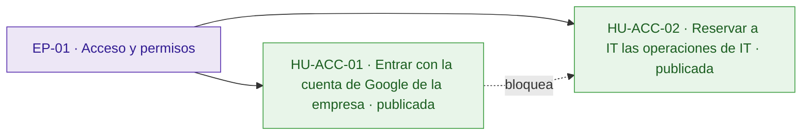
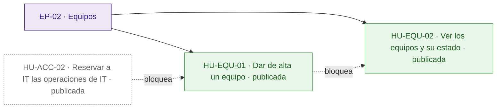
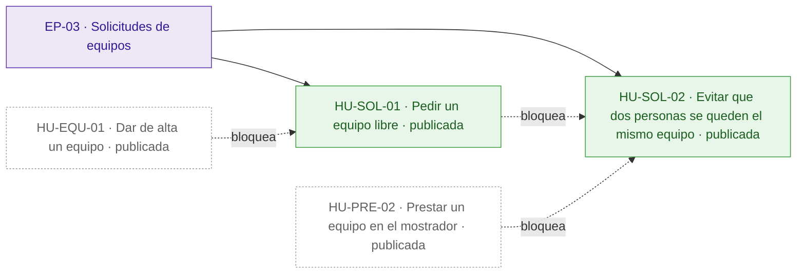
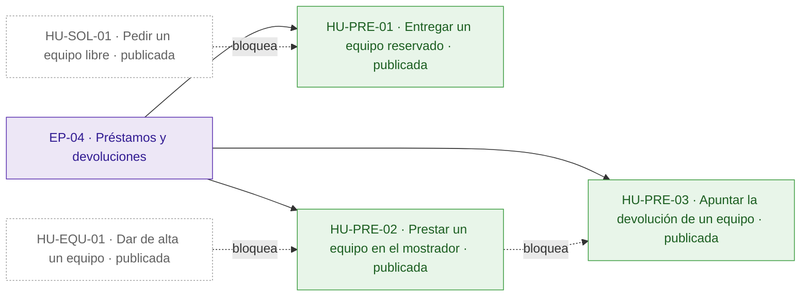
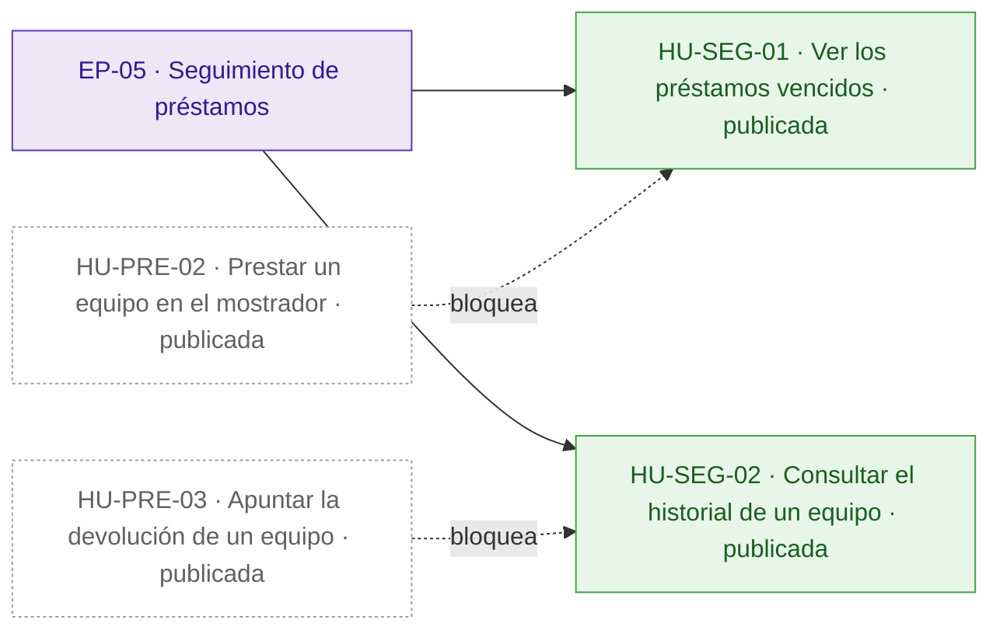
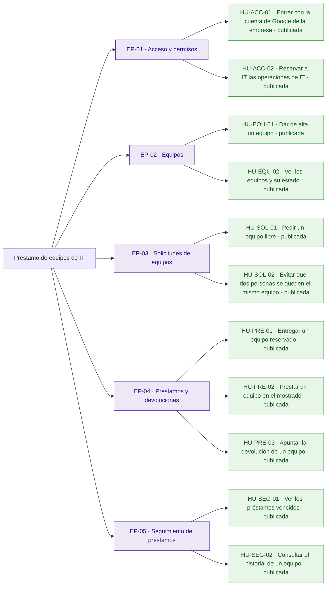
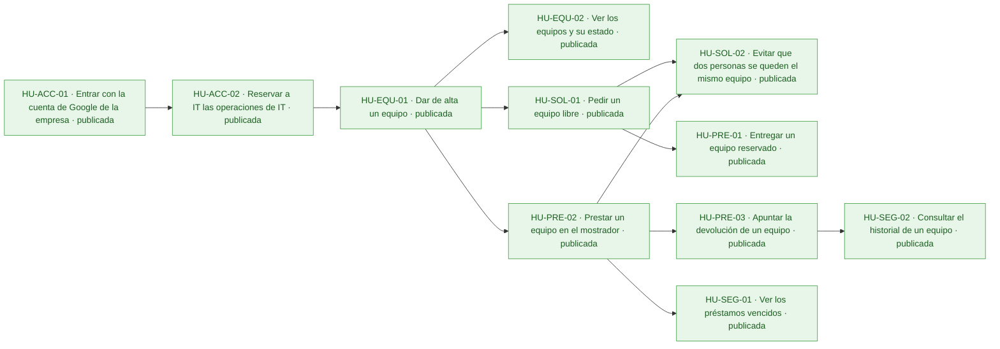
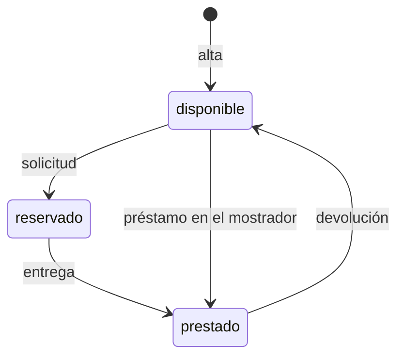

# Préstamo de equipos de IT

Hoy los préstamos de portátiles, monitores y proyectores se apuntan en una hoja de cálculo y se piden por correo a IT: nadie sabe qué está libre sin preguntar, dos personas acaban esperando el mismo portátil y los préstamos vencidos pasan desapercibidos hasta que alguien echa en falta el equipo.

La aplicación permite a los empleados ver los equipos y pedir uno libre, y a IT dar de alta equipos, entregarlos, prestarlos en el mostrador, apuntar las devoluciones, ver los vencidos y consultar el historial. El inventario de IT se conecta a una API fijada por el cliente que no puede cambiar. Quedan fuera la anulación de solicitudes y los avisos por correo de préstamos vencidos.

## Visión y alcance

Que empleados e IT gestionen el préstamo de los equipos de la oficina en una aplicación, sabiendo qué está libre y sin que ningún equipo se reserve o se preste dos veces.

**Dentro del alcance**

- Entrar en la aplicación con la cuenta de Google de la empresa (peticion.md).
- Ver la lista de equipos con su id, nombre y estado (\`disponible\`, \`reservado\` o \`prestado\`) y, si está reservado o prestado, la persona y la fecha de devolución (peticion.md, anexo).
- Pedir un equipo libre indicando la fecha de devolución; el equipo queda reservado a nombre de quien lo pide hasta que IT se lo entrega (peticion.md).
- Solo IT: dar de alta un equipo; el nombre es obligatorio y no puede repetirse (peticion.md, anexo).
- Solo IT: entregar un equipo reservado, que pasa a prestado con la misma persona y fecha de devolución (peticion.md, anexo).
- Solo IT: prestar en el mostrador un equipo disponible a la persona que se indique, con su fecha de devolución (peticion.md, anexo).
- Solo IT: apuntar la devolución de un equipo prestado, que vuelve a estar disponible sin persona ni fecha (peticion.md, anexo).
- Solo IT: ver los préstamos vencidos (equipos prestados con la devolución anterior a hoy), del más antiguo al más reciente (peticion.md, anexo).
- Solo IT: ver el historial de un equipo, del más reciente al más antiguo, con persona, devolución y estado (\`reservado\`, \`prestado\` o \`devuelto\`) (peticion.md, anexo).
- La fecha de devolución es un texto \`AAAA-MM-DD\` que tiene que existir; quien pide un equipo no puede poner una fecha anterior a hoy, pero IT sí en el mostrador, y ese préstamo ya aparece entre los vencidos (peticion.md, anexo).
- Dos nombres de equipo son el mismo si solo se diferencian en mayúsculas o en espacios al principio o al final (peticion.md, anexo).

**Fuera del alcance**

- Que los empleados anulen una solicitud (peticion.md).
- Avisos por correo de préstamos vencidos (peticion.md).

## Resumen en cifras

| Dato | Valor |
| --- | --- |
| Épicas | 5 |
| Historias | 11 |
| Historias por estado | borrador 0, aprobada 0, descartada 0, publicada 11 |
| Tareas | 35 |
| Sprints | 1 |
| Personas en el equipo | 1 |
| Modalidad de desarrollo | manual, sin IA |
| Horas estimadas | 54 h |
| Horas efectivas (según la modalidad de desarrollo) | 54 h |
| Historias sin estimar | 0 |
| Historias descartadas (fuera de las horas) | 0 |
| Supuestos | 10 |
| Preguntas abiertas | 5 |
| Requisitos | 14 |
| Requisitos sin historia | 0 |

## Índice

- [Visión y alcance](#visión-y-alcance)
- [Resumen en cifras](#resumen-en-cifras)
- [Épicas e historias](#épicas-e-historias)
  - [EP-01 · Acceso y permisos](#ep-01--acceso-y-permisos)
  - [EP-02 · Equipos](#ep-02--equipos)
  - [EP-03 · Solicitudes de equipos](#ep-03--solicitudes-de-equipos)
  - [EP-04 · Préstamos y devoluciones](#ep-04--préstamos-y-devoluciones)
  - [EP-05 · Seguimiento de préstamos](#ep-05--seguimiento-de-préstamos)
- [Tareas](#tareas)
- [Sprints](#sprints)
- [Equipo](#equipo)
- [Dependencias](#dependencias)
- [Requisitos y trazabilidad](#requisitos-y-trazabilidad)
- [Preparación y definición de hecho](#preparación-y-definición-de-hecho)
- [Diagramas](#diagramas)
- [Supuestos](#supuestos)
- [Preguntas abiertas](#preguntas-abiertas)
- [Decisiones](#decisiones)

## Épicas e historias

### EP-01 · Acceso y permisos

Empleados, IT y el inventario de IT entran con su cuenta de Google de la empresa, y solo las cuentas de IT pueden hacer lo que les toca a ellas. Deja fuera cualquier otro método de acceso.

#### Épica EP-01: Acceso y permisos

#### HU-ACC-01 · Entrar con la cuenta de Google de la empresa

Como empleado, quiero entrar en la aplicación con mi cuenta de Google de la empresa, para que cada reserva y cada préstamo queden a mi nombre sin crear otra contraseña.

**Contexto.** Todos los usuarios entran con su cuenta de Google de la empresa, y todas las rutas de la API exigen el token de identidad de Google con el correo verificado, emitido para el cliente OAuth de la aplicación (RQ.001, RQ.012; peticion.md y su anexo).

- **Prioridad:** Highest
- **Tamaño:** L
- **Horas:** 8 h estimadas · 8 h efectivas
- **Estado:** publicada
- **Sprint:** SP-01 Sprint 1
- **Responsable:** José Luis Calvo
- **Tipo:** historia
- **Puntos de historia:** 5
- **Preparación:** parcialmente lista (pendiente: DoR-08: dependencias externas sin plan confirmado: Cliente OAuth de Google de la aplicación · supuestos sin confirmar: DoR-04, DoR-05, DoR-06, DoR-07, DoR-09)
- **Requisitos:** RQ.001, RQ.012, RQ.014
- **Dependencias externas:** Cliente OAuth de Google de la aplicación

**Criterios de aceptación**

*Escenarios positivos*

1. **Dado** la empleada «lucia.gomez@empresa.com» con un token de identidad de Google válido, con el correo verificado y emitido para el cliente OAuth de la aplicación, **cuando** pide la lista de equipos, **entonces** recibe 200 con la lista de equipos.
2. **Dado** la cuenta de servicio del inventario de IT con un token de identidad de Google válido, con el correo verificado y emitido para el cliente OAuth de la aplicación, **cuando** pide la lista de equipos, **entonces** recibe 200 con la lista de equipos.

*Escenarios negativos*

1. **Dado** una petición sin token de identidad, **cuando** pide la lista de equipos, **entonces** recibe 401 con {"error": "Inicia sesión con Google."}.
2. **Dado** un token de identidad de Google emitido para otro cliente OAuth, **cuando** pide la lista de equipos, **entonces** recibe 401 con {"error": "Inicia sesión con Google."}.
3. **Dado** un token de identidad de Google emitido para el cliente OAuth de la aplicación con el correo sin verificar, **cuando** pide la lista de equipos, **entonces** recibe 401 con {"error": "Inicia sesión con Google."}.

**Notas.** La persona de cada operación es el correo del token. El inventario de IT entra igual, con una cuenta de servicio. Los criterios se comprueban con la ruta de la lista de equipos, que puede existir antes de que la lista esté terminada.

**Definición de hecho**

- Criterios de aceptación probados.
- Los errores siguen el formato {"error": "\<mensaje\>"} del anexo.
- Textos revisados en español de España.

**Tareas**

- TA-001 · Verificación del token de identidad de Google y del correo verificado en todas las rutas · backend · José Luis Calvo
- TA-002 · Inicio de sesión con Google en la aplicación web · frontend · José Luis Calvo
- TA-003 · Pruebas de acceso con token válido, sin token y de otro cliente OAuth · QA · José Luis Calvo

#### HU-ACC-02 · Reservar a IT las operaciones de IT

Como técnico de IT, quiero limitar las operaciones «Solo IT» a las cuentas de CORREOS\_IT, para evitar que un empleado entregue o dé por devuelto un equipo ajeno.

**Contexto.** Las operaciones «Solo IT» solo las hace una cuenta de la variable de entorno CORREOS\_IT, fijada en la configuración del despliegue y no en el código; con cualquier otra cuenta responden 403 (RQ.012; peticion.md, anexo). Responde al riesgo de que un empleado haga lo que solo le toca a IT.

- **Prioridad:** Highest
- **Tamaño:** M
- **Horas:** 4 h estimadas · 4 h efectivas
- **Estado:** publicada
- **Sprint:** SP-01 Sprint 1
- **Responsable:** José Luis Calvo
- **Tipo:** historia
- **Puntos de historia:** 3
- **Preparación:** parcialmente lista (pendiente: DoR-08: depende de HU-ACC-01, sin resolver ni planificada en un sprint anterior · supuestos sin confirmar: DoR-04, DoR-05, DoR-06, DoR-07, DoR-09)
- **Requisitos:** RQ.012
- **Depende de:**
  - HU-ACC-01 · Entrar con la cuenta de Google de la empresa: Saber si la cuenta es de IT exige conocer el correo del token.

**Criterios de aceptación**

*Escenarios positivos*

1. **Dado** CORREOS\_IT con «it.soporte@empresa.com,inventario@empresa.iam.gserviceaccount.com» y una sesión de «IT.Soporte@empresa.com», **cuando** da de alta el equipo «Monitor 03», **entonces** recibe 201 con el equipo «Monitor 03» en estado «disponible».
2. **Dado** CORREOS\_IT con «inventario@empresa.iam.gserviceaccount.com», una sesión de esa cuenta y el equipo «Portátil 07» disponible, **cuando** pide el equipo «Portátil 07» con la devolución «2030-06-15», **entonces** recibe 201 con el equipo en estado «reservado» y la persona «inventario@empresa.iam.gserviceaccount.com».

*Escenarios negativos*

1. **Dado** CORREOS\_IT con «it.soporte@empresa.com» y una sesión de la empleada «lucia.gomez@empresa.com», **cuando** da de alta el equipo «Monitor 03», **entonces** recibe 403 con {"error": "Solo IT puede hacer esto."} y el equipo no se crea.
2. **Dado** CORREOS\_IT con «it.soporte@empresa.com» y una sesión de la empleada «lucia.gomez@empresa.com», **cuando** pide los préstamos vencidos, **entonces** recibe 403 con {"error": "Solo IT puede hacer esto."}.

**Notas.** Dos correos son el mismo aunque cambien las mayúsculas. La cuenta de servicio del inventario está en la lista y también puede hacer lo de un empleado.

**Definición de hecho**

- Criterios de aceptación probados.
- La lista de IT se lee de la variable de entorno CORREOS\_IT, sin correos en el código.
- Textos revisados en español de España.

**Tareas**

- TA-004 · Comprobación de cuentas de IT a partir de CORREOS\_IT sin distinguir mayúsculas · backend · José Luis Calvo
- TA-005 · Pruebas de las operaciones «Solo IT» con cuentas de IT y de empleado · QA · José Luis Calvo

### EP-02 · Equipos

IT da de alta los equipos de la oficina y cualquier empleado ve la lista con su estado. Deja fuera cambiar o retirar un equipo, que la petición no pide.

#### Épica EP-02: Equipos

#### HU-EQU-01 · Dar de alta un equipo

Como técnico de IT, quiero dar de alta un equipo con su nombre, para que los empleados puedan pedirlo sin escribir a IT.

**Contexto.** IT da de alta los equipos de la oficina; el nombre es obligatorio y no se puede repetir, y dos nombres son el mismo si solo cambian mayúsculas o espacios al principio o al final (RQ.004, RQ.011; peticion.md, anexo).

- **Prioridad:** Highest
- **Tamaño:** M
- **Horas:** 4 h estimadas · 4 h efectivas
- **Estado:** publicada
- **Sprint:** SP-01 Sprint 1
- **Responsable:** José Luis Calvo
- **Tipo:** historia
- **Puntos de historia:** 3
- **Preparación:** parcialmente lista (pendiente: DoR-08: depende de HU-ACC-02, sin resolver ni planificada en un sprint anterior · supuestos sin confirmar: DoR-04, DoR-05, DoR-06, DoR-07, DoR-09)
- **Requisitos:** RQ.004, RQ.011, RQ.014
- **Depende de:**
  - HU-ACC-02 · Reservar a IT las operaciones de IT: Dar de alta es una operación «Solo IT».

**Criterios de aceptación**

*Escenarios positivos*

1. **Dado** el técnico de IT «it.soporte@empresa.com» y ningún equipo llamado «Portátil 07», **cuando** da de alta el equipo con el nombre «Portátil 07», **entonces** recibe 201 con el id del equipo, el nombre «Portátil 07» y el estado «disponible».

*Escenarios negativos*

1. **Dado** el técnico de IT «it.soporte@empresa.com», **cuando** da de alta un equipo con el nombre vacío, **entonces** recibe 400 con {"error": "Falta el nombre del equipo"} y no se crea ningún equipo.
2. **Dado** el técnico de IT «it.soporte@empresa.com» y el equipo «Portátil 07» ya dado de alta, **cuando** da de alta un equipo con el nombre « portátil 07 », **entonces** recibe 409 con {"error": "Ya hay un equipo con ese nombre"} y no se crea otro equipo.

**Definición de hecho**

- Criterios de aceptación probados.
- Respuesta y errores exactamente como en el anexo.
- Textos revisados en español de España.

**Tareas**

- TA-006 · Colección de equipos con el nombre normalizado único · datos · José Luis Calvo
- TA-007 · Ruta de alta de equipos con sus errores · backend · José Luis Calvo
- TA-008 · Formulario de alta de equipos para IT · frontend · José Luis Calvo
- TA-009 · Pruebas del alta, del nombre vacío y del nombre repetido · QA · José Luis Calvo

#### HU-EQU-02 · Ver los equipos y su estado

Como empleado, quiero ver la lista de equipos con su estado, para saber qué está libre sin preguntar a IT.

**Contexto.** Cualquier empleado ve los equipos y su estado; si un equipo está reservado o prestado, la lista muestra también la persona y la fecha de devolución (RQ.002; peticion.md, anexo).

- **Prioridad:** Highest
- **Tamaño:** S
- **Horas:** 2 h estimadas · 2 h efectivas
- **Estado:** publicada
- **Sprint:** SP-01 Sprint 1
- **Responsable:** José Luis Calvo
- **Tipo:** historia
- **Puntos de historia:** 2
- **Preparación:** parcialmente lista (pendiente: DoR-08: depende de HU-EQU-01, sin resolver ni planificada en un sprint anterior · supuestos sin confirmar: DoR-04, DoR-05, DoR-06, DoR-07, DoR-09)
- **Requisitos:** RQ.002, RQ.014
- **Depende de:**
  - HU-EQU-01 · Dar de alta un equipo: La lista muestra los equipos dados de alta.

**Criterios de aceptación**

*Escenarios positivos*

1. **Dado** el equipo «Portátil 07» disponible y el equipo «Proyector 01» prestado a «ana.perez@empresa.com» hasta «2030-06-15», **cuando** la empleada «lucia.gomez@empresa.com» pide la lista de equipos, **entonces** recibe 200 con «Portátil 07» en estado «disponible» sin persona ni devolución, y «Proyector 01» en estado «prestado» con la persona «ana.perez@empresa.com» y la devolución «2030-06-15».

*Escenarios negativos*

1. **Dado** ningún equipo dado de alta, **cuando** la empleada «lucia.gomez@empresa.com» pide la lista de equipos, **entonces** recibe 200 con una lista vacía.

**Notas.** Depende de la pregunta abierta sobre si todos los empleados deben ver el correo de quien tiene cada equipo.

**Definición de hecho**

- Criterios de aceptación probados.
- Campos de la respuesta exactamente como en el anexo.
- Textos revisados en español de España.

**Tareas**

- TA-010 · Ruta de la lista de equipos con persona y devolución · backend · José Luis Calvo
- TA-011 · Pantalla de la lista de equipos con su estado · frontend · José Luis Calvo
- TA-012 · Pruebas de la lista con equipos en cada estado y vacía · QA · José Luis Calvo

### EP-03 · Solicitudes de equipos

Un empleado pide un equipo libre con la fecha en que lo devolverá y el equipo queda reservado a su nombre, sin que dos personas se queden con el mismo. Deja fuera que el empleado anule su solicitud.

#### Épica EP-03: Solicitudes de equipos

#### HU-SOL-01 · Pedir un equipo libre

Como empleado, quiero pedir un equipo disponible con la fecha en que lo devolveré, para tenerlo reservado a mi nombre hasta que IT me lo entregue, sin escribir correos.

**Contexto.** Un empleado pide un equipo libre con la fecha de devolución y el equipo queda reservado a su nombre hasta que IT se lo entrega. La fecha va como AAAA-MM-DD, tiene que existir y no puede ser anterior a hoy, que es el día en Madrid (RQ.003, RQ.010; peticion.md, anexo).

- **Prioridad:** Highest
- **Tamaño:** L
- **Horas:** 8 h estimadas · 8 h efectivas
- **Estado:** publicada
- **Sprint:** SP-01 Sprint 1
- **Responsable:** José Luis Calvo
- **Tipo:** historia
- **Puntos de historia:** 5
- **Preparación:** parcialmente lista (pendiente: DoR-08: depende de HU-EQU-01, sin resolver ni planificada en un sprint anterior · supuestos sin confirmar: DoR-04, DoR-05, DoR-06, DoR-07, DoR-09)
- **Requisitos:** RQ.003, RQ.010, RQ.014
- **Depende de:**
  - HU-EQU-01 · Dar de alta un equipo: Solo se pide un equipo dado de alta.

**Criterios de aceptación**

*Escenarios positivos*

1. **Dado** el equipo «Portátil 07» disponible, **cuando** la empleada «lucia.gomez@empresa.com» lo pide con la devolución «2030-06-15», **entonces** recibe 201 con el equipo en estado «reservado», la persona «lucia.gomez@empresa.com» y la devolución «2030-06-15».

*Escenarios negativos*

1. **Dado** el equipo «Portátil 07» disponible, **cuando** la empleada «lucia.gomez@empresa.com» lo pide sin fecha de devolución, **entonces** recibe 400 con {"error": "Falta la fecha de devolución"} y el equipo sigue disponible.
2. **Dado** el equipo «Portátil 07» disponible, **cuando** la empleada «lucia.gomez@empresa.com» lo pide con la devolución «2026-02-30», **entonces** recibe 400 con {"error": "La fecha de devolución no es válida"} y el equipo sigue disponible.
3. **Dado** el equipo «Portátil 07» disponible, **cuando** la empleada «lucia.gomez@empresa.com» lo pide con la devolución «2025-01-10», anterior a hoy en Madrid, **entonces** recibe 400 con {"error": "La fecha de devolución ya ha pasado"} y el equipo sigue disponible.
4. **Dado** ningún equipo con el id «no-existe», **cuando** la empleada «lucia.gomez@empresa.com» pide el equipo «no-existe» con la devolución «2030-06-15», **entonces** recibe 404 con {"error": "No existe el equipo"}.
5. **Dado** el equipo «Portátil 07» reservado a «lucia.gomez@empresa.com», **cuando** el empleado «marcos.ruiz@empresa.com» lo pide con la devolución «2030-06-15», **entonces** recibe 409 con {"error": "El equipo no está disponible"} y el equipo sigue reservado a «lucia.gomez@empresa.com».

**Notas.** Depende de la pregunta abierta sobre qué pasa con una reserva que IT no llega a entregar, porque los empleados no pueden anular solicitudes.

**Definición de hecho**

- Criterios de aceptación probados.
- «Hoy» se calcula con el día en Madrid.
- Respuesta y errores exactamente como en el anexo.

**Tareas**

- TA-013 · Registro de préstamos con su estado y fecha de devolución · datos · José Luis Calvo
- TA-014 · Ruta de solicitud con la validación de la fecha en Madrid · backend · José Luis Calvo
- TA-015 · Botón para pedir un equipo libre con su fecha de devolución · frontend · José Luis Calvo
- TA-016 · Pruebas de la solicitud y de cada error de la fecha · QA · José Luis Calvo

#### HU-SOL-02 · Evitar que dos personas se queden el mismo equipo

Como empleado, quiero pedir un equipo libre aunque otra persona lo pida a la vez, para saber con certeza si el equipo es mío, sin esperar un portátil que ya tiene otra persona.

**Contexto.** Lo más importante de la petición: un equipo no puede estar reservado o prestado dos veces a la vez, ni siquiera con dos peticiones simultáneas, sean solicitudes o préstamos en el mostrador (RQ.013; peticion.md, anexo).

- **Prioridad:** Highest
- **Tamaño:** L
- **Horas:** 8 h estimadas · 8 h efectivas
- **Estado:** publicada
- **Sprint:** SP-01 Sprint 1
- **Responsable:** José Luis Calvo
- **Tipo:** historia
- **Puntos de historia:** 5
- **Preparación:** parcialmente lista (pendiente: DoR-08: depende de HU-SOL-01, HU-PRE-02, sin resolver ni planificada en un sprint anterior · supuestos sin confirmar: DoR-04, DoR-05, DoR-06, DoR-07, DoR-09)
- **Requisitos:** RQ.013
- **Depende de:**
  - HU-SOL-01 · Pedir un equipo libre: Protege las solicitudes de los empleados.
  - HU-PRE-02 · Prestar un equipo en el mostrador: Protege también los préstamos en el mostrador.

**Criterios de aceptación**

*Escenarios positivos*

1. **Dado** el equipo «Portátil 07» disponible y dos peticiones simultáneas, una de «lucia.gomez@empresa.com» y otra de «marcos.ruiz@empresa.com», con la devolución «2030-06-15», **cuando** llegan las dos solicitudes a la vez, **entonces** una recibe 201 con el equipo reservado a su nombre y la otra recibe 409 con {"error": "El equipo no está disponible"}.

*Escenarios negativos*

1. **Dado** el equipo «Portátil 07» disponible, una solicitud de «lucia.gomez@empresa.com» y un préstamo en el mostrador de «it.soporte@empresa.com» a «marcos.ruiz@empresa.com», ambos con la devolución «2030-06-15», **cuando** llegan las dos peticiones a la vez, **entonces** exactamente una de las dos recibe 201 y la otra recibe 409 con {"error": "El equipo no está disponible"}, y el equipo queda reservado o prestado a una sola persona.

**Definición de hecho**

- Criterios de aceptación probados, también con peticiones simultáneas.
- Nunca salen bien dos peticiones sobre el mismo equipo disponible.

**Tareas**

- TA-017 · Documento del préstamo activo por equipo, creado solo si no existe · datos · José Luis Calvo
- TA-018 · Transacción que reserva o presta el equipo una sola vez · backend · José Luis Calvo
- TA-019 · Pruebas de peticiones simultáneas de solicitud y de mostrador · QA · José Luis Calvo

### EP-04 · Préstamos y devoluciones

IT entrega los equipos reservados, presta directamente en el mostrador y apunta las devoluciones. Las solicitudes de los empleados son de la épica «Solicitudes de equipos».

#### Épica EP-04: Préstamos y devoluciones

#### HU-PRE-01 · Entregar un equipo reservado

Como técnico de IT, quiero entregar al empleado el equipo que tiene reservado, para que el préstamo conste con la misma persona y fecha que pidió.

**Contexto.** IT entrega los equipos reservados, que pasan a prestados con la misma persona y fecha de devolución de la solicitud (RQ.005; peticion.md, anexo).

- **Prioridad:** Highest
- **Tamaño:** M
- **Horas:** 4 h estimadas · 4 h efectivas
- **Estado:** publicada
- **Sprint:** SP-01 Sprint 1
- **Responsable:** José Luis Calvo
- **Tipo:** historia
- **Puntos de historia:** 3
- **Preparación:** parcialmente lista (pendiente: DoR-08: depende de HU-SOL-01, sin resolver ni planificada en un sprint anterior · supuestos sin confirmar: DoR-04, DoR-05, DoR-06, DoR-07, DoR-09)
- **Requisitos:** RQ.005, RQ.014
- **Depende de:**
  - HU-SOL-01 · Pedir un equipo libre: Solo se entrega un equipo reservado.

**Criterios de aceptación**

*Escenarios positivos*

1. **Dado** el equipo «Portátil 07» reservado a «lucia.gomez@empresa.com» con la devolución «2030-06-15», **cuando** el técnico de IT «it.soporte@empresa.com» lo entrega, **entonces** recibe 200 con el equipo en estado «prestado», la persona «lucia.gomez@empresa.com» y la devolución «2030-06-15».

*Escenarios negativos*

1. **Dado** el equipo «Portátil 07» disponible, **cuando** el técnico de IT «it.soporte@empresa.com» lo entrega, **entonces** recibe 409 con {"error": "El equipo no está reservado"} y el equipo sigue disponible.
2. **Dado** ningún equipo con el id «no-existe», **cuando** el técnico de IT «it.soporte@empresa.com» entrega el equipo «no-existe», **entonces** recibe 404 con {"error": "No existe el equipo"}.

**Definición de hecho**

- Criterios de aceptación probados.
- Respuesta y errores exactamente como en el anexo.

**Tareas**

- TA-020 · Ruta de entrega de un equipo reservado · backend · José Luis Calvo
- TA-021 · Acción de entrega en la pantalla de IT · frontend · José Luis Calvo
- TA-022 · Pruebas de la entrega y de sus errores · QA · José Luis Calvo

#### HU-PRE-02 · Prestar un equipo en el mostrador

Como técnico de IT, quiero prestar un equipo disponible a quien viene al mostrador, con su fecha de devolución, para que también los préstamos sin solicitud pasen por la aplicación.

**Contexto.** IT presta directamente a quien viene al mostrador. A diferencia de quien pide un equipo, IT puede poner una fecha anterior a hoy porque a veces apunta los préstamos con retraso, y ese préstamo ya aparece entre los vencidos (RQ.006, RQ.010; peticion.md, anexo).

- **Prioridad:** Highest
- **Tamaño:** M
- **Horas:** 4 h estimadas · 4 h efectivas
- **Estado:** publicada
- **Sprint:** SP-01 Sprint 1
- **Responsable:** José Luis Calvo
- **Tipo:** historia
- **Puntos de historia:** 3
- **Preparación:** parcialmente lista (pendiente: DoR-08: depende de HU-EQU-01, sin resolver ni planificada en un sprint anterior · supuestos sin confirmar: DoR-04, DoR-05, DoR-06, DoR-07, DoR-09)
- **Requisitos:** RQ.006, RQ.010, RQ.014
- **Depende de:**
  - HU-EQU-01 · Dar de alta un equipo: Solo se presta un equipo dado de alta.

**Criterios de aceptación**

*Escenarios positivos*

1. **Dado** el equipo «Proyector 01» disponible, **cuando** el técnico de IT «it.soporte@empresa.com» lo presta a «ana.perez@empresa.com» con la devolución «2030-06-15», **entonces** recibe 201 con el equipo en estado «prestado», la persona «ana.perez@empresa.com» y la devolución «2030-06-15».
2. **Dado** el equipo «Proyector 01» disponible, **cuando** el técnico de IT «it.soporte@empresa.com» lo presta a «ana.perez@empresa.com» con la devolución «2025-01-10», anterior a hoy en Madrid, **entonces** recibe 201 con el equipo en estado «prestado» y el préstamo aparece entre los vencidos.

*Escenarios negativos*

1. **Dado** el equipo «Proyector 01» disponible, **cuando** el técnico de IT «it.soporte@empresa.com» lo presta con la devolución «2030-06-15» y sin persona, **entonces** recibe 400 con {"error": "Faltan la persona o la fecha de devolución"} y el equipo sigue disponible.
2. **Dado** el equipo «Proyector 01» disponible, **cuando** el técnico de IT «it.soporte@empresa.com» lo presta a «ana.perez@empresa.com» con la devolución «2026-02-30», **entonces** recibe 400 con {"error": "La fecha de devolución no es válida"} y el equipo sigue disponible.
3. **Dado** el equipo «Proyector 01» prestado a «marcos.ruiz@empresa.com», **cuando** el técnico de IT «it.soporte@empresa.com» lo presta a «ana.perez@empresa.com» con la devolución «2030-06-15», **entonces** recibe 409 con {"error": "El equipo no está disponible"} y el equipo sigue prestado a «marcos.ruiz@empresa.com».

**Definición de hecho**

- Criterios de aceptación probados.
- Respuesta y errores exactamente como en el anexo.

**Tareas**

- TA-023 · Ruta de préstamo en el mostrador que admite fechas pasadas · backend · José Luis Calvo
- TA-024 · Formulario de préstamo en el mostrador · frontend · José Luis Calvo
- TA-025 · Pruebas del préstamo en el mostrador y de sus errores · QA · José Luis Calvo

#### HU-PRE-03 · Apuntar la devolución de un equipo

Como técnico de IT, quiero apuntar que un equipo prestado se ha devuelto, para que vuelva a aparecer libre para el siguiente empleado.

**Contexto.** IT apunta las devoluciones; el equipo pasa a disponible y deja de llevar persona y fecha de devolución (RQ.007; peticion.md, anexo).

- **Prioridad:** Highest
- **Tamaño:** M
- **Horas:** 4 h estimadas · 4 h efectivas
- **Estado:** publicada
- **Sprint:** SP-01 Sprint 1
- **Responsable:** José Luis Calvo
- **Tipo:** historia
- **Puntos de historia:** 3
- **Preparación:** parcialmente lista (pendiente: DoR-08: depende de HU-PRE-02, sin resolver ni planificada en un sprint anterior · supuestos sin confirmar: DoR-04, DoR-05, DoR-06, DoR-07, DoR-09)
- **Requisitos:** RQ.007, RQ.014
- **Depende de:**
  - HU-PRE-02 · Prestar un equipo en el mostrador: Solo se devuelve un equipo prestado.

**Criterios de aceptación**

*Escenarios positivos*

1. **Dado** el equipo «Proyector 01» prestado a «ana.perez@empresa.com» con la devolución «2030-06-15», **cuando** el técnico de IT «it.soporte@empresa.com» apunta su devolución, **entonces** recibe 200 con el equipo en estado «disponible», sin persona ni devolución.

*Escenarios negativos*

1. **Dado** el equipo «Portátil 07» reservado a «lucia.gomez@empresa.com», **cuando** el técnico de IT «it.soporte@empresa.com» apunta su devolución, **entonces** recibe 409 con {"error": "El equipo no está prestado"} y el equipo sigue reservado.
2. **Dado** ningún equipo con el id «no-existe», **cuando** el técnico de IT «it.soporte@empresa.com» apunta la devolución del equipo «no-existe», **entonces** recibe 404 con {"error": "No existe el equipo"}.

**Definición de hecho**

- Criterios de aceptación probados.
- Respuesta y errores exactamente como en el anexo.

**Tareas**

- TA-026 · Ruta de devolución que libera el equipo · backend · José Luis Calvo
- TA-027 · Acción de devolución en la pantalla de IT · frontend · José Luis Calvo
- TA-028 · Pruebas de la devolución y de sus errores · QA · José Luis Calvo

### EP-05 · Seguimiento de préstamos

IT ve qué préstamos han vencido y consulta el historial de cada equipo, sin preguntar a nadie. Deja fuera los avisos por correo de préstamos vencidos.

#### Épica EP-05: Seguimiento de préstamos

#### HU-SEG-01 · Ver los préstamos vencidos

Como técnico de IT, quiero ver los préstamos cuya fecha de devolución es anterior a hoy, para revisarlos cada semana sin tener que preguntar a nadie.

**Contexto.** IT ve qué préstamos han vencido: los equipos prestados con la devolución anterior a hoy, que es el día en Madrid, del más antiguo al más reciente (RQ.008, RQ.010; peticion.md, anexo). Es una de las métricas de éxito.

- **Prioridad:** Highest
- **Tamaño:** M
- **Horas:** 4 h estimadas · 4 h efectivas
- **Estado:** publicada
- **Sprint:** SP-01 Sprint 1
- **Responsable:** José Luis Calvo
- **Tipo:** historia
- **Puntos de historia:** 3
- **Preparación:** parcialmente lista (pendiente: DoR-08: depende de HU-PRE-02, sin resolver ni planificada en un sprint anterior · supuestos sin confirmar: DoR-04, DoR-05, DoR-06, DoR-07, DoR-09)
- **Requisitos:** RQ.008, RQ.010, RQ.014
- **Depende de:**
  - HU-PRE-02 · Prestar un equipo en el mostrador: Los vencidos son equipos prestados.

**Criterios de aceptación**

*Escenarios positivos*

1. **Dado** el equipo «Proyector 01» prestado a «ana.perez@empresa.com» hasta «2025-03-01», el equipo «Monitor 03» prestado a «marcos.ruiz@empresa.com» hasta «2025-01-10» y el equipo «Portátil 07» prestado a «lucia.gomez@empresa.com» hasta «2030-06-15», **cuando** el técnico de IT «it.soporte@empresa.com» pide los préstamos vencidos, **entonces** recibe 200 con «Monitor 03» primero y «Proyector 01» después, cada uno con id, nombre, persona y devolución, y sin «Portátil 07».

*Escenarios negativos*

1. **Dado** el equipo «Portátil 07» reservado a «lucia.gomez@empresa.com» hasta «2025-01-10» y ningún equipo prestado, **cuando** el técnico de IT «it.soporte@empresa.com» pide los préstamos vencidos, **entonces** recibe 200 con una lista vacía.

**Definición de hecho**

- Criterios de aceptación probados.
- «Hoy» se calcula con el día en Madrid.
- Respuesta exactamente como en el anexo.

**Tareas**

- TA-029 · Consulta de préstamos activos ordenada por fecha de devolución · datos · José Luis Calvo
- TA-030 · Ruta de préstamos vencidos con el día de Madrid · backend · José Luis Calvo
- TA-031 · Pantalla de préstamos vencidos para IT · frontend · José Luis Calvo
- TA-032 · Pruebas de los vencidos, su orden y la lista vacía · QA · José Luis Calvo

#### HU-SEG-02 · Consultar el historial de un equipo

Como técnico de IT, quiero consultar el historial de préstamos de un equipo, para saber quién lo tuvo y cuándo sin buscar en la hoja de cálculo.

**Contexto.** IT consulta el historial de cada equipo: sus préstamos del más reciente al más antiguo, con persona, devolución y estado reservado, prestado o devuelto (RQ.009; peticion.md, anexo).

- **Prioridad:** High
- **Tamaño:** M
- **Horas:** 4 h estimadas · 4 h efectivas
- **Estado:** publicada
- **Sprint:** SP-01 Sprint 1
- **Responsable:** José Luis Calvo
- **Tipo:** historia
- **Puntos de historia:** 3
- **Preparación:** parcialmente lista (pendiente: DoR-08: depende de HU-PRE-03, sin resolver ni planificada en un sprint anterior · supuestos sin confirmar: DoR-04, DoR-05, DoR-06, DoR-07, DoR-09)
- **Requisitos:** RQ.009, RQ.014
- **Depende de:**
  - HU-PRE-03 · Apuntar la devolución de un equipo: El historial muestra los préstamos devueltos.

**Criterios de aceptación**

*Escenarios positivos*

1. **Dado** el equipo «Proyector 01» prestado y devuelto por «ana.perez@empresa.com» con la devolución «2030-05-01» y después reservado a «lucia.gomez@empresa.com» con la devolución «2030-06-15», **cuando** el técnico de IT «it.soporte@empresa.com» consulta su historial, **entonces** recibe 200 con la reserva de «lucia.gomez@empresa.com» en estado «reservado» primero y el préstamo de «ana.perez@empresa.com» en estado «devuelto» después.

*Escenarios negativos*

1. **Dado** ningún equipo con el id «no-existe», **cuando** el técnico de IT «it.soporte@empresa.com» consulta el historial del equipo «no-existe», **entonces** recibe 404 con {"error": "No existe el equipo"}.

**Definición de hecho**

- Criterios de aceptación probados.
- Respuesta y errores exactamente como en el anexo.

**Tareas**

- TA-033 · Ruta del historial de un equipo ordenado del más reciente al más antiguo · backend · José Luis Calvo
- TA-034 · Pantalla del historial de un equipo · frontend · José Luis Calvo
- TA-035 · Pruebas del historial y del equipo inexistente · QA · José Luis Calvo

## Tareas

| ID | Título | Historia | Disciplina | Descripción | Responsable | Horas estimadas | Horas efectivas |
| --- | --- | --- | --- | --- | --- | --- | --- |
| TA-001 | Verificación del token de identidad de Google y del correo verificado en todas las rutas | HU-ACC-01 · Entrar con la cuenta de Google de la empresa | backend |   | José Luis Calvo |   |   |
| TA-002 | Inicio de sesión con Google en la aplicación web | HU-ACC-01 · Entrar con la cuenta de Google de la empresa | frontend |   | José Luis Calvo |   |   |
| TA-003 | Pruebas de acceso con token válido, sin token y de otro cliente OAuth | HU-ACC-01 · Entrar con la cuenta de Google de la empresa | QA |   | José Luis Calvo |   |   |
| TA-004 | Comprobación de cuentas de IT a partir de CORREOS\_IT sin distinguir mayúsculas | HU-ACC-02 · Reservar a IT las operaciones de IT | backend |   | José Luis Calvo |   |   |
| TA-005 | Pruebas de las operaciones «Solo IT» con cuentas de IT y de empleado | HU-ACC-02 · Reservar a IT las operaciones de IT | QA |   | José Luis Calvo |   |   |
| TA-006 | Colección de equipos con el nombre normalizado único | HU-EQU-01 · Dar de alta un equipo | datos |   | José Luis Calvo |   |   |
| TA-007 | Ruta de alta de equipos con sus errores | HU-EQU-01 · Dar de alta un equipo | backend |   | José Luis Calvo |   |   |
| TA-008 | Formulario de alta de equipos para IT | HU-EQU-01 · Dar de alta un equipo | frontend |   | José Luis Calvo |   |   |
| TA-009 | Pruebas del alta, del nombre vacío y del nombre repetido | HU-EQU-01 · Dar de alta un equipo | QA |   | José Luis Calvo |   |   |
| TA-010 | Ruta de la lista de equipos con persona y devolución | HU-EQU-02 · Ver los equipos y su estado | backend |   | José Luis Calvo |   |   |
| TA-011 | Pantalla de la lista de equipos con su estado | HU-EQU-02 · Ver los equipos y su estado | frontend |   | José Luis Calvo |   |   |
| TA-012 | Pruebas de la lista con equipos en cada estado y vacía | HU-EQU-02 · Ver los equipos y su estado | QA |   | José Luis Calvo |   |   |
| TA-013 | Registro de préstamos con su estado y fecha de devolución | HU-SOL-01 · Pedir un equipo libre | datos |   | José Luis Calvo |   |   |
| TA-014 | Ruta de solicitud con la validación de la fecha en Madrid | HU-SOL-01 · Pedir un equipo libre | backend |   | José Luis Calvo |   |   |
| TA-015 | Botón para pedir un equipo libre con su fecha de devolución | HU-SOL-01 · Pedir un equipo libre | frontend |   | José Luis Calvo |   |   |
| TA-016 | Pruebas de la solicitud y de cada error de la fecha | HU-SOL-01 · Pedir un equipo libre | QA |   | José Luis Calvo |   |   |
| TA-017 | Documento del préstamo activo por equipo, creado solo si no existe | HU-SOL-02 · Evitar que dos personas se queden el mismo equipo | datos |   | José Luis Calvo |   |   |
| TA-018 | Transacción que reserva o presta el equipo una sola vez | HU-SOL-02 · Evitar que dos personas se queden el mismo equipo | backend |   | José Luis Calvo |   |   |
| TA-019 | Pruebas de peticiones simultáneas de solicitud y de mostrador | HU-SOL-02 · Evitar que dos personas se queden el mismo equipo | QA |   | José Luis Calvo |   |   |
| TA-020 | Ruta de entrega de un equipo reservado | HU-PRE-01 · Entregar un equipo reservado | backend |   | José Luis Calvo |   |   |
| TA-021 | Acción de entrega en la pantalla de IT | HU-PRE-01 · Entregar un equipo reservado | frontend |   | José Luis Calvo |   |   |
| TA-022 | Pruebas de la entrega y de sus errores | HU-PRE-01 · Entregar un equipo reservado | QA |   | José Luis Calvo |   |   |
| TA-023 | Ruta de préstamo en el mostrador que admite fechas pasadas | HU-PRE-02 · Prestar un equipo en el mostrador | backend |   | José Luis Calvo |   |   |
| TA-024 | Formulario de préstamo en el mostrador | HU-PRE-02 · Prestar un equipo en el mostrador | frontend |   | José Luis Calvo |   |   |
| TA-025 | Pruebas del préstamo en el mostrador y de sus errores | HU-PRE-02 · Prestar un equipo en el mostrador | QA |   | José Luis Calvo |   |   |
| TA-026 | Ruta de devolución que libera el equipo | HU-PRE-03 · Apuntar la devolución de un equipo | backend |   | José Luis Calvo |   |   |
| TA-027 | Acción de devolución en la pantalla de IT | HU-PRE-03 · Apuntar la devolución de un equipo | frontend |   | José Luis Calvo |   |   |
| TA-028 | Pruebas de la devolución y de sus errores | HU-PRE-03 · Apuntar la devolución de un equipo | QA |   | José Luis Calvo |   |   |
| TA-029 | Consulta de préstamos activos ordenada por fecha de devolución | HU-SEG-01 · Ver los préstamos vencidos | datos |   | José Luis Calvo |   |   |
| TA-030 | Ruta de préstamos vencidos con el día de Madrid | HU-SEG-01 · Ver los préstamos vencidos | backend |   | José Luis Calvo |   |   |
| TA-031 | Pantalla de préstamos vencidos para IT | HU-SEG-01 · Ver los préstamos vencidos | frontend |   | José Luis Calvo |   |   |
| TA-032 | Pruebas de los vencidos, su orden y la lista vacía | HU-SEG-01 · Ver los préstamos vencidos | QA |   | José Luis Calvo |   |   |
| TA-033 | Ruta del historial de un equipo ordenado del más reciente al más antiguo | HU-SEG-02 · Consultar el historial de un equipo | backend |   | José Luis Calvo |   |   |
| TA-034 | Pantalla del historial de un equipo | HU-SEG-02 · Consultar el historial de un equipo | frontend |   | José Luis Calvo |   |   |
| TA-035 | Pruebas del historial y del equipo inexistente | HU-SEG-02 · Consultar el historial de un equipo | QA |   | José Luis Calvo |   |   |

## Sprints

| Sprint | Fechas | Objetivo | Historias | Capacidad (h) | Carga (h efectivas) |
| --- | --- | --- | --- | --- | --- |
| SP-01 Sprint 1 | del 16/11/2026 al 27/11/2026 | Que empleados e IT gestionen en la aplicación todo el ciclo de un préstamo, desde el alta del equipo hasta su devolución, los vencidos y el historial. | 11 | 56 h | 54 h · 96 % |

Historias sin sprint: 0.

## Equipo

| Nombre | Rol | Dedicación | Usa un agente de IA |
| --- | --- | --- | --- |
| José Luis Calvo | Desarrollo | 100 % | sí |

*Por privacidad, este documento no incluye correos electrónicos ni usuarios de GitHub o Trello.*

## Dependencias

| Historia | Bloqueada por | Motivo |
| --- | --- | --- |
| HU-ACC-02 · Reservar a IT las operaciones de IT | HU-ACC-01 · Entrar con la cuenta de Google de la empresa | Saber si la cuenta es de IT exige conocer el correo del token. |
| HU-EQU-01 · Dar de alta un equipo | HU-ACC-02 · Reservar a IT las operaciones de IT | Dar de alta es una operación «Solo IT». |
| HU-EQU-02 · Ver los equipos y su estado | HU-EQU-01 · Dar de alta un equipo | La lista muestra los equipos dados de alta. |
| HU-SOL-01 · Pedir un equipo libre | HU-EQU-01 · Dar de alta un equipo | Solo se pide un equipo dado de alta. |
| HU-SOL-02 · Evitar que dos personas se queden el mismo equipo | HU-SOL-01 · Pedir un equipo libre | Protege las solicitudes de los empleados. |
| HU-SOL-02 · Evitar que dos personas se queden el mismo equipo | HU-PRE-02 · Prestar un equipo en el mostrador | Protege también los préstamos en el mostrador. |
| HU-PRE-01 · Entregar un equipo reservado | HU-SOL-01 · Pedir un equipo libre | Solo se entrega un equipo reservado. |
| HU-PRE-02 · Prestar un equipo en el mostrador | HU-EQU-01 · Dar de alta un equipo | Solo se presta un equipo dado de alta. |
| HU-PRE-03 · Apuntar la devolución de un equipo | HU-PRE-02 · Prestar un equipo en el mostrador | Solo se devuelve un equipo prestado. |
| HU-SEG-01 · Ver los préstamos vencidos | HU-PRE-02 · Prestar un equipo en el mostrador | Los vencidos son equipos prestados. |
| HU-SEG-02 · Consultar el historial de un equipo | HU-PRE-03 · Apuntar la devolución de un equipo | El historial muestra los préstamos devueltos. |

## Requisitos y trazabilidad

| Requisito | Título | Tipo | Origen | Historias | Cobertura |
| --- | --- | --- | --- | --- | --- |
| RQ.001 | Entrar en la aplicación con la cuenta de Google de la empresa | Funcional | peticion.md | HU-ACC-01 | cubierto |
| RQ.002 | Ver la lista de equipos con su estado y, si está reservado o prestado, la persona y la devolución | Funcional | peticion.md | HU-EQU-02 | cubierto |
| RQ.003 | Pedir un equipo libre con la fecha de devolución, que queda reservado a nombre de quien lo pide | Funcional | peticion.md | HU-SOL-01 | cubierto |
| RQ.004 | Solo IT: dar de alta un equipo con nombre obligatorio y que no se repita | Funcional | peticion.md | HU-EQU-01 | cubierto |
| RQ.005 | Solo IT: entregar un equipo reservado, que pasa a prestado | Funcional | peticion.md | HU-PRE-01 | cubierto |
| RQ.006 | Solo IT: prestar en el mostrador un equipo disponible a la persona indicada | Funcional | peticion.md | HU-PRE-02 | cubierto |
| RQ.007 | Solo IT: apuntar la devolución de un equipo prestado | Funcional | peticion.md | HU-PRE-03 | cubierto |
| RQ.008 | Solo IT: ver los préstamos vencidos, del más antiguo al más reciente | Funcional | peticion.md | HU-SEG-01 | cubierto |
| RQ.009 | Solo IT: ver el historial de un equipo, del más reciente al más antiguo | Funcional | peticion.md | HU-SEG-02 | cubierto |
| RQ.010 | La fecha de devolución es AAAA-MM-DD real; quien pide no puede poner una fecha pasada, IT en el mostrador sí; hoy es el día en Madrid | Funcional | peticion.md | HU-SOL-01, HU-PRE-02, HU-SEG-01 | cubierto |
| RQ.011 | Dos nombres de equipo son el mismo si solo cambian mayúsculas o espacios al principio o al final | Funcional | peticion.md | HU-EQU-01 | cubierto |
| RQ.012 | Todas las rutas exigen el token de identidad de Google con correo verificado; las cuentas de IT salen de CORREOS\_IT y el resto recibe 403 | No funcional: seguridad | peticion.md | HU-ACC-01, HU-ACC-02 | cubierto |
| RQ.013 | Un equipo nunca se reserva o se presta dos veces a la vez, ni con peticiones simultáneas | No funcional: concurrencia | peticion.md | HU-SOL-02 | cubierto |
| RQ.014 | La API es exactamente la del anexo, con errores {"error": "\<mensaje\>"} | No funcional: compatibilidad | peticion.md | HU-ACC-01, HU-EQU-01, HU-EQU-02, HU-SOL-01, HU-PRE-01, HU-PRE-02, HU-PRE-03, HU-SEG-01, HU-SEG-02 | cubierto |

Requisitos sin ninguna historia: 0 de 14.

## Preparación y definición de hecho

**Definición de preparado (DoR)**

- Historia con título, descripción y valor de negocio claros.
- Trazabilidad a uno o varios RQ registrada.
- Criterios de aceptación verificables definidos.
- Reglas funcionales necesarias cerradas.
- Diseño/prototipo o referencia UI disponible cuando aplique.
- Fuentes/campos de datos identificados cuando aplique.
- Datos de prueba suficientes o estrategia de mock definida.
- Dependencias externas resueltas o plan temporal explícito.
- Permisos/roles definidos si afectan a la historia.
- La historia puede completarse razonablemente dentro de un sprint.
- No hay decisiones de negocio abiertas que impidan implementar o probar.

**Definición de hecho del proyecto (DoD)**

- Todos los criterios de aceptación implementados.
- Código revisado y mergeado conforme al flujo acordado.
- Tests unitarios y de integración asociados en verde.
- Pruebas funcionales ejecutadas correctamente.
- Comportamiento validado con los datos disponibles.
- Permisos/RLS verificados cuando corresponda.
- Rendimiento contrastado cuando el RQ lo requiera.
- Sin defectos críticos o bloqueantes asociados.
- Desplegada en el entorno previsto para el sprint.
- Trazabilidad HU → RQ → prueba/evidencia actualizada.

**Historias que no están listas del todo**

| ID | Historia | Preparación | Pendiente |
| --- | --- | --- | --- |
| HU-ACC-01 | Entrar con la cuenta de Google de la empresa | parcialmente lista | DoR-08: dependencias externas sin plan confirmado: Cliente OAuth de Google de la aplicación · supuestos sin confirmar: DoR-04, DoR-05, DoR-06, DoR-07, DoR-09 |
| HU-ACC-02 | Reservar a IT las operaciones de IT | parcialmente lista | DoR-08: depende de HU-ACC-01, sin resolver ni planificada en un sprint anterior · supuestos sin confirmar: DoR-04, DoR-05, DoR-06, DoR-07, DoR-09 |
| HU-EQU-01 | Dar de alta un equipo | parcialmente lista | DoR-08: depende de HU-ACC-02, sin resolver ni planificada en un sprint anterior · supuestos sin confirmar: DoR-04, DoR-05, DoR-06, DoR-07, DoR-09 |
| HU-EQU-02 | Ver los equipos y su estado | parcialmente lista | DoR-08: depende de HU-EQU-01, sin resolver ni planificada en un sprint anterior · supuestos sin confirmar: DoR-04, DoR-05, DoR-06, DoR-07, DoR-09 |
| HU-SOL-01 | Pedir un equipo libre | parcialmente lista | DoR-08: depende de HU-EQU-01, sin resolver ni planificada en un sprint anterior · supuestos sin confirmar: DoR-04, DoR-05, DoR-06, DoR-07, DoR-09 |
| HU-SOL-02 | Evitar que dos personas se queden el mismo equipo | parcialmente lista | DoR-08: depende de HU-SOL-01, HU-PRE-02, sin resolver ni planificada en un sprint anterior · supuestos sin confirmar: DoR-04, DoR-05, DoR-06, DoR-07, DoR-09 |
| HU-PRE-01 | Entregar un equipo reservado | parcialmente lista | DoR-08: depende de HU-SOL-01, sin resolver ni planificada en un sprint anterior · supuestos sin confirmar: DoR-04, DoR-05, DoR-06, DoR-07, DoR-09 |
| HU-PRE-02 | Prestar un equipo en el mostrador | parcialmente lista | DoR-08: depende de HU-EQU-01, sin resolver ni planificada en un sprint anterior · supuestos sin confirmar: DoR-04, DoR-05, DoR-06, DoR-07, DoR-09 |
| HU-PRE-03 | Apuntar la devolución de un equipo | parcialmente lista | DoR-08: depende de HU-PRE-02, sin resolver ni planificada en un sprint anterior · supuestos sin confirmar: DoR-04, DoR-05, DoR-06, DoR-07, DoR-09 |
| HU-SEG-01 | Ver los préstamos vencidos | parcialmente lista | DoR-08: depende de HU-PRE-02, sin resolver ni planificada en un sprint anterior · supuestos sin confirmar: DoR-04, DoR-05, DoR-06, DoR-07, DoR-09 |
| HU-SEG-02 | Consultar el historial de un equipo | parcialmente lista | DoR-08: depende de HU-PRE-03, sin resolver ni planificada en un sprint anterior · supuestos sin confirmar: DoR-04, DoR-05, DoR-06, DoR-07, DoR-09 |

## Diagramas

### Mapa de la iniciativa

### Dependencias entre historias

### Calendario de sprints

### Estados de un equipo

## Supuestos

- \[SUPUESTO\] Valores del sprint: 10 días laborables, 8 horas al día y factor de foco 0,7; el equipo no ha dado los suyos.
- \[SUPUESTO\] Modalidad de desarrollo: solo trabajo manual; el equipo no ha dicho si usará IA.
- \[SUPUESTO\] La aplicación tiene una interfaz web para empleados e IT, además de la API — la petición habla de una «aplicación» en la que los empleados «ven» los equipos, pero el anexo solo define la API.
- \[SUPUESTO\] El historial guarda una entrada por cada reserva o préstamo, cuyo estado pasa de reservado a prestado y a devuelto — se deduce de los estados que devuelve el historial.
- \[SUPUESTO\] Un equipo reservado no se puede devolver ni anular; solo IT puede entregarlo — el anexo solo admite la devolución de un equipo prestado y deja fuera la anulación.
- \[SUPUESTO\] El correo de ejemplo del anexo es ficticio y se copia tal cual porque forma parte de la API fijada — el anexo lo usa solo como ejemplo de petición.
- \[SUPUESTO\] ¿Qué pasa con una reserva que IT no llega a entregar?: sigue reservada hasta que IT la entrega; esta entrega no anula ni caduca reservas (supuesto razonable: el anexo no define anulación y la petición la deja fuera de alcance).
- \[SUPUESTO\] ¿Es intencionado que la lista de equipos muestre a todos el correo de quien tiene cada equipo?: sí (intent.md, API fijada por el cliente: «Ver los equipos \| Todos \| … si está reservado o prestado, también persona y devolucion»).
- \[SUPUESTO\] ¿Hay un máximo de días de préstamo o de fecha de devolución futura?: no hay máximo; solo se valida que la fecha exista y, en las solicitudes, que no sea anterior a hoy (supuesto razonable: el anexo no fija ningún tope).
- \[SUPUESTO\] ¿Se valida que la persona del préstamo en el mostrador sea un correo del dominio de la empresa?: no; solo se exige que no falte (intent.md, API fijada por el cliente: el único error de la persona es 400 «Faltan la persona o la fecha de devolución»).

## Preguntas abiertas

- \[media\] ¿Cuántos equipos y usuarios se esperan?
- \[media\] ¿Cómo se mide que «todos los préstamos pasan por la aplicación» y quién lo comprueba?
- \[baja\] ¿Se migran los datos actuales de la hoja de cálculo?
- \[media\] ¿Se añaden los enablers transversales de la plantilla (Sprint 0, rendimiento, pentesting, UAT y despliegue)?
- \[media\] ¿Qué historias son imprescindibles para la primera entrega? Hoy 10 de 11 tienen la prioridad más alta.

## Decisiones

- **2026-11-09 17:09** · Se crea la iniciativa «Préstamo de equipos de IT» a partir de .diverger/inbox/peticion.md; equipo.csv se reserva para la planificación del sprint. *(supuesto)*
- **2026-11-09 17:09** · \[SUPUESTO\] La aplicación tiene una interfaz web para empleados e IT, además de la API: la petición habla de una aplicación en la que los empleados ven los equipos. *(supuesto)*
- **2026-11-09 17:09** · \[SUPUESTO\] El historial guarda una entrada por cada reserva o préstamo, que pasa de reservado a prestado y a devuelto. *(supuesto)*
- **2026-11-09 17:09** · \[SUPUESTO\] Un equipo reservado no se puede devolver ni anular; solo IT puede entregarlo. *(supuesto)*
- **2026-11-09 17:09** · \[SUPUESTO\] El correo de ejemplo del anexo es ficticio y se copia tal cual en la API fijada por el cliente. *(supuesto)*
- **2026-11-09 17:13** · \[SUPUESTO\] Backlog escrito sin revisión del usuario: 5 épicas, 11 historias en borrador y 35 tareas, con la auditoría y la revisión de estilo aplicadas. *(supuesto)*
- **2026-11-09 17:13** · \[SUPUESTO\] Las tallas y los puntos de historia son una propuesta para que el equipo los ajuste. *(supuesto)*
- **2026-11-09 17:16** · \[SUPUESTO\] ¿Qué pasa con una reserva que IT no llega a entregar?: sigue reservada hasta que IT la entrega; esta entrega no anula ni caduca reservas (supuesto razonable: el anexo no define anulación y la petición la deja fuera de alcance). *(supuesto)*
- **2026-11-09 17:16** · \[SUPUESTO\] ¿Es intencionado que la lista de equipos muestre a todos el correo de quien tiene cada equipo?: sí (intent.md, API fijada por el cliente: «Ver los equipos \| Todos \| … si está reservado o prestado, también persona y devolucion»). *(supuesto)*
- **2026-11-09 17:16** · \[SUPUESTO\] ¿Hay un máximo de días de préstamo o de fecha de devolución futura?: no hay máximo; solo se valida que la fecha exista y, en las solicitudes, que no sea anterior a hoy (supuesto razonable: el anexo no fija ningún tope). *(supuesto)*
- **2026-11-09 17:16** · \[SUPUESTO\] ¿Se valida que la persona del préstamo en el mostrador sea un correo del dominio de la empresa?: no; solo se exige que no falte (intent.md, API fijada por el cliente: el único error de la persona es 400 «Faltan la persona o la fecha de devolución»). *(supuesto)*
- **2026-11-09 17:16** · \[SUPUESTO\] HU-ACC-01, HU-ACC-02, HU-EQU-01, HU-EQU-02, HU-SOL-01, HU-SOL-02, HU-PRE-01, HU-PRE-02, HU-PRE-03, HU-SEG-01 y HU-SEG-02 aprobadas sin revisión del usuario: son válidas, no tienen problemas de calidad y, con los requisitos confirmados, ninguna pregunta abierta las cita. *(supuesto)*
- **2026-11-09 17:17** · \[SUPUESTO\] DoR DoR-04 «Reglas funcionales necesarias cerradas.»: se supone cumplido — HU-ACC-01, HU-ACC-02, HU-EQU-01, HU-EQU-02, HU-SOL-01, HU-SOL-02, HU-PRE-01, HU-PRE-02, HU-PRE-03, HU-SEG-01, HU-SEG-02 *(supuesto)*
- **2026-11-09 17:17** · \[SUPUESTO\] DoR DoR-05 «Diseño/prototipo o referencia UI disponible cuando aplique.»: se supone cumplido — HU-ACC-01, HU-ACC-02, HU-EQU-01, HU-EQU-02, HU-SOL-01, HU-SOL-02, HU-PRE-01, HU-PRE-02, HU-PRE-03, HU-SEG-01, HU-SEG-02 *(supuesto)*
- **2026-11-09 17:17** · \[SUPUESTO\] DoR DoR-06 «Fuentes/campos de datos identificados cuando aplique.»: se supone cumplido — HU-ACC-01, HU-ACC-02, HU-EQU-01, HU-EQU-02, HU-SOL-01, HU-SOL-02, HU-PRE-01, HU-PRE-02, HU-PRE-03, HU-SEG-01, HU-SEG-02 *(supuesto)*
- **2026-11-09 17:17** · \[SUPUESTO\] DoR DoR-07 «Datos de prueba suficientes o estrategia de mock definida.»: se supone cumplido — HU-ACC-01, HU-ACC-02, HU-EQU-01, HU-EQU-02, HU-SOL-01, HU-SOL-02, HU-PRE-01, HU-PRE-02, HU-PRE-03, HU-SEG-01, HU-SEG-02 *(supuesto)*
- **2026-11-09 17:17** · \[SUPUESTO\] DoR DoR-09 «Permisos/roles definidos si afectan a la historia.»: se supone cumplido — HU-ACC-01, HU-ACC-02, HU-EQU-01, HU-EQU-02, HU-SOL-01, HU-SOL-02, HU-PRE-01, HU-PRE-02, HU-PRE-03, HU-SEG-01, HU-SEG-02 *(supuesto)*
- **2026-11-09 17:17** · \[SUPUESTO\] HU-ACC-01 entra en un sprint sin estar lista: Resuelto en el repositorio: infra/staging.tfvars: fija google\_client\_id con el cliente OAuth de la aplicación y CORREOS\_IT en variables\_entorno. *(supuesto)*
- **2026-11-09 17:17** · \[SUPUESTO\] HU-ACC-02 entra en un sprint sin estar lista: Supuesto razonable: su bloqueante HU-ACC-01 se planifica antes en el mismo sprint. *(supuesto)*
- **2026-11-09 17:17** · \[SUPUESTO\] HU-EQU-01 entra en un sprint sin estar lista: Supuesto razonable: su bloqueante HU-ACC-02 se planifica antes en el mismo sprint. *(supuesto)*
- **2026-11-09 17:17** · \[SUPUESTO\] HU-EQU-02 entra en un sprint sin estar lista: Supuesto razonable: su bloqueante HU-EQU-01 se planifica antes en el mismo sprint. *(supuesto)*
- **2026-11-09 17:17** · \[SUPUESTO\] HU-SOL-01 entra en un sprint sin estar lista: Supuesto razonable: su bloqueante HU-EQU-01 se planifica antes en el mismo sprint. *(supuesto)*
- **2026-11-09 17:17** · \[SUPUESTO\] HU-SOL-02 entra en un sprint sin estar lista: Supuesto razonable: sus bloqueantes HU-SOL-01 y HU-PRE-02 se planifican antes en el mismo sprint. *(supuesto)*
- **2026-11-09 17:17** · \[SUPUESTO\] HU-PRE-01 entra en un sprint sin estar lista: Supuesto razonable: su bloqueante HU-SOL-01 se planifica antes en el mismo sprint. *(supuesto)*
- **2026-11-09 17:17** · \[SUPUESTO\] HU-PRE-02 entra en un sprint sin estar lista: Supuesto razonable: su bloqueante HU-EQU-01 se planifica antes en el mismo sprint. *(supuesto)*
- **2026-11-09 17:17** · \[SUPUESTO\] HU-PRE-03 entra en un sprint sin estar lista: Supuesto razonable: su bloqueante HU-PRE-02 se planifica antes en el mismo sprint. *(supuesto)*
- **2026-11-09 17:17** · \[SUPUESTO\] HU-SEG-01 entra en un sprint sin estar lista: Supuesto razonable: su bloqueante HU-PRE-02 se planifica antes en el mismo sprint. *(supuesto)*
- **2026-11-09 17:17** · \[SUPUESTO\] HU-SEG-02 entra en un sprint sin estar lista: Supuesto razonable: su bloqueante HU-PRE-03 se planifica antes en el mismo sprint. *(supuesto)*
- **2026-11-09 17:19** · Equipo cargado desde .diverger/inbox/equipo.csv: una persona (P-01, Desarrollo, dedicación 100 %, usa agente de IA). *(decisión del usuario)*
- **2026-11-09 17:19** · \[SUPUESTO\] Valores del sprint: 10 días laborables, 8 horas al día, factor de foco 0,7 e inicio el lunes 16 de noviembre de 2026; el equipo no ha dado los suyos. *(supuesto)*
- **2026-11-09 17:19** · \[SUPUESTO\] Modalidad de desarrollo: solo trabajo manual; el equipo no ha dicho si usará IA. *(supuesto)*
- **2026-11-09 17:19** · \[SUPUESTO\] Plan guardado: un sprint, SP-01, del 16 al 27 de noviembre de 2026, con las 11 historias aprobadas (54 h de 56 h de capacidad) y todas las tareas asignadas a P-01. No se añaden dependencias nuevas. *(supuesto)*

---

*Documento generado por Diverger, de DIVERGER, a partir de backlog.json. Se reescribe en cada exportación: los cambios se hacen en el backlog, no aquí.*
