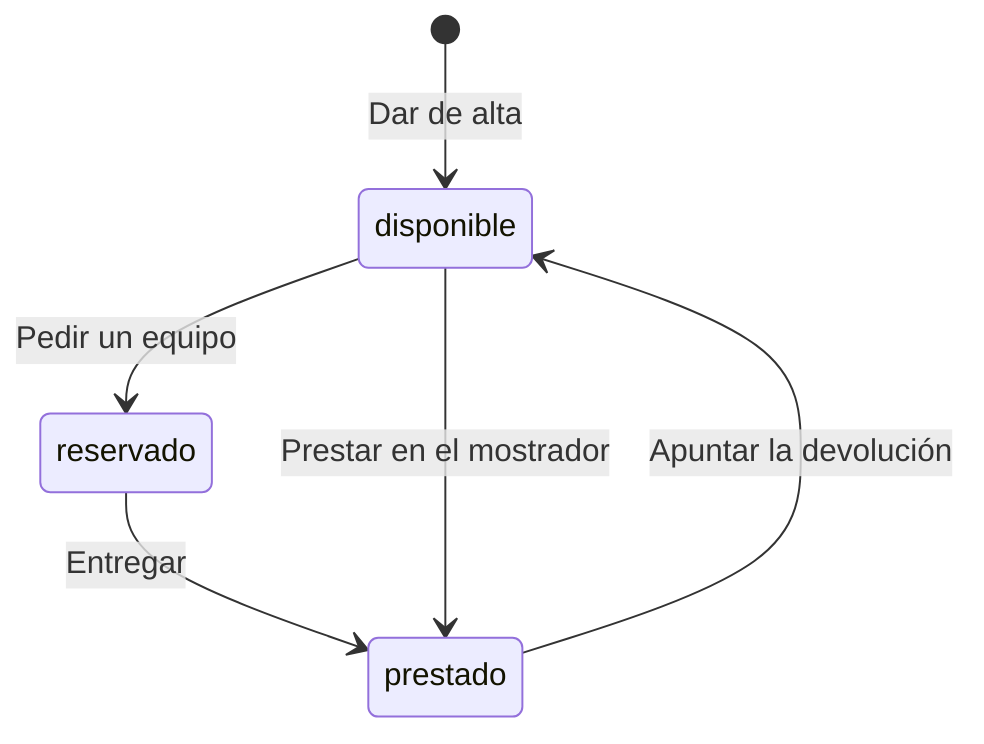

# Préstamo de equipos de IT

## Fuentes

- .diverger/inbox/peticion.md: petición del cliente con su anexo «API para el inventario de IT». Aporta el problema, los usuarios, el alcance, lo que queda fuera, las restricciones de acceso, los riesgos y la API exacta que debe exponer la aplicación.

## Objetivo

Hoy los préstamos se apuntan en una hoja de cálculo y los empleados los piden por correo a IT: no se sabe qué está libre sin preguntar, dos personas esperan el mismo portátil y nadie se entera de que un préstamo ha vencido hasta que alguien echa en falta el equipo (peticion.md).

Que los empleados vean y pidan los equipos de IT (portátiles, monitores, proyectores) en una aplicación, e IT gestione en ella altas, entregas, préstamos, devoluciones y vencidos (peticion.md).

Métricas de éxito (peticion.md), durante el primer mes:

- Todos los préstamos pasan por la aplicación.
- Ningún equipo se reserva o se presta dos veces.
- IT revisa los vencidos cada semana sin tener que preguntar a nadie.

## Usuarios

- Empleados: entran con su cuenta de Google de la empresa; ven los equipos y su estado y piden un equipo libre (peticion.md).
- IT: entran con su cuenta de Google de la empresa; son las cuentas de la variable de entorno `CORREOS_IT`; dan de alta equipos, entregan los reservados, prestan en el mostrador, apuntan devoluciones y consultan vencidos e historial; también pueden hacer lo de un empleado (peticion.md).
- Inventario de IT: sistema que entra con una cuenta de servicio incluida en `CORREOS_IT`, así que también puede hacer lo de un empleado (peticion.md, Anexo).

## Alcance

- Cualquier empleado ve los equipos (portátiles, monitores, proyectores) y su estado; si está reservado o prestado, también quién lo tiene y la fecha de devolución (peticion.md).
- Un empleado pide un equipo libre indicando la fecha de devolución y el equipo queda reservado a su nombre hasta que IT se lo entrega (peticion.md).
- IT da de alta los equipos con un nombre (peticion.md).
- IT entrega los equipos reservados, que pasan a prestados con la misma persona y fecha de devolución (peticion.md).
- IT presta directamente en el mostrador a quien viene a pedirlo, indicando la persona y la fecha de devolución (peticion.md).
- IT apunta las devoluciones y el equipo vuelve a estar disponible (peticion.md).
- IT ve los préstamos vencidos: equipos prestados con fecha de devolución anterior a hoy, del más antiguo al más reciente (peticion.md).
- IT consulta el historial de cada equipo, del préstamo más reciente al más antiguo, con su persona, fecha de devolución y estado (reservado, prestado o devuelto) (peticion.md).
- Un equipo está en uno de tres estados: disponible, reservado o prestado (peticion.md, Anexo).
- Nombres y fechas: el nombre del equipo es obligatorio y dos nombres son el mismo si solo cambian mayúsculas o espacios en los extremos; la fecha de devolución es una fecha real en formato AAAA-MM-DD; «hoy» es el día en Madrid; quien pide un equipo no puede poner una fecha anterior a hoy, pero IT sí cuando presta en el mostrador (peticion.md, Anexo).
- Un equipo no puede estar reservado o prestado dos veces a la vez: si llegan dos peticiones a la vez para el mismo equipo disponible, una sale bien y la otra recibe 409 (peticion.md, Anexo).

## Fuera de alcance

- Que los empleados anulen una solicitud (peticion.md).
- Avisos por correo de préstamos vencidos (peticion.md).

## Restricciones

- Todas las rutas necesitan haber iniciado sesión con el token de identidad de Google, con el correo verificado, emitido para el cliente OAuth de la aplicación, de una persona o de una cuenta de servicio; sin token válido responden 401 (peticion.md, Anexo).
- Las operaciones «Solo IT» responden 403 a cualquier cuenta que no esté en `CORREOS_IT`; la lista se fija en la configuración del despliegue, no en el código, y los correos se comparan sin distinguir mayúsculas (peticion.md, Anexo).
- La API tiene que ser exactamente la del anexo, porque el inventario de IT se va a conectar a ella (peticion.md, Anexo).
- Dependencia de las cuentas de Google de la empresa para entrar en la aplicación (peticion.md).

## API fijada por el cliente

El inventario de IT se va a conectar a la aplicación, así que la API tiene que ser exactamente esta. Todas las rutas necesitan haber iniciado sesión: sin un token válido responden 401 con «Inicia sesión con Google.». Vale el token de identidad de Google, con el correo verificado, emitido para el cliente OAuth de la aplicación, tanto de una persona como de una cuenta de servicio. La persona de cada operación es el correo del token.

Las operaciones marcadas «Solo IT» solo las puede hacer una cuenta de IT; con cualquier otra cuenta responden 403 con «Solo IT puede hacer esto.». Las cuentas de IT son las de la variable de entorno `CORREOS_IT`, con los correos separados por comas: la lista se fija en la configuración del despliegue, no en el código. Dos correos son el mismo aunque cambien las mayúsculas. El inventario entra con una cuenta de servicio que está en esa lista, así que también puede hacer lo de un empleado. Los errores son un objeto JSON `{"error": "<mensaje>"}` con el mensaje exacto que se indica.

Un equipo está en uno de tres estados: `disponible`, `reservado` (un empleado lo ha pedido y aún no lo ha recogido) o `prestado`. Cuando está reservado o prestado, el equipo lleva también `persona` (el correo de quien lo tiene) y `devolucion`.

| Operación | Quién | Petición | Respuesta correcta | Errores |
|---|---|---|---|---|
| Dar de alta un equipo | Solo IT | `POST /api/equipos` con `{"nombre": "Portátil 07"}` | 201 con `{"id": "…", "nombre": "Portátil 07", "estado": "disponible"}` | 400 «Falta el nombre del equipo» si el nombre falta o está vacío. 409 «Ya hay un equipo con ese nombre» |
| Ver los equipos | Todos | `GET /api/equipos` | 200 con la lista de equipos, cada uno con `id`, `nombre` y `estado`; si está reservado o prestado, también `persona` y `devolucion` | — |
| Pedir un equipo | Todos | `POST /api/equipos/{id}/solicitud` con `{"devolucion": "2026-11-20"}` | 201 con el equipo: `estado: "reservado"`, `persona` (el correo de quien lo pide) y `devolucion` | 400 «Falta la fecha de devolución». 400 «La fecha de devolución no es válida» si no es una fecha real. 400 «La fecha de devolución ya ha pasado». 404 «No existe el equipo». 409 «El equipo no está disponible» si está reservado o prestado |
| Entregar un equipo reservado | Solo IT | `POST /api/equipos/{id}/entrega` | 200 con el equipo: `estado: "prestado"`, con la misma `persona` y `devolucion` de la solicitud | 404 «No existe el equipo». 409 «El equipo no está reservado» |
| Prestar en el mostrador | Solo IT | `POST /api/equipos/{id}/prestamo` con `{"persona": "ana.perez@empresa.com", "devolucion": "2026-11-20"}` | 201 con el equipo: `estado: "prestado"`, `persona` y `devolucion` | 400 «Faltan la persona o la fecha de devolución». 400 «La fecha de devolución no es válida» si no es una fecha real. 404 «No existe el equipo». 409 «El equipo no está disponible» si está reservado o prestado |
| Apuntar la devolución | Solo IT | `POST /api/equipos/{id}/devolucion` | 200 con el equipo y `estado: "disponible"`, sin `persona` ni `devolucion` | 404 «No existe el equipo». 409 «El equipo no está prestado» |
| Ver los préstamos vencidos | Solo IT | `GET /api/prestamos/vencidos` | 200 con la lista de equipos prestados cuya fecha de devolución es anterior a hoy, cada uno con `id`, `nombre`, `persona` y `devolucion`, del más antiguo al más reciente | — |
| Ver el historial de un equipo | Solo IT | `GET /api/equipos/{id}/historial` | 200 con la lista de sus préstamos, del más reciente al más antiguo, cada uno con `persona`, `devolucion` y `estado` (`reservado`, `prestado` o `devuelto`) | 404 «No existe el equipo» |

La fecha de devolución va como texto `AAAA-MM-DD` y se devuelve igual. Tiene que ser una fecha que exista («2026-02-30» no vale). «Hoy» es el día en Madrid. Quien pide un equipo no puede poner una fecha anterior a hoy, pero IT sí cuando presta en el mostrador, porque a veces apunta los préstamos con retraso; un préstamo así ya aparece entre los vencidos.

Un equipo no puede estar reservado o prestado dos veces a la vez. Si llegan dos peticiones a la vez para el mismo equipo disponible, sean solicitudes o préstamos en el mostrador, una sale bien y la otra recibe 409 «El equipo no está disponible»; nunca salen bien las dos.

Dos nombres de equipo son el mismo si solo se diferencian en mayúsculas o en espacios al principio o al final: « portátil 07 » repite «Portátil 07».

(peticion.md, «Anexo: API para el inventario de IT»)

## Riesgos

- Que dos empleados se queden con el mismo equipo porque lo pidieron a la vez (peticion.md).
- Que un empleado pueda hacer lo que solo le toca a IT (peticion.md).
- Que el inventario de IT deje de funcionar si la API cambia (peticion.md).

## Supuestos

- [SUPUESTO] Se necesita una interfaz web para empleados e IT además de la API — la petición dice que los empleados ven y piden equipos, pero el anexo solo define la API.
- [SUPUESTO] Un préstamo aparece en el historial como reservado al pedirse, pasa a prestado al entregarse y a devuelto al devolverse — se deduce de los estados del historial.
- [SUPUESTO] Un equipo reservado nunca cuenta como vencido; solo los prestados — el anexo habla de «equipos prestados» en los vencidos.
- [SUPUESTO] El catálogo no tiene categorías de equipo (portátil, monitor, proyector) como campo — la API solo tiene `nombre`.

## Preguntas abiertas

1. [alta] ¿Qué ocurre con una reserva que IT nunca entrega, si el empleado no puede anularla? ¿Caduca sola o la anula IT?
2. [alta] ¿Se necesita una interfaz de usuario además de la API? ¿Web, y para qué dispositivos?
3. [media] ¿Hay un máximo de días de préstamo o de préstamos simultáneos por empleado?
4. [media] En el préstamo en el mostrador, ¿qué se hace si `persona` no es un correo válido o no es de la empresa?
5. [media] ¿Cuántos equipos y usuarios se esperan y dónde se desplegará la aplicación?
6. [media] ¿Hay que migrar los datos de la hoja de cálculo actual?
7. [baja] ¿Cómo se mide que «todos los préstamos pasan por la aplicación»?
8. [baja] ¿Es correcto que cualquier empleado vea el correo de quien tiene cada equipo, como expone `GET /api/equipos`?
9. [media] ¿Quién hace las tareas de datos y de QA? Nadie del equipo tiene esos roles y se han asignado a José Luis Calvo por carga.

## Claridad

| Categoría | Claridad |
|---|---|
| Usuarios | 75 % |
| Problema | 75 % |
| Objetivo y métricas | 50 % |
| Alcance | 100 % |
| Fuera de alcance | 75 % |
| Restricciones | 75 % |
| Dependencias e integraciones | 75 % |
| Riesgos | 75 % |
| Global | 75 % |

## Diagramas

### Estados de un equipo

