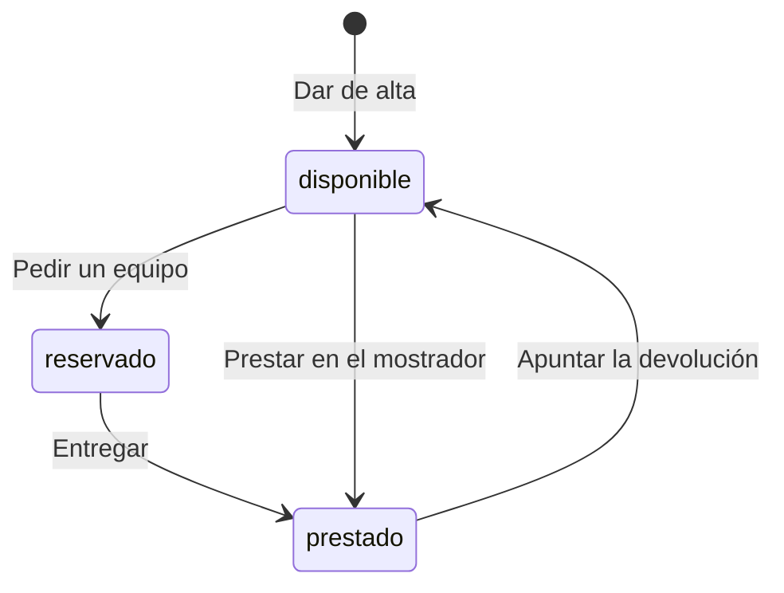

# Préstamo de equipos de IT

## Fuentes

- .diverger/inbox/peticion.md: petición del cliente con el anexo «API para el inventario de IT». Aporta el problema, los usuarios, el alcance, los criterios de éxito, los riesgos y la API fijada.
- .diverger/inbox/equipo.csv: no se usa como fuente de requisitos; es el equipo de desarrollo, que usará la planificación de sprints.

## Objetivo

Hoy los préstamos se apuntan en una hoja de cálculo y los empleados piden los equipos por correo a IT: no se sabe qué está libre, dos personas esperan el mismo portátil y nadie se entera de que un préstamo ha vencido hasta que alguien echa en falta el equipo (peticion.md).

Que los empleados vean y pidan los equipos de IT en una aplicación y que IT gestione en ella las entregas, los préstamos, las devoluciones y los vencidos (peticion.md).

Métricas de éxito (peticion.md):

- Durante el primer mes, todos los préstamos pasan por la aplicación.
- Ningún equipo se reserva o se presta dos veces.
- IT revisa los vencidos cada semana sin tener que preguntar a nadie.

## Usuarios

- Empleados: entran con su cuenta de Google de la empresa, ven los equipos y su estado y piden un equipo libre (peticion.md).
- IT: las cuentas de la variable de entorno `CORREOS_IT`; dan de alta equipos, entregan los reservados, prestan en el mostrador, apuntan las devoluciones, ven los vencidos y consultan el historial (peticion.md).
- Inventario de IT: sistema que se conecta a la API con una cuenta de servicio incluida en `CORREOS_IT`, así que también puede hacer lo de un empleado (peticion.md).

## Alcance

- Ver los equipos (portátiles, monitores, proyectores) con su estado; si están reservados o prestados, también la persona y la fecha de devolución. Todos (peticion.md).
- Pedir un equipo disponible indicando la fecha de devolución: queda reservado a nombre de quien lo pide hasta que IT lo entrega. Todos (peticion.md).
- Dar de alta un equipo con nombre obligatorio y único; dos nombres son el mismo si solo cambian las mayúsculas o los espacios al principio o al final. Solo IT (peticion.md).
- Entregar un equipo reservado: pasa a prestado con la misma persona y fecha de devolución. Solo IT (peticion.md).
- Prestar un equipo disponible en el mostrador a la persona indicada, con fecha de devolución, que puede ser anterior a hoy. Solo IT (peticion.md).
- Apuntar la devolución de un equipo prestado: vuelve a disponible, sin persona ni fecha. Solo IT (peticion.md).
- Ver los préstamos vencidos (prestados con devolución anterior a hoy), del más antiguo al más reciente. Solo IT (peticion.md).
- Consultar el historial de préstamos de un equipo, del más reciente al más antiguo, con estado reservado, prestado o devuelto. Solo IT (peticion.md).
- Validar la fecha de devolución: formato `AAAA-MM-DD`, fecha real, «hoy» es el día en Madrid y quien pide un equipo no puede poner una fecha anterior a hoy (peticion.md).

## Fuera de alcance

- Que los empleados anulen una solicitud (peticion.md).
- Avisos por correo de préstamos vencidos (peticion.md).

## Restricciones

- Todas las rutas exigen haber iniciado sesión con un token de identidad de Google, con el correo verificado y emitido para el cliente OAuth de la aplicación; sin token válido, 401 (peticion.md).
- Las operaciones «Solo IT» solo las hacen las cuentas de `CORREOS_IT`, fijada en la configuración del despliegue y no en el código, comparando los correos sin distinguir mayúsculas; las demás cuentas reciben 403 (peticion.md).
- Un equipo no puede estar reservado o prestado dos veces a la vez, tampoco con peticiones simultáneas: una sale bien y la otra recibe 409 (peticion.md).
- La API tiene que ser exactamente la del anexo, porque el inventario de IT se va a conectar a ella (peticion.md).
- Las personas entran con su cuenta de Google de la empresa (peticion.md).

## API fijada por el cliente

El inventario de IT se va a conectar a la aplicación, así que la API tiene que ser exactamente esta. Todas las rutas necesitan haber iniciado sesión: sin un token válido responden 401 con «Inicia sesión con Google.». Vale el token de identidad de Google, con el correo verificado, emitido para el cliente OAuth de la aplicación, tanto de una persona como de una cuenta de servicio. La persona de cada operación es el correo del token.

Las operaciones marcadas «Solo IT» solo las puede hacer una cuenta de IT; con cualquier otra cuenta responden 403 con «Solo IT puede hacer esto.». Las cuentas de IT son las de la variable de entorno `CORREOS_IT`, con los correos separados por comas: la lista se fija en la configuración del despliegue, no en el código. Dos correos son el mismo aunque cambien las mayúsculas. El inventario entra con una cuenta de servicio que está en esa lista, así que también puede hacer lo de un empleado. Los errores son un objeto JSON `{"error": "<mensaje>"}` con el mensaje exacto que se indica.

Un equipo está en uno de tres estados: `disponible`, `reservado` (un empleado lo ha pedido y aún no lo ha recogido) o `prestado`. Cuando está reservado o prestado, el equipo lleva también `persona` (el correo de quien lo tiene) y `devolucion`.

| Operación | Quién | Petición | Respuesta correcta | Errores |
|---|---|---|---|---|
| Dar de alta un equipo | Solo IT | `POST /api/equipos` con `{"nombre": "Portátil 07"}` | 201 con `{"id": "…", "nombre": "Portátil 07", "estado": "disponible"}` | 400 «Falta el nombre del equipo» si el nombre falta o está vacío. 409 «Ya hay un equipo con ese nombre» |
| Ver los equipos | Todos | `GET /api/equipos` | 200 con la lista de equipos, cada uno con `id`, `nombre` y `estado`; si está reservado o prestado, también `persona` y `devolucion` | — |
| Pedir un equipo | Todos | `POST /api/equipos/{id}/solicitud` con `{"devolucion": "2026-11-20"}` | 201 con el equipo: `estado: "reservado"`, `persona` (el correo de quien lo pide) y `devolucion` | 400 «Falta la fecha de devolución». 400 «La fecha de devolución no es válida» si no es una fecha real. 400 «La fecha de devolución ya ha pasado». 404 «No existe el equipo». 409 «El equipo no está disponible» si está reservado o prestado |
| Entregar un equipo reservado | Solo IT | `POST /api/equipos/{id}/entrega` | 200 con el equipo: `estado: "prestado"`, con la misma `persona` y `devolucion` de la solicitud | 404 «No existe el equipo». 409 «El equipo no está reservado» |
| Prestar en el mostrador | Solo IT | `POST /api/equipos/{id}/prestamo` con `{"persona": "ana.perez@empresa.com", "devolucion": "2026-11-20"}` | 201 con el equipo: `estado: "prestado"`, `persona` y `devolucion` | 400 «Faltan la persona o la fecha de devolución». 400 «La fecha de devolución no es válida» si no es una fecha real. 404 «No existe el equipo». 409 «El equipo no está disponible» si está reservado o prestado |
| Apuntar la devolución | Solo IT | `POST /api/equipos/{id}/devolucion` | 200 con el equipo y `estado: "disponible"`, sin `persona` ni `devolucion` | 404 «No existe el equipo». 409 «El equipo no está prestado» |
| Ver los préstamos vencidos | Solo IT | `GET /api/prestamos/vencidos` | 200 con la lista de equipos prestados cuya fecha de devolución es anterior a hoy, cada uno con `id`, `nombre`, `persona` y `devolucion`, del más antiguo al más reciente | — |
| Ver el historial de un equipo | Solo IT | `GET /api/equipos/{id}/historial` | 200 con la lista de sus préstamos, del más reciente al más antiguo, cada uno con `persona`, `devolucion` y `estado` (`reservado`, `prestado` o `devuelto`) | 404 «No existe el equipo» |

La fecha de devolución va como texto `AAAA-MM-DD` y se devuelve igual. Tiene que ser una fecha que exista («2026-02-30» no vale). «Hoy» es el día en Madrid. Quien pide un equipo no puede poner una fecha anterior a hoy, pero IT sí cuando presta en el mostrador, porque a veces apunta los préstamos con retraso; un préstamo así ya aparece entre los vencidos.

Un equipo no puede estar reservado o prestado dos veces a la vez. Si llegan dos peticiones a la vez para el mismo equipo disponible, sean solicitudes o préstamos en el mostrador, una sale bien y la otra recibe 409 «El equipo no está disponible»; nunca salen bien las dos.

Dos nombres de equipo son el mismo si solo se diferencian en mayúsculas o en espacios al principio o al final: « portátil 07 » repite «Portátil 07».

(peticion.md, «Anexo: API para el inventario de IT»)

## Riesgos

- Que dos empleados se queden con el mismo equipo porque lo pidieron a la vez (peticion.md).
- Que un empleado pueda hacer lo que solo le toca a IT (peticion.md).
- Que el inventario deje de funcionar si la API cambia (peticion.md).

## Supuestos

- [SUPUESTO] La aplicación tiene interfaz web para empleados e IT además de la API — la petición dice que los empleados ven y piden equipos, pero solo especifica la API.
- [SUPUESTO] Portátiles, monitores y proyectores son un único tipo de equipo con solo nombre y estado — el anexo no define categoría ni otros campos.
- [SUPUESTO] El historial de un equipo incluye todas sus reservas y préstamos desde el alta — se deduce de los estados reservado, prestado y devuelto del anexo.
- [SUPUESTO] Una reserva que IT aún no ha entregado no cuenta como vencida — los vencidos son solo los equipos prestados.

## Preguntas abiertas

1. [alta] ¿Hay interfaz web para empleados e IT o solo la API?
2. [alta] ¿Una reserva que IT no entrega caduca, o puede quedar reservada indefinidamente, ya que los empleados no pueden anularla?
3. [media] ¿Quién puede anular o corregir una reserva errónea? La API no tiene operación para ello.
4. [media] ¿Dónde y cómo se despliega la aplicación (nube, tecnología, almacenamiento)?
5. [media] ¿Cuántos equipos y usuarios habrá y qué rendimiento se espera?
6. [media] ¿Hay una duración máxima de préstamo o un límite de préstamos por empleado?
7. [baja] ¿Se migran los datos de la hoja de cálculo actual?
8. [baja] ¿El historial debe incluir la fecha de entrega y la de devolución real, o solo lo que dice el anexo?

## Claridad

| Categoría | Claridad |
|---|---|
| Usuarios | 75 % |
| Problema | 75 % |
| Objetivo y métricas | 50 % |
| Alcance | 75 % |
| Fuera de alcance | 50 % |
| Restricciones | 50 % |
| Dependencias e integraciones | 75 % |
| Riesgos | 50 % |
| Global | 63 % |

## Diagramas

### Estados de un equipo

