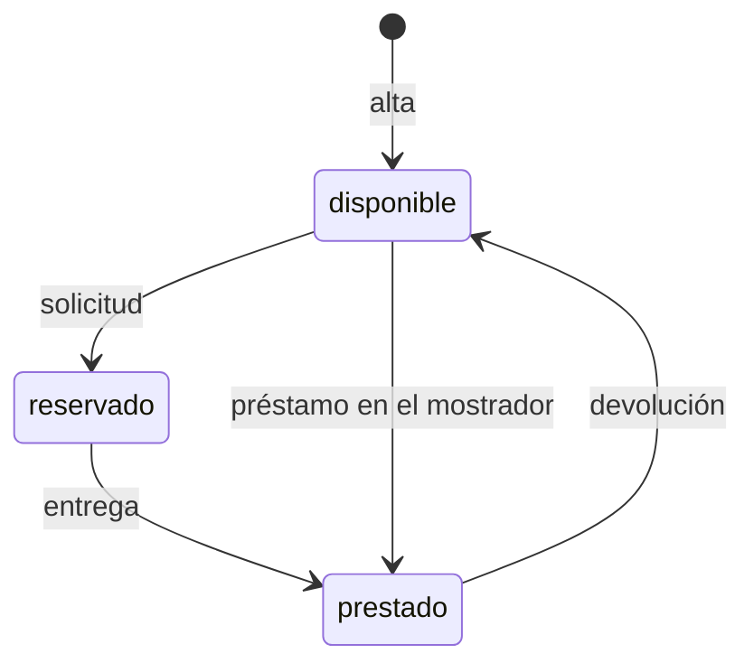

# Préstamo de equipos de IT

## Fuentes

- .diverger/inbox/peticion.md: petición del cliente con su anexo «API para el inventario de IT». Aporta el problema, los usuarios, el alcance, lo que queda fuera, las restricciones, los riesgos y la API fijada por el cliente.
- .diverger/inbox/equipo.csv: no se ha analizado como fuente de requisitos; son los datos del equipo y se usan al planificar el sprint.

## Objetivo

Hoy los préstamos se apuntan en una hoja de cálculo y los empleados piden los equipos por correo a IT: no se sabe qué está libre sin preguntar, dos personas acaban esperando el mismo portátil y nadie se entera de que un préstamo ha vencido hasta que alguien echa en falta el equipo (peticion.md).

Una aplicación para gestionar el préstamo de equipos de la oficina (portátiles, monitores, proyectores): los empleados ven qué hay disponible y lo piden prestado por unos días, e IT da de alta los equipos, entrega y recoge, y ve qué préstamos han vencido (peticion.md).

Métricas de éxito (peticion.md), durante el primer mes:

- Todos los préstamos pasan por la aplicación.
- Ningún equipo se reserva o se presta dos veces.
- IT revisa los vencidos cada semana sin tener que preguntar a nadie.

## Usuarios

- Empleados: entran con su cuenta de Google de la empresa, ven los equipos y su estado y piden uno libre con la fecha en que lo devolverán (peticion.md).
- IT: da de alta los equipos, entrega los reservados, presta directamente en el mostrador, apunta las devoluciones, ve los préstamos vencidos y consulta el historial de cada equipo (peticion.md).
- Inventario de IT: sistema que se conecta a la API con una cuenta de servicio incluida en `CORREOS_IT`; puede hacer lo de IT y lo de un empleado (peticion.md, anexo).

## Alcance

- Entrar en la aplicación con la cuenta de Google de la empresa (peticion.md).
- Ver la lista de equipos con su id, nombre y estado (`disponible`, `reservado` o `prestado`) y, si está reservado o prestado, la persona y la fecha de devolución (peticion.md, anexo).
- Pedir un equipo libre indicando la fecha de devolución; el equipo queda reservado a nombre de quien lo pide hasta que IT se lo entrega (peticion.md).
- Solo IT: dar de alta un equipo; el nombre es obligatorio y no puede repetirse (peticion.md, anexo).
- Solo IT: entregar un equipo reservado, que pasa a prestado con la misma persona y fecha de devolución (peticion.md, anexo).
- Solo IT: prestar en el mostrador un equipo disponible a la persona que se indique, con su fecha de devolución (peticion.md, anexo).
- Solo IT: apuntar la devolución de un equipo prestado, que vuelve a estar disponible sin persona ni fecha (peticion.md, anexo).
- Solo IT: ver los préstamos vencidos (equipos prestados con la devolución anterior a hoy), del más antiguo al más reciente (peticion.md, anexo).
- Solo IT: ver el historial de un equipo, del más reciente al más antiguo, con persona, devolución y estado (`reservado`, `prestado` o `devuelto`) (peticion.md, anexo).
- La fecha de devolución es un texto `AAAA-MM-DD` que tiene que existir; quien pide un equipo no puede poner una fecha anterior a hoy, pero IT sí en el mostrador, y ese préstamo ya aparece entre los vencidos (peticion.md, anexo).
- Dos nombres de equipo son el mismo si solo se diferencian en mayúsculas o en espacios al principio o al final (peticion.md, anexo).

## Fuera de alcance

- Que los empleados anulen una solicitud (peticion.md).
- Avisos por correo de préstamos vencidos (peticion.md).

## Restricciones

- Todas las rutas necesitan sesión: vale el token de identidad de Google, con el correo verificado, emitido para el cliente OAuth de la aplicación, de una persona o de una cuenta de servicio; sin token válido, 401 «Inicia sesión con Google.» (peticion.md, anexo).
- Las cuentas de IT son las de la variable de entorno `CORREOS_IT`, separadas por comas y fijadas en la configuración del despliegue, no en el código; dos correos son el mismo aunque cambien las mayúsculas (peticion.md, anexo).
- Las operaciones «Solo IT» responden 403 «Solo IT puede hacer esto.» a cualquier otra cuenta (peticion.md, anexo).
- Un equipo no puede estar reservado o prestado dos veces a la vez: con dos peticiones simultáneas sobre el mismo equipo disponible, una sale bien y la otra recibe 409 «El equipo no está disponible» (peticion.md, anexo).
- «Hoy» es el día en Madrid (peticion.md, anexo).
- El inventario de IT se conecta a la aplicación, así que la API tiene que ser exactamente la del anexo, con errores `{"error": "<mensaje>"}` (peticion.md, anexo).
- Todos entran con su cuenta de Google de la empresa (peticion.md).

## API fijada por el cliente

El inventario de IT se va a conectar a la aplicación, así que la API tiene que ser exactamente esta. Todas las rutas necesitan haber iniciado sesión: sin un token válido responden 401 con «Inicia sesión con Google.». Vale el token de identidad de Google, con el correo verificado, emitido para el cliente OAuth de la aplicación, tanto de una persona como de una cuenta de servicio. La persona de cada operación es el correo del token.

Las operaciones marcadas «Solo IT» solo las puede hacer una cuenta de IT; con cualquier otra cuenta responden 403 con «Solo IT puede hacer esto.». Las cuentas de IT son las de la variable de entorno `CORREOS_IT`, con los correos separados por comas: la lista se fija en la configuración del despliegue, no en el código. Dos correos son el mismo aunque cambien las mayúsculas. El inventario entra con una cuenta de servicio que está en esa lista, así que también puede hacer lo de un empleado. Los errores son un objeto JSON `{"error": "<mensaje>"}` con el mensaje exacto que se indica.

Un equipo está en uno de tres estados: `disponible`, `reservado` (un empleado lo ha pedido y aún no lo ha recogido) o `prestado`. Cuando está reservado o prestado, el equipo lleva también `persona` (el correo de quien lo tiene) y `devolucion`.

| Operación | Quién | Petición | Respuesta correcta | Errores |
|---|---|---|---|---|
| Dar de alta un equipo | Solo IT | `POST /api/equipos` con `{"nombre": "Portátil 07"}` | 201 con `{"id": "…", "nombre": "Portátil 07", "estado": "disponible"}` | 400 «Falta el nombre del equipo» si el nombre falta o está vacío. 409 «Ya hay un equipo con ese nombre» |
| Ver los equipos | Todos | `GET /api/equipos` | 200 con la lista de equipos, cada uno con `id`, `nombre` y `estado`; si está reservado o prestado, también `persona` y `devolucion` | — |
| Pedir un equipo | Todos | `POST /api/equipos/{id}/solicitud` con `{"devolucion": "2026-11-20"}` | 201 con el equipo: `estado: "reservado"`, `persona` (el correo de quien lo pide) y `devolucion` | 400 «Falta la fecha de devolución». 400 «La fecha de devolución no es válida» si no es una fecha real. 400 «La fecha de devolución ya ha pasado». 404 «No existe el equipo». 409 «El equipo no está disponible» si está reservado o prestado |
| Entregar un equipo reservado | Solo IT | `POST /api/equipos/{id}/entrega` | 200 con el equipo: `estado: "prestado"`, con la misma `persona` y `devolucion` de la solicitud | 404 «No existe el equipo». 409 «El equipo no está reservado» |
| Prestar en el mostrador | Solo IT | `POST /api/equipos/{id}/prestamo` con `{"persona": "ana.perez@empresa.com", "devolucion": "2026-11-20"}` | 201 con el equipo: `estado: "prestado"`, `persona` y `devolucion` | 400 «Faltan la persona o la fecha de devolución». 400 «La fecha de devolución no es válida» si no es una fecha real. 404 «No existe el equipo». 409 «El equipo no está disponible» si está reservado o prestado |
| Apuntar la devolución | Solo IT | `POST /api/equipos/{id}/devolucion` | 200 con el equipo y `estado: "disponible"`, sin `persona` ni `devolucion` | 404 «No existe el equipo». 409 «El equipo no está prestado» |
| Ver los préstamos vencidos | Solo IT | `GET /api/prestamos/vencidos` | 200 con la lista de equipos prestados cuya fecha de devolución es anterior a hoy, cada uno con `id`, `nombre`, `persona` y `devolucion`, del más antiguo al más reciente | — |
| Ver el historial de un equipo | Solo IT | `GET /api/equipos/{id}/historial` | 200 con la lista de sus préstamos, del más reciente al más antiguo, cada uno con `persona`, `devolucion` y `estado` (`reservado`, `prestado` o `devuelto`) | 404 «No existe el equipo» |

La fecha de devolución va como texto `AAAA-MM-DD` y se devuelve igual. Tiene que ser una fecha que exista («2026-02-30» no vale). «Hoy» es el día en Madrid. Quien pide un equipo no puede poner una fecha anterior a hoy, pero IT sí cuando presta en el mostrador, porque a veces apunta los préstamos con retraso; un préstamo así ya aparece entre los vencidos.

Un equipo no puede estar reservado o prestado dos veces a la vez. Si llegan dos peticiones a la vez para el mismo equipo disponible, sean solicitudes o préstamos en el mostrador, una sale bien y la otra recibe 409 «El equipo no está disponible»; nunca salen bien las dos.

Dos nombres de equipo son el mismo si solo se diferencian en mayúsculas o en espacios al principio o al final: « portátil 07 » repite «Portátil 07».

(peticion.md, «Anexo: API para el inventario de IT»)

## Riesgos

- Que dos empleados se queden con el mismo equipo porque lo pidieron a la vez (peticion.md).
- Que un empleado pueda hacer lo que solo le toca a IT (peticion.md).
- Que el inventario deje de funcionar si la API cambia (peticion.md).

## Supuestos

- [SUPUESTO] La aplicación tiene una interfaz web para empleados e IT, además de la API — la petición habla de una «aplicación» en la que los empleados «ven» los equipos, pero el anexo solo define la API.
- [SUPUESTO] El historial guarda una entrada por cada reserva o préstamo, cuyo estado pasa de `reservado` a `prestado` y a `devuelto` — se deduce de los estados que devuelve el historial.
- [SUPUESTO] Un equipo reservado no se puede devolver ni anular; solo IT puede entregarlo — el anexo solo admite la devolución de un equipo prestado y deja fuera la anulación.
- [SUPUESTO] El correo de ejemplo del anexo (ana.perez@empresa.com) es ficticio y se copia tal cual porque forma parte de la API fijada — el anexo lo usa solo como ejemplo de petición.

## Preguntas abiertas

1. [alta] ¿Qué pasa con una reserva que IT no llega a entregar? Sin anulación, el equipo quedaría reservado indefinidamente.
2. [alta] ¿Es intencionado que la lista de equipos muestre a todos los empleados el correo de quien tiene cada equipo?
3. [media] ¿Hay un máximo de días de préstamo o de fecha de devolución futura («unos días»)?
4. [media] ¿Cuántos equipos y usuarios se esperan?
5. [media] ¿Cómo se mide que «todos los préstamos pasan por la aplicación» y quién lo comprueba?
6. [baja] ¿Se migran los datos actuales de la hoja de cálculo?
7. [baja] ¿Se valida que la `persona` del préstamo en el mostrador sea un correo del dominio de la empresa?

## Claridad

| Categoría | Claridad |
|---|---|
| Usuarios | 75 % |
| Problema | 75 % |
| Objetivo y métricas | 50 % |
| Alcance | 100 % |
| Fuera de alcance | 75 % |
| Restricciones | 75 % |
| Dependencias e integraciones | 50 % |
| Riesgos | 50 % |
| Global | 69 % |

## Diagramas

### Estados de un equipo

