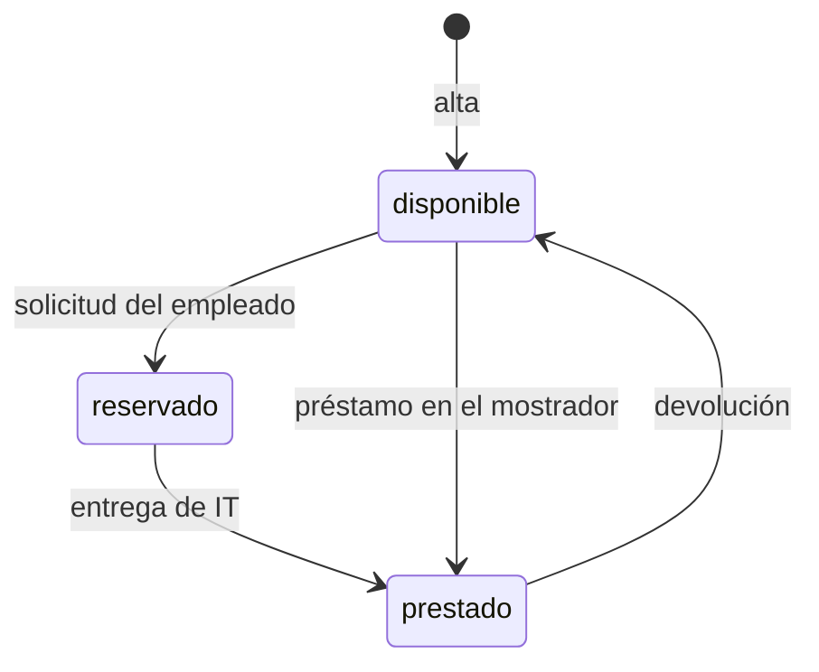

# Préstamo de equipos de IT

## Fuentes

- .diverger/inbox/peticion.md: petición del cliente con su anexo «API para el inventario de IT». Aporta el problema, los usuarios, el alcance, las exclusiones, los criterios de éxito, las preocupaciones y la API que la aplicación debe exponer exactamente.
- .diverger/inbox/equipo.csv: composición del equipo que construye el producto (una persona con rol de Desarrollo, dedicación 100, que usa agente de IA). No aporta requisitos de producto; los datos personales no se reproducen ([omitido]).

## Objetivo

Hoy los préstamos se apuntan en una hoja de cálculo y los empleados piden los equipos por correo a IT: no se sabe qué está libre sin preguntar, dos personas acaban esperando el mismo portátil y nadie se entera de que un préstamo ha vencido hasta que alguien echa en falta el equipo (peticion.md).

Una aplicación para gestionar el préstamo de equipos de la oficina (portátiles, monitores, proyectores): los empleados ven qué hay disponible y lo piden prestado por unos días; IT da de alta los equipos, entrega y recoge, y ve qué préstamos han vencido (peticion.md).

Métricas de éxito, durante el primer mes (peticion.md):

- Todos los préstamos pasan por la aplicación.
- Ningún equipo se reserva o se presta dos veces.
- IT revisa los vencidos cada semana sin tener que preguntar a nadie.

## Usuarios

- Empleado: entra con su cuenta de Google de la empresa, ve los equipos y su estado y pide uno libre con la fecha en que lo devolverá (peticion.md).
- IT: las cuentas de la variable de entorno `CORREOS_IT`; da de alta los equipos, entrega los reservados, presta en el mostrador, apunta las devoluciones, ve los vencidos y consulta el historial de cada equipo; también puede hacer lo de un empleado (peticion.md).
- Inventario de IT: sistema que se conecta a la API con una cuenta de servicio incluida en `CORREOS_IT`, así que puede hacer lo de IT y lo de un empleado (peticion.md).

## Alcance

- Ver los equipos con su estado (disponible, reservado o prestado) y, si está reservado o prestado, la persona y la fecha de devolución; lo puede hacer cualquier empleado (peticion.md).
- Pedir un equipo disponible indicando la fecha de devolución; queda reservado a nombre de quien lo pide hasta que IT se lo entrega (peticion.md).
- Dar de alta un equipo con su nombre, solo IT; no puede haber dos equipos con el mismo nombre, ignorando mayúsculas y espacios al principio o al final (peticion.md).
- Entregar un equipo reservado, solo IT: pasa a prestado con la misma persona y fecha de devolución de la solicitud (peticion.md).
- Prestar un equipo disponible en el mostrador a una persona con su fecha de devolución, solo IT (peticion.md).
- Apuntar la devolución de un equipo prestado, solo IT: vuelve a disponible, sin persona ni fecha de devolución (peticion.md).
- Ver los préstamos vencidos (prestados con fecha de devolución anterior a hoy), del más antiguo al más reciente, solo IT (peticion.md).
- Consultar el historial de préstamos de un equipo, del más reciente al más antiguo, con estado reservado, prestado o devuelto, solo IT (peticion.md).
- La fecha de devolución va como `AAAA-MM-DD` y debe existir; «hoy» es el día en Madrid; quien pide un equipo no puede poner una fecha anterior a hoy, IT sí al prestar en el mostrador, y ese préstamo aparece ya entre los vencidos (peticion.md).
- Un equipo no puede estar reservado o prestado dos veces a la vez: si llegan dos peticiones a la vez por el mismo equipo disponible, una sale bien y la otra recibe 409 (peticion.md).
- Todas las rutas exigen haber iniciado sesión con un token de identidad de Google válido (correo verificado, emitido para el cliente OAuth de la aplicación, de una persona o de una cuenta de servicio); sin él responden 401 (peticion.md).
- Las operaciones «Solo IT» responden 403 a cualquier cuenta que no esté en `CORREOS_IT`; los correos se comparan sin distinguir mayúsculas (peticion.md).

## Fuera de alcance

- Que los empleados anulen una solicitud (peticion.md).
- Avisos por correo de préstamos vencidos (peticion.md).

## Restricciones

- Todos los usuarios entran con su cuenta de Google de la empresa (peticion.md).
- La lista de cuentas de IT se fija en la configuración del despliegue (variable de entorno `CORREOS_IT`, correos separados por comas), no en el código (peticion.md).
- La API tiene que ser exactamente la del anexo, porque el inventario de IT se va a conectar a ella (peticion.md).
- Los errores son un objeto JSON `{"error": "<mensaje>"}` con el mensaje exacto indicado (peticion.md).
- Integración: el inventario de IT consume la API con una cuenta de servicio (peticion.md).

## API fijada por el cliente

El inventario de IT se va a conectar a la aplicación, así que la API tiene que ser exactamente esta. Todas las rutas necesitan haber iniciado sesión: sin un token válido responden 401 con «Inicia sesión con Google.». Vale el token de identidad de Google, con el correo verificado, emitido para el cliente OAuth de la aplicación, tanto de una persona como de una cuenta de servicio. La persona de cada operación es el correo del token.

Las operaciones marcadas «Solo IT» solo las puede hacer una cuenta de IT; con cualquier otra cuenta responden 403 con «Solo IT puede hacer esto.». Las cuentas de IT son las de la variable de entorno `CORREOS_IT`, con los correos separados por comas: la lista se fija en la configuración del despliegue, no en el código. Dos correos son el mismo aunque cambien las mayúsculas. El inventario entra con una cuenta de servicio que está en esa lista, así que también puede hacer lo de un empleado. Los errores son un objeto JSON `{"error": "<mensaje>"}` con el mensaje exacto que se indica.

Un equipo está en uno de tres estados: `disponible`, `reservado` (un empleado lo ha pedido y aún no lo ha recogido) o `prestado`. Cuando está reservado o prestado, el equipo lleva también `persona` (el correo de quien lo tiene) y `devolucion`.

| Operación | Quién | Petición | Respuesta correcta | Errores |
|---|---|---|---|---|
| Dar de alta un equipo | Solo IT | `POST /api/equipos` con `{"nombre": "Portátil 07"}` | 201 con `{"id": "…", "nombre": "Portátil 07", "estado": "disponible"}` | 400 «Falta el nombre del equipo» si el nombre falta o está vacío. 409 «Ya hay un equipo con ese nombre» |
| Ver los equipos | Todos | `GET /api/equipos` | 200 con la lista de equipos, cada uno con `id`, `nombre` y `estado`; si está reservado o prestado, también `persona` y `devolucion` | — |
| Pedir un equipo | Todos | `POST /api/equipos/{id}/solicitud` con `{"devolucion": "2026-11-20"}` | 201 con el equipo: `estado: "reservado"`, `persona` (el correo de quien lo pide) y `devolucion` | 400 «Falta la fecha de devolución». 400 «La fecha de devolución no es válida» si no es una fecha real. 400 «La fecha de devolución ya ha pasado». 404 «No existe el equipo». 409 «El equipo no está disponible» si está reservado o prestado |
| Entregar un equipo reservado | Solo IT | `POST /api/equipos/{id}/entrega` | 200 con el equipo: `estado: "prestado"`, con la misma `persona` y `devolucion` de la solicitud | 404 «No existe el equipo». 409 «El equipo no está reservado» |
| Prestar en el mostrador | Solo IT | `POST /api/equipos/{id}/prestamo` con `{"persona": "ana.perez@empresa.com", "devolucion": "2026-11-20"}` | 201 con el equipo: `estado: "prestado"`, `persona` y `devolucion` | 400 «Faltan la persona o la fecha de devolución». 400 «La fecha de devolución no es válida» si no es una fecha real. 404 «No existe el equipo». 409 «El equipo no está disponible» si está reservado o prestado |
| Apuntar la devolución | Solo IT | `POST /api/equipos/{id}/devolucion` | 200 con el equipo y `estado: "disponible"`, sin `persona` ni `devolucion` | 404 «No existe el equipo». 409 «El equipo no está prestado» |
| Ver los préstamos vencidos | Solo IT | `GET /api/prestamos/vencidos` | 200 con la lista de equipos prestados cuya fecha de devolución es anterior a hoy, cada uno con `id`, `nombre`, `persona` y `devolucion`, del más antiguo al más reciente | — |
| Ver el historial de un equipo | Solo IT | `GET /api/equipos/{id}/historial` | 200 con la lista de sus préstamos, del más reciente al más antiguo, cada uno con `persona`, `devolucion` y `estado` (`reservado`, `prestado` o `devuelto`) | 404 «No existe el equipo» |

La fecha de devolución va como texto `AAAA-MM-DD` y se devuelve igual. Tiene que ser una fecha que exista («2026-02-30» no vale). «Hoy» es el día en Madrid. Quien pide un equipo no puede poner una fecha anterior a hoy, pero IT sí cuando presta en el mostrador, porque a veces apunta los préstamos con retraso; un préstamo así ya aparece entre los vencidos.

Un equipo no puede estar reservado o prestado dos veces a la vez. Si llegan dos peticiones a la vez para el mismo equipo disponible, sean solicitudes o préstamos en el mostrador, una sale bien y la otra recibe 409 «El equipo no está disponible»; nunca salen bien las dos.

Dos nombres de equipo son el mismo si solo se diferencian en mayúsculas o en espacios al principio o al final: « portátil 07 » repite «Portátil 07».

(peticion.md, «Anexo: API para el inventario de IT»)

## Riesgos

- Que dos empleados se queden con el mismo equipo porque lo pidieron a la vez (peticion.md).
- Que un empleado pueda hacer lo que solo le toca a IT (peticion.md).
- Que el inventario deje de funcionar si la API cambia (peticion.md).

## Supuestos

- [SUPUESTO] El tipo de equipo (portátil, monitor, proyector) no se guarda como campo aparte; solo existe el nombre — la API del anexo no tiene campo de tipo.
- [SUPUESTO] Un empleado puede tener varios equipos reservados o prestados a la vez — la petición no lo limita.
- [SUPUESTO] El historial de un equipo incluye también la reserva aún no entregada — el estado «reservado» figura entre los del historial.
- [SUPUESTO] Que la cuenta sea «de la empresa» lo garantiza el cliente OAuth de la aplicación; no hay una lista de dominios permitidos — la petición no la menciona.
- [SUPUESTO] El equipo que construye el producto es una sola persona de Desarrollo con dedicación completa (100 %) y uso de agente de IA — equipo.csv tiene una sola fila y no indica la unidad de «dedicacion».

## Preguntas abiertas

1. [alta] ¿Qué ocurre con una reserva que IT nunca entrega? Sin anulación por parte del empleado, ¿caduca o la libera IT de algún modo?
2. [media] ¿Es aceptable que cualquier empleado vea el correo de quien tiene cada equipo? La API del anexo lo devuelve a todos en `GET /api/equipos`.
3. [media] ¿Hay un plazo máximo de préstamo o una fecha de devolución máxima? ¿Cuántos equipos y empleados se esperan?
4. [media] ¿Cómo se medirá que «todos los préstamos pasan por la aplicación» durante el primer mes?
5. [media] ¿Hay que migrar los préstamos y equipos de la hoja de cálculo actual?
6. [media] ¿El equipo es realmente de una sola persona o faltan roles (producto, QA, diseño)?
7. [baja] ¿Se pueden dar de baja o renombrar equipos?
8. [baja] ¿Se pueden prorrogar los préstamos?

## Claridad

| Categoría | Claridad |
|---|---|
| Usuarios | 75 % |
| Problema | 75 % |
| Objetivo y métricas | 50 % |
| Alcance | 100 % |
| Fuera de alcance | 50 % |
| Restricciones | 75 % |
| Dependencias e integraciones | 75 % |
| Riesgos | 50 % |
| Global | 69 % |

## Diagramas

### Estados de un equipo

