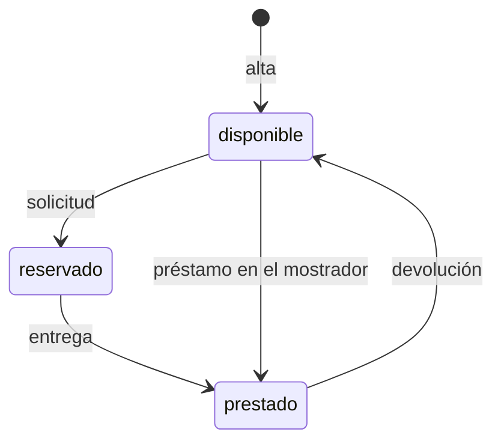

# Préstamo de equipos de IT

## Fuentes

- .diverger/inbox/peticion.md: petición del cliente con el anexo «API para el inventario de IT». Aporta el problema, los usuarios, el alcance, las métricas de éxito, los riesgos y la API fijada por el cliente.
- .diverger/inbox/equipo.csv: no se analiza como requisito; es el CSV del equipo para la planificación del sprint.

## Objetivo

Hoy los préstamos se apuntan en una hoja de cálculo y los empleados piden los equipos por correo a IT: no se sabe qué está libre sin preguntar, dos personas acaban esperando el mismo portátil y nadie se entera de que un préstamo ha vencido hasta que alguien echa en falta el equipo (peticion.md).

Una aplicación para gestionar el préstamo de equipos de la oficina (portátiles, monitores, proyectores): los empleados ven qué hay disponible y lo piden prestado por unos días, e IT da de alta los equipos, entrega y recoge, y ve qué préstamos han vencido (peticion.md).

Métricas de éxito (peticion.md):

- Durante el primer mes todos los préstamos pasan por la aplicación.
- Ningún equipo se reserva o se presta dos veces.
- IT revisa los vencidos cada semana sin tener que preguntar a nadie.

## Usuarios

- Empleado: entra con su cuenta de Google de la empresa, ve los equipos y su estado y pide uno libre con la fecha en que lo devolverá (peticion.md).
- IT: entra con su cuenta de Google de la empresa; da de alta los equipos, entrega los reservados, presta en el mostrador, apunta las devoluciones, ve los préstamos vencidos y consulta el historial de cada equipo (peticion.md).
- Inventario de IT: sistema que se conecta a la API con una cuenta de servicio que está en la lista de IT, así que también puede hacer lo de un empleado (peticion.md, anexo).

## Alcance

- Ver los equipos con su estado (`disponible`, `reservado` o `prestado`) y, si están reservados o prestados, la persona y la fecha de devolución (peticion.md).
- Pedir un equipo libre indicando la fecha de devolución; queda reservado a nombre de quien lo pide hasta que IT lo entrega (peticion.md).
- Quien pide un equipo no puede poner una fecha de devolución anterior a hoy (peticion.md, anexo).
- Dar de alta equipos, solo IT; el nombre es obligatorio y único, y dos nombres son el mismo si solo se diferencian en mayúsculas o en espacios al principio o al final (peticion.md, anexo).
- Entregar un equipo reservado, solo IT: pasa a prestado con la misma persona y fecha de devolución (peticion.md, anexo).
- Prestar en el mostrador, solo IT, a una persona con fecha de devolución, que puede ser anterior a hoy; un préstamo así ya aparece entre los vencidos (peticion.md, anexo).
- Apuntar la devolución, solo IT: el equipo vuelve a disponible sin persona ni fecha (peticion.md, anexo).
- Ver los préstamos vencidos, solo IT: los equipos prestados con fecha de devolución anterior a hoy, del más antiguo al más reciente (peticion.md, anexo).
- Consultar el historial de un equipo, solo IT: sus préstamos del más reciente al más antiguo, con persona, fecha de devolución y estado (`reservado`, `prestado` o `devuelto`) (peticion.md, anexo).
- Un equipo no puede estar reservado o prestado dos veces a la vez, ni siquiera con dos peticiones simultáneas: una sale bien y la otra recibe 409 (peticion.md, anexo).
- La fecha de devolución va como texto `AAAA-MM-DD`, tiene que ser una fecha que exista y «hoy» es el día en Madrid (peticion.md, anexo).

## Fuera de alcance

- Que los empleados anulen una solicitud (peticion.md).
- Avisos por correo de préstamos vencidos (peticion.md).

## Restricciones

- Todos los usuarios entran con su cuenta de Google de la empresa; vale el token de identidad de Google con el correo verificado, emitido para el cliente OAuth de la aplicación (peticion.md, anexo).
- Las cuentas de IT son las de la variable de entorno `CORREOS_IT`, con los correos separados por comas, fijada en la configuración del despliegue y no en el código; dos correos son el mismo aunque cambien las mayúsculas (peticion.md, anexo).
- Un empleado no puede hacer lo que solo le toca a IT (peticion.md).
- El inventario de IT se conecta a la aplicación, así que la API tiene que ser exactamente la del anexo (peticion.md, anexo).

## API fijada por el cliente

El inventario de IT se va a conectar a la aplicación, así que la API tiene que ser exactamente esta. Todas las rutas necesitan haber iniciado sesión: sin un token válido responden 401 con «Inicia sesión con Google.». Vale el token de identidad de Google, con el correo verificado, emitido para el cliente OAuth de la aplicación, tanto de una persona como de una cuenta de servicio. La persona de cada operación es el correo del token.

Las operaciones marcadas «Solo IT» solo las puede hacer una cuenta de IT; con cualquier otra cuenta responden 403 con «Solo IT puede hacer esto.». Las cuentas de IT son las de la variable de entorno `CORREOS_IT`, con los correos separados por comas: la lista se fija en la configuración del despliegue, no en el código. Dos correos son el mismo aunque cambien las mayúsculas. El inventario entra con una cuenta de servicio que está en esa lista, así que también puede hacer lo de un empleado. Los errores son un objeto JSON `{"error": "<mensaje>"}` con el mensaje exacto que se indica.

Un equipo está en uno de tres estados: `disponible`, `reservado` (un empleado lo ha pedido y aún no lo ha recogido) o `prestado`. Cuando está reservado o prestado, el equipo lleva también `persona` (el correo de quien lo tiene) y `devolucion`.

| Operación | Quién | Petición | Respuesta correcta | Errores |
|---|---|---|---|---|
| Dar de alta un equipo | Solo IT | `POST /api/equipos` con `{"nombre": "Portátil 07"}` | 201 con `{"id": "…", "nombre": "Portátil 07", "estado": "disponible"}` | 400 «Falta el nombre del equipo» si el nombre falta o está vacío. 409 «Ya hay un equipo con ese nombre» |
| Ver los equipos | Todos | `GET /api/equipos` | 200 con la lista de equipos, cada uno con `id`, `nombre` y `estado`; si está reservado o prestado, también `persona` y `devolucion` | — |
| Pedir un equipo | Todos | `POST /api/equipos/{id}/solicitud` con `{"devolucion": "2026-11-20"}` | 201 con el equipo: `estado: "reservado"`, `persona` (el correo de quien lo pide) y `devolucion` | 400 «Falta la fecha de devolución». 400 «La fecha de devolución no es válida» si no es una fecha real. 400 «La fecha de devolución ya ha pasado». 404 «No existe el equipo». 409 «El equipo no está disponible» si está reservado o prestado |
| Entregar un equipo reservado | Solo IT | `POST /api/equipos/{id}/entrega` | 200 con el equipo: `estado: "prestado"`, con la misma `persona` y `devolucion` de la solicitud | 404 «No existe el equipo». 409 «El equipo no está reservado» |
| Prestar en el mostrador | Solo IT | `POST /api/equipos/{id}/prestamo` con `{"persona": "ana.perez@empresa.com", "devolucion": "2026-11-20"}` | 201 con el equipo: `estado: "prestado"`, `persona` y `devolucion` | 400 «Faltan la persona o la fecha de devolución». 400 «La fecha de devolución no es válida» si no es una fecha real. 404 «No existe el equipo». 409 «El equipo no está disponible» si está reservado o prestado |
| Apuntar la devolución | Solo IT | `POST /api/equipos/{id}/devolucion` | 200 con el equipo y `estado: "disponible"`, sin `persona` ni `devolucion` | 404 «No existe el equipo». 409 «El equipo no está prestado» |
| Ver los préstamos vencidos | Solo IT | `GET /api/prestamos/vencidos` | 200 con la lista de equipos prestados cuya fecha de devolución es anterior a hoy, cada uno con `id`, `nombre`, `persona` y `devolucion`, del más antiguo al más reciente | — |
| Ver el historial de un equipo | Solo IT | `GET /api/equipos/{id}/historial` | 200 con la lista de sus préstamos, del más reciente al más antiguo, cada uno con `persona`, `devolucion` y `estado` (`reservado`, `prestado` o `devuelto`) | 404 «No existe el equipo» |

La fecha de devolución va como texto `AAAA-MM-DD` y se devuelve igual. Tiene que ser una fecha que exista («2026-02-30» no vale). «Hoy» es el día en Madrid. Quien pide un equipo no puede poner una fecha anterior a hoy, pero IT sí cuando presta en el mostrador, porque a veces apunta los préstamos con retraso; un préstamo así ya aparece entre los vencidos.

Un equipo no puede estar reservado o prestado dos veces a la vez. Si llegan dos peticiones a la vez para el mismo equipo disponible, sean solicitudes o préstamos en el mostrador, una sale bien y la otra recibe 409 «El equipo no está disponible»; nunca salen bien las dos.

Dos nombres de equipo son el mismo si solo se diferencian en mayúsculas o en espacios al principio o al final: « portátil 07 » repite «Portátil 07».

(peticion.md, «Anexo: API para el inventario de IT»)

## Riesgos

- Que dos empleados se queden con el mismo equipo porque lo pidieron a la vez (peticion.md).
- Que un empleado pueda hacer lo que solo le toca a IT (peticion.md).
- Que el inventario deje de funcionar si la API cambia (peticion.md).

## Supuestos

- [SUPUESTO] La aplicación incluye una interfaz web para empleados e IT además de la API: la petición habla de una «aplicación» en la que los empleados «ven» los equipos, pero solo define la API.
- [SUPUESTO] El acceso se limita a las cuentas de la empresa porque el token tiene que estar emitido para el cliente OAuth de la aplicación: la petición no dice cómo se restringe a la empresa.
- [SUPUESTO] El historial registra cada préstamo desde la reserva hasta la devolución: se deduce de sus estados `reservado`, `prestado` y `devuelto`.
- [SUPUESTO] Una reserva no recogida sigue reservada hasta que IT la entrega: la petición no habla de caducidad y deja fuera la anulación.

## Preguntas abiertas

1. [alta] ¿Hace falta una interfaz web o basta con la API para el inventario?
2. [alta] ¿Se limita el acceso a un dominio de Google concreto o vale cualquier cuenta con un token emitido para el cliente OAuth de la aplicación?
3. [media] ¿Una reserva no recogida caduca alguna vez, o queda reservada hasta que IT la entrega?
4. [media] ¿Hay un límite de días de préstamo o de préstamos por persona? La petición dice «por unos días».
5. [media] ¿Cuántos equipos y usuarios hay y qué rendimiento se espera?
6. [baja] ¿Se migran los datos de la hoja de cálculo actual?
7. [baja] ¿Se pueden dar de baja o editar equipos? El anexo solo define el alta.

## Claridad

| Categoría | Claridad |
|---|---|
| Usuarios | 75 % |
| Problema | 75 % |
| Objetivo y métricas | 50 % |
| Alcance | 100 % |
| Fuera de alcance | 50 % |
| Restricciones | 75 % |
| Dependencias e integraciones | 75 % |
| Riesgos | 50 % |
| Global | 69 % |

## Diagramas

### Estados de un equipo

