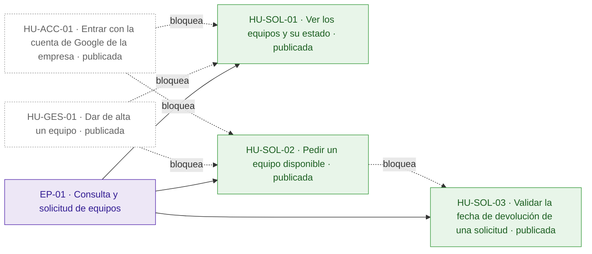
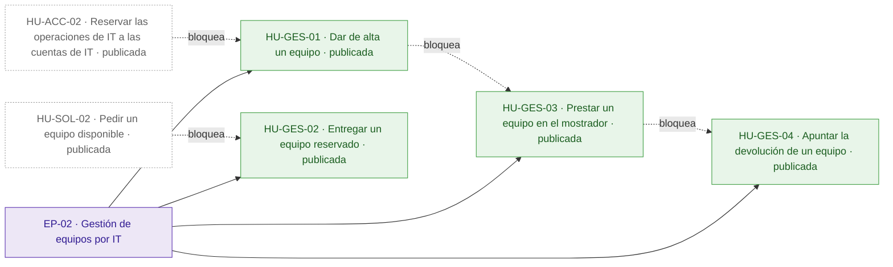
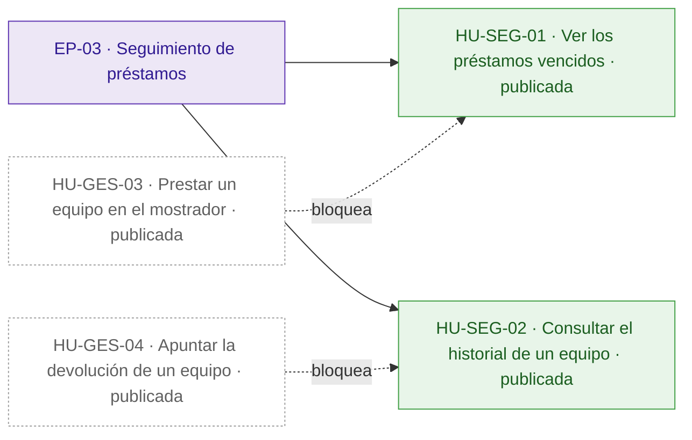
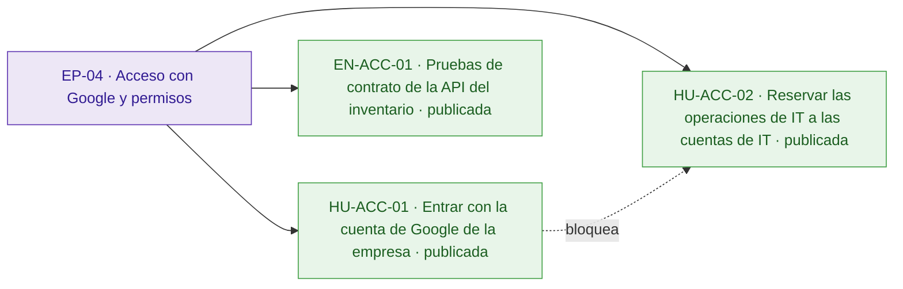
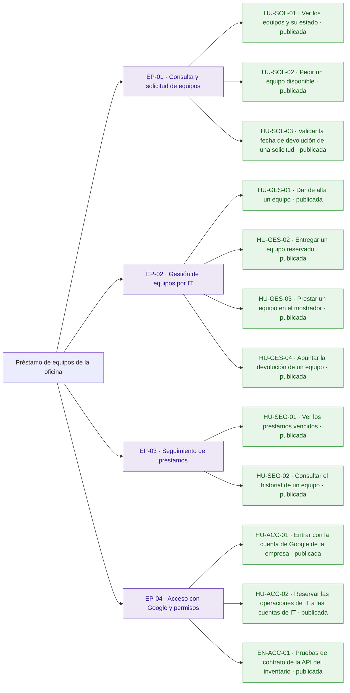
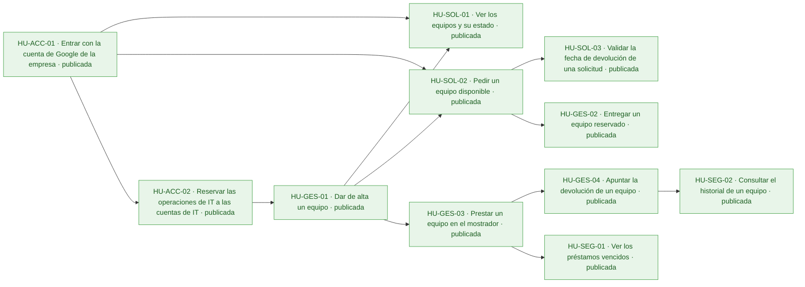
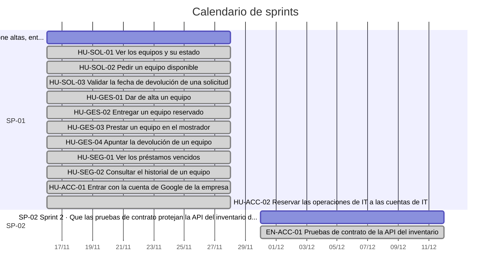
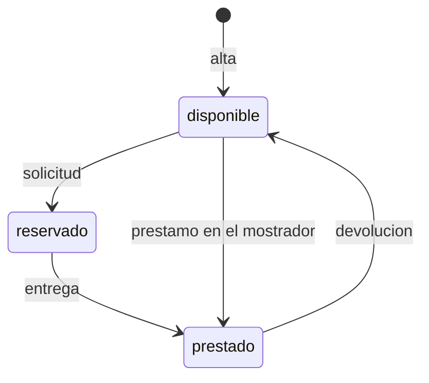

# Préstamo de equipos de la oficina

Hoy los préstamos de portátiles, monitores y proyectores se apuntan en una hoja de cálculo y se piden por correo a IT: nadie sabe qué está libre sin preguntar, dos personas acaban esperando el mismo portátil y los vencimientos pasan desapercibidos.

La aplicación permite a los empleados ver los equipos y pedir los disponibles, y a IT dar de alta equipos, entregarlos, prestarlos en el mostrador, apuntar las devoluciones y revisar vencidos e historial. Todos entran con su cuenta de Google de la empresa y el inventario de IT se conecta con una API que debe ser exactamente la del anexo de la petición. Quedan fuera la anulación de solicitudes por los empleados y los avisos por correo de vencidos.

## Visión y alcance

Que los empleados vean qué equipos de la oficina están disponibles y los pidan, e IT gestione altas, entregas, préstamos, devoluciones y vencidos en una sola aplicación, sin que ningún equipo se reserve o se preste dos veces.

**Dentro del alcance**

- Cualquier empleado ve los equipos y su estado: disponible, reservado o prestado; si está reservado o prestado, también la persona y la fecha de devolución (peticion.md).
- Un empleado pide un equipo disponible indicando la fecha de devolución, y el equipo queda reservado a su nombre hasta que IT se lo entrega (peticion.md).
- IT da de alta los equipos con un nombre obligatorio que no puede repetirse; dos nombres son el mismo si solo se diferencian en mayúsculas o en espacios al principio o al final (peticion.md).
- IT entrega un equipo reservado, que pasa a prestado con la misma persona y fecha de devolución de la solicitud (peticion.md).
- IT presta directamente en el mostrador un equipo disponible a una persona, con su fecha de devolución (peticion.md).
- IT apunta la devolución de un equipo prestado, que vuelve a estar disponible sin persona ni fecha de devolución (peticion.md).
- IT ve los préstamos vencidos: los equipos prestados cuya fecha de devolución es anterior a hoy, del más antiguo al más reciente (peticion.md).
- IT consulta el historial de cada equipo, del más reciente al más antiguo, con persona, fecha de devolución y estado (reservado, prestado o devuelto) (peticion.md).
- La fecha de devolución va como texto AAAA-MM-DD y debe existir; quien pide un equipo no puede poner una fecha anterior a hoy, pero IT sí cuando presta en el mostrador, y ese préstamo aparece ya entre los vencidos; «hoy» es el día en Madrid (peticion.md).

**Fuera del alcance**

- Que los empleados anulen una solicitud (peticion.md).
- Avisos por correo de préstamos vencidos (peticion.md).

## Resumen en cifras

| Dato | Valor |
| --- | --- |
| Épicas | 4 |
| Historias | 12 |
| Historias por estado | borrador 0, aprobada 0, descartada 0, publicada 12 |
| Tareas | 39 |
| Sprints | 2 |
| Personas en el equipo | 1 |
| Modalidad de desarrollo | manual, sin IA |
| Horas estimadas | 60 h |
| Horas efectivas (según la modalidad de desarrollo) | 60 h |
| Historias sin estimar | 0 |
| Historias descartadas (fuera de las horas) | 0 |
| Supuestos | 12 |
| Preguntas abiertas | 7 |
| Requisitos | 13 |
| Requisitos sin historia | 0 |

## Índice

- [Visión y alcance](#visión-y-alcance)
- [Resumen en cifras](#resumen-en-cifras)
- [Épicas e historias](#épicas-e-historias)
  - [EP-01 · Consulta y solicitud de equipos](#ep-01--consulta-y-solicitud-de-equipos)
  - [EP-02 · Gestión de equipos por IT](#ep-02--gestión-de-equipos-por-it)
  - [EP-03 · Seguimiento de préstamos](#ep-03--seguimiento-de-préstamos)
  - [EP-04 · Acceso con Google y permisos](#ep-04--acceso-con-google-y-permisos)
- [Tareas](#tareas)
- [Sprints](#sprints)
- [Equipo](#equipo)
- [Dependencias](#dependencias)
- [Requisitos y trazabilidad](#requisitos-y-trazabilidad)
- [Preparación y definición de hecho](#preparación-y-definición-de-hecho)
- [Diagramas](#diagramas)
- [Supuestos](#supuestos)
- [Preguntas abiertas](#preguntas-abiertas)
- [Decisiones](#decisiones)

## Épicas e historias

### EP-01 · Consulta y solicitud de equipos

Los empleados ven todos los equipos de la oficina con su estado y piden uno disponible indicando la fecha de devolución, que queda reservado a su nombre hasta que IT se lo entrega. Deja fuera que el empleado anule una solicitud, que está fuera de alcance.

#### Épica EP-01: Consulta y solicitud de equipos

#### HU-SOL-01 · Ver los equipos y su estado

Como empleado, quiero ver la lista de equipos de la oficina con su estado, para saber qué está libre sin tener que preguntar a IT.

**Contexto.** Cubre RQ.001 (peticion.md): hoy nadie sabe qué está libre sin preguntar. La respuesta sigue la operación «Ver los equipos» del anexo de la API (RQ.013).

- **Prioridad:** Highest
- **Tamaño:** M
- **Horas:** 4 h estimadas · 4 h efectivas
- **Estado:** publicada
- **Sprint:** SP-01 Sprint 1
- **Responsable:** José Luis Calvo
- **Tipo:** historia
- **Puntos de historia:** 3
- **Preparación:** parcialmente lista (pendiente: DoR-08: depende de HU-GES-01, HU-ACC-01, sin resolver ni planificada en un sprint anterior · supuestos sin confirmar: DoR-04, DoR-05, DoR-06, DoR-07, DoR-09)
- **Requisitos:** RQ.001, RQ.013
- **Depende de:**
  - HU-GES-01 · Dar de alta un equipo: Para ver equipos tiene que haber equipos dados de alta.
  - HU-ACC-01 · Entrar con la cuenta de Google de la empresa: La respuesta 401 la da la verificación del token.

**Criterios de aceptación**

*Escenarios positivos*

1. **Dado** un empleado con sesión iniciada como «ana.perez@empresa.com», el equipo «Portátil 07» disponible y el equipo «Proyector 02» prestado a «luis.gomez@empresa.com» con devolución «2026-11-20», **cuando** pide la lista con GET /api/equipos, **entonces** recibe 200 con «Portátil 07» con estado «disponible» y sin persona ni devolución, y «Proyector 02» con estado «prestado», persona «luis.gomez@empresa.com» y devolución «2026-11-20».

*Escenarios negativos*

1. **Dado** una petición sin token de identidad de Google, **cuando** pide la lista con GET /api/equipos, **entonces** recibe 401 con {"error": "Inicia sesión con Google."} y ningún equipo.

**Notas.** \[SUPUESTO\] Los empleados ven la lista en una interfaz web además de la API; si la aplicación es solo API, la tarea de frontend sobra (pregunta abierta).

**Definición de hecho**

- Criterios de aceptación probados.
- Campos y mensajes iguales a los del anexo de la API.
- Textos revisados en español de España.

**Tareas**

- TA-001 · Endpoint GET /api/equipos con estado, persona y devolución · backend · José Luis Calvo
- TA-002 · Pantalla con la lista de equipos y su estado · frontend · José Luis Calvo
- TA-003 · Pruebas de los criterios de la lista de equipos · QA · José Luis Calvo

#### HU-SOL-02 · Pedir un equipo disponible

Como empleado, quiero pedir un equipo disponible indicando la fecha de devolución, para tenerlo reservado a mi nombre sin escribir a IT ni competir con otra persona por el mismo equipo.

**Contexto.** Cubre RQ.002 (peticion.md): hoy los empleados piden por correo y dos personas acaban esperando el mismo portátil. Aplica RQ.012: un equipo nunca se reserva dos veces, tampoco con peticiones simultáneas.

- **Prioridad:** Highest
- **Tamaño:** L
- **Horas:** 8 h estimadas · 8 h efectivas
- **Estado:** publicada
- **Sprint:** SP-01 Sprint 1
- **Responsable:** José Luis Calvo
- **Tipo:** historia
- **Puntos de historia:** 5
- **Preparación:** parcialmente lista (pendiente: DoR-08: depende de HU-GES-01, sin resolver ni planificada en un sprint anterior · supuestos sin confirmar: DoR-04, DoR-05, DoR-06, DoR-07, DoR-09)
- **Requisitos:** RQ.002, RQ.012, RQ.013
- **Depende de:**
  - HU-GES-01 · Dar de alta un equipo: Solo se puede pedir un equipo que IT ha dado de alta.
  - HU-ACC-01 · Entrar con la cuenta de Google de la empresa: La persona de la reserva sale del correo del token.

**Criterios de aceptación**

*Escenarios positivos*

1. **Dado** un empleado con sesión iniciada como «ana.perez@empresa.com» y el equipo «Portátil 07» disponible, **cuando** envía POST /api/equipos/{id}/solicitud con {"devolucion": "2026-11-20"}, **entonces** recibe 201 con el equipo en estado «reservado», persona «ana.perez@empresa.com» y devolución «2026-11-20», y la lista de equipos lo muestra así.

*Escenarios negativos*

1. **Dado** el equipo «Portátil 07» reservado a «luis.gomez@empresa.com», **cuando** «ana.perez@empresa.com» envía POST /api/equipos/{id}/solicitud con {"devolucion": "2026-11-20"}, **entonces** recibe 409 con {"error": "El equipo no está disponible"} y el equipo sigue reservado a «luis.gomez@empresa.com».
2. **Dado** el equipo «Portátil 07» disponible y dos solicitudes simultáneas de «ana.perez@empresa.com» y «luis.gomez@empresa.com», **cuando** llegan las dos a POST /api/equipos/{id}/solicitud a la vez, **entonces** una recibe 201 y la otra recibe 409 con {"error": "El equipo no está disponible"}, y el equipo queda reservado a una sola persona.
3. **Dado** un identificador de equipo que no existe, **cuando** un empleado envía POST /api/equipos/{id}/solicitud con {"devolucion": "2026-11-20"}, **entonces** recibe 404 con {"error": "No existe el equipo"}.

**Notas.** Las reglas de la fecha de devolución están en HU-SOL-03. Los empleados no pueden anular una solicitud (fuera de alcance), y cómo se libera una reserva que nadie recoge es una pregunta abierta.

**Definición de hecho**

- Criterios de aceptación probados, incluida la prueba de peticiones simultáneas.
- Campos y mensajes iguales a los del anexo de la API.
- La solicitud queda en el historial del equipo con estado «reservado».

**Tareas**

- TA-004 · Registro de la solicitud en el historial del equipo · datos · José Luis Calvo
- TA-005 · Endpoint de solicitud con reserva atómica frente a peticiones simultáneas · backend · José Luis Calvo
- TA-006 · Botón y formulario para pedir un equipo con su fecha de devolución · frontend · José Luis Calvo
- TA-007 · Pruebas de la solicitud y de peticiones simultáneas · QA · José Luis Calvo

#### HU-SOL-03 · Validar la fecha de devolución de una solicitud

Como empleado, quiero indicar una fecha de devolución válida al pedir un equipo, para corregirla en el momento en lugar de dejar una reserva con una fecha imposible.

**Contexto.** Cubre RQ.009 (peticion.md) para la solicitud del empleado: la fecha va como AAAA-MM-DD, tiene que existir y no puede ser anterior a hoy; «hoy» es el día en Madrid.

- **Prioridad:** Highest
- **Tamaño:** M
- **Horas:** 4 h estimadas · 4 h efectivas
- **Estado:** publicada
- **Sprint:** SP-01 Sprint 1
- **Responsable:** José Luis Calvo
- **Tipo:** historia
- **Puntos de historia:** 3
- **Preparación:** parcialmente lista (pendiente: DoR-08: depende de HU-SOL-02, sin resolver ni planificada en un sprint anterior · supuestos sin confirmar: DoR-04, DoR-05, DoR-06, DoR-07, DoR-09)
- **Requisitos:** RQ.009, RQ.013
- **Depende de:**
  - HU-SOL-02 · Pedir un equipo disponible: Valida la fecha de la solicitud que crea esa historia.

**Criterios de aceptación**

*Escenarios positivos*

1. **Dado** el 11 de noviembre de 2026 en Madrid y el equipo «Portátil 07» disponible, **cuando** un empleado envía la solicitud con {"devolucion": "2026-11-11"}, **entonces** recibe 201 con el equipo reservado y devolución «2026-11-11», igual que la envió.

*Escenarios negativos*

1. **Dado** el 11 de noviembre de 2026 en Madrid, **cuando** un empleado envía la solicitud con {"devolucion": "2026-11-10"}, **entonces** recibe 400 con {"error": "La fecha de devolución ya ha pasado"} y el equipo sigue disponible.
2. **Dado** el equipo «Portátil 07» disponible, **cuando** un empleado envía la solicitud con {"devolucion": "2026-02-30"}, **entonces** recibe 400 con {"error": "La fecha de devolución no es válida"} y el equipo sigue disponible.
3. **Dado** el equipo «Portátil 07» disponible, **cuando** un empleado envía la solicitud con el cuerpo {}, **entonces** recibe 400 con {"error": "Falta la fecha de devolución"} y el equipo sigue disponible.

**Definición de hecho**

- Criterios de aceptación probados, también con la hora de Madrid cerca de medianoche.
- Mensajes iguales a los del anexo de la API.

**Tareas**

- TA-008 · Validación de la fecha AAAA-MM-DD con el día de Madrid · backend · José Luis Calvo
- TA-009 · Mensajes de fecha no válida en el formulario de solicitud · frontend · José Luis Calvo
- TA-010 · Pruebas de fechas pasadas, inexistentes y ausentes · QA · José Luis Calvo

### EP-02 · Gestión de equipos por IT

IT da de alta los equipos, entrega los reservados, presta directamente en el mostrador y apunta las devoluciones, de modo que el estado de cada equipo refleja siempre quién lo tiene. La consulta de vencidos y del historial está en la épica de seguimiento.

#### Épica EP-02: Gestión de equipos por IT

#### HU-GES-01 · Dar de alta un equipo

Como técnico de IT, quiero dar de alta un equipo con su nombre, para que los empleados lo vean disponible y lo puedan pedir sin duplicados en la lista.

**Contexto.** Cubre RQ.003 (peticion.md): IT da de alta los equipos. Dos nombres son el mismo si solo se diferencian en mayúsculas o en espacios al principio o al final.

- **Prioridad:** Highest
- **Tamaño:** M
- **Horas:** 4 h estimadas · 4 h efectivas
- **Estado:** publicada
- **Sprint:** SP-01 Sprint 1
- **Responsable:** José Luis Calvo
- **Tipo:** historia
- **Puntos de historia:** 3
- **Preparación:** parcialmente lista (pendiente: DoR-08: depende de HU-ACC-02, sin resolver ni planificada en un sprint anterior · supuestos sin confirmar: DoR-04, DoR-05, DoR-06, DoR-07, DoR-09)
- **Requisitos:** RQ.003, RQ.013
- **Depende de:**
  - HU-ACC-02 · Reservar las operaciones de IT a las cuentas de IT: El alta es una operación «Solo IT» y necesita la comprobación de CORREOS\_IT.

**Criterios de aceptación**

*Escenarios positivos*

1. **Dado** un técnico de IT con sesión iniciada y ningún equipo llamado «Portátil 07», **cuando** envía POST /api/equipos con {"nombre": "Portátil 07"}, **entonces** recibe 201 con un id, nombre «Portátil 07» y estado «disponible».

*Escenarios negativos*

1. **Dado** un equipo ya dado de alta como «Portátil 07», **cuando** un técnico de IT envía POST /api/equipos con {"nombre": " portátil 07 "}, **entonces** recibe 409 con {"error": "Ya hay un equipo con ese nombre"} y no se crea otro equipo.
2. **Dado** un técnico de IT con sesión iniciada, **cuando** envía POST /api/equipos con {"nombre": ""}, **entonces** recibe 400 con {"error": "Falta el nombre del equipo"} y no se crea ningún equipo.

**Notas.** Que solo IT pueda dar de alta lo cubre HU-ACC-02.

**Definición de hecho**

- Criterios de aceptación probados.
- Campos y mensajes iguales a los del anexo de la API.

**Tareas**

- TA-011 · Almacén de equipos con nombre único normalizado · datos · José Luis Calvo
- TA-012 · Endpoint POST /api/equipos con sus validaciones · backend · José Luis Calvo
- TA-013 · Formulario de alta de equipos para IT · frontend · José Luis Calvo
- TA-014 · Pruebas del alta y de nombres repetidos · QA · José Luis Calvo

#### HU-GES-02 · Entregar un equipo reservado

Como técnico de IT, quiero marcar como entregado un equipo reservado, para que la aplicación refleje quién tiene físicamente el equipo desde el momento de la recogida.

**Contexto.** Cubre RQ.004 (peticion.md): IT entrega los equipos reservados, que pasan a prestados con la misma persona y fecha de devolución de la solicitud.

- **Prioridad:** Highest
- **Tamaño:** M
- **Horas:** 4 h estimadas · 4 h efectivas
- **Estado:** publicada
- **Sprint:** SP-01 Sprint 1
- **Responsable:** José Luis Calvo
- **Tipo:** historia
- **Puntos de historia:** 3
- **Preparación:** parcialmente lista (pendiente: DoR-08: depende de HU-SOL-02, sin resolver ni planificada en un sprint anterior · supuestos sin confirmar: DoR-04, DoR-05, DoR-06, DoR-07, DoR-09)
- **Requisitos:** RQ.004, RQ.013
- **Depende de:**
  - HU-SOL-02 · Pedir un equipo disponible: Solo se entrega un equipo que un empleado ha pedido.

**Criterios de aceptación**

*Escenarios positivos*

1. **Dado** el equipo «Portátil 07» reservado a «ana.perez@empresa.com» con devolución «2026-11-20», **cuando** un técnico de IT envía POST /api/equipos/{id}/entrega, **entonces** recibe 200 con el equipo en estado «prestado», persona «ana.perez@empresa.com» y devolución «2026-11-20».

*Escenarios negativos*

1. **Dado** el equipo «Portátil 07» disponible, **cuando** un técnico de IT envía POST /api/equipos/{id}/entrega, **entonces** recibe 409 con {"error": "El equipo no está reservado"} y el equipo sigue disponible.
2. **Dado** un identificador de equipo que no existe, **cuando** un técnico de IT envía POST /api/equipos/{id}/entrega, **entonces** recibe 404 con {"error": "No existe el equipo"}.

**Notas.** Qué pasa al entregar una reserva cuya fecha de devolución ya ha pasado es una pregunta abierta.

**Definición de hecho**

- Criterios de aceptación probados.
- Campos y mensajes iguales a los del anexo de la API.
- El historial del equipo muestra la entrega con estado «prestado».

**Tareas**

- TA-015 · Endpoint de entrega de un equipo reservado · backend · José Luis Calvo
- TA-016 · Acción de entregar en la lista de equipos de IT · frontend · José Luis Calvo
- TA-017 · Pruebas de la entrega · QA · José Luis Calvo

#### HU-GES-03 · Prestar un equipo en el mostrador

Como técnico de IT, quiero prestar directamente un equipo disponible a quien viene al mostrador, para que el equipo conste a nombre de quien lo lleva y, si el préstamo vence, aparezca entre los vencidos aunque no pasara por una solicitud.

**Contexto.** Cubre RQ.005 (peticion.md): IT presta directamente en el mostrador. Por RQ.009, IT sí puede poner una fecha anterior a hoy porque a veces apunta los préstamos con retraso, y ese préstamo aparece ya entre los vencidos. Aplica RQ.012 frente a solicitudes simultáneas.

- **Prioridad:** Highest
- **Tamaño:** L
- **Horas:** 8 h estimadas · 8 h efectivas
- **Estado:** publicada
- **Sprint:** SP-01 Sprint 1
- **Responsable:** José Luis Calvo
- **Tipo:** historia
- **Puntos de historia:** 5
- **Preparación:** parcialmente lista (pendiente: DoR-08: depende de HU-GES-01, sin resolver ni planificada en un sprint anterior · supuestos sin confirmar: DoR-04, DoR-05, DoR-06, DoR-07, DoR-09)
- **Requisitos:** RQ.005, RQ.009, RQ.012, RQ.013
- **Depende de:**
  - HU-GES-01 · Dar de alta un equipo: Solo se presta un equipo dado de alta.

**Criterios de aceptación**

*Escenarios positivos*

1. **Dado** el equipo «Monitor 03» disponible, **cuando** un técnico de IT envía POST /api/equipos/{id}/prestamo con {"persona": "ana.perez@empresa.com", "devolucion": "2026-11-20"}, **entonces** recibe 201 con el equipo en estado «prestado», persona «ana.perez@empresa.com» y devolución «2026-11-20».
2. **Dado** el 11 de noviembre de 2026 en Madrid y el equipo «Monitor 03» disponible, **cuando** un técnico de IT envía el préstamo con {"persona": "ana.perez@empresa.com", "devolucion": "2026-11-05"}, **entonces** recibe 201 con el equipo prestado y el equipo aparece en GET /api/prestamos/vencidos.

*Escenarios negativos*

1. **Dado** el equipo «Monitor 03» disponible, **cuando** un técnico de IT envía el préstamo con {"devolucion": "2026-11-20"}, **entonces** recibe 400 con {"error": "Faltan la persona o la fecha de devolución"} y el equipo sigue disponible.
2. **Dado** el equipo «Monitor 03» reservado a «luis.gomez@empresa.com», **cuando** un técnico de IT envía el préstamo con {"persona": "ana.perez@empresa.com", "devolucion": "2026-11-20"}, **entonces** recibe 409 con {"error": "El equipo no está disponible"} y la reserva de «luis.gomez@empresa.com» no cambia.
3. **Dado** el equipo «Monitor 03» disponible, **cuando** un técnico de IT envía el préstamo con {"persona": "ana.perez@empresa.com", "devolucion": "2026-02-30"}, **entonces** recibe 400 con {"error": "La fecha de devolución no es válida"} y el equipo sigue disponible.
4. **Dado** el equipo «Monitor 03» disponible, una solicitud de «luis.gomez@empresa.com» y un préstamo en el mostrador a «ana.perez@empresa.com» simultáneos, **cuando** llegan los dos a la vez, **entonces** una de las dos peticiones recibe 201, la otra recibe 409 con {"error": "El equipo no está disponible"} y el equipo queda en un solo estado, a nombre de una sola persona.

**Notas.** \[SUPUESTO\] No se valida el formato del correo de la persona más allá de que no falte; si hay que exigir el dominio de la empresa es una pregunta abierta.

**Definición de hecho**

- Criterios de aceptación probados, incluida la prueba de peticiones simultáneas.
- Campos y mensajes iguales a los del anexo de la API.

**Tareas**

- TA-018 · Registro del préstamo en el historial del equipo · datos · José Luis Calvo
- TA-019 · Endpoint de préstamo en el mostrador con reserva atómica · backend · José Luis Calvo
- TA-020 · Formulario de préstamo en el mostrador · frontend · José Luis Calvo
- TA-021 · Pruebas del préstamo, fechas pasadas y peticiones simultáneas · QA · José Luis Calvo

#### HU-GES-04 · Apuntar la devolución de un equipo

Como técnico de IT, quiero apuntar que un equipo prestado se ha devuelto, para que vuelva a aparecer disponible para el siguiente empleado y deje de contar como vencido.

**Contexto.** Cubre RQ.006 (peticion.md): IT apunta las devoluciones y el equipo vuelve a disponible sin persona ni fecha de devolución.

- **Prioridad:** Highest
- **Tamaño:** M
- **Horas:** 4 h estimadas · 4 h efectivas
- **Estado:** publicada
- **Sprint:** SP-01 Sprint 1
- **Responsable:** José Luis Calvo
- **Tipo:** historia
- **Puntos de historia:** 3
- **Preparación:** parcialmente lista (pendiente: DoR-08: depende de HU-GES-03, sin resolver ni planificada en un sprint anterior · supuestos sin confirmar: DoR-04, DoR-05, DoR-06, DoR-07, DoR-09)
- **Requisitos:** RQ.006, RQ.013
- **Depende de:**
  - HU-GES-03 · Prestar un equipo en el mostrador: Solo se devuelve un equipo prestado.

**Criterios de aceptación**

*Escenarios positivos*

1. **Dado** el equipo «Portátil 07» prestado a «ana.perez@empresa.com» con devolución «2026-11-20», **cuando** un técnico de IT envía POST /api/equipos/{id}/devolucion, **entonces** recibe 200 con el equipo en estado «disponible», sin persona ni devolución.

*Escenarios negativos*

1. **Dado** el equipo «Portátil 07» reservado a «ana.perez@empresa.com» y aún no entregado, **cuando** un técnico de IT envía POST /api/equipos/{id}/devolucion, **entonces** recibe 409 con {"error": "El equipo no está prestado"} y la reserva no cambia.
2. **Dado** un identificador de equipo que no existe, **cuando** un técnico de IT envía POST /api/equipos/{id}/devolucion, **entonces** recibe 404 con {"error": "No existe el equipo"}.

**Definición de hecho**

- Criterios de aceptación probados.
- Campos y mensajes iguales a los del anexo de la API.
- El historial del equipo muestra el préstamo con estado «devuelto».

**Tareas**

- TA-022 · Cierre del préstamo como devuelto en el historial · datos · José Luis Calvo
- TA-023 · Endpoint de devolución · backend · José Luis Calvo
- TA-024 · Acción de apuntar la devolución · frontend · José Luis Calvo
- TA-025 · Pruebas de la devolución · QA · José Luis Calvo

### EP-03 · Seguimiento de préstamos

IT ve los préstamos vencidos y el historial de cada equipo sin tener que preguntar a nadie. Deja fuera los avisos por correo de préstamos vencidos, que están fuera de alcance.

#### Épica EP-03: Seguimiento de préstamos

#### HU-SEG-01 · Ver los préstamos vencidos

Como técnico de IT, quiero ver los equipos prestados cuya fecha de devolución es anterior a hoy, para reclamar los vencidos cada semana sin tener que preguntar a nadie.

**Contexto.** Cubre RQ.007 (peticion.md): hoy nadie se entera de que un préstamo ha vencido hasta que alguien echa en falta el equipo. Es una de las métricas de éxito: IT revisa los vencidos cada semana.

- **Prioridad:** Highest
- **Tamaño:** M
- **Horas:** 4 h estimadas · 4 h efectivas
- **Estado:** publicada
- **Sprint:** SP-01 Sprint 1
- **Responsable:** José Luis Calvo
- **Tipo:** historia
- **Puntos de historia:** 3
- **Preparación:** parcialmente lista (pendiente: DoR-08: depende de HU-GES-03, sin resolver ni planificada en un sprint anterior · supuestos sin confirmar: DoR-04, DoR-05, DoR-06, DoR-07, DoR-09)
- **Requisitos:** RQ.007, RQ.013
- **Depende de:**
  - HU-GES-03 · Prestar un equipo en el mostrador: Hacen falta equipos prestados para que haya vencidos.

**Criterios de aceptación**

*Escenarios positivos*

1. **Dado** el 11 de noviembre de 2026 en Madrid, «Portátil 07» prestado con devolución «2026-11-05», «Monitor 03» prestado con devolución «2026-11-01» y «Proyector 02» prestado con devolución «2026-11-11», **cuando** un técnico de IT pide GET /api/prestamos/vencidos, **entonces** recibe 200 con «Monitor 03» y después «Portátil 07», cada uno con id, nombre, persona y devolución, y sin «Proyector 02».

*Escenarios negativos*

1. **Dado** el 11 de noviembre de 2026 en Madrid y «Portátil 07» reservado, sin entregar, con devolución «2026-11-05», **cuando** un técnico de IT pide GET /api/prestamos/vencidos, **entonces** recibe 200 con una lista sin «Portátil 07», porque solo cuentan los equipos prestados.

**Notas.** Los avisos por correo de vencidos están fuera de alcance. Que solo IT vea esta lista lo cubre HU-ACC-02.

**Definición de hecho**

- Criterios de aceptación probados, también con la hora de Madrid cerca de medianoche.
- Campos y orden iguales a los del anexo de la API.

**Tareas**

- TA-026 · Endpoint de préstamos vencidos ordenados por fecha · backend · José Luis Calvo
- TA-027 · Pantalla de préstamos vencidos · frontend · José Luis Calvo
- TA-028 · Pruebas de vencidos con el día de Madrid · QA · José Luis Calvo

#### HU-SEG-02 · Consultar el historial de un equipo

Como técnico de IT, quiero consultar el historial de préstamos de un equipo, para saber quién lo tuvo y cuándo si falta o vuelve dañado.

**Contexto.** Cubre RQ.008 (peticion.md): IT consulta el historial de cada equipo, del más reciente al más antiguo, con persona, fecha de devolución y estado.

- **Prioridad:** High
- **Tamaño:** M
- **Horas:** 4 h estimadas · 4 h efectivas
- **Estado:** publicada
- **Sprint:** SP-01 Sprint 1
- **Responsable:** José Luis Calvo
- **Tipo:** historia
- **Puntos de historia:** 3
- **Preparación:** parcialmente lista (pendiente: DoR-08: depende de HU-GES-04, sin resolver ni planificada en un sprint anterior · supuestos sin confirmar: DoR-04, DoR-05, DoR-06, DoR-07, DoR-09)
- **Requisitos:** RQ.008, RQ.013
- **Depende de:**
  - HU-GES-04 · Apuntar la devolución de un equipo: El historial muestra préstamos devueltos.

**Criterios de aceptación**

*Escenarios positivos*

1. **Dado** «Portátil 07» prestado y devuelto por «luis.gomez@empresa.com» con devolución «2026-10-15» y ahora reservado a «ana.perez@empresa.com» con devolución «2026-11-20», **cuando** un técnico de IT pide GET /api/equipos/{id}/historial, **entonces** recibe 200 con primero «ana.perez@empresa.com», «2026-11-20», «reservado» y después «luis.gomez@empresa.com», «2026-10-15», «devuelto».

*Escenarios negativos*

1. **Dado** un identificador de equipo que no existe, **cuando** un técnico de IT pide GET /api/equipos/{id}/historial, **entonces** recibe 404 con {"error": "No existe el equipo"}.

**Definición de hecho**

- Criterios de aceptación probados.
- Campos y orden iguales a los del anexo de la API.

**Tareas**

- TA-029 · Consulta del historial ordenada del más reciente al más antiguo · datos · José Luis Calvo
- TA-030 · Endpoint del historial de un equipo · backend · José Luis Calvo
- TA-031 · Pantalla del historial de un equipo · frontend · José Luis Calvo
- TA-032 · Pruebas del historial · QA · José Luis Calvo

### EP-04 · Acceso con Google y permisos

Todos entran con su cuenta de Google de la empresa, solo las cuentas de IT hacen las operaciones de IT y la API se mantiene exactamente como la del anexo para que el inventario de IT siga funcionando.

#### Épica EP-04: Acceso con Google y permisos

#### HU-ACC-01 · Entrar con la cuenta de Google de la empresa

Como empleado, quiero entrar en la aplicación con mi cuenta de Google de la empresa, para usarla sin crear otra contraseña y que cada solicitud quede a mi nombre.

**Contexto.** Cubre RQ.010 (peticion.md): todos entran con su cuenta de Google de la empresa y vale el token de identidad con el correo verificado, de una persona o de una cuenta de servicio.

- **Prioridad:** Highest
- **Tamaño:** L
- **Horas:** 8 h estimadas · 8 h efectivas
- **Estado:** publicada
- **Sprint:** SP-01 Sprint 1
- **Responsable:** José Luis Calvo
- **Tipo:** historia
- **Puntos de historia:** 5
- **Preparación:** parcialmente lista (pendiente: DoR-08: dependencias externas sin plan confirmado: Cliente OAuth de Google de la aplicación · supuestos sin confirmar: DoR-04, DoR-05, DoR-06, DoR-07, DoR-09)
- **Requisitos:** RQ.010, RQ.013
- **Dependencias externas:** Cliente OAuth de Google de la aplicación

**Criterios de aceptación**

*Escenarios positivos*

1. **Dado** un token de identidad de Google de «ana.perez@empresa.com», con el correo verificado y emitido para el cliente OAuth de la aplicación, **cuando** envía GET /api/equipos con ese token, **entonces** recibe 200 con la lista de equipos.
2. **Dado** el mismo token de «ana.perez@empresa.com» y el equipo «Portátil 07» disponible, **cuando** envía POST /api/equipos/{id}/solicitud con {"devolucion": "2026-11-20"}, **entonces** recibe 201 con persona «ana.perez@empresa.com», tomada del correo del token.

*Escenarios negativos*

1. **Dado** un token de identidad de Google de «ana.perez@empresa.com» con el correo sin verificar, **cuando** envía GET /api/equipos con ese token, **entonces** recibe 401 con {"error": "Inicia sesión con Google."}.
2. **Dado** un token de identidad de Google válido pero emitido para otro cliente OAuth, **cuando** envía GET /api/equipos con ese token, **entonces** recibe 401 con {"error": "Inicia sesión con Google."}.

**Notas.** La cuenta de servicio del inventario de IT usa el mismo mecanismo.

**Definición de hecho**

- Criterios de aceptación probados.
- Todas las rutas de la API responden 401 sin token válido.
- Mensaje igual al del anexo de la API.

**Tareas**

- TA-033 · Verificación del token de identidad de Google en todas las rutas · backend · José Luis Calvo
- TA-034 · Inicio de sesión con Google en la aplicación · frontend · José Luis Calvo
- TA-035 · Pruebas de tokens válidos, sin verificar y de otro cliente · QA · José Luis Calvo

#### HU-ACC-02 · Reservar las operaciones de IT a las cuentas de IT

Como técnico de IT, quiero que solo las cuentas de la lista de IT puedan dar de alta, entregar, prestar, apuntar devoluciones y consultar vencidos e historial, para evitar que un empleado haga lo que solo le toca a IT.

**Contexto.** Cubre RQ.011 (peticion.md): las cuentas de IT son las de CORREOS\_IT, fijada en la configuración del despliegue y no en el código, y dos correos son el mismo aunque cambien las mayúsculas. Responde al riesgo de que un empleado haga lo que solo le toca a IT.

- **Prioridad:** Highest
- **Tamaño:** M
- **Horas:** 4 h estimadas · 4 h efectivas
- **Estado:** publicada
- **Sprint:** SP-01 Sprint 1
- **Responsable:** José Luis Calvo
- **Tipo:** historia
- **Puntos de historia:** 3
- **Preparación:** parcialmente lista (pendiente: DoR-08: dependencias externas sin plan confirmado: Variable CORREOS\_IT en la configuración del despliegue; depende de HU-ACC-01, sin resolver ni planificada en un sprint anterior · supuestos sin confirmar: DoR-04, DoR-05, DoR-06, DoR-07, DoR-09)
- **Requisitos:** RQ.011, RQ.013
- **Dependencias externas:** Variable CORREOS\_IT en la configuración del despliegue
- **Depende de:**
  - HU-ACC-01 · Entrar con la cuenta de Google de la empresa: Los permisos dependen del correo del token.

**Criterios de aceptación**

*Escenarios positivos*

1. **Dado** CORREOS\_IT con «it@empresa.com,Inventario@empresa.com» y un token de «inventario@empresa.com», **cuando** envía POST /api/equipos con {"nombre": "Portátil 08"}, **entonces** recibe 201 con el equipo «Portátil 08» disponible.

*Escenarios negativos*

1. **Dado** CORREOS\_IT con «it@empresa.com» y un token de «ana.perez@empresa.com», **cuando** envía POST /api/equipos con {"nombre": "Portátil 08"}, **entonces** recibe 403 con {"error": "Solo IT puede hacer esto."} y no se crea ningún equipo.
2. **Dado** CORREOS\_IT con «it@empresa.com» y un token de «ana.perez@empresa.com», **cuando** pide GET /api/prestamos/vencidos, **entonces** recibe 403 con {"error": "Solo IT puede hacer esto."}.
3. **Dado** CORREOS\_IT con «it@empresa.com», un token de «ana.perez@empresa.com» y el equipo «Portátil 07» reservado a «luis.gomez@empresa.com», **cuando** envía POST /api/equipos/{id}/entrega, **entonces** recibe 403 con {"error": "Solo IT puede hacer esto."} y el equipo sigue reservado.
4. **Dado** CORREOS\_IT con «it@empresa.com», un token de «ana.perez@empresa.com» y el equipo «Monitor 03» disponible, **cuando** envía POST /api/equipos/{id}/prestamo con {"persona": "ana.perez@empresa.com", "devolucion": "2026-11-20"}, **entonces** recibe 403 con {"error": "Solo IT puede hacer esto."} y el equipo sigue disponible.
5. **Dado** CORREOS\_IT con «it@empresa.com», un token de «ana.perez@empresa.com» y el equipo «Proyector 02» prestado a «ana.perez@empresa.com», **cuando** envía POST /api/equipos/{id}/devolucion, **entonces** recibe 403 con {"error": "Solo IT puede hacer esto."} y el equipo sigue prestado.
6. **Dado** CORREOS\_IT con «it@empresa.com» y un token de «ana.perez@empresa.com», **cuando** pide GET /api/equipos/{id}/historial de «Portátil 07», **entonces** recibe 403 con {"error": "Solo IT puede hacer esto."}.

**Notas.** La cuenta de servicio del inventario está en la lista, así que también puede hacer lo de un empleado.

**Definición de hecho**

- Criterios de aceptación probados en las seis operaciones «Solo IT» del anexo.
- Ningún correo de IT escrito en el código.

**Tareas**

- TA-036 · Comprobación de CORREOS\_IT en las operaciones de IT · backend · José Luis Calvo
- TA-037 · Ocultar las acciones de IT a los empleados · frontend · José Luis Calvo
- TA-038 · Pruebas de permisos en las seis operaciones de IT · QA · José Luis Calvo

#### EN-ACC-01 · Pruebas de contrato de la API del inventario

Como equipo, necesitamos disponer de pruebas automáticas que comprueben las rutas, campos, códigos y mensajes del anexo de la API, para detectar antes de integrar cualquier cambio que rompería el inventario de IT.

**Contexto.** Cubre RQ.013 (peticion.md): el inventario de IT se conecta a la aplicación, así que la API tiene que ser exactamente la del anexo. Responde al riesgo de que el inventario deje de funcionar si la API cambia.

- **Prioridad:** High
- **Tamaño:** M
- **Horas:** 4 h estimadas · 4 h efectivas
- **Estado:** publicada
- **Sprint:** SP-02 Sprint 2
- **Responsable:** José Luis Calvo
- **Tipo:** habilitador (enabler)
- **Puntos de historia:** 3
- **Preparación:** parcialmente lista (pendiente: DoR-08: dependencias externas sin plan confirmado: Inventario de IT · supuestos sin confirmar: DoR-04, DoR-05, DoR-06, DoR-07, DoR-09)
- **Requisitos:** RQ.013
- **Dependencias externas:** Inventario de IT

**Criterios de aceptación**

*Escenarios positivos*

1. **Dado** la API sin cambios respecto al anexo, **cuando** se ejecutan las pruebas de contrato en la integración continua, **entonces** pasan las pruebas de las ocho operaciones del anexo, con sus respuestas correctas y sus errores.

*Escenarios negativos*

1. **Dado** un cambio que renombra el campo «devolucion» a «fechaDevolucion» en GET /api/equipos, **cuando** se ejecutan las pruebas de contrato, **entonces** falla la prueba de «Ver los equipos» y el cambio no se puede integrar.

**Notas.** Qué operaciones usa el inventario y quién lo mantiene es una pregunta abierta.

**Definición de hecho**

- Pruebas de contrato en la integración continua.
- Cada operación del anexo tiene al menos una prueba de respuesta correcta y una de error.

**Tareas**

- TA-039 · Pruebas de contrato de las ocho operaciones del anexo · QA · José Luis Calvo

## Tareas

| ID | Título | Historia | Disciplina | Descripción | Responsable | Horas estimadas | Horas efectivas |
| --- | --- | --- | --- | --- | --- | --- | --- |
| TA-001 | Endpoint GET /api/equipos con estado, persona y devolución | HU-SOL-01 · Ver los equipos y su estado | backend |   | José Luis Calvo |   |   |
| TA-002 | Pantalla con la lista de equipos y su estado | HU-SOL-01 · Ver los equipos y su estado | frontend |   | José Luis Calvo |   |   |
| TA-003 | Pruebas de los criterios de la lista de equipos | HU-SOL-01 · Ver los equipos y su estado | QA |   | José Luis Calvo |   |   |
| TA-004 | Registro de la solicitud en el historial del equipo | HU-SOL-02 · Pedir un equipo disponible | datos |   | José Luis Calvo |   |   |
| TA-005 | Endpoint de solicitud con reserva atómica frente a peticiones simultáneas | HU-SOL-02 · Pedir un equipo disponible | backend |   | José Luis Calvo |   |   |
| TA-006 | Botón y formulario para pedir un equipo con su fecha de devolución | HU-SOL-02 · Pedir un equipo disponible | frontend |   | José Luis Calvo |   |   |
| TA-007 | Pruebas de la solicitud y de peticiones simultáneas | HU-SOL-02 · Pedir un equipo disponible | QA |   | José Luis Calvo |   |   |
| TA-008 | Validación de la fecha AAAA-MM-DD con el día de Madrid | HU-SOL-03 · Validar la fecha de devolución de una solicitud | backend |   | José Luis Calvo |   |   |
| TA-009 | Mensajes de fecha no válida en el formulario de solicitud | HU-SOL-03 · Validar la fecha de devolución de una solicitud | frontend |   | José Luis Calvo |   |   |
| TA-010 | Pruebas de fechas pasadas, inexistentes y ausentes | HU-SOL-03 · Validar la fecha de devolución de una solicitud | QA |   | José Luis Calvo |   |   |
| TA-011 | Almacén de equipos con nombre único normalizado | HU-GES-01 · Dar de alta un equipo | datos |   | José Luis Calvo |   |   |
| TA-012 | Endpoint POST /api/equipos con sus validaciones | HU-GES-01 · Dar de alta un equipo | backend |   | José Luis Calvo |   |   |
| TA-013 | Formulario de alta de equipos para IT | HU-GES-01 · Dar de alta un equipo | frontend |   | José Luis Calvo |   |   |
| TA-014 | Pruebas del alta y de nombres repetidos | HU-GES-01 · Dar de alta un equipo | QA |   | José Luis Calvo |   |   |
| TA-015 | Endpoint de entrega de un equipo reservado | HU-GES-02 · Entregar un equipo reservado | backend |   | José Luis Calvo |   |   |
| TA-016 | Acción de entregar en la lista de equipos de IT | HU-GES-02 · Entregar un equipo reservado | frontend |   | José Luis Calvo |   |   |
| TA-017 | Pruebas de la entrega | HU-GES-02 · Entregar un equipo reservado | QA |   | José Luis Calvo |   |   |
| TA-018 | Registro del préstamo en el historial del equipo | HU-GES-03 · Prestar un equipo en el mostrador | datos |   | José Luis Calvo |   |   |
| TA-019 | Endpoint de préstamo en el mostrador con reserva atómica | HU-GES-03 · Prestar un equipo en el mostrador | backend |   | José Luis Calvo |   |   |
| TA-020 | Formulario de préstamo en el mostrador | HU-GES-03 · Prestar un equipo en el mostrador | frontend |   | José Luis Calvo |   |   |
| TA-021 | Pruebas del préstamo, fechas pasadas y peticiones simultáneas | HU-GES-03 · Prestar un equipo en el mostrador | QA |   | José Luis Calvo |   |   |
| TA-022 | Cierre del préstamo como devuelto en el historial | HU-GES-04 · Apuntar la devolución de un equipo | datos |   | José Luis Calvo |   |   |
| TA-023 | Endpoint de devolución | HU-GES-04 · Apuntar la devolución de un equipo | backend |   | José Luis Calvo |   |   |
| TA-024 | Acción de apuntar la devolución | HU-GES-04 · Apuntar la devolución de un equipo | frontend |   | José Luis Calvo |   |   |
| TA-025 | Pruebas de la devolución | HU-GES-04 · Apuntar la devolución de un equipo | QA |   | José Luis Calvo |   |   |
| TA-026 | Endpoint de préstamos vencidos ordenados por fecha | HU-SEG-01 · Ver los préstamos vencidos | backend |   | José Luis Calvo |   |   |
| TA-027 | Pantalla de préstamos vencidos | HU-SEG-01 · Ver los préstamos vencidos | frontend |   | José Luis Calvo |   |   |
| TA-028 | Pruebas de vencidos con el día de Madrid | HU-SEG-01 · Ver los préstamos vencidos | QA |   | José Luis Calvo |   |   |
| TA-029 | Consulta del historial ordenada del más reciente al más antiguo | HU-SEG-02 · Consultar el historial de un equipo | datos |   | José Luis Calvo |   |   |
| TA-030 | Endpoint del historial de un equipo | HU-SEG-02 · Consultar el historial de un equipo | backend |   | José Luis Calvo |   |   |
| TA-031 | Pantalla del historial de un equipo | HU-SEG-02 · Consultar el historial de un equipo | frontend |   | José Luis Calvo |   |   |
| TA-032 | Pruebas del historial | HU-SEG-02 · Consultar el historial de un equipo | QA |   | José Luis Calvo |   |   |
| TA-033 | Verificación del token de identidad de Google en todas las rutas | HU-ACC-01 · Entrar con la cuenta de Google de la empresa | backend |   | José Luis Calvo |   |   |
| TA-034 | Inicio de sesión con Google en la aplicación | HU-ACC-01 · Entrar con la cuenta de Google de la empresa | frontend |   | José Luis Calvo |   |   |
| TA-035 | Pruebas de tokens válidos, sin verificar y de otro cliente | HU-ACC-01 · Entrar con la cuenta de Google de la empresa | QA |   | José Luis Calvo |   |   |
| TA-036 | Comprobación de CORREOS\_IT en las operaciones de IT | HU-ACC-02 · Reservar las operaciones de IT a las cuentas de IT | backend |   | José Luis Calvo |   |   |
| TA-037 | Ocultar las acciones de IT a los empleados | HU-ACC-02 · Reservar las operaciones de IT a las cuentas de IT | frontend |   | José Luis Calvo |   |   |
| TA-038 | Pruebas de permisos en las seis operaciones de IT | HU-ACC-02 · Reservar las operaciones de IT a las cuentas de IT | QA |   | José Luis Calvo |   |   |
| TA-039 | Pruebas de contrato de las ocho operaciones del anexo | EN-ACC-01 · Pruebas de contrato de la API del inventario | QA |   | José Luis Calvo |   |   |

## Sprints

| Sprint | Fechas | Objetivo | Historias | Capacidad (h) | Carga (h efectivas) |
| --- | --- | --- | --- | --- | --- |
| SP-01 Sprint 1 | del 16/11/2026 al 27/11/2026 | Que empleados e IT entren con Google, IT gestione altas, entregas, préstamos y devoluciones, los empleados pidan equipos e IT vea vencidos e historial. | 11 | 56 h | 56 h · 100 % |
| SP-02 Sprint 2 | del 30/11/2026 al 11/12/2026 | Que las pruebas de contrato protejan la API del inventario de IT frente a cambios. | 1 | 56 h | 4 h · 7 % |

Historias sin sprint: 0.

## Equipo

| Nombre | Rol | Dedicación | Usa un agente de IA |
| --- | --- | --- | --- |
| José Luis Calvo | Desarrollo | 100 % | sí |

*Por privacidad, este documento no incluye correos electrónicos ni usuarios de GitHub o Trello.*

## Dependencias

| Historia | Bloqueada por | Motivo |
| --- | --- | --- |
| HU-SOL-01 · Ver los equipos y su estado | HU-GES-01 · Dar de alta un equipo | Para ver equipos tiene que haber equipos dados de alta. |
| HU-SOL-01 · Ver los equipos y su estado | HU-ACC-01 · Entrar con la cuenta de Google de la empresa | La respuesta 401 la da la verificación del token. |
| HU-SOL-02 · Pedir un equipo disponible | HU-GES-01 · Dar de alta un equipo | Solo se puede pedir un equipo que IT ha dado de alta. |
| HU-SOL-02 · Pedir un equipo disponible | HU-ACC-01 · Entrar con la cuenta de Google de la empresa | La persona de la reserva sale del correo del token. |
| HU-SOL-03 · Validar la fecha de devolución de una solicitud | HU-SOL-02 · Pedir un equipo disponible | Valida la fecha de la solicitud que crea esa historia. |
| HU-GES-01 · Dar de alta un equipo | HU-ACC-02 · Reservar las operaciones de IT a las cuentas de IT | El alta es una operación «Solo IT» y necesita la comprobación de CORREOS\_IT. |
| HU-GES-02 · Entregar un equipo reservado | HU-SOL-02 · Pedir un equipo disponible | Solo se entrega un equipo que un empleado ha pedido. |
| HU-GES-03 · Prestar un equipo en el mostrador | HU-GES-01 · Dar de alta un equipo | Solo se presta un equipo dado de alta. |
| HU-GES-04 · Apuntar la devolución de un equipo | HU-GES-03 · Prestar un equipo en el mostrador | Solo se devuelve un equipo prestado. |
| HU-SEG-01 · Ver los préstamos vencidos | HU-GES-03 · Prestar un equipo en el mostrador | Hacen falta equipos prestados para que haya vencidos. |
| HU-SEG-02 · Consultar el historial de un equipo | HU-GES-04 · Apuntar la devolución de un equipo | El historial muestra préstamos devueltos. |
| HU-ACC-02 · Reservar las operaciones de IT a las cuentas de IT | HU-ACC-01 · Entrar con la cuenta de Google de la empresa | Los permisos dependen del correo del token. |

## Requisitos y trazabilidad

| Requisito | Título | Tipo | Origen | Historias | Cobertura |
| --- | --- | --- | --- | --- | --- |
| RQ.001 | Cualquier empleado ve los equipos y su estado | Funcional | peticion.md | HU-SOL-01 | cubierto |
| RQ.002 | Un empleado pide un equipo disponible con fecha de devolución y queda reservado a su nombre | Funcional | peticion.md | HU-SOL-02 | cubierto |
| RQ.003 | IT da de alta equipos con un nombre obligatorio que no se repite | Funcional | peticion.md | HU-GES-01 | cubierto |
| RQ.004 | IT entrega un equipo reservado, que pasa a prestado | Funcional | peticion.md | HU-GES-02 | cubierto |
| RQ.005 | IT presta en el mostrador un equipo disponible a una persona con fecha de devolución | Funcional | peticion.md | HU-GES-03 | cubierto |
| RQ.006 | IT apunta la devolución y el equipo vuelve a estar disponible | Funcional | peticion.md | HU-GES-04 | cubierto |
| RQ.007 | IT ve los préstamos vencidos, del más antiguo al más reciente | Funcional | peticion.md | HU-SEG-01 | cubierto |
| RQ.008 | IT consulta el historial de cada equipo, del más reciente al más antiguo | Funcional | peticion.md | HU-SEG-02 | cubierto |
| RQ.009 | La fecha de devolución es AAAA-MM-DD, existe y no es anterior a hoy en Madrid salvo en el mostrador | Funcional | peticion.md | HU-SOL-03, HU-GES-03 | cubierto |
| RQ.010 | Acceso solo con el token de identidad de Google de la empresa, con el correo verificado | No funcional: seguridad | peticion.md | HU-ACC-01 | cubierto |
| RQ.011 | Las operaciones de IT solo las hacen las cuentas de CORREOS\_IT, fijada en el despliegue | No funcional: seguridad | peticion.md | HU-ACC-02 | cubierto |
| RQ.012 | Un equipo nunca se reserva o se presta dos veces, tampoco con peticiones simultáneas | No funcional: concurrencia | peticion.md | HU-SOL-02, HU-GES-03 | cubierto |
| RQ.013 | La API es exactamente la del anexo para el inventario de IT | No funcional: compatibilidad | peticion.md | HU-SOL-01, HU-SOL-02, HU-SOL-03, HU-GES-01, HU-GES-02, HU-GES-03, HU-GES-04, HU-SEG-01, HU-SEG-02, HU-ACC-01, HU-ACC-02, EN-ACC-01 | cubierto |

Requisitos sin ninguna historia: 0 de 13.

## Preparación y definición de hecho

**Definición de preparado (DoR)**

- Historia con título, descripción y valor de negocio claros.
- Trazabilidad a uno o varios RQ registrada.
- Criterios de aceptación verificables definidos.
- Reglas funcionales necesarias cerradas.
- Diseño/prototipo o referencia UI disponible cuando aplique.
- Fuentes/campos de datos identificados cuando aplique.
- Datos de prueba suficientes o estrategia de mock definida.
- Dependencias externas resueltas o plan temporal explícito.
- Permisos/roles definidos si afectan a la historia.
- La historia puede completarse razonablemente dentro de un sprint.
- No hay decisiones de negocio abiertas que impidan implementar o probar.

**Definición de hecho del proyecto (DoD)**

- Todos los criterios de aceptación implementados.
- Código revisado y mergeado conforme al flujo acordado.
- Tests unitarios y de integración asociados en verde.
- Pruebas funcionales ejecutadas correctamente.
- Comportamiento validado con los datos disponibles.
- Permisos/RLS verificados cuando corresponda.
- Rendimiento contrastado cuando el RQ lo requiera.
- Sin defectos críticos o bloqueantes asociados.
- Desplegada en el entorno previsto para el sprint.
- Trazabilidad HU → RQ → prueba/evidencia actualizada.

**Historias que no están listas del todo**

| ID | Historia | Preparación | Pendiente |
| --- | --- | --- | --- |
| HU-SOL-01 | Ver los equipos y su estado | parcialmente lista | DoR-08: depende de HU-GES-01, HU-ACC-01, sin resolver ni planificada en un sprint anterior · supuestos sin confirmar: DoR-04, DoR-05, DoR-06, DoR-07, DoR-09 |
| HU-SOL-02 | Pedir un equipo disponible | parcialmente lista | DoR-08: depende de HU-GES-01, sin resolver ni planificada en un sprint anterior · supuestos sin confirmar: DoR-04, DoR-05, DoR-06, DoR-07, DoR-09 |
| HU-SOL-03 | Validar la fecha de devolución de una solicitud | parcialmente lista | DoR-08: depende de HU-SOL-02, sin resolver ni planificada en un sprint anterior · supuestos sin confirmar: DoR-04, DoR-05, DoR-06, DoR-07, DoR-09 |
| HU-GES-01 | Dar de alta un equipo | parcialmente lista | DoR-08: depende de HU-ACC-02, sin resolver ni planificada en un sprint anterior · supuestos sin confirmar: DoR-04, DoR-05, DoR-06, DoR-07, DoR-09 |
| HU-GES-02 | Entregar un equipo reservado | parcialmente lista | DoR-08: depende de HU-SOL-02, sin resolver ni planificada en un sprint anterior · supuestos sin confirmar: DoR-04, DoR-05, DoR-06, DoR-07, DoR-09 |
| HU-GES-03 | Prestar un equipo en el mostrador | parcialmente lista | DoR-08: depende de HU-GES-01, sin resolver ni planificada en un sprint anterior · supuestos sin confirmar: DoR-04, DoR-05, DoR-06, DoR-07, DoR-09 |
| HU-GES-04 | Apuntar la devolución de un equipo | parcialmente lista | DoR-08: depende de HU-GES-03, sin resolver ni planificada en un sprint anterior · supuestos sin confirmar: DoR-04, DoR-05, DoR-06, DoR-07, DoR-09 |
| HU-SEG-01 | Ver los préstamos vencidos | parcialmente lista | DoR-08: depende de HU-GES-03, sin resolver ni planificada en un sprint anterior · supuestos sin confirmar: DoR-04, DoR-05, DoR-06, DoR-07, DoR-09 |
| HU-SEG-02 | Consultar el historial de un equipo | parcialmente lista | DoR-08: depende de HU-GES-04, sin resolver ni planificada en un sprint anterior · supuestos sin confirmar: DoR-04, DoR-05, DoR-06, DoR-07, DoR-09 |
| HU-ACC-01 | Entrar con la cuenta de Google de la empresa | parcialmente lista | DoR-08: dependencias externas sin plan confirmado: Cliente OAuth de Google de la aplicación · supuestos sin confirmar: DoR-04, DoR-05, DoR-06, DoR-07, DoR-09 |
| HU-ACC-02 | Reservar las operaciones de IT a las cuentas de IT | parcialmente lista | DoR-08: dependencias externas sin plan confirmado: Variable CORREOS\_IT en la configuración del despliegue; depende de HU-ACC-01, sin resolver ni planificada en un sprint anterior · supuestos sin confirmar: DoR-04, DoR-05, DoR-06, DoR-07, DoR-09 |
| EN-ACC-01 | Pruebas de contrato de la API del inventario | parcialmente lista | DoR-08: dependencias externas sin plan confirmado: Inventario de IT · supuestos sin confirmar: DoR-04, DoR-05, DoR-06, DoR-07, DoR-09 |

## Diagramas

### Mapa de la iniciativa

### Dependencias entre historias

### Calendario de sprints

### Estados de un equipo

## Supuestos

- \[SUPUESTO\] La aplicación tiene una interfaz web para empleados e IT además de la API — la petición dice que los empleados «ven qué hay disponible y lo piden», pero el anexo solo define la API.
- \[SUPUESTO\] Una reserva no caduca por sí sola — la petición no habla de caducidad y deja fuera la anulación por parte del empleado.
- \[SUPUESTO\] La revisión semanal de vencidos es una práctica de IT con la lista de vencidos, no una función nueva de la aplicación — no se pide informe ni aviso.
- \[SUPUESTO\] En el préstamo en el mostrador no se valida el formato del correo de la persona más allá de que no falte — el anexo solo define el error cuando falta.
- \[SUPUESTO\] Si una reserva nunca se recoge, ¿cómo se libera el equipo?: en esta versión no se libera; queda reservada hasta que IT la entrega, sin caducidad ni operación nueva (supuesto razonable: la API del anexo es fija y no tiene operación para liberar reservas, y la anulación por el empleado está fuera de alcance).
- \[SUPUESTO\] ¿Qué operaciones de la API usa el inventario de IT?: puede usar las ocho operaciones del anexo, con una cuenta de servicio incluida en CORREOS\_IT (peticion.md, anexo: «El inventario entra con una cuenta de servicio que está en esa lista, así que también puede hacer lo de un empleado»).
- \[SUPUESTO\] ¿Hay un plazo máximo de préstamo o un límite de equipos a la vez por persona?: no; solo se exige la fecha de devolución (peticion.md, anexo: las operaciones de solicitud y préstamo no definen ningún error por plazo ni por número de equipos).
- \[SUPUESTO\] ¿Hay que comprobar en el mostrador que la persona sea un correo del dominio de la empresa?: no; solo se comprueba que no falte (peticion.md, anexo: el único error de persona es «Faltan la persona o la fecha de devolución»).
- \[SUPUESTO\] ¿Qué pasa al entregar una reserva cuya fecha de devolución ya ha pasado?: se entrega igualmente con la misma fecha y aparece entre los vencidos (peticion.md, anexo: «Entregar un equipo reservado» solo define los errores 404 y 409 y conserva la persona y la devolución de la solicitud).
- \[SUPUESTO\] ¿Puede el historial de cada equipo (HU-SEG-02) llegar después de la primera entrega?: sí, puede llegar después de las historias imprescindibles (supuesto razonable: es importante pero no imprescindible y ninguna métrica de éxito depende de él).
- \[SUPUESTO\] Sprints de 10 días laborables, empezando el lunes 16 de noviembre de 2026, con 8 horas al día y un factor de foco de 0,7: el equipo no ha dado sus valores.
- \[SUPUESTO\] Modalidad de desarrollo: solo trabajo manual; el equipo no ha dicho si usará IA.

## Preguntas abiertas

- \[alta\] ¿La aplicación necesita una interfaz web para empleados e IT además de la API, o basta con la API?
- \[media\] ¿Quién mantiene el inventario de IT?
- \[media\] ¿Cómo se medirá que «todos los préstamos pasan por la aplicación» durante el primer mes?
- \[media\] ¿Qué tecnología, alojamiento y plazos tiene el proyecto?
- \[media\] ¿Se añaden los enablers transversales de la plantilla (Sprint 0, rendimiento, pentesting, UAT y despliegue)?
- \[baja\] ¿Cuántos equipos y usuarios se esperan?
- \[media\] ¿Quién hace las tareas de datos y de pruebas (QA)? El equipo solo tiene el rol de desarrollo y se han asignado a José Luis Calvo por carga.

## Decisiones

- **2026-11-11 15:35** · Se crea la iniciativa «Préstamo de equipos de la oficina» a partir de .diverger/inbox/peticion.md; equipo.csv se reserva para la planificación de sprints. *(supuesto)*
- **2026-11-11 15:35** · Se da por bueno el alcance de peticion.md sin preguntas (modo yolo), con la API del anexo copiada literalmente en intent.md. *(supuesto)*
- **2026-11-11 15:35** · La aplicación tiene una interfaz web para empleados e IT además de la API, porque la petición dice que los empleados ven qué hay disponible y lo piden. *(supuesto)*
- **2026-11-11 15:35** · Una reserva no caduca por sí sola: la petición no habla de caducidad y deja fuera la anulación por el empleado. *(supuesto)*
- **2026-11-11 15:35** · La revisión semanal de vencidos es una práctica de IT con la lista de vencidos, no una función nueva. *(supuesto)*
- **2026-11-11 15:35** · En el préstamo en el mostrador no se valida el formato del correo de la persona más allá de que no falte, como define el anexo. *(supuesto)*
- **2026-11-11 16:02** · Se escribe el backlog con 4 épicas y 12 historias (11 historias y 1 habilitador), todas en borrador, auditadas y válidas. *(supuesto)*
- **2026-11-11 16:02** · Los tamaños, horas y puntos de historia son una propuesta de Diverger para que el equipo los ajuste. *(supuesto)*
- **2026-11-11 16:02** · Prioridad: imprescindible todo lo que piden las métricas y la API fija; el historial de un equipo y las pruebas de contrato quedan como importantes. No se añaden los habilitadores transversales (Sprint 0, rendimiento, pentesting, UAT y despliegue) porque ningún requisito los pide; queda como pregunta abierta. *(supuesto)*
- **2026-11-11 16:02** · \[SUPUESTO\] DoR DoR-04 «Reglas funcionales necesarias cerradas.»: se supone cumplido — HU-SOL-01, HU-SOL-02, HU-SOL-03, HU-GES-01, HU-GES-02, HU-GES-03, HU-GES-04, HU-SEG-01, HU-SEG-02, HU-ACC-01, HU-ACC-02, EN-ACC-01 *(supuesto)*
- **2026-11-11 16:02** · \[SUPUESTO\] DoR DoR-05 «Diseño/prototipo o referencia UI disponible cuando aplique.»: se supone cumplido — HU-SOL-01, HU-SOL-02, HU-SOL-03, HU-GES-01, HU-GES-02, HU-GES-03, HU-GES-04, HU-SEG-01, HU-SEG-02, HU-ACC-01, HU-ACC-02, EN-ACC-01 *(supuesto)*
- **2026-11-11 16:02** · \[SUPUESTO\] DoR DoR-06 «Fuentes/campos de datos identificados cuando aplique.»: se supone cumplido — HU-SOL-01, HU-SOL-02, HU-SOL-03, HU-GES-01, HU-GES-02, HU-GES-03, HU-GES-04, HU-SEG-01, HU-SEG-02, HU-ACC-01, HU-ACC-02, EN-ACC-01 *(supuesto)*
- **2026-11-11 16:02** · \[SUPUESTO\] DoR DoR-07 «Datos de prueba suficientes o estrategia de mock definida.»: se supone cumplido — HU-SOL-01, HU-SOL-02, HU-SOL-03, HU-GES-01, HU-GES-02, HU-GES-03, HU-GES-04, HU-SEG-01, HU-SEG-02, HU-ACC-01, HU-ACC-02, EN-ACC-01 *(supuesto)*
- **2026-11-11 16:02** · \[SUPUESTO\] DoR DoR-09 «Permisos/roles definidos si afectan a la historia.»: se supone cumplido — HU-SOL-01, HU-SOL-02, HU-SOL-03, HU-GES-01, HU-GES-02, HU-GES-03, HU-GES-04, HU-SEG-01, HU-SEG-02, HU-ACC-01, HU-ACC-02, EN-ACC-01 *(supuesto)*
- **2026-11-11 16:17** · \[SUPUESTO\] Si una reserva nunca se recoge, ¿cómo se libera el equipo?: en esta versión no se libera; queda reservada hasta que IT la entrega (supuesto razonable: la API del anexo es fija y no tiene operación para liberar reservas, y la anulación está fuera de alcance). *(supuesto)*
- **2026-11-11 16:17** · \[SUPUESTO\] ¿Qué operaciones de la API usa el inventario de IT?: puede usar las ocho del anexo con una cuenta de servicio de CORREOS\_IT (peticion.md, anexo). Queda abierto quién lo mantiene. *(supuesto)*
- **2026-11-11 16:17** · \[SUPUESTO\] ¿Hay un plazo máximo de préstamo o un límite de equipos por persona?: no (peticion.md, anexo: no define ningún error por plazo ni por número de equipos). *(supuesto)*
- **2026-11-11 16:17** · \[SUPUESTO\] ¿Hay que comprobar en el mostrador que la persona sea del dominio de la empresa?: no, solo que no falte (peticion.md, anexo: único error «Faltan la persona o la fecha de devolución»). *(supuesto)*
- **2026-11-11 16:17** · \[SUPUESTO\] ¿Qué pasa al entregar una reserva con la fecha de devolución pasada?: se entrega con la misma fecha y aparece entre los vencidos (peticion.md, anexo: la entrega solo define los errores 404 y 409). *(supuesto)*
- **2026-11-11 16:17** · \[SUPUESTO\] ¿Puede el historial de cada equipo (HU-SEG-02) llegar después de la primera entrega?: sí (supuesto razonable: es importante, no imprescindible, y ninguna métrica de éxito depende de él). *(supuesto)*
- **2026-11-11 16:17** · \[SUPUESTO\] HU-SOL-01, HU-SOL-02, HU-SOL-03, HU-GES-01, HU-GES-02, HU-GES-03, HU-GES-04, HU-SEG-01, HU-SEG-02, HU-ACC-01, HU-ACC-02 y EN-ACC-01 aprobadas sin revisión del usuario: son válidas, no tienen problemas de calidad y ninguna pregunta abierta pendiente las cita (requisitos confirmados por el usuario en la ejecución). *(supuesto)*
- **2026-11-11 16:18** · \[SUPUESTO\] HU-ACC-01 entra en un sprint sin estar lista: Resuelto en el repositorio: infra/staging.tfvars: define google\_client\_id, el ID del cliente OAuth de Google de la aplicación. *(supuesto)*
- **2026-11-11 16:18** · \[SUPUESTO\] HU-ACC-02 entra en un sprint sin estar lista: Resuelto en el repositorio: infra/staging.tfvars: fija CORREOS\_IT en variables\_entorno del despliegue; HU-ACC-01 se planifica antes. *(supuesto)*
- **2026-11-11 16:18** · \[SUPUESTO\] EN-ACC-01 entra en un sprint sin estar lista: Supuesto razonable: las pruebas de contrato se escriben contra el anexo de la API, sin necesitar el inventario de IT. *(supuesto)*
- **2026-11-11 16:18** · \[SUPUESTO\] HU-GES-01 entra en un sprint sin estar lista: Supuesto razonable: su bloqueante HU-ACC-02 se planifica antes, en el mismo sprint o en uno anterior. *(supuesto)*
- **2026-11-11 16:18** · \[SUPUESTO\] HU-SOL-01 entra en un sprint sin estar lista: Supuesto razonable: sus bloqueantes HU-GES-01 y HU-ACC-01 se planifican antes, en el mismo sprint o en uno anterior. *(supuesto)*
- **2026-11-11 16:18** · \[SUPUESTO\] HU-SOL-02 entra en un sprint sin estar lista: Supuesto razonable: su bloqueante HU-GES-01 se planifica antes, en el mismo sprint o en uno anterior. *(supuesto)*
- **2026-11-11 16:18** · \[SUPUESTO\] HU-SOL-03 entra en un sprint sin estar lista: Supuesto razonable: su bloqueante HU-SOL-02 se planifica antes, en el mismo sprint o en uno anterior. *(supuesto)*
- **2026-11-11 16:18** · \[SUPUESTO\] HU-GES-02 entra en un sprint sin estar lista: Supuesto razonable: su bloqueante HU-SOL-02 se planifica antes, en el mismo sprint o en uno anterior. *(supuesto)*
- **2026-11-11 16:18** · \[SUPUESTO\] HU-GES-03 entra en un sprint sin estar lista: Supuesto razonable: su bloqueante HU-GES-01 se planifica antes, en el mismo sprint o en uno anterior. *(supuesto)*
- **2026-11-11 16:18** · \[SUPUESTO\] HU-GES-04 entra en un sprint sin estar lista: Supuesto razonable: su bloqueante HU-GES-03 se planifica antes, en el mismo sprint o en uno anterior. *(supuesto)*
- **2026-11-11 16:18** · \[SUPUESTO\] HU-SEG-01 entra en un sprint sin estar lista: Supuesto razonable: su bloqueante HU-GES-03 se planifica antes, en el mismo sprint o en uno anterior. *(supuesto)*
- **2026-11-11 16:18** · \[SUPUESTO\] HU-SEG-02 entra en un sprint sin estar lista: Supuesto razonable: su bloqueante HU-GES-04 se planifica antes, en el mismo sprint o en uno anterior. *(supuesto)*
- **2026-11-11 16:19** · Equipo cargado desde .diverger/inbox/equipo.csv: una persona (P-01, José Luis Calvo, Desarrollo, dedicación completa, usa agente de IA). *(decisión del usuario)*
- **2026-11-11 16:19** · \[SUPUESTO\] Valores de sprint: 10 días laborables, inicio el lunes 16 de noviembre de 2026, 8 horas al día y factor de foco 0,7; el equipo no ha dado los suyos. Capacidad: 56 h por sprint. *(supuesto)*
- **2026-11-11 16:19** · \[SUPUESTO\] Modalidad de desarrollo: solo trabajo manual; el equipo no ha dicho si usará IA. *(supuesto)*
- **2026-11-11 16:19** · Dependencia añadida (confianza alta): HU-SOL-02 bloqueada por HU-ACC-01, porque la persona de la reserva sale del correo del token. *(supuesto)*
- **2026-11-11 16:19** · \[SUPUESTO\] Plan guardado: SP-01 (16/11/2026–27/11/2026) con 11 historias y 56 h; SP-02 (30/11/2026–11/12/2026) con EN-ACC-01 y 4 h. Todo asignado a P-01. *(supuesto)*

---

*Documento generado por Diverger, de DIVERGER, a partir de backlog.json. Se reescribe en cada exportación: los cambios se hacen en el backlog, no aquí.*
