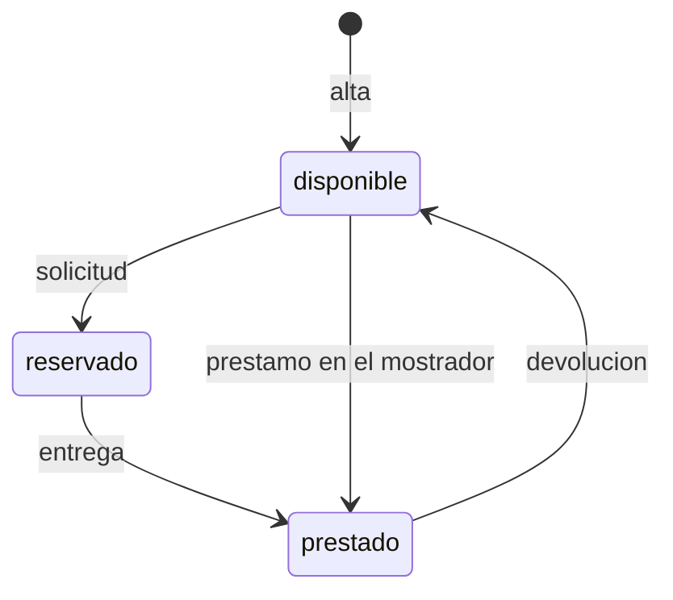

# Préstamo de equipos de la oficina

## Fuentes

- .diverger/inbox/peticion.md: petición del cliente con su anexo «API para el inventario de IT». Aporta el problema, los usuarios, el alcance, los criterios de éxito, las preocupaciones y la API exacta que usará el inventario de IT.
- .diverger/inbox/equipo.csv: no se ha leído como fuente de requisitos; es la lista del equipo (nombre, correo, rol, dedicación) y se usará al planificar los sprints.

## Objetivo

Hoy los préstamos se apuntan en una hoja de cálculo y los empleados piden los equipos por correo a IT: no se sabe qué está libre sin preguntar, dos personas acaban esperando el mismo portátil y nadie se entera de que un préstamo ha vencido hasta que alguien echa en falta el equipo (peticion.md).

Una aplicación para gestionar el préstamo de equipos de la oficina (portátiles, monitores, proyectores) en la que los empleados ven qué hay disponible y lo piden, e IT gestiona altas, entregas, préstamos, devoluciones y vencidos (peticion.md).

Métricas de éxito (peticion.md):

- Durante el primer mes todos los préstamos pasan por la aplicación.
- Ningún equipo se reserva o se presta dos veces.
- IT revisa los vencidos cada semana sin tener que preguntar a nadie.

## Usuarios

- Empleados: entran con su cuenta de Google de la empresa, ven los equipos y su estado y piden un equipo libre (peticion.md).
- IT: entra con su cuenta de Google de la empresa; da de alta los equipos, entrega los reservados, presta en el mostrador, apunta las devoluciones y ve los vencidos y el historial de cada equipo (peticion.md).
- Inventario de IT: sistema que se conecta a la API con una cuenta de servicio incluida en la lista de IT, así que también puede hacer lo de un empleado (peticion.md, anexo).

## Alcance

- Cualquier empleado ve los equipos y su estado: disponible, reservado o prestado; si está reservado o prestado, también la persona y la fecha de devolución (peticion.md).
- Un empleado pide un equipo disponible indicando la fecha de devolución, y el equipo queda reservado a su nombre hasta que IT se lo entrega (peticion.md).
- IT da de alta los equipos con un nombre obligatorio que no puede repetirse; dos nombres son el mismo si solo se diferencian en mayúsculas o en espacios al principio o al final (peticion.md).
- IT entrega un equipo reservado, que pasa a prestado con la misma persona y fecha de devolución de la solicitud (peticion.md).
- IT presta directamente en el mostrador un equipo disponible a una persona, con su fecha de devolución (peticion.md).
- IT apunta la devolución de un equipo prestado, que vuelve a estar disponible sin persona ni fecha de devolución (peticion.md).
- IT ve los préstamos vencidos: los equipos prestados cuya fecha de devolución es anterior a hoy, del más antiguo al más reciente (peticion.md).
- IT consulta el historial de cada equipo, del más reciente al más antiguo, con persona, fecha de devolución y estado (reservado, prestado o devuelto) (peticion.md).
- La fecha de devolución va como texto AAAA-MM-DD y debe existir; quien pide un equipo no puede poner una fecha anterior a hoy, pero IT sí cuando presta en el mostrador, y ese préstamo aparece ya entre los vencidos; «hoy» es el día en Madrid (peticion.md).

## Fuera de alcance

- Que los empleados anulen una solicitud (peticion.md).
- Avisos por correo de préstamos vencidos (peticion.md).

## Restricciones

- Todos entran con su cuenta de Google de la empresa; vale el token de identidad de Google con el correo verificado, emitido para el cliente OAuth de la aplicación, de una persona o de una cuenta de servicio (peticion.md).
- Las cuentas de IT son las de la variable de entorno `CORREOS_IT`, fijada en la configuración del despliegue y no en el código; dos correos son el mismo aunque cambien las mayúsculas (peticion.md).
- Las operaciones de IT las hace solo una cuenta de IT (peticion.md).
- Un equipo no puede estar reservado o prestado dos veces a la vez, tampoco con peticiones simultáneas: una sale bien y la otra recibe un error (peticion.md).
- El inventario de IT se va a conectar a la aplicación, así que la API tiene que ser exactamente la del anexo (peticion.md).

## API fijada por el cliente

El inventario de IT se va a conectar a la aplicación, así que la API tiene que ser exactamente esta. Todas las rutas necesitan haber iniciado sesión: sin un token válido responden 401 con «Inicia sesión con Google.». Vale el token de identidad de Google, con el correo verificado, emitido para el cliente OAuth de la aplicación, tanto de una persona como de una cuenta de servicio. La persona de cada operación es el correo del token.

Las operaciones marcadas «Solo IT» solo las puede hacer una cuenta de IT; con cualquier otra cuenta responden 403 con «Solo IT puede hacer esto.». Las cuentas de IT son las de la variable de entorno `CORREOS_IT`, con los correos separados por comas: la lista se fija en la configuración del despliegue, no en el código. Dos correos son el mismo aunque cambien las mayúsculas. El inventario entra con una cuenta de servicio que está en esa lista, así que también puede hacer lo de un empleado. Los errores son un objeto JSON `{"error": "<mensaje>"}` con el mensaje exacto que se indica.

Un equipo está en uno de tres estados: `disponible`, `reservado` (un empleado lo ha pedido y aún no lo ha recogido) o `prestado`. Cuando está reservado o prestado, el equipo lleva también `persona` (el correo de quien lo tiene) y `devolucion`.

| Operación | Quién | Petición | Respuesta correcta | Errores |
|---|---|---|---|---|
| Dar de alta un equipo | Solo IT | `POST /api/equipos` con `{"nombre": "Portátil 07"}` | 201 con `{"id": "…", "nombre": "Portátil 07", "estado": "disponible"}` | 400 «Falta el nombre del equipo» si el nombre falta o está vacío. 409 «Ya hay un equipo con ese nombre» |
| Ver los equipos | Todos | `GET /api/equipos` | 200 con la lista de equipos, cada uno con `id`, `nombre` y `estado`; si está reservado o prestado, también `persona` y `devolucion` | — |
| Pedir un equipo | Todos | `POST /api/equipos/{id}/solicitud` con `{"devolucion": "2026-11-20"}` | 201 con el equipo: `estado: "reservado"`, `persona` (el correo de quien lo pide) y `devolucion` | 400 «Falta la fecha de devolución». 400 «La fecha de devolución no es válida» si no es una fecha real. 400 «La fecha de devolución ya ha pasado». 404 «No existe el equipo». 409 «El equipo no está disponible» si está reservado o prestado |
| Entregar un equipo reservado | Solo IT | `POST /api/equipos/{id}/entrega` | 200 con el equipo: `estado: "prestado"`, con la misma `persona` y `devolucion` de la solicitud | 404 «No existe el equipo». 409 «El equipo no está reservado» |
| Prestar en el mostrador | Solo IT | `POST /api/equipos/{id}/prestamo` con `{"persona": "ana.perez@empresa.com", "devolucion": "2026-11-20"}` | 201 con el equipo: `estado: "prestado"`, `persona` y `devolucion` | 400 «Faltan la persona o la fecha de devolución». 400 «La fecha de devolución no es válida» si no es una fecha real. 404 «No existe el equipo». 409 «El equipo no está disponible» si está reservado o prestado |
| Apuntar la devolución | Solo IT | `POST /api/equipos/{id}/devolucion` | 200 con el equipo y `estado: "disponible"`, sin `persona` ni `devolucion` | 404 «No existe el equipo». 409 «El equipo no está prestado» |
| Ver los préstamos vencidos | Solo IT | `GET /api/prestamos/vencidos` | 200 con la lista de equipos prestados cuya fecha de devolución es anterior a hoy, cada uno con `id`, `nombre`, `persona` y `devolucion`, del más antiguo al más reciente | — |
| Ver el historial de un equipo | Solo IT | `GET /api/equipos/{id}/historial` | 200 con la lista de sus préstamos, del más reciente al más antiguo, cada uno con `persona`, `devolucion` y `estado` (`reservado`, `prestado` o `devuelto`) | 404 «No existe el equipo» |

La fecha de devolución va como texto `AAAA-MM-DD` y se devuelve igual. Tiene que ser una fecha que exista («2026-02-30» no vale). «Hoy» es el día en Madrid. Quien pide un equipo no puede poner una fecha anterior a hoy, pero IT sí cuando presta en el mostrador, porque a veces apunta los préstamos con retraso; un préstamo así ya aparece entre los vencidos.

Un equipo no puede estar reservado o prestado dos veces a la vez. Si llegan dos peticiones a la vez para el mismo equipo disponible, sean solicitudes o préstamos en el mostrador, una sale bien y la otra recibe 409 «El equipo no está disponible»; nunca salen bien las dos.

Dos nombres de equipo son el mismo si solo se diferencian en mayúsculas o en espacios al principio o al final: « portátil 07 » repite «Portátil 07».

(peticion.md, «Anexo: API para el inventario de IT»)

## Riesgos

- Que dos empleados se queden con el mismo equipo porque lo pidieron a la vez (peticion.md).
- Que un empleado pueda hacer lo que solo le toca a IT (peticion.md).
- Que el inventario deje de funcionar si la API cambia (peticion.md).

## Supuestos

- [SUPUESTO] La aplicación tiene una interfaz web para empleados e IT además de la API — la petición dice que los empleados «ven qué hay disponible y lo piden», pero el anexo solo define la API.
- [SUPUESTO] Una reserva no caduca por sí sola — la petición no habla de caducidad y deja fuera la anulación por parte del empleado.
- [SUPUESTO] La revisión semanal de vencidos es una práctica de IT con la lista de vencidos, no una función nueva de la aplicación — no se pide informe ni aviso.
- [SUPUESTO] En el préstamo en el mostrador no se valida el formato del correo de la persona más allá de que no falte — el anexo solo define el error cuando falta.

## Preguntas abiertas

1. [alta] ¿La aplicación necesita una interfaz web para empleados e IT además de la API, o basta con la API?
2. [alta] Si una reserva nunca se recoge, ¿cómo se libera el equipo, si el empleado no puede anular y la API no tiene una operación para ello? ¿Puede IT liberarla o debe caducar?
3. [media] ¿Qué es el inventario de IT, quién lo mantiene y qué operaciones de la API usa?
4. [media] ¿Cómo se medirá que «todos los préstamos pasan por la aplicación» durante el primer mes?
5. [media] ¿Hay un plazo máximo de préstamo o un límite de equipos a la vez por persona?
6. [media] ¿Qué tecnología, alojamiento y plazos tiene el proyecto?
7. [baja] ¿Hay que comprobar en el mostrador que la persona sea un correo del dominio de la empresa?
8. [baja] ¿Qué pasa al entregar una reserva cuya fecha de devolución ya ha pasado?
9. [baja] ¿Cuántos equipos y usuarios se esperan?
10. [media] ¿Quién hace las tareas de datos y de pruebas (QA)? El equipo solo tiene el rol de desarrollo y se han asignado a José Luis Calvo por carga.

## Claridad

| Categoría | Claridad |
|---|---|
| Usuarios | 75 % |
| Problema | 75 % |
| Objetivo y métricas | 50 % |
| Alcance | 75 % |
| Fuera de alcance | 50 % |
| Restricciones | 75 % |
| Dependencias e integraciones | 50 % |
| Riesgos | 50 % |
| Global | 63 % |

## Diagramas

### Estados de un equipo

