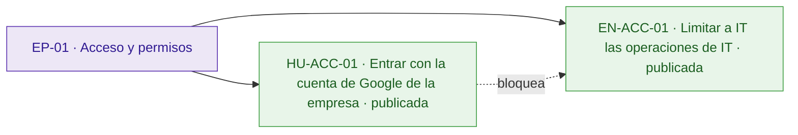
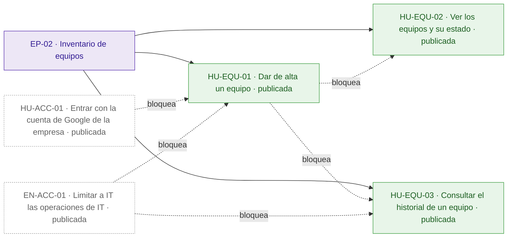
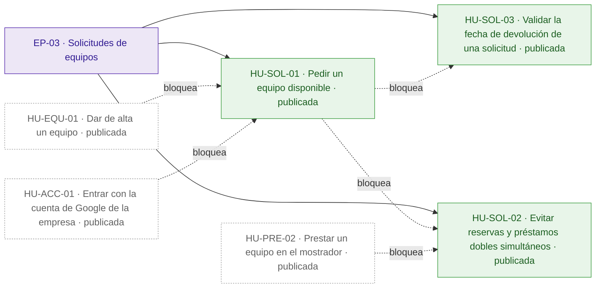
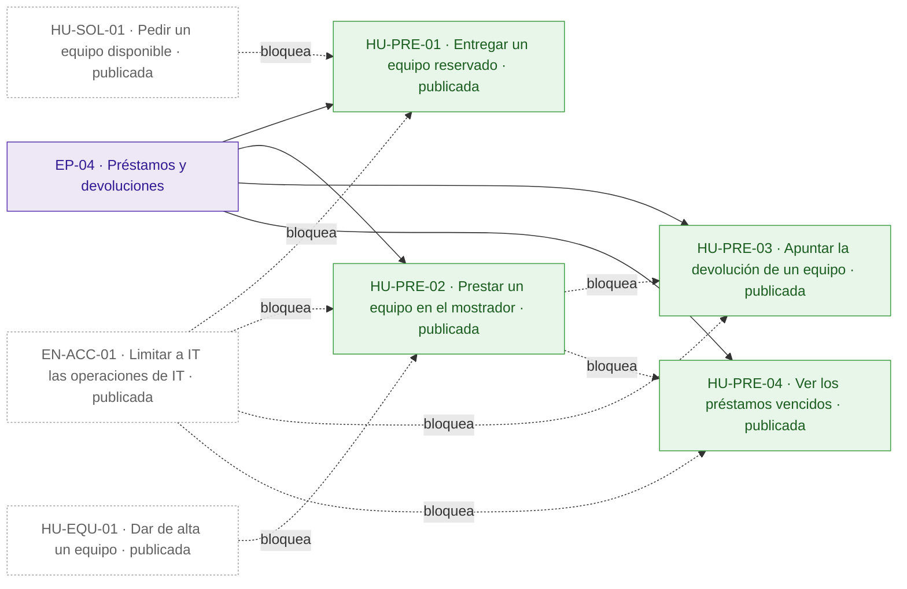
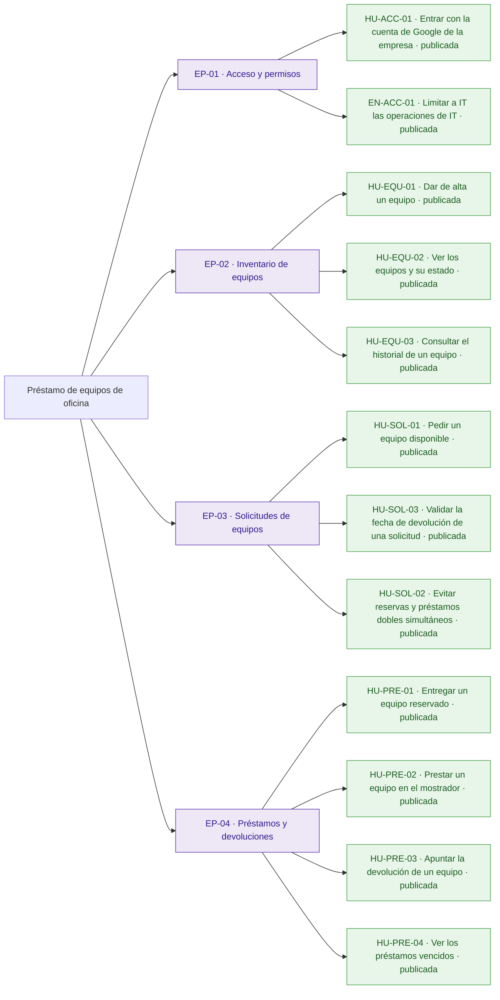
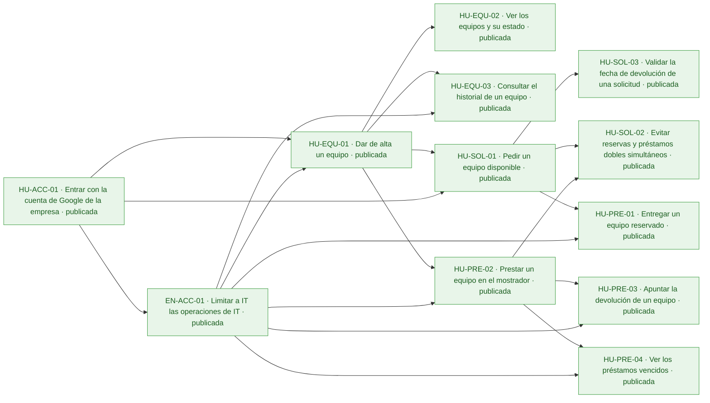
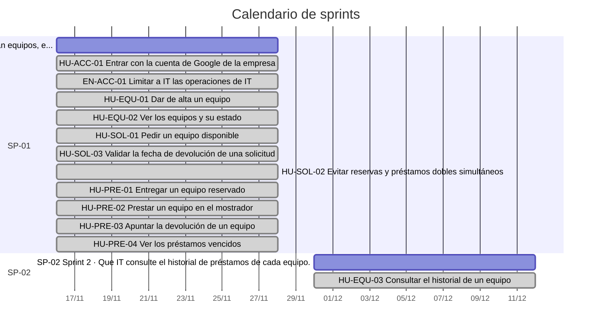
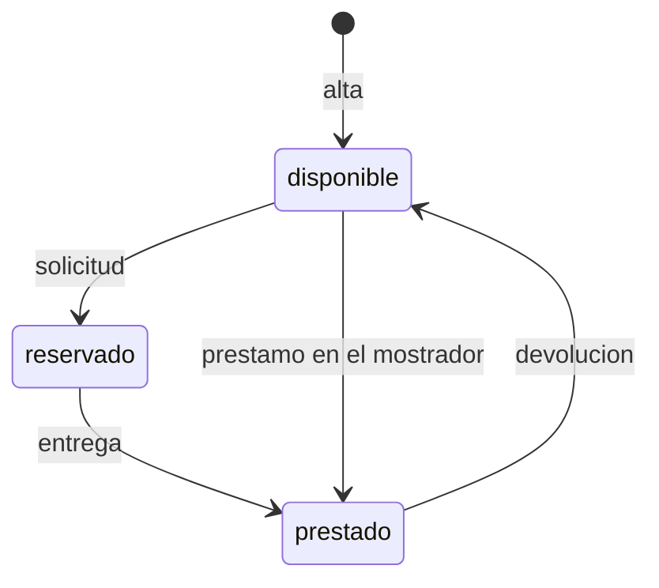

# Préstamo de equipos de oficina

Hoy los préstamos de portátiles, monitores y proyectores se apuntan en una hoja de cálculo y se piden por correo a IT: nadie sabe qué está libre sin preguntar, dos personas acaban esperando el mismo portátil y los préstamos vencidos pasan desapercibidos hasta que alguien echa en falta el equipo.

La aplicación permite a los empleados ver los equipos y su estado y pedir uno libre con su fecha de devolución, y a IT dar de alta los equipos, entregar los reservados, prestar en el mostrador, apuntar las devoluciones, ver los vencidos y consultar el historial. Todos entran con su cuenta de Google de la empresa, el inventario de IT se conecta por una API fijada por el cliente y un equipo nunca puede reservarse o prestarse dos veces a la vez. Quedan fuera la anulación de solicitudes por los empleados y los avisos por correo de préstamos vencidos.

## Visión y alcance

Que los empleados vean qué equipos de la oficina están libres y los pidan prestados, e IT dé de alta, entregue, preste y recoja los equipos y vea qué préstamos han vencido, sin que un equipo se reserve o se preste dos veces.

**Dentro del alcance**

- Ver los equipos y su estado (disponible, reservado o prestado) y, si está reservado o prestado, quién lo tiene y su fecha de devolución (peticion.md).
- Pedir un equipo disponible indicando la fecha de devolución; queda reservado a nombre de quien lo pide hasta que IT se lo entrega (peticion.md).
- Dar de alta un equipo con un nombre obligatorio y único, sin distinguir mayúsculas ni espacios al principio o al final; solo IT (peticion.md).
- Entregar un equipo reservado, que pasa a prestado con la misma persona y fecha de devolución; solo IT (peticion.md).
- Prestar un equipo disponible en el mostrador a la persona indicada, con su fecha de devolución; solo IT (peticion.md).
- Apuntar la devolución de un equipo prestado, que vuelve a estar disponible sin persona ni fecha; solo IT (peticion.md).
- Ver los préstamos vencidos (equipos prestados con fecha de devolución anterior a hoy), del más antiguo al más reciente; solo IT (peticion.md).
- Consultar el historial de préstamos de un equipo, del más reciente al más antiguo; solo IT (peticion.md).
- La fecha de devolución va como \`AAAA-MM-DD\`, tiene que existir y «hoy» es el día en Madrid; quien pide un equipo no puede poner una fecha anterior a hoy, pero IT sí al prestar en el mostrador, y ese préstamo ya aparece entre los vencidos (peticion.md).
- Un equipo no puede estar reservado o prestado dos veces a la vez: con dos peticiones simultáneas sobre el mismo equipo disponible, una sale bien y la otra recibe 409 «El equipo no está disponible» (peticion.md).
- Solo las cuentas de IT, las de la variable de entorno \`CORREOS\_IT\`, pueden hacer las operaciones «Solo IT»; las demás reciben 403 (peticion.md).
- Todas las rutas exigen haber iniciado sesión con el token de identidad de Google, con el correo verificado y emitido para el cliente OAuth de la aplicación; sin él responden 401. La persona de cada operación es el correo del token (peticion.md).

**Fuera del alcance**

- Que los empleados anulen una solicitud (peticion.md).
- Avisos por correo de préstamos vencidos (peticion.md).

## Resumen en cifras

| Dato | Valor |
| --- | --- |
| Épicas | 4 |
| Historias | 12 |
| Historias por estado | borrador 0, aprobada 0, descartada 0, publicada 12 |
| Tareas | 38 |
| Sprints | 2 |
| Personas en el equipo | 1 |
| Modalidad de desarrollo | manual, sin IA |
| Horas estimadas | 60 h |
| Horas efectivas (según la modalidad de desarrollo) | 60 h |
| Historias sin estimar | 0 |
| Historias descartadas (fuera de las horas) | 0 |
| Supuestos | 13 |
| Preguntas abiertas | 5 |
| Requisitos | 13 |
| Requisitos sin historia | 0 |

## Índice

- [Visión y alcance](#visión-y-alcance)
- [Resumen en cifras](#resumen-en-cifras)
- [Épicas e historias](#épicas-e-historias)
  - [EP-01 · Acceso y permisos](#ep-01--acceso-y-permisos)
  - [EP-02 · Inventario de equipos](#ep-02--inventario-de-equipos)
  - [EP-03 · Solicitudes de equipos](#ep-03--solicitudes-de-equipos)
  - [EP-04 · Préstamos y devoluciones](#ep-04--préstamos-y-devoluciones)
- [Tareas](#tareas)
- [Sprints](#sprints)
- [Equipo](#equipo)
- [Dependencias](#dependencias)
- [Requisitos y trazabilidad](#requisitos-y-trazabilidad)
- [Preparación y definición de hecho](#preparación-y-definición-de-hecho)
- [Diagramas](#diagramas)
- [Supuestos](#supuestos)
- [Preguntas abiertas](#preguntas-abiertas)
- [Decisiones](#decisiones)

## Épicas e historias

### EP-01 · Acceso y permisos

Entrada de empleados, IT y la cuenta de servicio del inventario con el token de identidad de Google, y la restricción de las operaciones de IT a las cuentas de la variable CORREOS\_IT. Protege el riesgo de que un empleado haga lo que solo le toca a IT. No incluye ninguna operación sobre los equipos.

#### Épica EP-01: Acceso y permisos

#### HU-ACC-01 · Entrar con la cuenta de Google de la empresa

Como empleado, quiero entrar en la aplicación con mi cuenta de Google de la empresa, para que cada operación quede a nombre del correo de mi cuenta de Google de la empresa.

**Contexto.** Cubre RQ.012 y RQ.013 (peticion.md): todos entran con su cuenta de Google de la empresa, todas las rutas de la API fijada por el cliente exigen el token de identidad de Google y la persona de cada operación es el correo del token.

- **Prioridad:** Highest
- **Tamaño:** L
- **Horas:** 8 h estimadas · 8 h efectivas
- **Estado:** publicada
- **Sprint:** SP-01 Sprint 1
- **Responsable:** José Luis Calvo
- **Tipo:** historia
- **Puntos de historia:** 5
- **Preparación:** parcialmente lista (pendiente: DoR-08: dependencias externas sin plan confirmado: Cliente OAuth de Google de la aplicación · supuestos sin confirmar: DoR-04, DoR-05, DoR-06, DoR-07, DoR-09)
- **Requisitos:** RQ.012, RQ.013
- **Dependencias externas:** Cliente OAuth de Google de la aplicación

**Criterios de aceptación**

*Escenarios positivos*

1. **Dado** la empleada ana.perez@empresa.com con un token de identidad de Google con el correo verificado y emitido para el cliente OAuth de la aplicación, **cuando** consulta la lista de equipos, **entonces** recibe 200 con la lista de equipos y la aplicación la identifica como ana.perez@empresa.com.
2. **Dado** la cuenta de servicio del inventario de IT con un token de identidad de Google con el correo verificado y emitido para el cliente OAuth de la aplicación, **cuando** consulta la lista de equipos, **entonces** recibe 200 con la lista de equipos.

*Escenarios negativos*

1. **Dado** una petición sin token, **cuando** consulta la lista de equipos, **entonces** recibe 401 con el error «Inicia sesión con Google.» y ninguna lista de equipos.
2. **Dado** un token de Google de ana.perez@empresa.com con el correo sin verificar, **cuando** consulta la lista de equipos, **entonces** recibe 401 con el error «Inicia sesión con Google.».
3. **Dado** un token de Google de ana.perez@empresa.com emitido para otro cliente OAuth, **cuando** consulta la lista de equipos, **entonces** recibe 401 con el error «Inicia sesión con Google.».

**Notas.** Sigue abierta la pregunta de si el acceso se restringe al dominio de correo de la empresa o basta un token válido para el cliente OAuth de la aplicación.

**Definición de hecho**

- Criterios de aceptación probados.
- Mensajes de error con el texto exacto de la API fijada por el cliente.
- Textos revisados en español de España.

**Tareas**

- TA-001 · Verificación del token de identidad de Google en todas las rutas · backend · José Luis Calvo
- TA-002 · Inicio de sesión con la cuenta de Google de la empresa · frontend · José Luis Calvo
- TA-003 · Pruebas de token válido, sin token, correo sin verificar y otro cliente OAuth · QA · José Luis Calvo

#### EN-ACC-01 · Limitar a IT las operaciones de IT

Como equipo, necesitamos limitar las operaciones «Solo IT» a las cuentas de la variable de entorno CORREOS\_IT, para que ningún empleado pueda dar de alta, entregar, prestar o recoger equipos ni ver los vencidos o el historial.

**Contexto.** Cubre RQ.011 y RQ.013 (peticion.md): las operaciones marcadas «Solo IT» solo las puede hacer una cuenta de la variable de entorno CORREOS\_IT, y dos correos son el mismo aunque cambien las mayúsculas. Responde al riesgo de que un empleado pueda hacer lo que solo le toca a IT.

- **Prioridad:** Highest
- **Tamaño:** M
- **Horas:** 4 h estimadas · 4 h efectivas
- **Estado:** publicada
- **Sprint:** SP-01 Sprint 1
- **Responsable:** José Luis Calvo
- **Tipo:** habilitador (enabler)
- **Puntos de historia:** 3
- **Preparación:** parcialmente lista (pendiente: DoR-08: depende de HU-ACC-01, sin resolver ni planificada en un sprint anterior · supuestos sin confirmar: DoR-04, DoR-05, DoR-06, DoR-07, DoR-09)
- **Requisitos:** RQ.011, RQ.013
- **Depende de:**
  - HU-ACC-01 · Entrar con la cuenta de Google de la empresa: Saber si una cuenta es de IT exige conocer el correo del token.

**Criterios de aceptación**

*Escenarios positivos*

1. **Dado** CORREOS\_IT con «it@empresa.com,soporte@empresa.com» y una petición con el token de IT@empresa.com, **cuando** llega a una operación marcada «Solo IT», **entonces** la aplicación reconoce IT@empresa.com como cuenta de IT, aunque cambien las mayúsculas, y deja pasar la petición.

*Escenarios negativos*

1. **Dado** CORREOS\_IT con «it@empresa.com,soporte@empresa.com» y una petición con el token de ana.perez@empresa.com, **cuando** llega a una operación marcada «Solo IT», **entonces** responde 403 con el error «Solo IT puede hacer esto.» y la operación no se hace.

**Notas.** La cuenta de servicio del inventario de IT está en CORREOS\_IT, así que también puede hacer lo de un empleado.

**Definición de hecho**

- Criterios de aceptación probados.
- La lista CORREOS\_IT se lee de la configuración del despliegue, no del código.

**Tareas**

- TA-004 · Comprobación de cuentas de IT a partir de CORREOS\_IT sin distinguir mayúsculas · backend · José Luis Calvo
- TA-005 · Pruebas de 403 en cada operación «Solo IT» · QA · José Luis Calvo

### EP-02 · Inventario de equipos

Alta de los equipos por IT, la lista de equipos con su estado para todos y el historial de préstamos de cada equipo para IT. Sustituye a la hoja de cálculo como registro de qué equipos hay y quién los ha tenido. Las solicitudes y los préstamos quedan en otras épicas.

#### Épica EP-02: Inventario de equipos

#### HU-EQU-01 · Dar de alta un equipo

Como técnico de IT, quiero dar de alta un equipo con su nombre, para que los empleados lo vean y lo puedan pedir sin preguntar a IT.

**Contexto.** Cubre RQ.003 (peticion.md): IT da de alta los equipos, y dos nombres son el mismo si solo se diferencian en mayúsculas o en espacios al principio o al final.

- **Prioridad:** Highest
- **Tamaño:** M
- **Horas:** 4 h estimadas · 4 h efectivas
- **Estado:** publicada
- **Sprint:** SP-01 Sprint 1
- **Responsable:** José Luis Calvo
- **Tipo:** historia
- **Puntos de historia:** 3
- **Preparación:** parcialmente lista (pendiente: DoR-08: depende de HU-ACC-01, EN-ACC-01, sin resolver ni planificada en un sprint anterior · supuestos sin confirmar: DoR-04, DoR-05, DoR-06, DoR-07, DoR-09)
- **Requisitos:** RQ.003, RQ.013
- **Depende de:**
  - HU-ACC-01 · Entrar con la cuenta de Google de la empresa: Todas las rutas exigen haber iniciado sesión con Google.
  - EN-ACC-01 · Limitar a IT las operaciones de IT: La operación es solo de IT.

**Criterios de aceptación**

*Escenarios positivos*

1. **Dado** un técnico de IT con sesión iniciada y ningún equipo llamado «Portátil 07», **cuando** da de alta el equipo «Portátil 07», **entonces** recibe 201 con un id nuevo, el nombre «Portátil 07» y el estado «disponible».

*Escenarios negativos*

1. **Dado** un técnico de IT con sesión iniciada, **cuando** da de alta un equipo con el nombre vacío, **entonces** recibe 400 con el error «Falta el nombre del equipo» y no se crea ningún equipo.
2. **Dado** un técnico de IT con sesión iniciada y el equipo «Portátil 07» ya dado de alta, **cuando** da de alta el equipo « portátil 07 », **entonces** recibe 409 con el error «Ya hay un equipo con ese nombre» y sigue habiendo un solo «Portátil 07».

**Definición de hecho**

- Criterios de aceptación probados.
- Respuesta y mensajes de error iguales a los de la API fijada por el cliente.
- Textos revisados en español de España.

**Tareas**

- TA-006 · Modelo de equipo con nombre único normalizado · datos · José Luis Calvo
- TA-007 · Endpoint de alta de equipos · backend · José Luis Calvo
- TA-008 · Formulario de alta de equipos para IT · frontend · José Luis Calvo
- TA-009 · Pruebas de alta, nombre vacío y nombre repetido · QA · José Luis Calvo

#### HU-EQU-02 · Ver los equipos y su estado

Como empleado, quiero ver los equipos de la oficina y su estado, para saber qué está libre sin preguntar a IT.

**Contexto.** Cubre RQ.001 (peticion.md): cualquier empleado ve los equipos y su estado. Hoy no se sabe qué está libre sin preguntar.

- **Prioridad:** Highest
- **Tamaño:** M
- **Horas:** 4 h estimadas · 4 h efectivas
- **Estado:** publicada
- **Sprint:** SP-01 Sprint 1
- **Responsable:** José Luis Calvo
- **Tipo:** historia
- **Puntos de historia:** 3
- **Preparación:** parcialmente lista (pendiente: DoR-08: depende de HU-EQU-01, sin resolver ni planificada en un sprint anterior · supuestos sin confirmar: DoR-04, DoR-05, DoR-06, DoR-07, DoR-09)
- **Requisitos:** RQ.001
- **Depende de:**
  - HU-EQU-01 · Dar de alta un equipo: Solo hay equipos que ver después de darlos de alta.

**Criterios de aceptación**

*Escenarios positivos*

1. **Dado** el equipo «Portátil 07» disponible y el equipo «Proyector 02» prestado a ana.perez@empresa.com con devolución «2026-11-20», **cuando** un empleado consulta la lista de equipos, **entonces** ve «Portátil 07» disponible, sin persona ni fecha de devolución, y «Proyector 02» prestado a «ana.perez@empresa.com» con devolución «2026-11-20».
2. **Dado** el equipo «Monitor 03» reservado por luis.gomez@empresa.com con devolución «2026-11-25», **cuando** un empleado consulta la lista de equipos, **entonces** ve «Monitor 03» reservado por «luis.gomez@empresa.com» con devolución «2026-11-25».

*Escenarios negativos*

1. **Dado** ningún equipo dado de alta, **cuando** un empleado consulta la lista de equipos, **entonces** recibe 200 con una lista vacía.

**Notas.** Sigue abierta la pregunta de si es intencionado que cualquier empleado vea quién tiene cada equipo y hasta cuándo; la API fijada devuelve persona y fecha de devolución a todos.

**Definición de hecho**

- Criterios de aceptación probados.
- Respuesta igual a la de la API fijada por el cliente.
- Textos revisados en español de España.

**Tareas**

- TA-010 · Endpoint de la lista de equipos con su estado · backend · José Luis Calvo
- TA-011 · Pantalla de la lista de equipos · frontend · José Luis Calvo
- TA-012 · Pruebas de la lista con equipos en cada estado · QA · José Luis Calvo

#### HU-EQU-03 · Consultar el historial de un equipo

Como técnico de IT, quiero consultar el historial de préstamos de un equipo, para saber quién ha tenido cada equipo sin buscarlo en la hoja de cálculo.

**Contexto.** Cubre RQ.008 (peticion.md): IT consulta el historial de cada equipo, del préstamo más reciente al más antiguo, con los estados reservado, prestado o devuelto.

- **Prioridad:** High
- **Tamaño:** M
- **Horas:** 4 h estimadas · 4 h efectivas
- **Estado:** publicada
- **Sprint:** SP-02 Sprint 2
- **Responsable:** José Luis Calvo
- **Tipo:** historia
- **Puntos de historia:** 3
- **Preparación:** parcialmente lista (pendiente: DoR-08: depende de HU-EQU-01, EN-ACC-01, sin resolver ni planificada en un sprint anterior · supuestos sin confirmar: DoR-04, DoR-05, DoR-06, DoR-07, DoR-09)
- **Requisitos:** RQ.008, RQ.013
- **Depende de:**
  - HU-EQU-01 · Dar de alta un equipo: El historial es de un equipo dado de alta.
  - EN-ACC-01 · Limitar a IT las operaciones de IT: La operación es solo de IT.

**Criterios de aceptación**

*Escenarios positivos*

1. **Dado** el equipo «Portátil 07», prestado antes a ana.perez@empresa.com con devolución «2026-11-10» y ya devuelto, y ahora reservado por luis.gomez@empresa.com con devolución «2026-11-25», **cuando** un técnico de IT consulta el historial de «Portátil 07», **entonces** recibe 200 con dos préstamos: primero luis.gomez@empresa.com, «2026-11-25», reservado; después ana.perez@empresa.com, «2026-11-10», devuelto.

*Escenarios negativos*

1. **Dado** ningún equipo con el id «equipo-inexistente», **cuando** un técnico de IT consulta el historial de «equipo-inexistente», **entonces** recibe 404 con el error «No existe el equipo».

**Notas.** \[SUPUESTO\] El historial incluye la reserva en curso, los préstamos y las devoluciones.

**Definición de hecho**

- Criterios de aceptación probados.
- Respuesta y mensajes de error iguales a los de la API fijada por el cliente.
- Textos revisados en español de España.

**Tareas**

- TA-013 · Registro de los préstamos de cada equipo · datos · José Luis Calvo
- TA-014 · Endpoint del historial de un equipo · backend · José Luis Calvo
- TA-015 · Pantalla del historial de un equipo · frontend · José Luis Calvo
- TA-016 · Pruebas del orden del historial y del equipo inexistente · QA · José Luis Calvo

### EP-03 · Solicitudes de equipos

Los empleados piden un equipo libre con la fecha en que lo devolverán y queda reservado a su nombre hasta que IT se lo entrega. Incluye la garantía de que un equipo nunca se reserva o se presta dos veces a la vez, aunque las peticiones lleguen al mismo tiempo. Los empleados no pueden anular una solicitud.

#### Épica EP-03: Solicitudes de equipos

#### HU-SOL-01 · Pedir un equipo disponible

Como empleado, quiero pedir un equipo disponible indicando la fecha en que lo devolveré, para que quede reservado a mi nombre y nadie más lo pida mientras IT me lo entrega.

**Contexto.** Cubre RQ.002 (peticion.md): un empleado pide un equipo libre con la fecha en que lo devolverá y queda reservado a su nombre hasta que IT se lo entrega. La validación de la fecha está en HU-SOL-03.

- **Prioridad:** Highest
- **Tamaño:** L
- **Horas:** 8 h estimadas · 8 h efectivas
- **Estado:** publicada
- **Sprint:** SP-01 Sprint 1
- **Responsable:** José Luis Calvo
- **Tipo:** historia
- **Puntos de historia:** 5
- **Preparación:** parcialmente lista (pendiente: DoR-08: depende de HU-EQU-01, sin resolver ni planificada en un sprint anterior · supuestos sin confirmar: DoR-04, DoR-05, DoR-06, DoR-07, DoR-09)
- **Requisitos:** RQ.002, RQ.013
- **Depende de:**
  - HU-EQU-01 · Dar de alta un equipo: Solo se puede pedir un equipo dado de alta.
  - HU-ACC-01 · Entrar con la cuenta de Google de la empresa: La reserva queda a nombre del correo del token, así que exige una persona identificada.

**Criterios de aceptación**

*Escenarios positivos*

1. **Dado** el equipo «Portátil 07» disponible, el 14 de noviembre de 2026 en Madrid, y la empleada ana.perez@empresa.com con sesión iniciada, **cuando** pide «Portátil 07» con devolución «2026-11-20», **entonces** recibe 201 con «Portátil 07» reservado, la persona «ana.perez@empresa.com» y la devolución «2026-11-20».

*Escenarios negativos*

1. **Dado** el equipo «Proyector 02» prestado a luis.gomez@empresa.com, **cuando** la empleada ana.perez@empresa.com lo pide con devolución «2026-11-20», **entonces** recibe 409 con el error «El equipo no está disponible» y «Proyector 02» sigue prestado a luis.gomez@empresa.com.
2. **Dado** ningún equipo con el id «equipo-inexistente», **cuando** la empleada ana.perez@empresa.com lo pide con devolución «2026-11-20», **entonces** recibe 404 con el error «No existe el equipo».

**Notas.** Los empleados no pueden anular una solicitud (fuera de alcance). Sigue abierta la pregunta de qué pasa con una reserva que IT nunca entrega.

**Definición de hecho**

- Criterios de aceptación probados.
- Respuesta y mensajes de error iguales a los de la API fijada por el cliente.
- Textos revisados en español de España.

**Tareas**

- TA-017 · Estado de reserva con persona y fecha de devolución · datos · José Luis Calvo
- TA-018 · Endpoint de solicitud de un equipo · backend · José Luis Calvo
- TA-019 · Pedir un equipo desde la lista con su fecha de devolución · frontend · José Luis Calvo
- TA-020 · Pruebas de solicitud, equipo no disponible y equipo inexistente · QA · José Luis Calvo

#### HU-SOL-03 · Validar la fecha de devolución de una solicitud

Como empleado, quiero pedir un equipo con una fecha de devolución de hoy en adelante, para saber en el momento si la fecha que he puesto no sirve, sin esperar a que IT me lo diga.

**Contexto.** Cubre RQ.009 (peticion.md): la fecha de devolución va como AAAA-MM-DD, tiene que existir («2026-02-30» no vale) y quien pide un equipo no puede poner una fecha anterior a hoy en Madrid.

- **Prioridad:** Highest
- **Tamaño:** M
- **Horas:** 4 h estimadas · 4 h efectivas
- **Estado:** publicada
- **Sprint:** SP-01 Sprint 1
- **Responsable:** José Luis Calvo
- **Tipo:** historia
- **Puntos de historia:** 3
- **Preparación:** parcialmente lista (pendiente: DoR-08: depende de HU-SOL-01, sin resolver ni planificada en un sprint anterior · supuestos sin confirmar: DoR-04, DoR-05, DoR-06, DoR-07, DoR-09)
- **Requisitos:** RQ.009, RQ.013
- **Depende de:**
  - HU-SOL-01 · Pedir un equipo disponible: La fecha se valida al pedir un equipo.

**Criterios de aceptación**

*Escenarios positivos*

1. **Dado** el equipo «Portátil 07» disponible, el 14 de noviembre de 2026 en Madrid, **cuando** la empleada ana.perez@empresa.com lo pide con devolución «2026-11-14», **entonces** recibe 201 con «Portátil 07» reservado a «ana.perez@empresa.com» con devolución «2026-11-14».

*Escenarios negativos*

1. **Dado** el equipo «Portátil 07» disponible, el 14 de noviembre de 2026 en Madrid, **cuando** la empleada ana.perez@empresa.com lo pide con devolución «2026-11-13», **entonces** recibe 400 con el error «La fecha de devolución ya ha pasado» y «Portátil 07» sigue disponible.
2. **Dado** el equipo «Portátil 07» disponible, **cuando** la empleada ana.perez@empresa.com lo pide con devolución «2026-02-30», **entonces** recibe 400 con el error «La fecha de devolución no es válida» y «Portátil 07» sigue disponible.
3. **Dado** el equipo «Portátil 07» disponible, **cuando** la empleada ana.perez@empresa.com lo pide sin fecha de devolución, **entonces** recibe 400 con el error «Falta la fecha de devolución» y «Portátil 07» sigue disponible.

**Definición de hecho**

- Criterios de aceptación probados.
- «Hoy» se calcula con la fecha de Madrid.
- Mensajes de error iguales a los de la API fijada por el cliente.
- Textos revisados en español de España.

**Tareas**

- TA-036 · Validación de la fecha de devolución con hoy en Madrid · backend · José Luis Calvo
- TA-037 · Mensajes de error de la fecha en la solicitud · frontend · José Luis Calvo
- TA-038 · Pruebas de fechas de hoy, pasadas, inexistentes y ausentes · QA · José Luis Calvo

#### HU-SOL-02 · Evitar reservas y préstamos dobles simultáneos

Como empleado, quiero pedir un equipo disponible aunque otra persona lo pida a la vez, para no quedarme esperando un equipo que ya tiene otra persona.

**Contexto.** Cubre RQ.010 (peticion.md): un equipo no puede estar reservado o prestado dos veces a la vez; si llegan dos peticiones a la vez para el mismo equipo disponible, sean solicitudes o préstamos en el mostrador, nunca salen bien las dos. Es lo más importante de la petición y una de sus métricas de éxito.

- **Prioridad:** Highest
- **Tamaño:** L
- **Horas:** 8 h estimadas · 8 h efectivas
- **Estado:** publicada
- **Sprint:** SP-01 Sprint 1
- **Responsable:** José Luis Calvo
- **Tipo:** historia
- **Puntos de historia:** 5
- **Preparación:** parcialmente lista (pendiente: DoR-08: depende de HU-SOL-01, HU-PRE-02, sin resolver ni planificada en un sprint anterior · supuestos sin confirmar: DoR-04, DoR-05, DoR-06, DoR-07, DoR-09)
- **Requisitos:** RQ.010, RQ.013
- **Depende de:**
  - HU-SOL-01 · Pedir un equipo disponible: La regla protege las solicitudes de los empleados.
  - HU-PRE-02 · Prestar un equipo en el mostrador: La regla protege también los préstamos en el mostrador.

**Criterios de aceptación**

*Escenarios positivos*

1. **Dado** el equipo «Monitor 03» disponible, **cuando** llegan a la vez una solicitud de ana.perez@empresa.com y otra de luis.gomez@empresa.com, ambas con devolución «2026-11-20», **entonces** una recibe 201 con «Monitor 03» reservado a su nombre y la otra 409 con el error «El equipo no está disponible».
2. **Dado** el equipo «Monitor 03» disponible, **cuando** llegan a la vez una solicitud de ana.perez@empresa.com con devolución «2026-11-20» y un préstamo en el mostrador a luis.gomez@empresa.com con devolución «2026-11-21», **entonces** una petición recibe 201 y la otra 409 con el error «El equipo no está disponible»; «Monitor 03» queda a nombre de una sola persona.

*Escenarios negativos*

1. **Dado** el equipo «Portátil 07» disponible, **cuando** llegan a la vez 20 solicitudes de 20 empleados distintos con devolución «2026-11-20», **entonces** exactamente una recibe 201, las otras 19 reciben 409 con el error «El equipo no está disponible» y el historial de «Portátil 07» tiene una sola reserva.

**Notas.** Responde al riesgo de que dos empleados se queden con el mismo equipo porque lo pidieron a la vez. La regla es transversal: cubre también el préstamo en el mostrador de HU-PRE-02.

**Definición de hecho**

- Criterios de aceptación probados con peticiones concurrentes reales, no secuenciales.
- Mensaje de error igual al de la API fijada por el cliente.

**Tareas**

- TA-021 · Cambio de estado atómico del equipo · datos · José Luis Calvo
- TA-022 · Solicitud y préstamo en el mostrador sobre el cambio atómico · backend · José Luis Calvo
- TA-023 · Pruebas de peticiones concurrentes sobre el mismo equipo · QA · José Luis Calvo

### EP-04 · Préstamos y devoluciones

IT entrega los equipos reservados, presta directamente en el mostrador, apunta las devoluciones y ve los préstamos vencidos para revisarlos cada semana. No incluye avisos por correo de préstamos vencidos.

#### Épica EP-04: Préstamos y devoluciones

#### HU-PRE-01 · Entregar un equipo reservado

Como técnico de IT, quiero entregar un equipo reservado a quien lo pidió, para que la aplicación refleje quién tiene el equipo y hasta cuándo sin apuntarlo en la hoja de cálculo.

**Contexto.** Cubre RQ.004 (peticion.md): IT entrega los equipos reservados, que pasan a prestados con la misma persona y fecha de devolución de la solicitud.

- **Prioridad:** Highest
- **Tamaño:** M
- **Horas:** 4 h estimadas · 4 h efectivas
- **Estado:** publicada
- **Sprint:** SP-01 Sprint 1
- **Responsable:** José Luis Calvo
- **Tipo:** historia
- **Puntos de historia:** 3
- **Preparación:** parcialmente lista (pendiente: DoR-08: depende de HU-SOL-01, EN-ACC-01, sin resolver ni planificada en un sprint anterior · supuestos sin confirmar: DoR-04, DoR-05, DoR-06, DoR-07, DoR-09)
- **Requisitos:** RQ.004, RQ.013
- **Depende de:**
  - HU-SOL-01 · Pedir un equipo disponible: Solo se entrega un equipo que un empleado ha reservado.
  - EN-ACC-01 · Limitar a IT las operaciones de IT: La operación es solo de IT.

**Criterios de aceptación**

*Escenarios positivos*

1. **Dado** el equipo «Portátil 07» reservado por ana.perez@empresa.com con devolución «2026-11-20», **cuando** un técnico de IT apunta la entrega de «Portátil 07», **entonces** recibe 200 con «Portátil 07» prestado a «ana.perez@empresa.com» con devolución «2026-11-20».

*Escenarios negativos*

1. **Dado** el equipo «Monitor 03» disponible, **cuando** un técnico de IT apunta la entrega de «Monitor 03», **entonces** recibe 409 con el error «El equipo no está reservado» y «Monitor 03» sigue disponible.
2. **Dado** CORREOS\_IT con «it@empresa.com,soporte@empresa.com», el equipo «Portátil 07» reservado y la empleada ana.perez@empresa.com con sesión iniciada, **cuando** apunta la entrega de «Portátil 07», **entonces** recibe 403 con el error «Solo IT puede hacer esto.» y «Portátil 07» sigue reservado.
3. **Dado** ningún equipo con el id «equipo-inexistente», **cuando** un técnico de IT apunta la entrega de «equipo-inexistente», **entonces** recibe 404 con el error «No existe el equipo».

**Definición de hecho**

- Criterios de aceptación probados.
- Respuesta y mensajes de error iguales a los de la API fijada por el cliente.
- Textos revisados en español de España.

**Tareas**

- TA-024 · Endpoint de entrega de un equipo reservado · backend · José Luis Calvo
- TA-025 · Acción de entrega en la lista de equipos de IT · frontend · José Luis Calvo
- TA-026 · Pruebas de entrega, equipo no reservado y equipo inexistente · QA · José Luis Calvo

#### HU-PRE-02 · Prestar un equipo en el mostrador

Como técnico de IT, quiero prestar un equipo disponible a la persona que viene al mostrador, para que los préstamos sin solicitud previa también queden registrados en la aplicación.

**Contexto.** Cubre RQ.005 y RQ.009 (peticion.md): IT presta directamente a quien viene a pedirlo al mostrador. A diferencia del empleado, IT puede poner una fecha de devolución anterior a hoy, porque a veces apunta los préstamos con retraso.

- **Prioridad:** Highest
- **Tamaño:** M
- **Horas:** 4 h estimadas · 4 h efectivas
- **Estado:** publicada
- **Sprint:** SP-01 Sprint 1
- **Responsable:** José Luis Calvo
- **Tipo:** historia
- **Puntos de historia:** 3
- **Preparación:** parcialmente lista (pendiente: DoR-08: depende de HU-EQU-01, EN-ACC-01, sin resolver ni planificada en un sprint anterior · supuestos sin confirmar: DoR-04, DoR-05, DoR-06, DoR-07, DoR-09)
- **Requisitos:** RQ.005, RQ.009, RQ.013
- **Depende de:**
  - HU-EQU-01 · Dar de alta un equipo: Solo se presta un equipo dado de alta.
  - EN-ACC-01 · Limitar a IT las operaciones de IT: La operación es solo de IT.

**Criterios de aceptación**

*Escenarios positivos*

1. **Dado** el equipo «Monitor 03» disponible, el 14 de noviembre de 2026 en Madrid, **cuando** un técnico de IT presta «Monitor 03» a luis.gomez@empresa.com con devolución «2026-11-20», **entonces** recibe 201 con «Monitor 03» prestado a «luis.gomez@empresa.com» con devolución «2026-11-20».
2. **Dado** el equipo «Monitor 03» disponible, el 14 de noviembre de 2026 en Madrid, **cuando** un técnico de IT presta «Monitor 03» a luis.gomez@empresa.com con devolución «2026-11-10», **entonces** recibe 201 con «Monitor 03» prestado a «luis.gomez@empresa.com» con devolución «2026-11-10», aunque la fecha sea anterior a hoy.

*Escenarios negativos*

1. **Dado** el equipo «Monitor 03» disponible, **cuando** un técnico de IT lo presta con devolución «2026-11-20» y sin persona, **entonces** recibe 400 con el error «Faltan la persona o la fecha de devolución» y «Monitor 03» sigue disponible.
2. **Dado** el equipo «Monitor 03» disponible, **cuando** un técnico de IT lo presta a luis.gomez@empresa.com con devolución «2026-02-30», **entonces** recibe 400 con el error «La fecha de devolución no es válida» y «Monitor 03» sigue disponible.
3. **Dado** el equipo «Portátil 07» reservado por ana.perez@empresa.com, **cuando** un técnico de IT lo presta a luis.gomez@empresa.com con devolución «2026-11-20», **entonces** recibe 409 con el error «El equipo no está disponible» y «Portátil 07» sigue reservado por ana.perez@empresa.com.

**Definición de hecho**

- Criterios de aceptación probados.
- «Hoy» se calcula con la fecha de Madrid.
- Respuesta y mensajes de error iguales a los de la API fijada por el cliente.
- Textos revisados en español de España.

**Tareas**

- TA-027 · Endpoint de préstamo en el mostrador · backend · José Luis Calvo
- TA-028 · Formulario de préstamo en el mostrador con persona y fecha · frontend · José Luis Calvo
- TA-029 · Pruebas de préstamo, fecha pasada, datos que faltan y equipo no disponible · QA · José Luis Calvo

#### HU-PRE-03 · Apuntar la devolución de un equipo

Como técnico de IT, quiero apuntar la devolución de un equipo prestado, para que vuelva a aparecer como disponible para el siguiente empleado que lo necesite.

**Contexto.** Cubre RQ.006 (peticion.md): IT apunta las devoluciones y el equipo vuelve a estar disponible sin persona ni fecha de devolución.

- **Prioridad:** Highest
- **Tamaño:** M
- **Horas:** 4 h estimadas · 4 h efectivas
- **Estado:** publicada
- **Sprint:** SP-01 Sprint 1
- **Responsable:** José Luis Calvo
- **Tipo:** historia
- **Puntos de historia:** 3
- **Preparación:** parcialmente lista (pendiente: DoR-08: depende de HU-PRE-02, EN-ACC-01, sin resolver ni planificada en un sprint anterior · supuestos sin confirmar: DoR-04, DoR-05, DoR-06, DoR-07, DoR-09)
- **Requisitos:** RQ.006, RQ.013
- **Depende de:**
  - HU-PRE-02 · Prestar un equipo en el mostrador: Solo se devuelve un equipo prestado.
  - EN-ACC-01 · Limitar a IT las operaciones de IT: La operación es solo de IT.

**Criterios de aceptación**

*Escenarios positivos*

1. **Dado** el equipo «Monitor 03» prestado a luis.gomez@empresa.com con devolución «2026-11-20», **cuando** un técnico de IT apunta la devolución de «Monitor 03», **entonces** recibe 200 con «Monitor 03» disponible, sin persona ni fecha de devolución.

*Escenarios negativos*

1. **Dado** el equipo «Portátil 07» reservado por ana.perez@empresa.com, **cuando** un técnico de IT apunta la devolución de «Portátil 07», **entonces** recibe 409 con el error «El equipo no está prestado» y «Portátil 07» sigue reservado.
2. **Dado** ningún equipo con el id «equipo-inexistente», **cuando** un técnico de IT apunta la devolución de «equipo-inexistente», **entonces** recibe 404 con el error «No existe el equipo».

**Definición de hecho**

- Criterios de aceptación probados.
- Respuesta y mensajes de error iguales a los de la API fijada por el cliente.
- Textos revisados en español de España.

**Tareas**

- TA-030 · Endpoint de devolución · backend · José Luis Calvo
- TA-031 · Acción de devolución en la lista de equipos de IT · frontend · José Luis Calvo
- TA-032 · Pruebas de devolución, equipo no prestado y equipo inexistente · QA · José Luis Calvo

#### HU-PRE-04 · Ver los préstamos vencidos

Como técnico de IT, quiero ver los préstamos vencidos, para reclamar cada semana los equipos que no se han devuelto sin tener que preguntar a nadie.

**Contexto.** Cubre RQ.007 (peticion.md): IT ve los equipos prestados cuya fecha de devolución es anterior a hoy en Madrid, del más antiguo al más reciente. Un préstamo apuntado con retraso en el mostrador ya aparece entre los vencidos. Una de las métricas de éxito es que IT revise los vencidos cada semana sin preguntar a nadie.

- **Prioridad:** Highest
- **Tamaño:** M
- **Horas:** 4 h estimadas · 4 h efectivas
- **Estado:** publicada
- **Sprint:** SP-01 Sprint 1
- **Responsable:** José Luis Calvo
- **Tipo:** historia
- **Puntos de historia:** 3
- **Preparación:** parcialmente lista (pendiente: DoR-08: depende de HU-PRE-02, EN-ACC-01, sin resolver ni planificada en un sprint anterior · supuestos sin confirmar: DoR-04, DoR-05, DoR-06, DoR-07, DoR-09)
- **Requisitos:** RQ.007, RQ.009
- **Depende de:**
  - HU-PRE-02 · Prestar un equipo en el mostrador: Sin préstamos no hay vencidos que ver.
  - EN-ACC-01 · Limitar a IT las operaciones de IT: La operación es solo de IT.

**Criterios de aceptación**

*Escenarios positivos*

1. **Dado** el 14 de noviembre de 2026 en Madrid, «Proyector 02» prestado a ana.perez@empresa.com con devolución «2026-11-12» y «Monitor 03» prestado en el mostrador a luis.gomez@empresa.com con devolución «2026-11-10», **cuando** un técnico de IT consulta los préstamos vencidos, **entonces** recibe 200 con «Monitor 03» (luis.gomez@empresa.com, «2026-11-10») y después «Proyector 02» (ana.perez@empresa.com, «2026-11-12»).

*Escenarios negativos*

1. **Dado** el 14 de noviembre de 2026 en Madrid y «Portátil 07» prestado a ana.perez@empresa.com con devolución «2026-11-14», **cuando** un técnico de IT consulta los préstamos vencidos, **entonces** «Portátil 07» no aparece en la lista, porque su fecha de devolución no es anterior a hoy.
2. **Dado** CORREOS\_IT con «it@empresa.com,soporte@empresa.com» y la empleada ana.perez@empresa.com con sesión iniciada, **cuando** consulta los préstamos vencidos, **entonces** recibe 403 con el error «Solo IT puede hacer esto.» y ninguna lista.

**Notas.** \[SUPUESTO\] Una reserva cuya fecha de devolución ya ha pasado no aparece entre los vencidos. Los avisos por correo de préstamos vencidos quedan fuera de alcance.

**Definición de hecho**

- Criterios de aceptación probados.
- «Hoy» se calcula con la fecha de Madrid.
- Respuesta igual a la de la API fijada por el cliente.
- Textos revisados en español de España.

**Tareas**

- TA-033 · Endpoint de préstamos vencidos ordenados por fecha · backend · José Luis Calvo
- TA-034 · Pantalla de préstamos vencidos · frontend · José Luis Calvo
- TA-035 · Pruebas de vencidos con fechas anteriores, iguales y posteriores a hoy · QA · José Luis Calvo

## Tareas

| ID | Título | Historia | Disciplina | Descripción | Responsable | Horas estimadas | Horas efectivas |
| --- | --- | --- | --- | --- | --- | --- | --- |
| TA-001 | Verificación del token de identidad de Google en todas las rutas | HU-ACC-01 · Entrar con la cuenta de Google de la empresa | backend |   | José Luis Calvo |   |   |
| TA-002 | Inicio de sesión con la cuenta de Google de la empresa | HU-ACC-01 · Entrar con la cuenta de Google de la empresa | frontend |   | José Luis Calvo |   |   |
| TA-003 | Pruebas de token válido, sin token, correo sin verificar y otro cliente OAuth | HU-ACC-01 · Entrar con la cuenta de Google de la empresa | QA |   | José Luis Calvo |   |   |
| TA-004 | Comprobación de cuentas de IT a partir de CORREOS\_IT sin distinguir mayúsculas | EN-ACC-01 · Limitar a IT las operaciones de IT | backend |   | José Luis Calvo |   |   |
| TA-005 | Pruebas de 403 en cada operación «Solo IT» | EN-ACC-01 · Limitar a IT las operaciones de IT | QA |   | José Luis Calvo |   |   |
| TA-006 | Modelo de equipo con nombre único normalizado | HU-EQU-01 · Dar de alta un equipo | datos |   | José Luis Calvo |   |   |
| TA-007 | Endpoint de alta de equipos | HU-EQU-01 · Dar de alta un equipo | backend |   | José Luis Calvo |   |   |
| TA-008 | Formulario de alta de equipos para IT | HU-EQU-01 · Dar de alta un equipo | frontend |   | José Luis Calvo |   |   |
| TA-009 | Pruebas de alta, nombre vacío y nombre repetido | HU-EQU-01 · Dar de alta un equipo | QA |   | José Luis Calvo |   |   |
| TA-010 | Endpoint de la lista de equipos con su estado | HU-EQU-02 · Ver los equipos y su estado | backend |   | José Luis Calvo |   |   |
| TA-011 | Pantalla de la lista de equipos | HU-EQU-02 · Ver los equipos y su estado | frontend |   | José Luis Calvo |   |   |
| TA-012 | Pruebas de la lista con equipos en cada estado | HU-EQU-02 · Ver los equipos y su estado | QA |   | José Luis Calvo |   |   |
| TA-013 | Registro de los préstamos de cada equipo | HU-EQU-03 · Consultar el historial de un equipo | datos |   | José Luis Calvo |   |   |
| TA-014 | Endpoint del historial de un equipo | HU-EQU-03 · Consultar el historial de un equipo | backend |   | José Luis Calvo |   |   |
| TA-015 | Pantalla del historial de un equipo | HU-EQU-03 · Consultar el historial de un equipo | frontend |   | José Luis Calvo |   |   |
| TA-016 | Pruebas del orden del historial y del equipo inexistente | HU-EQU-03 · Consultar el historial de un equipo | QA |   | José Luis Calvo |   |   |
| TA-017 | Estado de reserva con persona y fecha de devolución | HU-SOL-01 · Pedir un equipo disponible | datos |   | José Luis Calvo |   |   |
| TA-018 | Endpoint de solicitud de un equipo | HU-SOL-01 · Pedir un equipo disponible | backend |   | José Luis Calvo |   |   |
| TA-019 | Pedir un equipo desde la lista con su fecha de devolución | HU-SOL-01 · Pedir un equipo disponible | frontend |   | José Luis Calvo |   |   |
| TA-020 | Pruebas de solicitud, equipo no disponible y equipo inexistente | HU-SOL-01 · Pedir un equipo disponible | QA |   | José Luis Calvo |   |   |
| TA-036 | Validación de la fecha de devolución con hoy en Madrid | HU-SOL-03 · Validar la fecha de devolución de una solicitud | backend |   | José Luis Calvo |   |   |
| TA-037 | Mensajes de error de la fecha en la solicitud | HU-SOL-03 · Validar la fecha de devolución de una solicitud | frontend |   | José Luis Calvo |   |   |
| TA-038 | Pruebas de fechas de hoy, pasadas, inexistentes y ausentes | HU-SOL-03 · Validar la fecha de devolución de una solicitud | QA |   | José Luis Calvo |   |   |
| TA-021 | Cambio de estado atómico del equipo | HU-SOL-02 · Evitar reservas y préstamos dobles simultáneos | datos |   | José Luis Calvo |   |   |
| TA-022 | Solicitud y préstamo en el mostrador sobre el cambio atómico | HU-SOL-02 · Evitar reservas y préstamos dobles simultáneos | backend |   | José Luis Calvo |   |   |
| TA-023 | Pruebas de peticiones concurrentes sobre el mismo equipo | HU-SOL-02 · Evitar reservas y préstamos dobles simultáneos | QA |   | José Luis Calvo |   |   |
| TA-024 | Endpoint de entrega de un equipo reservado | HU-PRE-01 · Entregar un equipo reservado | backend |   | José Luis Calvo |   |   |
| TA-025 | Acción de entrega en la lista de equipos de IT | HU-PRE-01 · Entregar un equipo reservado | frontend |   | José Luis Calvo |   |   |
| TA-026 | Pruebas de entrega, equipo no reservado y equipo inexistente | HU-PRE-01 · Entregar un equipo reservado | QA |   | José Luis Calvo |   |   |
| TA-027 | Endpoint de préstamo en el mostrador | HU-PRE-02 · Prestar un equipo en el mostrador | backend |   | José Luis Calvo |   |   |
| TA-028 | Formulario de préstamo en el mostrador con persona y fecha | HU-PRE-02 · Prestar un equipo en el mostrador | frontend |   | José Luis Calvo |   |   |
| TA-029 | Pruebas de préstamo, fecha pasada, datos que faltan y equipo no disponible | HU-PRE-02 · Prestar un equipo en el mostrador | QA |   | José Luis Calvo |   |   |
| TA-030 | Endpoint de devolución | HU-PRE-03 · Apuntar la devolución de un equipo | backend |   | José Luis Calvo |   |   |
| TA-031 | Acción de devolución en la lista de equipos de IT | HU-PRE-03 · Apuntar la devolución de un equipo | frontend |   | José Luis Calvo |   |   |
| TA-032 | Pruebas de devolución, equipo no prestado y equipo inexistente | HU-PRE-03 · Apuntar la devolución de un equipo | QA |   | José Luis Calvo |   |   |
| TA-033 | Endpoint de préstamos vencidos ordenados por fecha | HU-PRE-04 · Ver los préstamos vencidos | backend |   | José Luis Calvo |   |   |
| TA-034 | Pantalla de préstamos vencidos | HU-PRE-04 · Ver los préstamos vencidos | frontend |   | José Luis Calvo |   |   |
| TA-035 | Pruebas de vencidos con fechas anteriores, iguales y posteriores a hoy | HU-PRE-04 · Ver los préstamos vencidos | QA |   | José Luis Calvo |   |   |

## Sprints

| Sprint | Fechas | Objetivo | Historias | Capacidad (h) | Carga (h efectivas) |
| --- | --- | --- | --- | --- | --- |
| SP-01 Sprint 1 | del 16/11/2026 al 27/11/2026 | Que los empleados entren con Google, vean y pidan equipos, e IT dé de alta, entregue, preste, recoja y vea los vencidos sin reservas dobles. | 11 | 56 h | 56 h · 100 % |
| SP-02 Sprint 2 | del 30/11/2026 al 11/12/2026 | Que IT consulte el historial de préstamos de cada equipo. | 1 | 56 h | 4 h · 7 % |

Historias sin sprint: 0.

## Equipo

| Nombre | Rol | Dedicación | Usa un agente de IA |
| --- | --- | --- | --- |
| José Luis Calvo | Desarrollo | 100 % | sí |

*Por privacidad, este documento no incluye correos electrónicos ni usuarios de GitHub o Trello.*

## Dependencias

| Historia | Bloqueada por | Motivo |
| --- | --- | --- |
| EN-ACC-01 · Limitar a IT las operaciones de IT | HU-ACC-01 · Entrar con la cuenta de Google de la empresa | Saber si una cuenta es de IT exige conocer el correo del token. |
| HU-EQU-01 · Dar de alta un equipo | HU-ACC-01 · Entrar con la cuenta de Google de la empresa | Todas las rutas exigen haber iniciado sesión con Google. |
| HU-EQU-01 · Dar de alta un equipo | EN-ACC-01 · Limitar a IT las operaciones de IT | La operación es solo de IT. |
| HU-EQU-02 · Ver los equipos y su estado | HU-EQU-01 · Dar de alta un equipo | Solo hay equipos que ver después de darlos de alta. |
| HU-EQU-03 · Consultar el historial de un equipo | HU-EQU-01 · Dar de alta un equipo | El historial es de un equipo dado de alta. |
| HU-EQU-03 · Consultar el historial de un equipo | EN-ACC-01 · Limitar a IT las operaciones de IT | La operación es solo de IT. |
| HU-SOL-01 · Pedir un equipo disponible | HU-EQU-01 · Dar de alta un equipo | Solo se puede pedir un equipo dado de alta. |
| HU-SOL-01 · Pedir un equipo disponible | HU-ACC-01 · Entrar con la cuenta de Google de la empresa | La reserva queda a nombre del correo del token, así que exige una persona identificada. |
| HU-SOL-03 · Validar la fecha de devolución de una solicitud | HU-SOL-01 · Pedir un equipo disponible | La fecha se valida al pedir un equipo. |
| HU-SOL-02 · Evitar reservas y préstamos dobles simultáneos | HU-SOL-01 · Pedir un equipo disponible | La regla protege las solicitudes de los empleados. |
| HU-SOL-02 · Evitar reservas y préstamos dobles simultáneos | HU-PRE-02 · Prestar un equipo en el mostrador | La regla protege también los préstamos en el mostrador. |
| HU-PRE-01 · Entregar un equipo reservado | HU-SOL-01 · Pedir un equipo disponible | Solo se entrega un equipo que un empleado ha reservado. |
| HU-PRE-01 · Entregar un equipo reservado | EN-ACC-01 · Limitar a IT las operaciones de IT | La operación es solo de IT. |
| HU-PRE-02 · Prestar un equipo en el mostrador | HU-EQU-01 · Dar de alta un equipo | Solo se presta un equipo dado de alta. |
| HU-PRE-02 · Prestar un equipo en el mostrador | EN-ACC-01 · Limitar a IT las operaciones de IT | La operación es solo de IT. |
| HU-PRE-03 · Apuntar la devolución de un equipo | HU-PRE-02 · Prestar un equipo en el mostrador | Solo se devuelve un equipo prestado. |
| HU-PRE-03 · Apuntar la devolución de un equipo | EN-ACC-01 · Limitar a IT las operaciones de IT | La operación es solo de IT. |
| HU-PRE-04 · Ver los préstamos vencidos | HU-PRE-02 · Prestar un equipo en el mostrador | Sin préstamos no hay vencidos que ver. |
| HU-PRE-04 · Ver los préstamos vencidos | EN-ACC-01 · Limitar a IT las operaciones de IT | La operación es solo de IT. |

## Requisitos y trazabilidad

| Requisito | Título | Tipo | Origen | Historias | Cobertura |
| --- | --- | --- | --- | --- | --- |
| RQ.001 | Ver los equipos y su estado, y quién tiene los reservados o prestados con su fecha de devolución | Funcional | peticion.md | HU-EQU-02 | cubierto |
| RQ.002 | Pedir un equipo disponible con la fecha de devolución, que queda reservado a nombre de quien lo pide | Funcional | peticion.md | HU-SOL-01 | cubierto |
| RQ.003 | Dar de alta un equipo con un nombre obligatorio y único (solo IT) | Funcional | peticion.md | HU-EQU-01 | cubierto |
| RQ.004 | Entregar un equipo reservado, que pasa a prestado con la misma persona y fecha (solo IT) | Funcional | peticion.md | HU-PRE-01 | cubierto |
| RQ.005 | Prestar un equipo disponible en el mostrador a la persona indicada (solo IT) | Funcional | peticion.md | HU-PRE-02 | cubierto |
| RQ.006 | Apuntar la devolución de un equipo prestado, que vuelve a estar disponible (solo IT) | Funcional | peticion.md | HU-PRE-03 | cubierto |
| RQ.007 | Ver los préstamos vencidos, del más antiguo al más reciente (solo IT) | Funcional | peticion.md | HU-PRE-04 | cubierto |
| RQ.008 | Consultar el historial de préstamos de un equipo (solo IT) | Funcional | peticion.md | HU-EQU-03 | cubierto |
| RQ.009 | Validar la fecha de devolución AAAA-MM-DD con «hoy» en Madrid; IT puede poner fechas pasadas en el mostrador | Funcional | peticion.md | HU-SOL-03, HU-PRE-02, HU-PRE-04 | cubierto |
| RQ.010 | Un equipo no se reserva ni se presta dos veces a la vez, tampoco con peticiones simultáneas | Funcional | peticion.md | HU-SOL-02 | cubierto |
| RQ.011 | Solo las cuentas de CORREOS\_IT hacen las operaciones «Solo IT»; las demás reciben 403 | No funcional: seguridad | peticion.md | EN-ACC-01 | cubierto |
| RQ.012 | Todas las rutas exigen el token de identidad de Google con correo verificado; sin él, 401 | No funcional: seguridad | peticion.md | HU-ACC-01 | cubierto |
| RQ.013 | Los errores son JSON {"error": "\<mensaje\>"} con el mensaje exacto de la API fijada | No funcional: interoperabilidad | peticion.md | HU-ACC-01, EN-ACC-01, HU-EQU-01, HU-EQU-03, HU-SOL-01, HU-SOL-03, HU-SOL-02, HU-PRE-01, HU-PRE-02, HU-PRE-03 | cubierto |

Requisitos sin ninguna historia: 0 de 13.

## Preparación y definición de hecho

**Definición de preparado (DoR)**

- Historia con título, descripción y valor de negocio claros.
- Trazabilidad a uno o varios RQ registrada.
- Criterios de aceptación verificables definidos.
- Reglas funcionales necesarias cerradas.
- Diseño/prototipo o referencia UI disponible cuando aplique.
- Fuentes/campos de datos identificados cuando aplique.
- Datos de prueba suficientes o estrategia de mock definida.
- Dependencias externas resueltas o plan temporal explícito.
- Permisos/roles definidos si afectan a la historia.
- La historia puede completarse razonablemente dentro de un sprint.
- No hay decisiones de negocio abiertas que impidan implementar o probar.

**Definición de hecho del proyecto (DoD)**

- Todos los criterios de aceptación implementados.
- Código revisado y mergeado conforme al flujo acordado.
- Tests unitarios y de integración asociados en verde.
- Pruebas funcionales ejecutadas correctamente.
- Comportamiento validado con los datos disponibles.
- Permisos/RLS verificados cuando corresponda.
- Rendimiento contrastado cuando el RQ lo requiera.
- Sin defectos críticos o bloqueantes asociados.
- Desplegada en el entorno previsto para el sprint.
- Trazabilidad HU → RQ → prueba/evidencia actualizada.

**Historias que no están listas del todo**

| ID | Historia | Preparación | Pendiente |
| --- | --- | --- | --- |
| HU-ACC-01 | Entrar con la cuenta de Google de la empresa | parcialmente lista | DoR-08: dependencias externas sin plan confirmado: Cliente OAuth de Google de la aplicación · supuestos sin confirmar: DoR-04, DoR-05, DoR-06, DoR-07, DoR-09 |
| EN-ACC-01 | Limitar a IT las operaciones de IT | parcialmente lista | DoR-08: depende de HU-ACC-01, sin resolver ni planificada en un sprint anterior · supuestos sin confirmar: DoR-04, DoR-05, DoR-06, DoR-07, DoR-09 |
| HU-EQU-01 | Dar de alta un equipo | parcialmente lista | DoR-08: depende de HU-ACC-01, EN-ACC-01, sin resolver ni planificada en un sprint anterior · supuestos sin confirmar: DoR-04, DoR-05, DoR-06, DoR-07, DoR-09 |
| HU-EQU-02 | Ver los equipos y su estado | parcialmente lista | DoR-08: depende de HU-EQU-01, sin resolver ni planificada en un sprint anterior · supuestos sin confirmar: DoR-04, DoR-05, DoR-06, DoR-07, DoR-09 |
| HU-EQU-03 | Consultar el historial de un equipo | parcialmente lista | DoR-08: depende de HU-EQU-01, EN-ACC-01, sin resolver ni planificada en un sprint anterior · supuestos sin confirmar: DoR-04, DoR-05, DoR-06, DoR-07, DoR-09 |
| HU-SOL-01 | Pedir un equipo disponible | parcialmente lista | DoR-08: depende de HU-EQU-01, sin resolver ni planificada en un sprint anterior · supuestos sin confirmar: DoR-04, DoR-05, DoR-06, DoR-07, DoR-09 |
| HU-SOL-03 | Validar la fecha de devolución de una solicitud | parcialmente lista | DoR-08: depende de HU-SOL-01, sin resolver ni planificada en un sprint anterior · supuestos sin confirmar: DoR-04, DoR-05, DoR-06, DoR-07, DoR-09 |
| HU-SOL-02 | Evitar reservas y préstamos dobles simultáneos | parcialmente lista | DoR-08: depende de HU-SOL-01, HU-PRE-02, sin resolver ni planificada en un sprint anterior · supuestos sin confirmar: DoR-04, DoR-05, DoR-06, DoR-07, DoR-09 |
| HU-PRE-01 | Entregar un equipo reservado | parcialmente lista | DoR-08: depende de HU-SOL-01, EN-ACC-01, sin resolver ni planificada en un sprint anterior · supuestos sin confirmar: DoR-04, DoR-05, DoR-06, DoR-07, DoR-09 |
| HU-PRE-02 | Prestar un equipo en el mostrador | parcialmente lista | DoR-08: depende de HU-EQU-01, EN-ACC-01, sin resolver ni planificada en un sprint anterior · supuestos sin confirmar: DoR-04, DoR-05, DoR-06, DoR-07, DoR-09 |
| HU-PRE-03 | Apuntar la devolución de un equipo | parcialmente lista | DoR-08: depende de HU-PRE-02, EN-ACC-01, sin resolver ni planificada en un sprint anterior · supuestos sin confirmar: DoR-04, DoR-05, DoR-06, DoR-07, DoR-09 |
| HU-PRE-04 | Ver los préstamos vencidos | parcialmente lista | DoR-08: depende de HU-PRE-02, EN-ACC-01, sin resolver ni planificada en un sprint anterior · supuestos sin confirmar: DoR-04, DoR-05, DoR-06, DoR-07, DoR-09 |

## Diagramas

### Mapa de la iniciativa

### Dependencias entre historias

### Calendario de sprints

### Estados de un equipo

## Supuestos

- \[SUPUESTO\] Empleados e IT usan la aplicación con pantallas web además de la API — la petición habla de una «aplicación» donde los empleados «ven» y «piden», pero solo describe la API.
- \[SUPUESTO\] Los equipos no tienen categorías ni más atributos que el nombre — la petición da tres ejemplos (portátiles, monitores, proyectores) y el alta solo lleva nombre.
- \[SUPUESTO\] Cualquier empleado puede ver quién tiene cada equipo reservado o prestado y su fecha de devolución — GET /api/equipos devuelve persona y devolucion a «Todos».
- \[SUPUESTO\] El historial de un equipo incluye la reserva en curso, los préstamos y las devoluciones — sus estados son reservado, prestado y devuelto.
- \[SUPUESTO\] Una reserva cuya fecha de devolución ya ha pasado no aparece entre los vencidos — los vencidos solo incluyen equipos prestados.
- \[SUPUESTO\] Las tareas de frontend de cada historia son las pantallas web del primer supuesto; si basta con la API, desaparecen.
- \[SUPUESTO\] ¿Qué pasa con una reserva que IT nunca entrega, si el empleado no la puede anular?: no se añade ninguna cancelación; la reserva sigue hasta que IT entrega el equipo (supuesto razonable: la API fijada no tiene operación de anulación y añadirla ampliaría el alcance).
- \[SUPUESTO\] ¿Es intencionado que cualquier empleado vea quién tiene cada equipo y hasta cuándo?: sí (intent.md, API fijada por el cliente: «Ver los equipos \| Todos» devuelve persona y devolucion si está reservado o prestado).
- \[SUPUESTO\] ¿Hay un plazo máximo de préstamo o un límite de equipos por persona?: no hay plazo máximo ni límite (intent.md, API fijada por el cliente: los únicos errores de la solicitud son la fecha que falta, no es válida o ya ha pasado, el equipo inexistente y el no disponible).
- \[SUPUESTO\] ¿Se restringe el acceso al dominio de correo de la empresa?: no; basta un token de identidad de Google con el correo verificado y emitido para el cliente OAuth de la aplicación (lib/auth.ts: comprueba la audiencia del cliente y email\_verified, sin dominio; intent.md, API fijada).
- \[SUPUESTO\] ¿Cómo revisa IT los vencidos cada semana?: en una pantalla de préstamos vencidos que usa GET /api/prestamos/vencidos, sin exportación (supuesto razonable: es lo que fija la API y una exportación ampliaría el alcance).
- \[SUPUESTO\] Sprints de 10 días laborables, desde el lunes 16 de noviembre de 2026, con 8 horas al día y un factor de foco de 0,7: el equipo no ha dado sus valores.
- \[SUPUESTO\] Modalidad de desarrollo: solo trabajo manual; el equipo no ha dicho si usará IA.

## Preguntas abiertas

- \[alta\] ¿La aplicación necesita pantallas para empleados e IT o basta con la API? Cambia lo que se construye.
- \[media\] ¿Se añaden los enablers transversales de la plantilla (Sprint 0, rendimiento, pentesting, UAT y despliegue)?
- \[baja\] ¿Cuántos equipos y empleados se esperan?
- \[baja\] ¿Dónde se despliega la aplicación y hay fecha objetivo?
- \[baja\] ¿Se migran los datos de la hoja de cálculo actual?

## Decisiones

- **2026-11-14 17:18** · Se crea la iniciativa «Préstamo de equipos de oficina» a partir de .diverger/inbox/peticion.md, y se acepta el alcance de la petición sin aprobación explícita (modo yolo). *(supuesto)*
- **2026-11-14 17:18** · Empleados e IT usan la aplicación con pantallas web además de la API: la petición habla de una aplicación donde los empleados ven y piden, pero solo describe la API. *(supuesto)*
- **2026-11-14 17:18** · Los equipos no tienen categorías ni más atributos que el nombre: el alta de la API solo lleva nombre. *(supuesto)*
- **2026-11-14 17:18** · Cualquier empleado puede ver quién tiene cada equipo reservado o prestado y su fecha de devolución, porque GET /api/equipos devuelve persona y devolucion a todos. *(supuesto)*
- **2026-11-14 17:18** · El historial de un equipo incluye la reserva en curso, los préstamos y las devoluciones (estados reservado, prestado y devuelto). *(supuesto)*
- **2026-11-14 17:18** · Una reserva cuya fecha de devolución ya ha pasado no aparece entre los vencidos, que solo incluyen equipos prestados. *(supuesto)*
- **2026-11-14 17:24** · Se escribe el backlog con 4 épicas, 12 historias (11 historias y 1 habilitador) y 38 tareas, como borradores pendientes de revisión (modo yolo). *(supuesto)*
- **2026-11-14 17:24** · Los tamaños y puntos de historia son una propuesta de Diverger para que el equipo los ajuste. *(supuesto)*
- **2026-11-14 17:24** · Todas las historias son imprescindibles salvo el historial de un equipo (importante): las métricas de éxito exigen que todos los préstamos pasen por la aplicación, sin reservas dobles y con revisión semanal de vencidos. *(supuesto)*
- **2026-11-14 17:24** · Las tareas de frontend de cada historia suponen pantallas web además de la API; si basta con la API, desaparecen. No se añaden habilitadores transversales (Sprint 0, rendimiento, pentesting, UAT, despliegue) porque ningún requisito los pide; queda como pregunta abierta. *(supuesto)*
- **2026-11-14 17:24** · \[SUPUESTO\] DoR DoR-04 «Reglas funcionales necesarias cerradas.»: se supone cumplido — HU-ACC-01, EN-ACC-01, HU-EQU-01, HU-EQU-02, HU-EQU-03, HU-SOL-01, HU-SOL-03, HU-SOL-02, HU-PRE-01, HU-PRE-02, HU-PRE-03, HU-PRE-04 *(supuesto)*
- **2026-11-14 17:24** · \[SUPUESTO\] DoR DoR-05 «Diseño/prototipo o referencia UI disponible cuando aplique.»: se supone cumplido — HU-ACC-01, EN-ACC-01, HU-EQU-01, HU-EQU-02, HU-EQU-03, HU-SOL-01, HU-SOL-03, HU-SOL-02, HU-PRE-01, HU-PRE-02, HU-PRE-03, HU-PRE-04 *(supuesto)*
- **2026-11-14 17:24** · \[SUPUESTO\] DoR DoR-06 «Fuentes/campos de datos identificados cuando aplique.»: se supone cumplido — HU-ACC-01, EN-ACC-01, HU-EQU-01, HU-EQU-02, HU-EQU-03, HU-SOL-01, HU-SOL-03, HU-SOL-02, HU-PRE-01, HU-PRE-02, HU-PRE-03, HU-PRE-04 *(supuesto)*
- **2026-11-14 17:24** · \[SUPUESTO\] DoR DoR-07 «Datos de prueba suficientes o estrategia de mock definida.»: se supone cumplido — HU-ACC-01, EN-ACC-01, HU-EQU-01, HU-EQU-02, HU-EQU-03, HU-SOL-01, HU-SOL-03, HU-SOL-02, HU-PRE-01, HU-PRE-02, HU-PRE-03, HU-PRE-04 *(supuesto)*
- **2026-11-14 17:24** · \[SUPUESTO\] DoR DoR-09 «Permisos/roles definidos si afectan a la historia.»: se supone cumplido — HU-ACC-01, EN-ACC-01, HU-EQU-01, HU-EQU-02, HU-EQU-03, HU-SOL-01, HU-SOL-03, HU-SOL-02, HU-PRE-01, HU-PRE-02, HU-PRE-03, HU-PRE-04 *(supuesto)*
- **2026-11-14 17:30** · \[SUPUESTO\] ¿Qué pasa con una reserva que IT nunca entrega, si el empleado no la puede anular?: no se añade ninguna cancelación; la reserva sigue hasta que IT entrega el equipo (supuesto razonable: la API fijada no tiene operación de anulación y añadirla ampliaría el alcance). *(supuesto)*
- **2026-11-14 17:30** · \[SUPUESTO\] ¿Es intencionado que cualquier empleado vea quién tiene cada equipo y hasta cuándo?: sí (intent.md, API fijada por el cliente: «Ver los equipos \| Todos» devuelve persona y devolucion si está reservado o prestado). *(supuesto)*
- **2026-11-14 17:30** · \[SUPUESTO\] ¿Hay un plazo máximo de préstamo o un límite de equipos por persona?: no hay plazo máximo ni límite (intent.md, API fijada por el cliente: los únicos errores de la solicitud son la fecha que falta, no es válida o ya ha pasado, el equipo inexistente y el no disponible). *(supuesto)*
- **2026-11-14 17:30** · \[SUPUESTO\] ¿Se restringe el acceso al dominio de correo de la empresa?: no; basta un token de identidad de Google con el correo verificado y emitido para el cliente OAuth de la aplicación (lib/auth.ts: comprueba la audiencia del cliente y email\_verified, sin dominio; intent.md, API fijada). *(supuesto)*
- **2026-11-14 17:31** · \[SUPUESTO\] ¿Cómo revisa IT los vencidos cada semana?: en una pantalla de préstamos vencidos que usa GET /api/prestamos/vencidos, sin exportación (supuesto razonable: es lo que fija la API y una exportación ampliaría el alcance). *(supuesto)*
- **2026-11-14 17:31** · \[SUPUESTO\] HU-ACC-01, EN-ACC-01, HU-EQU-01, HU-EQU-02, HU-EQU-03, HU-SOL-01, HU-SOL-03, HU-SOL-02, HU-PRE-01, HU-PRE-02, HU-PRE-03 y HU-PRE-04 aprobadas sin revisión del usuario: el backlog es válido, no tienen problemas de calidad y, tras asentar como supuestos las preguntas que las citaban, ninguna pregunta abierta las afecta (requisitos confirmados en la ejecución). *(supuesto)*
- **2026-11-14 17:32** · \[SUPUESTO\] HU-ACC-01 entra en un sprint sin estar lista: Resuelto en el repositorio: infra/staging.tfvars: google\_client\_id fija el ID del cliente OAuth «Aplicación web» de Google, que infra/cloud\_run.tf pasa a la aplicación como GOOGLE\_CLIENT\_ID. *(supuesto)*
- **2026-11-14 17:32** · \[SUPUESTO\] EN-ACC-01 entra en un sprint sin estar lista: Supuesto razonable: su única dependencia, HU-ACC-01, se planifica antes o en el mismo sprint y se construye primero. *(supuesto)*
- **2026-11-14 17:32** · \[SUPUESTO\] HU-EQU-01 entra en un sprint sin estar lista: Supuesto razonable: sus dependencias, HU-ACC-01 y EN-ACC-01, se planifican antes o en el mismo sprint y se construyen primero. *(supuesto)*
- **2026-11-14 17:32** · \[SUPUESTO\] HU-EQU-02 entra en un sprint sin estar lista: Supuesto razonable: su dependencia, HU-EQU-01, se planifica antes o en el mismo sprint y se construye primero. *(supuesto)*
- **2026-11-14 17:32** · \[SUPUESTO\] HU-EQU-03 entra en un sprint sin estar lista: Supuesto razonable: sus dependencias, HU-EQU-01 y EN-ACC-01, se planifican antes o en el mismo sprint y se construyen primero. *(supuesto)*
- **2026-11-14 17:32** · \[SUPUESTO\] HU-SOL-01 entra en un sprint sin estar lista: Supuesto razonable: su dependencia, HU-EQU-01, se planifica antes o en el mismo sprint y se construye primero. *(supuesto)*
- **2026-11-14 17:32** · \[SUPUESTO\] HU-SOL-03 entra en un sprint sin estar lista: Supuesto razonable: su dependencia, HU-SOL-01, se planifica antes o en el mismo sprint y se construye primero. *(supuesto)*
- **2026-11-14 17:32** · \[SUPUESTO\] HU-SOL-02 entra en un sprint sin estar lista: Supuesto razonable: sus dependencias, HU-SOL-01 y HU-PRE-02, se planifican antes o en el mismo sprint y se construyen primero. *(supuesto)*
- **2026-11-14 17:32** · \[SUPUESTO\] HU-PRE-01 entra en un sprint sin estar lista: Supuesto razonable: sus dependencias, HU-SOL-01 y EN-ACC-01, se planifican antes o en el mismo sprint y se construyen primero. *(supuesto)*
- **2026-11-14 17:32** · \[SUPUESTO\] HU-PRE-02 entra en un sprint sin estar lista: Supuesto razonable: sus dependencias, HU-EQU-01 y EN-ACC-01, se planifican antes o en el mismo sprint y se construyen primero. *(supuesto)*
- **2026-11-14 17:32** · \[SUPUESTO\] HU-PRE-03 entra en un sprint sin estar lista: Supuesto razonable: sus dependencias, HU-PRE-02 y EN-ACC-01, se planifican antes o en el mismo sprint y se construyen primero. *(supuesto)*
- **2026-11-14 17:32** · \[SUPUESTO\] HU-PRE-04 entra en un sprint sin estar lista: Supuesto razonable: sus dependencias, HU-PRE-02 y EN-ACC-01, se planifican antes o en el mismo sprint y se construyen primero. *(supuesto)*
- **2026-11-14 17:33** · Equipo cargado desde .diverger/inbox/equipo.csv: José Luis Calvo (P-01), Desarrollo, dedicación completa, usa agente de IA. *(decisión del usuario)*
- **2026-11-14 17:33** · \[SUPUESTO\] Sprints de 10 días laborables, desde el lunes 16 de noviembre de 2026, con 8 horas al día y factor de foco 0,7 (capacidad de 56 h por sprint): el equipo no ha dado sus valores. *(supuesto)*
- **2026-11-14 17:33** · \[SUPUESTO\] Modalidad de desarrollo: solo trabajo manual; el equipo no ha dicho si usará IA. *(supuesto)*
- **2026-11-14 17:33** · Dependencia añadida: HU-SOL-01 bloqueada por HU-ACC-01 (la reserva queda a nombre del correo del token), propuesta con confianza alta por el mapeo de dependencias. *(supuesto)*
- **2026-11-14 17:33** · \[SUPUESTO\] Plan guardado: SP-01 (16/11/2026–27/11/2026) con 11 historias imprescindibles, 56 h de 56 h; SP-02 (30/11/2026–11/12/2026) con HU-EQU-03, 4 h de 56 h. Todas las historias y tareas, a P-01; las tareas de datos y QA se asignan por carga porque nadie tiene ese rol. *(supuesto)*

---

*Documento generado por Diverger, de DIVERGER, a partir de backlog.json. Se reescribe en cada exportación: los cambios se hacen en el backlog, no aquí.*
