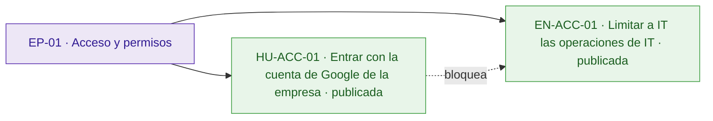
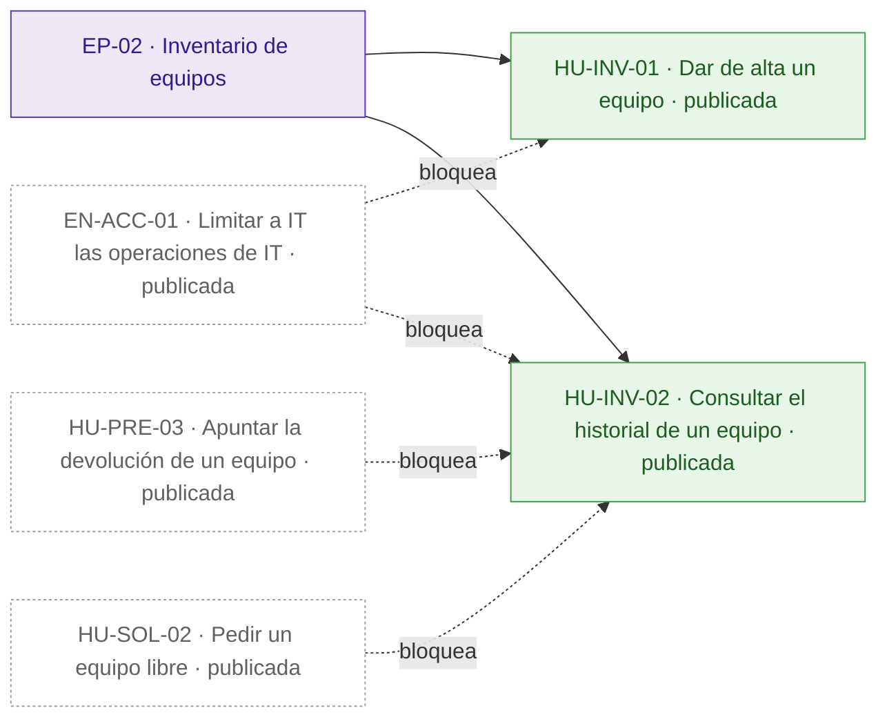
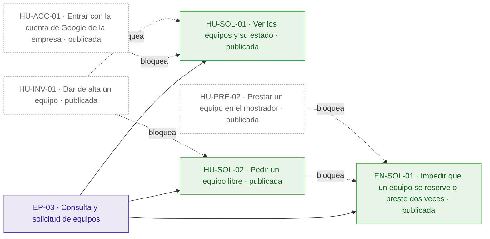
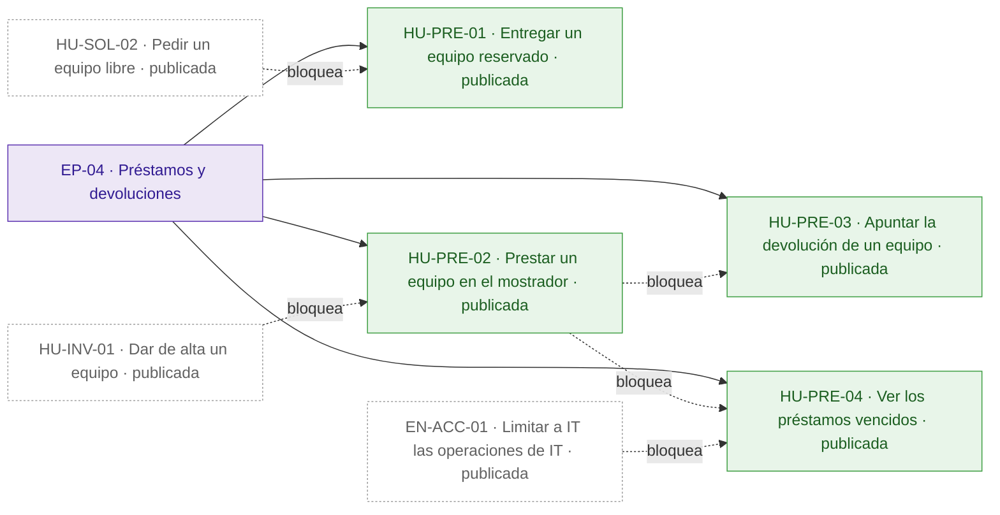
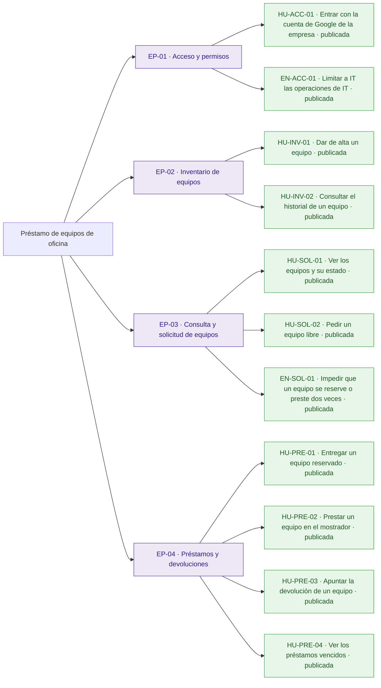
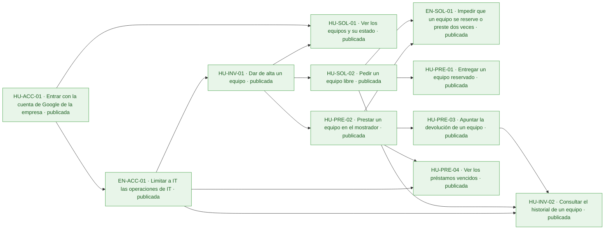
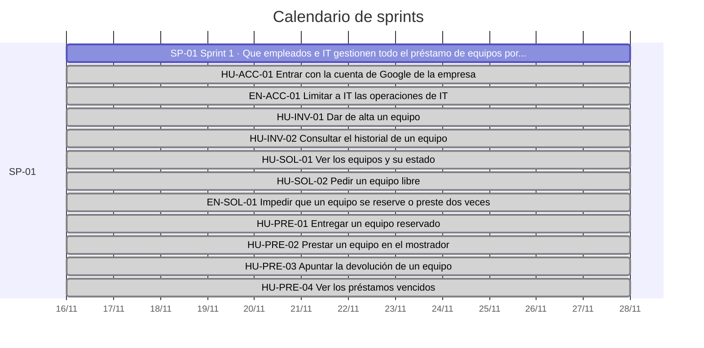
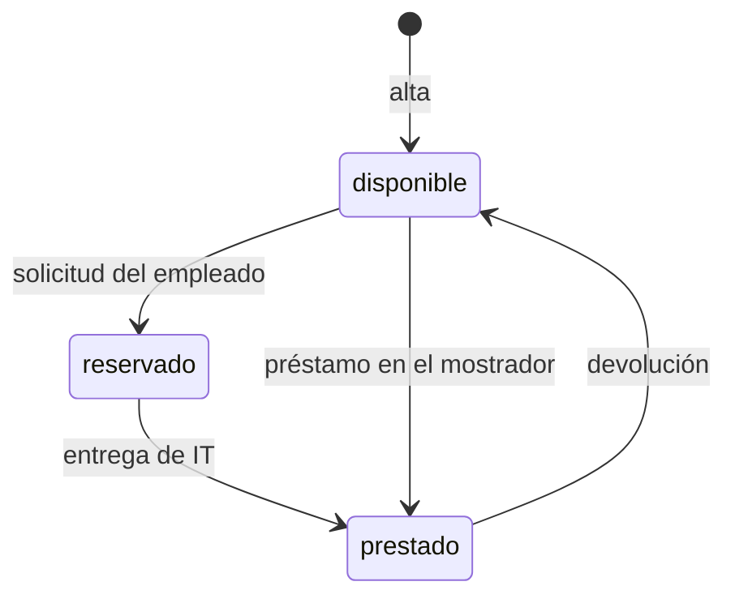

# Préstamo de equipos de oficina

Hoy los préstamos de portátiles, monitores y proyectores se apuntan en una hoja de cálculo y se piden por correo a IT: nadie sabe qué está libre sin preguntar, dos personas acaban esperando el mismo portátil y los préstamos vencidos pasan inadvertidos.

La aplicación permite a los empleados ver los equipos y pedir uno libre, y a IT dar de alta equipos, entregarlos, prestarlos en el mostrador, apuntar devoluciones y revisar vencidos e historial. Todos entran con su cuenta de Google de la empresa y el inventario de IT se conecta por una API que tiene que ser exactamente la del anexo. Quedan fuera la anulación de solicitudes por los empleados y los avisos por correo de vencidos.

## Visión y alcance

Que los empleados vean qué equipos de la oficina están libres y los pidan prestados, y que IT gestione altas, entregas, devoluciones y vencidos sin hojas de cálculo ni correos, sin que ningún equipo se preste dos veces.

**Dentro del alcance**

- Cualquier empleado ve los equipos y su estado (\`disponible\`, \`reservado\` o \`prestado\`); si está reservado o prestado, también la persona que lo tiene y la fecha de devolución (peticion.md).
- Un empleado pide un equipo libre indicando la fecha de devolución; el equipo queda reservado a su nombre hasta que IT se lo entrega (peticion.md).
- IT da de alta equipos con un nombre obligatorio; no se admiten dos equipos con el mismo nombre, sin distinguir mayúsculas ni espacios al principio o al final (peticion.md).
- IT entrega un equipo reservado: pasa a prestado con la misma persona y fecha de devolución de la solicitud (peticion.md).
- IT presta directamente en el mostrador un equipo disponible a la persona indicada, con su fecha de devolución (peticion.md).
- IT apunta la devolución de un equipo prestado: vuelve a disponible, sin persona ni fecha de devolución (peticion.md).
- IT ve los préstamos vencidos: los equipos prestados cuya fecha de devolución es anterior a hoy, del más antiguo al más reciente (peticion.md).
- IT consulta el historial de préstamos de cada equipo, del más reciente al más antiguo, con persona, fecha de devolución y estado (\`reservado\`, \`prestado\` o \`devuelto\`) (peticion.md).
- La fecha de devolución va como texto \`AAAA-MM-DD\`, tiene que existir y «hoy» es el día en Madrid; quien pide un equipo no puede poner una fecha anterior a hoy, pero IT sí cuando presta en el mostrador, y ese préstamo aparece ya entre los vencidos (peticion.md).
- Un equipo no puede estar reservado o prestado dos veces a la vez: si llegan dos peticiones a la vez para el mismo equipo disponible, sean solicitudes o préstamos en el mostrador, una sale bien y la otra recibe 409 «El equipo no está disponible» (peticion.md).

**Fuera del alcance**

- Que los empleados anulen una solicitud (peticion.md).
- Avisos por correo de préstamos vencidos (peticion.md).

## Resumen en cifras

| Dato | Valor |
| --- | --- |
| Épicas | 4 |
| Historias | 11 |
| Historias por estado | borrador 0, aprobada 0, descartada 0, publicada 11 |
| Tareas | 27 |
| Sprints | 1 |
| Personas en el equipo | 1 |
| Modalidad de desarrollo | manual, sin IA |
| Horas estimadas | 56 h |
| Horas efectivas (según la modalidad de desarrollo) | 56 h |
| Historias sin estimar | 0 |
| Historias descartadas (fuera de las horas) | 0 |
| Supuestos | 12 |
| Preguntas abiertas | 5 |
| Requisitos | 13 |
| Requisitos sin historia | 0 |

## Índice

- [Visión y alcance](#visión-y-alcance)
- [Resumen en cifras](#resumen-en-cifras)
- [Épicas e historias](#épicas-e-historias)
  - [EP-01 · Acceso y permisos](#ep-01--acceso-y-permisos)
  - [EP-02 · Inventario de equipos](#ep-02--inventario-de-equipos)
  - [EP-03 · Consulta y solicitud de equipos](#ep-03--consulta-y-solicitud-de-equipos)
  - [EP-04 · Préstamos y devoluciones](#ep-04--préstamos-y-devoluciones)
- [Tareas](#tareas)
- [Sprints](#sprints)
- [Equipo](#equipo)
- [Dependencias](#dependencias)
- [Requisitos y trazabilidad](#requisitos-y-trazabilidad)
- [Preparación y definición de hecho](#preparación-y-definición-de-hecho)
- [Diagramas](#diagramas)
- [Supuestos](#supuestos)
- [Preguntas abiertas](#preguntas-abiertas)
- [Decisiones](#decisiones)

## Épicas e historias

### EP-01 · Acceso y permisos

Garantiza que solo entran las cuentas de Google válidas, de personas o de la cuenta de servicio del inventario, y que solo las cuentas de IT hacen las operaciones de IT. Protege frente al riesgo de que un empleado haga lo que solo le toca a IT. No incluye ninguna gestión de usuarios dentro de la aplicación: la lista de IT se fija en el despliegue.

#### Épica EP-01: Acceso y permisos

#### HU-ACC-01 · Entrar con la cuenta de Google de la empresa

Como empleado, quiero usar la aplicación con mi cuenta de Google de la empresa, para que cada reserva y cada préstamo queden a nombre de quien los hace sin crear otra contraseña.

**Contexto.** Cubre RQ.011 (peticion.md): todos entran con su cuenta de Google de la empresa y todas las rutas de la API exigen sesión. Es la base de las demás historias, porque la persona de cada operación es el correo del token.

- **Prioridad:** Highest
- **Tamaño:** L
- **Horas:** 8 h estimadas · 8 h efectivas
- **Estado:** publicada
- **Sprint:** SP-01 Sprint 1
- **Responsable:** José Luis Calvo
- **Tipo:** historia
- **Puntos de historia:** 5
- **Preparación:** parcialmente lista (pendiente: DoR-08: dependencias externas sin plan confirmado: Cliente OAuth de Google de la aplicación · supuestos sin confirmar: DoR-04, DoR-05, DoR-06, DoR-07, DoR-09)
- **Requisitos:** RQ.011, RQ.013
- **Dependencias externas:** Cliente OAuth de Google de la aplicación

**Criterios de aceptación**

*Escenarios positivos*

1. **Dado** un empleado con un token de identidad de Google de «ana.perez@empresa.com», con el correo verificado y emitido para el cliente OAuth de la aplicación, y el equipo «Portátil 07» disponible, **cuando** pide \`POST /api/equipos/{id}/solicitud\` de «Portátil 07» con \`{"devolucion": "2026-11-20"}\`, **entonces** recibe 201 con \`persona\` «ana.perez@empresa.com».
2. **Dado** la cuenta de servicio del inventario de IT con un token de identidad de Google válido, con el correo verificado y emitido para el cliente OAuth de la aplicación, **cuando** pide \`GET /api/equipos\`, **entonces** recibe 200 con la lista de equipos.

*Escenarios negativos*

1. **Dado** una petición sin token de identidad, **cuando** pide \`GET /api/prestamos/vencidos\`, **entonces** recibe 401 con \`{"error": "Inicia sesión con Google."}\`.
2. **Dado** un token de identidad de Google de «luis.gomez@empresa.com» con el correo sin verificar, **cuando** pide \`GET /api/equipos\`, **entonces** recibe 401 con \`{"error": "Inicia sesión con Google."}\`.
3. **Dado** un token de identidad de Google de «ana.perez@empresa.com» emitido para otro cliente OAuth, **cuando** pide \`GET /api/equipos\`, **entonces** recibe 401 con \`{"error": "Inicia sesión con Google."}\`.

**Notas.** Si además hay que limitar el acceso al dominio de Google de la empresa sigue como pregunta abierta; los criterios solo validan el token.

**Definición de hecho**

- Criterios de aceptación probados.
- Mensajes de error idénticos a los del anexo de la API.

**Tareas**

- TA-001 · Validación del token de identidad de Google y obtención del correo de la operación · backend · José Luis Calvo
- TA-002 · Pruebas con token válido, sin token, con correo sin verificar, de otro cliente y de cuenta de servicio · QA · José Luis Calvo

#### EN-ACC-01 · Limitar a IT las operaciones de IT

Como equipo, necesitamos restringir a las cuentas de \`CORREOS\_IT\` las operaciones marcadas «Solo IT», para que ningún empleado pueda dar de alta, entregar, prestar, apuntar devoluciones ni consultar vencidos e historial.

**Contexto.** Cubre RQ.012 (peticion.md): las cuentas de IT son las de la variable de entorno \`CORREOS\_IT\`, fijada en la configuración del despliegue y no en el código, y los correos se comparan sin distinguir mayúsculas. Responde al riesgo de que un empleado haga lo que solo le toca a IT.

- **Prioridad:** Highest
- **Tamaño:** M
- **Horas:** 4 h estimadas · 4 h efectivas
- **Estado:** publicada
- **Sprint:** SP-01 Sprint 1
- **Responsable:** José Luis Calvo
- **Tipo:** habilitador (enabler)
- **Puntos de historia:** 3
- **Preparación:** parcialmente lista (pendiente: DoR-08: depende de HU-ACC-01, sin resolver ni planificada en un sprint anterior · supuestos sin confirmar: DoR-04, DoR-05, DoR-06, DoR-07, DoR-09)
- **Requisitos:** RQ.012, RQ.013
- **Depende de:**
  - HU-ACC-01 · Entrar con la cuenta de Google de la empresa: Saber si una cuenta es de IT exige conocer antes el correo del token.

**Criterios de aceptación**

*Escenarios positivos*

1. **Dado** la variable \`CORREOS\_IT\` con «it@empresa.com,inventario@empresa.com» y un técnico de IT con sesión de «IT@empresa.com», **cuando** pide \`GET /api/prestamos/vencidos\`, **entonces** recibe 200 con la lista de préstamos vencidos.
2. **Dado** la misma \`CORREOS\_IT\` y la cuenta de servicio «inventario@empresa.com» con sesión, ante el equipo «Monitor 03» disponible, **cuando** pide \`POST /api/equipos/{id}/solicitud\` de «Monitor 03» con \`{"devolucion": "2026-11-20"}\`, **entonces** recibe 201 con \`estado: "reservado"\` y \`persona\` «inventario@empresa.com».

*Escenarios negativos*

1. **Dado** la misma \`CORREOS\_IT\` y un empleado con sesión de «ana.perez@empresa.com», **cuando** pide \`POST /api/equipos\` con \`{"nombre": "Portátil 08"}\`, **entonces** recibe 403 con \`{"error": "Solo IT puede hacer esto."}\` y no se crea ningún equipo.

**Definición de hecho**

- Criterios de aceptación probados.
- La lista de cuentas de IT no aparece en el código.
- Mensajes de error idénticos a los del anexo de la API.

**Tareas**

- TA-003 · Lectura de CORREOS\_IT y control de las operaciones «Solo IT» · backend · José Luis Calvo
- TA-004 · Pruebas de permisos con cuentas de IT, de empleado y de la cuenta de servicio · QA · José Luis Calvo

### EP-02 · Inventario de equipos

Permite a IT dar de alta los equipos de la oficina sin nombres repetidos y consultar el historial de préstamos de cada uno. Las entregas, préstamos y devoluciones están en la épica de préstamos y devoluciones.

#### Épica EP-02: Inventario de equipos

#### HU-INV-01 · Dar de alta un equipo

Como técnico de IT, quiero dar de alta un equipo con su nombre, para que los empleados lo vean y puedan pedirlo sin preguntar a IT.

**Contexto.** Cubre RQ.003 (peticion.md): IT da de alta los equipos; dos nombres son el mismo si solo se diferencian en mayúsculas o en espacios al principio o al final.

- **Prioridad:** Highest
- **Tamaño:** M
- **Horas:** 4 h estimadas · 4 h efectivas
- **Estado:** publicada
- **Sprint:** SP-01 Sprint 1
- **Responsable:** José Luis Calvo
- **Tipo:** historia
- **Puntos de historia:** 3
- **Preparación:** parcialmente lista (pendiente: DoR-08: depende de EN-ACC-01, sin resolver ni planificada en un sprint anterior · supuestos sin confirmar: DoR-04, DoR-05, DoR-06, DoR-07, DoR-09)
- **Requisitos:** RQ.003, RQ.013
- **Depende de:**
  - EN-ACC-01 · Limitar a IT las operaciones de IT: Dar de alta es una operación «Solo IT».

**Criterios de aceptación**

*Escenarios positivos*

1. **Dado** un técnico de IT con sesión y ningún equipo llamado «Portátil 07», **cuando** pide \`POST /api/equipos\` con \`{"nombre": "Portátil 07"}\`, **entonces** recibe 201 con \`{"id": "…", "nombre": "Portátil 07", "estado": "disponible"}\`.

*Escenarios negativos*

1. **Dado** un técnico de IT con sesión, **cuando** pide \`POST /api/equipos\` con \`{"nombre": ""}\`, **entonces** recibe 400 con \`{"error": "Falta el nombre del equipo"}\` y no se crea ningún equipo.
2. **Dado** un técnico de IT con sesión y el equipo «Portátil 07» ya dado de alta, **cuando** pide \`POST /api/equipos\` con \`{"nombre": " portátil 07 "}\`, **entonces** recibe 409 con \`{"error": "Ya hay un equipo con ese nombre"}\` y sigue habiendo un solo «Portátil 07».

**Definición de hecho**

- Criterios de aceptación probados.
- Mensajes de error idénticos a los del anexo de la API.

**Tareas**

- TA-005 · Modelo de equipo con nombre normalizado único · datos · José Luis Calvo
- TA-006 · Operación de alta de equipos con sus errores · backend · José Luis Calvo
- TA-007 · Pruebas de alta, nombre vacío y nombre repetido · QA · José Luis Calvo

#### HU-INV-02 · Consultar el historial de un equipo

Como técnico de IT, quiero consultar el historial de préstamos de un equipo, para saber quién ha tenido el equipo y cuándo debía devolverlo.

**Contexto.** Cubre RQ.008 (peticion.md): IT consulta el historial de cada equipo, del más reciente al más antiguo, con persona, fecha de devolución y estado.

- **Prioridad:** High
- **Tamaño:** M
- **Horas:** 4 h estimadas · 4 h efectivas
- **Estado:** publicada
- **Sprint:** SP-01 Sprint 1
- **Responsable:** José Luis Calvo
- **Tipo:** historia
- **Puntos de historia:** 3
- **Preparación:** parcialmente lista (pendiente: DoR-08: depende de HU-PRE-03, sin resolver ni planificada en un sprint anterior · supuestos sin confirmar: DoR-04, DoR-05, DoR-06, DoR-07, DoR-09)
- **Requisitos:** RQ.008, RQ.013
- **Depende de:**
  - HU-PRE-03 · Apuntar la devolución de un equipo: El estado \`devuelto\` del historial nace al apuntar la devolución.
  - HU-SOL-02 · Pedir un equipo libre: El historial incluye una reserva, y solo la solicitud del empleado crea reservas.
  - EN-ACC-01 · Limitar a IT las operaciones de IT: El escenario de permisos exige el 403 de las cuentas que no están en CORREOS\_IT.

**Criterios de aceptación**

*Escenarios positivos*

1. **Dado** un técnico de IT con sesión y el equipo «Portátil 07», prestado antes a «luis.gomez@empresa.com» con devolución «2026-11-10» y ya devuelto, y ahora reservado por «ana.perez@empresa.com» con devolución «2026-11-20», **cuando** pide \`GET /api/equipos/{id}/historial\` de «Portátil 07», **entonces** recibe 200 con dos préstamos en este orden: «ana.perez@empresa.com», «2026-11-20», \`reservado\`; y «luis.gomez@empresa.com», «2026-11-10», \`devuelto\`.

*Escenarios negativos*

1. **Dado** un técnico de IT con sesión, **cuando** pide \`GET /api/equipos/{id}/historial\` con un id que no corresponde a ningún equipo, **entonces** recibe 404 con \`{"error": "No existe el equipo"}\`.
2. **Dado** un empleado con sesión de «ana.perez@empresa.com», que no está en \`CORREOS\_IT\`, **cuando** pide \`GET /api/equipos/{id}/historial\` de «Portátil 07», **entonces** recibe 403 con \`{"error": "Solo IT puede hacer esto."}\`.

**Notas.** \[SUPUESTO\] Cada préstamo del historial pasa por \`reservado\` o \`prestado\` y termina en \`devuelto\` al apuntar la devolución; el anexo no detalla las transiciones.

**Definición de hecho**

- Criterios de aceptación probados.
- Mensajes de error idénticos a los del anexo de la API.

**Tareas**

- TA-008 · Registro de los préstamos de cada equipo con su estado · datos · José Luis Calvo
- TA-009 · Operación de historial ordenada del más reciente al más antiguo · backend · José Luis Calvo
- TA-010 · Pruebas del orden del historial, equipo inexistente y permisos · QA · José Luis Calvo

### EP-03 · Consulta y solicitud de equipos

Permite a cualquier empleado ver qué equipos hay y en qué estado están, y pedir uno libre con su fecha de devolución, sin que un equipo pueda reservarse o prestarse dos veces a la vez. Los empleados no pueden anular una solicitud: queda fuera del alcance.

#### Épica EP-03: Consulta y solicitud de equipos

#### HU-SOL-01 · Ver los equipos y su estado

Como empleado, quiero ver la lista de equipos con su estado, para saber qué está libre sin escribir a IT.

**Contexto.** Cubre RQ.001 (peticion.md): cualquier empleado ve los equipos y su estado. Responde al problema de que hoy no se sabe qué está libre sin preguntar.

- **Prioridad:** Highest
- **Tamaño:** M
- **Horas:** 4 h estimadas · 4 h efectivas
- **Estado:** publicada
- **Sprint:** SP-01 Sprint 1
- **Responsable:** José Luis Calvo
- **Tipo:** historia
- **Puntos de historia:** 3
- **Preparación:** parcialmente lista (pendiente: DoR-08: depende de HU-ACC-01, HU-INV-01, sin resolver ni planificada en un sprint anterior · supuestos sin confirmar: DoR-04, DoR-05, DoR-06, DoR-07, DoR-09)
- **Requisitos:** RQ.001, RQ.013
- **Depende de:**
  - HU-ACC-01 · Entrar con la cuenta de Google de la empresa: La lista exige sesión iniciada.
  - HU-INV-01 · Dar de alta un equipo: Sin equipos dados de alta la lista está vacía.

**Criterios de aceptación**

*Escenarios positivos*

1. **Dado** un empleado con sesión, el equipo «Portátil 07» disponible y el equipo «Monitor 03» prestado a «luis.gomez@empresa.com» con devolución «2026-11-20», **cuando** pide \`GET /api/equipos\`, **entonces** recibe 200 con «Portátil 07» en estado \`disponible\` sin \`persona\` ni \`devolucion\`, y «Monitor 03» en estado \`prestado\` con \`persona\` «luis.gomez@empresa.com» y \`devolucion\` «2026-11-20».

*Escenarios negativos*

1. **Dado** una petición sin token de identidad, **cuando** pide \`GET /api/equipos\`, **entonces** recibe 401 con \`{"error": "Inicia sesión con Google."}\` y ningún equipo.

**Notas.** \[SUPUESTO\] Cualquier empleado ve la persona y la fecha de devolución de los equipos que tienen otros, porque la operación es para todos y devuelve esos campos.

**Definición de hecho**

- Criterios de aceptación probados.
- Respuesta con los campos exactos del anexo de la API.

**Tareas**

- TA-011 · Operación de lista de equipos con persona y devolución · backend · José Luis Calvo
- TA-012 · Pruebas de la lista con equipos en cada estado · QA · José Luis Calvo

#### HU-SOL-02 · Pedir un equipo libre

Como empleado, quiero pedir un equipo disponible indicando la fecha en que lo devolveré, para tenerlo apartado a mi nombre hasta que IT me lo entregue, sin escribir correos.

**Contexto.** Cubre RQ.002 y RQ.009 (peticion.md): el empleado pide un equipo libre con la fecha de devolución, que debe ser una fecha real \`AAAA-MM-DD\` no anterior a hoy en Madrid, y el equipo queda reservado a su nombre hasta que IT se lo entrega.

- **Prioridad:** Highest
- **Tamaño:** L
- **Horas:** 8 h estimadas · 8 h efectivas
- **Estado:** publicada
- **Sprint:** SP-01 Sprint 1
- **Responsable:** José Luis Calvo
- **Tipo:** historia
- **Puntos de historia:** 5
- **Preparación:** parcialmente lista (pendiente: DoR-08: depende de HU-INV-01, sin resolver ni planificada en un sprint anterior · supuestos sin confirmar: DoR-04, DoR-05, DoR-06, DoR-07, DoR-09)
- **Requisitos:** RQ.002, RQ.009, RQ.013
- **Depende de:**
  - HU-INV-01 · Dar de alta un equipo: Solo se puede pedir un equipo dado de alta.

**Criterios de aceptación**

*Escenarios positivos*

1. **Dado** el día 2026-11-15 en Madrid, un empleado con sesión de «ana.perez@empresa.com» y el equipo «Portátil 07» disponible, **cuando** pide \`POST /api/equipos/{id}/solicitud\` de «Portátil 07» con \`{"devolucion": "2026-11-20"}\`, **entonces** recibe 201 con el equipo en \`estado: "reservado"\`, \`persona\` «ana.perez@empresa.com» y \`devolucion\` «2026-11-20».

*Escenarios negativos*

1. **Dado** el día 2026-11-15 en Madrid, un empleado con sesión y el equipo «Portátil 07» disponible, **cuando** pide la solicitud de «Portátil 07» con \`{"devolucion": "2026-11-14"}\`, **entonces** recibe 400 con \`{"error": "La fecha de devolución ya ha pasado"}\` y el equipo sigue \`disponible\`.
2. **Dado** un empleado con sesión y el equipo «Portátil 07» disponible, **cuando** pide la solicitud de «Portátil 07» con \`{"devolucion": "2026-02-30"}\`, **entonces** recibe 400 con \`{"error": "La fecha de devolución no es válida"}\` y el equipo sigue \`disponible\`.
3. **Dado** un empleado con sesión y el equipo «Portátil 07» disponible, **cuando** pide la solicitud de «Portátil 07» con el cuerpo \`{}\`, **entonces** recibe 400 con \`{"error": "Falta la fecha de devolución"}\`.
4. **Dado** un empleado con sesión y el equipo «Monitor 03» reservado por «luis.gomez@empresa.com», **cuando** pide la solicitud de «Monitor 03» con \`{"devolucion": "2026-11-20"}\`, **entonces** recibe 409 con \`{"error": "El equipo no está disponible"}\` y «Monitor 03» sigue reservado por «luis.gomez@empresa.com».
5. **Dado** un empleado con sesión, **cuando** pide la solicitud de un id que no corresponde a ningún equipo con \`{"devolucion": "2026-11-20"}\`, **entonces** recibe 404 con \`{"error": "No existe el equipo"}\`.

**Notas.** Qué pasa con una reserva que IT no entrega nunca y si hay un plazo máximo de devolución siguen como preguntas abiertas. Los empleados no pueden anular la solicitud.

**Definición de hecho**

- Criterios de aceptación probados.
- «Hoy» calculado con la zona horaria de Madrid.
- Mensajes de error idénticos a los del anexo de la API.

**Tareas**

- TA-013 · Estado de reserva del equipo con persona y fecha de devolución · datos · José Luis Calvo
- TA-014 · Operación de solicitud con validación de la fecha en la zona de Madrid · backend · José Luis Calvo
- TA-015 · Pruebas de solicitud, fechas pasadas, inexistentes o ausentes, equipo ocupado o inexistente · QA · José Luis Calvo

#### EN-SOL-01 · Impedir que un equipo se reserve o preste dos veces

Como equipo, necesitamos garantizar que un equipo no se reserva ni se presta dos veces con peticiones simultáneas, para que ningún empleado vaya a recoger un equipo que también está a nombre de otra persona.

**Contexto.** Cubre RQ.010 (peticion.md): un equipo no puede estar reservado o prestado dos veces a la vez, ni siquiera si dos personas lo piden en el mismo momento. Es lo más importante para el cliente y una de sus métricas de éxito.

- **Prioridad:** Highest
- **Tamaño:** L
- **Horas:** 8 h estimadas · 8 h efectivas
- **Estado:** publicada
- **Sprint:** SP-01 Sprint 1
- **Responsable:** José Luis Calvo
- **Tipo:** habilitador (enabler)
- **Puntos de historia:** 5
- **Preparación:** parcialmente lista (pendiente: DoR-08: depende de HU-SOL-02, HU-PRE-02, sin resolver ni planificada en un sprint anterior · supuestos sin confirmar: DoR-04, DoR-05, DoR-06, DoR-07, DoR-09)
- **Requisitos:** RQ.010, RQ.013
- **Depende de:**
  - HU-SOL-02 · Pedir un equipo libre: La concurrencia se prueba sobre la solicitud del empleado.
  - HU-PRE-02 · Prestar un equipo en el mostrador: La concurrencia también se prueba sobre el préstamo en el mostrador.

**Criterios de aceptación**

*Escenarios positivos*

1. **Dado** el equipo «Portátil 07» disponible y dos solicitudes simultáneas, de «ana.perez@empresa.com» y de «luis.gomez@empresa.com», con devolución «2026-11-20», **cuando** llegan las dos a \`POST /api/equipos/{id}/solicitud\` a la vez, **entonces** una recibe 201 con \`estado: "reservado"\` y la otra 409 con \`{"error": "El equipo no está disponible"}\`, y el equipo queda a nombre de una sola persona.
2. **Dado** el equipo «Monitor 03» disponible, una solicitud de «ana.perez@empresa.com» y un préstamo en el mostrador de IT a «luis.gomez@empresa.com», ambos con devolución «2026-11-20», **cuando** llegan las dos peticiones a la vez, **entonces** una recibe 201 con el equipo reservado o prestado a su persona y la otra recibe 409 con \`{"error": "El equipo no está disponible"}\`.

*Escenarios negativos*

1. **Dado** el equipo «Portátil 07» ya reservado por «ana.perez@empresa.com» y un técnico de IT con sesión, **cuando** pide \`POST /api/equipos/{id}/prestamo\` de «Portátil 07» con \`{"persona": "luis.gomez@empresa.com", "devolucion": "2026-11-20"}\`, **entonces** recibe 409 con \`{"error": "El equipo no está disponible"}\` y «Portátil 07» sigue reservado por «ana.perez@empresa.com».

**Definición de hecho**

- Criterios de aceptación probados con peticiones realmente simultáneas.
- Mensajes de error idénticos a los del anexo de la API.

**Tareas**

- TA-016 · Cambio de estado atómico del equipo en solicitudes y préstamos · datos · José Luis Calvo
- TA-017 · Respuesta 409 a la petición que pierde la carrera · backend · José Luis Calvo
- TA-018 · Pruebas de peticiones simultáneas sobre el mismo equipo · QA · José Luis Calvo

### EP-04 · Préstamos y devoluciones

Permite a IT entregar los equipos reservados, prestar en el mostrador, apuntar las devoluciones y revisar los préstamos vencidos sin preguntar a nadie. No incluye avisos por correo de préstamos vencidos, que quedan fuera del alcance.

#### Épica EP-04: Préstamos y devoluciones

#### HU-PRE-01 · Entregar un equipo reservado

Como técnico de IT, quiero apuntar que entrego un equipo reservado a quien lo pidió, para que conste como prestado con la fecha de devolución acordada y cuente para los vencidos.

**Contexto.** Cubre RQ.004 (peticion.md): IT entrega los equipos reservados, que pasan a prestados con la misma persona y fecha de devolución de la solicitud.

- **Prioridad:** Highest
- **Tamaño:** M
- **Horas:** 4 h estimadas · 4 h efectivas
- **Estado:** publicada
- **Sprint:** SP-01 Sprint 1
- **Responsable:** José Luis Calvo
- **Tipo:** historia
- **Puntos de historia:** 3
- **Preparación:** parcialmente lista (pendiente: DoR-08: depende de HU-SOL-02, sin resolver ni planificada en un sprint anterior · supuestos sin confirmar: DoR-04, DoR-05, DoR-06, DoR-07, DoR-09)
- **Requisitos:** RQ.004, RQ.013
- **Depende de:**
  - HU-SOL-02 · Pedir un equipo libre: Solo se entrega un equipo que un empleado ha reservado.

**Criterios de aceptación**

*Escenarios positivos*

1. **Dado** un técnico de IT con sesión y el equipo «Portátil 07» reservado por «ana.perez@empresa.com» con devolución «2026-11-20», **cuando** pide \`POST /api/equipos/{id}/entrega\` de «Portátil 07», **entonces** recibe 200 con el equipo en \`estado: "prestado"\`, \`persona\` «ana.perez@empresa.com» y \`devolucion\` «2026-11-20».

*Escenarios negativos*

1. **Dado** un técnico de IT con sesión y el equipo «Monitor 03» disponible, **cuando** pide la entrega de «Monitor 03», **entonces** recibe 409 con \`{"error": "El equipo no está reservado"}\` y el equipo sigue \`disponible\`.
2. **Dado** un técnico de IT con sesión, **cuando** pide la entrega de un id que no corresponde a ningún equipo, **entonces** recibe 404 con \`{"error": "No existe el equipo"}\`.

**Definición de hecho**

- Criterios de aceptación probados.
- Mensajes de error idénticos a los del anexo de la API.

**Tareas**

- TA-019 · Operación de entrega de un equipo reservado · backend · José Luis Calvo
- TA-020 · Pruebas de entrega, equipo no reservado e inexistente · QA · José Luis Calvo

#### HU-PRE-02 · Prestar un equipo en el mostrador

Como técnico de IT, quiero prestar directamente un equipo disponible a quien viene al mostrador, para que también los préstamos sin solicitud previa queden registrados en la aplicación.

**Contexto.** Cubre RQ.005 y RQ.009 (peticion.md): IT presta directamente a quien viene al mostrador y, a diferencia del empleado, puede poner una fecha de devolución anterior a hoy porque a veces apunta los préstamos con retraso.

- **Prioridad:** Highest
- **Tamaño:** M
- **Horas:** 4 h estimadas · 4 h efectivas
- **Estado:** publicada
- **Sprint:** SP-01 Sprint 1
- **Responsable:** José Luis Calvo
- **Tipo:** historia
- **Puntos de historia:** 3
- **Preparación:** parcialmente lista (pendiente: DoR-08: depende de HU-INV-01, sin resolver ni planificada en un sprint anterior · supuestos sin confirmar: DoR-04, DoR-05, DoR-06, DoR-07, DoR-09)
- **Requisitos:** RQ.005, RQ.009, RQ.013
- **Depende de:**
  - HU-INV-01 · Dar de alta un equipo: Solo se presta un equipo dado de alta.

**Criterios de aceptación**

*Escenarios positivos*

1. **Dado** un técnico de IT con sesión y el equipo «Proyector 01» disponible, **cuando** pide \`POST /api/equipos/{id}/prestamo\` de «Proyector 01» con \`{"persona": "ana.perez@empresa.com", "devolucion": "2026-11-20"}\`, **entonces** recibe 201 con el equipo en \`estado: "prestado"\`, \`persona\` «ana.perez@empresa.com» y \`devolucion\` «2026-11-20».
2. **Dado** el día 2026-11-15 en Madrid, un técnico de IT con sesión que apunta con retraso un préstamo y el equipo «Proyector 01» disponible, **cuando** pide el préstamo de «Proyector 01» con \`{"persona": "luis.gomez@empresa.com", "devolucion": "2026-11-10"}\`, **entonces** recibe 201 con el equipo prestado y «Proyector 01» aparece ya en \`GET /api/prestamos/vencidos\`.

*Escenarios negativos*

1. **Dado** un técnico de IT con sesión y el equipo «Proyector 01» disponible, **cuando** pide el préstamo de «Proyector 01» con \`{"devolucion": "2026-11-20"}\`, **entonces** recibe 400 con \`{"error": "Faltan la persona o la fecha de devolución"}\` y el equipo sigue \`disponible\`.
2. **Dado** un técnico de IT con sesión y el equipo «Proyector 01» disponible, **cuando** pide el préstamo de «Proyector 01» con \`{"persona": "ana.perez@empresa.com", "devolucion": "2026-02-30"}\`, **entonces** recibe 400 con \`{"error": "La fecha de devolución no es válida"}\`.
3. **Dado** un técnico de IT con sesión y el equipo «Monitor 03» reservado por «luis.gomez@empresa.com», **cuando** pide el préstamo de «Monitor 03» con \`{"persona": "ana.perez@empresa.com", "devolucion": "2026-11-20"}\`, **entonces** recibe 409 con \`{"error": "El equipo no está disponible"}\` y «Monitor 03» sigue reservado por «luis.gomez@empresa.com».
4. **Dado** un técnico de IT con sesión, **cuando** pide el préstamo de un id que no corresponde a ningún equipo con \`{"persona": "ana.perez@empresa.com", "devolucion": "2026-11-20"}\`, **entonces** recibe 404 con \`{"error": "No existe el equipo"}\`.

**Definición de hecho**

- Criterios de aceptación probados.
- Mensajes de error idénticos a los del anexo de la API.

**Tareas**

- TA-021 · Operación de préstamo en el mostrador con fecha pasada permitida · backend · José Luis Calvo
- TA-022 · Pruebas de préstamo, datos que faltan, fecha inexistente y equipo ocupado o inexistente · QA · José Luis Calvo

#### HU-PRE-03 · Apuntar la devolución de un equipo

Como técnico de IT, quiero apuntar que un equipo prestado se ha devuelto, para que vuelva a estar libre para el siguiente empleado y deje de contar como vencido.

**Contexto.** Cubre RQ.006 (peticion.md): IT apunta las devoluciones y el equipo vuelve a estar disponible.

- **Prioridad:** Highest
- **Tamaño:** M
- **Horas:** 4 h estimadas · 4 h efectivas
- **Estado:** publicada
- **Sprint:** SP-01 Sprint 1
- **Responsable:** José Luis Calvo
- **Tipo:** historia
- **Puntos de historia:** 3
- **Preparación:** parcialmente lista (pendiente: DoR-08: depende de HU-PRE-02, sin resolver ni planificada en un sprint anterior · supuestos sin confirmar: DoR-04, DoR-05, DoR-06, DoR-07, DoR-09)
- **Requisitos:** RQ.006, RQ.013
- **Depende de:**
  - HU-PRE-02 · Prestar un equipo en el mostrador: Solo se devuelve un equipo prestado.

**Criterios de aceptación**

*Escenarios positivos*

1. **Dado** un técnico de IT con sesión y el equipo «Portátil 07» prestado a «ana.perez@empresa.com» con devolución «2026-11-20», **cuando** pide \`POST /api/equipos/{id}/devolucion\` de «Portátil 07», **entonces** recibe 200 con el equipo en \`estado: "disponible"\`, sin \`persona\` ni \`devolucion\`.

*Escenarios negativos*

1. **Dado** un técnico de IT con sesión y el equipo «Monitor 03» reservado por «luis.gomez@empresa.com», todavía sin entregar, **cuando** pide la devolución de «Monitor 03», **entonces** recibe 409 con \`{"error": "El equipo no está prestado"}\` y «Monitor 03» sigue reservado.
2. **Dado** un técnico de IT con sesión, **cuando** pide la devolución de un id que no corresponde a ningún equipo, **entonces** recibe 404 con \`{"error": "No existe el equipo"}\`.

**Definición de hecho**

- Criterios de aceptación probados.
- Mensajes de error idénticos a los del anexo de la API.

**Tareas**

- TA-023 · Cierre del préstamo como devuelto en el historial · datos · José Luis Calvo
- TA-024 · Operación de devolución de un equipo prestado · backend · José Luis Calvo
- TA-025 · Pruebas de devolución, equipo no prestado e inexistente · QA · José Luis Calvo

#### HU-PRE-04 · Ver los préstamos vencidos

Como técnico de IT, quiero ver los préstamos cuya fecha de devolución ya ha pasado, para reclamar los equipos cada semana sin esperar a que alguien los eche en falta.

**Contexto.** Cubre RQ.007 (peticion.md): IT ve qué préstamos han vencido, del más antiguo al más reciente. Responde a la métrica de éxito de que IT revise los vencidos cada semana sin preguntar a nadie.

- **Prioridad:** Highest
- **Tamaño:** M
- **Horas:** 4 h estimadas · 4 h efectivas
- **Estado:** publicada
- **Sprint:** SP-01 Sprint 1
- **Responsable:** José Luis Calvo
- **Tipo:** historia
- **Puntos de historia:** 3
- **Preparación:** parcialmente lista (pendiente: DoR-08: depende de HU-PRE-02, sin resolver ni planificada en un sprint anterior · supuestos sin confirmar: DoR-04, DoR-05, DoR-06, DoR-07, DoR-09)
- **Requisitos:** RQ.007, RQ.013
- **Depende de:**
  - HU-PRE-02 · Prestar un equipo en el mostrador: Los vencidos son equipos prestados.
  - EN-ACC-01 · Limitar a IT las operaciones de IT: El escenario de permisos exige el 403 de las cuentas que no están en CORREOS\_IT.

**Criterios de aceptación**

*Escenarios positivos*

1. **Dado** el día 2026-11-15 en Madrid, un técnico de IT con sesión, «Portátil 07» prestado hasta «2026-11-12», «Monitor 03» prestado hasta «2026-11-10» y «Proyector 01» prestado hasta «2026-11-15», **cuando** pide \`GET /api/prestamos/vencidos\`, **entonces** recibe 200 con «Monitor 03» y después «Portátil 07», cada uno con \`id\`, \`nombre\`, \`persona\` y \`devolucion\`, y sin «Proyector 01».

*Escenarios negativos*

1. **Dado** el día 2026-11-15 en Madrid, un técnico de IT con sesión y el equipo «Portátil 08» reservado, sin entregar, con devolución «2026-11-16», **cuando** pide \`GET /api/prestamos/vencidos\`, **entonces** recibe 200 con una lista que no incluye «Portátil 08».
2. **Dado** un empleado con sesión de «ana.perez@empresa.com», que no está en \`CORREOS\_IT\`, **cuando** pide \`GET /api/prestamos/vencidos\`, **entonces** recibe 403 con \`{"error": "Solo IT puede hacer esto."}\`.

**Definición de hecho**

- Criterios de aceptación probados.
- «Hoy» calculado con la zona horaria de Madrid.
- Mensajes de error idénticos a los del anexo de la API.

**Tareas**

- TA-026 · Operación de préstamos vencidos ordenada del más antiguo al más reciente · backend · José Luis Calvo
- TA-027 · Pruebas de vencidos en el límite de hoy, reservas excluidas y permisos · QA · José Luis Calvo

## Tareas

| ID | Título | Historia | Disciplina | Descripción | Responsable | Horas estimadas | Horas efectivas |
| --- | --- | --- | --- | --- | --- | --- | --- |
| TA-001 | Validación del token de identidad de Google y obtención del correo de la operación | HU-ACC-01 · Entrar con la cuenta de Google de la empresa | backend |   | José Luis Calvo |   |   |
| TA-002 | Pruebas con token válido, sin token, con correo sin verificar, de otro cliente y de cuenta de servicio | HU-ACC-01 · Entrar con la cuenta de Google de la empresa | QA |   | José Luis Calvo |   |   |
| TA-003 | Lectura de CORREOS\_IT y control de las operaciones «Solo IT» | EN-ACC-01 · Limitar a IT las operaciones de IT | backend |   | José Luis Calvo |   |   |
| TA-004 | Pruebas de permisos con cuentas de IT, de empleado y de la cuenta de servicio | EN-ACC-01 · Limitar a IT las operaciones de IT | QA |   | José Luis Calvo |   |   |
| TA-005 | Modelo de equipo con nombre normalizado único | HU-INV-01 · Dar de alta un equipo | datos |   | José Luis Calvo |   |   |
| TA-006 | Operación de alta de equipos con sus errores | HU-INV-01 · Dar de alta un equipo | backend |   | José Luis Calvo |   |   |
| TA-007 | Pruebas de alta, nombre vacío y nombre repetido | HU-INV-01 · Dar de alta un equipo | QA |   | José Luis Calvo |   |   |
| TA-008 | Registro de los préstamos de cada equipo con su estado | HU-INV-02 · Consultar el historial de un equipo | datos |   | José Luis Calvo |   |   |
| TA-009 | Operación de historial ordenada del más reciente al más antiguo | HU-INV-02 · Consultar el historial de un equipo | backend |   | José Luis Calvo |   |   |
| TA-010 | Pruebas del orden del historial, equipo inexistente y permisos | HU-INV-02 · Consultar el historial de un equipo | QA |   | José Luis Calvo |   |   |
| TA-011 | Operación de lista de equipos con persona y devolución | HU-SOL-01 · Ver los equipos y su estado | backend |   | José Luis Calvo |   |   |
| TA-012 | Pruebas de la lista con equipos en cada estado | HU-SOL-01 · Ver los equipos y su estado | QA |   | José Luis Calvo |   |   |
| TA-013 | Estado de reserva del equipo con persona y fecha de devolución | HU-SOL-02 · Pedir un equipo libre | datos |   | José Luis Calvo |   |   |
| TA-014 | Operación de solicitud con validación de la fecha en la zona de Madrid | HU-SOL-02 · Pedir un equipo libre | backend |   | José Luis Calvo |   |   |
| TA-015 | Pruebas de solicitud, fechas pasadas, inexistentes o ausentes, equipo ocupado o inexistente | HU-SOL-02 · Pedir un equipo libre | QA |   | José Luis Calvo |   |   |
| TA-016 | Cambio de estado atómico del equipo en solicitudes y préstamos | EN-SOL-01 · Impedir que un equipo se reserve o preste dos veces | datos |   | José Luis Calvo |   |   |
| TA-017 | Respuesta 409 a la petición que pierde la carrera | EN-SOL-01 · Impedir que un equipo se reserve o preste dos veces | backend |   | José Luis Calvo |   |   |
| TA-018 | Pruebas de peticiones simultáneas sobre el mismo equipo | EN-SOL-01 · Impedir que un equipo se reserve o preste dos veces | QA |   | José Luis Calvo |   |   |
| TA-019 | Operación de entrega de un equipo reservado | HU-PRE-01 · Entregar un equipo reservado | backend |   | José Luis Calvo |   |   |
| TA-020 | Pruebas de entrega, equipo no reservado e inexistente | HU-PRE-01 · Entregar un equipo reservado | QA |   | José Luis Calvo |   |   |
| TA-021 | Operación de préstamo en el mostrador con fecha pasada permitida | HU-PRE-02 · Prestar un equipo en el mostrador | backend |   | José Luis Calvo |   |   |
| TA-022 | Pruebas de préstamo, datos que faltan, fecha inexistente y equipo ocupado o inexistente | HU-PRE-02 · Prestar un equipo en el mostrador | QA |   | José Luis Calvo |   |   |
| TA-023 | Cierre del préstamo como devuelto en el historial | HU-PRE-03 · Apuntar la devolución de un equipo | datos |   | José Luis Calvo |   |   |
| TA-024 | Operación de devolución de un equipo prestado | HU-PRE-03 · Apuntar la devolución de un equipo | backend |   | José Luis Calvo |   |   |
| TA-025 | Pruebas de devolución, equipo no prestado e inexistente | HU-PRE-03 · Apuntar la devolución de un equipo | QA |   | José Luis Calvo |   |   |
| TA-026 | Operación de préstamos vencidos ordenada del más antiguo al más reciente | HU-PRE-04 · Ver los préstamos vencidos | backend |   | José Luis Calvo |   |   |
| TA-027 | Pruebas de vencidos en el límite de hoy, reservas excluidas y permisos | HU-PRE-04 · Ver los préstamos vencidos | QA |   | José Luis Calvo |   |   |

## Sprints

| Sprint | Fechas | Objetivo | Historias | Capacidad (h) | Carga (h efectivas) |
| --- | --- | --- | --- | --- | --- |
| SP-01 Sprint 1 | del 16/11/2026 al 27/11/2026 | Que empleados e IT gestionen todo el préstamo de equipos por la API, con acceso de Google, permisos de IT y sin dobles reservas ni préstamos. | 11 | 56 h | 56 h · 100 % |

Historias sin sprint: 0.

## Equipo

| Nombre | Rol | Dedicación | Usa un agente de IA |
| --- | --- | --- | --- |
| José Luis Calvo | Desarrollo | 100 % | sí |

*Por privacidad, este documento no incluye correos electrónicos ni usuarios de GitHub o Trello.*

## Dependencias

| Historia | Bloqueada por | Motivo |
| --- | --- | --- |
| EN-ACC-01 · Limitar a IT las operaciones de IT | HU-ACC-01 · Entrar con la cuenta de Google de la empresa | Saber si una cuenta es de IT exige conocer antes el correo del token. |
| HU-INV-01 · Dar de alta un equipo | EN-ACC-01 · Limitar a IT las operaciones de IT | Dar de alta es una operación «Solo IT». |
| HU-INV-02 · Consultar el historial de un equipo | HU-PRE-03 · Apuntar la devolución de un equipo | El estado \`devuelto\` del historial nace al apuntar la devolución. |
| HU-INV-02 · Consultar el historial de un equipo | HU-SOL-02 · Pedir un equipo libre | El historial incluye una reserva, y solo la solicitud del empleado crea reservas. |
| HU-INV-02 · Consultar el historial de un equipo | EN-ACC-01 · Limitar a IT las operaciones de IT | El escenario de permisos exige el 403 de las cuentas que no están en CORREOS\_IT. |
| HU-SOL-01 · Ver los equipos y su estado | HU-ACC-01 · Entrar con la cuenta de Google de la empresa | La lista exige sesión iniciada. |
| HU-SOL-01 · Ver los equipos y su estado | HU-INV-01 · Dar de alta un equipo | Sin equipos dados de alta la lista está vacía. |
| HU-SOL-02 · Pedir un equipo libre | HU-INV-01 · Dar de alta un equipo | Solo se puede pedir un equipo dado de alta. |
| EN-SOL-01 · Impedir que un equipo se reserve o preste dos veces | HU-SOL-02 · Pedir un equipo libre | La concurrencia se prueba sobre la solicitud del empleado. |
| EN-SOL-01 · Impedir que un equipo se reserve o preste dos veces | HU-PRE-02 · Prestar un equipo en el mostrador | La concurrencia también se prueba sobre el préstamo en el mostrador. |
| HU-PRE-01 · Entregar un equipo reservado | HU-SOL-02 · Pedir un equipo libre | Solo se entrega un equipo que un empleado ha reservado. |
| HU-PRE-02 · Prestar un equipo en el mostrador | HU-INV-01 · Dar de alta un equipo | Solo se presta un equipo dado de alta. |
| HU-PRE-03 · Apuntar la devolución de un equipo | HU-PRE-02 · Prestar un equipo en el mostrador | Solo se devuelve un equipo prestado. |
| HU-PRE-04 · Ver los préstamos vencidos | HU-PRE-02 · Prestar un equipo en el mostrador | Los vencidos son equipos prestados. |
| HU-PRE-04 · Ver los préstamos vencidos | EN-ACC-01 · Limitar a IT las operaciones de IT | El escenario de permisos exige el 403 de las cuentas que no están en CORREOS\_IT. |

## Requisitos y trazabilidad

| Requisito | Título | Tipo | Origen | Historias | Cobertura |
| --- | --- | --- | --- | --- | --- |
| RQ.001 | Cualquier empleado ve los equipos y su estado, con persona y fecha de devolución si está reservado o prestado | Funcional | peticion.md | HU-SOL-01 | cubierto |
| RQ.002 | Un empleado pide un equipo libre con la fecha de devolución y queda reservado a su nombre hasta que IT lo entrega | Funcional | peticion.md | HU-SOL-02 | cubierto |
| RQ.003 | IT da de alta equipos con nombre obligatorio y sin nombres repetidos, sin distinguir mayúsculas ni espacios al principio o al final | Funcional | peticion.md | HU-INV-01 | cubierto |
| RQ.004 | IT entrega un equipo reservado, que pasa a prestado con la misma persona y fecha de devolución | Funcional | peticion.md | HU-PRE-01 | cubierto |
| RQ.005 | IT presta en el mostrador un equipo disponible a la persona indicada, con su fecha de devolución | Funcional | peticion.md | HU-PRE-02 | cubierto |
| RQ.006 | IT apunta la devolución de un equipo prestado, que vuelve a disponible sin persona ni fecha | Funcional | peticion.md | HU-PRE-03 | cubierto |
| RQ.007 | IT ve los préstamos vencidos, del más antiguo al más reciente | Funcional | peticion.md | HU-PRE-04 | cubierto |
| RQ.008 | IT consulta el historial de préstamos de cada equipo, del más reciente al más antiguo | Funcional | peticion.md | HU-INV-02 | cubierto |
| RQ.009 | La fecha de devolución es una fecha real AAAA-MM-DD; el empleado no puede poner una anterior a hoy en Madrid, IT sí en el mostrador | Funcional | peticion.md | HU-SOL-02, HU-PRE-02 | cubierto |
| RQ.010 | Un equipo no puede estar reservado o prestado dos veces a la vez, ni con dos peticiones simultáneas | Funcional | peticion.md | EN-SOL-01 | cubierto |
| RQ.011 | Todas las rutas exigen un token de identidad de Google válido, con correo verificado y emitido para el cliente OAuth de la aplicación; si no, 401 | No funcional: seguridad | peticion.md | HU-ACC-01 | cubierto |
| RQ.012 | Las operaciones «Solo IT» solo las hacen las cuentas de CORREOS\_IT, fijadas en el despliegue; las demás reciben 403 | No funcional: seguridad | peticion.md | EN-ACC-01 | cubierto |
| RQ.013 | La API es exactamente la del anexo para el inventario de IT, con errores {"error": "\<mensaje\>"} y los mensajes exactos | No funcional: compatibilidad | peticion.md | HU-ACC-01, EN-ACC-01, HU-INV-01, HU-INV-02, HU-SOL-01, HU-SOL-02, EN-SOL-01, HU-PRE-01, HU-PRE-02, HU-PRE-03, HU-PRE-04 | cubierto |

Requisitos sin ninguna historia: 0 de 13.

## Preparación y definición de hecho

**Definición de preparado (DoR)**

- Historia con título, descripción y valor de negocio claros.
- Trazabilidad a uno o varios RQ registrada.
- Criterios de aceptación verificables definidos.
- Reglas funcionales necesarias cerradas.
- Diseño/prototipo o referencia UI disponible cuando aplique.
- Fuentes/campos de datos identificados cuando aplique.
- Datos de prueba suficientes o estrategia de mock definida.
- Dependencias externas resueltas o plan temporal explícito.
- Permisos/roles definidos si afectan a la historia.
- La historia puede completarse razonablemente dentro de un sprint.
- No hay decisiones de negocio abiertas que impidan implementar o probar.

**Definición de hecho del proyecto (DoD)**

- Todos los criterios de aceptación implementados.
- Código revisado y mergeado conforme al flujo acordado.
- Tests unitarios y de integración asociados en verde.
- Pruebas funcionales ejecutadas correctamente.
- Comportamiento validado con los datos disponibles.
- Permisos/RLS verificados cuando corresponda.
- Rendimiento contrastado cuando el RQ lo requiera.
- Sin defectos críticos o bloqueantes asociados.
- Desplegada en el entorno previsto para el sprint.
- Trazabilidad HU → RQ → prueba/evidencia actualizada.

**Historias que no están listas del todo**

| ID | Historia | Preparación | Pendiente |
| --- | --- | --- | --- |
| HU-ACC-01 | Entrar con la cuenta de Google de la empresa | parcialmente lista | DoR-08: dependencias externas sin plan confirmado: Cliente OAuth de Google de la aplicación · supuestos sin confirmar: DoR-04, DoR-05, DoR-06, DoR-07, DoR-09 |
| EN-ACC-01 | Limitar a IT las operaciones de IT | parcialmente lista | DoR-08: depende de HU-ACC-01, sin resolver ni planificada en un sprint anterior · supuestos sin confirmar: DoR-04, DoR-05, DoR-06, DoR-07, DoR-09 |
| HU-INV-01 | Dar de alta un equipo | parcialmente lista | DoR-08: depende de EN-ACC-01, sin resolver ni planificada en un sprint anterior · supuestos sin confirmar: DoR-04, DoR-05, DoR-06, DoR-07, DoR-09 |
| HU-INV-02 | Consultar el historial de un equipo | parcialmente lista | DoR-08: depende de HU-PRE-03, sin resolver ni planificada en un sprint anterior · supuestos sin confirmar: DoR-04, DoR-05, DoR-06, DoR-07, DoR-09 |
| HU-SOL-01 | Ver los equipos y su estado | parcialmente lista | DoR-08: depende de HU-ACC-01, HU-INV-01, sin resolver ni planificada en un sprint anterior · supuestos sin confirmar: DoR-04, DoR-05, DoR-06, DoR-07, DoR-09 |
| HU-SOL-02 | Pedir un equipo libre | parcialmente lista | DoR-08: depende de HU-INV-01, sin resolver ni planificada en un sprint anterior · supuestos sin confirmar: DoR-04, DoR-05, DoR-06, DoR-07, DoR-09 |
| EN-SOL-01 | Impedir que un equipo se reserve o preste dos veces | parcialmente lista | DoR-08: depende de HU-SOL-02, HU-PRE-02, sin resolver ni planificada en un sprint anterior · supuestos sin confirmar: DoR-04, DoR-05, DoR-06, DoR-07, DoR-09 |
| HU-PRE-01 | Entregar un equipo reservado | parcialmente lista | DoR-08: depende de HU-SOL-02, sin resolver ni planificada en un sprint anterior · supuestos sin confirmar: DoR-04, DoR-05, DoR-06, DoR-07, DoR-09 |
| HU-PRE-02 | Prestar un equipo en el mostrador | parcialmente lista | DoR-08: depende de HU-INV-01, sin resolver ni planificada en un sprint anterior · supuestos sin confirmar: DoR-04, DoR-05, DoR-06, DoR-07, DoR-09 |
| HU-PRE-03 | Apuntar la devolución de un equipo | parcialmente lista | DoR-08: depende de HU-PRE-02, sin resolver ni planificada en un sprint anterior · supuestos sin confirmar: DoR-04, DoR-05, DoR-06, DoR-07, DoR-09 |
| HU-PRE-04 | Ver los préstamos vencidos | parcialmente lista | DoR-08: depende de HU-PRE-02, sin resolver ni planificada en un sprint anterior · supuestos sin confirmar: DoR-04, DoR-05, DoR-06, DoR-07, DoR-09 |

## Diagramas

### Mapa de la iniciativa

### Dependencias entre historias

### Calendario de sprints

### Estados de un equipo

## Supuestos

- \[SUPUESTO\] Modalidad de desarrollo: solo trabajo manual; el equipo no ha dicho si usará IA.
- \[SUPUESTO\] Sprints de 10 días laborables, empezando el lunes 16 de noviembre de 2026, con 8 horas al día y un factor de foco de 0,7: el equipo no ha dado los suyos.
- \[SUPUESTO\] En el historial, cada préstamo pasa por \`reservado\` o \`prestado\` y termina en \`devuelto\` al apuntar la devolución — el anexo enumera los estados del historial, pero no sus transiciones.
- \[SUPUESTO\] Los tipos de equipo (portátil, monitor, proyector) son solo ejemplos y no un atributo del equipo — la API solo tiene \`nombre\`.
- \[SUPUESTO\] Cualquier empleado ve la persona y la fecha de devolución de los equipos que tienen otros — la operación «Ver los equipos» es para todos y devuelve esos campos.
- \[SUPUESTO\] Las cuentas de IT también pueden hacer las operaciones marcadas «Todos» — el anexo lo afirma para la cuenta de servicio del inventario.
- \[SUPUESTO\] Las tareas no incluyen interfaz web porque la petición solo define la API; depende de la pregunta abierta sobre la interfaz.
- \[SUPUESTO\] ¿Qué pasa con una reserva que IT no entrega nunca?: la reserva no caduca ni se anula en esta versión; el equipo sigue reservado hasta que IT lo entrega (peticion.md: «el equipo queda reservado a su nombre hasta que IT se lo entrega» y la API no tiene operación de anulación).
- \[SUPUESTO\] ¿Hay un plazo máximo para la fecha de devolución?: no hay plazo máximo; solo se valida que la fecha exista y, para el empleado, que no sea anterior a hoy (peticion.md, anexo: las únicas reglas de la fecha son esas).
- \[SUPUESTO\] ¿Qué responden las operaciones con un \`id\` de formato no válido y en qué orden se valida?: un \`id\` que no corresponde a ningún equipo, sea cual sea su formato, responde 404 «No existe el equipo»; el orden es sesión (401), permisos (403), cuerpo de la petición (400), existencia del equipo (404) y estado (409) (supuesto razonable: el anexo solo define el 404 para un equipo que no existe y no fija el orden).
- \[SUPUESTO\] ¿Se restringe el acceso al dominio de Google de la empresa?: no; se valida el token de identidad emitido para el cliente OAuth de la aplicación con el correo verificado, sin comprobar el dominio (lib/auth.ts: verifyIdToken con audience y email\_verified, sin comprobación de dominio).
- \[SUPUESTO\] ¿Puede el empleado poner como fecha de devolución el mismo día de hoy?: sí, porque solo se rechaza una fecha anterior a hoy (peticion.md, anexo: «Quien pide un equipo no puede poner una fecha anterior a hoy»).

## Preguntas abiertas

- \[media\] ¿Se necesita una interfaz web para empleados e IT además de la API? El anexo solo define la API.
- \[media\] ¿Cómo se medirá que «todos los préstamos pasan por la aplicación» durante el primer mes?
- \[baja\] ¿Cuántos equipos y usuarios se esperan?
- \[baja\] ¿Hay que migrar los datos de la hoja de cálculo actual?
- \[media\] ¿Se añaden los requisitos habilitadores transversales de la plantilla (Sprint 0, rendimiento, pruebas de intrusión, UAT y despliegue)?

## Decisiones

- **2026-11-15 16:58** · Se crea la iniciativa «Préstamo de equipos de oficina» a partir de .diverger/inbox/peticion.md; equipo.csv no se analiza como fuente de requisitos porque describe el equipo del proyecto. *(supuesto)*
- **2026-11-15 16:58** · Alcance aprobado sin preguntar (modo yolo): 10 requisitos funcionales y 3 no funcionales (RQ.001 a RQ.013), con la API del anexo copiada literalmente en intent.md. *(supuesto)*
- **2026-11-15 16:58** · En el historial, cada préstamo pasa por reservado o prestado y termina en devuelto al apuntar la devolución; el anexo no detalla las transiciones. *(supuesto)*
- **2026-11-15 16:58** · Los tipos de equipo (portátil, monitor, proyector) son solo ejemplos y no un atributo del equipo: la API solo tiene nombre. *(supuesto)*
- **2026-11-15 16:58** · Cualquier empleado ve la persona y la fecha de devolución de los equipos que tienen otros, porque «Ver los equipos» es para todos y devuelve esos campos. *(supuesto)*
- **2026-11-15 16:58** · Las cuentas de IT también pueden hacer las operaciones marcadas «Todos», como el anexo afirma para la cuenta de servicio del inventario. *(supuesto)*
- **2026-11-15 17:03** · Backlog escrito en modo yolo: 4 épicas, 9 historias y 2 habilitadores (EN-ACC-01 y EN-SOL-01) en borrador, con 27 tareas; cubre los 13 requisitos del catálogo. *(supuesto)*
- **2026-11-15 17:03** · Los tamaños y puntos de historia son una propuesta para que el equipo los ajuste. *(supuesto)*
- **2026-11-15 17:03** · Se mantiene la prioridad imprescindible en todo lo que exigen las métricas de éxito y la API fijada; solo el historial de un equipo (HU-INV-02) queda como importante. *(supuesto)*
- **2026-11-15 17:03** · Las tareas no incluyen interfaz web porque la petición solo define la API; depende de la pregunta abierta sobre la interfaz. *(supuesto)*
- **2026-11-15 17:03** · \[SUPUESTO\] DoR DoR-04 «Reglas funcionales necesarias cerradas.»: se supone cumplido — HU-ACC-01, EN-ACC-01, HU-INV-01, HU-INV-02, HU-SOL-01, HU-SOL-02, EN-SOL-01, HU-PRE-01, HU-PRE-02, HU-PRE-03, HU-PRE-04 *(supuesto)*
- **2026-11-15 17:03** · \[SUPUESTO\] DoR DoR-05 «Diseño/prototipo o referencia UI disponible cuando aplique.»: se supone cumplido — HU-ACC-01, EN-ACC-01, HU-INV-01, HU-INV-02, HU-SOL-01, HU-SOL-02, EN-SOL-01, HU-PRE-01, HU-PRE-02, HU-PRE-03, HU-PRE-04 *(supuesto)*
- **2026-11-15 17:03** · \[SUPUESTO\] DoR DoR-06 «Fuentes/campos de datos identificados cuando aplique.»: se supone cumplido — HU-ACC-01, EN-ACC-01, HU-INV-01, HU-INV-02, HU-SOL-01, HU-SOL-02, EN-SOL-01, HU-PRE-01, HU-PRE-02, HU-PRE-03, HU-PRE-04 *(supuesto)*
- **2026-11-15 17:03** · \[SUPUESTO\] DoR DoR-07 «Datos de prueba suficientes o estrategia de mock definida.»: se supone cumplido — HU-ACC-01, EN-ACC-01, HU-INV-01, HU-INV-02, HU-SOL-01, HU-SOL-02, EN-SOL-01, HU-PRE-01, HU-PRE-02, HU-PRE-03, HU-PRE-04 *(supuesto)*
- **2026-11-15 17:03** · \[SUPUESTO\] DoR DoR-09 «Permisos/roles definidos si afectan a la historia.»: se supone cumplido — HU-ACC-01, EN-ACC-01, HU-INV-01, HU-INV-02, HU-SOL-01, HU-SOL-02, EN-SOL-01, HU-PRE-01, HU-PRE-02, HU-PRE-03, HU-PRE-04 *(supuesto)*
- **2026-11-15 17:29** · \[SUPUESTO\] ¿Qué pasa con una reserva que IT no entrega nunca?: la reserva no caduca ni se anula en esta versión; el equipo sigue reservado hasta que IT lo entrega (peticion.md: «el equipo queda reservado a su nombre hasta que IT se lo entrega» y la API no tiene operación de anulación). *(supuesto)*
- **2026-11-15 17:29** · \[SUPUESTO\] ¿Hay un plazo máximo para la fecha de devolución?: no hay plazo máximo; solo se valida que la fecha exista y, para el empleado, que no sea anterior a hoy (peticion.md, anexo). *(supuesto)*
- **2026-11-15 17:29** · \[SUPUESTO\] ¿Qué responden las operaciones con un id de formato no válido y en qué orden se valida?: un id que no corresponde a ningún equipo responde 404 «No existe el equipo»; orden: sesión (401), permisos (403), cuerpo (400), existencia (404), estado (409) (supuesto razonable: el anexo no fija el orden). *(supuesto)*
- **2026-11-15 17:29** · \[SUPUESTO\] ¿Se restringe el acceso al dominio de Google de la empresa?: no; se valida el token emitido para el cliente OAuth de la aplicación con el correo verificado (lib/auth.ts: verifyIdToken con audience y email\_verified, sin comprobación de dominio). *(supuesto)*
- **2026-11-15 17:29** · \[SUPUESTO\] ¿Puede el empleado poner como fecha de devolución el mismo día de hoy?: sí, solo se rechaza una fecha anterior a hoy (peticion.md, anexo). *(supuesto)*
- **2026-11-15 17:30** · \[SUPUESTO\] HU-ACC-01, EN-ACC-01, HU-INV-01, HU-INV-02, HU-SOL-01, HU-SOL-02, EN-SOL-01, HU-PRE-01, HU-PRE-02, HU-PRE-03 y HU-PRE-04 aprobadas sin revisión del usuario: son válidas, no tienen problemas de calidad y, tras resolver como supuestos sus preguntas abiertas con los requisitos confirmados, ninguna pregunta abierta las cita. *(supuesto)*
- **2026-11-15 17:30** · \[SUPUESTO\] HU-ACC-01 entra en un sprint sin estar lista: Resuelto en el repositorio: infra/staging.tfvars: google\_client\_id fija el ID del cliente OAuth «Aplicación web», que infra/cloud\_run.tf pasa como GOOGLE\_CLIENT\_ID. *(supuesto)*
- **2026-11-15 17:30** · \[SUPUESTO\] EN-ACC-01 entra en un sprint sin estar lista: Supuesto razonable: solo depende de HU-ACC-01, que se planifica antes en el orden de trabajo. *(supuesto)*
- **2026-11-15 17:30** · \[SUPUESTO\] HU-INV-01 entra en un sprint sin estar lista: Supuesto razonable: solo depende de EN-ACC-01, que se planifica antes en el orden de trabajo. *(supuesto)*
- **2026-11-15 17:30** · \[SUPUESTO\] HU-INV-02 entra en un sprint sin estar lista: Supuesto razonable: solo depende de HU-PRE-03, que se planifica antes en el orden de trabajo. *(supuesto)*
- **2026-11-15 17:30** · \[SUPUESTO\] HU-SOL-01 entra en un sprint sin estar lista: Supuesto razonable: depende de HU-ACC-01 y HU-INV-01, que se planifican antes en el orden de trabajo. *(supuesto)*
- **2026-11-15 17:30** · \[SUPUESTO\] HU-SOL-02 entra en un sprint sin estar lista: Supuesto razonable: solo depende de HU-INV-01, que se planifica antes en el orden de trabajo. *(supuesto)*
- **2026-11-15 17:30** · \[SUPUESTO\] EN-SOL-01 entra en un sprint sin estar lista: Supuesto razonable: depende de HU-SOL-02 y HU-PRE-02, que se planifican antes en el orden de trabajo. *(supuesto)*
- **2026-11-15 17:30** · \[SUPUESTO\] HU-PRE-01 entra en un sprint sin estar lista: Supuesto razonable: solo depende de HU-SOL-02, que se planifica antes en el orden de trabajo. *(supuesto)*
- **2026-11-15 17:30** · \[SUPUESTO\] HU-PRE-02 entra en un sprint sin estar lista: Supuesto razonable: solo depende de HU-INV-01, que se planifica antes en el orden de trabajo. *(supuesto)*
- **2026-11-15 17:30** · \[SUPUESTO\] HU-PRE-03 entra en un sprint sin estar lista: Supuesto razonable: solo depende de HU-PRE-02, que se planifica antes en el orden de trabajo. *(supuesto)*
- **2026-11-15 17:30** · \[SUPUESTO\] HU-PRE-04 entra en un sprint sin estar lista: Supuesto razonable: solo depende de HU-PRE-02, que se planifica antes en el orden de trabajo. *(supuesto)*
- **2026-11-15 17:32** · Equipo cargado desde .diverger/inbox/equipo.csv: José Luis Calvo (P-01), Desarrollo, dedicación completa, usa agente de IA. *(supuesto)*
- **2026-11-15 17:32** · \[SUPUESTO\] Sprints de 10 días laborables desde el lunes 16 de noviembre de 2026, 8 horas al día y factor de foco 0,7: el equipo no ha dado los suyos. *(supuesto)*
- **2026-11-15 17:32** · \[SUPUESTO\] Modalidad de desarrollo: solo trabajo manual; el equipo no ha dicho si usará IA. *(supuesto)*
- **2026-11-15 17:32** · Dependencias añadidas (confianza alta): HU-INV-02 bloqueada por HU-SOL-02 y EN-ACC-01; HU-PRE-04 bloqueada por EN-ACC-01. *(supuesto)*
- **2026-11-15 17:32** · \[SUPUESTO\] Plan guardado: un sprint, SP-01 (16/11/2026 a 27/11/2026, 56 h de capacidad), con las 11 historias aprobadas (56 h, carga del 100 %) asignadas a P-01. *(supuesto)*

---

*Documento generado por Diverger, de DIVERGER, a partir de backlog.json. Se reescribe en cada exportación: los cambios se hacen en el backlog, no aquí.*
