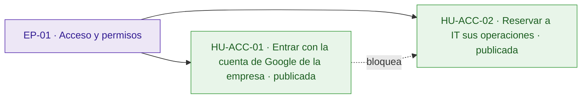
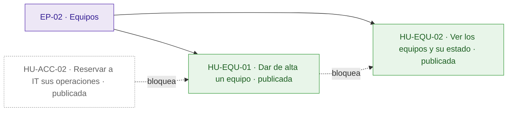
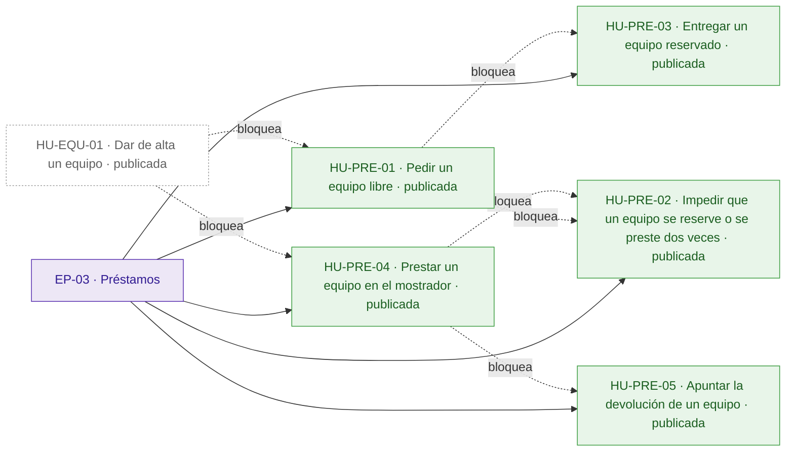
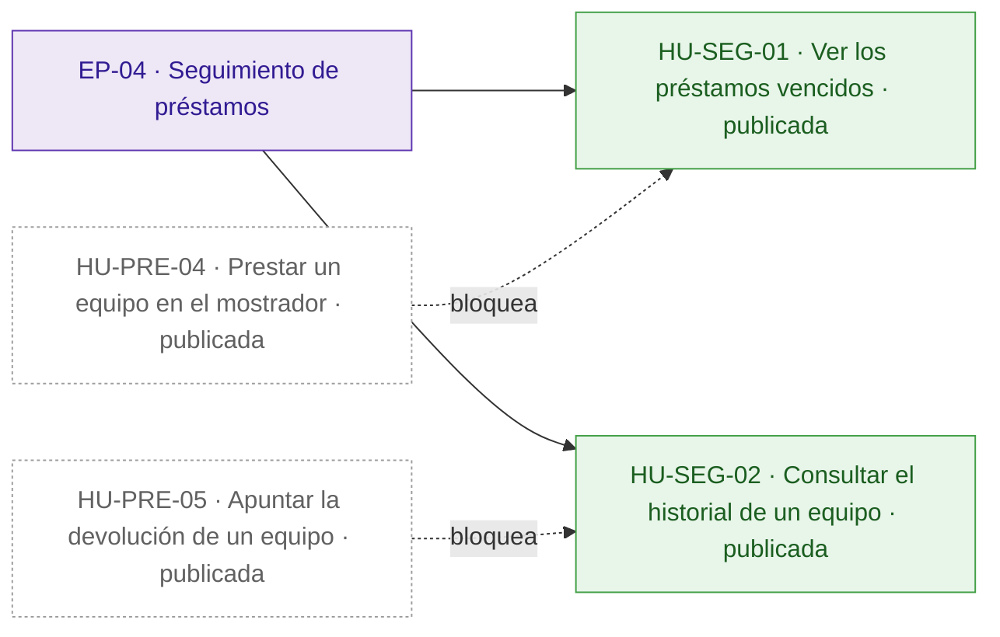
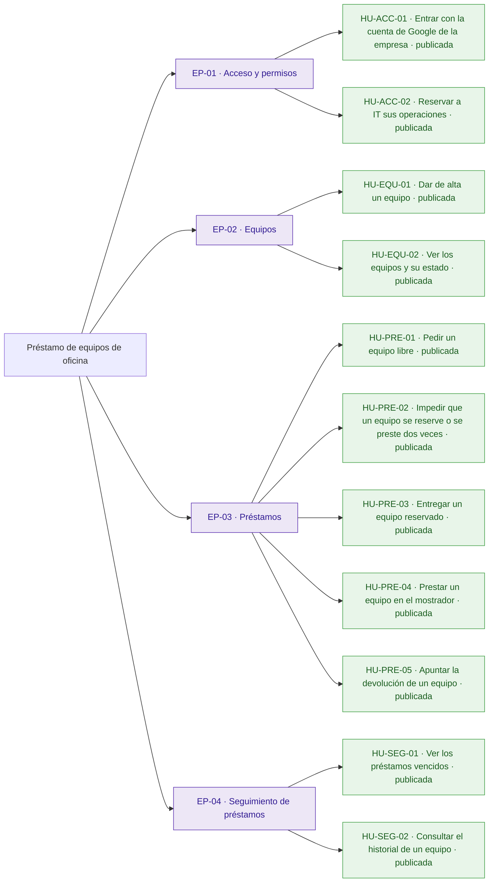
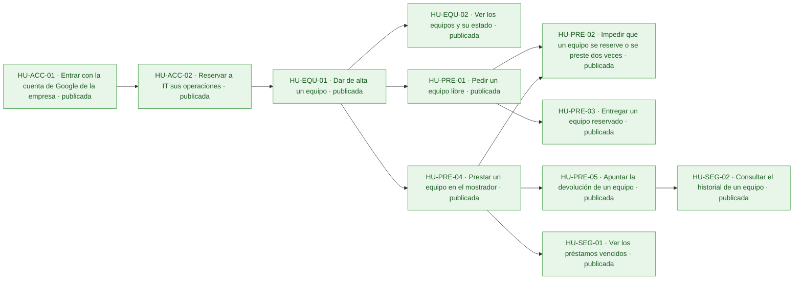
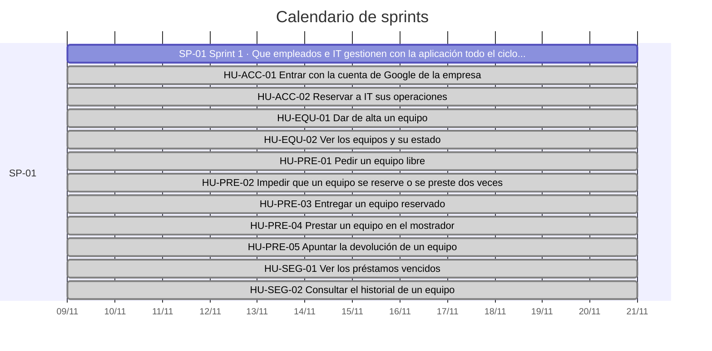
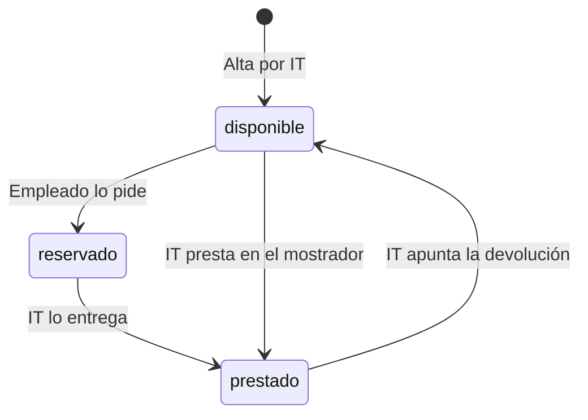

# Préstamo de equipos de oficina

Hoy los préstamos de portátiles, monitores y proyectores se apuntan en una hoja de cálculo y se piden por correo a IT: nadie sabe qué está libre sin preguntar, dos personas acaban esperando el mismo equipo y los préstamos vencidos no se detectan hasta que alguien echa en falta el equipo.

La aplicación permite a los empleados, con su cuenta de Google de la empresa, ver los equipos y pedir uno libre, y a IT dar de alta equipos, entregarlos, prestarlos en el mostrador, apuntar devoluciones, ver los vencidos y consultar el historial. El inventario de IT se conecta mediante una API fijada por el cliente que debe respetarse exactamente. Quedan fuera la anulación de solicitudes por los empleados y los avisos por correo de vencidos.

## Visión y alcance

Que los empleados vean qué equipos de oficina están libres y los pidan desde una aplicación, y que IT gestione altas, entregas, devoluciones y vencidos sin hoja de cálculo ni correos, sin que ningún equipo se reserve o se preste dos veces.

**Dentro del alcance**

- Iniciar sesión con la cuenta de Google de la empresa; la persona de cada operación es el correo de la sesión (peticion.md).
- Dar de alta un equipo (solo IT), con nombre obligatorio y único sin distinguir mayúsculas ni espacios al principio o al final (peticion.md).
- Ver los equipos con su estado (disponible, reservado o prestado) y, si están reservados o prestados, la persona y la fecha de devolución (todos) (peticion.md).
- Pedir un equipo libre indicando la fecha de devolución, que no puede ser anterior a hoy; el equipo queda reservado a nombre de quien lo pide hasta que IT se lo entrega (peticion.md).
- Entregar un equipo reservado (solo IT): pasa a prestado con la misma persona y fecha de devolución (peticion.md).
- Prestar un equipo en el mostrador a la persona indicada (solo IT); se admite una fecha de devolución pasada y ese préstamo aparece ya entre los vencidos (peticion.md).
- Apuntar la devolución de un equipo prestado (solo IT): vuelve a estar disponible, sin persona ni fecha de devolución (peticion.md).
- Ver los préstamos vencidos (solo IT): equipos prestados con fecha de devolución anterior a hoy, del más antiguo al más reciente (peticion.md).
- Ver el historial de un equipo (solo IT): sus préstamos del más reciente al más antiguo, con estado reservado, prestado o devuelto (peticion.md).
- La fecha de devolución va como \`AAAA-MM-DD\`, tiene que existir y «hoy» es el día en Madrid (peticion.md).

**Fuera del alcance**

- Que los empleados anulen una solicitud (peticion.md).
- Avisos por correo de préstamos vencidos (peticion.md).

## Resumen en cifras

| Dato | Valor |
| --- | --- |
| Épicas | 4 |
| Historias | 11 |
| Historias por estado | borrador 0, aprobada 0, descartada 0, publicada 11 |
| Tareas | 35 |
| Sprints | 1 |
| Personas en el equipo | 1 |
| Modalidad de desarrollo | manual, sin IA |
| Horas estimadas | 52 h |
| Horas efectivas (según la modalidad de desarrollo) | 52 h |
| Historias sin estimar | 0 |
| Historias descartadas (fuera de las horas) | 0 |
| Supuestos | 12 |
| Preguntas abiertas | 5 |
| Requisitos | 14 |
| Requisitos sin historia | 0 |

## Índice

- [Visión y alcance](#visión-y-alcance)
- [Resumen en cifras](#resumen-en-cifras)
- [Épicas e historias](#épicas-e-historias)
  - [EP-01 · Acceso y permisos](#ep-01--acceso-y-permisos)
  - [EP-02 · Equipos](#ep-02--equipos)
  - [EP-03 · Préstamos](#ep-03--préstamos)
  - [EP-04 · Seguimiento de préstamos](#ep-04--seguimiento-de-préstamos)
- [Tareas](#tareas)
- [Sprints](#sprints)
- [Equipo](#equipo)
- [Dependencias](#dependencias)
- [Requisitos y trazabilidad](#requisitos-y-trazabilidad)
- [Preparación y definición de hecho](#preparación-y-definición-de-hecho)
- [Diagramas](#diagramas)
- [Supuestos](#supuestos)
- [Preguntas abiertas](#preguntas-abiertas)
- [Decisiones](#decisiones)

## Épicas e historias

### EP-01 · Acceso y permisos

Entrada con la cuenta de Google de la empresa para empleados, IT y la cuenta de servicio del inventario, y separación entre lo que puede hacer cualquier empleado y lo que solo puede hacer IT. Las cuentas de IT se fijan en la configuración del despliegue. No incluye la gestión de usuarios dentro de la aplicación.

#### Épica EP-01: Acceso y permisos

#### HU-ACC-01 · Entrar con la cuenta de Google de la empresa

Como empleado, quiero entrar en la aplicación con mi cuenta de Google de la empresa, para consultar y pedir equipos sin escribir a IT por correo.

**Contexto.** Cubre RQ.001 y RQ.011 (peticion.md): todos los usuarios entran con su cuenta de Google de la empresa, y todas las rutas de la API exigen sesión. Es la base de las demás historias.

- **Prioridad:** Highest
- **Tamaño:** M
- **Horas:** 4 h estimadas · 4 h efectivas
- **Estado:** publicada
- **Sprint:** SP-01 Sprint 1
- **Responsable:** José Luis Calvo
- **Tipo:** historia
- **Puntos de historia:** 3
- **Preparación:** parcialmente lista (pendiente: DoR-08: dependencias externas sin plan confirmado: Cliente OAuth de Google de la aplicación para la cuenta de la empresa · supuestos sin confirmar: DoR-04, DoR-05, DoR-06, DoR-07, DoR-09)
- **Requisitos:** RQ.001, RQ.011, RQ.014
- **Dependencias externas:** Cliente OAuth de Google de la aplicación para la cuenta de la empresa

**Criterios de aceptación**

*Escenarios positivos*

1. **Dado** el empleado «luis.garcia@empresa.com» con un token de identidad de Google con el correo verificado y emitido para el cliente OAuth de la aplicación, **cuando** consulta los equipos con GET /api/equipos, **entonces** recibe 200 con la lista de equipos y sus operaciones quedan a nombre de «luis.garcia@empresa.com».
2. **Dado** la cuenta de servicio del inventario con un token de identidad de Google válido para el cliente OAuth de la aplicación, **cuando** consulta los equipos con GET /api/equipos, **entonces** recibe 200 con la lista de equipos.

*Escenarios negativos*

1. **Dado** una petición sin token de identidad, **cuando** consulta los equipos con GET /api/equipos, **entonces** recibe 401 con {"error": "Inicia sesión con Google."} y no ve ningún equipo.
2. **Dado** el correo «luis.garcia@empresa.com» con un token de Google emitido para otro cliente OAuth, **cuando** consulta los equipos con GET /api/equipos, **entonces** recibe 401 con {"error": "Inicia sesión con Google."}.
3. **Dado** un token de Google para el cliente OAuth de la aplicación con el correo «luis.garcia@empresa.com» sin verificar, **cuando** consulta los equipos con GET /api/equipos, **entonces** recibe 401 con {"error": "Inicia sesión con Google."}.
4. **Dado** una petición sin token de identidad y «Portátil 07» disponible, **cuando** pide «Portátil 07» con {"devolucion": "2026-11-20"}, **entonces** recibe 401 con {"error": "Inicia sesión con Google."} y el equipo sigue disponible.

**Notas.** El mensaje y el código de error son los del anexo de la API (RQ.014), porque el inventario de IT depende de ellos.

**Definición de hecho**

- Criterios de aceptación probados.
- Respuestas y mensajes de error idénticos a los del anexo de la API.
- Textos revisados en español de España.

**Tareas**

- TA-001 · Verificación del token de Google y del cliente OAuth en todas las rutas · backend
- TA-002 · Pantalla de inicio de sesión con la cuenta de Google de la empresa · frontend
- TA-003 · Pruebas de sesión válida, sin token y con otro cliente OAuth · QA

#### HU-ACC-02 · Reservar a IT sus operaciones

Como técnico de IT, quiero que solo las cuentas de la lista CORREOS\_IT puedan hacer las operaciones de IT, para evitar que un empleado dé de alta, entregue o preste equipos por su cuenta.

**Contexto.** Cubre RQ.012 (peticion.md): las operaciones marcadas «Solo IT» solo las hace una cuenta de la variable de entorno CORREOS\_IT, fijada en el despliegue y no en el código. Responde al riesgo de que un empleado haga lo que solo le toca a IT.

- **Prioridad:** Highest
- **Tamaño:** M
- **Horas:** 4 h estimadas · 4 h efectivas
- **Estado:** publicada
- **Sprint:** SP-01 Sprint 1
- **Responsable:** José Luis Calvo
- **Tipo:** historia
- **Puntos de historia:** 3
- **Preparación:** parcialmente lista (pendiente: DoR-08: depende de HU-ACC-01, sin resolver ni planificada en un sprint anterior · supuestos sin confirmar: DoR-04, DoR-05, DoR-06, DoR-07, DoR-09)
- **Requisitos:** RQ.012, RQ.014
- **Depende de:**
  - HU-ACC-01 · Entrar con la cuenta de Google de la empresa: Saber si una cuenta es de IT exige conocer antes el correo de la sesión.

**Criterios de aceptación**

*Escenarios positivos*

1. **Dado** CORREOS\_IT con el valor «it@empresa.com,inventario@empresa.com» y la cuenta «IT@empresa.com» con sesión iniciada, **cuando** consulta los préstamos vencidos con GET /api/prestamos/vencidos, **entonces** recibe 200, porque los correos se comparan sin distinguir mayúsculas.
2. **Dado** la cuenta de servicio «inventario@empresa.com», incluida en CORREOS\_IT, y «Monitor 03» disponible, **cuando** pide «Monitor 03» con devolución «2026-11-20» como haría un empleado, **entonces** recibe 201 con «Monitor 03» reservado a «inventario@empresa.com».

*Escenarios negativos*

1. **Dado** el empleado «luis.garcia@empresa.com», que no está en CORREOS\_IT, con sesión iniciada, **cuando** da de alta el equipo «Portátil 08» con POST /api/equipos, **entonces** recibe 403 con {"error": "Solo IT puede hacer esto."} y el equipo no se crea.

**Notas.** La lista de cuentas de IT se cambia en la configuración del despliegue, no en la aplicación.

**Definición de hecho**

- Criterios de aceptación probados.
- Cada operación «Solo IT» del anexo comprobada con una cuenta que no es de IT.
- La lista de IT se lee de la configuración del despliegue.

**Tareas**

- TA-004 · Lectura de CORREOS\_IT y control de acceso de las operaciones de IT · backend
- TA-005 · Ocultar las acciones de IT a los empleados · frontend
- TA-006 · Pruebas de 403 en cada operación de IT y de mayúsculas en los correos · QA

### EP-02 · Equipos

Alta de los equipos por IT y consulta por todos de los equipos con su estado, la persona que los tiene y la fecha de devolución. La edición y la baja de equipos no se tratan en esta épica.

#### Épica EP-02: Equipos

#### HU-EQU-01 · Dar de alta un equipo

Como técnico de IT, quiero dar de alta un equipo con su nombre, para que los empleados lo vean y puedan pedirlo en lugar de consultar la hoja de cálculo.

**Contexto.** Cubre RQ.002 (peticion.md): IT da de alta los equipos de la oficina (portátiles, monitores, proyectores). Dos nombres son el mismo si solo se diferencian en mayúsculas o en espacios al principio o al final.

- **Prioridad:** Highest
- **Tamaño:** M
- **Horas:** 4 h estimadas · 4 h efectivas
- **Estado:** publicada
- **Sprint:** SP-01 Sprint 1
- **Responsable:** José Luis Calvo
- **Tipo:** historia
- **Puntos de historia:** 3
- **Preparación:** parcialmente lista (pendiente: DoR-08: depende de HU-ACC-02, sin resolver ni planificada en un sprint anterior · supuestos sin confirmar: DoR-04, DoR-05, DoR-06, DoR-07, DoR-09)
- **Requisitos:** RQ.002, RQ.014
- **Depende de:**
  - HU-ACC-02 · Reservar a IT sus operaciones: El alta es una operación solo de IT.

**Criterios de aceptación**

*Escenarios positivos*

1. **Dado** un técnico de IT con sesión iniciada y ningún equipo llamado «Portátil 07», **cuando** da de alta el equipo con {"nombre": "Portátil 07"}, **entonces** recibe 201 con el id generado, el nombre «Portátil 07» y el estado «disponible».

*Escenarios negativos*

1. **Dado** un técnico de IT con sesión iniciada, **cuando** da de alta un equipo con {"nombre": ""}, **entonces** recibe 400 con {"error": "Falta el nombre del equipo"} y no se crea ningún equipo.
2. **Dado** el equipo «Portátil 07» ya dado de alta, **cuando** un técnico de IT da de alta un equipo con {"nombre": " portátil 07 "}, **entonces** recibe 409 con {"error": "Ya hay un equipo con ese nombre"} y sigue habiendo un solo «Portátil 07».

**Definición de hecho**

- Criterios de aceptación probados.
- Respuestas y mensajes de error idénticos a los del anexo de la API.
- Textos revisados en español de España.

**Tareas**

- TA-007 · Modelo de equipo con nombre único normalizado · datos
- TA-008 · Endpoint POST /api/equipos con sus validaciones · backend
- TA-009 · Formulario de alta de equipos · frontend
- TA-010 · Pruebas de alta, nombre vacío y nombre repetido · QA

#### HU-EQU-02 · Ver los equipos y su estado

Como empleado, quiero ver los equipos con su estado y, si están ocupados, quién los tiene y hasta cuándo, para saber qué está libre sin preguntar a IT.

**Contexto.** Cubre RQ.003 (peticion.md): cualquier empleado ve los equipos y su estado. Hoy no se sabe qué está libre sin preguntar.

- **Prioridad:** Highest
- **Tamaño:** M
- **Horas:** 4 h estimadas · 4 h efectivas
- **Estado:** publicada
- **Sprint:** SP-01 Sprint 1
- **Responsable:** José Luis Calvo
- **Tipo:** historia
- **Puntos de historia:** 3
- **Preparación:** parcialmente lista (pendiente: DoR-08: depende de HU-EQU-01, sin resolver ni planificada en un sprint anterior · supuestos sin confirmar: DoR-04, DoR-05, DoR-06, DoR-07, DoR-09)
- **Requisitos:** RQ.003, RQ.014
- **Depende de:**
  - HU-EQU-01 · Dar de alta un equipo: Hacen falta equipos dados de alta para listarlos.

**Criterios de aceptación**

*Escenarios positivos*

1. **Dado** «Portátil 07» reservado a «luis.garcia@empresa.com» con devolución «2026-11-20» y «Monitor 03» disponible, **cuando** un empleado consulta los equipos con GET /api/equipos, **entonces** recibe 200 con «Portátil 07» en estado «reservado», persona «luis.garcia@empresa.com» y devolución «2026-11-20», y «Monitor 03» en estado «disponible» sin persona ni devolución.

*Escenarios negativos*

1. **Dado** «Portátil 07» devuelto tras un préstamo a «luis.garcia@empresa.com» con devolución «2026-11-01», **cuando** un empleado consulta los equipos con GET /api/equipos, **entonces** recibe 200 con «Portátil 07» en estado «disponible», sin persona ni devolución, y no aparece «luis.garcia@empresa.com».

**Notas.** Sigue abierta la pregunta de si es aceptable que cualquier empleado vea el correo de quien tiene cada equipo; el anexo lo fija así para todos.

**Definición de hecho**

- Criterios de aceptación probados.
- Respuestas idénticas a las del anexo de la API.
- Textos revisados en español de España.

**Tareas**

- TA-011 · Endpoint GET /api/equipos · backend
- TA-012 · Listado de equipos con su estado · frontend
- TA-013 · Pruebas del listado por estado · QA

### EP-03 · Préstamos

Todo el ciclo de un préstamo: el empleado pide un equipo libre, IT lo entrega o lo presta en el mostrador y apunta la devolución, sin que un equipo se reserve o se preste dos veces a la vez. No incluye que el empleado anule su solicitud.

#### Épica EP-03: Préstamos

#### HU-PRE-01 · Pedir un equipo libre

Como empleado, quiero pedir un equipo libre indicando la fecha en que lo devolveré, para que quede reservado a mi nombre y nadie más lo pida mientras IT me lo entrega.

**Contexto.** Cubre RQ.004 y RQ.010 (peticion.md): el empleado pide un equipo libre con la fecha en que lo devolverá y queda reservado a su nombre hasta que IT se lo entrega. La fecha va como AAAA-MM-DD, tiene que existir y no puede ser anterior a hoy en Madrid.

- **Prioridad:** Highest
- **Tamaño:** L
- **Horas:** 8 h estimadas · 8 h efectivas
- **Estado:** publicada
- **Sprint:** SP-01 Sprint 1
- **Responsable:** José Luis Calvo
- **Tipo:** historia
- **Puntos de historia:** 5
- **Preparación:** parcialmente lista (pendiente: DoR-08: depende de HU-EQU-01, sin resolver ni planificada en un sprint anterior · supuestos sin confirmar: DoR-04, DoR-05, DoR-06, DoR-07, DoR-09)
- **Requisitos:** RQ.004, RQ.010, RQ.014
- **Depende de:**
  - HU-EQU-01 · Dar de alta un equipo: Hacen falta equipos dados de alta para pedirlos.

**Criterios de aceptación**

*Escenarios positivos*

1. **Dado** el 6 de noviembre de 2026 en Madrid, «Portátil 07» disponible y el empleado «luis.garcia@empresa.com» con sesión iniciada, **cuando** pide «Portátil 07» con {"devolucion": "2026-11-20"}, **entonces** recibe 201 con «Portátil 07» en estado «reservado», persona «luis.garcia@empresa.com» y devolución «2026-11-20».

*Escenarios negativos*

1. **Dado** las 00:30 del 7 de noviembre de 2026 en Madrid y «Portátil 07» disponible, **cuando** un empleado pide «Portátil 07» con {"devolucion": "2026-11-06"}, **entonces** recibe 400 con {"error": "La fecha de devolución ya ha pasado"} y el equipo sigue disponible.
2. **Dado** «Portátil 07» disponible, **cuando** un empleado lo pide con {"devolucion": "2026-02-30"}, **entonces** recibe 400 con {"error": "La fecha de devolución no es válida"} y el equipo sigue disponible.
3. **Dado** «Portátil 07» disponible, **cuando** un empleado lo pide sin fecha de devolución, **entonces** recibe 400 con {"error": "Falta la fecha de devolución"}.
4. **Dado** «Portátil 07» reservado a «marta.ruiz@empresa.com», **cuando** «luis.garcia@empresa.com» lo pide con {"devolucion": "2026-11-20"}, **entonces** recibe 409 con {"error": "El equipo no está disponible"} y la reserva sigue a nombre de «marta.ruiz@empresa.com».
5. **Dado** ningún equipo con el id pedido, **cuando** un empleado lo pide con {"devolucion": "2026-11-20"}, **entonces** recibe 404 con {"error": "No existe el equipo"}.

**Notas.** Los empleados no anulan solicitudes (fuera de alcance). Sigue abierta la pregunta de qué pasa con una reserva que IT nunca llega a entregar.

**Definición de hecho**

- Criterios de aceptación probados.
- Respuestas y mensajes de error idénticos a los del anexo de la API.
- Fecha de hoy calculada con la zona horaria de Madrid.

**Tareas**

- TA-014 · Modelo de préstamo con persona, devolución y estado · datos
- TA-015 · Endpoint de solicitud con validación de fechas en hora de Madrid · backend
- TA-016 · Pedir un equipo desde el listado con la fecha de devolución · frontend
- TA-017 · Pruebas de solicitud, fechas no válidas y equipo ocupado · QA

#### HU-PRE-02 · Impedir que un equipo se reserve o se preste dos veces

Como empleado, quiero recibir una respuesta clara cuando pido un equipo que otra persona pide al mismo tiempo, para que nunca se prometa el mismo equipo a dos personas.

**Contexto.** Cubre RQ.013 (peticion.md): un equipo no puede estar reservado o prestado dos veces a la vez, ni siquiera con peticiones simultáneas. Es lo más importante para el cliente y uno de sus criterios de éxito.

- **Prioridad:** Highest
- **Tamaño:** L
- **Horas:** 8 h estimadas · 8 h efectivas
- **Estado:** publicada
- **Sprint:** SP-01 Sprint 1
- **Responsable:** José Luis Calvo
- **Tipo:** historia
- **Puntos de historia:** 5
- **Preparación:** parcialmente lista (pendiente: DoR-08: depende de HU-PRE-01, HU-PRE-04, sin resolver ni planificada en un sprint anterior · supuestos sin confirmar: DoR-04, DoR-05, DoR-06, DoR-07, DoR-09)
- **Requisitos:** RQ.013, RQ.014
- **Depende de:**
  - HU-PRE-01 · Pedir un equipo libre: La garantía se prueba sobre las solicitudes.
  - HU-PRE-04 · Prestar un equipo en el mostrador: La garantía se prueba también sobre los préstamos en el mostrador.

**Criterios de aceptación**

*Escenarios positivos*

1. **Dado** «Portátil 07» disponible y dos solicitudes con devolución «2026-11-20», una de «luis.garcia@empresa.com» y otra de «marta.ruiz@empresa.com», preparadas para enviarse en paralelo, **cuando** se lanzan las dos solicitudes a la vez, **entonces** exactamente una recibe 201 con el equipo reservado a su nombre, la otra recibe 409 con {"error": "El equipo no está disponible"} y el historial de «Portátil 07» tiene un solo préstamo.
2. **Dado** «Monitor 03» disponible, una solicitud de «luis.garcia@empresa.com» y un préstamo en el mostrador a «marta.ruiz@empresa.com», ambos con devolución «2026-11-20» y preparados para enviarse en paralelo, **cuando** se lanzan las dos peticiones a la vez, **entonces** exactamente una sale bien, la otra recibe 409 con {"error": "El equipo no está disponible"} y el historial de «Monitor 03» tiene un solo préstamo.

*Escenarios negativos*

1. **Dado** «Portátil 07» reservado a «marta.ruiz@empresa.com» con devolución «2026-11-20», **cuando** «luis.garcia@empresa.com» lo pide con {"devolucion": "2026-11-25"}, **entonces** recibe 409 con {"error": "El equipo no está disponible"} y la reserva de «marta.ruiz@empresa.com» sigue con devolución «2026-11-20».

**Notas.** Responde al riesgo principal de la petición: que dos empleados se queden con el mismo equipo porque lo pidieron a la vez.

**Definición de hecho**

- Criterios de aceptación probados con peticiones concurrentes reales.
- Respuestas y mensajes de error idénticos a los del anexo de la API.

**Tareas**

- TA-018 · Cambio de estado atómico del equipo en la base de datos · datos
- TA-019 · Control de concurrencia en solicitud y préstamo · backend
- TA-020 · Pruebas de peticiones simultáneas sobre el mismo equipo · QA

#### HU-PRE-03 · Entregar un equipo reservado

Como técnico de IT, quiero apuntar la entrega de un equipo reservado, para que conste como prestado a quien lo pidió, con su fecha de devolución, sin volver a escribirla.

**Contexto.** Cubre RQ.005 (peticion.md): IT entrega los equipos reservados, que pasan a prestados con la misma persona y fecha de devolución de la solicitud.

- **Prioridad:** Highest
- **Tamaño:** M
- **Horas:** 4 h estimadas · 4 h efectivas
- **Estado:** publicada
- **Sprint:** SP-01 Sprint 1
- **Responsable:** José Luis Calvo
- **Tipo:** historia
- **Puntos de historia:** 3
- **Preparación:** parcialmente lista (pendiente: DoR-08: depende de HU-PRE-01, sin resolver ni planificada en un sprint anterior · supuestos sin confirmar: DoR-04, DoR-05, DoR-06, DoR-07, DoR-09)
- **Requisitos:** RQ.005, RQ.014
- **Depende de:**
  - HU-PRE-01 · Pedir un equipo libre: Solo se entrega un equipo que un empleado ha pedido.

**Criterios de aceptación**

*Escenarios positivos*

1. **Dado** «Portátil 07» reservado a «luis.garcia@empresa.com» con devolución «2026-11-20», **cuando** un técnico de IT apunta la entrega con POST /api/equipos/{id}/entrega, **entonces** recibe 200 con «Portátil 07» en estado «prestado», persona «luis.garcia@empresa.com» y devolución «2026-11-20».

*Escenarios negativos*

1. **Dado** «Monitor 03» disponible, **cuando** un técnico de IT apunta su entrega, **entonces** recibe 409 con {"error": "El equipo no está reservado"} y el equipo sigue disponible.
2. **Dado** ningún equipo con el id indicado, **cuando** un técnico de IT apunta su entrega, **entonces** recibe 404 con {"error": "No existe el equipo"}.

**Definición de hecho**

- Criterios de aceptación probados.
- Respuestas y mensajes de error idénticos a los del anexo de la API.
- Textos revisados en español de España.

**Tareas**

- TA-021 · Endpoint de entrega · backend
- TA-022 · Acción de entregar en el listado de IT · frontend
- TA-023 · Pruebas de entrega y de equipo no reservado · QA

#### HU-PRE-04 · Prestar un equipo en el mostrador

Como técnico de IT, quiero prestar un equipo disponible a quien viene al mostrador, para que también estos préstamos pasen por la aplicación, aunque los apunte con retraso.

**Contexto.** Cubre RQ.006 y RQ.010 (peticion.md): IT presta directamente a quien viene al mostrador y, como a veces apunta los préstamos con retraso, puede poner una fecha de devolución anterior a hoy; ese préstamo aparece ya entre los vencidos.

- **Prioridad:** Highest
- **Tamaño:** M
- **Horas:** 4 h estimadas · 4 h efectivas
- **Estado:** publicada
- **Sprint:** SP-01 Sprint 1
- **Responsable:** José Luis Calvo
- **Tipo:** historia
- **Puntos de historia:** 3
- **Preparación:** parcialmente lista (pendiente: DoR-08: depende de HU-EQU-01, sin resolver ni planificada en un sprint anterior · supuestos sin confirmar: DoR-04, DoR-05, DoR-06, DoR-07, DoR-09)
- **Requisitos:** RQ.006, RQ.010, RQ.014
- **Depende de:**
  - HU-EQU-01 · Dar de alta un equipo: Hacen falta equipos dados de alta para prestarlos.

**Criterios de aceptación**

*Escenarios positivos*

1. **Dado** el 6 de noviembre de 2026 en Madrid y «Proyector 02» disponible, **cuando** un técnico de IT lo presta con {"persona": "marta.ruiz@empresa.com", "devolucion": "2026-11-20"}, **entonces** recibe 201 con «Proyector 02» en estado «prestado», persona «marta.ruiz@empresa.com» y devolución «2026-11-20».
2. **Dado** el 6 de noviembre de 2026 en Madrid y «Proyector 02» disponible, **cuando** un técnico de IT lo presta con {"persona": "marta.ruiz@empresa.com", "devolucion": "2026-11-01"}, **entonces** recibe 201 con «Proyector 02» en estado «prestado», persona «marta.ruiz@empresa.com» y devolución «2026-11-01».

*Escenarios negativos*

1. **Dado** «Proyector 02» disponible, **cuando** un técnico de IT lo presta con {"devolucion": "2026-11-20"} y sin persona, **entonces** recibe 400 con {"error": "Faltan la persona o la fecha de devolución"} y el equipo sigue disponible.
2. **Dado** «Proyector 02» disponible, **cuando** un técnico de IT lo presta con {"persona": "marta.ruiz@empresa.com", "devolucion": "2026-02-30"}, **entonces** recibe 400 con {"error": "La fecha de devolución no es válida"}.
3. **Dado** «Portátil 07» reservado a «luis.garcia@empresa.com», **cuando** un técnico de IT lo presta a «marta.ruiz@empresa.com» con devolución «2026-11-20», **entonces** recibe 409 con {"error": "El equipo no está disponible"} y la reserva sigue a nombre de «luis.garcia@empresa.com».
4. **Dado** ningún equipo con el id indicado, **cuando** un técnico de IT lo presta a «marta.ruiz@empresa.com» con devolución «2026-11-20», **entonces** recibe 404 con {"error": "No existe el equipo"}.

**Definición de hecho**

- Criterios de aceptación probados.
- Respuestas y mensajes de error idénticos a los del anexo de la API.
- Textos revisados en español de España.

**Tareas**

- TA-024 · Endpoint de préstamo en el mostrador · backend
- TA-025 · Formulario de préstamo en el mostrador · frontend
- TA-026 · Pruebas de préstamo con fecha pasada, datos que faltan y equipo ocupado · QA

#### HU-PRE-05 · Apuntar la devolución de un equipo

Como técnico de IT, quiero apuntar que un equipo prestado se ha devuelto, para que vuelva a aparecer libre para el siguiente empleado.

**Contexto.** Cubre RQ.007 (peticion.md): IT apunta las devoluciones y el equipo vuelve a estar disponible.

- **Prioridad:** Highest
- **Tamaño:** M
- **Horas:** 4 h estimadas · 4 h efectivas
- **Estado:** publicada
- **Sprint:** SP-01 Sprint 1
- **Responsable:** José Luis Calvo
- **Tipo:** historia
- **Puntos de historia:** 3
- **Preparación:** parcialmente lista (pendiente: DoR-08: depende de HU-PRE-04, sin resolver ni planificada en un sprint anterior · supuestos sin confirmar: DoR-04, DoR-05, DoR-06, DoR-07, DoR-09)
- **Requisitos:** RQ.007, RQ.014
- **Depende de:**
  - HU-PRE-04 · Prestar un equipo en el mostrador: Solo se devuelve un equipo prestado.

**Criterios de aceptación**

*Escenarios positivos*

1. **Dado** «Proyector 02» prestado a «marta.ruiz@empresa.com» con devolución «2026-11-20», **cuando** un técnico de IT apunta su devolución con POST /api/equipos/{id}/devolucion, **entonces** recibe 200 con «Proyector 02» en estado «disponible», sin persona ni devolución.

*Escenarios negativos*

1. **Dado** «Portátil 07» reservado a «luis.garcia@empresa.com» y aún no entregado, **cuando** un técnico de IT apunta su devolución, **entonces** recibe 409 con {"error": "El equipo no está prestado"} y la reserva sigue igual.
2. **Dado** ningún equipo con el id indicado, **cuando** un técnico de IT apunta su devolución, **entonces** recibe 404 con {"error": "No existe el equipo"}.

**Definición de hecho**

- Criterios de aceptación probados.
- Respuestas y mensajes de error idénticos a los del anexo de la API.
- Textos revisados en español de España.

**Tareas**

- TA-027 · Endpoint de devolución · backend
- TA-028 · Acción de apuntar la devolución · frontend
- TA-029 · Pruebas de devolución y de equipo no prestado · QA

### EP-04 · Seguimiento de préstamos

Herramientas de IT para revisar los préstamos vencidos y el historial de cada equipo. No incluye avisos por correo de vencidos.

#### Épica EP-04: Seguimiento de préstamos

#### HU-SEG-01 · Ver los préstamos vencidos

Como técnico de IT, quiero ver los préstamos cuya fecha de devolución ya ha pasado, para reclamar los equipos cada semana sin tener que preguntar a nadie.

**Contexto.** Cubre RQ.008 y RQ.010 (peticion.md): IT ve los equipos prestados con fecha de devolución anterior a hoy en Madrid, del más antiguo al más reciente. Hoy nadie se entera de un vencido hasta que alguien echa en falta el equipo.

- **Prioridad:** Highest
- **Tamaño:** M
- **Horas:** 4 h estimadas · 4 h efectivas
- **Estado:** publicada
- **Sprint:** SP-01 Sprint 1
- **Responsable:** José Luis Calvo
- **Tipo:** historia
- **Puntos de historia:** 3
- **Preparación:** parcialmente lista (pendiente: DoR-08: depende de HU-PRE-04, sin resolver ni planificada en un sprint anterior · supuestos sin confirmar: DoR-04, DoR-05, DoR-06, DoR-07, DoR-09)
- **Requisitos:** RQ.008, RQ.010, RQ.014
- **Depende de:**
  - HU-PRE-04 · Prestar un equipo en el mostrador: Hacen falta préstamos para que alguno venza.

**Criterios de aceptación**

*Escenarios positivos*

1. **Dado** el 6 de noviembre de 2026 en Madrid, «Portátil 07» prestado con devolución «2026-11-01», «Proyector 02» prestado con devolución «2026-10-20», «Monitor 03» prestado con devolución «2026-11-06» y «Portátil 09» reservado con devolución «2026-11-10», **cuando** un técnico de IT consulta GET /api/prestamos/vencidos, **entonces** recibe 200 con «Proyector 02» y después «Portátil 07», cada uno con id, nombre, persona y devolución, y sin «Monitor 03» ni «Portátil 09».
2. **Dado** el 6 de noviembre de 2026 en Madrid y «Proyector 05» prestado en el mostrador a «marta.ruiz@empresa.com» con devolución «2026-11-01» apuntada con retraso, **cuando** un técnico de IT consulta GET /api/prestamos/vencidos, **entonces** recibe 200 con «Proyector 05», persona «marta.ruiz@empresa.com» y devolución «2026-11-01» en la lista.

*Escenarios negativos*

1. **Dado** el empleado «luis.garcia@empresa.com», que no está en CORREOS\_IT, **cuando** consulta GET /api/prestamos/vencidos, **entonces** recibe 403 con {"error": "Solo IT puede hacer esto."} y no ve ningún préstamo.

**Notas.** Los avisos por correo de vencidos quedan fuera de alcance.

**Definición de hecho**

- Criterios de aceptación probados.
- Respuestas idénticas a las del anexo de la API.
- Fecha de hoy calculada con la zona horaria de Madrid.

**Tareas**

- TA-030 · Endpoint de préstamos vencidos ordenado por fecha · backend
- TA-031 · Pantalla de préstamos vencidos · frontend
- TA-032 · Pruebas de vencidos en el límite de hoy · QA

#### HU-SEG-02 · Consultar el historial de un equipo

Como técnico de IT, quiero consultar todos los préstamos de un equipo, para saber quién ha tenido el equipo y hasta cuándo sin revisar la hoja de cálculo.

**Contexto.** Cubre RQ.009 (peticion.md): IT consulta el historial de cada equipo, del más reciente al más antiguo, con el estado de cada préstamo (reservado, prestado o devuelto).

- **Prioridad:** High
- **Tamaño:** M
- **Horas:** 4 h estimadas · 4 h efectivas
- **Estado:** publicada
- **Sprint:** SP-01 Sprint 1
- **Responsable:** José Luis Calvo
- **Tipo:** historia
- **Puntos de historia:** 3
- **Preparación:** parcialmente lista (pendiente: DoR-08: depende de HU-PRE-05, sin resolver ni planificada en un sprint anterior · supuestos sin confirmar: DoR-04, DoR-05, DoR-06, DoR-07, DoR-09)
- **Requisitos:** RQ.009, RQ.014
- **Depende de:**
  - HU-PRE-05 · Apuntar la devolución de un equipo: El historial muestra préstamos devueltos.

**Criterios de aceptación**

*Escenarios positivos*

1. **Dado** «Portátil 07» prestado a «luis.garcia@empresa.com» con devolución «2026-10-15» y devuelto, y después reservado a «marta.ruiz@empresa.com» con devolución «2026-11-20», **cuando** un técnico de IT consulta GET /api/equipos/{id}/historial, **entonces** recibe 200 con primero el préstamo de «marta.ruiz@empresa.com» en estado «reservado» y después el de «luis.garcia@empresa.com» en estado «devuelto».

*Escenarios negativos*

1. **Dado** ningún equipo con el id indicado, **cuando** un técnico de IT consulta su historial, **entonces** recibe 404 con {"error": "No existe el equipo"}.
2. **Dado** el empleado «luis.garcia@empresa.com», que no está en CORREOS\_IT, **cuando** consulta el historial de «Portátil 07», **entonces** recibe 403 con {"error": "Solo IT puede hacer esto."}.

**Notas.** \[SUPUESTO\] El beneficio de saber quién tuvo el equipo se deduce de la petición, que no explica para qué se usa el historial.

**Definición de hecho**

- Criterios de aceptación probados.
- Respuestas y mensajes de error idénticos a los del anexo de la API.
- Textos revisados en español de España.

**Tareas**

- TA-033 · Endpoint de historial ordenado del más reciente al más antiguo · backend
- TA-034 · Pantalla de historial de un equipo · frontend
- TA-035 · Pruebas de historial y de equipo inexistente · QA

## Tareas

| ID | Título | Historia | Disciplina | Descripción | Horas estimadas | Horas efectivas |
| --- | --- | --- | --- | --- | --- | --- |
| TA-001 | Verificación del token de Google y del cliente OAuth en todas las rutas | HU-ACC-01 · Entrar con la cuenta de Google de la empresa | backend |   |   |   |
| TA-002 | Pantalla de inicio de sesión con la cuenta de Google de la empresa | HU-ACC-01 · Entrar con la cuenta de Google de la empresa | frontend |   |   |   |
| TA-003 | Pruebas de sesión válida, sin token y con otro cliente OAuth | HU-ACC-01 · Entrar con la cuenta de Google de la empresa | QA |   |   |   |
| TA-004 | Lectura de CORREOS\_IT y control de acceso de las operaciones de IT | HU-ACC-02 · Reservar a IT sus operaciones | backend |   |   |   |
| TA-005 | Ocultar las acciones de IT a los empleados | HU-ACC-02 · Reservar a IT sus operaciones | frontend |   |   |   |
| TA-006 | Pruebas de 403 en cada operación de IT y de mayúsculas en los correos | HU-ACC-02 · Reservar a IT sus operaciones | QA |   |   |   |
| TA-007 | Modelo de equipo con nombre único normalizado | HU-EQU-01 · Dar de alta un equipo | datos |   |   |   |
| TA-008 | Endpoint POST /api/equipos con sus validaciones | HU-EQU-01 · Dar de alta un equipo | backend |   |   |   |
| TA-009 | Formulario de alta de equipos | HU-EQU-01 · Dar de alta un equipo | frontend |   |   |   |
| TA-010 | Pruebas de alta, nombre vacío y nombre repetido | HU-EQU-01 · Dar de alta un equipo | QA |   |   |   |
| TA-011 | Endpoint GET /api/equipos | HU-EQU-02 · Ver los equipos y su estado | backend |   |   |   |
| TA-012 | Listado de equipos con su estado | HU-EQU-02 · Ver los equipos y su estado | frontend |   |   |   |
| TA-013 | Pruebas del listado por estado | HU-EQU-02 · Ver los equipos y su estado | QA |   |   |   |
| TA-014 | Modelo de préstamo con persona, devolución y estado | HU-PRE-01 · Pedir un equipo libre | datos |   |   |   |
| TA-015 | Endpoint de solicitud con validación de fechas en hora de Madrid | HU-PRE-01 · Pedir un equipo libre | backend |   |   |   |
| TA-016 | Pedir un equipo desde el listado con la fecha de devolución | HU-PRE-01 · Pedir un equipo libre | frontend |   |   |   |
| TA-017 | Pruebas de solicitud, fechas no válidas y equipo ocupado | HU-PRE-01 · Pedir un equipo libre | QA |   |   |   |
| TA-018 | Cambio de estado atómico del equipo en la base de datos | HU-PRE-02 · Impedir que un equipo se reserve o se preste dos veces | datos |   |   |   |
| TA-019 | Control de concurrencia en solicitud y préstamo | HU-PRE-02 · Impedir que un equipo se reserve o se preste dos veces | backend |   |   |   |
| TA-020 | Pruebas de peticiones simultáneas sobre el mismo equipo | HU-PRE-02 · Impedir que un equipo se reserve o se preste dos veces | QA |   |   |   |
| TA-021 | Endpoint de entrega | HU-PRE-03 · Entregar un equipo reservado | backend |   |   |   |
| TA-022 | Acción de entregar en el listado de IT | HU-PRE-03 · Entregar un equipo reservado | frontend |   |   |   |
| TA-023 | Pruebas de entrega y de equipo no reservado | HU-PRE-03 · Entregar un equipo reservado | QA |   |   |   |
| TA-024 | Endpoint de préstamo en el mostrador | HU-PRE-04 · Prestar un equipo en el mostrador | backend |   |   |   |
| TA-025 | Formulario de préstamo en el mostrador | HU-PRE-04 · Prestar un equipo en el mostrador | frontend |   |   |   |
| TA-026 | Pruebas de préstamo con fecha pasada, datos que faltan y equipo ocupado | HU-PRE-04 · Prestar un equipo en el mostrador | QA |   |   |   |
| TA-027 | Endpoint de devolución | HU-PRE-05 · Apuntar la devolución de un equipo | backend |   |   |   |
| TA-028 | Acción de apuntar la devolución | HU-PRE-05 · Apuntar la devolución de un equipo | frontend |   |   |   |
| TA-029 | Pruebas de devolución y de equipo no prestado | HU-PRE-05 · Apuntar la devolución de un equipo | QA |   |   |   |
| TA-030 | Endpoint de préstamos vencidos ordenado por fecha | HU-SEG-01 · Ver los préstamos vencidos | backend |   |   |   |
| TA-031 | Pantalla de préstamos vencidos | HU-SEG-01 · Ver los préstamos vencidos | frontend |   |   |   |
| TA-032 | Pruebas de vencidos en el límite de hoy | HU-SEG-01 · Ver los préstamos vencidos | QA |   |   |   |
| TA-033 | Endpoint de historial ordenado del más reciente al más antiguo | HU-SEG-02 · Consultar el historial de un equipo | backend |   |   |   |
| TA-034 | Pantalla de historial de un equipo | HU-SEG-02 · Consultar el historial de un equipo | frontend |   |   |   |
| TA-035 | Pruebas de historial y de equipo inexistente | HU-SEG-02 · Consultar el historial de un equipo | QA |   |   |   |

## Sprints

| Sprint | Fechas | Objetivo | Historias | Capacidad (h) | Carga (h efectivas) |
| --- | --- | --- | --- | --- | --- |
| SP-01 Sprint 1 | del 09/11/2026 al 20/11/2026 | Que empleados e IT gestionen con la aplicación todo el ciclo del préstamo de un equipo, sin préstamos dobles, con vencidos e historial. | 11 | 56 h | 52 h · 93 % |

Historias sin sprint: 0.

## Equipo

| Nombre | Rol | Dedicación | Usa un agente de IA |
| --- | --- | --- | --- |
| José Luis Calvo | Desarrollo | 100 % | sí |

*Por privacidad, este documento no incluye correos electrónicos ni usuarios de GitHub o Trello.*

## Dependencias

| Historia | Bloqueada por | Motivo |
| --- | --- | --- |
| HU-ACC-02 · Reservar a IT sus operaciones | HU-ACC-01 · Entrar con la cuenta de Google de la empresa | Saber si una cuenta es de IT exige conocer antes el correo de la sesión. |
| HU-EQU-01 · Dar de alta un equipo | HU-ACC-02 · Reservar a IT sus operaciones | El alta es una operación solo de IT. |
| HU-EQU-02 · Ver los equipos y su estado | HU-EQU-01 · Dar de alta un equipo | Hacen falta equipos dados de alta para listarlos. |
| HU-PRE-01 · Pedir un equipo libre | HU-EQU-01 · Dar de alta un equipo | Hacen falta equipos dados de alta para pedirlos. |
| HU-PRE-02 · Impedir que un equipo se reserve o se preste dos veces | HU-PRE-01 · Pedir un equipo libre | La garantía se prueba sobre las solicitudes. |
| HU-PRE-02 · Impedir que un equipo se reserve o se preste dos veces | HU-PRE-04 · Prestar un equipo en el mostrador | La garantía se prueba también sobre los préstamos en el mostrador. |
| HU-PRE-03 · Entregar un equipo reservado | HU-PRE-01 · Pedir un equipo libre | Solo se entrega un equipo que un empleado ha pedido. |
| HU-PRE-04 · Prestar un equipo en el mostrador | HU-EQU-01 · Dar de alta un equipo | Hacen falta equipos dados de alta para prestarlos. |
| HU-PRE-05 · Apuntar la devolución de un equipo | HU-PRE-04 · Prestar un equipo en el mostrador | Solo se devuelve un equipo prestado. |
| HU-SEG-01 · Ver los préstamos vencidos | HU-PRE-04 · Prestar un equipo en el mostrador | Hacen falta préstamos para que alguno venza. |
| HU-SEG-02 · Consultar el historial de un equipo | HU-PRE-05 · Apuntar la devolución de un equipo | El historial muestra préstamos devueltos. |

## Requisitos y trazabilidad

| Requisito | Título | Tipo | Origen | Historias | Cobertura |
| --- | --- | --- | --- | --- | --- |
| RQ.001 | Iniciar sesión con la cuenta de Google de la empresa; la persona de cada operación es el correo de la sesión | Funcional | peticion.md | HU-ACC-01 | cubierto |
| RQ.002 | Dar de alta un equipo (solo IT), con nombre obligatorio y único sin distinguir mayúsculas ni espacios en los extremos | Funcional | peticion.md | HU-EQU-01 | cubierto |
| RQ.003 | Ver los equipos con su estado y, si están reservados o prestados, la persona y la fecha de devolución | Funcional | peticion.md | HU-EQU-02 | cubierto |
| RQ.004 | Pedir un equipo libre con fecha de devolución no anterior a hoy; queda reservado hasta que IT lo entrega | Funcional | peticion.md | HU-PRE-01 | cubierto |
| RQ.005 | Entregar un equipo reservado (solo IT), que pasa a prestado con la misma persona y fecha | Funcional | peticion.md | HU-PRE-03 | cubierto |
| RQ.006 | Prestar un equipo en el mostrador (solo IT), admitiendo fechas de devolución pasadas | Funcional | peticion.md | HU-PRE-04 | cubierto |
| RQ.007 | Apuntar la devolución de un equipo prestado (solo IT), que vuelve a estar disponible | Funcional | peticion.md | HU-PRE-05 | cubierto |
| RQ.008 | Ver los préstamos vencidos (solo IT), del más antiguo al más reciente | Funcional | peticion.md | HU-SEG-01 | cubierto |
| RQ.009 | Ver el historial de un equipo (solo IT), del más reciente al más antiguo | Funcional | peticion.md | HU-SEG-02 | cubierto |
| RQ.010 | Fecha de devolución en formato AAAA-MM-DD, que exista, con «hoy» como el día en Madrid | Funcional | peticion.md | HU-PRE-01, HU-PRE-04, HU-SEG-01 | cubierto |
| RQ.011 | Todas las rutas exigen un token de identidad de Google válido; sin él, 401 | No funcional: seguridad | peticion.md | HU-ACC-01 | cubierto |
| RQ.012 | Las operaciones de IT responden 403 a otras cuentas; las cuentas de IT se fijan en CORREOS\_IT del despliegue | No funcional: seguridad | peticion.md | HU-ACC-02 | cubierto |
| RQ.013 | Un equipo nunca se reserva o se presta dos veces, tampoco con peticiones simultáneas | No funcional: concurrencia | peticion.md | HU-PRE-02 | cubierto |
| RQ.014 | La API es exactamente la del anexo, con errores {"error": "\<mensaje\>"} y los mensajes exactos | No funcional: compatibilidad | peticion.md | HU-ACC-01, HU-ACC-02, HU-EQU-01, HU-EQU-02, HU-PRE-01, HU-PRE-02, HU-PRE-03, HU-PRE-04, HU-PRE-05, HU-SEG-01, HU-SEG-02 | cubierto |

Requisitos sin ninguna historia: 0 de 14.

## Preparación y definición de hecho

**Definición de preparado (DoR)**

- Historia con título, descripción y valor de negocio claros.
- Trazabilidad a uno o varios RQ registrada.
- Criterios de aceptación verificables definidos.
- Reglas funcionales necesarias cerradas.
- Diseño/prototipo o referencia UI disponible cuando aplique.
- Fuentes/campos de datos identificados cuando aplique.
- Datos de prueba suficientes o estrategia de mock definida.
- Dependencias externas resueltas o plan temporal explícito.
- Permisos/roles definidos si afectan a la historia.
- La historia puede completarse razonablemente dentro de un sprint.
- No hay decisiones de negocio abiertas que impidan implementar o probar.

**Definición de hecho del proyecto (DoD)**

- Todos los criterios de aceptación implementados.
- Código revisado y mergeado conforme al flujo acordado.
- Tests unitarios y de integración asociados en verde.
- Pruebas funcionales ejecutadas correctamente.
- Comportamiento validado con los datos disponibles.
- Permisos/RLS verificados cuando corresponda.
- Rendimiento contrastado cuando el RQ lo requiera.
- Sin defectos críticos o bloqueantes asociados.
- Desplegada en el entorno previsto para el sprint.
- Trazabilidad HU → RQ → prueba/evidencia actualizada.

**Historias que no están listas del todo**

| ID | Historia | Preparación | Pendiente |
| --- | --- | --- | --- |
| HU-ACC-01 | Entrar con la cuenta de Google de la empresa | parcialmente lista | DoR-08: dependencias externas sin plan confirmado: Cliente OAuth de Google de la aplicación para la cuenta de la empresa · supuestos sin confirmar: DoR-04, DoR-05, DoR-06, DoR-07, DoR-09 |
| HU-ACC-02 | Reservar a IT sus operaciones | parcialmente lista | DoR-08: depende de HU-ACC-01, sin resolver ni planificada en un sprint anterior · supuestos sin confirmar: DoR-04, DoR-05, DoR-06, DoR-07, DoR-09 |
| HU-EQU-01 | Dar de alta un equipo | parcialmente lista | DoR-08: depende de HU-ACC-02, sin resolver ni planificada en un sprint anterior · supuestos sin confirmar: DoR-04, DoR-05, DoR-06, DoR-07, DoR-09 |
| HU-EQU-02 | Ver los equipos y su estado | parcialmente lista | DoR-08: depende de HU-EQU-01, sin resolver ni planificada en un sprint anterior · supuestos sin confirmar: DoR-04, DoR-05, DoR-06, DoR-07, DoR-09 |
| HU-PRE-01 | Pedir un equipo libre | parcialmente lista | DoR-08: depende de HU-EQU-01, sin resolver ni planificada en un sprint anterior · supuestos sin confirmar: DoR-04, DoR-05, DoR-06, DoR-07, DoR-09 |
| HU-PRE-02 | Impedir que un equipo se reserve o se preste dos veces | parcialmente lista | DoR-08: depende de HU-PRE-01, HU-PRE-04, sin resolver ni planificada en un sprint anterior · supuestos sin confirmar: DoR-04, DoR-05, DoR-06, DoR-07, DoR-09 |
| HU-PRE-03 | Entregar un equipo reservado | parcialmente lista | DoR-08: depende de HU-PRE-01, sin resolver ni planificada en un sprint anterior · supuestos sin confirmar: DoR-04, DoR-05, DoR-06, DoR-07, DoR-09 |
| HU-PRE-04 | Prestar un equipo en el mostrador | parcialmente lista | DoR-08: depende de HU-EQU-01, sin resolver ni planificada en un sprint anterior · supuestos sin confirmar: DoR-04, DoR-05, DoR-06, DoR-07, DoR-09 |
| HU-PRE-05 | Apuntar la devolución de un equipo | parcialmente lista | DoR-08: depende de HU-PRE-04, sin resolver ni planificada en un sprint anterior · supuestos sin confirmar: DoR-04, DoR-05, DoR-06, DoR-07, DoR-09 |
| HU-SEG-01 | Ver los préstamos vencidos | parcialmente lista | DoR-08: depende de HU-PRE-04, sin resolver ni planificada en un sprint anterior · supuestos sin confirmar: DoR-04, DoR-05, DoR-06, DoR-07, DoR-09 |
| HU-SEG-02 | Consultar el historial de un equipo | parcialmente lista | DoR-08: depende de HU-PRE-05, sin resolver ni planificada en un sprint anterior · supuestos sin confirmar: DoR-04, DoR-05, DoR-06, DoR-07, DoR-09 |

## Diagramas

### Mapa de la iniciativa

### Dependencias entre historias

### Calendario de sprints

### Estados de un equipo

## Supuestos

- \[SUPUESTO\] Sprints de 10 días laborables, desde el lunes 9 de noviembre de 2026, con 8 horas al día y un factor de foco de 0,7: el equipo no ha dado sus valores.
- \[SUPUESTO\] Modalidad de desarrollo: solo trabajo manual; el equipo no ha dicho si usará IA.
- \[SUPUESTO\] Además de la API, hay una interfaz web para empleados e IT — la petición habla de «una aplicación» en la que los empleados ven y piden equipos, pero el anexo solo describe la API.
- \[SUPUESTO\] El id de cada equipo lo genera la aplicación — el anexo lo devuelve en el alta sin indicar su formato.
- \[SUPUESTO\] El tipo de equipo (portátil, monitor, proyector) no es un campo aparte — el alta solo recibe nombre.
- \[SUPUESTO\] Una cuenta de IT que pide un equipo lo reserva a su propio correo — «La persona de cada operación es el correo del token».
- \[SUPUESTO\] El historial de un equipo sirve para saber quién lo ha tenido — la petición no dice para qué se usa.
- \[SUPUESTO\] ¿Es aceptable que cualquier empleado vea el correo de quien tiene cada equipo?: sí, el listado muestra persona y devolución a todos (peticion.md, anexo: «Ver los equipos \| Todos \| … si está reservado o prestado, también persona y devolucion»).
- \[SUPUESTO\] ¿Qué pasa con una reserva que IT nunca llega a entregar?: sigue reservada hasta que IT la entregue; no caduca sola en esta entrega (supuesto razonable: la petición no define caducidad y añadirla ampliaría el alcance).
- \[SUPUESTO\] ¿Hay un plazo máximo de préstamo o una fecha de devolución máxima?: no, solo se exige una fecha real y, al pedir, no anterior a hoy (supuesto razonable: el anexo de la API no fija ningún máximo ni mensaje de error para ello).
- \[SUPUESTO\] ¿Qué formato tiene el id y qué se responde con un id mal formado?: el id es un texto que genera la aplicación y un id mal formado se trata como inexistente, con 404 «No existe el equipo» (supuesto razonable: el anexo solo define ese error para un equipo que no se encuentra).
- \[SUPUESTO\] ¿Son imprescindibles todas las historias salvo el historial?: sí, se mantienen las prioridades (supuesto razonable: los criterios de éxito y los riesgos de la petición dependen de ellas, incluido que un empleado no haga lo que solo le toca a IT).

## Preguntas abiertas

- \[alta\] ¿Se necesita una interfaz de usuario además de la API, o basta con la API?
- \[media\] ¿Cuántos equipos y empleados se esperan, y con cuánta simultaneidad?
- \[media\] ¿Dónde se despliega la aplicación y con qué tecnología?
- \[baja\] ¿Se puede editar o dar de baja un equipo? El anexo no lo cubre.
- \[media\] ¿Se añaden los enablers transversales de la plantilla (Sprint 0, rendimiento, pentesting, UAT y despliegue)?

## Decisiones

- **2026-11-06 20:30** · Se crea la iniciativa «Préstamo de equipos de oficina» a partir de .diverger/inbox/peticion.md; equipo.csv se reserva para planificar los sprints. *(supuesto)*
- **2026-11-06 20:30** · Se da por aprobado el alcance de peticion.md (10 requisitos funcionales y 4 no funcionales, API del anexo copiada literalmente) sin preguntar, por el modo yolo. *(supuesto)*
- **2026-11-06 20:30** · Se usa la plantilla DIVERGER de convenciones: IDs por área, Story y Enabler, Datos/Backend/Frontend/QA, puntos y horas, prioridad Jira, RQ.001, DoR y DoD de la plantilla, Sprint 0 propuesto. *(supuesto)*
- **2026-11-06 20:30** · \[SUPUESTO\] Además de la API, hay una interfaz web para empleados e IT, porque la petición habla de «una aplicación» y el anexo solo describe la API. *(supuesto)*
- **2026-11-06 20:30** · \[SUPUESTO\] El id de cada equipo lo genera la aplicación; el tipo de equipo no es un campo aparte; una cuenta de IT que pide un equipo lo reserva a su propio correo. *(supuesto)*
- **2026-11-06 20:34** · Se escribe el backlog: 4 épicas y 11 historias en borrador, con 35 tareas, que cubren los 14 requisitos del catálogo. Se aplican los hallazgos de la auditoría; la revisión de estilo no pidió cambios. *(supuesto)*
- **2026-11-06 20:34** · Los tamaños, horas y puntos de historia son una propuesta de Diverger para que el equipo los ajuste. *(supuesto)*
- **2026-11-06 20:34** · \[SUPUESTO\] Se incluye una tarea de interfaz web en cada historia de usuario, porque se supone una interfaz además de la API; si basta con la API, esas tareas se retiran. Solo el historial queda como importante; el resto es imprescindible porque de él dependen los criterios de éxito. *(supuesto)*
- **2026-11-06 20:34** · No se añaden enablers transversales (Sprint 0, rendimiento, pentesting, UAT, despliegue) porque ningún requisito los pide; queda una pregunta abierta. *(supuesto)*
- **2026-11-06 20:34** · \[SUPUESTO\] DoR DoR-04 «Reglas funcionales necesarias cerradas.»: se supone cumplido — HU-ACC-01, HU-ACC-02, HU-EQU-01, HU-EQU-02, HU-PRE-01, HU-PRE-02, HU-PRE-03, HU-PRE-04, HU-PRE-05, HU-SEG-01, HU-SEG-02. Las reglas vienen del anexo de API fijado por el cliente. *(supuesto)*
- **2026-11-06 20:34** · \[SUPUESTO\] DoR DoR-05 «Diseño/prototipo o referencia UI disponible cuando aplique.»: se supone cumplido — HU-ACC-01, HU-ACC-02, HU-EQU-01, HU-EQU-02, HU-PRE-01, HU-PRE-02, HU-PRE-03, HU-PRE-04, HU-PRE-05, HU-SEG-01, HU-SEG-02. La referencia es el contrato de la API; la interfaz web es un supuesto. *(supuesto)*
- **2026-11-06 20:34** · \[SUPUESTO\] DoR DoR-06 «Fuentes/campos de datos identificados cuando aplique.»: se supone cumplido — HU-ACC-01, HU-ACC-02, HU-EQU-01, HU-EQU-02, HU-PRE-01, HU-PRE-02, HU-PRE-03, HU-PRE-04, HU-PRE-05, HU-SEG-01, HU-SEG-02. Campos definidos en el anexo de la API. *(supuesto)*
- **2026-11-06 20:34** · \[SUPUESTO\] DoR DoR-07 «Datos de prueba suficientes o estrategia de mock definida.»: se supone cumplido — HU-ACC-01, HU-ACC-02, HU-EQU-01, HU-EQU-02, HU-PRE-01, HU-PRE-02, HU-PRE-03, HU-PRE-04, HU-PRE-05, HU-SEG-01, HU-SEG-02. Los criterios de aceptación traen datos de prueba concretos. *(supuesto)*
- **2026-11-06 20:34** · \[SUPUESTO\] DoR DoR-09 «Permisos/roles definidos si afectan a la historia.»: se supone cumplido — HU-ACC-01, HU-ACC-02, HU-EQU-01, HU-EQU-02, HU-PRE-01, HU-PRE-02, HU-PRE-03, HU-PRE-04, HU-PRE-05, HU-SEG-01, HU-SEG-02. Roles empleado e IT definidos en el anexo (CORREOS\_IT). *(supuesto)*
- **2026-11-06 20:47** · \[SUPUESTO\] ¿Es aceptable que cualquier empleado vea el correo de quien tiene cada equipo?: sí, el listado muestra persona y devolución a todos (peticion.md, anexo: «Ver los equipos \| Todos \| … si está reservado o prestado, también persona y devolucion»). *(supuesto)*
- **2026-11-06 20:47** · \[SUPUESTO\] ¿Qué pasa con una reserva que IT nunca llega a entregar?: sigue reservada hasta que IT la entregue; no caduca sola en esta entrega (supuesto razonable: la petición no define caducidad y añadirla ampliaría el alcance). *(supuesto)*
- **2026-11-06 20:47** · \[SUPUESTO\] ¿Hay un plazo máximo de préstamo o una fecha de devolución máxima?: no, solo se exige una fecha real y, al pedir, no anterior a hoy (supuesto razonable: el anexo de la API no fija ningún máximo ni mensaje de error para ello). *(supuesto)*
- **2026-11-06 20:47** · \[SUPUESTO\] ¿Qué formato tiene el id y qué se responde con un id mal formado?: el id es un texto que genera la aplicación y un id mal formado se trata como inexistente, con 404 «No existe el equipo» (supuesto razonable: el anexo solo define ese error para un equipo que no se encuentra). *(supuesto)*
- **2026-11-06 20:47** · \[SUPUESTO\] ¿Son imprescindibles todas las historias salvo el historial?: sí, se mantienen las prioridades (supuesto razonable: los criterios de éxito y los riesgos de la petición dependen de ellas, incluido que un empleado no haga lo que solo le toca a IT). *(supuesto)*
- **2026-11-06 20:47** · \[SUPUESTO\] HU-ACC-01, HU-ACC-02, HU-EQU-01, HU-EQU-02, HU-PRE-01, HU-PRE-02, HU-PRE-03, HU-PRE-04, HU-PRE-05, HU-SEG-01 y HU-SEG-02 aprobadas sin revisión del usuario: son válidas, no tienen problemas de calidad y ninguna pregunta abierta pendiente las cita (requisitos confirmados por la persona). *(supuesto)*
- **2026-11-06 20:48** · \[SUPUESTO\] HU-ACC-01 entra en un sprint sin estar lista: Resuelto en el repositorio: infra/staging.tfvars: google\_client\_id con el cliente OAuth «Aplicación web» de audiencia interna; lib/auth.ts ya verifica el token con ese cliente. *(supuesto)*
- **2026-11-06 20:48** · \[SUPUESTO\] HU-ACC-02 entra en un sprint sin estar lista: Supuesto razonable: su única dependencia es HU-ACC-01, que se planifica antes en el orden de trabajo. *(supuesto)*
- **2026-11-06 20:48** · \[SUPUESTO\] HU-EQU-01 entra en un sprint sin estar lista: Supuesto razonable: su única dependencia es HU-ACC-02, que se planifica antes en el orden de trabajo. *(supuesto)*
- **2026-11-06 20:48** · \[SUPUESTO\] HU-EQU-02 entra en un sprint sin estar lista: Supuesto razonable: su única dependencia es HU-EQU-01, que se planifica antes en el orden de trabajo. *(supuesto)*
- **2026-11-06 20:48** · \[SUPUESTO\] HU-PRE-01 entra en un sprint sin estar lista: Supuesto razonable: su única dependencia es HU-EQU-01, que se planifica antes en el orden de trabajo. *(supuesto)*
- **2026-11-06 20:48** · \[SUPUESTO\] HU-PRE-02 entra en un sprint sin estar lista: Supuesto razonable: sus dependencias HU-PRE-01 y HU-PRE-04 se planifican antes en el orden de trabajo. *(supuesto)*
- **2026-11-06 20:48** · \[SUPUESTO\] HU-PRE-03 entra en un sprint sin estar lista: Supuesto razonable: su única dependencia es HU-PRE-01, que se planifica antes en el orden de trabajo. *(supuesto)*
- **2026-11-06 20:48** · \[SUPUESTO\] HU-PRE-04 entra en un sprint sin estar lista: Supuesto razonable: su única dependencia es HU-EQU-01, que se planifica antes en el orden de trabajo. *(supuesto)*
- **2026-11-06 20:48** · \[SUPUESTO\] HU-PRE-05 entra en un sprint sin estar lista: Supuesto razonable: su única dependencia es HU-PRE-04, que se planifica antes en el orden de trabajo. *(supuesto)*
- **2026-11-06 20:48** · \[SUPUESTO\] HU-SEG-01 entra en un sprint sin estar lista: Supuesto razonable: su única dependencia es HU-PRE-04, que se planifica antes en el orden de trabajo. *(supuesto)*
- **2026-11-06 20:48** · \[SUPUESTO\] HU-SEG-02 entra en un sprint sin estar lista: Supuesto razonable: su única dependencia es HU-PRE-05, que se planifica antes en el orden de trabajo. *(supuesto)*
- **2026-11-06 20:49** · Equipo cargado desde .diverger/inbox/equipo.csv: P-01 José Luis Calvo, Desarrollo, dedicación completa, usa agente de IA. *(supuesto)*
- **2026-11-06 20:49** · \[SUPUESTO\] Valores del sprint: 10 días laborables, inicio el lunes 9 de noviembre de 2026, 8 horas al día y factor de foco 0,7: el equipo no ha dado los suyos. *(supuesto)*
- **2026-11-06 20:49** · \[SUPUESTO\] Modalidad de desarrollo: solo trabajo manual; el equipo no ha dicho si usará IA ni con qué ahorro. *(supuesto)*
- **2026-11-06 20:49** · \[SUPUESTO\] Plan guardado: un sprint, SP-01 (9 al 20 de noviembre de 2026, 56 h de capacidad), con las 11 historias aprobadas (52 h) asignadas a P-01. Las tareas de datos y QA van a P-01 por carga porque nadie del equipo tiene esos roles. No se añaden dependencias nuevas. *(supuesto)*

---

*Documento generado por Diverger, de DIVERGER, a partir de backlog.json. Se reescribe en cada exportación: los cambios se hacen en el backlog, no aquí.*
