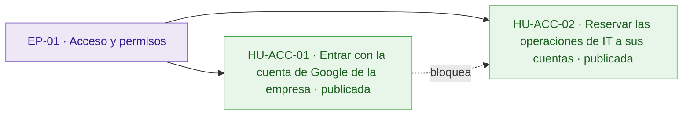
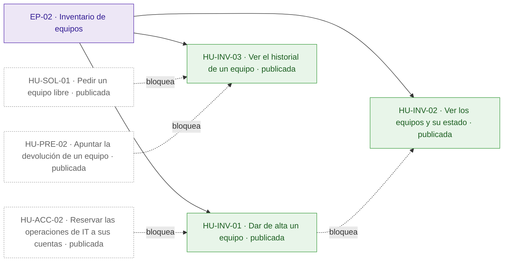
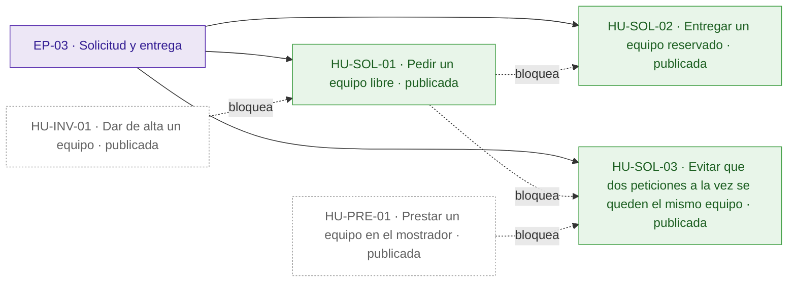
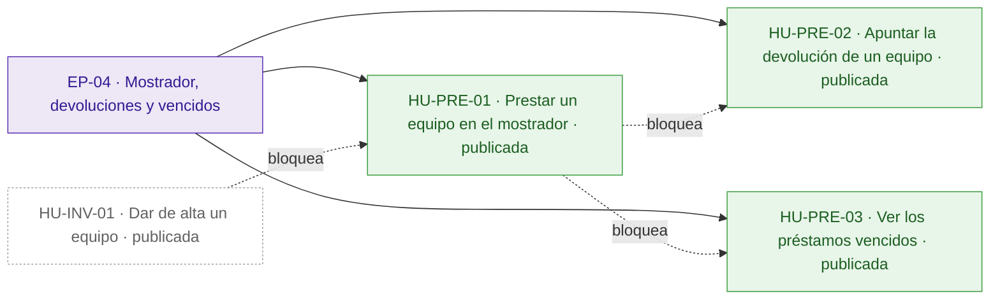
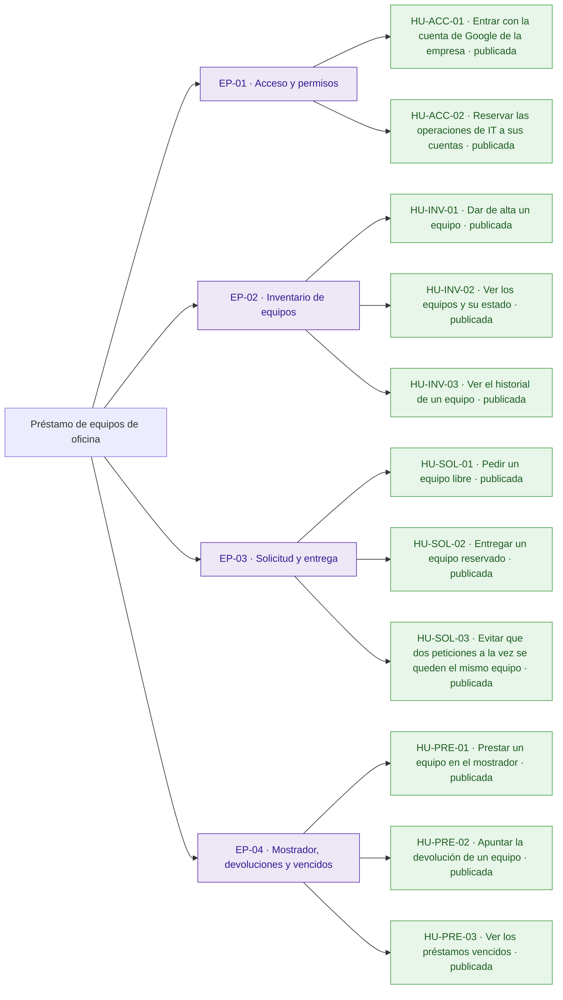
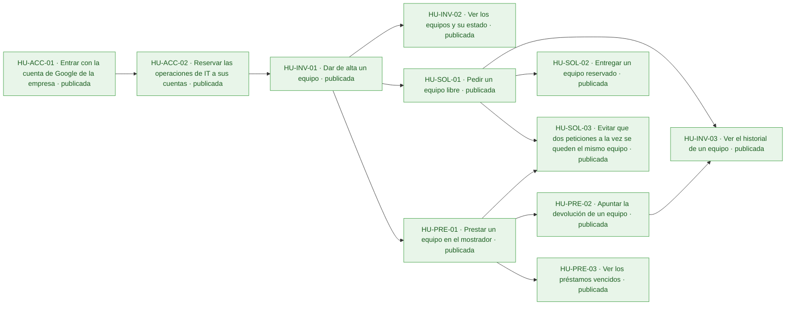
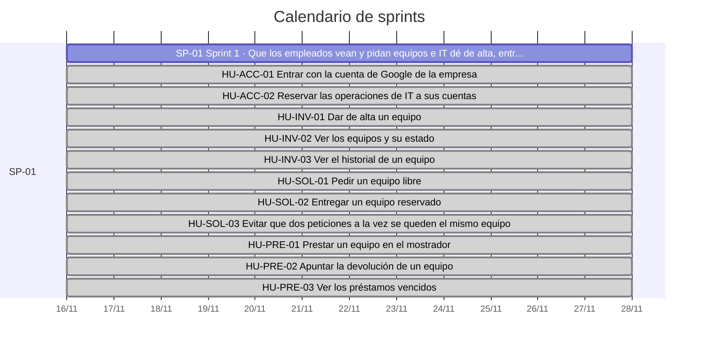
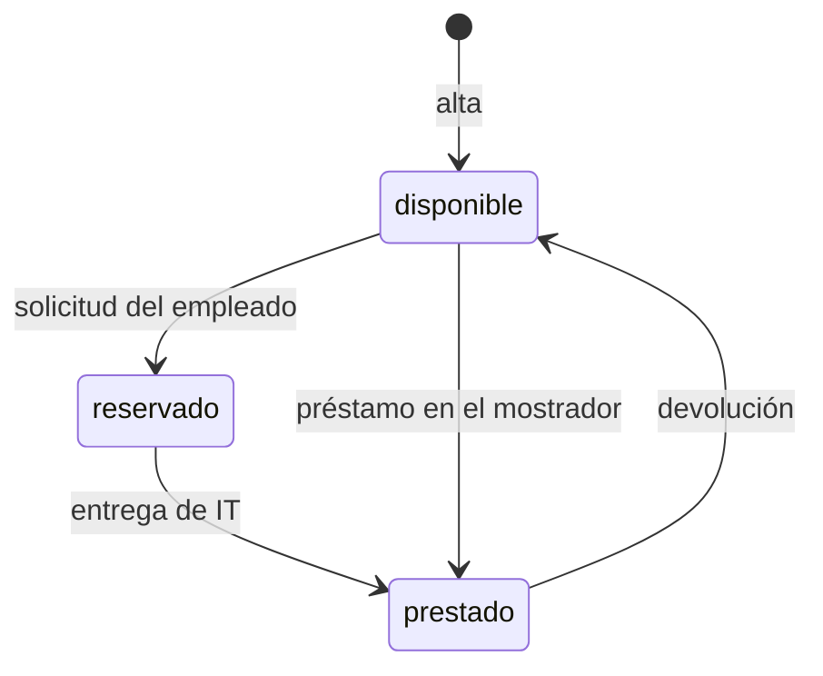

# Préstamo de equipos de oficina

Hoy los préstamos de portátiles, monitores y proyectores se apuntan en una hoja de cálculo y los empleados los piden por correo a IT: nadie sabe qué está libre sin preguntar, dos personas acaban esperando el mismo portátil y los préstamos vencidos pasan desapercibidos hasta que alguien echa en falta el equipo.

La aplicación permite a los empleados ver los equipos y pedir uno libre, y a IT dar de alta los equipos, entregarlos, prestarlos en el mostrador, apuntar las devoluciones, ver los vencidos y consultar el historial. Todos entran con su cuenta de Google de la empresa, un equipo nunca se reserva ni se presta dos veces a la vez y la API tiene que ser exactamente la que fija el anexo, porque el inventario de IT se conectará a ella. Quedan fuera la anulación de solicitudes y los avisos por correo de vencidos.

## Visión y alcance

Una aplicación para gestionar el préstamo de equipos de la oficina en la que los empleados ven qué hay disponible y lo piden, e IT da de alta los equipos, entrega, recoge y ve qué préstamos han vencido.

**Dentro del alcance**

- Ver los equipos y su estado; si está reservado o prestado, también la persona y la fecha de devolución (peticion.md).
- Pedir un equipo libre indicando la fecha de devolución; el equipo queda reservado a nombre de quien lo pide hasta que IT se lo entrega (peticion.md).
- Dar de alta un equipo, solo IT: el nombre es obligatorio y no puede repetir otro, aunque solo cambien las mayúsculas o los espacios al principio o al final (peticion.md).
- Entregar un equipo reservado, solo IT: pasa a prestado con la misma persona y fecha de devolución de la solicitud (peticion.md).
- Prestar en el mostrador, solo IT, indicando la persona y la fecha de devolución; esa fecha puede ser anterior a hoy, porque IT a veces apunta los préstamos con retraso, y el préstamo aparece ya entre los vencidos (peticion.md).
- Apuntar la devolución, solo IT: el equipo vuelve a estar disponible (peticion.md).
- Ver los préstamos vencidos, solo IT: los equipos prestados cuya fecha de devolución es anterior a hoy, del más antiguo al más reciente (peticion.md).
- Ver el historial de un equipo, solo IT: sus préstamos del más reciente al más antiguo, con persona, fecha de devolución y estado (reservado, prestado o devuelto) (peticion.md).
- La fecha de devolución va como texto AAAA-MM-DD y tiene que existir; «hoy» es el día en Madrid; quien pide un equipo no puede poner una fecha anterior a hoy (peticion.md).

**Fuera del alcance**

- Que los empleados anulen una solicitud (peticion.md).
- Avisos por correo de préstamos vencidos (peticion.md).

## Resumen en cifras

| Dato | Valor |
| --- | --- |
| Épicas | 4 |
| Historias | 11 |
| Historias por estado | borrador 0, aprobada 0, descartada 0, publicada 11 |
| Tareas | 34 |
| Sprints | 1 |
| Personas en el equipo | 1 |
| Modalidad de desarrollo | manual, sin IA |
| Horas estimadas | 52 h |
| Horas efectivas (según la modalidad de desarrollo) | 52 h |
| Historias sin estimar | 0 |
| Historias descartadas (fuera de las horas) | 0 |
| Supuestos | 12 |
| Preguntas abiertas | 3 |
| Requisitos | 13 |
| Requisitos sin historia | 0 |

## Índice

- [Visión y alcance](#visión-y-alcance)
- [Resumen en cifras](#resumen-en-cifras)
- [Épicas e historias](#épicas-e-historias)
  - [EP-01 · Acceso y permisos](#ep-01--acceso-y-permisos)
  - [EP-02 · Inventario de equipos](#ep-02--inventario-de-equipos)
  - [EP-03 · Solicitud y entrega](#ep-03--solicitud-y-entrega)
  - [EP-04 · Mostrador, devoluciones y vencidos](#ep-04--mostrador-devoluciones-y-vencidos)
- [Tareas](#tareas)
- [Sprints](#sprints)
- [Equipo](#equipo)
- [Dependencias](#dependencias)
- [Requisitos y trazabilidad](#requisitos-y-trazabilidad)
- [Preparación y definición de hecho](#preparación-y-definición-de-hecho)
- [Diagramas](#diagramas)
- [Supuestos](#supuestos)
- [Preguntas abiertas](#preguntas-abiertas)
- [Decisiones](#decisiones)

## Épicas e historias

### EP-01 · Acceso y permisos

Todos entran con su cuenta de Google de la empresa y solo las cuentas de IT pueden hacer las operaciones reservadas a IT. Protege al inventario y a los empleados de que alguien haga lo que no le toca. No incluye otros métodos de acceso.

#### Épica EP-01: Acceso y permisos

#### HU-ACC-01 · Entrar con la cuenta de Google de la empresa

Como empleado, quiero entrar en la aplicación con mi cuenta de Google de la empresa, para no tener que recordar otra contraseña y que cada operación quede asociada al correo de quien la hace.

**Contexto.** Todos los usuarios entran con su cuenta de Google de la empresa y todas las rutas de la API exigen haber iniciado sesión (RQ.011, peticion.md). La persona de cada operación es el correo del token.

- **Prioridad:** Highest
- **Tamaño:** M
- **Horas:** 4 h estimadas · 4 h efectivas
- **Estado:** publicada
- **Sprint:** SP-01 Sprint 1
- **Responsable:** José Luis Calvo
- **Tipo:** historia
- **Puntos de historia:** 3
- **Preparación:** parcialmente lista (pendiente: DoR-08: dependencias externas sin plan confirmado: Cliente OAuth de Google de la aplicación · supuestos sin confirmar: DoR-04, DoR-05, DoR-06, DoR-07, DoR-09)
- **Requisitos:** RQ.011, RQ.013
- **Dependencias externas:** Cliente OAuth de Google de la aplicación

**Criterios de aceptación**

*Escenarios positivos*

1. **Dado** la empleada «ana.perez@empresa.com» con un token de identidad de Google con el correo verificado, emitido para el cliente OAuth de la aplicación, **cuando** consulta GET /api/equipos, **entonces** recibe 200 con la lista de equipos.

*Escenarios negativos*

1. **Dado** una petición sin token, **cuando** consulta GET /api/equipos, **entonces** recibe 401 con {"error": "Inicia sesión con Google."}.
2. **Dado** un token de Google de «ana.perez@empresa.com» emitido para otro cliente OAuth, **cuando** consulta GET /api/equipos, **entonces** recibe 401 con {"error": "Inicia sesión con Google."}.

**Notas.** El inventario de IT entra con un token de una cuenta de servicio, que también vale. La tarea de pantalla depende de la pregunta abierta \[alta\] sobre las pantallas.

**Definición de hecho**

- Criterios de aceptación probados.
- Mensajes de error idénticos a los del anexo de la API.
- Textos revisados en español de España.

**Tareas**

- TA-001 · Verificación del token de identidad de Google y respuesta 401 · backend · José Luis Calvo
- TA-002 · Pantalla de entrada con la cuenta de Google · frontend · José Luis Calvo
- TA-003 · Pruebas de acceso con token válido, sin token y de otro cliente · QA · José Luis Calvo

#### HU-ACC-02 · Reservar las operaciones de IT a sus cuentas

Como técnico de IT, quiero que solo las cuentas de IT puedan hacer las operaciones de IT, para que ningún empleado pueda dar de alta, entregar, prestar o apuntar devoluciones por su cuenta.

**Contexto.** Las operaciones marcadas «Solo IT» solo las puede hacer una cuenta de la variable de entorno CORREOS\_IT, fijada en la configuración del despliegue (RQ.012, peticion.md). Responde al riesgo de que un empleado haga lo que solo le toca a IT.

- **Prioridad:** Highest
- **Tamaño:** M
- **Horas:** 4 h estimadas · 4 h efectivas
- **Estado:** publicada
- **Sprint:** SP-01 Sprint 1
- **Responsable:** José Luis Calvo
- **Tipo:** historia
- **Puntos de historia:** 3
- **Preparación:** parcialmente lista (pendiente: DoR-08: depende de HU-ACC-01, sin resolver ni planificada en un sprint anterior · supuestos sin confirmar: DoR-04, DoR-05, DoR-06, DoR-07, DoR-09)
- **Requisitos:** RQ.012, RQ.013
- **Depende de:**
  - HU-ACC-01 · Entrar con la cuenta de Google de la empresa: Saber quién es IT exige saber quién ha iniciado sesión.

**Criterios de aceptación**

*Escenarios positivos*

1. **Dado** CORREOS\_IT con «it@empresa.com,soporte@empresa.com» y un token de «IT@empresa.com», **cuando** envía POST /api/equipos con {"nombre": "Portátil 07"}, **entonces** recibe 201 con el equipo «Portátil 07» disponible.

*Escenarios negativos*

1. **Dado** CORREOS\_IT con «it@empresa.com,soporte@empresa.com» y un token de «ana.perez@empresa.com», **cuando** envía POST /api/equipos con {"nombre": "Portátil 07"}, **entonces** recibe 403 con {"error": "Solo IT puede hacer esto."} y no se crea ningún equipo.
2. **Dado** CORREOS\_IT con «it@empresa.com» y un token de «ana.perez@empresa.com», **cuando** consulta GET /api/prestamos/vencidos, **entonces** recibe 403 con {"error": "Solo IT puede hacer esto."}.
3. **Dado** CORREOS\_IT con «it@empresa.com», un token de «ana.perez@empresa.com» y el equipo «Portátil 07» reservado por ella, **cuando** envía POST /api/equipos/{id}/entrega de «Portátil 07», **entonces** recibe 403 con {"error": "Solo IT puede hacer esto."} y el equipo sigue reservado.
4. **Dado** CORREOS\_IT con «it@empresa.com», un token de «ana.perez@empresa.com» y el equipo «Proyector 01» disponible, **cuando** envía POST /api/equipos/{id}/prestamo con {"persona": "ana.perez@empresa.com", "devolucion": "2026-11-20"}, **entonces** recibe 403 con {"error": "Solo IT puede hacer esto."} y el equipo sigue disponible.
5. **Dado** CORREOS\_IT con «it@empresa.com», un token de «ana.perez@empresa.com» y el equipo «Monitor 03» prestado a ella, **cuando** envía POST /api/equipos/{id}/devolucion de «Monitor 03», **entonces** recibe 403 con {"error": "Solo IT puede hacer esto."} y el equipo sigue prestado.
6. **Dado** CORREOS\_IT con «it@empresa.com», un token de «ana.perez@empresa.com» y el equipo «Portátil 07», **cuando** consulta GET /api/equipos/{id}/historial de «Portátil 07», **entonces** recibe 403 con {"error": "Solo IT puede hacer esto."}.

**Notas.** La lista de cuentas de IT no se escribe en el código. La cuenta de servicio del inventario está en esa lista.

**Definición de hecho**

- Criterios de aceptación probados.
- 403 «Solo IT puede hacer esto.» para «ana.perez@empresa.com» en POST /api/equipos, POST /api/equipos/{id}/entrega, POST /api/equipos/{id}/prestamo, POST /api/equipos/{id}/devolucion, GET /api/prestamos/vencidos y GET /api/equipos/{id}/historial.
- Textos revisados en español de España.

**Tareas**

- TA-004 · Lectura de CORREOS\_IT y respuesta 403 en las operaciones de IT · backend · José Luis Calvo
- TA-005 · Pruebas del 403 en todas las operaciones de IT · QA · José Luis Calvo

### EP-02 · Inventario de equipos

IT da de alta los equipos y consulta el historial de cada uno, y todos ven los equipos con su estado. Es la base sobre la que se piden y se prestan los equipos. No incluye dar de baja ni modificar equipos, que está pendiente de confirmar.

#### Épica EP-02: Inventario de equipos

#### HU-INV-01 · Dar de alta un equipo

Como técnico de IT, quiero dar de alta un equipo con su nombre, para que los empleados puedan verlo y pedirlo sin escribir a IT.

**Contexto.** IT da de alta los equipos (RQ.003, peticion.md). Dos nombres son el mismo si solo se diferencian en mayúsculas o en espacios al principio o al final.

- **Prioridad:** Highest
- **Tamaño:** M
- **Horas:** 4 h estimadas · 4 h efectivas
- **Estado:** publicada
- **Sprint:** SP-01 Sprint 1
- **Responsable:** José Luis Calvo
- **Tipo:** historia
- **Puntos de historia:** 3
- **Preparación:** parcialmente lista (pendiente: DoR-08: depende de HU-ACC-02, sin resolver ni planificada en un sprint anterior · supuestos sin confirmar: DoR-04, DoR-05, DoR-06, DoR-07, DoR-09)
- **Requisitos:** RQ.003, RQ.013
- **Depende de:**
  - HU-ACC-02 · Reservar las operaciones de IT a sus cuentas: El alta es una operación reservada a las cuentas de IT.

**Criterios de aceptación**

*Escenarios positivos*

1. **Dado** la cuenta de IT «it@empresa.com» y ningún equipo llamado «Portátil 07», **cuando** envía POST /api/equipos con {"nombre": "Portátil 07"}, **entonces** recibe 201 con {"id": "…", "nombre": "Portátil 07", "estado": "disponible"}.

*Escenarios negativos*

1. **Dado** la cuenta de IT «it@empresa.com», **cuando** envía POST /api/equipos con {"nombre": ""}, **entonces** recibe 400 con {"error": "Falta el nombre del equipo"}.
2. **Dado** la cuenta de IT «it@empresa.com» y el equipo «Portátil 07» ya dado de alta, **cuando** envía POST /api/equipos con {"nombre": " portátil 07 "}, **entonces** recibe 409 con {"error": "Ya hay un equipo con ese nombre"}.

**Notas.** Se supone que el tipo de equipo (portátil, monitor, proyector) forma parte del nombre. La tarea de pantalla depende de la pregunta abierta \[alta\] sobre las pantallas.

**Definición de hecho**

- Criterios de aceptación probados.
- Respuestas idénticas a las del anexo de la API.
- Textos revisados en español de España.

**Tareas**

- TA-006 · Modelo del equipo con nombre normalizado único · datos · José Luis Calvo
- TA-007 · Ruta POST /api/equipos con sus validaciones · backend · José Luis Calvo
- TA-008 · Formulario de alta de equipos para IT · frontend · José Luis Calvo
- TA-009 · Pruebas del alta, del nombre vacío y del nombre repetido · QA · José Luis Calvo

#### HU-INV-02 · Ver los equipos y su estado

Como empleado, quiero ver los equipos con su estado, para saber qué está libre sin preguntar a IT.

**Contexto.** Cualquier empleado ve los equipos y su estado (RQ.001, peticion.md). Responde al problema de no saber qué está libre sin preguntar.

- **Prioridad:** Highest
- **Tamaño:** S
- **Horas:** 2 h estimadas · 2 h efectivas
- **Estado:** publicada
- **Sprint:** SP-01 Sprint 1
- **Responsable:** José Luis Calvo
- **Tipo:** historia
- **Puntos de historia:** 2
- **Preparación:** parcialmente lista (pendiente: DoR-08: depende de HU-INV-01, sin resolver ni planificada en un sprint anterior · supuestos sin confirmar: DoR-04, DoR-05, DoR-06, DoR-07, DoR-09)
- **Requisitos:** RQ.001, RQ.013
- **Depende de:**
  - HU-INV-01 · Dar de alta un equipo: Para ver equipos tiene que haber equipos dados de alta.

**Criterios de aceptación**

*Escenarios positivos*

1. **Dado** el equipo «Portátil 07» disponible y el equipo «Monitor 03» reservado por «luis.gomez@empresa.com» con devolución «2026-11-20», **cuando** la empleada «ana.perez@empresa.com» consulta GET /api/equipos, **entonces** recibe 200 con «Portátil 07» con estado «disponible» y «Monitor 03» con estado «reservado», persona «luis.gomez@empresa.com» y devolución «2026-11-20».
2. **Dado** el equipo «Proyector 01» disponible, **cuando** la empleada «ana.perez@empresa.com» consulta GET /api/equipos, **entonces** «Proyector 01» aparece con id, nombre y estado «disponible», sin persona ni devolución.

*Escenarios negativos*

1. **Dado** un token de Google de «ana.perez@empresa.com» con el correo sin verificar, **cuando** consulta GET /api/equipos, **entonces** recibe 401 con {"error": "Inicia sesión con Google."} y ninguna lista de equipos.

**Notas.** La tarea de pantalla depende de la pregunta abierta \[alta\] sobre las pantallas.

**Definición de hecho**

- Criterios de aceptación probados.
- Respuestas idénticas a las del anexo de la API.
- Textos revisados en español de España.

**Tareas**

- TA-010 · Ruta GET /api/equipos · backend · José Luis Calvo
- TA-011 · Listado de equipos con su estado · frontend · José Luis Calvo
- TA-012 · Pruebas del listado con equipos en cada estado · QA · José Luis Calvo

#### HU-INV-03 · Ver el historial de un equipo

Como técnico de IT, quiero consultar los préstamos de un equipo, para saber quién lo ha tenido y cuándo debía devolverlo.

**Contexto.** IT consulta el historial de cada equipo (RQ.008, peticion.md), del más reciente al más antiguo.

- **Prioridad:** High
- **Tamaño:** M
- **Horas:** 4 h estimadas · 4 h efectivas
- **Estado:** publicada
- **Sprint:** SP-01 Sprint 1
- **Responsable:** José Luis Calvo
- **Tipo:** historia
- **Puntos de historia:** 3
- **Preparación:** parcialmente lista (pendiente: DoR-08: depende de HU-SOL-01, HU-PRE-02, sin resolver ni planificada en un sprint anterior · supuestos sin confirmar: DoR-04, DoR-05, DoR-06, DoR-07, DoR-09)
- **Requisitos:** RQ.008, RQ.013
- **Depende de:**
  - HU-SOL-01 · Pedir un equipo libre: El historial recoge las reservas.
  - HU-PRE-02 · Apuntar la devolución de un equipo: El historial recoge los préstamos devueltos.

**Criterios de aceptación**

*Escenarios positivos*

1. **Dado** el equipo «Portátil 07» prestado a «ana.perez@empresa.com» con devolución «2026-11-05» y ya devuelto, y ahora reservado por «luis.gomez@empresa.com» con devolución «2026-11-20», **cuando** la cuenta de IT «it@empresa.com» consulta GET /api/equipos/{id}/historial de «Portátil 07», **entonces** recibe 200 con primero «luis.gomez@empresa.com», «2026-11-20», «reservado» y después «ana.perez@empresa.com», «2026-11-05», «devuelto».

*Escenarios negativos*

1. **Dado** la cuenta de IT «it@empresa.com» y ningún equipo con el id «no-existe», **cuando** consulta GET /api/equipos/no-existe/historial, **entonces** recibe 404 con {"error": "No existe el equipo"}.

**Notas.** Se supone que un préstamo pasa a «devuelto» cuando IT apunta la devolución. La tarea de pantalla depende de la pregunta abierta \[alta\] sobre las pantallas.

**Definición de hecho**

- Criterios de aceptación probados.
- Respuestas idénticas a las del anexo de la API.
- Textos revisados en español de España.

**Tareas**

- TA-013 · Registro de cada préstamo con su estado · datos · José Luis Calvo
- TA-014 · Ruta GET /api/equipos/{id}/historial · backend · José Luis Calvo
- TA-015 · Vista del historial de un equipo para IT · frontend · José Luis Calvo
- TA-016 · Pruebas del orden del historial y del equipo inexistente · QA · José Luis Calvo

### EP-03 · Solicitud y entrega

Los empleados piden un equipo libre con la fecha en que lo devolverán y el equipo queda reservado hasta que IT se lo entrega. Garantiza que un equipo nunca se reserva ni se presta dos veces a la vez. No incluye anular una solicitud.

#### Épica EP-03: Solicitud y entrega

#### HU-SOL-01 · Pedir un equipo libre

Como empleado, quiero pedir un equipo libre indicando la fecha en que lo devolveré, para tenerlo apartado a mi nombre sin escribir a IT ni esperar a que me contesten.

**Contexto.** Cualquier empleado pide un equipo libre con la fecha en que lo devolverá y el equipo queda reservado a su nombre hasta que IT se lo entrega (RQ.002, peticion.md). La fecha va como AAAA-MM-DD, tiene que existir y no puede ser anterior a hoy, el día en Madrid (RQ.009).

- **Prioridad:** Highest
- **Tamaño:** L
- **Horas:** 8 h estimadas · 8 h efectivas
- **Estado:** publicada
- **Sprint:** SP-01 Sprint 1
- **Responsable:** José Luis Calvo
- **Tipo:** historia
- **Puntos de historia:** 5
- **Preparación:** parcialmente lista (pendiente: DoR-08: depende de HU-INV-01, sin resolver ni planificada en un sprint anterior · supuestos sin confirmar: DoR-04, DoR-05, DoR-06, DoR-07, DoR-09)
- **Requisitos:** RQ.002, RQ.009, RQ.013
- **Depende de:**
  - HU-INV-01 · Dar de alta un equipo: Para pedir un equipo tiene que estar dado de alta.

**Criterios de aceptación**

*Escenarios positivos*

1. **Dado** hoy es el 14 de noviembre de 2026 en Madrid y el equipo «Portátil 07» está disponible, **cuando** la empleada «ana.perez@empresa.com» envía POST /api/equipos/{id}/solicitud con {"devolucion": "2026-11-20"}, **entonces** recibe 201 con el equipo en estado «reservado», persona «ana.perez@empresa.com» y devolución «2026-11-20».

*Escenarios negativos*

1. **Dado** hoy es el 14 de noviembre de 2026 en Madrid y el equipo «Portátil 07» está disponible, **cuando** la empleada «ana.perez@empresa.com» envía la solicitud con {"devolucion": "2026-11-13"}, **entonces** recibe 400 con {"error": "La fecha de devolución ya ha pasado"} y el equipo sigue disponible.
2. **Dado** el equipo «Portátil 07» disponible, **cuando** la empleada «ana.perez@empresa.com» envía la solicitud con {"devolucion": "2026-02-30"}, **entonces** recibe 400 con {"error": "La fecha de devolución no es válida"}.
3. **Dado** el equipo «Portátil 07» disponible, **cuando** la empleada «ana.perez@empresa.com» envía la solicitud con {}, **entonces** recibe 400 con {"error": "Falta la fecha de devolución"}.
4. **Dado** el equipo «Monitor 03» reservado por «luis.gomez@empresa.com», **cuando** la empleada «ana.perez@empresa.com» envía la solicitud de «Monitor 03» con {"devolucion": "2026-11-20"}, **entonces** recibe 409 con {"error": "El equipo no está disponible"} y la reserva sigue a nombre de «luis.gomez@empresa.com».
5. **Dado** ningún equipo con el id «no-existe», **cuando** la empleada «ana.perez@empresa.com» envía POST /api/equipos/no-existe/solicitud con {"devolucion": "2026-11-20"}, **entonces** recibe 404 con {"error": "No existe el equipo"}.

**Notas.** Los empleados no pueden anular una solicitud. Está abierta la pregunta de qué pasa con una reserva que IT nunca entrega. La tarea de pantalla depende de la pregunta abierta \[alta\] sobre las pantallas.

**Definición de hecho**

- Criterios de aceptación probados.
- Respuestas idénticas a las del anexo de la API.
- «Hoy» calculado con la zona horaria de Madrid.
- Textos revisados en español de España.

**Tareas**

- TA-017 · Ruta POST /api/equipos/{id}/solicitud con validación de fecha · backend · José Luis Calvo
- TA-018 · Acción de pedir un equipo con la fecha de devolución · frontend · José Luis Calvo
- TA-019 · Pruebas de la solicitud y de cada error · QA · José Luis Calvo

#### HU-SOL-02 · Entregar un equipo reservado

Como técnico de IT, quiero apuntar la entrega de un equipo reservado, para que conste quién tiene el equipo y cuándo tiene que devolverlo.

**Contexto.** IT entrega los equipos reservados; el equipo pasa a prestado con la misma persona y fecha de devolución de la solicitud (RQ.004, peticion.md).

- **Prioridad:** Highest
- **Tamaño:** M
- **Horas:** 4 h estimadas · 4 h efectivas
- **Estado:** publicada
- **Sprint:** SP-01 Sprint 1
- **Responsable:** José Luis Calvo
- **Tipo:** historia
- **Puntos de historia:** 3
- **Preparación:** parcialmente lista (pendiente: DoR-08: depende de HU-SOL-01, sin resolver ni planificada en un sprint anterior · supuestos sin confirmar: DoR-04, DoR-05, DoR-06, DoR-07, DoR-09)
- **Requisitos:** RQ.004, RQ.013
- **Depende de:**
  - HU-SOL-01 · Pedir un equipo libre: Solo se entrega un equipo reservado.

**Criterios de aceptación**

*Escenarios positivos*

1. **Dado** el equipo «Portátil 07» reservado por «ana.perez@empresa.com» con devolución «2026-11-20», **cuando** la cuenta de IT «it@empresa.com» envía POST /api/equipos/{id}/entrega, **entonces** recibe 200 con el equipo en estado «prestado», persona «ana.perez@empresa.com» y devolución «2026-11-20».

*Escenarios negativos*

1. **Dado** el equipo «Proyector 01» disponible, **cuando** la cuenta de IT «it@empresa.com» envía POST /api/equipos/{id}/entrega, **entonces** recibe 409 con {"error": "El equipo no está reservado"} y el equipo sigue disponible.
2. **Dado** ningún equipo con el id «no-existe», **cuando** la cuenta de IT «it@empresa.com» envía POST /api/equipos/no-existe/entrega, **entonces** recibe 404 con {"error": "No existe el equipo"}.

**Notas.** La tarea de pantalla depende de la pregunta abierta \[alta\] sobre las pantallas.

**Definición de hecho**

- Criterios de aceptación probados.
- Respuestas idénticas a las del anexo de la API.
- Textos revisados en español de España.

**Tareas**

- TA-020 · Ruta POST /api/equipos/{id}/entrega · backend · José Luis Calvo
- TA-021 · Acción de entregar un equipo reservado · frontend · José Luis Calvo
- TA-022 · Pruebas de la entrega y de sus errores · QA · José Luis Calvo

#### HU-SOL-03 · Evitar que dos peticiones a la vez se queden el mismo equipo

Como empleado, quiero pedir un equipo libre sabiendo que, si otra persona lo pide a la vez, solo una petición lo reserva, para no ir a recoger un equipo que ya tiene otra persona.

**Contexto.** Un equipo no puede estar reservado o prestado dos veces a la vez, ni siquiera si dos personas lo piden en el mismo momento (RQ.010, peticion.md). Es lo que más preocupa al cliente y una de sus métricas de éxito.

- **Prioridad:** Highest
- **Tamaño:** L
- **Horas:** 8 h estimadas · 8 h efectivas
- **Estado:** publicada
- **Sprint:** SP-01 Sprint 1
- **Responsable:** José Luis Calvo
- **Tipo:** historia
- **Puntos de historia:** 5
- **Preparación:** parcialmente lista (pendiente: DoR-08: depende de HU-SOL-01, HU-PRE-01, sin resolver ni planificada en un sprint anterior · supuestos sin confirmar: DoR-04, DoR-05, DoR-06, DoR-07, DoR-09)
- **Requisitos:** RQ.010, RQ.013
- **Depende de:**
  - HU-SOL-01 · Pedir un equipo libre: Las peticiones simultáneas incluyen solicitudes.
  - HU-PRE-01 · Prestar un equipo en el mostrador: Las peticiones simultáneas incluyen préstamos en el mostrador.

**Criterios de aceptación**

*Escenarios positivos*

1. **Dado** el equipo «Proyector 01» disponible, **cuando** «ana.perez@empresa.com» envía la solicitud y la cuenta de IT «it@empresa.com» envía a la vez POST /api/equipos/{id}/prestamo para «luis.gomez@empresa.com», **entonces** solo una de las dos peticiones sale bien, la otra recibe 409 con {"error": "El equipo no está disponible"} y el equipo queda a nombre de una sola persona.

*Escenarios negativos*

1. **Dado** el equipo «Portátil 07» disponible, **cuando** «ana.perez@empresa.com» y «luis.gomez@empresa.com» envían a la vez POST /api/equipos/{id}/solicitud con {"devolucion": "2026-11-20"}, **entonces** una petición recibe 201 con el equipo reservado a nombre de quien la envía, la otra recibe 409 con {"error": "El equipo no está disponible"} y la persona del equipo sigue siendo la de la petición que sale bien.

**Notas.** Responde al riesgo de que dos empleados se queden con el mismo equipo porque lo pidieron a la vez.

**Definición de hecho**

- Criterios de aceptación probados con peticiones simultáneas repetidas.
- Nunca salen bien las dos peticiones.
- Textos revisados en español de España.

**Tareas**

- TA-023 · Cambio de estado atómico del equipo · datos · José Luis Calvo
- TA-024 · Solicitud y préstamo con control de concurrencia · backend · José Luis Calvo
- TA-025 · Pruebas de peticiones simultáneas · QA · José Luis Calvo

### EP-04 · Mostrador, devoluciones y vencidos

IT presta equipos directamente en el mostrador, apunta las devoluciones y ve los préstamos vencidos. Permite revisar los vencidos cada semana sin preguntar a nadie. No incluye avisos por correo de vencidos.

#### Épica EP-04: Mostrador, devoluciones y vencidos

#### HU-PRE-01 · Prestar un equipo en el mostrador

Como técnico de IT, quiero prestar un equipo disponible a quien viene a pedirlo al mostrador, para atenderle en el momento sin que tenga que hacer una solicitud.

**Contexto.** IT presta directamente a quien viene a pedirlo al mostrador (RQ.005, peticion.md). A diferencia de la solicitud, IT puede poner una fecha anterior a hoy, porque a veces apunta los préstamos con retraso; un préstamo así ya aparece entre los vencidos.

- **Prioridad:** Highest
- **Tamaño:** L
- **Horas:** 8 h estimadas · 8 h efectivas
- **Estado:** publicada
- **Sprint:** SP-01 Sprint 1
- **Responsable:** José Luis Calvo
- **Tipo:** historia
- **Puntos de historia:** 5
- **Preparación:** parcialmente lista (pendiente: DoR-08: depende de HU-INV-01, sin resolver ni planificada en un sprint anterior · supuestos sin confirmar: DoR-04, DoR-05, DoR-06, DoR-07, DoR-09)
- **Requisitos:** RQ.005, RQ.009, RQ.013
- **Depende de:**
  - HU-INV-01 · Dar de alta un equipo: Para prestar un equipo tiene que estar dado de alta.

**Criterios de aceptación**

*Escenarios positivos*

1. **Dado** el equipo «Proyector 01» disponible, **cuando** la cuenta de IT «it@empresa.com» envía POST /api/equipos/{id}/prestamo con {"persona": "ana.perez@empresa.com", "devolucion": "2026-11-20"}, **entonces** recibe 201 con el equipo en estado «prestado», persona «ana.perez@empresa.com» y devolución «2026-11-20».
2. **Dado** hoy es el 14 de noviembre de 2026 en Madrid y el equipo «Monitor 05» está disponible, **cuando** la cuenta de IT «it@empresa.com» presta «Monitor 05» con {"persona": "luis.gomez@empresa.com", "devolucion": "2026-11-10"}, **entonces** recibe 201 con el equipo prestado con devolución «2026-11-10».

*Escenarios negativos*

1. **Dado** el equipo «Proyector 01» disponible, **cuando** la cuenta de IT «it@empresa.com» presta «Proyector 01» con {"devolucion": "2026-11-20"}, **entonces** recibe 400 con {"error": "Faltan la persona o la fecha de devolución"}.
2. **Dado** el equipo «Proyector 01» disponible, **cuando** la cuenta de IT «it@empresa.com» presta «Proyector 01» con {"persona": "ana.perez@empresa.com", "devolucion": "2026-02-30"}, **entonces** recibe 400 con {"error": "La fecha de devolución no es válida"}.
3. **Dado** el equipo «Monitor 03» reservado por «luis.gomez@empresa.com», **cuando** la cuenta de IT «it@empresa.com» presta «Monitor 03» con {"persona": "ana.perez@empresa.com", "devolucion": "2026-11-20"}, **entonces** recibe 409 con {"error": "El equipo no está disponible"}.
4. **Dado** ningún equipo con el id «no-existe», **cuando** la cuenta de IT «it@empresa.com» envía POST /api/equipos/no-existe/prestamo con {"persona": "ana.perez@empresa.com", "devolucion": "2026-11-20"}, **entonces** recibe 404 con {"error": "No existe el equipo"}.

**Notas.** Está abierta la pregunta de si se comprueba que la persona tenga un correo de la empresa. La tarea de pantalla depende de la pregunta abierta \[alta\] sobre las pantallas.

**Definición de hecho**

- Criterios de aceptación probados.
- Respuestas idénticas a las del anexo de la API.
- Textos revisados en español de España.

**Tareas**

- TA-026 · Ruta POST /api/equipos/{id}/prestamo con sus validaciones · backend · José Luis Calvo
- TA-027 · Formulario de préstamo en el mostrador · frontend · José Luis Calvo
- TA-028 · Pruebas del préstamo, de la fecha pasada y de cada error · QA · José Luis Calvo

#### HU-PRE-02 · Apuntar la devolución de un equipo

Como técnico de IT, quiero apuntar que un equipo prestado se ha devuelto, para que vuelva a estar libre para el siguiente empleado y deje de contar como vencido.

**Contexto.** IT apunta las devoluciones y el equipo vuelve a estar disponible, sin persona ni fecha de devolución (RQ.006, peticion.md).

- **Prioridad:** Highest
- **Tamaño:** S
- **Horas:** 2 h estimadas · 2 h efectivas
- **Estado:** publicada
- **Sprint:** SP-01 Sprint 1
- **Responsable:** José Luis Calvo
- **Tipo:** historia
- **Puntos de historia:** 2
- **Preparación:** parcialmente lista (pendiente: DoR-08: depende de HU-PRE-01, sin resolver ni planificada en un sprint anterior · supuestos sin confirmar: DoR-04, DoR-05, DoR-06, DoR-07, DoR-09)
- **Requisitos:** RQ.006, RQ.013
- **Depende de:**
  - HU-PRE-01 · Prestar un equipo en el mostrador: Solo se devuelve un equipo prestado.

**Criterios de aceptación**

*Escenarios positivos*

1. **Dado** el equipo «Portátil 07» prestado a «ana.perez@empresa.com» con devolución «2026-11-20», **cuando** la cuenta de IT «it@empresa.com» envía POST /api/equipos/{id}/devolucion, **entonces** recibe 200 con el equipo en estado «disponible», sin persona ni devolución.

*Escenarios negativos*

1. **Dado** el equipo «Monitor 03» reservado por «luis.gomez@empresa.com», **cuando** la cuenta de IT «it@empresa.com» envía POST /api/equipos/{id}/devolucion, **entonces** recibe 409 con {"error": "El equipo no está prestado"} y la reserva sigue igual.
2. **Dado** ningún equipo con el id «no-existe», **cuando** la cuenta de IT «it@empresa.com» envía POST /api/equipos/no-existe/devolucion, **entonces** recibe 404 con {"error": "No existe el equipo"}.

**Notas.** La tarea de pantalla depende de la pregunta abierta \[alta\] sobre las pantallas.

**Definición de hecho**

- Criterios de aceptación probados.
- Respuestas idénticas a las del anexo de la API.
- Textos revisados en español de España.

**Tareas**

- TA-029 · Ruta POST /api/equipos/{id}/devolucion · backend · José Luis Calvo
- TA-030 · Acción de apuntar la devolución · frontend · José Luis Calvo
- TA-031 · Pruebas de la devolución y de sus errores · QA · José Luis Calvo

#### HU-PRE-03 · Ver los préstamos vencidos

Como técnico de IT, quiero ver los préstamos cuya fecha de devolución ya ha pasado, para reclamar los equipos cada semana sin esperar a que alguien los eche en falta.

**Contexto.** IT ve qué préstamos han vencido: los equipos prestados cuya fecha de devolución es anterior a hoy, el día en Madrid, del más antiguo al más reciente (RQ.007, peticion.md). Una de las métricas de éxito es que IT revise los vencidos cada semana sin preguntar a nadie.

- **Prioridad:** Highest
- **Tamaño:** M
- **Horas:** 4 h estimadas · 4 h efectivas
- **Estado:** publicada
- **Sprint:** SP-01 Sprint 1
- **Responsable:** José Luis Calvo
- **Tipo:** historia
- **Puntos de historia:** 3
- **Preparación:** parcialmente lista (pendiente: DoR-08: depende de HU-PRE-01, sin resolver ni planificada en un sprint anterior · supuestos sin confirmar: DoR-04, DoR-05, DoR-06, DoR-07, DoR-09)
- **Requisitos:** RQ.007, RQ.013
- **Depende de:**
  - HU-PRE-01 · Prestar un equipo en el mostrador: Los vencidos son préstamos hechos.

**Criterios de aceptación**

*Escenarios positivos*

1. **Dado** hoy es el 14 de noviembre de 2026 en Madrid, «Monitor 03» prestado con devolución «2026-11-12», «Portátil 07» prestado con devolución «2026-11-10» y «Proyector 01» prestado con devolución «2026-11-20», **cuando** la cuenta de IT «it@empresa.com» consulta GET /api/prestamos/vencidos, **entonces** recibe 200 con primero «Portátil 07» y después «Monitor 03», cada uno con id, nombre, persona y devolución, y sin «Proyector 01».

*Escenarios negativos*

1. **Dado** hoy es el 14 de noviembre de 2026 en Madrid, «Monitor 05» reservado con devolución «2026-11-10» y «Portátil 08» prestado con devolución «2026-11-14», **cuando** la cuenta de IT «it@empresa.com» consulta GET /api/prestamos/vencidos, **entonces** recibe 200 con una lista que no incluye «Monitor 05» ni «Portátil 08».

**Notas.** No hay avisos por correo de préstamos vencidos: IT los consulta aquí. La tarea de pantalla depende de la pregunta abierta \[alta\] sobre las pantallas.

**Definición de hecho**

- Criterios de aceptación probados.
- Respuestas idénticas a las del anexo de la API.
- «Hoy» calculado con la zona horaria de Madrid.
- Textos revisados en español de España.

**Tareas**

- TA-032 · Ruta GET /api/prestamos/vencidos con hoy en Madrid · backend · José Luis Calvo
- TA-033 · Listado de préstamos vencidos para IT · frontend · José Luis Calvo
- TA-034 · Pruebas del orden y del límite de hoy en los vencidos · QA · José Luis Calvo

## Tareas

| ID | Título | Historia | Disciplina | Descripción | Responsable | Horas estimadas | Horas efectivas |
| --- | --- | --- | --- | --- | --- | --- | --- |
| TA-001 | Verificación del token de identidad de Google y respuesta 401 | HU-ACC-01 · Entrar con la cuenta de Google de la empresa | backend |   | José Luis Calvo |   |   |
| TA-002 | Pantalla de entrada con la cuenta de Google | HU-ACC-01 · Entrar con la cuenta de Google de la empresa | frontend |   | José Luis Calvo |   |   |
| TA-003 | Pruebas de acceso con token válido, sin token y de otro cliente | HU-ACC-01 · Entrar con la cuenta de Google de la empresa | QA |   | José Luis Calvo |   |   |
| TA-004 | Lectura de CORREOS\_IT y respuesta 403 en las operaciones de IT | HU-ACC-02 · Reservar las operaciones de IT a sus cuentas | backend |   | José Luis Calvo |   |   |
| TA-005 | Pruebas del 403 en todas las operaciones de IT | HU-ACC-02 · Reservar las operaciones de IT a sus cuentas | QA |   | José Luis Calvo |   |   |
| TA-006 | Modelo del equipo con nombre normalizado único | HU-INV-01 · Dar de alta un equipo | datos |   | José Luis Calvo |   |   |
| TA-007 | Ruta POST /api/equipos con sus validaciones | HU-INV-01 · Dar de alta un equipo | backend |   | José Luis Calvo |   |   |
| TA-008 | Formulario de alta de equipos para IT | HU-INV-01 · Dar de alta un equipo | frontend |   | José Luis Calvo |   |   |
| TA-009 | Pruebas del alta, del nombre vacío y del nombre repetido | HU-INV-01 · Dar de alta un equipo | QA |   | José Luis Calvo |   |   |
| TA-010 | Ruta GET /api/equipos | HU-INV-02 · Ver los equipos y su estado | backend |   | José Luis Calvo |   |   |
| TA-011 | Listado de equipos con su estado | HU-INV-02 · Ver los equipos y su estado | frontend |   | José Luis Calvo |   |   |
| TA-012 | Pruebas del listado con equipos en cada estado | HU-INV-02 · Ver los equipos y su estado | QA |   | José Luis Calvo |   |   |
| TA-013 | Registro de cada préstamo con su estado | HU-INV-03 · Ver el historial de un equipo | datos |   | José Luis Calvo |   |   |
| TA-014 | Ruta GET /api/equipos/{id}/historial | HU-INV-03 · Ver el historial de un equipo | backend |   | José Luis Calvo |   |   |
| TA-015 | Vista del historial de un equipo para IT | HU-INV-03 · Ver el historial de un equipo | frontend |   | José Luis Calvo |   |   |
| TA-016 | Pruebas del orden del historial y del equipo inexistente | HU-INV-03 · Ver el historial de un equipo | QA |   | José Luis Calvo |   |   |
| TA-017 | Ruta POST /api/equipos/{id}/solicitud con validación de fecha | HU-SOL-01 · Pedir un equipo libre | backend |   | José Luis Calvo |   |   |
| TA-018 | Acción de pedir un equipo con la fecha de devolución | HU-SOL-01 · Pedir un equipo libre | frontend |   | José Luis Calvo |   |   |
| TA-019 | Pruebas de la solicitud y de cada error | HU-SOL-01 · Pedir un equipo libre | QA |   | José Luis Calvo |   |   |
| TA-020 | Ruta POST /api/equipos/{id}/entrega | HU-SOL-02 · Entregar un equipo reservado | backend |   | José Luis Calvo |   |   |
| TA-021 | Acción de entregar un equipo reservado | HU-SOL-02 · Entregar un equipo reservado | frontend |   | José Luis Calvo |   |   |
| TA-022 | Pruebas de la entrega y de sus errores | HU-SOL-02 · Entregar un equipo reservado | QA |   | José Luis Calvo |   |   |
| TA-023 | Cambio de estado atómico del equipo | HU-SOL-03 · Evitar que dos peticiones a la vez se queden el mismo equipo | datos |   | José Luis Calvo |   |   |
| TA-024 | Solicitud y préstamo con control de concurrencia | HU-SOL-03 · Evitar que dos peticiones a la vez se queden el mismo equipo | backend |   | José Luis Calvo |   |   |
| TA-025 | Pruebas de peticiones simultáneas | HU-SOL-03 · Evitar que dos peticiones a la vez se queden el mismo equipo | QA |   | José Luis Calvo |   |   |
| TA-026 | Ruta POST /api/equipos/{id}/prestamo con sus validaciones | HU-PRE-01 · Prestar un equipo en el mostrador | backend |   | José Luis Calvo |   |   |
| TA-027 | Formulario de préstamo en el mostrador | HU-PRE-01 · Prestar un equipo en el mostrador | frontend |   | José Luis Calvo |   |   |
| TA-028 | Pruebas del préstamo, de la fecha pasada y de cada error | HU-PRE-01 · Prestar un equipo en el mostrador | QA |   | José Luis Calvo |   |   |
| TA-029 | Ruta POST /api/equipos/{id}/devolucion | HU-PRE-02 · Apuntar la devolución de un equipo | backend |   | José Luis Calvo |   |   |
| TA-030 | Acción de apuntar la devolución | HU-PRE-02 · Apuntar la devolución de un equipo | frontend |   | José Luis Calvo |   |   |
| TA-031 | Pruebas de la devolución y de sus errores | HU-PRE-02 · Apuntar la devolución de un equipo | QA |   | José Luis Calvo |   |   |
| TA-032 | Ruta GET /api/prestamos/vencidos con hoy en Madrid | HU-PRE-03 · Ver los préstamos vencidos | backend |   | José Luis Calvo |   |   |
| TA-033 | Listado de préstamos vencidos para IT | HU-PRE-03 · Ver los préstamos vencidos | frontend |   | José Luis Calvo |   |   |
| TA-034 | Pruebas del orden y del límite de hoy en los vencidos | HU-PRE-03 · Ver los préstamos vencidos | QA |   | José Luis Calvo |   |   |

## Sprints

| Sprint | Fechas | Objetivo | Historias | Capacidad (h) | Carga (h efectivas) |
| --- | --- | --- | --- | --- | --- |
| SP-01 Sprint 1 | del 16/11/2026 al 27/11/2026 | Que los empleados vean y pidan equipos e IT dé de alta, entregue, preste, recoja y vea los vencidos y el historial, sin préstamos dobles. | 11 | 56 h | 52 h · 93 % |

Historias sin sprint: 0.

## Equipo

| Nombre | Rol | Dedicación | Usa un agente de IA |
| --- | --- | --- | --- |
| José Luis Calvo | Desarrollo | 100 % | sí |

*Por privacidad, este documento no incluye correos electrónicos ni usuarios de GitHub o Trello.*

## Dependencias

| Historia | Bloqueada por | Motivo |
| --- | --- | --- |
| HU-ACC-02 · Reservar las operaciones de IT a sus cuentas | HU-ACC-01 · Entrar con la cuenta de Google de la empresa | Saber quién es IT exige saber quién ha iniciado sesión. |
| HU-INV-01 · Dar de alta un equipo | HU-ACC-02 · Reservar las operaciones de IT a sus cuentas | El alta es una operación reservada a las cuentas de IT. |
| HU-INV-02 · Ver los equipos y su estado | HU-INV-01 · Dar de alta un equipo | Para ver equipos tiene que haber equipos dados de alta. |
| HU-INV-03 · Ver el historial de un equipo | HU-SOL-01 · Pedir un equipo libre | El historial recoge las reservas. |
| HU-INV-03 · Ver el historial de un equipo | HU-PRE-02 · Apuntar la devolución de un equipo | El historial recoge los préstamos devueltos. |
| HU-SOL-01 · Pedir un equipo libre | HU-INV-01 · Dar de alta un equipo | Para pedir un equipo tiene que estar dado de alta. |
| HU-SOL-02 · Entregar un equipo reservado | HU-SOL-01 · Pedir un equipo libre | Solo se entrega un equipo reservado. |
| HU-SOL-03 · Evitar que dos peticiones a la vez se queden el mismo equipo | HU-SOL-01 · Pedir un equipo libre | Las peticiones simultáneas incluyen solicitudes. |
| HU-SOL-03 · Evitar que dos peticiones a la vez se queden el mismo equipo | HU-PRE-01 · Prestar un equipo en el mostrador | Las peticiones simultáneas incluyen préstamos en el mostrador. |
| HU-PRE-01 · Prestar un equipo en el mostrador | HU-INV-01 · Dar de alta un equipo | Para prestar un equipo tiene que estar dado de alta. |
| HU-PRE-02 · Apuntar la devolución de un equipo | HU-PRE-01 · Prestar un equipo en el mostrador | Solo se devuelve un equipo prestado. |
| HU-PRE-03 · Ver los préstamos vencidos | HU-PRE-01 · Prestar un equipo en el mostrador | Los vencidos son préstamos hechos. |

## Requisitos y trazabilidad

| Requisito | Título | Tipo | Origen | Historias | Cobertura |
| --- | --- | --- | --- | --- | --- |
| RQ.001 | Ver los equipos y su estado, con la persona y la fecha de devolución si está reservado o prestado | Funcional | peticion.md | HU-INV-02 | cubierto |
| RQ.002 | Pedir un equipo libre con la fecha de devolución; queda reservado a nombre de quien lo pide hasta que IT lo entrega | Funcional | peticion.md | HU-SOL-01 | cubierto |
| RQ.003 | Dar de alta un equipo, solo IT, con nombre obligatorio y sin repetir otro aunque cambien mayúsculas o espacios | Funcional | peticion.md | HU-INV-01 | cubierto |
| RQ.004 | Entregar un equipo reservado, solo IT, que pasa a prestado con la misma persona y fecha | Funcional | peticion.md | HU-SOL-02 | cubierto |
| RQ.005 | Prestar en el mostrador, solo IT, con persona y fecha de devolución, que puede ser anterior a hoy | Funcional | peticion.md | HU-PRE-01 | cubierto |
| RQ.006 | Apuntar la devolución, solo IT: el equipo vuelve a estar disponible | Funcional | peticion.md | HU-PRE-02 | cubierto |
| RQ.007 | Ver los préstamos vencidos, solo IT, del más antiguo al más reciente | Funcional | peticion.md | HU-PRE-03 | cubierto |
| RQ.008 | Ver el historial de un equipo, solo IT, del más reciente al más antiguo | Funcional | peticion.md | HU-INV-03 | cubierto |
| RQ.009 | Fecha de devolución AAAA-MM-DD que exista; hoy es el día en Madrid; quien pide no puede poner una fecha pasada | Funcional | peticion.md | HU-SOL-01, HU-PRE-01 | cubierto |
| RQ.010 | Un equipo no se reserva ni se presta dos veces a la vez, ni con peticiones simultáneas | No funcional: concurrencia | peticion.md | HU-SOL-03 | cubierto |
| RQ.011 | Acceso con la cuenta de Google de la empresa; sin token válido, 401 | No funcional: seguridad | peticion.md | HU-ACC-01 | cubierto |
| RQ.012 | Las operaciones de IT responden 403 a otras cuentas; IT son los correos de CORREOS\_IT, sin distinguir mayúsculas | No funcional: seguridad | peticion.md | HU-ACC-02 | cubierto |
| RQ.013 | La API es exactamente la del anexo, con errores JSON y mensajes exactos | No funcional: compatibilidad | peticion.md | HU-ACC-01, HU-ACC-02, HU-INV-01, HU-INV-02, HU-INV-03, HU-SOL-01, HU-SOL-02, HU-SOL-03, HU-PRE-01, HU-PRE-02, HU-PRE-03 | cubierto |

Requisitos sin ninguna historia: 0 de 13.

## Preparación y definición de hecho

**Definición de preparado (DoR)**

- Historia con título, descripción y valor de negocio claros.
- Trazabilidad a uno o varios RQ registrada.
- Criterios de aceptación verificables definidos.
- Reglas funcionales necesarias cerradas.
- Diseño/prototipo o referencia UI disponible cuando aplique.
- Fuentes/campos de datos identificados cuando aplique.
- Datos de prueba suficientes o estrategia de mock definida.
- Dependencias externas resueltas o plan temporal explícito.
- Permisos/roles definidos si afectan a la historia.
- La historia puede completarse razonablemente dentro de un sprint.
- No hay decisiones de negocio abiertas que impidan implementar o probar.

**Definición de hecho del proyecto (DoD)**

- Todos los criterios de aceptación implementados.
- Código revisado y mergeado conforme al flujo acordado.
- Tests unitarios y de integración asociados en verde.
- Pruebas funcionales ejecutadas correctamente.
- Comportamiento validado con los datos disponibles.
- Permisos/RLS verificados cuando corresponda.
- Rendimiento contrastado cuando el RQ lo requiera.
- Sin defectos críticos o bloqueantes asociados.
- Desplegada en el entorno previsto para el sprint.
- Trazabilidad HU → RQ → prueba/evidencia actualizada.

**Historias que no están listas del todo**

| ID | Historia | Preparación | Pendiente |
| --- | --- | --- | --- |
| HU-ACC-01 | Entrar con la cuenta de Google de la empresa | parcialmente lista | DoR-08: dependencias externas sin plan confirmado: Cliente OAuth de Google de la aplicación · supuestos sin confirmar: DoR-04, DoR-05, DoR-06, DoR-07, DoR-09 |
| HU-ACC-02 | Reservar las operaciones de IT a sus cuentas | parcialmente lista | DoR-08: depende de HU-ACC-01, sin resolver ni planificada en un sprint anterior · supuestos sin confirmar: DoR-04, DoR-05, DoR-06, DoR-07, DoR-09 |
| HU-INV-01 | Dar de alta un equipo | parcialmente lista | DoR-08: depende de HU-ACC-02, sin resolver ni planificada en un sprint anterior · supuestos sin confirmar: DoR-04, DoR-05, DoR-06, DoR-07, DoR-09 |
| HU-INV-02 | Ver los equipos y su estado | parcialmente lista | DoR-08: depende de HU-INV-01, sin resolver ni planificada en un sprint anterior · supuestos sin confirmar: DoR-04, DoR-05, DoR-06, DoR-07, DoR-09 |
| HU-INV-03 | Ver el historial de un equipo | parcialmente lista | DoR-08: depende de HU-SOL-01, HU-PRE-02, sin resolver ni planificada en un sprint anterior · supuestos sin confirmar: DoR-04, DoR-05, DoR-06, DoR-07, DoR-09 |
| HU-SOL-01 | Pedir un equipo libre | parcialmente lista | DoR-08: depende de HU-INV-01, sin resolver ni planificada en un sprint anterior · supuestos sin confirmar: DoR-04, DoR-05, DoR-06, DoR-07, DoR-09 |
| HU-SOL-02 | Entregar un equipo reservado | parcialmente lista | DoR-08: depende de HU-SOL-01, sin resolver ni planificada en un sprint anterior · supuestos sin confirmar: DoR-04, DoR-05, DoR-06, DoR-07, DoR-09 |
| HU-SOL-03 | Evitar que dos peticiones a la vez se queden el mismo equipo | parcialmente lista | DoR-08: depende de HU-SOL-01, HU-PRE-01, sin resolver ni planificada en un sprint anterior · supuestos sin confirmar: DoR-04, DoR-05, DoR-06, DoR-07, DoR-09 |
| HU-PRE-01 | Prestar un equipo en el mostrador | parcialmente lista | DoR-08: depende de HU-INV-01, sin resolver ni planificada en un sprint anterior · supuestos sin confirmar: DoR-04, DoR-05, DoR-06, DoR-07, DoR-09 |
| HU-PRE-02 | Apuntar la devolución de un equipo | parcialmente lista | DoR-08: depende de HU-PRE-01, sin resolver ni planificada en un sprint anterior · supuestos sin confirmar: DoR-04, DoR-05, DoR-06, DoR-07, DoR-09 |
| HU-PRE-03 | Ver los préstamos vencidos | parcialmente lista | DoR-08: depende de HU-PRE-01, sin resolver ni planificada en un sprint anterior · supuestos sin confirmar: DoR-04, DoR-05, DoR-06, DoR-07, DoR-09 |

## Diagramas

### Mapa de la iniciativa

### Dependencias entre historias

### Calendario de sprints

### Estados de un equipo

## Supuestos

- \[SUPUESTO\] Sprints de 10 días laborables que empiezan el lunes 16 de noviembre de 2026, con 8 horas al día y un factor de foco de 0,7: el equipo no ha dado los suyos.
- \[SUPUESTO\] Modalidad de desarrollo: solo trabajo manual; el equipo no ha dicho si usará IA.
- \[SUPUESTO\] Además de la API, la aplicación tiene pantallas web para empleados e IT — la petición habla de «una aplicación» en la que los empleados «ven» los equipos, aunque el anexo solo define la API.
- \[SUPUESTO\] El tipo de equipo (portátil, monitor, proyector) forma parte del nombre, sin campo propio — la API solo tiene \`nombre\`.
- \[SUPUESTO\] En el historial, un préstamo pasa a \`devuelto\` cuando IT apunta la devolución — el anexo lista ese estado sin decir cuándo se alcanza.
- \[SUPUESTO\] ¿Qué pantallas necesitan los empleados e IT además de la API, o basta con la API?: hay pantallas web para cada operación, además de la API (web/pantallas.ts: la aplicación tiene pantallas por contexto en web/\<id\>/ que llaman a la API con el token de Google)
- \[SUPUESTO\] ¿Qué pasa con una reserva que IT nunca entrega?: la reserva se mantiene hasta que IT la entrega; no caduca sola (supuesto razonable: la petición no pide caducidad ni anulación y añadirla ampliaría el alcance)
- \[SUPUESTO\] ¿Hay un límite de días de préstamo o de préstamos por persona?: no hay límite; solo se exige una fecha de devolución válida (supuesto razonable: ni la petición ni el anexo fijan un límite)
- \[SUPUESTO\] ¿Se pueden dar de baja o modificar equipos, o solo darlos de alta?: solo se dan de alta (intent.md, API fijada por el cliente: la API solo define POST /api/equipos para el alta)
- \[SUPUESTO\] ¿Se comprueba que la persona de un préstamo en el mostrador tenga un correo de la empresa?: no; solo se exige que no falte (intent.md, API fijada por el cliente: el único error es «Faltan la persona o la fecha de devolución»)
- \[SUPUESTO\] ¿Se añade un criterio de 401 para cada operación, o basta con comprobarlo en GET /api/equipos?: basta con GET /api/equipos y la comprobación se aplica a todas las rutas (intent.md, API fijada por el cliente: «Todas las rutas necesitan haber iniciado sesión»)
- \[SUPUESTO\] ¿Cómo se distingue en el historial y en los vencidos un préstamo apuntado por la cuenta de servicio del inventario de uno apuntado por una persona de IT?: no se distingue (intent.md, API fijada por el cliente: el historial solo devuelve persona, devolucion y estado)

## Preguntas abiertas

- \[media\] ¿Cómo se medirá que todos los préstamos pasan por la aplicación y que IT revisa los vencidos cada semana?
- \[baja\] ¿Hay plazo o presupuesto previstos?
- \[media\] ¿Se añaden los enablers transversales de la plantilla (Sprint 0, rendimiento, pentesting, UAT y despliegue)?

## Decisiones

- **2026-11-14 16:01** · Se crea la iniciativa «Préstamo de equipos de oficina» a partir de .diverger/inbox/peticion.md y se toma su alcance tal como lo describe la petición (modo yolo, sin aprobación interactiva). *(supuesto)*
- **2026-11-14 16:01** · Además de la API, la aplicación tiene pantallas web para empleados e IT, porque la petición habla de una aplicación en la que los empleados ven los equipos. *(supuesto)*
- **2026-11-14 16:01** · El tipo de equipo (portátil, monitor, proyector) forma parte del nombre, sin campo propio, porque la API solo tiene nombre. *(supuesto)*
- **2026-11-14 16:01** · En el historial, un préstamo pasa a «devuelto» cuando IT apunta la devolución. *(supuesto)*
- **2026-11-14 16:05** · Se escribe el backlog con 4 épicas, 11 historias en borrador y 34 tareas; queda pendiente de revisión. *(supuesto)*
- **2026-11-14 16:05** · Los tamaños y puntos de las historias son una propuesta para que el equipo los ajuste. 10 de 11 historias son imprescindibles porque la API es fija y las métricas de éxito dependen de ellas; solo el historial es importante. *(supuesto)*
- **2026-11-14 16:06** · \[SUPUESTO\] DoR DoR-04 «Reglas funcionales necesarias cerradas.»: se supone cumplido — HU-ACC-01, HU-ACC-02, HU-INV-01, HU-INV-02, HU-INV-03, HU-SOL-01, HU-SOL-02, HU-SOL-03, HU-PRE-01, HU-PRE-02, HU-PRE-03 *(supuesto)*
- **2026-11-14 16:06** · \[SUPUESTO\] DoR DoR-05 «Diseño/prototipo o referencia UI disponible cuando aplique.»: se supone cumplido — HU-ACC-01, HU-ACC-02, HU-INV-01, HU-INV-02, HU-INV-03, HU-SOL-01, HU-SOL-02, HU-SOL-03, HU-PRE-01, HU-PRE-02, HU-PRE-03 *(supuesto)*
- **2026-11-14 16:06** · \[SUPUESTO\] DoR DoR-06 «Fuentes/campos de datos identificados cuando aplique.»: se supone cumplido — HU-ACC-01, HU-ACC-02, HU-INV-01, HU-INV-02, HU-INV-03, HU-SOL-01, HU-SOL-02, HU-SOL-03, HU-PRE-01, HU-PRE-02, HU-PRE-03 *(supuesto)*
- **2026-11-14 16:06** · \[SUPUESTO\] DoR DoR-07 «Datos de prueba suficientes o estrategia de mock definida.»: se supone cumplido — HU-ACC-01, HU-ACC-02, HU-INV-01, HU-INV-02, HU-INV-03, HU-SOL-01, HU-SOL-02, HU-SOL-03, HU-PRE-01, HU-PRE-02, HU-PRE-03 *(supuesto)*
- **2026-11-14 16:06** · \[SUPUESTO\] DoR DoR-09 «Permisos/roles definidos si afectan a la historia.»: se supone cumplido — HU-ACC-01, HU-ACC-02, HU-INV-01, HU-INV-02, HU-INV-03, HU-SOL-01, HU-SOL-02, HU-SOL-03, HU-PRE-01, HU-PRE-02, HU-PRE-03 *(supuesto)*
- **2026-11-14 16:13** · \[SUPUESTO\] ¿Qué pantallas necesitan los empleados e IT además de la API?: hay pantallas web para cada operación, además de la API (web/pantallas.ts: pantallas por contexto en web/\<id\>/ que llaman a la API con el token de Google) *(supuesto)*
- **2026-11-14 16:13** · \[SUPUESTO\] ¿Qué pasa con una reserva que IT nunca entrega?: la reserva se mantiene hasta que IT la entrega; no caduca sola (supuesto razonable: la petición no pide caducidad ni anulación y añadirla ampliaría el alcance) *(supuesto)*
- **2026-11-14 16:13** · \[SUPUESTO\] ¿Hay un límite de días de préstamo o de préstamos por persona?: no hay límite (supuesto razonable: ni la petición ni el anexo fijan un límite) *(supuesto)*
- **2026-11-14 16:13** · \[SUPUESTO\] ¿Se pueden dar de baja o modificar equipos?: solo se dan de alta (intent.md, API fijada por el cliente: solo define POST /api/equipos para el alta) *(supuesto)*
- **2026-11-14 16:13** · \[SUPUESTO\] ¿Se comprueba que la persona de un préstamo en el mostrador tenga un correo de la empresa?: no; solo que no falte (intent.md, API fijada por el cliente: el único error es «Faltan la persona o la fecha de devolución») *(supuesto)*
- **2026-11-14 16:13** · \[SUPUESTO\] ¿Se añade un criterio de 401 para cada operación?: basta con GET /api/equipos y la comprobación se aplica a todas las rutas (intent.md, API fijada por el cliente: «Todas las rutas necesitan haber iniciado sesión») *(supuesto)*
- **2026-11-14 16:13** · \[SUPUESTO\] ¿Cómo se distingue en el historial y en los vencidos un préstamo de la cuenta de servicio del inventario?: no se distingue (intent.md, API fijada por el cliente: el historial solo devuelve persona, devolucion y estado) *(supuesto)*
- **2026-11-14 16:14** · \[SUPUESTO\] HU-ACC-01, HU-ACC-02, HU-INV-01, HU-INV-02, HU-INV-03, HU-SOL-01, HU-SOL-02, HU-SOL-03, HU-PRE-01, HU-PRE-02 y HU-PRE-03 aprobadas sin revisión del usuario: son válidas, no tienen problemas de calidad y ninguna pregunta abierta las cita tras los supuestos registrados. *(supuesto)*
- **2026-11-14 16:14** · \[SUPUESTO\] HU-ACC-01 entra en un sprint sin estar lista: Resuelto en el repositorio: infra/staging.tfvars: define google\_client\_id, el ID del cliente OAuth «Aplicación web» de Google, que infra/cloud\_run.tf pasa como GOOGLE\_CLIENT\_ID. *(supuesto)*
- **2026-11-14 16:14** · \[SUPUESTO\] HU-ACC-02 entra en un sprint sin estar lista: Supuesto razonable: solo depende de HU-ACC-01, que se planifica antes en el mismo sprint; CORREOS\_IT ya está en infra/staging.tfvars. *(supuesto)*
- **2026-11-14 16:14** · \[SUPUESTO\] HU-INV-01 entra en un sprint sin estar lista: Supuesto razonable: solo depende de historias del backlog que se planifican antes, en el mismo sprint o en uno anterior. *(supuesto)*
- **2026-11-14 16:14** · \[SUPUESTO\] HU-INV-02 entra en un sprint sin estar lista: Supuesto razonable: solo depende de historias del backlog que se planifican antes, en el mismo sprint o en uno anterior. *(supuesto)*
- **2026-11-14 16:14** · \[SUPUESTO\] HU-INV-03 entra en un sprint sin estar lista: Supuesto razonable: solo depende de historias del backlog que se planifican antes, en el mismo sprint o en uno anterior. *(supuesto)*
- **2026-11-14 16:14** · \[SUPUESTO\] HU-SOL-01 entra en un sprint sin estar lista: Supuesto razonable: solo depende de historias del backlog que se planifican antes, en el mismo sprint o en uno anterior. *(supuesto)*
- **2026-11-14 16:14** · \[SUPUESTO\] HU-SOL-02 entra en un sprint sin estar lista: Supuesto razonable: solo depende de historias del backlog que se planifican antes, en el mismo sprint o en uno anterior. *(supuesto)*
- **2026-11-14 16:14** · \[SUPUESTO\] HU-SOL-03 entra en un sprint sin estar lista: Supuesto razonable: solo depende de historias del backlog que se planifican antes, en el mismo sprint o en uno anterior. *(supuesto)*
- **2026-11-14 16:14** · \[SUPUESTO\] HU-PRE-01 entra en un sprint sin estar lista: Supuesto razonable: solo depende de historias del backlog que se planifican antes, en el mismo sprint o en uno anterior. *(supuesto)*
- **2026-11-14 16:14** · \[SUPUESTO\] HU-PRE-02 entra en un sprint sin estar lista: Supuesto razonable: solo depende de historias del backlog que se planifican antes, en el mismo sprint o en uno anterior. *(supuesto)*
- **2026-11-14 16:14** · \[SUPUESTO\] HU-PRE-03 entra en un sprint sin estar lista: Supuesto razonable: solo depende de historias del backlog que se planifican antes, en el mismo sprint o en uno anterior. *(supuesto)*
- **2026-11-14 16:15** · Equipo cargado desde .diverger/inbox/equipo.csv: José Luis Calvo (P-01), Desarrollo, dedicación completa, usa agente de IA. *(decisión del usuario)*
- **2026-11-14 16:15** · \[SUPUESTO\] Valores del sprint: 10 días laborables, inicio el lunes 16 de noviembre de 2026, 8 horas al día y factor de foco 0,7; el equipo no ha dado los suyos. *(supuesto)*
- **2026-11-14 16:15** · \[SUPUESTO\] Modalidad de desarrollo: solo trabajo manual; el equipo no ha dicho si usará IA. *(supuesto)*
- **2026-11-14 16:15** · \[SUPUESTO\] Plan guardado: un sprint, SP-01 (16/11/2026 a 27/11/2026, 56 h de capacidad), con las 11 historias aprobadas (52 h) asignadas a P-01. No se añaden dependencias nuevas: el mapeo solo propuso HU-INV-02 bloqueada por HU-ACC-01 con confianza media, ya cubierta por la cadena existente. *(supuesto)*

---

*Documento generado por Diverger, de DIVERGER, a partir de backlog.json. Se reescribe en cada exportación: los cambios se hacen en el backlog, no aquí.*
