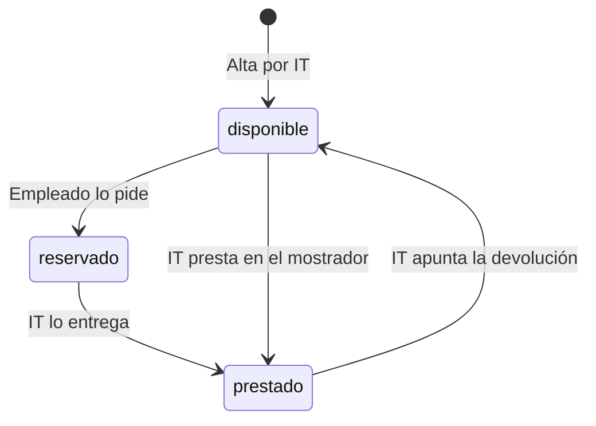

# Préstamo de equipos de oficina

## Fuentes

- .diverger/inbox/peticion.md: petición del cliente con su anexo de API para el inventario de IT. Aporta el problema, los usuarios, el alcance, las exclusiones, los criterios de éxito, los riesgos y la API fijada.
- .diverger/inbox/equipo.csv: no es una fuente de requisitos; es el equipo de desarrollo para planificar los sprints (se usará en plan-sprint).

## Objetivo

Hoy los préstamos se apuntan en una hoja de cálculo y los empleados piden los equipos por correo a IT: no se sabe qué está libre sin preguntar, dos personas acaban esperando el mismo portátil y nadie se entera de que un préstamo ha vencido hasta que alguien echa en falta el equipo (peticion.md).

Una aplicación para gestionar el préstamo de equipos de la oficina (portátiles, monitores, proyectores): los empleados ven qué hay disponible y lo piden prestado por unos días, e IT da de alta los equipos, entrega y recoge, y ve qué préstamos han vencido (peticion.md).

Métricas de éxito (peticion.md):

- Durante el primer mes todos los préstamos pasan por la aplicación.
- Ningún equipo se reserva o se presta dos veces.
- IT revisa los vencidos cada semana sin tener que preguntar a nadie.

## Usuarios

- Empleados: entran con su cuenta de Google de la empresa, ven los equipos y su estado y piden uno libre con la fecha en que lo devolverán (peticion.md).
- IT: entra con su cuenta de Google de la empresa; da de alta los equipos, entrega los reservados, presta en el mostrador, apunta las devoluciones, ve los préstamos vencidos y consulta el historial de cada equipo. Las cuentas de IT son las de la variable de entorno `CORREOS_IT` (peticion.md).
- Inventario de IT: sistema que se conecta a la API con una cuenta de servicio incluida en la lista de IT, así que también puede hacer lo de un empleado (peticion.md).

## Alcance

- Iniciar sesión con la cuenta de Google de la empresa; la persona de cada operación es el correo de la sesión (peticion.md).
- Dar de alta un equipo (solo IT), con nombre obligatorio y único sin distinguir mayúsculas ni espacios al principio o al final (peticion.md).
- Ver los equipos con su estado (disponible, reservado o prestado) y, si están reservados o prestados, la persona y la fecha de devolución (todos) (peticion.md).
- Pedir un equipo libre indicando la fecha de devolución, que no puede ser anterior a hoy; el equipo queda reservado a nombre de quien lo pide hasta que IT se lo entrega (peticion.md).
- Entregar un equipo reservado (solo IT): pasa a prestado con la misma persona y fecha de devolución (peticion.md).
- Prestar un equipo en el mostrador a la persona indicada (solo IT); se admite una fecha de devolución pasada y ese préstamo aparece ya entre los vencidos (peticion.md).
- Apuntar la devolución de un equipo prestado (solo IT): vuelve a estar disponible, sin persona ni fecha de devolución (peticion.md).
- Ver los préstamos vencidos (solo IT): equipos prestados con fecha de devolución anterior a hoy, del más antiguo al más reciente (peticion.md).
- Ver el historial de un equipo (solo IT): sus préstamos del más reciente al más antiguo, con estado reservado, prestado o devuelto (peticion.md).
- La fecha de devolución va como `AAAA-MM-DD`, tiene que existir y «hoy» es el día en Madrid (peticion.md).

## Fuera de alcance

- Que los empleados anulen una solicitud (peticion.md).
- Avisos por correo de préstamos vencidos (peticion.md).

## Restricciones

- Todas las rutas necesitan sesión: sin un token de identidad de Google válido (correo verificado, emitido para el cliente OAuth de la aplicación, de persona o de cuenta de servicio) responden 401 (peticion.md).
- Las operaciones «Solo IT» responden 403 a cualquier otra cuenta; las cuentas de IT se fijan en la variable de entorno `CORREOS_IT`, en la configuración del despliegue y no en el código, y los correos se comparan sin distinguir mayúsculas (peticion.md).
- Un equipo no puede estar reservado o prestado dos veces a la vez, tampoco con peticiones simultáneas: una sale bien y la otra recibe 409 (peticion.md).
- La API tiene que ser exactamente la del anexo, porque el inventario de IT se va a conectar a ella (peticion.md).
- Integraciones: el acceso con la cuenta de Google de la empresa y el inventario de IT, que se conecta mediante la API (peticion.md).

## API fijada por el cliente

El inventario de IT se va a conectar a la aplicación, así que la API tiene que ser exactamente esta. Todas las rutas necesitan haber iniciado sesión: sin un token válido responden 401 con «Inicia sesión con Google.». Vale el token de identidad de Google, con el correo verificado, emitido para el cliente OAuth de la aplicación, tanto de una persona como de una cuenta de servicio. La persona de cada operación es el correo del token.

Las operaciones marcadas «Solo IT» solo las puede hacer una cuenta de IT; con cualquier otra cuenta responden 403 con «Solo IT puede hacer esto.». Las cuentas de IT son las de la variable de entorno `CORREOS_IT`, con los correos separados por comas: la lista se fija en la configuración del despliegue, no en el código. Dos correos son el mismo aunque cambien las mayúsculas. El inventario entra con una cuenta de servicio que está en esa lista, así que también puede hacer lo de un empleado. Los errores son un objeto JSON `{"error": "<mensaje>"}` con el mensaje exacto que se indica.

Un equipo está en uno de tres estados: `disponible`, `reservado` (un empleado lo ha pedido y aún no lo ha recogido) o `prestado`. Cuando está reservado o prestado, el equipo lleva también `persona` (el correo de quien lo tiene) y `devolucion`.

| Operación | Quién | Petición | Respuesta correcta | Errores |
|---|---|---|---|---|
| Dar de alta un equipo | Solo IT | `POST /api/equipos` con `{"nombre": "Portátil 07"}` | 201 con `{"id": "…", "nombre": "Portátil 07", "estado": "disponible"}` | 400 «Falta el nombre del equipo» si el nombre falta o está vacío. 409 «Ya hay un equipo con ese nombre» |
| Ver los equipos | Todos | `GET /api/equipos` | 200 con la lista de equipos, cada uno con `id`, `nombre` y `estado`; si está reservado o prestado, también `persona` y `devolucion` | — |
| Pedir un equipo | Todos | `POST /api/equipos/{id}/solicitud` con `{"devolucion": "2026-11-20"}` | 201 con el equipo: `estado: "reservado"`, `persona` (el correo de quien lo pide) y `devolucion` | 400 «Falta la fecha de devolución». 400 «La fecha de devolución no es válida» si no es una fecha real. 400 «La fecha de devolución ya ha pasado». 404 «No existe el equipo». 409 «El equipo no está disponible» si está reservado o prestado |
| Entregar un equipo reservado | Solo IT | `POST /api/equipos/{id}/entrega` | 200 con el equipo: `estado: "prestado"`, con la misma `persona` y `devolucion` de la solicitud | 404 «No existe el equipo». 409 «El equipo no está reservado» |
| Prestar en el mostrador | Solo IT | `POST /api/equipos/{id}/prestamo` con `{"persona": "ana.perez@empresa.com", "devolucion": "2026-11-20"}` | 201 con el equipo: `estado: "prestado"`, `persona` y `devolucion` | 400 «Faltan la persona o la fecha de devolución». 400 «La fecha de devolución no es válida» si no es una fecha real. 404 «No existe el equipo». 409 «El equipo no está disponible» si está reservado o prestado |
| Apuntar la devolución | Solo IT | `POST /api/equipos/{id}/devolucion` | 200 con el equipo y `estado: "disponible"`, sin `persona` ni `devolucion` | 404 «No existe el equipo». 409 «El equipo no está prestado» |
| Ver los préstamos vencidos | Solo IT | `GET /api/prestamos/vencidos` | 200 con la lista de equipos prestados cuya fecha de devolución es anterior a hoy, cada uno con `id`, `nombre`, `persona` y `devolucion`, del más antiguo al más reciente | — |
| Ver el historial de un equipo | Solo IT | `GET /api/equipos/{id}/historial` | 200 con la lista de sus préstamos, del más reciente al más antiguo, cada uno con `persona`, `devolucion` y `estado` (`reservado`, `prestado` o `devuelto`) | 404 «No existe el equipo» |

La fecha de devolución va como texto `AAAA-MM-DD` y se devuelve igual. Tiene que ser una fecha que exista («2026-02-30» no vale). «Hoy» es el día en Madrid. Quien pide un equipo no puede poner una fecha anterior a hoy, pero IT sí cuando presta en el mostrador, porque a veces apunta los préstamos con retraso; un préstamo así ya aparece entre los vencidos.

Un equipo no puede estar reservado o prestado dos veces a la vez. Si llegan dos peticiones a la vez para el mismo equipo disponible, sean solicitudes o préstamos en el mostrador, una sale bien y la otra recibe 409 «El equipo no está disponible»; nunca salen bien las dos.

Dos nombres de equipo son el mismo si solo se diferencian en mayúsculas o en espacios al principio o al final: « portátil 07 » repite «Portátil 07».

(peticion.md, «Anexo: API para el inventario de IT»)

## Riesgos

- Que dos empleados se queden con el mismo equipo porque lo pidieron a la vez (peticion.md).
- Que un empleado pueda hacer lo que solo le toca a IT (peticion.md).
- Que el inventario deje de funcionar si la API cambia (peticion.md).

## Supuestos

- [SUPUESTO] Además de la API, hay una interfaz web para empleados e IT — la petición habla de «una aplicación» en la que los empleados ven y piden equipos, pero el anexo solo describe la API.
- [SUPUESTO] El `id` de cada equipo lo genera la aplicación — el anexo lo devuelve en el alta sin indicar su formato.
- [SUPUESTO] El tipo de equipo (portátil, monitor, proyector) no es un campo aparte — el alta solo recibe `nombre`.
- [SUPUESTO] Una cuenta de IT que pide un equipo lo reserva a su propio correo — «La persona de cada operación es el correo del token».

## Preguntas abiertas

1. [alta] ¿Se necesita una interfaz de usuario además de la API, o basta con la API?
2. [media] ¿Es aceptable que cualquier empleado vea el correo de quien tiene cada equipo? El anexo lo fija para «Todos» en `GET /api/equipos`.
3. [media] ¿Qué pasa con una reserva que IT nunca llega a entregar, si el empleado no puede anularla?
4. [media] ¿Hay un plazo máximo de préstamo o una fecha de devolución máxima? La petición solo dice «por unos días».
5. [media] ¿Cuántos equipos y empleados se esperan, y con cuánta simultaneidad?
6. [media] ¿Dónde se despliega la aplicación y con qué tecnología?
7. [baja] ¿Se puede editar o dar de baja un equipo? El anexo no lo cubre.
8. [baja] ¿Qué formato tiene el `id` y qué se responde con un `id` mal formado?

## Claridad

| Categoría | Claridad |
|---|---|
| Usuarios | 75 % |
| Problema | 75 % |
| Objetivo y métricas | 75 % |
| Alcance | 100 % |
| Fuera de alcance | 50 % |
| Restricciones | 75 % |
| Dependencias e integraciones | 75 % |
| Riesgos | 50 % |
| Global | 72 % |

## Diagramas

### Estados de un equipo

