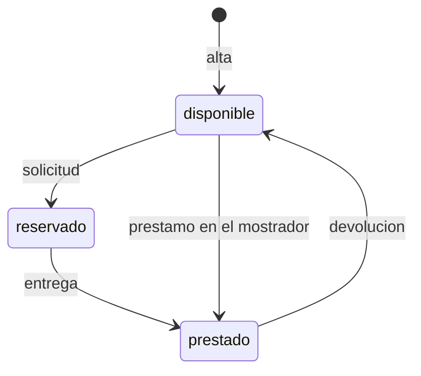

# Préstamo de equipos de oficina

## Fuentes

- .diverger/inbox/peticion.md: petición del cliente con un anexo de API para el inventario de IT. Aporta el problema, los usuarios, el alcance, las exclusiones, las métricas de éxito, los riesgos y la API fijada que debe exponer la aplicación.

## Objetivo

Hoy los préstamos se apuntan en una hoja de cálculo y los empleados piden los equipos por correo a IT: no se sabe qué está libre sin preguntar, dos personas acaban esperando el mismo portátil y nadie se entera de que un préstamo ha vencido hasta que alguien echa en falta el equipo (peticion.md).

Una aplicación para gestionar el préstamo de equipos de la oficina (portátiles, monitores, proyectores): los empleados ven qué hay disponible y lo piden prestado por unos días; IT da de alta los equipos, entrega y recoge, y ve qué préstamos han vencido (peticion.md).

Métricas de éxito, durante el primer mes (peticion.md):

- Todos los préstamos pasan por la aplicación.
- Ningún equipo se reserva o se presta dos veces.
- IT revisa los vencidos cada semana sin tener que preguntar a nadie.

## Usuarios

- Empleados: entran con su cuenta de Google de la empresa, ven los equipos y su estado y piden uno libre con la fecha en que lo devolverán (peticion.md).
- IT: entra con su cuenta de Google de la empresa; da de alta los equipos, entrega los reservados, presta en el mostrador, apunta las devoluciones, ve los préstamos vencidos y consulta el historial de cada equipo (peticion.md).
- Inventario de IT: sistema que se conecta a la aplicación por la API con una cuenta de servicio incluida en la lista de IT, así que también puede hacer lo de un empleado (peticion.md).

## Alcance

- Ver los equipos y su estado (disponible, reservado o prestado) y, si está reservado o prestado, quién lo tiene y su fecha de devolución (peticion.md).
- Pedir un equipo disponible indicando la fecha de devolución; queda reservado a nombre de quien lo pide hasta que IT se lo entrega (peticion.md).
- Dar de alta un equipo con un nombre obligatorio y único, sin distinguir mayúsculas ni espacios al principio o al final; solo IT (peticion.md).
- Entregar un equipo reservado, que pasa a prestado con la misma persona y fecha de devolución; solo IT (peticion.md).
- Prestar un equipo disponible en el mostrador a la persona indicada, con su fecha de devolución; solo IT (peticion.md).
- Apuntar la devolución de un equipo prestado, que vuelve a estar disponible sin persona ni fecha; solo IT (peticion.md).
- Ver los préstamos vencidos (equipos prestados con fecha de devolución anterior a hoy), del más antiguo al más reciente; solo IT (peticion.md).
- Consultar el historial de préstamos de un equipo, del más reciente al más antiguo; solo IT (peticion.md).
- La fecha de devolución va como `AAAA-MM-DD`, tiene que existir y «hoy» es el día en Madrid; quien pide un equipo no puede poner una fecha anterior a hoy, pero IT sí al prestar en el mostrador, y ese préstamo ya aparece entre los vencidos (peticion.md).
- Un equipo no puede estar reservado o prestado dos veces a la vez: con dos peticiones simultáneas sobre el mismo equipo disponible, una sale bien y la otra recibe 409 «El equipo no está disponible» (peticion.md).
- Solo las cuentas de IT, las de la variable de entorno `CORREOS_IT`, pueden hacer las operaciones «Solo IT»; las demás reciben 403 (peticion.md).
- Todas las rutas exigen haber iniciado sesión con el token de identidad de Google, con el correo verificado y emitido para el cliente OAuth de la aplicación; sin él responden 401. La persona de cada operación es el correo del token (peticion.md).

## Fuera de alcance

- Que los empleados anulen una solicitud (peticion.md).
- Avisos por correo de préstamos vencidos (peticion.md).

## Restricciones

- Todos entran con su cuenta de Google de la empresa (peticion.md).
- La lista de cuentas de IT se fija en la configuración del despliegue, en la variable de entorno `CORREOS_IT`, no en el código; dos correos son el mismo aunque cambien las mayúsculas (peticion.md).
- Los errores son un objeto JSON `{"error": "<mensaje>"}` con el mensaje exacto indicado (peticion.md).
- El inventario de IT se va a conectar a la aplicación, así que la API tiene que ser exactamente la del anexo (peticion.md).

## API fijada por el cliente

El inventario de IT se va a conectar a la aplicación, así que la API tiene que ser exactamente esta. Todas las rutas necesitan haber iniciado sesión: sin un token válido responden 401 con «Inicia sesión con Google.». Vale el token de identidad de Google, con el correo verificado, emitido para el cliente OAuth de la aplicación, tanto de una persona como de una cuenta de servicio. La persona de cada operación es el correo del token.

Las operaciones marcadas «Solo IT» solo las puede hacer una cuenta de IT; con cualquier otra cuenta responden 403 con «Solo IT puede hacer esto.». Las cuentas de IT son las de la variable de entorno `CORREOS_IT`, con los correos separados por comas: la lista se fija en la configuración del despliegue, no en el código. Dos correos son el mismo aunque cambien las mayúsculas. El inventario entra con una cuenta de servicio que está en esa lista, así que también puede hacer lo de un empleado. Los errores son un objeto JSON `{"error": "<mensaje>"}` con el mensaje exacto que se indica.

Un equipo está en uno de tres estados: `disponible`, `reservado` (un empleado lo ha pedido y aún no lo ha recogido) o `prestado`. Cuando está reservado o prestado, el equipo lleva también `persona` (el correo de quien lo tiene) y `devolucion`.

| Operación | Quién | Petición | Respuesta correcta | Errores |
|---|---|---|---|---|
| Dar de alta un equipo | Solo IT | `POST /api/equipos` con `{"nombre": "Portátil 07"}` | 201 con `{"id": "…", "nombre": "Portátil 07", "estado": "disponible"}` | 400 «Falta el nombre del equipo» si el nombre falta o está vacío. 409 «Ya hay un equipo con ese nombre» |
| Ver los equipos | Todos | `GET /api/equipos` | 200 con la lista de equipos, cada uno con `id`, `nombre` y `estado`; si está reservado o prestado, también `persona` y `devolucion` | — |
| Pedir un equipo | Todos | `POST /api/equipos/{id}/solicitud` con `{"devolucion": "2026-11-20"}` | 201 con el equipo: `estado: "reservado"`, `persona` (el correo de quien lo pide) y `devolucion` | 400 «Falta la fecha de devolución». 400 «La fecha de devolución no es válida» si no es una fecha real. 400 «La fecha de devolución ya ha pasado». 404 «No existe el equipo». 409 «El equipo no está disponible» si está reservado o prestado |
| Entregar un equipo reservado | Solo IT | `POST /api/equipos/{id}/entrega` | 200 con el equipo: `estado: "prestado"`, con la misma `persona` y `devolucion` de la solicitud | 404 «No existe el equipo». 409 «El equipo no está reservado» |
| Prestar en el mostrador | Solo IT | `POST /api/equipos/{id}/prestamo` con `{"persona": "ana.perez@empresa.com", "devolucion": "2026-11-20"}` | 201 con el equipo: `estado: "prestado"`, `persona` y `devolucion` | 400 «Faltan la persona o la fecha de devolución». 400 «La fecha de devolución no es válida» si no es una fecha real. 404 «No existe el equipo». 409 «El equipo no está disponible» si está reservado o prestado |
| Apuntar la devolución | Solo IT | `POST /api/equipos/{id}/devolucion` | 200 con el equipo y `estado: "disponible"`, sin `persona` ni `devolucion` | 404 «No existe el equipo». 409 «El equipo no está prestado» |
| Ver los préstamos vencidos | Solo IT | `GET /api/prestamos/vencidos` | 200 con la lista de equipos prestados cuya fecha de devolución es anterior a hoy, cada uno con `id`, `nombre`, `persona` y `devolucion`, del más antiguo al más reciente | — |
| Ver el historial de un equipo | Solo IT | `GET /api/equipos/{id}/historial` | 200 con la lista de sus préstamos, del más reciente al más antiguo, cada uno con `persona`, `devolucion` y `estado` (`reservado`, `prestado` o `devuelto`) | 404 «No existe el equipo» |

La fecha de devolución va como texto `AAAA-MM-DD` y se devuelve igual. Tiene que ser una fecha que exista («2026-02-30» no vale). «Hoy» es el día en Madrid. Quien pide un equipo no puede poner una fecha anterior a hoy, pero IT sí cuando presta en el mostrador, porque a veces apunta los préstamos con retraso; un préstamo así ya aparece entre los vencidos.

Un equipo no puede estar reservado o prestado dos veces a la vez. Si llegan dos peticiones a la vez para el mismo equipo disponible, sean solicitudes o préstamos en el mostrador, una sale bien y la otra recibe 409 «El equipo no está disponible»; nunca salen bien las dos.

Dos nombres de equipo son el mismo si solo se diferencian en mayúsculas o en espacios al principio o al final: « portátil 07 » repite «Portátil 07».

(peticion.md, «Anexo: API para el inventario de IT»)

## Riesgos

- Que dos empleados se queden con el mismo equipo porque lo pidieron a la vez (peticion.md).
- Que un empleado pueda hacer lo que solo le toca a IT (peticion.md).
- Que el inventario deje de funcionar si la API cambia (peticion.md).

## Supuestos

- [SUPUESTO] Empleados e IT usan la aplicación con pantallas web además de la API — la petición habla de una «aplicación» donde los empleados «ven» y «piden», pero solo describe la API.
- [SUPUESTO] Los equipos no tienen categorías ni más atributos que el nombre — la petición da tres ejemplos (portátiles, monitores, proyectores) y el alta solo lleva nombre.
- [SUPUESTO] Cualquier empleado puede ver quién tiene cada equipo reservado o prestado y su fecha de devolución — `GET /api/equipos` devuelve `persona` y `devolucion` a «Todos».
- [SUPUESTO] El historial de un equipo incluye la reserva en curso, los préstamos y las devoluciones — sus estados son `reservado`, `prestado` y `devuelto`.
- [SUPUESTO] Una reserva cuya fecha de devolución ya ha pasado no aparece entre los vencidos — los vencidos solo incluyen equipos prestados.

## Preguntas abiertas

1. [alta] ¿La aplicación necesita pantallas para empleados e IT o basta con la API? Cambia lo que se construye.
2. [media] ¿Qué pasa con una reserva que IT nunca entrega, si el empleado no la puede anular? ¿Puede IT cancelarla, o el equipo queda bloqueado?
3. [media] ¿Es intencionado que cualquier empleado vea quién tiene cada equipo y hasta cuándo? La petición dice que ve «los equipos y su estado», y la API devuelve también `persona` y `devolucion` a todos.
4. [media] ¿Hay un plazo máximo de préstamo («unos días») o un límite de equipos por persona?
5. [media] ¿Se restringe el acceso al dominio de correo de la empresa, o basta un token de Google válido para el cliente OAuth de la aplicación?
6. [media] ¿Cómo revisa IT los vencidos cada semana en la aplicación: una pantalla, una exportación?
7. [baja] ¿Cuántos equipos y empleados se esperan?
8. [baja] ¿Dónde se despliega la aplicación y hay fecha objetivo?
9. [baja] ¿Se migran los datos de la hoja de cálculo actual?

## Diagramas

### Estados de un equipo

## Claridad

| Categoría | Claridad |
|---|---|
| Usuarios | 75 % |
| Problema | 75 % |
| Objetivo y métricas | 50 % |
| Alcance | 100 % |
| Fuera de alcance | 75 % |
| Restricciones | 50 % |
| Dependencias e integraciones | 75 % |
| Riesgos | 50 % |
| Global | 69 % |
