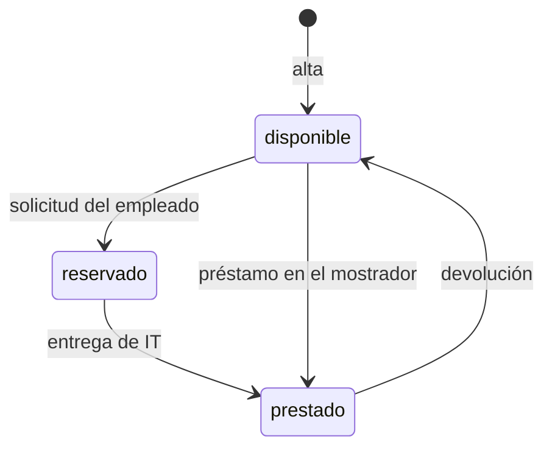

# Préstamo de equipos de oficina

## Fuentes

- .diverger/inbox/peticion.md: petición del cliente con su anexo de API para el inventario de IT. Aporta el problema, los usuarios, el alcance, lo que queda fuera, los criterios de éxito, los riesgos y la API que debe exponerse exactamente.
- .diverger/inbox/equipo.csv: no se analiza como fuente de requisitos; es el equipo del proyecto (nombre, rol, dedicación y uso de agente de IA) y lo usará la planificación de sprints.

## Objetivo

Hoy los préstamos se apuntan en una hoja de cálculo y los empleados piden los equipos por correo a IT: no se sabe qué está libre sin preguntar, dos personas acaban esperando el mismo portátil y nadie se entera de que un préstamo ha vencido hasta que alguien echa en falta el equipo (peticion.md).

Una aplicación para gestionar el préstamo de equipos de la oficina (portátiles, monitores, proyectores): los empleados ven qué hay disponible y lo piden prestado por unos días; IT da de alta los equipos, entrega y recoge, y ve qué préstamos han vencido (peticion.md).

Métricas de éxito, durante el primer mes (peticion.md):

- Todos los préstamos pasan por la aplicación.
- Ningún equipo se reserva o se presta dos veces.
- IT revisa los vencidos cada semana sin tener que preguntar a nadie.

## Usuarios

- Empleado: entra con su cuenta de Google de la empresa, ve los equipos y su estado y pide uno libre con la fecha en que lo devolverá (peticion.md).
- IT: entra con su cuenta de Google de la empresa; da de alta los equipos, entrega los reservados, presta en el mostrador, apunta las devoluciones, ve los préstamos vencidos y consulta el historial de cada equipo. Las cuentas de IT son las de la variable de entorno `CORREOS_IT` (peticion.md).
- Inventario de IT: sistema que se conecta a la API con una cuenta de servicio incluida en `CORREOS_IT`, así que también puede hacer lo de un empleado (peticion.md).

## Alcance

- Cualquier empleado ve los equipos y su estado (`disponible`, `reservado` o `prestado`); si está reservado o prestado, también la persona que lo tiene y la fecha de devolución (peticion.md).
- Un empleado pide un equipo libre indicando la fecha de devolución; el equipo queda reservado a su nombre hasta que IT se lo entrega (peticion.md).
- IT da de alta equipos con un nombre obligatorio; no se admiten dos equipos con el mismo nombre, sin distinguir mayúsculas ni espacios al principio o al final (peticion.md).
- IT entrega un equipo reservado: pasa a prestado con la misma persona y fecha de devolución de la solicitud (peticion.md).
- IT presta directamente en el mostrador un equipo disponible a la persona indicada, con su fecha de devolución (peticion.md).
- IT apunta la devolución de un equipo prestado: vuelve a disponible, sin persona ni fecha de devolución (peticion.md).
- IT ve los préstamos vencidos: los equipos prestados cuya fecha de devolución es anterior a hoy, del más antiguo al más reciente (peticion.md).
- IT consulta el historial de préstamos de cada equipo, del más reciente al más antiguo, con persona, fecha de devolución y estado (`reservado`, `prestado` o `devuelto`) (peticion.md).
- La fecha de devolución va como texto `AAAA-MM-DD`, tiene que existir y «hoy» es el día en Madrid; quien pide un equipo no puede poner una fecha anterior a hoy, pero IT sí cuando presta en el mostrador, y ese préstamo aparece ya entre los vencidos (peticion.md).
- Un equipo no puede estar reservado o prestado dos veces a la vez: si llegan dos peticiones a la vez para el mismo equipo disponible, sean solicitudes o préstamos en el mostrador, una sale bien y la otra recibe 409 «El equipo no está disponible» (peticion.md).

## Fuera de alcance

- Que los empleados anulen una solicitud (peticion.md).
- Avisos por correo de préstamos vencidos (peticion.md).

## Restricciones

- Todos entran con su cuenta de Google de la empresa; todas las rutas necesitan sesión con un token de identidad de Google con el correo verificado, emitido para el cliente OAuth de la aplicación, de una persona o de una cuenta de servicio; sin token válido responden 401 (peticion.md).
- Las operaciones «Solo IT» responden 403 a cualquier otra cuenta; las cuentas de IT se fijan en la variable de entorno `CORREOS_IT` de la configuración del despliegue, no en el código, y los correos se comparan sin distinguir mayúsculas (peticion.md).
- El inventario de IT se va a conectar a la aplicación, así que la API tiene que ser exactamente la del anexo, con errores como objeto JSON `{"error": "<mensaje>"}` con el mensaje exacto (peticion.md).

## API fijada por el cliente

El inventario de IT se va a conectar a la aplicación, así que la API tiene que ser exactamente esta. Todas las rutas necesitan haber iniciado sesión: sin un token válido responden 401 con «Inicia sesión con Google.». Vale el token de identidad de Google, con el correo verificado, emitido para el cliente OAuth de la aplicación, tanto de una persona como de una cuenta de servicio. La persona de cada operación es el correo del token.

Las operaciones marcadas «Solo IT» solo las puede hacer una cuenta de IT; con cualquier otra cuenta responden 403 con «Solo IT puede hacer esto.». Las cuentas de IT son las de la variable de entorno `CORREOS_IT`, con los correos separados por comas: la lista se fija en la configuración del despliegue, no en el código. Dos correos son el mismo aunque cambien las mayúsculas. El inventario entra con una cuenta de servicio que está en esa lista, así que también puede hacer lo de un empleado. Los errores son un objeto JSON `{"error": "<mensaje>"}` con el mensaje exacto que se indica.

Un equipo está en uno de tres estados: `disponible`, `reservado` (un empleado lo ha pedido y aún no lo ha recogido) o `prestado`. Cuando está reservado o prestado, el equipo lleva también `persona` (el correo de quien lo tiene) y `devolucion`.

| Operación | Quién | Petición | Respuesta correcta | Errores |
|---|---|---|---|---|
| Dar de alta un equipo | Solo IT | `POST /api/equipos` con `{"nombre": "Portátil 07"}` | 201 con `{"id": "…", "nombre": "Portátil 07", "estado": "disponible"}` | 400 «Falta el nombre del equipo» si el nombre falta o está vacío. 409 «Ya hay un equipo con ese nombre» |
| Ver los equipos | Todos | `GET /api/equipos` | 200 con la lista de equipos, cada uno con `id`, `nombre` y `estado`; si está reservado o prestado, también `persona` y `devolucion` | — |
| Pedir un equipo | Todos | `POST /api/equipos/{id}/solicitud` con `{"devolucion": "2026-11-20"}` | 201 con el equipo: `estado: "reservado"`, `persona` (el correo de quien lo pide) y `devolucion` | 400 «Falta la fecha de devolución». 400 «La fecha de devolución no es válida» si no es una fecha real. 400 «La fecha de devolución ya ha pasado». 404 «No existe el equipo». 409 «El equipo no está disponible» si está reservado o prestado |
| Entregar un equipo reservado | Solo IT | `POST /api/equipos/{id}/entrega` | 200 con el equipo: `estado: "prestado"`, con la misma `persona` y `devolucion` de la solicitud | 404 «No existe el equipo». 409 «El equipo no está reservado» |
| Prestar en el mostrador | Solo IT | `POST /api/equipos/{id}/prestamo` con `{"persona": "ana.perez@empresa.com", "devolucion": "2026-11-20"}` | 201 con el equipo: `estado: "prestado"`, `persona` y `devolucion` | 400 «Faltan la persona o la fecha de devolución». 400 «La fecha de devolución no es válida» si no es una fecha real. 404 «No existe el equipo». 409 «El equipo no está disponible» si está reservado o prestado |
| Apuntar la devolución | Solo IT | `POST /api/equipos/{id}/devolucion` | 200 con el equipo y `estado: "disponible"`, sin `persona` ni `devolucion` | 404 «No existe el equipo». 409 «El equipo no está prestado» |
| Ver los préstamos vencidos | Solo IT | `GET /api/prestamos/vencidos` | 200 con la lista de equipos prestados cuya fecha de devolución es anterior a hoy, cada uno con `id`, `nombre`, `persona` y `devolucion`, del más antiguo al más reciente | — |
| Ver el historial de un equipo | Solo IT | `GET /api/equipos/{id}/historial` | 200 con la lista de sus préstamos, del más reciente al más antiguo, cada uno con `persona`, `devolucion` y `estado` (`reservado`, `prestado` o `devuelto`) | 404 «No existe el equipo» |

La fecha de devolución va como texto `AAAA-MM-DD` y se devuelve igual. Tiene que ser una fecha que exista («2026-02-30» no vale). «Hoy» es el día en Madrid. Quien pide un equipo no puede poner una fecha anterior a hoy, pero IT sí cuando presta en el mostrador, porque a veces apunta los préstamos con retraso; un préstamo así ya aparece entre los vencidos.

Un equipo no puede estar reservado o prestado dos veces a la vez. Si llegan dos peticiones a la vez para el mismo equipo disponible, sean solicitudes o préstamos en el mostrador, una sale bien y la otra recibe 409 «El equipo no está disponible»; nunca salen bien las dos.

Dos nombres de equipo son el mismo si solo se diferencian en mayúsculas o en espacios al principio o al final: « portátil 07 » repite «Portátil 07».

(peticion.md, «Anexo: API para el inventario de IT»)

## Riesgos

- Que dos empleados se queden con el mismo equipo porque lo pidieron a la vez (peticion.md).
- Que un empleado pueda hacer lo que solo le toca a IT (peticion.md).
- Que el inventario deje de funcionar si la API cambia (peticion.md).

## Supuestos

- [SUPUESTO] En el historial, cada préstamo pasa por `reservado` o `prestado` y termina en `devuelto` al apuntar la devolución — el anexo enumera los estados del historial, pero no sus transiciones.
- [SUPUESTO] Los tipos de equipo (portátil, monitor, proyector) son solo ejemplos y no un atributo del equipo — la API solo tiene `nombre`.
- [SUPUESTO] Cualquier empleado ve la persona y la fecha de devolución de los equipos que tienen otros — la operación «Ver los equipos» es para todos y devuelve esos campos.
- [SUPUESTO] Las cuentas de IT también pueden hacer las operaciones marcadas «Todos» — el anexo lo afirma para la cuenta de servicio del inventario.

## Preguntas abiertas

1. [alta] ¿Qué pasa con una reserva que IT no entrega nunca? Los empleados no pueden anular solicitudes, así que el equipo quedaría bloqueado: ¿caduca la reserva o puede anularla IT?
2. [media] ¿Se necesita una interfaz web para empleados e IT además de la API? El anexo solo define la API.
3. [media] ¿Cómo se medirá que «todos los préstamos pasan por la aplicación» durante el primer mes?
4. [media] ¿Hay un plazo máximo para la fecha de devolución? La petición habla de préstamos «por unos días».
5. [media] ¿Qué responden las operaciones sobre un equipo cuando el `id` tiene un formato no válido: siempre 404 «No existe el equipo»? ¿En qué orden se validan el equipo y el cuerpo de la petición?
6. [baja] ¿Cuántos equipos y usuarios se esperan?
7. [baja] ¿Hay que migrar los datos de la hoja de cálculo actual?
8. [baja] ¿Se restringe el acceso al dominio de Google de la empresa además de validar el token?

## Claridad

| Categoría | Claridad |
|---|---|
| Usuarios | 75 % |
| Problema | 75 % |
| Objetivo y métricas | 50 % |
| Alcance | 100 % |
| Fuera de alcance | 75 % |
| Restricciones | 75 % |
| Dependencias e integraciones | 50 % |
| Riesgos | 50 % |
| Global | 69 % |

## Diagramas

### Estados de un equipo

