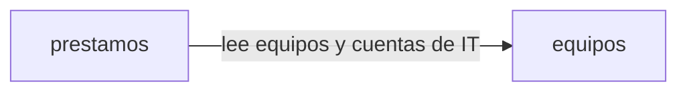

# Arquitectura: préstamo de equipos de oficina

## Resumen

La aplicación gestiona el préstamo de portátiles, monitores y proyectores de la oficina. Los empleados entran con su cuenta de Google de la empresa, ven los equipos y su estado y piden uno libre. IT da de alta los equipos, los entrega, los presta en el mostrador, apunta las devoluciones y consulta los vencidos y el historial. El inventario de IT usa la misma API con una cuenta de servicio.

Se divide en dos contextos:

- **equipos**: el alta de los equipos con nombre único y la regla de qué cuentas son de IT.
- **prestamos**: el estado de cada equipo y lo que le pasa con el tiempo (solicitud, entrega, préstamo en el mostrador, devolución), con el listado, los vencidos y el historial.

## Mapa de contextos

## Despliegue

Golden path de la constitución: un único servicio de Cloud Run con Node.js y TypeScript, un módulo por contexto (`src/equipos`, `src/prestamos`), frontend en React (`web/`), inicio de sesión con Google y Firestore a través del puerto de persistencia `lib/datos.ts`. La infraestructura ya está en `infra/` (Cloud Run, Firestore, Artifact Registry y Cloud Deploy).

## Piezas transversales

- **Inicio de sesión:** el servidor común (`app/server.ts`) comprueba en todas las rutas de `/api` el token de identidad de Google con `lib/auth.ts` (correo verificado y emitido para el cliente OAuth de la aplicación) y responde 401 «Inicia sesión con Google.» si no es válido. La persona de cada operación es el correo del token.
- **Cuentas de IT:** las decide `equipos` con la variable de entorno `CORREOS_IT`, y `prestamos` se lo pregunta a través del `index.ts` de `equipos`.
- **Persistencia:** cada contexto escribe solo en sus colecciones (`equipos_*`, `prestamos_*`) a través de `lib/datos.ts`; no hay transacciones que crucen contextos.
- **Contratos primero:** cada contexto tiene su contrato OpenAPI en `spec/contextos/<id>/api.openapi.json`, que se escribe y se aprueba antes que el código, y los tipos se generan de él. Un cambio de contrato es una tarea propia y en serie. Cambiarlo de forma incompatible lleva además su ADR, como dice la constitución.

## Decisiones

- [ADR 0001](../docs/adr/0001-un-prestamo-activo-por-equipo.md): un equipo tiene como mucho una reserva o un préstamo activo, garantizado con una transacción del almacén. Alternativa: un documento del préstamo activo que solo se crea si no existe.
- [ADR 0002](../docs/adr/0002-api-fijada-por-el-cliente.md): los contratos siguen la API fijada por el cliente en `intent.md` en lugar de las convenciones de la especificación. Sustituye el prefijo de ruta `/api/<contexto>/` (las rutas son `/api/equipos…` y `/api/prestamos/vencidos`, tal como las fija el cliente) y el formato de error RFC 9457 (los errores son `{"error": "<mensaje>"}` en `application/json`, con los mensajes exactos).
- [ADR 0003](../docs/adr/0003-nombre-de-equipo-unico.md): el nombre de un equipo es único gracias a un documento por nombre normalizado escrito en una transacción. Alternativa: recorrer los equipos y comparar.
- [ADR 0004](../docs/adr/0004-estado-del-equipo-en-prestamos.md): el estado de un equipo vive en `prestamos`, que también sirve `GET /api/equipos`. Alternativa: guardarlo en `equipos`.

No hay decisiones pendientes.

## Supuestos

- [SUPUESTO] Las validaciones se comprueban en este orden: primero el cuerpo de la petición (400), después que el equipo existe (404) y por último su estado (409). La API del cliente no fija el orden.
- [SUPUESTO] Las operaciones «Solo IT» comprueban la cuenta de IT (403) antes que el cuerpo y el equipo.
- [SUPUESTO] Un `id` mal formado se trata como un equipo que no existe: 404 «No existe el equipo».
- [SUPUESTO] El nombre del equipo se guarda sin los espacios del principio y del final; el nombre normalizado, además, en minúsculas.
- [SUPUESTO] En el préstamo en el mostrador, `persona` es cualquier texto que no esté vacío; la API no pide que sea un correo con un formato concreto.
- [SUPUESTO] Una reserva que IT nunca entrega sigue reservada; no caduca sola.
- [SUPUESTO] No hay un plazo máximo de préstamo ni una fecha de devolución máxima.
- [SUPUESTO] El historial se ordena por el momento en que empezó cada préstamo (la solicitud o el préstamo en el mostrador).
- [SUPUESTO] El listado de vencidos ordena por fecha de devolución y, a igual fecha, por el nombre del equipo.
- [SUPUESTO] `CORREOS_IT` se añade a la configuración del despliegue con `variables_entorno` de `infra/`; si no está, ninguna cuenta es de IT.
- [SUPUESTO] Además de la API, hay una interfaz web en `web/` para empleados e IT que usa los mismos contratos.
