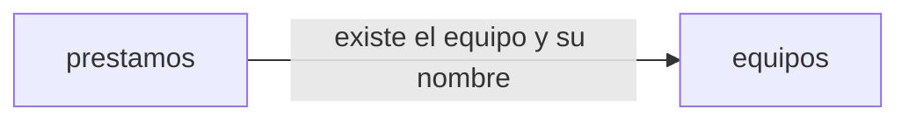

# Arquitectura · Préstamo de equipos de IT

## Resumen

La aplicación gestiona el préstamo de los equipos de la oficina. Se divide en dos contextos:

- **equipos**: el inventario; IT da de alta los equipos con un nombre que no se repite.
- **prestamos**: lo que pasa con cada equipo (solicitudes, entregas, préstamos en el mostrador y devoluciones), la lista de equipos con su estado, los vencidos y el historial.

## Mapa de contextos

## Despliegue

Golden path de la constitución: un servicio de Cloud Run con un módulo por contexto (`src/equipos`, `src/prestamos`), Node.js con TypeScript, React en el cliente, inicio de sesión con Google y Firestore a través del puerto de persistencia `lib/datos.ts`.

## Piezas transversales

- **Inicio de sesión.** Todas las rutas exigen el token de identidad de Google con el correo verificado y emitido para el cliente OAuth de la aplicación (`GOOGLE_CLIENT_ID`); sin él responden 401 «Inicia sesión con Google.». La persona de cada operación es el correo del token.
- **Cuentas de IT.** Son las de la variable de entorno `CORREOS_IT` (correos separados por comas, fijada en la configuración del despliegue), comparadas sin distinguir mayúsculas. Las operaciones solo de IT responden 403 «Solo IT puede hacer esto.» a cualquier otra cuenta. La comprobación es una pieza común que usan los dos contextos.
- **Persistencia.** Cada contexto escribe solo en sus colecciones (`equipos_*`, `prestamos_*`) a través del puerto de persistencia; no hay transacciones que crucen contextos.
- **Contratos primero.** El contrato de cada contexto se escribe y se aprueba antes que el código, y los tipos se generan de él.
- Un cambio de contrato es una tarea propia y en serie.

## Decisiones

- [ADR 0001](../docs/adr/0001-un-prestamo-activo-por-equipo.md): un préstamo activo por equipo, en una transacción, para que un equipo nunca se reserve ni se preste dos veces.
- [ADR 0002](../docs/adr/0002-nombre-de-equipo-unico.md): unicidad del nombre del equipo con un documento por nombre normalizado.
- [ADR 0003](../docs/adr/0003-api-fijada-por-el-cliente.md): los contratos siguen la API fijada por el cliente en la intención de la iniciativa, en lugar de dos convenciones del formato: las rutas no llevan el prefijo `/api/<id>/` (son `/api/equipos…` y `/api/prestamos/vencidos`) y los errores son `{"error": "<mensaje>"}` en `application/json` con el mensaje exacto, no RFC 9457.
- [ADR 0004](../docs/adr/0004-la-lista-de-equipos-la-sirve-prestamos.md): `GET /api/equipos` es del contexto prestamos, para evitar un ciclo entre contextos.

No hay decisiones pendientes.

## Supuestos

- [SUPUESTO] Orden de las comprobaciones de cada operación: primero la sesión (401), luego el permiso de IT (403), luego que el equipo exista (404), luego los datos de la petición (400) y por último el estado del equipo (409). La API del cliente no fija el orden.
- [SUPUESTO] El id de un equipo lo genera la aplicación al darlo de alta, como texto opaco.
- [SUPUESTO] El nombre se guarda sin los espacios de los extremos; un nombre que solo tiene espacios cuenta como vacío.
- [SUPUESTO] En el préstamo en el mostrador, la persona se acepta tal como llega si es un texto no vacío; no se comprueba que sea un correo de la empresa.
- [SUPUESTO] La persona de una solicitud es el correo del token tal como lo da Google.
- [SUPUESTO] Una reserva que IT nunca entrega sigue vigente; no hay caducidad ni anulación en esta fase.
- [SUPUESTO] El historial de un equipo incluye la reserva aún no entregada.
- [SUPUESTO] Las pantallas para empleados e IT usan esta misma API.
