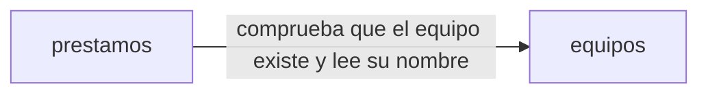

# Arquitectura: Préstamo de equipos de oficina

## Resumen

La aplicación gestiona el préstamo de los equipos de la oficina. Los empleados ven los equipos y su estado y piden uno libre; IT da de alta los equipos, los entrega, los presta en el mostrador, apunta las devoluciones y consulta los vencidos y el historial. El inventario de IT usa la misma API con una cuenta de servicio.

Se divide en dos contextos:

- **equipos**: el inventario; da de alta los equipos y garantiza que sus nombres no se repiten.
- **prestamos**: lo que pasa con cada equipo; guarda las reservas y los préstamos, enseña el estado de los equipos, los vencidos y el historial, y garantiza que un equipo no se reserva ni se presta dos veces a la vez.

## Mapa de contextos

## Despliegue

Sigue el golden path de la constitución: un servicio de Cloud Run con un módulo por contexto (`src/equipos` y `src/prestamos`), sus pantallas en `web/equipos` y `web/prestamos`, inicio de sesión con Google y Firestore a través del puerto de persistencia `lib/datos.ts`.

## Piezas transversales

- **Inicio de sesión.** Cada petición a `/api` lleva un token de identidad de Google con el correo verificado y emitido para el cliente OAuth de la aplicación (de una persona o de una cuenta de servicio); sin él, 401 «Inicia sesión con Google.». La persona de cada operación es el correo del token.
- **Cuentas de IT.** Son los correos de la variable de entorno `CORREOS_IT`, separados por comas, fijada en la configuración del despliegue y no en el código, comparados sin distinguir mayúsculas. Las operaciones de IT responden 403 «Solo IT puede hacer esto.» a cualquier otra cuenta.
- **Hoy.** La fecha de hoy se calcula en la zona horaria Europe/Madrid.
- **Persistencia.** Cada contexto escribe solo en sus colecciones (`equipos_…`, `prestamos_…`) y no hay transacciones entre contextos; `prestamos` lee los equipos por el `index.ts` de `equipos`.
- **Contratos primero.** Cada contrato se escribe y se aprueba antes que el código, y los tipos se generan de él. Un cambio de contrato es una tarea propia y en serie. Además, como dice la constitución, un cambio incompatible lleva su ADR.

## Decisiones

- [ADR 0001](../docs/adr/0001-api-fijada-por-el-cliente.md): los contratos siguen la API fijada por el cliente en `intent.md` en lugar de las convenciones del formato: sin el prefijo `/api/<id>/` en las rutas y con errores `{"error": "<mensaje>"}` en `application/json` en lugar de RFC 9457.
- [ADR 0002](../docs/adr/0002-una-reserva-o-prestamo-activo-por-equipo.md): un préstamo activo por equipo, garantizado con una transacción.
- [ADR 0003](../docs/adr/0003-nombre-de-equipo-unico.md): nombre de equipo único con un índice de nombres en transacción.
- [ADR 0004](../docs/adr/0004-estado-de-los-equipos-en-prestamos.md): el estado de los equipos y su listado están en el contexto de préstamos.

No hay decisiones pendientes.

## Supuestos

- [SUPUESTO] El tipo de equipo (portátil, monitor, proyector) forma parte del nombre y no tiene un campo propio.
- [SUPUESTO] Un préstamo pasa a `devuelto` en el historial cuando IT apunta la devolución.
- [SUPUESTO] Una reserva se mantiene hasta que IT la entrega; no caduca sola.
- [SUPUESTO] No hay límite de días de préstamo ni de préstamos por persona.
- [SUPUESTO] Los equipos solo se dan de alta; no se dan de baja ni se modifican.
- [SUPUESTO] En el préstamo en el mostrador no se comprueba que la persona tenga un correo de la empresa; solo que no falte.
- [SUPUESTO] El historial no distingue un préstamo apuntado por la cuenta de servicio del inventario de uno apuntado por una persona de IT.
- [SUPUESTO] El nombre del equipo se guarda y se devuelve sin los espacios del principio y del final.
- [SUPUESTO] La pantalla de alta de equipos se enseña a cualquiera con sesión, porque el contrato de `equipos` no tiene ninguna lectura reservada a IT; el alta responde 403 a quien no es de IT.
- [SUPUESTO] La carpeta `spec/contextos/ejemplo/` de la plantilla no forma parte de esta especificación: el manifiesto no la cita.
