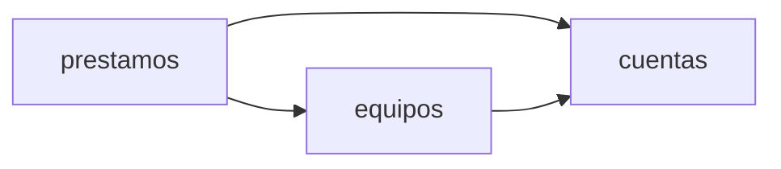

# Arquitectura · Préstamo de equipos de IT

## Resumen

La aplicación gestiona el préstamo de los equipos de la oficina. Los empleados ven los equipos y piden uno libre, e IT da de alta los equipos, los entrega, presta en el mostrador, apunta las devoluciones y revisa los vencidos y el historial. El inventario de IT se conecta por la misma API, que fija el cliente.

Se reparte en tres contextos:

- `cuentas`: la persona de la sesión y si es una cuenta de IT.
- `equipos`: el inventario y la unicidad del nombre.
- `prestamos`: las reservas, los préstamos, las devoluciones, el estado de cada equipo, los vencidos y el historial.

## Mapa de contextos

## Despliegue

Golden path de la constitución: un servicio de Cloud Run con Node.js y TypeScript (Fastify en el servidor, React en el frontend), un módulo por contexto en `src/<id>`, inicio de sesión con Google y Firestore a través del puerto de persistencia `lib/datos.ts`. El cliente OAuth de la aplicación llega en `GOOGLE_CLIENT_ID` y la lista de IT en `CORREOS_IT`, las dos desde la configuración del despliegue.

## Piezas transversales

- **Inicio de sesión:** el servidor verifica en cada petición a `/api` el token de identidad de Google (`lib/auth.ts`) y exige el correo verificado y el cliente OAuth de la aplicación. `cuentas` decide si la persona es de IT.
- **Persistencia:** cada contexto escribe solo en sus colecciones, con su id delante (`equipos_*`, `prestamos_*`), y usa `Almacen.transaccion` para las reglas de concurrencia. No hay transacciones entre contextos.
- **Llamadas entre contextos:** en el mismo proceso, a través del `index.ts` de cada contexto.
- **Contratos primero:** el contrato de cada contexto se escribe y se aprueba antes que el código.
- Un cambio de contrato es una tarea propia y en serie.
- Según la constitución, un cambio incompatible del contrato es además una tarea con ADR.

## Decisiones

- [ADR 0001](../docs/adr/0001-un-prestamo-activo-por-equipo.md): un equipo tiene como mucho un préstamo activo, garantizado con una transacción sobre `prestamos_activos`.
- [ADR 0002](../docs/adr/0002-nombre-de-equipo-unico.md): el nombre de un equipo es único, con un documento por nombre normalizado.
- [ADR 0003](../docs/adr/0003-api-fijada-por-el-cliente.md): los contratos siguen la API fijada por el cliente en `intent.md` en lugar de las convenciones del formato. Sustituye dos convenciones: las rutas no llevan el prefijo `/api/<id del contexto>/` y los errores son `{"error": "<mensaje>"}` en `application/json`, no RFC 9457.
- [ADR 0004](../docs/adr/0004-reparto-de-contextos.md): reparto en tres contextos; `GET /api/equipos` lo sirve `prestamos` para evitar un ciclo.

No hay decisiones pendientes.

## Supuestos

- [SUPUESTO] La aplicación tiene una interfaz web para empleados e IT además de la API, y para mostrar u ocultar las acciones de IT usa `GET /api/cuentas/yo`, una ruta que el cliente no fijó y que sigue las convenciones del formato.
- [SUPUESTO] «Hoy» se calcula con la zona horaria Europe/Madrid en el servidor, sea cual sea la del contenedor.
- [SUPUESTO] El id de un equipo lo genera la aplicación al darlo de alta; el anexo no dice su formato.
- [SUPUESTO] En la lista de equipos, el orden no está fijado; se devuelven por nombre.
- [SUPUESTO] El historial ordena los préstamos por el instante en que se crearon (solicitud o préstamo en el mostrador), del más reciente al más antiguo.
- [SUPUESTO] El préstamo en el mostrador no comprueba que la persona sea un correo con formato válido ni que pertenezca a la empresa; el anexo solo exige que no falte.
- [SUPUESTO] Las peticiones con un cuerpo que no es JSON se tratan como si les faltaran los campos (400 con el mensaje de campo ausente); el anexo no dice nada de ese caso.
