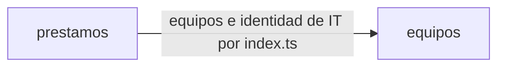

# Arquitectura: préstamo de equipos de oficina

## Resumen

La aplicación gestiona el préstamo de los equipos de la oficina. Los empleados ven los equipos y su estado y piden uno libre con su fecha de devolución; IT da de alta los equipos, entrega los reservados, presta en el mostrador, apunta las devoluciones, ve los préstamos vencidos y consulta el historial de cada equipo. El inventario de IT se conecta por la misma API, que fijó el cliente.

Se divide en dos contextos delimitados:

- **equipos**: qué equipos hay, con su nombre único, y qué cuentas son de IT.
- **prestamos**: lo que pasa con cada equipo (solicitudes, entregas, préstamos en el mostrador y devoluciones), y desde ahí la lista de equipos con su estado, los vencidos y el historial.

## Mapa de contextos

No hay eventos entre contextos.

## Despliegue

El golden path de la constitución: un servicio de Cloud Run con la aplicación de Node.js y TypeScript, un módulo por contexto (`src/equipos`, `src/prestamos`) y sus pantallas de React (`web/equipos`, `web/prestamos`), inicio de sesión con Google y Firestore a través del puerto de persistencia de la plantilla (`lib/datos.ts`).

## Piezas transversales

- **Inicio de sesión.** El servidor de la plantilla (`app/server.ts` y `lib/auth.ts`) verifica en cada petición a `/api/` el token de identidad de Google, con el correo verificado y emitido para el cliente OAuth de la aplicación, y responde 401 «Inicia sesión con Google.» sin él. La persona de cada operación es el correo del token.
- **Cuentas de IT.** La variable de entorno `CORREOS_IT`, con los correos separados por comas, se fija en la configuración del despliegue. El contexto `equipos` la interpreta y ofrece la comprobación a `prestamos` por su `index.ts`.
- **Persistencia.** Cada contexto escribe solo en sus colecciones (`equipos_…` y `prestamos_…`) y solo a través del puerto de persistencia; no hay transacciones que crucen contextos.
- **Hoy.** «Hoy» es el día actual en Madrid (`Europe/Madrid`), calculado en el contexto `prestamos`.
- **Contratos primero.** Cada contrato se escribe y se aprueba antes que el código, y los tipos se generan de él.
- Un cambio de contrato es una tarea propia y en serie.

## Decisiones

- [ADR 0001](../docs/adr/0001-api-fijada-por-el-cliente.md): los contratos siguen la API fijada por el cliente en `intent.md` en lugar de las convenciones del formato: sin el prefijo `/api/<contexto>/` (hay rutas de `prestamos` bajo `/api/equipos/`) y con errores `{"error": "<mensaje>"}` en `application/json` en lugar de RFC 9457.
- [ADR 0002](../docs/adr/0002-un-prestamo-activo-por-equipo.md): un equipo tiene como mucho una reserva o un préstamo activo, garantizado con una transacción sobre un documento por equipo.
- [ADR 0003](../docs/adr/0003-nombre-de-equipo-unico.md): el nombre de un equipo es único, garantizado con una transacción sobre un documento por clave del nombre.
- [ADR 0004](../docs/adr/0004-lista-de-equipos-en-prestamos.md): la lista de equipos con su estado la sirve `prestamos`, y la comprobación de cuentas de IT vive en `equipos`, para no tener ciclos.

No hay decisiones pendientes.

## Supuestos

- [SUPUESTO] El `id` de un equipo lo genera la aplicación al darlo de alta, como texto opaco; la API solo dice `"id": "…"`.
- [SUPUESTO] El historial ordena los préstamos por su momento de creación (`creadoEn`), porque la API no da otro campo para ordenarlos.
- [SUPUESTO] La lista de equipos y la de vencidos con el mismo orden de fecha se desempatan por nombre del equipo; la API no dice cómo.
- [SUPUESTO] La pantalla de alta de equipos la ve cualquier persona con sesión y muestra el 403 «Solo IT puede hacer esto.» a quien no es de IT, porque el contrato de `equipos` no tiene ninguna lectura solo de IT y no se añaden rutas a la API fijada.
- [SUPUESTO] Las pantallas de IT de `prestamos` se ocultan cuando `prestamos.listarVencidos` responde 401 o 403.
- [SUPUESTO] El préstamo en el mostrador no comprueba que `persona` tenga forma de correo: la API solo define el error cuando falta.
