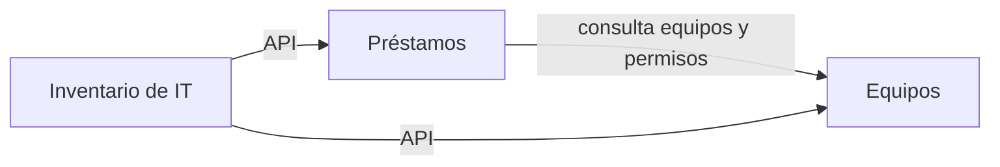

# Arquitectura: préstamo de equipos de la oficina

## Resumen

La aplicación permite a los empleados ver los equipos de la oficina y pedir uno libre, y a IT darlos de alta, entregarlos, prestarlos en el mostrador, apuntar devoluciones, ver los vencidos y el historial. El inventario de IT usa la misma API. Se divide en dos contextos: `equipos`, dueño del inventario, y `prestamos`, que registra lo que les pasa a los equipos y depende de `equipos`.

## Mapa de contextos

## Despliegue

Golden path de la constitución: un servicio de Cloud Run con un módulo por contexto (`src/equipos`, `src/prestamos`) y sus pantallas en `web/equipos` y `web/prestamos`, inicio de sesión con Google y Firestore a través del puerto de persistencia `lib/datos.ts`.

## Piezas transversales

- **Inicio de sesión:** token de identidad de Google, con el correo verificado y emitido para el cliente OAuth de la aplicación, de persona o de cuenta de servicio. Las cuentas de IT son las de la variable de entorno `CORREOS_IT`, separadas por comas y comparadas sin distinguir mayúsculas. La comprobación vive en `equipos` y `prestamos` la usa por su `index.ts`.
- **Persistencia:** Firestore; cada contexto escribe solo en sus colecciones y no hay transacciones entre contextos.
- **Contratos primero:** cada contrato se escribe y se aprueba antes que el código.
- Un cambio de contrato es una tarea propia y en serie.

## Decisiones

- [ADR 0001](../docs/adr/0001-api-fijada-por-el-cliente.md): los contratos siguen la API fijada por el cliente en `intent.md`, por encima de las convenciones del formato: sin el prefijo de rutas `/api/<contexto>/` y con errores `{"error": "<mensaje>"}` en `application/json` en lugar de RFC 9457.
- [ADR 0002](../docs/adr/0002-un-prestamo-activo-por-equipo.md): un equipo tiene como mucho una reserva o un préstamo activo, garantizado con un documento por equipo en una transacción de Firestore.
- [ADR 0003](../docs/adr/0003-nombre-de-equipo-unico.md): el nombre de un equipo es único, con un documento por nombre normalizado en una transacción.

No hay decisiones pendientes.

## Supuestos

- [SUPUESTO] `GET /api/equipos` está en el contrato de `prestamos`, porque necesita el estado de los préstamos; `equipos` no depende de `prestamos`.
- [SUPUESTO] Las pantallas de IT se muestran solo cuando `GET /api/prestamos/vencidos` responde; la API fijada no tiene una operación para saber el rol.
- [SUPUESTO] El historial de un equipo que nunca se ha prestado devuelve 200 con una lista vacía.
- [SUPUESTO] La entrada y la devolución dejan un movimiento en el historial con estado `prestado` o `devuelto`; la solicitud, uno con estado `reservado`.
