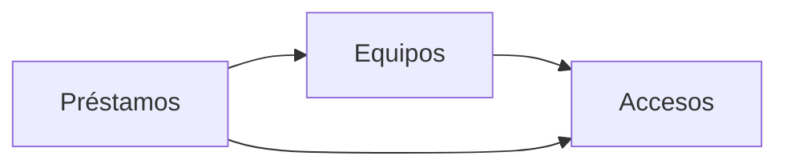

# Arquitectura: Préstamo de equipos de IT

## Resumen

La aplicación gestiona el préstamo de los equipos de la oficina. Los empleados ven los equipos y piden uno libre. IT da de alta los equipos, los entrega, presta en el mostrador, apunta las devoluciones, ve los vencidos y consulta el historial. El inventario de IT se conecta por la API que fijó el cliente.

Se divide en tres contextos:

- `accesos`: identifica la sesión y dice si la cuenta es de IT.
- `equipos`: el catálogo de equipos y su alta.
- `prestamos`: las solicitudes, las entregas, los préstamos, las devoluciones, el estado de cada equipo, los vencidos y el historial.

## Mapa de contextos

Las flechas van del contexto que consume al que ofrece el contrato. No hay eventos entre contextos.

## Despliegue

Golden path de la constitución: un servicio de Cloud Run con un módulo por contexto (`src/accesos`, `src/equipos`, `src/prestamos`), Node.js con TypeScript, inicio de sesión con Google y Firestore a través del puerto de persistencia `lib/datos.ts`. La lista de IT llega al servicio en la variable de entorno `CORREOS_IT`, fijada en la configuración del despliegue.

## Piezas transversales

- **Inicio de sesión:** `lib/auth.ts` verifica el token de identidad de Google (correo verificado y emitido para el cliente OAuth) y el servidor responde 401 «Inicia sesión con Google.» sin token válido. `accesos` añade la comprobación de la lista de IT.
- **Persistencia:** cada contexto escribe solo en sus colecciones, con su id delante (`equipos_…`, `prestamos_…`), y no hay transacciones entre contextos. Entre contextos se llama en proceso a través del `index.ts` de cada uno.
- **Contratos primero:** cada contrato se escribe y se aprueba antes que el código, y los tipos se generan de él.
- Un cambio de contrato es una tarea propia y en serie.
- Como dice la constitución, un cambio incompatible de contrato lleva además su ADR. Con la API fijada por el cliente, cualquier cambio de ruta o de mensaje es incompatible.

## Decisiones

- [ADR 0001](../docs/adr/0001-api-fijada-por-el-cliente.md): los contratos de `equipos` y `prestamos` siguen la API fijada por el cliente de `intent.md`, en lugar de las convenciones del formato. Sustituye dos convenciones: las rutas no llevan el prefijo `/api/<contexto>/`, y los errores son `{"error": "<mensaje>"}` en `application/json` en lugar de RFC 9457. La ruta de sesión de `accesos` usa también ese formato de error.
- [ADR 0002](../docs/adr/0002-un-prestamo-activo-por-equipo.md): un préstamo activo por equipo, con un documento por equipo creado en una transacción.
- [ADR 0003](../docs/adr/0003-nombre-de-equipo-unico.md): el nombre de equipo es único gracias a un documento por nombre normalizado, creado en una transacción.
- [ADR 0004](../docs/adr/0004-estado-del-equipo-en-prestamos.md): el estado del equipo vive en `prestamos`, que responde `GET /api/equipos`.

No hay decisiones pendientes.

## Supuestos

- [SUPUESTO] El contexto `accesos` expone `GET /api/accesos/sesion`, con la persona y si es de IT. La API del cliente no la incluye; se añade para que el frontend sepa qué mostrar.
- [SUPUESTO] Un cuerpo que no es JSON se trata como si faltaran los campos y recibe el 400 de campo ausente de cada operación.
- [SUPUESTO] La `persona` del préstamo en el mostrador se acepta como texto no vacío, sin comprobar el formato de correo.
- [SUPUESTO] Una reserva no caduca sola: sigue hasta que IT entrega el equipo.
- [SUPUESTO] El `id` del equipo lo genera la aplicación.
- [SUPUESTO] Las entradas del historial se ordenan por el momento en que se crearon.
- [SUPUESTO] Un préstamo vencido sigue en la lista de vencidos hasta que IT apunta la devolución.
