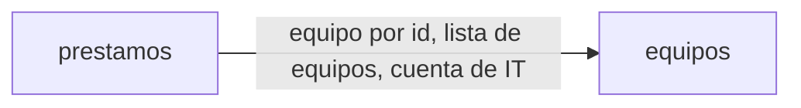

# Arquitectura: préstamo de equipos de oficina

## Resumen

La aplicación gestiona el préstamo de los equipos de la oficina. Los empleados ven los equipos y su estado y piden uno libre; IT da de alta equipos, los entrega, presta en el mostrador, apunta devoluciones y revisa los vencidos y el historial de cada equipo. El inventario de IT usa la misma API con una cuenta de servicio.

Se divide en dos contextos delimitados:

- **equipos**: el inventario (alta de equipos con nombre único) y qué cuentas son de IT.
- **prestamos**: el estado de cada equipo y sus préstamos (solicitud, entrega, préstamo en el mostrador, devolución, vencidos e historial). Depende de `equipos`.

## Mapa de contextos

No hay eventos entre contextos.

## Despliegue

El golden path de la constitución: un servicio de Cloud Run con un módulo por contexto (`src/equipos` y `src/prestamos`), las pantallas en `web/equipos` y `web/prestamos`, inicio de sesión con Google y Firestore a través del puerto de persistencia `lib/datos.ts`. La variable de entorno `CORREOS_IT` se fija en la configuración del despliegue, no en el código.

## Piezas transversales

- **Inicio de sesión.** El servidor de la plantilla verifica en cada ruta `/api/` el token de identidad de Google (correo verificado y emitido para el cliente OAuth de la aplicación) y responde 401 `{"error": "Inicia sesión con Google."}` sin él. La persona de cada operación es el correo del token.
- **Cuentas de IT.** `equipos` lee `CORREOS_IT` y ofrece en su `index.ts` la comprobación de si un correo es de IT, sin distinguir mayúsculas; `prestamos` la usa para sus operaciones «Solo IT».
- **Persistencia.** Cada contexto escribe solo sus colecciones (`equipos_*`, `prestamos_*`) y nunca hay transacciones entre contextos.
- **Contratos primero.** El contrato de cada contexto se escribe y se aprueba antes que el código, y los tipos se generan de él.
- Un cambio de contrato es una tarea propia y en serie. Cambiar un contrato que ya usa otro contexto, una tarea o el inventario de IT nunca se hace dentro de otra tarea, y dos cambios de contrato nunca van a la vez; uno incompatible lleva además su ADR, como dice la constitución.

## Decisiones

- [ADR 0001](../docs/adr/0001-api-fijada-por-el-cliente.md): los contratos siguen la API fijada por el cliente en `intent.md` en lugar de las convenciones del formato. Sustituye dos convenciones: las rutas no llevan el prefijo `/api/<id>/` (son las del cliente, como `/api/equipos/{id}/prestamo` y `/api/prestamos/vencidos`) y los errores son `{"error": "<mensaje>"}` en `application/json`, no RFC 9457.
- [ADR 0002](../docs/adr/0002-nombre-de-equipo-unico.md): el nombre único de equipo se garantiza con un documento por nombre normalizado en una transacción.
- [ADR 0003](../docs/adr/0003-un-equipo-no-se-reserva-ni-se-presta-dos-veces.md): el estado de cada equipo vive en `prestamos` y se cambia en una transacción, que impide reservarlo o prestarlo dos veces a la vez.

Decisiones pendientes: ninguna.

## Supuestos

- [SUPUESTO] El estado del equipo (`estado`, `persona`, `devolucion`) es de `prestamos`, aunque se vea en `GET /api/equipos`; por eso esa ruta está en el contrato de `prestamos` y la de alta en el de `equipos`.
- [SUPUESTO] La comprobación de las cuentas de IT vive en `equipos`, el primer contexto que la necesita, y `prestamos` la usa por su `index.ts`.
- [SUPUESTO] El orden de validación es sesión (401), permisos (403), cuerpo de la petición (400), existencia del equipo (404) y estado (409); el anexo no lo fija.
- [SUPUESTO] Un `id` que no corresponde a ningún equipo, tenga el formato que tenga, responde 404 «No existe el equipo».
- [SUPUESTO] El historial se ordena por el momento en que empezó cada préstamo; un préstamo en el mostrador entra ya como `prestado`, y al apuntar la devolución su entrada pasa a `devuelto`.
- [SUPUESTO] No hay plazo máximo para la fecha de devolución, y el empleado puede poner la fecha de hoy.
- [SUPUESTO] En el mostrador no se comprueba el formato del correo de `persona`: el anexo solo define el error de que falte.
- [SUPUESTO] El alta guarda el nombre sin los espacios del principio y del final; el anexo no dice si se guarda tal cual.
