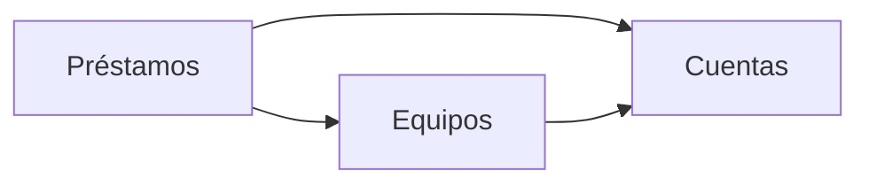

# Arquitectura: Préstamo de equipos de IT

## Resumen

La aplicación lleva el préstamo de los equipos de la oficina. Los empleados ven los equipos con su estado y piden uno libre; IT da de alta los equipos, los entrega, los presta en el mostrador, apunta las devoluciones, ve los vencidos y consulta el historial. El inventario de IT usa la misma API con una cuenta de servicio.

Se divide en tres contextos:

- `cuentas`: identifica la cuenta de cada petición y dice si es de IT.
- `equipos`: guarda los equipos y su nombre único.
- `prestamos`: lleva las reservas, los préstamos, las devoluciones y, con ellos, el estado de cada equipo.

## Mapa de contextos

## Despliegue

El golden path de la constitución: un servicio de Cloud Run con un módulo por contexto (`src/cuentas`, `src/equipos`, `src/prestamos`), Node.js con TypeScript y Fastify en el servidor, React en la interfaz web, inicio de sesión con Google y Firestore a través del puerto de persistencia `lib/datos.ts`. El cliente OAuth (`GOOGLE_CLIENT_ID`) y la lista `CORREOS_IT` llegan como variables de entorno desde la configuración del despliegue (`infra/`).

## Piezas transversales

- **Inicio de sesión:** `lib/auth.ts` verifica el token de identidad de Google (firma, cliente OAuth de la aplicación y correo verificado). El contexto `cuentas` lo usa para dar a los demás la cuenta de la petición y si es de IT.
- **Persistencia:** cada contexto escribe solo en sus colecciones, con el prefijo de su id (`equipos_…`, `prestamos_…`), y solo a través de `lib/datos.ts`. Las transacciones usan `Almacen.transaccion` y nunca cruzan contextos.
- **Llamadas entre contextos:** en el mismo proceso, a través del `index.ts` de cada contexto, con los tipos generados de su contrato.
- **Zona horaria:** «hoy» es el día en Europe/Madrid, calculado en un único sitio del contexto `prestamos`.
- **Contratos primero:** el contrato de cada contexto se escribe y se aprueba antes que el código.
- Un cambio de contrato es una tarea propia y en serie.

Esta frase va junto a la regla de la constitución: cambiar un contrato de forma incompatible es una tarea propia, en serie y con ADR.

## Decisiones

- [ADR 0001](../docs/adr/0001-un-prestamo-activo-por-equipo.md): un equipo tiene como mucho una reserva o un préstamo activo, garantizado con un documento por equipo creado en transacción.
- [ADR 0002](../docs/adr/0002-nombre-de-equipo-unico.md): el nombre de un equipo no se repite, con un documento por nombre normalizado.
- [ADR 0003](../docs/adr/0003-api-fijada-por-el-cliente.md): los contratos siguen la API fijada por el cliente en `intent.md` en lugar de las convenciones del formato. Sustituye el prefijo de ruta `/api/<contexto>/` por las rutas exactas del cliente y el formato de error RFC 9457 (`application/problem+json`) por `{"error": "<mensaje>"}` en `application/json`.
- [ADR 0004](../docs/adr/0004-reparto-de-contextos.md): `POST /api/equipos` está en `equipos` y `GET /api/equipos` en `prestamos`.

No hay decisiones pendientes.

## Supuestos

- [SUPUESTO] La operación `GET /api/cuentas/yo` del contexto `cuentas` no está en la API del cliente: la interfaz web la necesita para saber si la sesión es de IT y mostrar sus pantallas. Sigue las convenciones de ruta y el formato de error del cliente.
- [SUPUESTO] «Hoy» se calcula en la zona horaria Europe/Madrid.
- [SUPUESTO] El id de un equipo lo genera la aplicación al darlo de alta.
- [SUPUESTO] Un nombre que no es un texto responde como un nombre que falta: 400 «Falta el nombre del equipo».
- [SUPUESTO] Una `persona` o una `devolucion` vacías en el préstamo en el mostrador cuentan como que faltan.
- [SUPUESTO] El historial de un equipo sin préstamos es una lista vacía, y la lista de equipos sin equipos también.
- [SUPUESTO] Dos préstamos vencidos con la misma fecha de devolución se ordenan por nombre del equipo.
