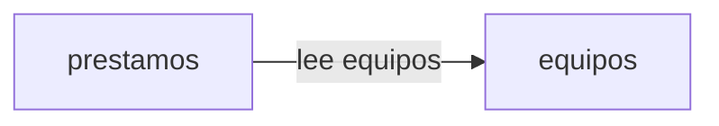

# Arquitectura: préstamo de equipos de la oficina

## Resumen

La aplicación permite a los empleados ver los equipos de la oficina y pedirlos prestados, y a IT darlos de alta, entregarlos, prestarlos en el mostrador, apuntar las devoluciones y revisar los vencidos y el historial. El inventario de IT se conecta a la misma API. Se divide en dos contextos: `equipos`, que mantiene el inventario, y `prestamos`, que lleva el estado de cada equipo y sus préstamos.

## Mapa de contextos

## Despliegue

Golden path de la constitución: un servicio de Cloud Run con un módulo por contexto (`src/equipos`, `src/prestamos`), pantallas en `web/equipos` y `web/prestamos`, inicio de sesión con Google y Firestore a través del puerto de persistencia `lib/datos.ts`.

## Piezas transversales

- **Inicio de sesión:** token de identidad de Google con el correo verificado, emitido para el cliente OAuth de la aplicación, de una persona o de una cuenta de servicio. Sin token válido, 401 «Inicia sesión con Google.».
- **Cuentas de IT:** los correos de la variable de entorno `CORREOS_IT`, separados por comas, comparados sin distinguir mayúsculas; se fija en la configuración del despliegue, no en el código.
- **Persistencia:** cada contexto escribe solo en sus colecciones; `prestamos` lee los equipos con el `index.ts` de `equipos`.
- **Contratos primero:** el contrato se escribe y se aprueba antes que el código. Un cambio de contrato es una tarea propia y en serie.

## Decisiones

- [ADR 0001](../docs/adr/0001-api-fijada-por-el-cliente.md): los contratos siguen la API fijada por el cliente en `intent.md`, por encima de las convenciones del formato: sin el prefijo `/api/<contexto>/` en las rutas (por ejemplo, `GET /api/equipos` está en `prestamos`) y con errores `{"error": "<mensaje>"}` en `application/json` en lugar de RFC 9457.
- [ADR 0002](../docs/adr/0002-un-equipo-no-se-reserva-ni-presta-dos-veces.md): un equipo no se reserva ni se presta dos veces gracias a una transacción de Firestore sobre su estado.
- [ADR 0003](../docs/adr/0003-nombre-de-equipo-unico.md): el nombre único se garantiza con un documento índice por nombre normalizado.

Sin decisiones pendientes.

## Supuestos

- [SUPUESTO] El estado de cada equipo vive en `prestamos` y no en `equipos`, para no crear un ciclo entre los dos contextos; un equipo sin documento de estado está disponible.
- [SUPUESTO] Cuando una petición tiene varios errores a la vez, se comprueban en este orden: sesión (401), permiso (403), datos de la petición (400), existencia del equipo (404) y estado (409).
- [SUPUESTO] La persona del préstamo en el mostrador se acepta tal como llega; solo responde 400 si falta.
- [SUPUESTO] Una reserva que IT no entrega no caduca.
- [SUPUESTO] Los ejemplos del anexo usan la fecha 2026-11-20; no se tocan aunque ya hayan pasado.
