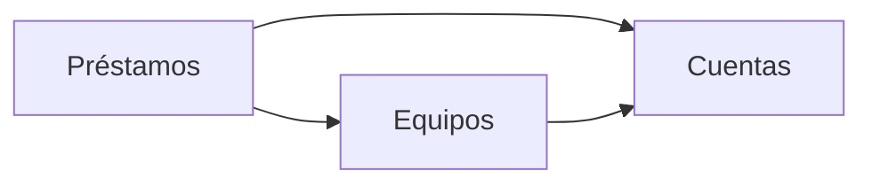

# Arquitectura: Préstamo de equipos de IT

## Resumen

La aplicación permite a los empleados ver los equipos de IT y pedir uno libre, y a IT darlos de alta, entregarlos, prestarlos en el mostrador, apuntar las devoluciones, ver los vencidos y consultar el historial. El inventario de IT se conecta a la misma API. Se divide en tres contextos:

- `cuentas`: quién ha iniciado sesión y si es una cuenta de IT.
- `equipos`: el alta de los equipos, con su nombre único.
- `prestamos`: las reservas, los préstamos y las devoluciones, y con ellos la lista de equipos con su estado, los vencidos y el historial.

## Mapa de contextos

Las flechas van del contexto que consume al que ofrece. No hay eventos entre contextos.

## Despliegue

El golden path de la constitución: un servicio de Cloud Run con Node.js y TypeScript, el frontend en React, inicio de sesión con Google y Firestore. Cada contexto es un módulo en `src/<id>` y se registra en `app/contextos.ts`. Los datos se guardan solo a través del puerto de persistencia `lib/datos.ts`. La lista `CORREOS_IT` y el cliente OAuth vienen de la configuración del despliegue (`infra/`), nunca del código.

## Piezas transversales

- **Inicio de sesión.** La plantilla verifica el token de identidad de Google en todas las rutas de `/api` y responde 401 con `{"error": "Inicia sesión con Google."}` sin él. Es lo que hace `app/server.ts`.
- **Cuentas de IT.** Los contextos preguntan a `cuentas` si la persona es de IT. Nunca leen `CORREOS_IT` por su cuenta.
- **Persistencia.** Cada contexto escribe solo en sus colecciones, con su id delante (`equipos_…`, `prestamos_…`). Las reglas de concurrencia usan `Almacen.transaccion`, y ninguna transacción cruza contextos.
- **Contratos primero.** El contrato de cada contexto se escribe y se aprueba antes que el código, y los tipos se generan de él.
- Un cambio de contrato es una tarea propia y en serie.

## Decisiones

- [ADR 0001](../docs/adr/0001-un-prestamo-activo-por-equipo.md): un equipo tiene como mucho un préstamo activo, garantizado con un documento por equipo dentro de una transacción.
- [ADR 0002](../docs/adr/0002-nombre-de-equipo-unico.md): el nombre de un equipo es único, con un documento por nombre normalizado dentro de una transacción.
- [ADR 0003](../docs/adr/0003-api-fijada-por-el-cliente.md): los contratos de `equipos` y `prestamos` siguen la API fijada por el cliente en `intent.md`, por encima de dos convenciones del formato:
  - Sus rutas no llevan el prefijo `/api/<id>/`: son `/api/equipos…` y `/api/prestamos/vencidos`, como las escribe el cliente.
  - Los errores son `{"error": "<mensaje>"}` en `application/json`, no RFC 9457. La ruta propia de `cuentas` usa el mismo formato de error.
- [ADR 0004](../docs/adr/0004-reparto-de-contextos.md): el reparto en `cuentas`, `equipos` y `prestamos`. `prestamos` sirve la lista de equipos para no crear un ciclo.

No quedan decisiones pendientes.

## Supuestos

- [SUPUESTO] La ruta `GET /api/cuentas/yo` no está en la API del cliente. La interfaz la usa para saber si muestra las acciones de IT, y sigue la convención `/api/<id>/`.
- [SUPUESTO] El orden en que se comprueba una petición es:
  1. el inicio de sesión (401);
  2. la cuenta de IT (403);
  3. los campos del cuerpo (400);
  4. que el equipo exista (404);
  5. el estado del equipo (409).
- [SUPUESTO] La lista de equipos se devuelve ordenada por nombre. La API del cliente no fija el orden.
- [SUPUESTO] Los vencidos con la misma fecha de devolución se ordenan por nombre del equipo.
- [SUPUESTO] El historial se ordena por el momento en que se creó cada préstamo, del más reciente al más antiguo.
- [SUPUESTO] Una fecha que no sigue el formato `AAAA-MM-DD`, como «20/11/2026», responde 400 «La fecha de devolución no es válida».
- [SUPUESTO] El id de cada equipo lo genera la aplicación como un identificador aleatorio.
- [SUPUESTO] Al prestar en el mostrador, la persona se guarda tal como la escribe IT, sin comprobar que sea un correo de la empresa.
- [SUPUESTO] Hay interfaz web para empleados e IT además de la API. Si al final solo hay API, se quitan las tareas de interfaz.
