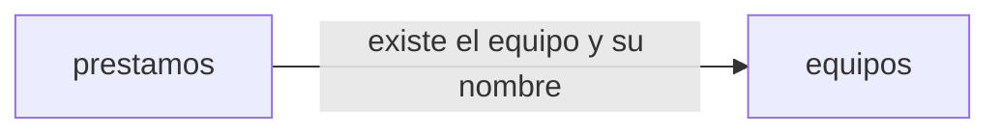

# Arquitectura: préstamo de equipos de la oficina

## Resumen

La aplicación gestiona el préstamo de los equipos de la oficina: los empleados ven qué equipos hay y su estado y piden los disponibles; IT da de alta equipos, entrega los reservados, presta en el mostrador, apunta las devoluciones y consulta los vencidos y el historial. El inventario de IT se conecta a la misma API.

Se divide en dos contextos delimitados:

- **equipos**: qué equipos existen y su nombre, que no se repite.
- **prestamos**: lo que les pasa a los equipos (reservas, préstamos, devoluciones), la lista de equipos con su estado, los vencidos y el historial.

## Mapa de contextos

No hay eventos entre contextos.

## Despliegue

El golden path de la constitución: un servicio de Cloud Run con Node.js y TypeScript, un módulo por contexto (`src/equipos`, `src/prestamos`), interfaz web en React, inicio de sesión con Google y Firestore a través del puerto de persistencia `lib/datos.ts`. Cada contexto escribe solo en sus colecciones, con su id delante.

## Piezas transversales

- **Inicio de sesión.** Todas las rutas exigen el token de identidad de Google con el correo verificado, emitido para el cliente OAuth de la aplicación (`GOOGLE_CLIENT_ID`), de una persona o de una cuenta de servicio. La persona de cada operación es el correo del token. Sin token válido: 401 «Inicia sesión con Google.».
- **Cuentas de IT.** Las de la variable de entorno `CORREOS_IT`, con los correos separados por comas, fijada en la configuración del despliegue y no en el código; dos correos son el mismo aunque cambien las mayúsculas. Las operaciones de IT responden 403 «Solo IT puede hacer esto.» a las demás cuentas.
- **Hoy.** El día actual en Madrid, para validar las fechas de devolución y calcular los vencidos.
- **Persistencia.** Solo con el puerto `lib/datos.ts`; las transiciones de estado de un equipo van en transacciones.
- **Contratos primero.** El contrato de cada contexto se escribe y se aprueba antes que el código, y los tipos se generan de él.
- Un cambio de contrato es una tarea propia y en serie.

## Decisiones

- [ADR 0001](../docs/adr/0001-api-fijada-por-el-cliente.md): los contratos siguen la API fijada por el cliente en `intent.md`, en lugar de las convenciones del formato: las rutas no llevan el prefijo `/api/<contexto>/` y los errores son `{"error": "<mensaje>"}` en `application/json`, no RFC 9457.
- [ADR 0002](../docs/adr/0002-una-reserva-o-prestamo-activo-por-equipo.md): un equipo tiene como mucho una reserva o un préstamo activo, garantizado con una transacción sobre su estado.
- [ADR 0003](../docs/adr/0003-nombre-de-equipo-unico.md): el nombre de un equipo es único, garantizado con un índice de nombres normalizados en una transacción.
- [ADR 0004](../docs/adr/0004-la-lista-de-equipos-la-sirve-prestamos.md): la lista de equipos con su estado la sirve `prestamos`, para no crear un ciclo de dependencias.

No hay decisiones pendientes.

## Supuestos

- [SUPUESTO] El id de un equipo lo genera la aplicación; la API fijada solo dice que es un texto.
- [SUPUESTO] El historial se ordena por el momento en que se creó cada préstamo, que se guarda con él y no sale en la API.
- [SUPUESTO] Una reserva que nadie recoge no caduca ni se libera en esta versión: la API fijada no tiene operación para ello.
- [SUPUESTO] Un equipo dado de alta no se borra: la API fijada no tiene operación de baja, así que `prestamos` puede comprobar que existe fuera de su transacción.
- [SUPUESTO] El contexto de ejemplo de la plantilla (`spec/contextos/ejemplo/` y `src/ejemplo`) no forma parte de esta especificación y se retira al construir los contextos de la aplicación.
