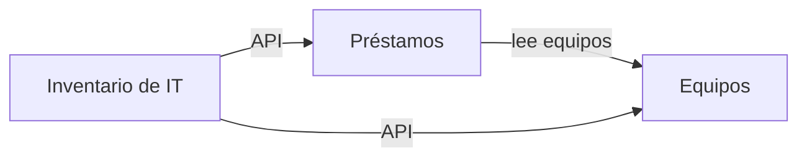

# Arquitectura: préstamo de equipos de oficina

## Resumen

La aplicación gestiona el préstamo de los equipos de la oficina. Los empleados ven qué equipos hay y en qué estado, y piden uno disponible con su fecha de devolución. IT da de alta los equipos, entrega los reservados, presta en el mostrador, apunta las devoluciones, revisa los préstamos vencidos y consulta el historial de cada equipo. El inventario de IT usa la misma API con una cuenta de servicio.

Se divide en dos contextos:

- **equipos**: el inventario de equipos y su nombre único.
- **prestamos**: el estado de cada equipo, sus préstamos y la regla de no reservar ni prestar dos veces el mismo equipo. Depende de `equipos`.

## Mapa de contextos

## Despliegue

El golden path de la constitución: un servicio de Cloud Run con un módulo por contexto (`src/equipos`, `src/prestamos`), pantallas en React (`web/equipos`, `web/prestamos`), inicio de sesión con Google y Firestore a través del puerto de persistencia `lib/datos.ts`.

## Piezas transversales

- **Inicio de sesión.** Cada petición a `/api` lleva el token de identidad de Google en `Authorization: Bearer`. Vale el de una persona o el de una cuenta de servicio, con el correo verificado y emitido para el cliente OAuth de la aplicación (`GOOGLE_CLIENT_ID`). Sin un token válido, la respuesta es 401 `{"error": "Inicia sesión con Google."}`.
- **Cuentas de IT.** Son los correos de la variable de entorno `CORREOS_IT`, separados por comas y fijados en la configuración del despliegue, no en el código. Se comparan sin distinguir mayúsculas. Las operaciones de IT responden 403 `{"error": "Solo IT puede hacer esto."}` a cualquier otra cuenta.
- **Persistencia.** Cada contexto guarda sus datos en sus colecciones, con su id delante, a través del puerto de persistencia; las reglas de concurrencia usan sus transacciones.
- **Hoy.** Las comparaciones de fechas usan el día actual en Madrid.
- **Contratos primero.** Cada contrato se escribe y se aprueba antes que el código, y los tipos se generan de él. Un cambio de contrato es una tarea propia y en serie. Cambiarlo de forma incompatible lleva además su ADR, como pide la constitución.

## Decisiones

- [ADR 0001](../docs/adr/0001-api-fijada-por-el-cliente.md): los contratos siguen la API fijada por el cliente en `intent.md`, por encima de las convenciones del formato. Sustituye dos convenciones: el prefijo de ruta `/api/<contexto>/` (las rutas son las del cliente, como `/api/equipos/{id}/solicitud`) y el formato de error RFC 9457 (los errores son `{"error": "<mensaje>"}` en `application/json`).
- [ADR 0002](../docs/adr/0002-un-prestamo-activo-por-equipo.md): un equipo tiene como mucho un préstamo activo, garantizado con una transacción sobre su documento de préstamo activo.
- [ADR 0003](../docs/adr/0003-nombre-de-equipo-unico.md): el nombre de un equipo es único, con un documento por nombre normalizado creado en una transacción.
- [ADR 0004](../docs/adr/0004-estado-de-los-equipos-en-prestamos.md): el estado de cada equipo lo lleva el contexto de préstamos, que también sirve `GET /api/equipos`.

No hay decisiones pendientes.

## Supuestos

- [SUPUESTO] El id de un equipo lo genera la aplicación al darlo de alta: la API del cliente solo lo muestra como «…».
- [SUPUESTO] Los préstamos vencidos se ordenan por fecha de devolución, de la más antigua a la más reciente.
- [SUPUESTO] El historial se ordena por el momento en que se creó cada préstamo, del más reciente al más antiguo.
- [SUPUESTO] `GET /api/equipos` no tiene filtros ni paginación: la API del cliente no los menciona.
- [SUPUESTO] El préstamo en el mostrador no comprueba que la persona sea una cuenta de la empresa: la API del cliente solo pide que no falte.
- [SUPUESTO] Una reserva que IT no entrega sigue reservada hasta la entrega: la API del cliente no tiene ninguna operación para cancelarla.
- [SUPUESTO] El orden de comprobación de los errores es: sesión (401), cuenta de IT (403), datos de la petición (400), existencia del equipo (404) y estado (409). La API del cliente no fija el orden; es un punto que comprobar con el cliente.
